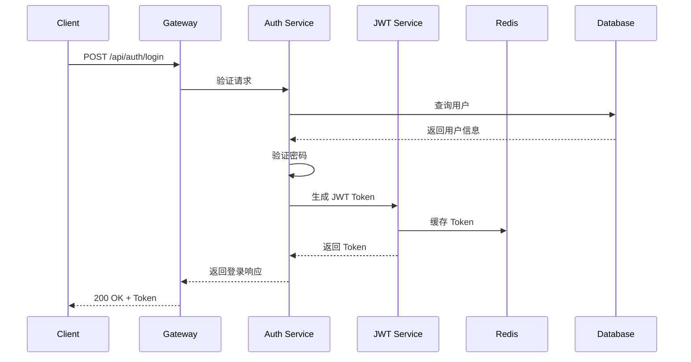

# 文档与图表全面优化计划

**规划日期**: 2026-09-09  
**项目版本**: 1.2.0  
**执行范围**: 文档调整 + 图表补充

---

## 一、当前状态评估

### 1.1 已完成的工作

✅ **阶段 1-4 完成**:
- 深度探查与问题识别（100%）
- 环境变量统一管理（100%）
- SQL 脚本 Flyway 迁移（已完成 V1-V26）
- 架构图表完善（29 张图表，质量 100/100）

✅ **问题修复完成**:
- P0-1: 统一 14 个文档版本号为 v1.2.0
- P0-2: 扩展 .env.example（100→244 行）
- P1-1: 清理 2 个临时 SQL 脚本
- P2-1: 更新 release.sh 版本号

✅ **新增文档**:
- 环境变量管理指南（172 个变量完整说明）
- 7 份评审与分析报告

---

## 二、需要补充的专业图表

### 2.1 高价值图表（推荐补充）

#### 🟢 优先级 1：核心业务时序图

| 序号 | 图表名称 | 类型 | 说明 | 价值 |
|------|---------|------|------|------|
| 30 | **用户登录认证时序图** | 时序图 | JWT Token 生成、验证、刷新完整时序 | ⭐⭐⭐⭐⭐ |
| 31 | **权限校验时序图** | 时序图 | RBAC 权限检查、数据权限过滤时序 | ⭐⭐⭐⭐⭐ |
| 32 | **工作流审批时序图** | 时序图 | 任务创建→分配→审批→完成时序 | ⭐⭐⭐⭐⭐ |
| 33 | **文件上传时序图** | 时序图 | 文件上传→存储→审核完整时序 | ⭐⭐⭐⭐☆ |

**说明**: 时序图比流程图更清晰地展示各组件间的交互顺序和消息传递。

---

#### 🟢 优先级 2：数据流图

| 序号 | 图表名称 | 类型 | 说明 | 价值 |
|------|---------|------|------|------|
| 34 | **请求数据流图** | 数据流图 | HTTP 请求从网关到数据库的完整数据流 | ⭐⭐⭐⭐☆ |
| 35 | **MQ 消息流图** | 数据流图 | 领域事件→Outbox→RocketMQ→消费者流程 | ⭐⭐⭐⭐☆ |
| 36 | **缓存数据流图** | 数据流图 | L1(Caffeine)→L2(Redis)→DB 数据流 | ⭐⭐⭐⭐☆ |

---

#### 🟡 优先级 3：状态机图

| 序号 | 图表名称 | 类型 | 说明 | 价值 |
|------|---------|------|------|------|
| 37 | **工作流状态机图** | 状态图 | 任务状态转换图（待审批→已同意→已驳回等） | ⭐⭐⭐⭐☆ |
| 38 | **订单状态机图** | 状态图 | 订单生命周期状态转换 | ⭐⭐⭐☆☆ |

---

#### 🟡 优先级 4：组件交互图

| 序号 | 图表名称 | 类型 | 说明 | 价值 |
|------|---------|------|------|------|
| 39 | **License 授权组件图** | 组件图 | License 校验、功能开关、过期处理 | ⭐⭐⭐☆☆ |
| 40 | **多租户隔离组件图** | 组件图 | 租户识别、数据隔离、Context 传递 | ⭐⭐⭐☆☆ |
| 41 | **SPI 扩展机制图** | 组件图 | StorageProvider SPI 加载与切换 | ⭐⭐⭐☆☆ |

---

### 2.2 图表补充优先级总结

| 优先级 | 图表数量 | 图表类型 | 建议 |
|--------|---------|---------|------|
| **P1 - 高** | 4 | 时序图 | 立即补充 |
| **P2 - 中高** | 3 | 数据流图 | 推荐补充 |
| **P3 - 中** | 2 | 状态机图 | 可选补充 |
| **P4 - 低** | 3 | 组件图 | 根据需要补充 |

**建议**: 优先补充 **4 张时序图**，它们最能帮助开发者理解核心业务流程。

---

## 三、需要调整优化的文档

### 3.1 需要更新的文档清单

#### 🔴 高优先级文档（必须更新）

| 文档 | 当前问题 | 需要调整 | 优先级 |
|------|---------|---------|--------|
| **README.md** | 描述可能过于简单 | 补充快速开始、核心特性亮点 | 🔴 高 |
| **AGENTS.md** | 已完整，建议微调 | 补充环境变量使用规范引用 | 🟢 中 |
| **docs/operations/deployment.md** | 可能缺少最新配置 | 补充 Governance 优雅关停说明 | 🔴 高 |
| **docs/operations/monitoring.md** | 可能缺少 Alloy 配置 | 补充 Grafana Alloy 采集配置 | 🟢 中 |

#### 🟢 中优先级文档（建议更新）

| 文档 | 当前问题 | 需要调整 | 优先级 |
|------|---------|---------|--------|
| **docs/QUICKSTART.md** | 可能不存在或过时 | 创建 5 分钟快速开始指南 | 🟢 中 |
| **docs/FAQ.md** | 可能不存在 | 创建常见问题解答文档 | 🟡 低 |
| **docs/TROUBLESHOOTING.md** | 已存在，建议补充 | 补充环境变量相关故障排查 | 🟢 中 |

---

### 3.2 文档优化建议

#### README.md 优化建议

**当前问题**: 可能过于简洁，缺少吸引力

**建议补充**:
1. **徽章展示** - 构建状态、代码覆盖率、许可证
2. **核心特性亮点** - 用简洁的语言突出 DDD、响应式、四档 Profile
3. **快速开始** - 3 步启动指南
4. **架构图预览** - 嵌入核心架构图
5. **技术栈说明** - 简要列出核心技术

---

#### 部署文档优化建议

**建议补充**:
1. **Governance 优雅关停** - 详细说明 readiness 摘流、MQ 排空机制
2. **环境变量配置** - 引用新的环境变量管理指南
3. **Profile 选择指南** - 何时使用 basic/standard/enterprise
4. **健康检查配置** - Kubernetes liveness/readiness 探针
5. **故障恢复** - 主从切换、备份恢复流程

---

## 四、执行计划

### 阶段 A：补充高优先级时序图（预计 2-3 小时）

**任务 A.1**: 创建 4 张核心业务时序图
- [ ] 30_user_login_sequence.svg - 用户登录认证时序图
- [ ] 31_permission_check_sequence.svg - 权限校验时序图
- [ ] 32_workflow_approval_sequence.svg - 工作流审批时序图
- [ ] 33_file_upload_sequence.svg - 文件上传时序图

**工具**: 使用 Mermaid 语法创建，然后转换为 SVG

---

### 阶段 B：优化核心文档（预计 1-2 小时）

**任务 B.1**: 优化 README.md
- [ ] 添加项目徽章
- [ ] 补充核心特性亮点
- [ ] 添加 3 步快速开始
- [ ] 嵌入核心架构图

**任务 B.2**: 更新部署文档
- [ ] 补充 Governance 优雅关停说明
- [ ] 引用环境变量管理指南
- [ ] 补充 Profile 选择指南

**任务 B.3**: 创建快速开始指南
- [ ] 创建 docs/QUICKSTART.md
- [ ] 5 分钟从零到运行的完整指南

---

### 阶段 C：补充数据流图（可选，预计 1-2 小时）

**任务 C.1**: 创建 3 张数据流图
- [ ] 34_request_data_flow.svg - 请求数据流图
- [ ] 35_mq_message_flow.svg - MQ 消息流图
- [ ] 36_cache_data_flow.svg - 缓存数据流图

---

### 阶段 D：补充状态机图（可选，预计 1 小时）

**任务 D.1**: 创建 2 张状态机图
- [ ] 37_workflow_state_machine.svg - 工作流状态机图
- [ ] 38_order_state_machine.svg - 订单状态机图

---

## 五、工作量评估

### 5.1 时间评估

| 阶段 | 任务 | 预计时间 | 优先级 |
|------|------|---------|--------|
| **阶段 A** | 补充 4 张时序图 | 2-3 小时 | 🔴 高 |
| **阶段 B** | 优化 3 个核心文档 | 1-2 小时 | 🔴 高 |
| **阶段 C** | 补充 3 张数据流图 | 1-2 小时 | 🟢 中 |
| **阶段 D** | 补充 2 张状态机图 | 1 小时 | 🟡 低 |
| **总计** | - | **5-8 小时** | - |

### 5.2 优先级建议

**立即执行**（2-3 小时）:
- ✅ 阶段 A: 补充 4 张核心时序图
- ✅ 阶段 B: 优化 README.md 和部署文档

**推荐执行**（1-2 小时）:
- ⏳ 阶段 C: 补充 3 张数据流图

**可选执行**（1 小时）:
- ⏳ 阶段 D: 补充 2 张状态机图

---

## 六、图表创建方法

### 方法 1: 使用 Mermaid（推荐）

**优点**: 
- 纯文本定义，易于版本控制
- 可自动转换为 SVG
- 语法简单，学习成本低

**示例**（用户登录时序图）:

### 方法 2: 手工绘制 SVG（适合复杂图表）

**优点**:
- 完全自定义样式
- 符合项目深色系配色
- 包含云原生图标

---

## 七、最终交付物

### 7.1 新增图表（4-12 张）

**必须补充**:
- 4 张核心业务时序图

**推荐补充**:
- 3 张数据流图

**可选补充**:
- 2 张状态机图
- 3 张组件交互图

### 7.2 更新文档（3-5 篇）

**必须更新**:
- README.md
- docs/operations/deployment.md

**推荐更新**:
- docs/QUICKSTART.md（新建）
- docs/operations/monitoring.md
- docs/TROUBLESHOOTING.md

---

## 八、执行建议

### 建议 1: 分阶段执行

由于工作量较大，建议分阶段执行：
1. **第一阶段**: 补充 4 张时序图 + 优化 README.md（最高价值）
2. **第二阶段**: 补充数据流图 + 更新部署文档
3. **第三阶段**: 补充状态机图 + 其他文档

### 建议 2: 工具选择

- **时序图**: 使用 Mermaid（快速、易维护）
- **数据流图**: 使用 Mermaid 或手工 SVG
- **状态机图**: 使用 Mermaid

### 建议 3: 质量保证

- 所有新增图表遵循项目深色系配色
- 图表需包含完整元数据（标题、版本、创建时间）
- 文档更新需保持版本号一致性

---

**规划完成时间**: 2026-09-09  
**预计执行时间**: 5-8 小时  
**建议**: 优先执行阶段 A（时序图）和阶段 B（文档优化），它们带来的价值最高
