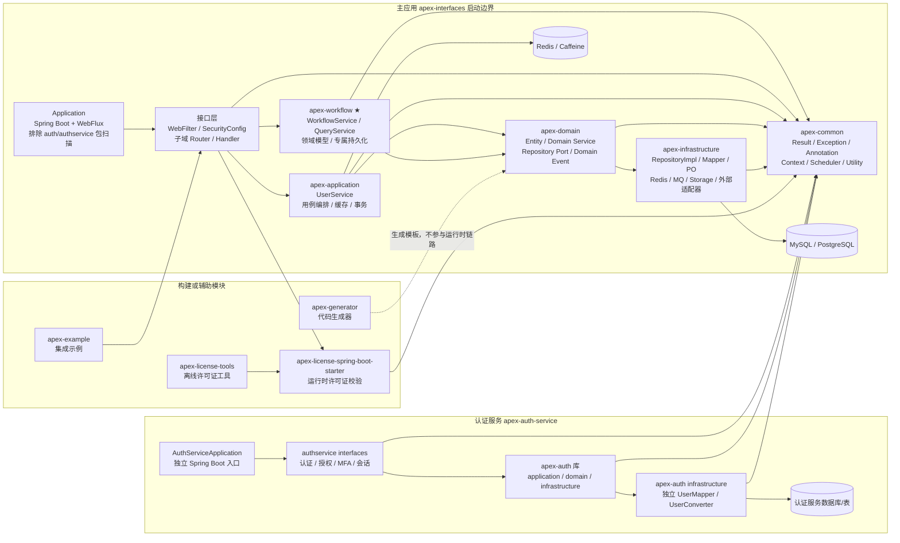
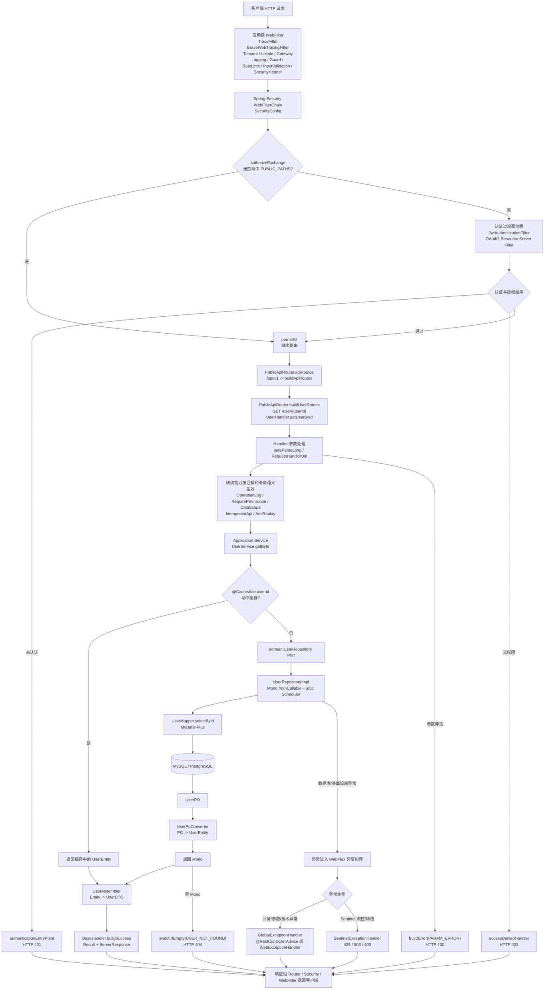
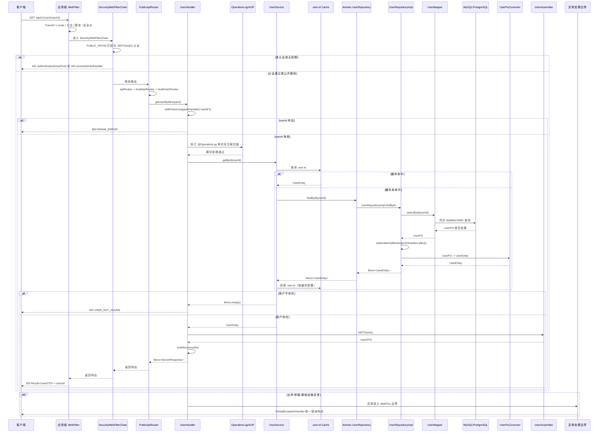

# AGENTS.md — Apex Scaffold

本文件定义本仓库的编码、验证和提交约定。修改前先检查实际代码和配置，遵循现有模式；不要为了满足规则进行无关重构。

## 当前 system 物理边界（2026-10-12）

`apex-system` 已承接原 interfaces/application 的源码、资源和测试，以及 system 专属 domain/infrastructure 实体、仓储、Mapper/PO、适配器与测试，保持原 Java 包名。`apex-interfaces`、`apex-application` 已退出 reactor 和依赖版本声明；`apex-system-service` 装配 system 库，example 依赖 system，auth-service 仅在 test scope 引用 system 进行 parity 验证。

共享 `apex-domain` 只保留 BaseEntity、Token/SMS/Cache/Event/远程调用等通用契约与 TokenRevokedEvent；共享 `apex-infrastructure` 保留缓存、消息、事件 Outbox、审计、加密、邮件、通用持久化配置与受管 HTTP 客户端。共享模块不得依赖 system；system 业务实体不得下沉 common 或 api-contract。HTTP 日志使用共享 ApiCallObservation/ApiCallLogSink，system 持久化实现负责映射 ApiCallLogEntity。

本批按旧路径删除与 system 对应路径存在交叉统计，迁入 application 281、domain 180、infrastructure 222 个文件，共 683 个（main 560、test 123，含资源，不含前批 interfaces）。共享层和兄弟服务 801 个生产 Java 文件未发现直接导入 system 类型；实际门禁结果见验收清单的本批记录。

当前物理依赖为 `system-service → system → infrastructure → domain → common`；其他服务通过各自业务库复用共享设施。system 库内部继续遵守 domain/application/infrastructure/interfaces 的 Java 包分层。下文原单体结构和图示保留为迁移背景，以本节及根 POM 为当前物理边界。

## 项目结构（原单体分层背景）

Apex Scaffold 是 Java 17、Spring Boot 3.5.15、Spring WebFlux 的多模块项目。

- **Java 版本**：由 `.sdkmanrc` 指定（当前 `17.0.12-oracle`），使用 SDKMAN 管理，禁止手动修改 `JAVA_HOME` 或使用其他 JDK 版本。
- **构建工具**：使用 Maven Daemon（mvnd）而非 Maven（mvn），版本由 `.sdkmanrc` 指定（当前 `2.0.0-rc-3`），所有构建命令必须使用 `mvnd`。
- **构建环境**：优先通过 SDKMAN 加载 `.sdkmanrc` 中的 Java 和 `mvnd` 版本；仓库中需要准备构建环境的脚本使用 `scripts/build/init-build-env.sh`。
- **禁止回退**：不得在实际构建、测试、打包、依赖解析或发布脚本中调用 `mvn`；未找到 `mvnd` 时应直接失败并提示安装 SDKMAN 版本，不得回退到系统 Maven。
- **项目版本与依赖**：以根 [pom.xml](pom.xml) 为准。

根 POM 当前包含以下模块（以根 [pom.xml](pom.xml) 中 `<modules>` 顺序为准）：

- `apex-common`：公共基础模块，提供统一响应体、异常体系、注解、常量、上下文（租户、用户、请求）、工具类和调度器基础设施。所有业务模块均可依赖。
- `apex-license-spring-boot-starter`：授权校验 Spring Boot Starter，提供运行时许可证校验能力，被 `apex-interfaces` 依赖。
- `apex-license-tools`：授权生成与管理工具，依赖 `apex-license-spring-boot-starter`，用于离线生成和签发许可证。
- `apex-domain`：领域层，包含聚合根、实体、值对象、领域服务、领域事件和仓储接口（Port）。只依赖 `apex-common`，不得依赖任何上层模块。
- `apex-infrastructure`：基础设施层，实现领域层定义的仓储接口，包含 MyBatis-Plus Mapper/PO、Redis/Caffeine 缓存、RocketMQ 消息、MinIO/TOS 存储、外部服务适配器（Office、Keycloak、KMS 等）。依赖 `apex-domain` 和 `apex-common`。
- `apex-application`：应用层，用例编排、应用服务、事务边界、DTO/Assembler 转换、事件监听和定时任务调度。依赖 `apex-domain`、`apex-common` 和 `apex-infrastructure`。
- `apex-workflow`：工作流独立模块，遵循与主应用一致的 DDD 分层，内部包含 `application`（服务/查询/调度/DTO）、`domain`（领域模型/仓储契约）和 `infrastructure`（专属持久化）三层。依赖 `apex-domain` 和 `apex-common`，不依赖 `apex-infrastructure`；对外由 `apex-interfaces` 通过 `apex-workflow` 依赖引用其应用服务。
- `apex-interfaces`：接口层，WebFlux 函数式 Router + Handler、安全过滤器链、AOP 切面（权限、审计、幂等、防重放、数据权限等）、配置类、OpenAPI 文档、i18n 资源、Flyway 迁移脚本和主启动入口 `Application.java`。依赖 `apex-application`、`apex-workflow`、`apex-infrastructure`、`apex-domain` 和 `apex-license-spring-boot-starter`。
- `apex-auth`：认证领域/应用库模块（Phase 6 库模块），承载认证、授权、MFA/TOTP、JWT 密钥轮换、会话管理、审计日志、KMS 集成、IP 访问控制、设备信任、生物识别、暴力破解防护等能力的 application/domain/infrastructure 三层，并保留共享配置 `OAuth2Properties`。依赖 `apex-common`、`apex-infrastructure`、`apex-domain` 和 `apex-api-contract`，不含 `interfaces`、启动类与 Flyway 资源。
- `apex-example`：示例模块，演示完整 DDD + WebFlux 链路的集成用法，依赖 `apex-interfaces` 及其下层所有模块。
- `apex-generator`：独立的 DDD 代码生成器，不依赖其他业务模块，根据数据库表结构生成 entity/mapper/po 等模板代码。

微服务化改造模块（详见 [docs/microservice-migration-plan.md](docs/microservice-migration-plan.md)）：

- `apex-services-bom`：微服务依赖版本 BOM，统一锁定各服务模块与第三方依赖版本（Phase 1.1）。
- `apex-api-contract`：跨服务内部 API 契约模块，提供 Feign 接口与共享 DTO（纯契约，无业务实体），被各服务与网关按需依赖（Phase 1.3）。
- `apex-gateway`：API 网关，统一入口/路由/JWT（JWKS）验签/限流/灰度切流/链路追踪/`/internal` 403 拦截，独立启动（端口 8080，Phase 1.2）。
- `apex-workflow-service`：工作流服务，独立启动类 + Router/Handler，使用独立 `apex_workflow` 库与独立 Flyway 链 V1（Phase 3，端口 8083）。
- `apex-file`：文件模块库，承载文件/文档/图表的领域+应用+基础设施与存储 SPI（Phase 4 库模块）。
- `apex-file-service`：文件服务，独立启动类 + Router/Handler，使用独立 `apex_file` 库与独立 Flyway 链 V1，含分片上传与预览（Phase 4，端口 8085）。
- `apex-auth`：认证模块库，承载认证/授权/MFA/JWT/会话/审计的领域+应用+基础设施三层与共享配置（Phase 6 库模块）。
- `apex-auth-service`：认证服务，独立启动类 + Router/Handler，使用独立 `apex_auth` 库与独立 Flyway 链 V44（Phase 6，端口 8081）。
- `apex-system-service`：系统服务，Strangler 装配 `apex-interfaces`/`apex-application`/`apex-domain`/`apex-infrastructure`/`apex-common`，独立启动类 + 扫描根包 `com.apex.scaffold.systemservice`，使用独立 `apex_system` 库（原 `apex_data`，Phase 6，端口 8082）；网关路由 `lb://apex-system-service`（`ROUTE_SYSTEM_URI` 可一键回滚）。
- `apex-office`：办公模块库，承载办公平台（企微/钉钉/飞书）领域+应用+基础设施与集成适配（Phase 5 库模块）。
- `apex-office-service`：办公服务，独立启动类 + Router/Handler，使用独立 `apex_office` 库与独立 Flyway 链（Phase 5，端口 8084）。

依赖方向保持为：

```text
interfaces ──▶ application ──▶ domain ◀── infrastructure
     │   │          │              │              │
     │   └──▶ workflow ──▶ domain ─┘              │
     │              │                             │
     └──▶ license-spring-boot-starter             │
                    │                             │
              license-tools                       │
                                                  │
auth-service ────────────────────────────────────┘
    │
    └──▶ common ◀── 所有模块按需依赖

workflow ──▶ common（不依赖 infrastructure，共享持久化设施 BasePO/ConditionUtil/ApexLambdaQueryWrapper 位于 common）
```

核心约束：

- `domain` 不得依赖 `application`、`interfaces` 或 `infrastructure`。
- `application` 可依赖 `domain`、`common` 和 `infrastructure`，但不得反向依赖 `interfaces`。
- `workflow` 为独立分层模块，可依赖 `domain` 和 `common`，不得依赖 `infrastructure`（共享持久化设施已下沉至 `common`），也不得被 `domain`/`infrastructure` 反向依赖。
- `interfaces` 是主应用的最上层，依赖 `application`、`workflow`、`infrastructure`、`domain` 和 `license-spring-boot-starter`。
- `apex-auth` 是独立的认证库模块，依赖 `common`、`infrastructure`、`domain` 和 `api-contract`，不依赖主应用的 `application`/`interfaces` 层；`apex-auth-service` 为可启动服务，依赖 `apex-auth` 库并拥有独立的 `interfaces`、配置、启动类与 Flyway 资源。
- `apex-example` 和 `apex-generator` 分别用于示例演示和代码生成，不参与生产依赖链。

微服务化相关约束：

- `apex-services-bom` 仅做依赖版本锁定（`import` 到各服务模块），不承载业务代码。
- `apex-api-contract` 仅含 Feign 接口与共享 DTO，不得引入业务实体或持久化依赖；服务间调用必须经该契约桥接。
- `apex-gateway` / `apex-workflow-service` / `apex-file-service` 为独立可启动服务，各自拥有独立 `bootstrap.yml`、独立启动类与独立 Flyway 迁移链；不得跨服务直接访问对方数据库。
- 已服务化的服务不再被 `apex-interfaces` 反向依赖；单体中对应代码域须清理干净（无残留）。

修改跨层代码时运行已有架构测试（ArchUnit），确保依赖方向不被破坏。

## 核心架构图示

以下图表基于项目真实代码结构绘制，用于辅助理解模块协作和请求处理链路。

### 项目模块与运行边界图

下图按“启动边界、运行时调用链、构建辅助模块”展示项目结构。主应用和认证服务分别由独立启动类装配；主应用通过组件扫描排除 `com.apex.scaffold.auth..*` 与 `com.apex.scaffold.authservice..*`，因此认证服务内部的 `UserMapper`、`UserConverter` 不属于主应用用户查询链。



**图中边界与依赖说明**：

- `Application` 是主应用入口，负责装配 WebFlux、异步任务、配置属性和服务发现；`AuthServiceApplication` 是认证服务的独立入口，二者不是同一个 Spring ApplicationContext。
- 主应用依赖方向为 `interfaces -> application -> domain`，基础设施实现 `domain` 定义的 Repository Port；当前 `application -> infrastructure` 是项目实际存在的直接依赖，不能在文档中简化为纯粹的六边形依赖。
- `apex-workflow` 是独立的 DDD 分层模块，依赖 `domain` 和 `common`，**不依赖 `infrastructure`**；共享持久化设施 `BasePO`、`ConditionUtil`、`ApexLambdaQueryWrapper` 已从 `infrastructure` 下沉至 `common`，从而消除了工作流模块与基础设施模块间的循环依赖。接口层通过 `apex-workflow` 依赖引用其应用服务，对外 HTTP 路由保持不变。
- `apex-common` 提供 `Result`、异常、注解、上下文、工具和 `BlockingIoSchedulers`，不承载具体业务用例。
- 主应用用户查询链使用 `UserService -> domain.UserRepository -> infrastructure.UserRepositoryImpl -> UserMapper/UserPoConverter`；认证中心使用自己的同名仓储、Mapper 和 Converter，不能交叉引用。
- `apex-example` 用于集成示例，`apex-generator` 用于生成模板，二者不是生产请求的必经模块；许可证 Starter 是主应用运行时能力，许可证 Tools 是离线工具。

**模块职责细化**：

- **apex-common**：统一响应体、错误码、业务异常、权限/审计/幂等/防重放/数据权限注解、租户和请求上下文、脱敏和 TraceId 工具，以及按 JDBC、缓存、存储、事件、远程调用和通用任务划分的阻塞 I/O Scheduler。
- **apex-domain**：领域实体、值对象、领域服务、领域事件和 Repository Port。它表达业务规则和抽象边界，不直接实现 MyBatis、Redis 或对象存储访问。
- **apex-infrastructure**：实现 Repository Port，使用 MyBatis-Plus Mapper/PO 访问数据库，并承载 Redis/Caffeine、RocketMQ、MinIO/TOS、Keycloak、KMS 等适配器。同步调用通过语义化 Scheduler 隔离。
- **apex-application**：以 `UserService` 等应用服务编排用例，处理缓存、事务、领域对象组合和 Assembler 转换；它把接口层请求转换为领域调用，再把结果交回接口层。
- **apex-workflow**：独立工作流模块，内部自带 application（服务/查询/调度/DTO）、domain（领域模型/仓储契约）、infrastructure（专属持久化）三层，承载工作流引擎、办公审批集成与监控统计；依赖 `apex-domain` 和 `apex-common`，不依赖 `apex-infrastructure`，由接口层引用其应用服务。
- **apex-interfaces**：由 `Application` 启动，包含 WebFilter、Spring Security、按子域拆分的 Router（`PublicApiRouter` 等 18 个 `@Configuration` 路由类，由原 `ApiRouter` 拆分而来）、Handler、AOP、OpenAPI、异常处理、配置和主应用 Flyway 资源。
- **apex-auth**：认证库模块，承载认证、授权、MFA/TOTP、JWT、会话、审计和风控能力的 application/domain/infrastructure 三层与共享配置，不包含 `interfaces`、启动类与 Flyway 资源。
- **apex-auth-service**：认证服务，独立启动类 + Router/Handler，拥有自己的 `interfaces`、配置与独立 `apex_auth` Flyway 资源。

**运行时装配与数据边界**：

- 主应用从 `Application` 启动，组件扫描覆盖 `com.apex.scaffold`，但通过正则排除 `com.apex.scaffold.auth..*` 与 `com.apex.scaffold.authservice..*`；因此主应用启动时不会把认证服务的 Handler、Service、Mapper 或配置注册到同一个容器中。
- `AuthServiceApplication` 负责认证服务自己的组件装配、配置和迁移资源。认证服务可以与主应用共享 `apex-common` 的基础类型，但运行时数据库、请求入口和用户转换链保持独立。
- 图中的箭头表示模块依赖或运行时调用方向，不表示所有模块都在同一个进程中执行。`apex-example`、`apex-generator` 和 `apex-license-tools` 是构建或辅助用途，不应被理解为生产请求的运行时下游。
- 从数据模型看，`UserPO` 是基础设施持久化模型，`UserEntity` 是应用与领域之间传递的业务模型，`UserDTO` 是接口响应模型。三者分层转换可以避免数据库字段、领域规则和 API 契约相互泄漏。
- 从部署边界看，主应用和认证中心可以独立启动、独立配置和独立演进；需要跨系统调用时，应通过明确的认证协议或远程适配器完成，不能直接引用对方的内部 Mapper 或 Converter。

### 请求业务处理流程图

下图将应用级 WebFilter、Spring Security 内部链、函数式路由、业务调用和三类异常出口分开表示。过滤器的实际先后顺序由 `@Order` 和 Spring Security 的过滤器位置共同决定，不应概括为所有 WebFilter 都先于安全链。



**业务处理阶段说明**：

1. **请求上下文建立**：`TraceFilter` 位于最前端，提取或生成 `X-Trace-Id`，写入交换对象属性、响应头和 Reactor Context，并在结束时清理 MDC。`LocaleWebFilter` 负责语言上下文，日志、指标、限流和安全头过滤器负责横切能力。
2. **安全决策**：`SecurityConfig.securityWebFilterChain` 先处理 `SystemConstants.PUBLIC_PATHS` 的 `permitAll` 规则，再按认证用户路径、管理路径和 `anyExchange().authenticated()` 处理其余请求。JWT 和 OAuth2 过滤器位于 Spring Security 的认证位置；401 由认证入口处理，403 由拒绝访问处理器处理。
3. **函数式路由**：主应用将原单体 `ApiRouter` 按子域拆分为 18 个 `@Configuration` 路由类（如 `PublicApiRouter`、`UserAdminRouter`、`LogRouter` 等）。`/api/v1` 通用路径由 `PublicApiRouter.apiRoutes` 建立，再由 `buildApiRoutes` 分发到 `/auth`、`/user` 等子路由；用户查询 `GET /api/v1/user/{userId}` 仍由 `buildUserRoutes` 注册到 `UserHandler.getUserById`。后台管理路径则独立注册在 `UserAdminRouter` 等子域 Router 中，不再由单一 `ApiRouter` 汇聚。
4. **Handler 与横切能力**：Handler 负责读取路径或请求体、构造响应式链并调用 Application Service。`@OperationLog`、`@RequirePermission`、`@DataScope`、`@IdempotentApi` 和 `@AntiReplay` 是否生效，取决于具体 Handler 方法的实际注解和业务风险；不能把所有注解都强加到每个接口。
5. **应用服务与缓存**：`UserService.getById` 使用 `@Cacheable(value = "user:id")`，缓存命中时可以直接返回用户实体；未命中时才调用领域 Repository。缓存具体由配置的缓存实现承载，文档不应把每次查询固定描述为直接访问数据库。
6. **领域 Port 与基础设施实现**：Application 依赖领域层的 `UserRepository` 接口，运行时由 `UserRepositoryImpl` 实现。该实现调用 `UserMapper.selectById`，并通过 `UserPoConverter` 将 `UserPO` 转换为 `UserEntity`。
7. **阻塞 I/O 隔离**：MyBatis/JDBC 是同步阻塞调用，Repository 使用 `Mono.fromCallable(...).subscribeOn(BlockingIoSchedulers.jdbc())` 将其移出 Netty 事件循环；这表示“响应式封装 + 阻塞线程隔离”，不表示 JDBC 本身是非阻塞的。
8. **结果与异常出口**：成功结果经 `UserAssembler.toDTO` 和 `BaseHandler.buildSuccess` 生成 `Result<T>`。参数错误和空结果由 Handler 构造 400/404；安全 401/403 在 SecurityConfig 内处理；Sentinel 异常由专门处理器处理；普通业务、参数和技术异常才进入 `GlobalExceptionHandler` 的 Advice 或 WebFlux 兜底。

### 用户 ID 查询时序图

以 `GET /api/v1/user/{userId}` 为例，图中同时展示路由注册、认证边界、缓存命中/未命中、领域 Port 与基础设施实现，以及参数错误、用户不存在和异常返回路径。



**时序交互说明**：

1. TraceId 在最前端过滤器生成或接收，并通过 Reactor Context 传播；它不是由 Handler 临时生成的请求标识。
2. 安全链只对 `PUBLIC_PATHS` 精确匹配路径执行 `permitAll`；其他路径最终受认证规则约束。用户查询接口是否需要 Token，以 `SecurityConfig` 的路径规则为准，不以 Handler Javadoc 为准。
3. 用户查询路由实际注册在 `PublicApiRouter.buildUserRoutes`：`GET /api/v1/user/{userId}` 映射到 `UserHandler.getUserById`。
4. Handler 先调用 `safeParseLong`；非法路径参数直接返回 `PARAM_ERROR`，不会访问 Service 或数据库。
5. `UserService.getById` 先经过 `user:id` 缓存抽象；只有缓存未命中才调用 `UserRepository`。
6. `UserRepository` 是领域 Port，`UserRepositoryImpl` 是基础设施实现；主应用使用 `UserPoConverter`，不要与认证中心的 `UserConverter` 混淆。
7. `UserMapper` 继承 MyBatis-Plus `BaseMapper<UserPO>`，`selectById` 是同步数据库调用，使用 `BlockingIoSchedulers.jdbc()` 隔离阻塞线程。
8. 数据库返回空记录时，Repository 返回空 `Mono`，Handler 通过 `switchIfEmpty(buildError(ResultCode.USER_NOT_FOUND, traceId))` 返回 404；成功时经过 `UserPoConverter` 和 `UserAssembler` 完成两次模型转换。
9. 成功响应由 `BaseHandler.buildSuccess` 生成 `Result<UserDTO>` 并交给 `ServerResponse`；响应再沿函数式路由、安全链和应用级过滤器返回客户端。
10. 认证异常、授权异常、Sentinel 限流/降级异常和普通函数式业务异常拥有不同处理器；不能把所有异常都描述为由 `GlobalExceptionHandler` 单一路径处理。

**参与者职责与分支含义**：

- `Filter` 代表一组应用级 WebFilter，而不是单个统一过滤器。它们负责请求上下文、链路追踪、语言、日志、限流、输入防护和响应头等横切能力；其中具体执行顺序由 `@Order` 和过滤器注册方式决定。
- `SecurityWebFilterChain` 负责“请求能否进入业务路由”的安全判断，不负责查询用户业务数据。`PUBLIC_PATHS` 命中时跳过认证要求，但不代表跳过所有应用级过滤器；非公开路径则继续经过 JWT/OAuth2 认证和授权判断。
- `Router`（如 `PublicApiRouter` 等子域路由类）只负责把 HTTP 方法和路径映射到 Handler。它不执行 `UserService` 查询，也不负责把 `UserPO` 转换成 `UserDTO`；这些职责分别属于 Handler/Application Service 和 Converter/Assembler。
- `UserHandler` 是接口适配层。它负责从 `ServerRequest` 读取路径参数、判断参数是否可解析、组合 `Mono` 链并选择成功或业务错误响应。`safeParseLong` 返回空值时，链路在 Handler 内结束，不会继续访问缓存或数据库。
- `OperationLog/AOP` 只表示实际存在的横切切面执行点。切面是否参与当前请求，要以目标方法是否声明相应注解以及切面匹配条件为准；时序图中的 `@OperationLog` 对应当前 `getUserById` 方法的实际审计记录。
- `UserService` 负责用例编排和缓存抽象，`UserRepository` 负责领域层定义的查询契约，`UserRepositoryImpl` 负责把契约落到 MyBatis-Plus 和数据库。这样可以把业务调用者与具体持久化技术隔离开。
- `Cache` 的命中分支不会触发 `UserRepository`、`UserMapper` 和数据库调用；未命中分支才会执行完整的持久化链路，并在缓存策略允许时回填 `user:id`。缓存回填属于缓存实现策略，不应在业务代码中重复手工拼装同一套查询逻辑。
- `UserPoConverter` 和 `UserAssembler` 位于不同转换边界：前者将 `UserPO` 转为领域/应用可用的 `UserEntity`，后者将 `UserEntity` 转为对外暴露的 `UserDTO`。如果用户不存在，转换器不会被调用，空 `Mono` 会由 Handler 转成 `USER_NOT_FOUND`。
- 时序图中的 `Error` 是异常处理边界的抽象参与者，不是一个具体业务类。安全异常在 SecurityConfig 的入口或拒绝处理器结束，Sentinel 异常进入 Sentinel 专用处理器，普通业务和技术异常才进入统一 WebFlux 异常处理路径。

**分支阅读方式**：

- 先沿主路径阅读：`Client -> Filter -> Security -> Router -> Handler -> Service`，这部分描述所有请求都要经过的入口和业务编排。
- 再阅读缓存分支：命中时直接返回 `UserEntity`；未命中时进入 `Port -> Repo -> Mapper -> DB -> Converter`，最后回到 Service。
- 最后阅读结果分支：成功路径经过 `UserAssembler` 和 `buildSuccess` 返回 200；非法参数返回 400；空结果返回 404；认证/授权、Sentinel 和普通异常分别在各自边界结束。

**响应式与线程模型**：

- Handler、Service、Repository 之间使用 `Mono`/`Flux` 组合，不在请求链中调用 `.block()`。
- `Mono.fromCallable` 只负责把同步调用封装进 Reactor；真正的线程隔离由 `subscribeOn(BlockingIoSchedulers.jdbc())` 完成。
- 缓存、对象存储、远程 SDK、事件持久化等其他阻塞调用分别使用 `cache()`、`storage()`、`remote()`、`event()` 等语义化 Scheduler，不能一律套用 JDBC 调度器。

## 实现约定

### WebFlux 函数式路由与 Handler

**核心原则**：前后端严格分离，后端只提供 RESTful API，不涉及前端路由、视图或组件配置。

**接口实现规范**：
- 所有 HTTP 接口必须使用函数式 WebFlux Router + Handler 模式，禁止使用 `@Controller`、`@RestController`、`@RequestMapping`、`@GetMapping`、`@PostMapping` 等注解式编程。
- Router 类位于 `apex-interfaces/src/main/java/com/apex/scaffold/interfaces/router/` 包，负责定义路由规则。
- Handler 类位于 `apex-interfaces/src/main/java/com/apex/scaffold/interfaces/handler/` 包，负责处理业务逻辑。
- 新增接口必须完成：
  1. 创建 Request/Response DTO（位于 `interfaces/dto/` 包）
  2. 在 Handler 中实现业务逻辑（调用 Application 层 Service）
  3. 在 Router 中注册路由（使用 `RouterFunctions.route()`）
  4. 添加完整的 SpringDoc 注解（确保 Swagger 文档完整）
  5. 使用 `RequestHandlerUtil.validateAndMap()` 进行参数校验

**Router 实现模板**：
```java
@Configuration
public class XxxRouter {
    @Bean
    @RouterOperations({
        @RouterOperation(
            path = "/api/v1/xxx/{id}",
            method = RequestMethod.GET,
            beanClass = XxxHandler.class,
            beanMethod = "getById",
            operation = @Operation(
                operationId = "getById",
                summary = "根据 ID 查询",
                description = "根据 ID 查询详细信息",
                tags = {"业务模块"},
                parameters = {
                    @Parameter(name = "id", description = "记录 ID", 
                               required = true, in = ParameterIn.PATH,
                               schema = @Schema(type = "string"))
                },
                responses = {
                    @ApiResponse(responseCode = "200", description = "查询成功",
                                 content = @Content(mediaType = MediaType.APPLICATION_JSON_VALUE))
                }
            )
        )
    })
    public RouterFunction<ServerResponse> xxxRoutes(XxxHandler handler) {
        return RouterFunctions.route()
            .path("/api/v1/xxx", builder -> builder
                .GET("/{id}", handler::getById)
                .POST("", accept(MediaType.APPLICATION_JSON), handler::create))
            .build();
    }
}
```

**Handler 实现规范**：
- Handler 方法按现有代码模式补充必要的 JavaDoc，复杂或非直观的业务逻辑应说明功能、参数和返回值。
- 使用构造器注入依赖（配合 `@RequiredArgsConstructor`），禁止使用 `@Autowired` 字段注入。
- 具有业务副作用的写操作必须添加 `@OperationLog` 注解记录操作日志；幂等、防重放和数据权限注解按接口的业务语义和现有实现按需使用。
- 敏感操作必须添加权限校验注解（`@RequirePermission`）和数据权限注解（`@DataScope`）。
- 返回值统一使用 `Result<T>` 封装，通过 `buildSuccess()` 或 `buildError()` 构建响应。

**SpringDoc/Swagger 注解规范**：
- Router 方法必须使用 `@RouterOperation` 或 `@RouterOperations` 定义接口元数据。
- Request DTO 使用 `@Schema` 注解标注类和字段说明，必填字段使用 `required = true`。
- Response DTO 使用 `@Schema` 注解标注类和字段说明，包含示例值（`example = "..."`）。
- 接口参数使用 `@Parameter` 注解说明参数用途、类型、约束和位置（PATH/QUERY/HEADER）。
- 使用 `@Operation` 注解说明接口摘要（`summary`）、描述（`description`）、标签（`tags`）和响应状态码。

**阻塞 I/O 隔离**：
- JDBC、MyBatis-Plus、同步 Redis、文件 I/O 和同步 HTTP 客户端都是阻塞操作，必须使用项目已有的 `BlockingIoSchedulers` 隔离。
- **严禁直接使用 `Schedulers.boundedElastic()`**，必须使用 `BlockingIoSchedulers` 提供的语义明确的专用调度器：
  - `BlockingIoSchedulers.jdbc()`：JDBC、MyBatis-Plus 数据库操作
  - `BlockingIoSchedulers.cache()`：Redisson 同步 API、分布式锁
  - `BlockingIoSchedulers.storage()`：MinIO、TOS 对象存储、本地文件 I/O
  - `BlockingIoSchedulers.event()`：Outbox 写入、API 调用日志入库
  - `BlockingIoSchedulers.remote()`：外部 SDK、第三方 HTTP 同步调用（LDAP、钉钉、飞书、企业微信等）
  - `BlockingIoSchedulers.general()`：启动预热、后台批量任务、运维脚本
- Handler 层的请求处理链中不得直接调用 `.block()`。
- 消息监听器只有在现有同步消费边界明确允许时才能使用阻塞桥接。

**响应式编程最佳实践**：
- 优先使用 `Mono`、`Flux`、`Mono.defer`、`Mono.fromCallable` 和 `Mono.zip`。
- 远程调用应设置超时，并按业务语义处理重试、降级和取消。
- 使用 `subscribeOn()` 指定阻塞操作的调度器，使用 `publishOn()` 切换后续操作的线程。
- 避免在响应式链中使用阻塞代码，必须通过 `Mono.fromCallable()` 或 `Mono.defer()` 包装并调度到专用线程池。

### DDD 分层架构与开发顺序

**核心原则**：严格遵循 DDD 分层依赖关系，确保领域层纯粹性和业务逻辑内聚。

**新增业务实现顺序**：

1. **Domain 层**（`apex-domain`）：
   - 定义聚合根（Aggregate Root）、实体（Entity）、值对象（Value Object）
   - 编写领域服务（Domain Service）处理核心业务逻辑
   - 定义领域事件（Domain Event）用于跨聚合通信
   - 定义仓储接口（Repository Interface），但不实现
   - **禁止依赖**：不得引入 Spring、MyBatis、Redis 等基础设施依赖

2. **Infrastructure 层**（`apex-infrastructure`）：
   - 创建持久化对象（PO）对应数据库表结构
   - 编写 MyBatis-Plus Mapper 接口（继承 `BaseMapper<PO>`）
   - 实现 Repository 接口；PO ↔ 实体转换优先沿用现有的 MapStruct Converter 模式
   - 实现外部服务适配器（如第三方 API 调用、对象存储、消息队列）
   - 阻塞操作必须使用 `BlockingIoSchedulers` 隔离

3. **Application 层**（`apex-application`）：
   - 编写应用服务（Application Service）编排用例流程
   - 定义事务边界（使用 `TransactionalOperator` 或 `@Transactional`）
   - 创建 DTO（Data Transfer Object）用于跨层数据传输
   - DTO ↔ 领域实体转换优先沿用现有的 MapStruct Assembler 模式
   - 处理领域事件监听和发布

4. **Interfaces 层**（`apex-interfaces`）：
   - 创建 Request/Response DTO（API 契约层）
   - 编写 Handler 调用 Application 层服务
   - 在 Router 中注册路由并添加 SpringDoc 注解
   - 添加安全校验（`@RequirePermission`、`@DataScope`）
   - 配置统一异常处理和响应转换

5. **数据库迁移**（Flyway）：
   - 主应用迁移脚本位于 `apex-interfaces/src/main/resources/db/migration/{mysql,postgresql}/`
   - 认证服务迁移脚本位于 `apex-auth-service/src/main/resources/db/migration/{mysql,postgresql}/`（独立链 V44–V56）
   - 根据变更所属模块选择对应目录，按数据库类型追加脚本
   - 禁止修改已执行的迁移脚本（版本号不可回退或重复）

**数据库迁移规范**：
- Flyway 脚本命名：`V{版本号}__{描述}.sql`（如 `V28__add_job_query_menu_and_permissions.sql`）
- 版本号必须递增，不得重复或回退已执行的版本号
- 脚本必须幂等，支持重复执行不报错
- MySQL 和 PostgreSQL 脚本需分别维护，确保语法兼容性
- 菜单、权限变更必须同步更新 Flyway 种子数据

**租户隔离规范**：
- 租户字段、数据权限、乐观锁、逻辑删除和拦截器顺序必须与现有实现一致
- 消费者、缓存键和异步任务的业务标识必须包含租户作用域（使用 `TenantContext.currentTenantId()`）
- 不能让外部请求覆盖服务端租户上下文
- 更新和删除操作必须校验租户权限，防止跨租户数据访问

**事务管理规范**：
- 事务边界通常位于 Application 层，具体方式以调用链和现有实现为准。
- 响应式 WebFlux 链路使用 `TransactionalOperator` 包裹 Reactor 链；同步阻塞边界使用同步 `@Transactional`。
- 不要在事务方法中包含远程调用或长时间阻塞操作。
- 乐观锁冲突是否使用 `@OptimisticLockRetry`，按现有业务实现和冲突处理语义决定。

**时间字段使用规范**：
- MySQL 数据库必须使用 `DATETIME` 类型，**严禁使用 `TIMESTAMP` 类型**（后者范围限制为 1970-2038，存在 Y2038 问题）
- PostgreSQL 数据库使用 `TIMESTAMP` 类型（默认 64 位，范围到 294276 AD，无 2038 年限制）
- Java 实体类统一使用 `LocalDateTime` 类型，**严禁使用 `Integer` 或 32 位 `int` 存储秒级时间戳**
- 时间字段默认值统一使用 `CURRENT_TIMESTAMP`，支持自动更新使用 `ON UPDATE CURRENT_TIMESTAMP`（MySQL）
- **严禁使用硬编码未来日期**（如 `'2099-12-31'`、`'9999-12-31'`）表示永久有效，应使用 `NULL` 或布尔标志字段
- 标准时间字段命名：`create_time`、`update_time`、`deleted_at`（软删除）、`expire_at`（过期时间）
- MyBatis-Plus 使用 `@TableField` 的 `fill` 属性实现时间字段自动填充：
  - `@TableField(value = "create_time", fill = FieldFill.INSERT)`
  - `@TableField(value = "update_time", fill = FieldFill.INSERT_UPDATE)`

### 统一响应与异常处理

**响应契约**：
- 所有接口统一使用 `Result<T>` 封装响应，包含以下字段：
  - `code`：业务状态码（整数，200 表示成功）
  - `msg`：提示消息（支持国际化）
  - `data`：业务数据（泛型 T）
  - `traceId`：链路追踪 ID（用于问题排查）
- Handler 中使用 `buildSuccess(data)` 或 `buildError(ResultCode, traceId)` 构建响应
- 禁止直接返回裸对象或自定义响应格式，破坏前后端契约

**错误码管理**：
- 错误码集中维护在 `apex-common` 模块的 `ResultCode` 枚举类
- 每个错误码包含：
  - 唯一的整数编码（如 `40001`）
  - 国际化消息 key（如 `error.user.not.found`）
  - 中文默认消息（作为降级方案）
- 新增错误码时必须同步更新 `i18n` 资源文件（支持 zh_CN、en_US、zh_TW、th_TH）
- 禁止在代码中散落魔法数字或硬编码错误消息

**异常处理规范**：
- 业务异常统一使用 `BusinessException`，构造时传入 `ResultCode` 枚举
- 普通技术异常（如 `DataAccessException`、`TimeoutException`）进入统一 WebFlux 异常边界并转换为标准 `Result` 响应；安全认证/授权异常由 `authenticationEntryPoint`、`accessDeniedHandler` 处理，Sentinel 流控与降级异常由 `SentinelExceptionHandler` 处理
- 参数校验异常（`MethodArgumentNotValidException`）自动转换为 400 错误，错误信息支持国际化
- WebFlux 响应式异常使用 `onErrorResume()` 或 `onErrorReturn()` 处理，避免异常传播到最外层
- 日志记录异常时必须包含完整堆栈信息、TraceId 和业务上下文参数

**参数校验规范**：
- Request DTO 必须使用 JSR-303/Jakarta Validation 注解：
  - `@NotNull`：非空校验（适用于所有类型）
  - `@NotBlank`：非空字符串校验（自动去除首尾空格）
  - `@Size(min, max)`：字符串长度或集合大小校验
  - `@Pattern(regexp)`：正则表达式校验
  - `@Min` / `@Max`：数值范围校验
  - `@Email`：邮箱格式校验
- Handler 方法统一使用 `RequestHandlerUtil.validateAndMap()` 进行参数校验和 DTO 转换
- 校验失败自动返回 400 错误，错误信息从 Validation 注解的 `message` 属性获取（支持国际化 key）

### 安全防护与权限控制

**核心原则**：深度防御、最小权限、默认拒绝。

**权限校验机制**：
- 管理端点必须具备权限校验，使用 `@RequirePermission` 注解标记 Handler 方法
- 权限编码（如 `"user:read"`、`"role:update"`）必须在 Flyway 菜单/权限种子中预先登记
- 数据权限使用 `@DataScope` 注解，自动注入租户、部门或用户级别的数据隔离条件
- 权限不足时返回 403 错误，错误信息明确说明缺少的权限

**写操作防护**：
- 具有业务副作用的写操作（POST/PUT/DELETE）必须添加 `@OperationLog`，记录操作人、操作类型、请求参数、响应结果和 IP 地址。
- `@IdempotentApi`、`@AntiReplay`、`@DataScope`、限流和权限注解按接口的业务语义、风险和现有实现按需使用。
- 涉及租户数据的操作必须进行租户上下文校验，确保跨租户数据访问被正确拦截。

**敏感操作限流**：
- 使用 `@SentinelResource` 注解标记需要限流保护的方法
- 配置限流规则（QPS、并发数、熔断阈值）
- 限流拒绝时返回 429 错误，并记录日志
- 敏感接口（登录、注册、密码重置）使用 IP 级别限流（`IpRateLimitWebFilter`）

**安全配置管理**：
- 修改 JWT、OAuth2、Keycloak、权限、验证码、限流或安全响应头时，先查找现有 `security`、`filter`、`aspect` 包中的实现和测试
- JWT 密钥、数据库密码、第三方 API 密钥等敏感配置必须通过环境变量注入
- 生产环境启动时自动校验敏感配置是否存在（使用 `@Profile("prod")` 的校验器）
- 密码、Token、证书、私钥等敏感信息禁止记录到日志或响应体中（使用脱敏工具类）

**安全响应头**：
- 统一配置在 `SecurityHeaderWebFilter` 中：
  - `X-Content-Type-Options: nosniff`
  - `X-Frame-Options: DENY`
  - `X-XSS-Protection: 1; mode=block`
  - `Strict-Transport-Security: max-age=31536000; includeSubDomains`
  - `Content-Security-Policy`：根据业务需求配置

### 缓存架构与策略

**多级缓存架构**：
- **L1 缓存**（Caffeine）：进程内本地缓存，适合热点数据和高频读取场景
  - 优势：无网络开销，纳秒级响应
  - 配置：最大条目数、过期时间、淘汰策略（LRU/LFU）
  - 使用场景：字典数据、配置项、用户基本信息
- **L2 缓存**（Redis）：分布式缓存，支持跨实例共享
  - 优势：支持集群、持久化、复杂数据结构
  - 配置：TTL、序列化方式（JSON/Protobuf）
  - 使用场景：会话状态、业务数据、分布式锁
- **数据源回源**：缓存未命中时从数据库查询，并回填缓存

**缓存防护策略**：
- **防击穿**（Single-Flight/Singleflight）：同一 key 的并发请求只触发一次数据库查询
- **防穿透**：空值标记，对不存在的数据也进行缓存（TTL 较短）
- **防雪崩**：缓存 TTL 添加随机抖动（如 300±30 秒），避免大量 key 同时过期
- **降级策略**：数据源查询失败时返回过期缓存数据（stale-while-revalidate）
- **线程隔离**：缓存回源的数据库查询必须使用 `BlockingIoSchedulers.jdbc()` 隔离

**缓存使用规范**：
- 缓存 key 必须包含租户标识，格式：`{prefix}:{tenantId}:{bizKey}`（如 `user:1001:profile:123456`）
- 使用 `MultiLevelCacheService` 统一管理多级缓存，自动处理 L1/L2 一致性
- 缓存失效策略：
  - 更新数据库后主动删除缓存（Cache-Aside 模式）
  - 使用 Redis Pub/Sub 或 RocketMQ 广播缓存失效消息，清理所有实例的 L1 缓存
- 热点数据识别：通过 Caffeine 统计命中率，自动预热到 L1 缓存

### 消息队列与事件驱动

**RocketMQ 使用规范**：
- **消息生产**：
  - 使用 `MqProducerService` 统一发送消息
  - 消息体必须包含：租户 ID、业务 ID、幂等 key、时间戳、事件类型
  - 重要消息使用事务消息（Transactional Message）确保最终一致性
  - 发送失败时记录到 Outbox 表，通过定时任务补偿
- **消息消费**：
  - 消费者方法必须保留租户上下文（从消息体中提取 `tenantId` 并设置到 `TenantContext`）
  - 实现幂等消费（根据幂等 key 判断是否已处理）
  - 消费异常时返回 `RECONSUME_LATER`，触发 RocketMQ 自动重试（最多 16 次）
  - 重试仍失败的消息进入死信队列（DLQ），需要人工介入处理
  - 消费者异常必须记录详细日志（包含消息 ID、业务 ID、异常堆栈）
- **阻塞操作隔离**：消费者中的数据库操作必须使用 `BlockingIoSchedulers.jdbc()` 或 `.event()`

**领域事件机制**：
- 领域事件类继承 `com.apex.scaffold.common.event.AbstractDomainEvent` 抽象类（位于 `apex-common` 模块）
- Application 层通过 `DomainEventPublisher` 发布事件（`publish(AbstractDomainEvent)` 返回 `Mono<Void>`）
- 使用 Outbox 模式保证事件发布的可靠性（事件先写入 Outbox 表，异步发送到 MQ）
- 事件消费者实现 `DomainEventHandler<T extends BaseDomainEvent>` 接口，按事件类型路由

**限流与熔断策略**：
- **限流算法**：
  - 令牌桶（Token Bucket）：允许短时突发流量，适合 API 限流和缓存回源保护
  - 漏桶（Leaky Bucket）：平滑流量输出，适合消息消费限速
  - 滑动窗口（Sliding Window）：精确统计时间窗口内的请求数，适合防刷和降级保护
- **限流实现**：
  - 接口级限流：使用 `@SentinelResource` 注解，配合 Sentinel 控制台动态调整规则
  - IP 级限流：使用 `IpRateLimitWebFilter`，基于 Redis + Lua 脚本实现分布式限流
  - 用户级限流：使用 `@UserRateLimit` 注解，防止单个用户过度调用
  - 使用 Bucket4j 实现本地限流（单 JVM 保护），Redis + Bucket4j 实现分布式限流
- **熔断降级**：
  - 使用 Resilience4j CircuitBreaker 实现熔断保护
  - 配置慢调用比例（如 50%）、错误率阈值（如 60%）、半开状态恢复策略
  - 熔断开启时返回降级数据或友好错误提示
- **测试要求**：新增限流行为必须覆盖边界测试、并发测试、时间窗口测试、恢复测试

## 配置管理与环境隔离

### Profile 配置策略

**环境隔离原则**：不同环境使用不同的 Spring Profile，配置文件位于 `apex-interfaces/src/main/resources/`。

**Profile 定义**：
- **`basic`**：本地开发环境（默认）
  - 特点：内存队列、单机缓存、H2/嵌入式 Redis，无外部依赖
  - 适用场景：单元测试、快速原型验证、离线开发
  - 启动方式：`mvnd spring-boot:run -P basic` 或不指定 Profile
- **`dev`**：开发环境
  - 特点：连接开发环境的 MySQL、Redis、RocketMQ、Minio
  - 适用场景：联调测试、集成测试、功能验证
  - 启动方式：`mvnd spring-boot:run -Dspring.profiles.active=dev`
- **`prod`**：生产环境
  - 特点：完整基础设施、启用生产安全校验、性能优化配置
  - 适用场景：正式上线环境
  - 启动方式：`java -jar app.jar --spring.profiles.active=prod`
  - **强制要求**：敏感配置必须通过环境变量注入，启动时自动校验
- **`standard`**：标准版（中型企业）
  - 特点：MySQL + Redis 基础配置，不包含高级特性（如 Keycloak、Sentinel）
  - 适用场景：中小型企业部署
- **`enterprise`**：企业版（大型企业）
  - 特点：完整功能，包含 SSO、高级审计、多租户增强、Office 集成等
  - 适用场景：大型企业、SaaS 平台
- **`performance`**：性能测试环境
  - 特点：针对性能优化的配置（连接池加大、缓存 TTL 延长、日志级别降低）
  - 适用场景：压力测试、性能基准测试

### 配置文件组织

**配置加载顺序**：
1. `application.yml`：通用配置（所有环境共享）
2. `application-{profile}.yml`：特定环境配置（覆盖通用配置）
3. `spring.config.import`：外部配置文件导入（如 `optional:file:./config/local.yml`）
4. 环境变量：最高优先级（生产环境敏感配置）

**配置组织原则**：
- 通用配置（如 server.port、logging.pattern）放在 `application.yml`
- 环境差异配置（如数据源、Redis 地址）放在 `application-{profile}.yml`
- 敏感配置（如密码、密钥）通过环境变量或 Vault 管理，**禁止提交到 Git**
- 新增 Profile 或独立配置文件前必须确认加载方式（通过 `spring.config.import` 或 `@PropertySource`）

### 配置类规范

**使用 `@ConfigurationProperties` 管理配置**：
```java
@Data
@ConfigurationProperties(prefix = "apex.feature")
public class FeatureProperties {
    private boolean keycloakEnabled = false;
    private boolean sentinelEnabled = true;
    private boolean officeIntegrationEnabled = false;
}
```

**配置类规范**：
- 优先使用 `@ConfigurationProperties` + 构造器注入，避免使用 `@Value` 散落在代码中
- 配置类必须提供合理的默认值，避免强制要求所有环境都配置
- 使用 `@Validated` + JSR-303 注解校验配置合法性（如 `@NotBlank`、`@Min`、`@Max`）
- 敏感配置字段不得在日志中明文输出，必要时通过自定义 `toString()` 或日志脱敏处理

**条件装配**：
- 使用 `@ConditionalOnProperty` 控制功能模块的启用/禁用：
  ```java
  @Configuration
  @ConditionalOnProperty(name = "apex.feature.keycloak-enabled", havingValue = "true")
  public class KeycloakAutoConfiguration { ... }
  ```
- 使用 `@ConditionalOnClass` 根据 classpath 中是否存在特定类来决定是否装配
- 使用 `@Profile` 注解限制 Bean 只在特定环境加载

### 敏感配置管理

**生产环境强制规范**：
- JWT 密钥、数据库密码、Redis 密码、第三方 API 密钥等敏感配置**必须**通过环境变量注入
- 环境变量命名规范：`APEX_DATABASE_PASSWORD`、`APEX_JWT_SECRET`、`APEX_REDIS_PASSWORD`
- 启动时使用 `@Profile("prod")` 的校验器自动检查敏感配置是否存在，缺失则拒绝启动
- **禁止**将真实密码、Token、证书、私钥提交到 Git 仓库

**本地开发配置**：
- 开发环境可以使用配置文件存储测试密码
- 使用 `.env` 文件或 `application-local.yml`（加入 `.gitignore`）存储个人配置
- 提供 `application-local.yml.example` 作为模板，开发者复制后修改

**配置变更流程**：
- 配置变更需同步更新相关文档（`docs/05-operations/configuration.md`）
- 新增配置项需在 `application.yml` 中添加注释说明
- 修改默认值需评估对现有环境的影响

### 代码风格与开发规范

- **代码格式化**：遵循 Spotless；修改后运行 `mvnd spotless:check`。
- **对象转换**：对象转换优先沿用现有的 MapStruct Converter 和 Assembler 模式；是否使用 MapStruct 以及具体 `@Mapper` 配置以目标模块现有实现和转换复杂度为准。
- **依赖注入规范**：
  - **严禁使用 `@Autowired` 注解**进行字段注入或 setter 注入。
  - Service、Component、Handler 和配置类必须使用构造器注入，配合 Lombok 的 `@RequiredArgsConstructor` 注解实现。
  - 构造器注入的优势：编译时检查依赖完整性、支持 final 字段、便于单元测试、避免循环依赖。
- **Lombok 使用规范**：Service、Component、配置类、DTO、Request、Response、VO 和实体优先沿用现有 Lombok 模式；使用何种 Lombok 注解以及是否保留手写方法，应根据类的可变性、继承关系和现有代码判断。避免引入 `@SneakyThrows`、`val`、`var` 和 `@Synchronized`，除非已有模式明确需要。
- **代码注释规范**：JavaDoc 按现有模块和类的模式维护；对公开 API、复杂逻辑和非直观业务规则优先补充必要说明，简单 getter/setter、重写方法或已有清晰契约的代码无需机械补充。需要检查时可使用仓库中存在的 `scripts/dev/check/scan-javadoc-issues.sh`、`scripts/dev/format/batch-add-javadoc.sh`；完整的注释规范（语言决策、文件头模板、行内注释规则、坏注释反例与兼容性条款）见 `docs/04-development/development-standards.md`。
- **包名约定**：主模块使用 `com.apex.scaffold.*`，example 使用现有 `com.apex.example`。
- **依赖管理**：引入依赖前先检查根 POM 和目标模块是否已有可复用能力。

## 脚本开发规范

项目提供了统一的脚本公共函数库 `scripts/lib/common.sh`，用于简化脚本编写、提高代码质量和可维护性。

### 公共函数库使用

**强制要求**：
- 所有新编写的 Bash 脚本**必须**使用公共函数库
- 修改现有脚本时，**优先考虑**迁移到公共函数库
- **严禁**在脚本中直接使用原始 `find` 命令（必须使用 `safe_find`）
- **严禁**手写目录排除规则（由公共库统一管理）

**基本用法**：

```bash
#!/bin/bash

# 1. 加载公共函数库（根据脚本位置调整路径）
SCRIPT_DIR="$(cd "$(dirname "${BASH_SOURCE[0]}")" && pwd)"
source "${SCRIPT_DIR}/lib/common.sh"              # scripts/ 目录下
# source "${SCRIPT_DIR}/../lib/common.sh"         # scripts/xxx/ 目录下
# source "${SCRIPT_DIR}/../../lib/common.sh"      # scripts/xxx/yyy/ 目录下

# 2. 获取项目根目录
PROJECT_ROOT=$(get_project_root) || exit 1
cd "$PROJECT_ROOT"

# 3. 使用公共函数
log_info "开始执行检查..."
java_files=$(safe_find "apex-*/src/main/java" "*.java")
count=$(safe_count "@author" "$file")
if safe_gt "$count" 0; then
    log_success "检查通过"
fi
```

### 核心函数说明

#### 1. 文件查找函数

**safe_find** - 安全的文件查找（自动排除 .trae、target、.git 等8类目录）

```bash
# 查找所有 Java 文件
java_files=$(safe_find "apex-*/src/main/java" "*.java")

# 查找 Router 类
router_files=$(safe_find "apex-interfaces/src/main/java" "*Router.java")
```

**safe_find_custom** - 自定义查找（保留自动排除功能）

```bash
# 查找特定文件
result=$(safe_find_custom "apex-common/src" -name "FeatureGate.java")
```

#### 2. 日志输出函数

**统一的日志输出**（支持颜色和级别控制）：

```bash
log_debug "调试信息"      # 仅在 DEBUG 级别显示
log_info "普通信息"       # 默认显示
log_warn "警告信息"       # 黄色显示
log_error "错误信息"      # 红色显示
log_success "成功信息"    # 绿色 ✓ 标记
log_failure "失败信息"    # 红色 ✗ 标记
```

**设置日志级别**：

```bash
export LOG_LEVEL=0  # DEBUG
export LOG_LEVEL=1  # INFO（默认）
export LOG_LEVEL=2  # WARN
export LOG_LEVEL=3  # ERROR
```

#### 3. 计数和数字处理

**safe_count** - 安全的计数（自动处理数字格式）

```bash
# 统计注解数量
count=$(safe_count "@author" "$file")
operation_count=$(safe_count "@Operation" "$handler_file")
```

**safe_gt / safe_lt / safe_eq** - 安全的数字比较

```bash
if safe_gt "$count" 10; then
    echo "数量超过10"
fi

if safe_lt "$count" 5; then
    echo "数量少于5"
fi

if safe_eq "$count" 0; then
    echo "数量为0"
fi
```

#### 4. 错误处理函数

**统一的错误检查**：

```bash
# 检查必需命令
require_command "mvnd" "Maven Daemon" || exit 1

# 检查目录存在
require_directory "$src_dir" "源代码目录" || exit 1

# 检查文件存在
require_file "$config_file" "配置文件" || exit 1

# 设置错误陷阱（自动捕获错误并显示行号）
setup_error_trap
```

#### 5. 路径处理函数

**自动路径检测**：

```bash
# 获取脚本所在目录
SCRIPT_DIR=$(get_script_dir)

# 获取项目根目录（自动查找 pom.xml）
PROJECT_ROOT=$(get_project_root) || exit 1
```

#### 6. 格式化输出函数

**美化终端输出**：

```bash
# 打印大标题
print_header "开始执行检查"

# 打印小节标题
print_section "检查 Router 类"

# 打印分隔线
print_separator "=" 40
```

#### 7. 统计和汇总函数

**生成统计报告**：

```bash
# 计算百分比
percentage=$(calculate_percentage 13 18)  # 返回 72

# 打印统计表格行
print_stats "Router 类" 18 13  # 输出：Router 类  |  18 |  13 | 72%
```

### 脚本编写规范

#### 统一的脚本结构

```bash
#!/bin/bash
###############################################################################
# 脚本名称 - 脚本功能描述
#
# 用法：./script-name.sh [选项]
#
# 作者：Apex Scaffold Team
# 日期：YYYY-MM-DD
###############################################################################

# 1. 加载公共函数库
SCRIPT_DIR="$(cd "$(dirname "${BASH_SOURCE[0]}")" && pwd)"
source "${SCRIPT_DIR}/lib/common.sh"

# 2. 设置错误处理（可选，推荐）
setup_error_trap

# 3. 获取项目根目录
PROJECT_ROOT=$(get_project_root) || exit 1
cd "$PROJECT_ROOT"

# 4. 参数解析
parse_arguments() {
    while [[ $# -gt 0 ]]; do
        case $1 in
            --verbose|-v)
                VERBOSE=1
                shift
                ;;
            --help|-h)
                show_usage
                exit 0
                ;;
            *)
                log_error "未知参数: $1"
                exit 1
                ;;
        esac
    done
}

# 5. 主函数
main() {
    parse_arguments "$@"
    
    print_header "脚本标题"
    
    # 检查依赖
    require_command "mvnd" || exit 1
    
    # 执行任务
    log_info "开始执行..."
    
    # ... 具体逻辑 ...
    
    log_success "执行完成"
}

# 6. 运行主函数
main "$@"
```

#### 错误处理模式

```bash
# 模式1：检查并退出
require_directory "$dir" || exit 1

# 模式2：检查并继续
if ! require_file "$file"; then
    log_warn "文件不存在，使用默认值"
    use_default_value
fi

# 模式3：设置错误陷阱
setup_error_trap  # 之后任何错误都会自动捕获并显示行号
```

#### 日志使用规范

```bash
# 调试信息（开发时使用）
log_debug "变量值: $var"

# 普通信息（进度提示）
log_info "正在处理..."

# 警告信息（潜在问题）
log_warn "文件可能需要更新"

# 错误信息（确定的错误）
log_error "无法读取文件"

# 成功/失败（最终结果）
log_success "所有测试通过"
log_failure "发现3个问题"
```

### 禁止事项

以下写法**严格禁止**：

```bash
# ❌ 禁止：直接使用 find 命令
find apex-*/src/main/java -name "*.java" -type f

# ✅ 正确：使用 safe_find
java_files=$(safe_find "apex-*/src/main/java" "*.java")

# ❌ 禁止：手写目录排除规则
find ... -not -path "*/.trae/*" -not -path "*/target/*" ...

# ✅ 正确：使用公共库自动处理
java_files=$(safe_find "apex-*/src/main/java" "*.java")

# ❌ 禁止：直接使用 grep -c
count=$(grep -c "@author" "$file")

# ✅ 正确：使用 safe_count
count=$(safe_count "@author" "$file")

# ❌ 禁止：不安全的数字比较
if [ "$count" -gt 0 ]; then

# ✅ 正确：使用 safe_gt
if safe_gt "$count" 0; then

# ❌ 禁止：不统一的日志输出
echo "✓ Success"
echo "✗ Failed"

# ✅ 正确：使用统一日志函数
log_success "Success"
log_failure "Failed"
```

### 脚本迁移指南

迁移现有脚本到公共函数库：

**步骤1**：备份原脚本

```bash
cp script.sh script.sh.backup
```

**步骤2**：添加库引用

```bash
# 在脚本开头添加
SCRIPT_DIR="$(cd "$(dirname "${BASH_SOURCE[0]}")" && pwd)"
source "${SCRIPT_DIR}/lib/common.sh"
```

**步骤3**：替换函数调用

| 原代码模式 | 替换为 |
|-----------|--------|
| `find ... -not -path ...` | `safe_find` |
| `grep -c ... \| tr -d '\n'` | `safe_count` |
| `[ "$a" -gt "$b" ]` | `safe_gt "$a" "$b"` |
| `echo "✓ ..."` | `log_success` |
| `echo "✗ ..."` | `log_failure` |
| 硬编码项目路径 | `get_project_root` |

**步骤4**：测试验证

```bash
./script.sh  # 运行测试，确保功能正常
```

### 相关文档

- **公共函数库完整文档**：`scripts/lib/README.md`（15,000+ 字详细说明）
- **测试脚本**：`scripts/lib/test-common-lib.sh`（包含10个测试用例）
- **重构示例**：`scripts/dev/check/check-springdoc-annotations-v2.sh`（使用公共库重构的完整示例）

### 最佳实践

1. **优先使用公共函数**：开发新脚本时，先查看公共库是否有可用函数
2. **避免重复造轮子**：不要在脚本中重复实现已有功能
3. **保持代码简洁**：使用公共函数可以大幅减少代码量（通常减少30-50%）
4. **统一错误处理**：使用 `require_*` 函数进行依赖检查
5. **规范日志输出**：使用 `log_*` 函数保持输出风格统一
6. **性能优化**：公共函数的性能影响应通过实际场景验证，不在规范中预设固定指标。

## 测试策略与质量保证

### 测试分层与职责

**单元测试**（Unit Tests）：
- **目标**：测试单个类或方法的逻辑正确性，隔离外部依赖
- **工具**：JUnit 5 + Mockito + AssertJ
- **覆盖范围**：
  - Domain 层：聚合根、值对象、领域服务的业务规则
  - Application 层：应用服务的用例编排逻辑
  - Infrastructure 层：Repository、Converter 的转换逻辑
- **最佳实践**：
  - 使用 Mockito 模拟外部依赖（数据库、Redis、MQ、HTTP 客户端）
  - 测试边界条件（空值、空集合、极限值）
  - 测试异常分支（业务异常、技术异常）
  - 每个测试方法只验证一个行为点

**集成测试**（Integration Tests）：
- **目标**：测试多个组件协作时的正确性，验证与真实基础设施的交互
- **工具**：`@SpringBootTest` + Testcontainers + WebTestClient
- **覆盖范围**：
  - Handler → Application → Infrastructure → Database 完整链路
  - 缓存一致性（L1/L2 缓存同步）
  - 消息生产与消费（RocketMQ）
  - 事务边界和回滚机制
- **环境准备**：
  - 使用 `@SpringBootTest(webEnvironment = WebEnvironment.RANDOM_PORT)`
  - 使用 Testcontainers 启动真实的 MySQL、Redis、RocketMQ 容器
  - Profile 设置为 `test`，加载测试专用配置
- **数据隔离**：
  - 每个测试类使用独立的测试数据
  - 使用 `@Transactional` + `@Rollback` 自动回滚数据变更
  - 或使用 `@DirtiesContext` 重建 Spring 上下文

**架构测试**（ArchUnit Tests）：
- **目标**：验证代码架构规则，防止依赖关系破坏
- **工具**：ArchUnit
- **验证规则**：
  - Domain 层不得依赖 Application、Infrastructure、Interfaces 层
  - Domain 层不得依赖 Spring、MyBatis、Redis 等基础设施框架
  - Repository 实现类必须位于 Infrastructure 层
  - 所有阻塞操作必须使用 `BlockingIoSchedulers` 隔离
  - 租户隔离注解使用规范（缓存 key、SQL 拦截器）

**性能测试**（Performance Tests）：
- **目标**：验证接口响应时间、吞吐量、并发能力
- **工具**：JMeter / Gatling / K6
- **测试场景**：
  - 单接口压测：QPS、P95/P99 响应时间
  - 混合场景压测：模拟真实流量比例
  - 缓存预热后的性能表现
  - 数据库连接池、线程池的资源使用情况
- **性能基准**：性能目标根据具体业务场景、部署环境和实际压测结果确定，不在本规范中预设固定响应时间或 QPS。

### 测试执行与验证

**常用测试命令**：
```bash
# 运行所有单元测试（使用 basic profile）
mvnd clean test -P basic

# 运行指定模块的测试
mvnd -pl apex-common,apex-infrastructure -am test

# 运行集成测试（需要 Podman 环境及 Testcontainers 的 Docker API 兼容连接）
mvnd verify -P integration-test

# 运行架构测试
mvnd test -Dtest=ArchitectureTest

# 生成测试覆盖率报告（JaCoCo）
mvnd clean test jacoco:report
```

**测试策略**：
- 修改响应式、缓存、消息、安全、租户或架构代码时，**先跑受影响模块测试**，再根据变更范围运行全量测试
- 外部服务测试使用对应 Profile（basic/dev/prod），并先确认依赖的基础设施已准备好
- 新增功能应根据风险和变更范围补充合适的单元测试、集成测试或架构测试；覆盖率作为参考指标，不设置未经项目配置确认的统一硬门槛

**测试重点**：
- **参数边界**：空值、空字符串、空集合、最大/最小值、特殊字符
- **异常分支**：业务异常、技术异常、超时、网络中断
- **并发场景**：多线程竞争、乐观锁冲突、分布式锁争抢
- **幂等性**：重复提交、重复消费、重试机制
- **租户隔离**：跨租户数据访问、缓存 key 租户前缀、SQL 拦截器
- **响应式链路**：Reactor 操作符使用、背压处理、错误传播
- **阻塞线程隔离**：JDBC、Redis、文件 I/O 使用正确的 Scheduler
- **缓存回源与降级**：缓存未命中、缓存失效、数据源异常时的降级策略
- **消息重试**：消息消费失败、重试次数、死信队列处理
- **限流时间窗口**：限流触发、恢复、并发请求、时间窗口边界

### 代码质量检查

**Spotless 代码格式化**：
```bash
# 检查代码格式
mvnd spotless:check

# 自动修复格式问题
mvnd spotless:apply
```

**PMD 静态代码分析**：
```bash
# 运行 PMD 检查
mvnd pmd:check

# 生成 PMD 报告
mvnd pmd:pmd
```

**JaCoCo 测试覆盖率**：
```bash
# 生成覆盖率报告
mvnd clean test jacoco:report

# 查看报告
open target/site/jacoco/index.html
```

**提交前质量检查清单**：
- [ ] `mvnd spotless:check` 通过（代码格式规范）
- [ ] `mvnd pmd:check` 通过（静态代码分析无警告）
- [ ] `mvnd test` 通过（单元测试全部通过）
- [ ] 已根据变更范围补充并通过必要测试；如项目配置了覆盖率规则，再按项目配置执行
- [ ] ArchUnit 测试通过（架构规则验证）
- [ ] 集成测试通过（如果修改了核心模块）

## 常用开发工具与脚本

### 环境准备与加载

**SDKMAN 环境管理**：
```bash
# 进入项目目录
cd /Users/work/apex-scaffold

# 加载项目环境（自动使用 .sdkmanrc 配置的 Java 和 Maven Daemon 版本）
sdk env

# 验证环境
java -version    # 应显示 Java 17.0.12-oracle
mvnd --version   # 应显示 Maven Daemon 2.0.0-rc-3
```

**项目环境配置文件**（`.sdkmanrc`）：
```properties
# SDKMAN 环境配置
java=17.0.12-oracle
mvnd=2.0.0-rc-3
```

### 常用构建命令

**编译与打包**：
```bash
# 编译单个模块（不运行测试）
mvnd -pl apex-interfaces -am compile -DskipTests

# 编译所有模块
mvnd clean compile -DskipTests

# 打包（生成可执行 JAR）
mvnd clean package -DskipTests

# 安装到本地仓库
mvnd clean install -DskipTests
```

**测试相关**：
```bash
# 运行所有单元测试（使用 basic profile）
mvnd clean test -P basic

# 运行指定模块的测试
mvnd -pl apex-common,apex-infrastructure -am test

# 运行集成测试
mvnd verify -P integration-test

# 跳过测试
mvnd clean package -DskipTests
```

**代码质量检查**：
```bash
# 代码格式检查
mvnd spotless:check

# 自动修复格式问题
mvnd spotless:apply

# PMD 静态代码分析
mvnd pmd:check

# 生成测试覆盖率报告
mvnd clean test jacoco:report
```

### 项目脚本工具

脚本路径以仓库当前文件为准。常用且已核实存在的脚本包括：

- 构建环境：`scripts/build/init-build-env.sh`、`scripts/build/build.sh`
- 代码检查：`scripts/dev/check/check-springdoc-annotations.sh`、`scripts/dev/check/check-springdoc-annotations-v2.sh`、`scripts/dev/check/scan-javadoc-issues.sh`、`scripts/dev/check/scan-lombok-issues.sh`、`scripts/dev/check/check-port-conflicts.sh`、`scripts/dev/check/check-flyway-timestamp-usage.sh`
- 格式与辅助：`scripts/dev/format/batch-add-javadoc.sh`、`scripts/dev/format/batch-add-lombok.sh`、`scripts/codegen/generate.sh`
- 迁移测试：`scripts/test/test-mysql-migration.sh`、`scripts/test/test-postgresql-migration.sh`、`scripts/test/check-migration-integrity.sh`
- 测试与诊断：`scripts/test/generate-test-report.sh`、`scripts/test/generate-comprehensive-test-report.sh`、`scripts/test/jvm-diagnostics-test.sh`、`scripts/diagnostics/jvm-diagnostics.sh`
- 部署与运维：`scripts/deploy/start.sh`、`scripts/deploy/stop.sh`、`scripts/deploy/app.sh`、`scripts/backup/db-backup.sh`、`scripts/backup/db-restore.sh`
- API 与配置：`scripts/utils/export-api-docs.sh`、`scripts/utils/extract-env-vars.sh`、`scripts/ci/check-doc-consistency.sh`、`scripts/ci/check-doc-links.sh`

使用脚本前先查看脚本内容和帮助信息，不能根据文件名推断未验证的功能、参数或运行结果。

### 脚本使用最佳实践

**脚本开发规范**：
- 所有新脚本必须使用公共函数库 `scripts/lib/common.sh`
- 严禁直接使用 `find` 命令，必须使用 `safe_find`
- 严禁手写目录排除规则，由公共库统一管理
- 使用统一的日志输出函数（`log_info`、`log_error`、`log_success`）
- 添加错误处理和参数校验

**脚本执行权限**：
```bash
# 为脚本添加执行权限
chmod +x scripts/codegen/generate.sh

# 执行脚本
./scripts/codegen/generate.sh
```

**查看脚本帮助**：
```bash
# 支持 --help 的脚本可查看用法
./scripts/codegen/generate.sh --help
```

**测试策略**：
- 修改响应式、缓存、消息、安全、租户或架构代码时，先跑受影响模块测试，再根据变更范围运行全量测试
- 外部服务测试使用对应 profile（basic/dev/prod/standard/enterprise/performance），并先确认 MySQL、Redis、RocketMQ 等依赖已准备好
- 测试重点包括参数边界、异常、并发、幂等、租户隔离、Reactor 链路、阻塞线程隔离、缓存回源与降级、消息重试以及限流时间窗口
- 使用 ArchUnit 进行架构测试，确保分层依赖、租户隔离和阻塞调度器隔离规则
- 集成测试使用 `@SpringBootTest`，单元测试使用 Mockito 模拟依赖

**性能与监控规范**：
- 接口响应时间、吞吐量和资源使用情况根据业务场景与实际压测结果评估
- 数据库查询根据访问模式和执行计划评估索引需求
- 热点数据使用多级缓存（Caffeine L1 + Redis L2），缓存 key 必须包含租户标识
- 使用 Micrometer 暴露业务指标，关键操作添加 `@Timed` 注解
- Sentinel 或其他限流规则按实际风险和业务场景覆盖需要保护的接口
- 使用 Grafana 监控 JVM、数据库连接池、缓存命中率、限流/熔断指标
- 日志必须包含 TraceId，支持分布式链路追踪

## 文档与前端

项目文档位于 `docs/`，应引用真实代码、配置和脚本路径，避免写入未经验证的版本、数量、耗时和完成状态。Mermaid 文件位于 `docs/diagrams/`，操作前阅读该目录 README 和相关验证脚本。

**文档维护规范**：
- 架构图必须与代码实现保持一致，修改代码时同步更新相关架构图
- API 文档通过 SpringDoc 注解自动生成，访问 `/swagger-ui.html` 查看
- 重大功能变更需更新 `docs/` 下的相关技术文档和用户手册
- 配置变更需同步更新 `docs/05-operations/configuration.md`

**国际化（i18n）规范**：
- 所有面向用户的消息必须使用 i18n key，不得硬编码中文或英文
- i18n 资源文件位于 `apex-interfaces/src/main/resources/i18n/`，支持 zh_CN、en_US、zh_TW、th_TH 四种语言
- 新增错误码或提示消息时，必须在所有语言文件中添加对应的翻译
- 使用注入的 `MessageUtils` 实例获取国际化消息：`messageUtils.get(code)` 返回 `Mono<String>`（响应式）或 `messageUtils.get(locale, code)` 返回 `String`，会根据请求的 `Accept-Language` 自动选择语言

### 前后端分离与接口契约

**核心原则**：前后端完全分离，后端只负责提供 RESTful API，不涉及前端实现细节。

**前端项目**：
- 管理后台是独立项目（不在本仓库中），使用独立的技术栈和构建流程。
- 前端路由、视图组件、页面布局由前端团队维护，后端开发者不需要关心。

**菜单权限管理**：
- 新增功能模块时，菜单和权限数据通过 Flyway 种子数据维护（位于 `db/migration/mysql` 和 `db/migration/postgresql`）。
- 菜单表中的 `component` 字段由前端定义，后端只负责存储和查询。
- 权限编码（`permission_code`）必须与 `@RequirePermission` 注解中的值一致。

**接口契约规范**：
- 所有接口统一使用 `Result<T>` 封装响应，包含 `code`、`msg`、`data`、`traceId` 字段。
- Request/Response DTO 字段命名统一使用 **camelCase**（驼峰命名），不使用下划线。
- 分页响应使用 `PageResponse<T>`，包含 `total`、`pageNum`、`pageSize`、`list`、`pages`、`hasNext` 字段。
- 时间字段统一使用 ISO 8601 格式字符串（`yyyy-MM-dd'T'HH:mm:ss`）或时间戳（Long 类型毫秒数）。
- 枚举类型在接口层传输时使用字符串或数值，DTO 中添加清晰的注释说明可选值。

**API 版本管理**：
- 当前 Router 中实际存在管理端接口路径 `/admin-api/v1/`、业务接口路径 `/api/v1/`，以及 OAuth2 和 `well-known` 相关路径。
- 新增或修改接口时必须以 `apex-interfaces` 中实际 Router 注册的路径为准，不要仅依据路径前缀推断完整 API。

**跨域与安全**：
- CORS 配置在 `SecurityConfig` 中统一管理，不在接口层单独配置。
- 所有接口默认要求 JWT 认证，公开接口需显式配置白名单。

## Git 提交

不要擅自提交、回滚或删除用户已有改动。提交前按功能分组，认证、业务代码、架构图、报告和配置等不同主题分别提交。禁止提交 `.env`、密钥、证书、私钥、真实配置和构建产物。

### 提交前规范检查

提交前必须执行以下检查，确保代码符合开发规范：

```bash
# 1. 检查工作区状态
git status --short

# 2. 检查空白字符错误
git diff --check

# 3. 代码格式化检查
mvnd spotless:check

# 4. 代码质量检查
mvnd pmd:check

# 5. 运行受影响模块的测试
mvnd -pl 受影响模块 -am test

# 6. 检查暂存区空白字符错误
git diff --cached --check

# 7. 最终确认暂存内容
git status --short
```

### 开发规范检查清单

提交前必须确认以下规范已遵守：

- [ ] **接口实现方式**：所有 HTTP 接口使用 Handler 方式，无 `@Controller`/`@RestController` 注解式接口
- [ ] **SpringDoc/Swagger 注解**：Router 和 DTO 按现有 Router、Handler 及 SpringDoc 模式补充必要元数据；公开 API 的描述应完整且与实际路由一致
- [ ] **对象转换**：优先沿用目标模块现有的 MapStruct Converter/Assembler 模式，特殊转换按实际复杂度处理
- [ ] **Lombok 注解**：优先沿用目标模块现有 Lombok 模式，避免机械添加或删除生成方法
- [ ] **依赖注入**：Service/Component/Handler 使用 `@RequiredArgsConstructor` 构造器注入，**严禁使用 `@Autowired` 注解**进行字段注入或 setter 注入
- [ ] **构建工具**：所有命令使用 `mvnd`，无 `mvn` 命令
- [ ] **代码注释完整性**：公开 API、复杂逻辑和非直观业务规则已有必要 JavaDoc；没有为简单代码机械添加样板注释
- [ ] **参数校验**：Request DTO 已添加 JSR-303/Jakarta Validation 注解（`@NotNull`、`@NotBlank`、`@Size` 等）
- [ ] **异常处理**：业务异常使用 `BusinessException` + `ResultCode`，无裸 `RuntimeException` 或魔法数字
- [ ] **租户隔离**：
  - 缓存 key、消息体、异步任务包含租户标识
  - 更新/删除操作已校验租户权限
  - 使用 `TenantContext.currentTenantId()` 获取租户 ID
- [ ] **事务管理**：响应式链路使用 `TransactionalOperator`，同步阻塞事务边界使用 `@Transactional`，并与现有调用链保持一致
- [ ] **阻塞 I/O 隔离**：JDBC/MyBatis/同步 Redis/文件 I/O 使用 `BlockingIoSchedulers` 隔离，无 `.block()` 调用，**严禁使用 `Schedulers.boundedElastic()`**
- [ ] **安全防护**：
  - 具有业务副作用的写操作已添加 `@OperationLog`
  - `@IdempotentApi`、`@AntiReplay`、`@DataScope`、限流和权限注解按业务语义及现有实现按需使用
  - 管理端点权限与 Flyway 种子数据保持一致
- [ ] **数据库迁移**：Flyway 脚本命名规范（`V{版本号}__{描述}.sql`），版本号递增，脚本幂等
- [ ] **代码格式**：`mvnd spotless:check` 通过
- [ ] **代码质量**：`mvnd pmd:check` 通过
- [ ] **架构测试**：ArchUnit 测试通过（分层依赖、租户隔离、阻塞调度器隔离）
- [ ] **测试覆盖**：受影响模块测试通过，集成测试和单元测试覆盖核心逻辑

如发现不符合规范的代码，必须先调整再提交。

### 提交信息格式

提交信息使用 Conventional Commits，例如：

```text
feat(auth): add token refresh flow
docs: update architecture diagrams
fix(cache): handle stale data fallback
refactor(user): migrate manual converter to MapStruct
style: apply Lombok annotations to DTOs
```

完成后只报告实际执行过的命令、测试范围、结果和已知限制。

## 日志规范与可观测性

### 日志级别使用规范

**日志级别定义**：
- **`ERROR`**：系统错误、未捕获异常、需要立即处理的问题
  - 使用场景：数据库连接失败、外部服务调用超时、业务关键流程异常
  - 示例：`log.error("用户支付失败: userId={}, orderId={}, amount={}", userId, orderId, amount, exception)`
  - **必须**包含完整异常堆栈信息
  
- **`WARN`**：潜在问题、降级处理、需要关注但不影响主流程的情况
  - 使用场景：缓存未命中、限流拒绝、降级策略触发、配置缺失使用默认值
  - 示例：`log.warn("缓存未命中，回源数据库: cacheKey={}, tenantId={}", cacheKey, tenantId)`
  - 记录可能需要优化或排查的异常情况
  
- **`INFO`**：关键业务流程、外部调用、状态变更、定时任务执行
  - 使用场景：用户登录、订单创建、支付完成、定时任务启动/结束
  - 示例：`log.info("用户登录成功: userId={}, loginType={}, ip={}", userId, loginType, ip)`
  - 生产环境默认日志级别
  
- **`DEBUG`**：详细的调试信息、方法入参出参、中间状态
  - 使用场景：开发环境调试、问题排查、性能分析
  - 示例：`log.debug("查询用户信息: userId={}, result={}", userId, result)`
  - 仅在开发和测试环境启用，生产环境应关闭
  
- **`TRACE`**：最详细的跟踪信息、第三方库调用细节
  - 使用场景：框架底层调试、复杂问题深度排查
  - 极少使用，性能开销大

### 日志内容规范

**日志格式要求**：
- 使用占位符而非字符串拼接：`log.info("用户登录: userId={}", userId)`（✅正确）
- 禁止字符串拼接：`log.info("用户登录: userId=" + userId)`（❌错误，性能差且无法优化）
- 日志消息应简洁清晰，描述"什么操作"、"操作对象"、"操作结果"
- 包含关键业务标识（userId、orderId、tenantId、traceId）便于问题排查

**TraceId 链路追踪**：
- 所有日志自动包含 TraceId，通过 MDC（Mapped Diagnostic Context）注入
- TraceId 在请求入口（WebFilter）生成，跨服务调用时通过 HTTP Header 传递
- 日志格式示例：`[2026-09-24 10:30:15.123] [INFO] [traceId:abc123] [userId:1001] 用户登录成功`
- 便于在 Grafana Loki 中按 TraceId 查询完整请求链路

**异常日志规范**：
- 异常日志必须记录完整堆栈信息：
  ```java
  try {
      // 业务逻辑
  } catch (Exception e) {
      log.error("操作失败: userId={}, operation={}", userId, operation, e);  // ✅ 正确
      // log.error("操作失败: " + e.getMessage());  // ❌ 错误，缺少堆栈
  }
  ```
- 业务异常（已知异常）使用 WARN 级别，技术异常（未预期异常）使用 ERROR 级别
- 异常信息应包含业务上下文参数，便于快速定位问题

**敏感信息脱敏**：
- **严禁记录**：密码、Token、证书、私钥、完整银行卡号、完整身份证号
- **需要脱敏**：手机号（`138****5678`）、邮箱（`u***@example.com`）、姓名（`张*`）
- 使用脱敏工具类：`DataMaskUtil.maskPhone(phone)`、`DataMaskUtil.maskEmail(email)`、`DataMaskUtil.maskIdCard(idCard)` 等
- 示例：
  ```java
  log.info("用户注册: phone={}, email={}",
           DataMaskUtil.maskPhone(phone),
           DataMaskUtil.maskEmail(email));
  ```

### 业务审计日志

**操作日志（`@OperationLog`）**：
- 具有业务副作用的写操作（POST/PUT/DELETE）必须添加 `@OperationLog` 注解；查询、导出等操作是否记录日志按业务审计要求和现有实现决定。
- 自动记录到 `sys_operation_log` 表，核心字段包括：
  - `user_id`：操作用户 ID
  - `user_name`：操作用户名
  - `operation_type`：操作类型（INSERT/UPDATE/DELETE/SELECT/LOGIN/LOGOUT/UPLOAD/DOWNLOAD/EXPORT/IMPORT/OTHER）
  - `module`：操作模块（如"用户管理"）
  - `description`：操作描述（如"新增用户"）
  - `request_method`：HTTP 方法（GET/POST/PUT/DELETE）
  - `request_uri`：请求 URI
  - `request_params`：请求参数（JSON 格式，敏感字段已脱敏）
  - `response_result`：响应结果
  - `status`：操作状态（0-成功，1-失败）
  - `execution_time`：执行时间（毫秒）
  - `ip`：操作 IP
  - `trace_id`：链路追踪 ID
  - `tenant_id`：租户 ID（多租户隔离）
  - `error_msg`：错误信息（失败时）
  - `operation_time`：操作时间
  - `create_time` / `update_time`：记录创建/更新时间

**登录日志（自动记录）**：
- 记录到 `sys_login_log` 表，包含登录成功/失败信息
- 字段包括：用户名、登录类型、IP 地址、归属地、浏览器、操作系统、登录时间、登录状态

**API 调用日志（`ApiCallLogService`）**：
- 记录外部 API 调用（第三方服务、微服务间调用）
- 字段包括：API 名称、请求 URL、请求参数、响应结果、耗时、状态码

### 日志配置与采集

**Logback 配置**：
- 配置文件：`apex-interfaces/src/main/resources/logback-spring.xml`
- 日志格式：结构化 JSON 格式（便于 ELK/Loki 采集和查询）
- 日志输出：
  - 控制台：开发环境启用，生产环境可选
  - 文件：滚动日志文件（按日期和大小切分）
  - Loki：通过 Grafana Alloy 采集（生产环境推荐）

**日志文件管理**：
- 日志路径：`logs/apex-scaffold.log`
- 滚动策略：每天生成新文件，单文件最大 100MB
- 归档文件：`logs/apex-scaffold-%d{yyyy-MM-dd}.%i.log.gz`
- 保留策略：本地保留 7 天，自动删除过期文件

**Grafana Loki 集成**：
- 日志采集：使用 Grafana Alloy（推荐）或 Promtail
- 日志推送：通过 HTTP API 实时推送到 Loki
- 日志查询：
  - 按 TraceId 查询完整请求链路
  - 按时间范围、日志级别、关键字过滤
  - 按租户 ID、用户 ID、业务模块分组统计
- 日志保留：Loki 保留 30 天（可配置）

**日志查询示例**：
```logql
# 查询指定 TraceId 的所有日志
{app="apex-scaffold"} |= "traceId:abc123"

# 查询 ERROR 级别日志
{app="apex-scaffold"} | json | level="ERROR"

# 查询指定用户的操作日志
{app="apex-scaffold"} | json | userId="1001" | line_format "{{.timestamp}} {{.level}} {{.message}}"

# 统计接口错误率
sum(rate({app="apex-scaffold"} | json | level="ERROR" [5m])) by (requestUri)
```

### 性能与监控指标

**日志性能优化**：
- 异步日志：使用 AsyncAppender 避免日志 I/O 阻塞业务线程
- 日志采样：高频日志（如 DEBUG 级别）可按比例采样
- 条件日志：使用 `log.isDebugEnabled()` 避免不必要的字符串拼接

**监控指标暴露**：
- 如现有模块已接入 Micrometer，则按实际监控需求暴露接口、缓存、限流、连接池或线程池指标。
- 关键操作是否添加 `@Timed` 注解，按现有监控配置和观测需求决定：
  ```java
  @Timed(value = "user.login", description = "用户登录耗时")
  public Mono<ServerResponse> login(ServerRequest request) { ... }
  ```

**告警配置**：
- 告警阈值根据环境、业务基线和实际运行数据配置，不在本规范中预设固定数值

## 编译故障排查与诊断

### 常见编译问题分类

**1. 注解处理器问题**（Lombok、MapStruct）
- 症状："cannot find symbol" 错误，涉及 getter/setter/builder 等 Lombok 生成的方法
- 根本原因：注解处理器未正确执行或源代码有前置编译错误
- 排查优先级：⭐⭐⭐⭐⭐

**2. 依赖冲突问题**
- 症状：`NoClassDefFoundError`、`ClassNotFoundException`、版本冲突警告
- 根本原因：依赖传递冲突、版本不兼容、缺少必需依赖
- 排查优先级：⭐⭐⭐⭐

**3. 方法签名不匹配**
- 症状：调用方法时参数类型、数量、返回值类型不匹配
- 根本原因：Service 层方法签名变更后，Handler 层未同步更新
- 排查优先级：⭐⭐⭐

**4. 导入错误**
- 症状：找不到类、包名错误、类名拼写错误
- 根本原因：导入语句错误、类路径不正确、包结构变更
- 排查优先级：⭐⭐⭐⭐⭐

**5. 模块依赖问题**
- 症状：跨模块引用找不到类、Maven 模块依赖未声明
- 根本原因：POM 文件中缺少模块依赖、依赖顺序错误
- 排查优先级：⭐⭐⭐⭐

### 编译问题诊断流程

**第一步：快速定位错误类型**

```bash
# 1. 清理并重新编译（排除缓存干扰）
mvnd clean compile -DskipTests 2>&1 | tee compile-error.log

# 2. 查看错误摘要（关注第一个错误）
grep -A 5 "COMPILATION ERROR" compile-error.log | head -20

# 3. 统计错误类型
grep "error:" compile-error.log | sort | uniq -c | sort -rn
```

**第二步：按优先级排查**

**优先级 1：检查导入和基础语法**
```bash
# 检查是否有导入错误
grep "package .* does not exist" compile-error.log

# 检查是否有类名拼写错误
grep "cannot find symbol.*class" compile-error.log
```

常见问题：
- 错误的包名：`import com.apex.common.*` 写成 `import com.apex.common.*`（包名正确示例）
- 类名拼写错误：`BlockingIoSchedulers` 写成 `BlockingIOSchedulers`
- 静态导入问题：缺少 `import static` 或导入了错误的静态方法

修复方法：
1. 使用 IDE 的自动导入功能（IntelliJ IDEA：Alt+Enter）
2. 检查源文件包声明与文件路径是否一致
3. 对比正常编译的模块的导入语句

**优先级 2：检查注解处理器配置**

```bash
# 使用 DEBUG 模式查看详细编译过程
mvnd clean compile -X -DskipTests 2>&1 | tee debug-compile.log

# 查看注解处理器路径
grep "processorpath" debug-compile.log

# 确认 Lombok 和 MapStruct 是否正确加载
grep -E "lombok|mapstruct" debug-compile.log | head -20
```

预期输出应包含：
```
-processorpath .../lombok-1.18.36.jar:.../mapstruct-processor-1.5.5.Final.jar:...
```

如果缺少，检查：
1. 根 POM 的 `maven-compiler-plugin` 配置
2. 子模块是否正确继承父 POM 配置
3. IDEA 是否启用了注解处理（Settings → Build → Compiler → Annotation Processors）

**优先级 3：检查模块依赖**

```bash
# 查看模块依赖树
mvnd dependency:tree -pl apex-interfaces

# 检查是否有依赖冲突
mvnd dependency:tree -pl apex-interfaces | grep "omitted for conflict"

# 查看有效 POM（合并后的配置）
mvnd help:effective-pom -pl apex-interfaces > effective-pom.xml
```

常见问题：
- 子模块未声明对其他模块的依赖（如 apex-interfaces 依赖 apex-application）
- 依赖版本冲突（多个模块引入不同版本的同一依赖）
- 依赖作用域错误（test 依赖无法在 main 代码中使用）

修复方法：
1. 在子模块 POM 中添加缺失的模块依赖
2. 使用 `<dependencyManagement>` 统一管理依赖版本
3. 使用 `mvnd dependency:analyze` 分析未使用和未声明的依赖

**优先级 4：检查方法签名匹配**

使用 IDE 查找方法调用：
1. 在 Service 方法上右键 → Find Usages
2. 检查所有调用点的参数类型、数量、返回值类型
3. 特别注意响应式类型转换：`Mono` vs `Flux`

常见问题示例：
```java
// Service 方法签名
public Mono<Void> revokeSession(Long userId, String sessionId) { ... }

// Handler 错误调用（参数顺序错误）
ssoService.revokeSession(sessionId, userId)  // ❌ 错误

// Handler 正确调用
ssoService.revokeSession(userId, sessionId)  // ✅ 正确
```

### Lombok 特定问题排查

**问题：Lombok 生成的方法找不到**

排查步骤：
```bash
# 1. 确认 Lombok 版本
grep "<lombok.version>" pom.xml

# 2. 检查 Lombok 注解是否正确
grep -r "@Data\|@Builder\|@Getter\|@Setter" apex-*/src/main/java

# 3. 查看生成的字节码（确认 Lombok 是否生效）
javap -c target/classes/com/apex/scaffold/interfaces/dto/XxxRequest.class | grep -E "get|set"
```

常见 Lombok 错误：
- ❌ 在接口或抽象类上使用 `@Data`（无效）
- ❌ 同时手写 getter 和使用 `@Data`（冲突）
- ❌ Lombok 注解和 `final` 字段冲突（`@Data` 会为 final 字段生成 getter 但不生成 setter）
- ✅ 使用 `@RequiredArgsConstructor` 替代 `@AllArgsConstructor` 实现构造器注入

**问题：MapStruct 生成的实现类找不到**

排查步骤：
```bash
# 1. 检查 Mapper 接口注解
grep -r "@Mapper" apex-*/src/main/java

# 2. 确认 MapStruct 生成的实现类
find target/generated-sources/annotations -name "*Impl.java"

# 3. 查看生成的实现类内容
cat target/generated-sources/annotations/com/apex/scaffold/application/assembler/UserAssemblerImpl.java
```

常见 MapStruct 错误：
- ❌ `@Mapper` 缺少 `componentModel = "spring"`（无法注入）
- ❌ 字段名不匹配且未使用 `@Mapping` 注解指定映射关系
- ❌ Lombok 和 MapStruct 执行顺序错误（需要 lombok-mapstruct-binding）

### 编译器配置最佳实践

**父 POM 统一配置**：
```xml
<build>
    <plugins>
        <plugin>
            <groupId>org.apache.maven.plugins</groupId>
            <artifactId>maven-compiler-plugin</artifactId>
            <configuration>
                <source>${maven.compiler.source}</source>
                <target>${maven.compiler.source}</target>
                <encoding>${project.build.sourceEncoding}</encoding>
                <parameters>true</parameters>
                <annotationProcessorPaths>
                    <!-- Lombok 必须放在 MapStruct 之前 -->
                    <path>
                        <groupId>org.projectlombok</groupId>
                        <artifactId>lombok</artifactId>
                        <version>${lombok.version}</version>
                    </path>
                    <path>
                        <groupId>org.mapstruct</groupId>
                        <artifactId>mapstruct-processor</artifactId>
                        <version>${mapstruct.version}</version>
                    </path>
                    <!-- Lombok 和 MapStruct 协同工作的桥接器 -->
                    <path>
                        <groupId>org.projectlombok</groupId>
                        <artifactId>lombok-mapstruct-binding</artifactId>
                        <version>0.2.0</version>
                    </path>
                </annotationProcessorPaths>
            </configuration>
        </plugin>
    </plugins>
</build>
```

**关键配置说明**：
- `<parameters>true</parameters>`：保留方法参数名，便于 Spring 等框架使用
- Lombok 必须放在 MapStruct 之前：确保 MapStruct 能识别 Lombok 生成的 getter/setter
- `lombok-mapstruct-binding`：解决 Lombok 和 MapStruct 协同问题

**子模块配置原则**：
- ✅ 优先继承父 POM 配置，避免重复定义
- ✅ 只在需要特殊配置时才显式添加 `maven-compiler-plugin`
- ❌ 避免在子模块中只定义 `<configuration>` 而不引用插件（会导致配置不生效）
- ❌ 避免子模块覆盖父 POM 的 `annotationProcessorPaths`（除非有充分理由）

### 依赖冲突解决

**查看依赖冲突**：
```bash
# 查看完整依赖树
mvnd dependency:tree > dependency-tree.txt

# 查找冲突的依赖
grep "omitted for conflict" dependency-tree.txt

# 查找重复引入的依赖
mvnd dependency:tree | grep -E "spring-boot-starter-web" | sort | uniq -c
```

**常见依赖冲突场景**：

**场景 1：Spring Boot 版本冲突**
```xml
<!-- ❌ 错误：子模块引入了不同版本的 Spring Boot -->
<dependency>
    <groupId>org.springframework.boot</groupId>
    <artifactId>spring-boot-starter-web</artifactId>
    <version>3.3.0</version>  <!-- 与父 POM 的 3.5.15 冲突 -->
</dependency>

<!-- ✅ 正确：不指定版本，继承父 POM -->
<dependency>
    <groupId>org.springframework.boot</groupId>
    <artifactId>spring-boot-starter-web</artifactId>
</dependency>
```

**场景 2：Jackson 版本冲突**
```bash
# 查找 Jackson 版本冲突
mvnd dependency:tree | grep jackson-databind

# 解决方法：在父 POM 的 <dependencyManagement> 中统一版本
```

**场景 3：日志框架冲突**（Logback vs Log4j）
```xml
<!-- 排除冲突的日志依赖 -->
<dependency>
    <groupId>com.example</groupId>
    <artifactId>some-library</artifactId>
    <exclusions>
        <exclusion>
            <groupId>org.apache.logging.log4j</groupId>
            <artifactId>log4j-core</artifactId>
        </exclusion>
    </exclusions>
</dependency>
```

**依赖分析工具**：
```bash
# 分析未使用的依赖
mvnd dependency:analyze

# 查看依赖的来源
mvnd dependency:tree -Dverbose -Dincludes=com.example:some-artifact
```

### IDE 配置检查

**IntelliJ IDEA 配置**：

1. **启用注解处理**：
   - Settings → Build, Execution, Deployment → Compiler → Annotation Processors
   - ✅ Enable annotation processing
   - ✅ Obtain processors from project classpath

2. **配置 Maven**：
   - Settings → Build, Execution, Deployment → Build Tools → Maven
   - Maven home path：使用 `.sdkmanrc` 中配置的 Maven Daemon（mvnd）
   - User settings file：使用项目的 `settings.xml`（如果有）
   - JDK for importer：Java 17

3. **刷新 Maven 项目**：
   - 右键项目 → Maven → Reload Project
   - 或点击 Maven 工具窗口的刷新按钮

4. **清理 IDEA 缓存**（最后手段）：
   - File → Invalidate Caches / Restart
   - 选择 Invalidate and Restart

**常见 IDEA 问题**：
- 问题：IDEA 显示错误但 Maven 编译成功
  - 原因：IDEA 缓存过期或配置不同步
  - 解决：Reload Maven Project + Invalidate Caches

- 问题：Lombok 在 IDEA 中不生效
  - 原因：未安装 Lombok 插件或未启用注解处理
  - 解决：安装 Lombok 插件（Settings → Plugins → Lombok）

- 问题：MapStruct 生成的实现类标红
  - 原因：IDEA 未识别 `target/generated-sources/annotations` 为源代码目录
  - 解决：右键该目录 → Mark Directory as → Generated Sources Root

### 增量编译与缓存管理

**清理策略**：
```bash
# 清理编译缓存
mvnd clean

# 清理特定模块
mvnd clean -pl apex-interfaces

# 强制重新下载依赖（慎用）
mvnd clean install -U

# 清理本地仓库的 SNAPSHOT 依赖
mvnd dependency:purge-local-repository -DmanualIncludes=com.apex.scaffold
```

**增量编译**：
```bash
# 只编译变更的模块及其依赖
mvnd compile -pl apex-interfaces -am

# 跳过测试，加快编译速度
mvnd compile -DskipTests

# 并行编译（利用多核 CPU）
mvnd -T 4 compile  # 使用 4 个线程
```

**Maven Daemon 优势**：
- 预热 JVM，避免每次编译都启动新 JVM
- 智能缓存依赖，加快后续编译
- 并行编译支持，充分利用多核 CPU

### 故障排查检查清单

**编译失败时的系统化检查**：

- [ ] **环境检查**
  - [ ] Java 版本：`java -version` 确认为 Java 17
  - [ ] Maven Daemon 版本：`mvnd --version` 确认版本正确
  - [ ] 项目环境已加载：已执行 `sdk env`

- [ ] **代码检查**
  - [ ] 导入语句正确，无拼写错误
  - [ ] 包声明与文件路径一致
  - [ ] 方法签名匹配（参数类型、数量、返回值）
  - [ ] Lombok 注解使用正确（`@Data`、`@Builder`、`@RequiredArgsConstructor`）

- [ ] **配置检查**
  - [ ] 父 POM 的 `maven-compiler-plugin` 配置正确
  - [ ] 子模块正确继承父 POM 配置
  - [ ] `annotationProcessorPaths` 包含 Lombok 和 MapStruct
  - [ ] Lombok 在 MapStruct 之前

- [ ] **依赖检查**
  - [ ] 模块依赖已声明（`dependency:tree`）
  - [ ] 无依赖版本冲突（`dependency:analyze`）
  - [ ] 依赖作用域正确（compile/test/provided）

- [ ] **IDE 检查**
  - [ ] IDEA 注解处理已启用
  - [ ] Lombok 插件已安装
  - [ ] Maven 项目已刷新
  - [ ] 生成源代码目录已标记

- [ ] **清理与重试**
  - [ ] 已执行 `mvnd clean`
  - [ ] 已重新编译 `mvnd compile -DskipTests`
  - [ ] 已查看完整编译日志

### 典型案例分析

**案例 1：Lombok getter 找不到**

错误信息：
```
cannot find symbol: method getUserId()
```

排查过程：
1. 检查类是否有 `@Data` 或 `@Getter` 注解 → 有
2. 查看 DEBUG 日志确认 Lombok 是否执行 → 未执行
3. 向上查找第一个编译错误 → 发现导入错误：`import com.apex.common.*` 包名不正确
4. 修复导入错误后，Lombok 正常执行，getter 方法生成成功

**案例 2：MapStruct 实现类找不到**

错误信息：
```
cannot find symbol: class UserAssemblerImpl
```

排查过程：
1. 检查 `UserAssembler` 接口是否有 `@Mapper(componentModel = "spring")` → 有
2. 查看 `target/generated-sources/annotations/` 目录 → 实现类已生成
3. 检查 IDEA 是否识别生成源代码目录 → 未识别
4. 右键目录 → Mark Directory as → Generated Sources Root → 问题解决

**案例 3：方法签名不匹配**

错误信息：
```
method revokeSession in class SsoService cannot be applied to given types
```

排查过程：
1. 使用 Find Usages 查找所有调用点
2. 发现 Handler 传递参数顺序错误：`revokeSession(sessionId, userId)` 应为 `revokeSession(userId, sessionId)`
3. 修复参数顺序 → 编译成功
- 参数顺序不一致(如 `(providerId, userId)` vs `(userId, providerId)`)
- 返回类型不匹配(如 Service 返回 `Flux` 但 Handler 期望 `Mono`)
- 方法已重命名但调用方未更新

**自动化检查**:
```bash
# 编译时会自动检查方法签名
mvnd clean compile -pl apex-interfaces -am -DskipTests

# 检查特定 Handler 的编译错误
mvnd clean compile -pl apex-interfaces 2>&1 | grep "cannot find symbol\|cannot be applied"
```

### 依赖注入和包导入检查

**Spring 依赖注入**:
- WebFlux 中 `org.springframework.web.bind.annotation.RequestMethod` 用于注解
- `org.springframework.web.reactive.function.server` 包中没有 `RequestMethod` 类
- 使用 IDE 的自动导入时要仔细检查导入的包是否正确

**阻塞 I/O 调度器**:
- `BlockingIoSchedulers` 提供静态方法: `jdbc()`, `cache()`, `storage()`, `event()`, `remote()`, `general()`
- 没有 `getScheduler(String)` 方法
- 选择合适的调度器: LDAP/HTTP 远程调用使用 `remote()`,数据库使用 `jdbc()`,Outbox/日志入库使用 `event()`

### 增量编译验证

**开发流程**:
1. 修改代码后立即编译单个模块: `mvnd compile -pl <module>`
2. 编译成功后再编译依赖模块: `mvnd compile -pl <module> -am`
3. 最后编译整个项目: `mvnd clean compile`
4. 避免积累大量修改后才编译,这会增加问题定位难度

**编译检查点**:
- 修改 Service 方法签名后 → 立即编译检查调用方
- 添加新依赖后 → 立即编译检查是否引入冲突
- 修改导入语句后 → 立即编译检查是否有错误
- 重构代码后 → 立即运行相关测试

### 未实现功能处理

对于尚未实现的 Service 方法,Handler 层应采取以下策略:

**临时方案**:
```java
public Mono<ServerResponse> someMethod(ServerRequest request) {
    // TODO: 实现 someService.someMethod() 方法
    return buildError(ResultCode.ERROR, TraceIdUtil.getTraceId());
    
    /* 原实现代码注释保留,便于后续实现
    return someService.someMethod(params)
            .flatMap(this::buildSuccess);
    */
}
```

**注意事项**:
- 添加清晰的 TODO 注释说明缺失的功能
- 返回合适的错误码(如 `ResultCode.ERROR`)
- 保留原有代码注释,便于后续实现
- 在代码审查和测试时明确标注这是临时实现
- 在项目管理系统中创建对应的任务跟踪

### 调试工具和命令

**Maven DEBUG 模式**:
```bash
# 生成完整的编译日志
mvnd clean compile -X 2>&1 | tee debug-build.log

# 查看注解处理器路径
grep "processorpath" debug-build.log

# 查看第一个编译错误
grep -A 3 "ERROR" debug-build.log | head -20
```

**有效 POM 检查**:
```bash
# 查看子模块的实际有效配置
mvnd help:effective-pom -pl apex-interfaces > effective-pom.xml

# 查看编译器插件配置
grep -A 30 "maven-compiler-plugin" effective-pom.xml
```

**模块依赖分析**:
```bash
# 查看模块依赖树
mvnd dependency:tree -pl apex-interfaces

# 查看编译顺序
mvnd compile -pl apex-interfaces -am -DskipTests
```

### 经验教训

1. **系统性思维**: 不要被表面现象迷惑,要深入理解底层机制
2. **工具的价值**: Maven DEBUG 日志、IDE 错误提示、编译日志都是重要线索
3. **基础的关键性**: 一个简单的导入错误可以导致整个编译流程失败
4. **持续验证**: 修复后必须运行测试验证,确保问题真正解决
5. **文档记录**: 复杂问题的排查过程和解决方案应该记录下来,供团队参考
