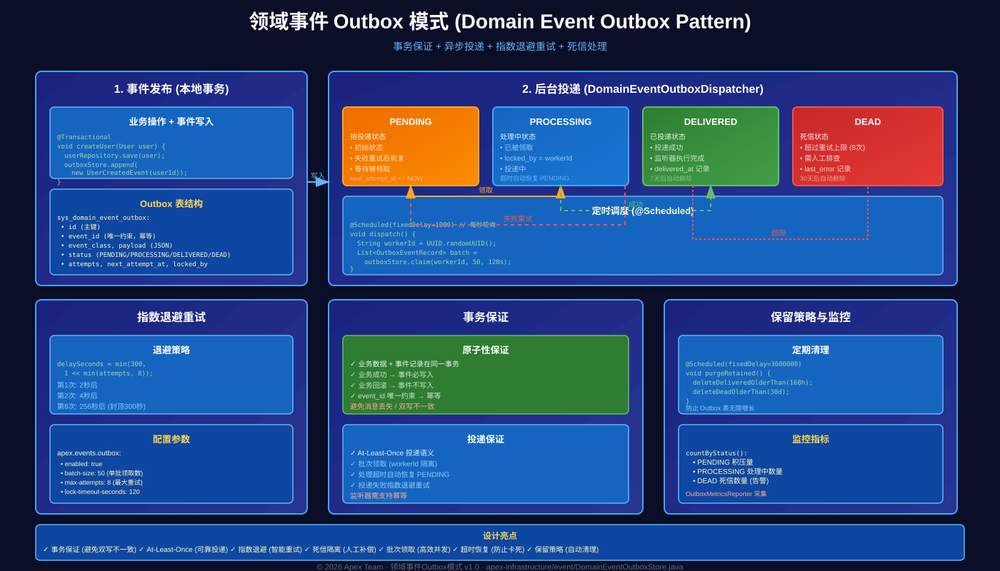

# 领域事件 Outbox 模式实践指南

## 一、概述

Apex Scaffold 采用 **Transactional Outbox 模式** 实现领域事件的可靠发布和投递,通过本地消息表保证事件与业务事务的原子性,避免分布式事务的复杂性。

### 核心价值

- **事务一致性**: 事件写入与业务操作在同一事务内,保证原子性
- **可靠投递**: 事件持久化到数据库,支持失败重试和死信收口
- **最终一致性**: 异步投递事件到监听器,实现系统解耦和最终一致
- **可观测性**: 完整的事件生命周期追踪和失败排查能力

### 架构图



---

## 二、Outbox 模式原理

### 2.1 本地消息表

Outbox 表 [sys_domain_event_outbox](../../apex-system/src/main/resources/db/migration/mysql/V1__init_schema.sql) 存储待投递的领域事件:

```sql
CREATE TABLE IF NOT EXISTS `sys_domain_event_outbox` (
  `id` BIGINT NOT NULL AUTO_INCREMENT COMMENT '主键',
  `event_id` VARCHAR(64) NOT NULL COMMENT '领域事件唯一标识',
  `event_class` VARCHAR(255) NOT NULL COMMENT '领域事件 Java 类型',
  `payload` LONGTEXT NOT NULL COMMENT '事件 JSON 负载',
  
  `status` VARCHAR(16) NOT NULL DEFAULT 'PENDING' 
    COMMENT 'PENDING/PROCESSING/DELIVERED/DEAD',
  
  `attempts` INT NOT NULL DEFAULT 0 COMMENT '已失败次数',
  `next_attempt_at` DATETIME(6) NOT NULL DEFAULT CURRENT_TIMESTAMP(6) 
    COMMENT '下次投递时间',
  
  `locked_by` VARCHAR(64) DEFAULT NULL COMMENT '投递实例令牌',
  `locked_at` DATETIME(6) DEFAULT NULL COMMENT '领取时间',
  `last_error` VARCHAR(1000) DEFAULT NULL COMMENT '最近一次错误摘要',
  
  `created_at` DATETIME(6) NOT NULL DEFAULT CURRENT_TIMESTAMP(6),
  `delivered_at` DATETIME(6) DEFAULT NULL COMMENT '投递完成时间',
  
  PRIMARY KEY (`id`),
  UNIQUE KEY `uk_event_id` (`event_id`),
  KEY `idx_outbox_dispatch` (`status`, `next_attempt_at`, `id`),
  KEY `idx_outbox_locked` (`status`, `locked_at`)
) ENGINE=InnoDB DEFAULT CHARSET=utf8mb4 COMMENT='领域事件发件箱';
```

### 2.2 事件状态流转

```
┌─────────┐
│ PENDING │  待投递
└────┬────┘
     │ dispatch()
     ↓
┌────────────┐
│ PROCESSING │  投递中
└─────┬──────┘
      │
      ├─ 成功 ──→ ┌───────────┐
      │           │ DELIVERED │  已投递
      │           └───────────┘
      │
      └─ 失败 ──→ ┌──────┐
                  │ DEAD │  死信(超过最大重试次数)
                  └──────┘
```

### 2.3 事务保证机制

业务事务提交后,事件才被投递:

```java
@Transactional
public Mono<User> createUser(CreateUserRequest request) {
    return userRepository.save(user)
        .flatMap(savedUser -> 
            domainEventPublisher.publish(new UserRegisteredEvent(savedUser.getId()))
                .thenReturn(savedUser)
        );
}
```

**关键点**:
1. `userRepository.save()` 和 `outboxStore.append()` 在同一事务内
2. 事务提交后,Outbox 调度器定时扫描 PENDING 记录并投递
3. 投递失败自动重试,超过阈值进入 DEAD 状态

---

## 三、核心组件

### 3.1 DomainEventPublisher

[DomainEventPublisherImpl](../../apex-infrastructure-messaging/src/main/java/com/apex/scaffold/infrastructure/event/DomainEventPublisherImpl.java) 负责将事件写入 Outbox:

```java
@Primary
@Component
@RequiredArgsConstructor
public class DomainEventPublisherImpl implements DomainEventPublisher {
    
    private final DomainEventOutboxStore outboxStore;
    
    @Override
    public Mono<Void> publish(AbstractDomainEvent event) {
        return Mono.fromRunnable(() -> outboxStore.append(event))
            .subscribeOn(BlockingIoSchedulers.event())
            .doOnSuccess(ignored -> 
                log.debug("领域事件已写入Outbox: {}, ID: {}", 
                    event.getClass().getSimpleName(), event.getEventId()))
            .then();
    }
}
```

### 3.2 DomainEventOutboxStore

[DomainEventOutboxStore](../../apex-infrastructure-messaging/src/main/java/com/apex/scaffold/infrastructure/event/DomainEventOutboxStore.java) 提供 Outbox 表的 CRUD 操作:

```java
@Repository
@RequiredArgsConstructor
public class DomainEventOutboxStore {
    
    private final DataSource dataSource;
    
    public void append(AbstractDomainEvent event) {
        String sql = "INSERT INTO sys_domain_event_outbox "
            + "(event_id,event_class,payload,status,attempts,next_attempt_at,created_at) "
            + "VALUES (?,?,?,'PENDING',0,CURRENT_TIMESTAMP(6),CURRENT_TIMESTAMP(6)) "
            + "ON DUPLICATE KEY UPDATE event_id=VALUES(event_id),"
            + "status=IF(status='DEAD','PENDING',status),"
            + "attempts=IF(status='DEAD',0,attempts),"
            + "next_attempt_at=IF(status='DEAD',CURRENT_TIMESTAMP(6),next_attempt_at)";
        
        try (Connection connection = dataSource.getConnection();
             PreparedStatement statement = connection.prepareStatement(sql)) {
            statement.setString(1, event.getEventId());
            statement.setString(2, event.getClass().getName());
            statement.setString(3, JsonUtil.toJson(event));
            statement.executeUpdate();
        } catch (SQLException exception) {
            throw new IllegalStateException("领域事件写入 Outbox 失败", exception);
        }
    }
}
```

**幂等保护**:
- `event_id` 唯一约束避免重复写入
- DEAD 状态的事件重新发布时会复活为 PENDING

### 3.3 DomainEventOutboxDispatcher

[DomainEventOutboxDispatcher](../../apex-infrastructure-messaging/src/main/java/com/apex/scaffold/infrastructure/event/DomainEventOutboxDispatcher.java) 后台定时扫描并投递事件:

```java
@Component
@ConditionalOnProperty(
    prefix = "apex.events.outbox", 
    name = "enabled", 
    havingValue = "true", 
    matchIfMissing = true
)
public class DomainEventOutboxDispatcher {
    
    @Scheduled(fixedDelayString = "${apex.events.outbox.poll-delay-ms:1000}")
    public void dispatch() {
        if (inFlightBatches.get() > 0) {
            return;
        }
        
        String workerId = UUID.randomUUID().toString();
        List<OutboxEventRecord> records = outboxStore.claim(
            workerId, batchSize, lockTimeoutSeconds
        );
        
        if (records.isEmpty()) {
            return;
        }
        
        inFlightBatches.incrementAndGet();
        
        CompletableFuture<?>[] deliveries = records.stream()
            .map(record -> CompletableFuture.runAsync(
                () -> deliver(record, workerId), 
                deliveryExecutor
            ))
            .toArray(CompletableFuture[]::new);
        
        CompletableFuture.allOf(deliveries)
            .orTimeout(lockTimeoutSeconds, TimeUnit.SECONDS)
            .whenComplete((result, throwable) -> {
                inFlightBatches.decrementAndGet();
                if (throwable != null) {
                    log.error("Outbox 投递批次超时或异常, workerId: {}", workerId, throwable);
                }
            });
    }
    
    private void deliver(OutboxEventRecord record, String workerId) {
        try {
            AbstractDomainEvent event = restore(record);
            eventPublisher.publishEvent(event);
            outboxStore.markDelivered(record.id(), workerId);
            log.info("领域事件投递完成, eventId: {}", record.eventId());
        } catch (Exception exception) {
            String error = exception.getClass().getSimpleName() 
                + ": " + exception.getMessage();
            outboxStore.markFailed(record, workerId, maxAttempts, error);
            log.error("领域事件投递失败, eventId: {}, attempts: {}", 
                record.eventId(), record.attempts() + 1, exception);
        }
    }
}
```

**关键特性**:
- **定时扫描**: 每秒扫描一次 PENDING 记录
- **批量领取**: 单次最多领取 50 条记录(可配置)
- **并行投递**: 使用线程池并行投递提高吞吐
- **超时保护**: 投递超时自动释放锁,由下一轮重试
- **批次互斥**: 同一实例同一时刻最多一批在途

---

## 四、事件发布流程

### 4.1 同步发布(事务内)

业务操作和事件写入在同一事务:

```java
@Service
@RequiredArgsConstructor
public class UserService {
    
    private final UserRepository userRepository;
    private final DomainEventPublisher eventPublisher;
    
    @Transactional
    public Mono<User> registerUser(RegisterRequest request) {
        User user = User.builder()
            .username(request.getUsername())
            .email(request.getEmail())
            .build();
        
        return userRepository.save(user)
            .flatMap(savedUser -> {
                UserRegisteredEvent event = new UserRegisteredEvent(
                    savedUser.getId(),
                    savedUser.getUsername(),
                    savedUser.getEmail()
                );
                return eventPublisher.publish(event)
                    .thenReturn(savedUser);
            });
    }
}
```

### 4.2 异步发布(可选)

[EnhancedDomainEventPublisherImpl](../../apex-infrastructure-messaging/src/main/java/com/apex/scaffold/infrastructure/event/EnhancedDomainEventPublisherImpl.java) 支持多种发布策略:

```java
@Component
@ConditionalOnBean(RocketMQTemplate.class)
public class EnhancedDomainEventPublisherImpl implements DomainEventPublisher {
    
    public Mono<Void> publishSync(AbstractDomainEvent event) {
        return Mono.deferContextual((ContextView ctx) -> {
            String tenantId = ctx.getOrDefault(TenantContext.REACTOR_CONTEXT_KEY, null);
            if (tenantId == null) {
                tenantId = TenantContext.currentTenantId().orElse(null);
            }
            event.attachTenantContext(tenantId);
            applicationEventPublisher.publishEvent(event);
            return Mono.empty();
        })
        .then(domainEventBus.publishSync(event));
    }
    
    public Mono<Void> publishAsync(AbstractDomainEvent event) {
        return Mono.fromRunnable(() -> {
            String tenantId = event.getTenantId();
            String prev = TenantContext.setTenantId(tenantId);
            try {
                applicationEventPublisher.publishEvent(event);
            } finally {
                TenantContext.restoreTenantId(prev);
            }
        })
        .then(domainEventBus.publish(event))
        .subscribeOn(BlockingIoSchedulers.event());
    }
    
    public Mono<Void> publishDistributed(AbstractDomainEvent event) {
        if (!domainEventEnabled) {
            return Mono.empty();
        }
        
        return Mono.fromRunnable(() -> {
            Message<String> message = MessageBuilder
                .withPayload(JsonUtil.toJson(event))
                .setHeader(MessageConst.PROPERTY_KEYS, event.getEventId())
                .build();
            
            rocketMQTemplate.syncSend(domainEventTopic, message);
        })
        .subscribeOn(BlockingIoSchedulers.event())
        .then();
    }
}
```

**发布策略**:
- **SYNC**: 同步发布,参与事务
- **ASYNC**: 异步发布,不阻塞主流程
- **DISTRIBUTED**: 通过 RocketMQ 发布到其他服务

---

## 五、事件消费流程

### 5.1 本地事件监听器

实现 Spring `@EventListener` 监听本地事件:

```java
@Component
public class UserEventHandler {
    
    @EventListener
    @Async("eventExecutor")
    public void handleUserRegistered(UserRegisteredEvent event) {
        log.info("处理用户注册事件: userId={}", event.getUserId());
        
        sendWelcomeEmail(event.getEmail());
        
        updateUserStatistics();
    }
}
```

### 5.2 RocketMQ 远程消费

通过 RocketMQ 消费分布式事件:

```java
@Component
@RocketMQMessageListener(
    topic = "${apex.mq.domain-event-topic}",
    consumerGroup = "apex-user-consumer"
)
public class UserEventConsumer implements RocketMQListener<String> {
    
    @Override
    public void onMessage(String message) {
        AbstractDomainEvent event = JsonUtil.parseObject(
            message, 
            AbstractDomainEvent.class
        );
        
        String tenantId = event.getTenantId();
        String prev = TenantContext.setTenantId(tenantId);
        try {
            if (event instanceof UserRegisteredEvent registeredEvent) {
                handleUserRegistered(registeredEvent);
            }
        } finally {
            TenantContext.restoreTenantId(prev);
        }
    }
}
```

---

## 六、重试策略

### 6.1 指数退避

投递失败后按指数退避重试:

```java
private long calculateNextAttemptDelay(int attempts) {
    long baseDelaySeconds = 10;
    long maxDelaySeconds = 3600;
    
    long delay = (long) (baseDelaySeconds * Math.pow(2, attempts));
    return Math.min(delay, maxDelaySeconds);
}
```

**退避时间表**:
| 重试次数 | 延迟时间 |
|---------|---------|
| 1 | 10s |
| 2 | 20s |
| 3 | 40s |
| 4 | 80s |
| 5 | 160s |
| 6 | 320s |
| 7 | 640s |
| 8+ | 3600s (1小时) |

### 6.2 最大重试次数

超过最大重试次数(默认 8 次)后进入 DEAD 状态:

```java
public void markFailed(
    OutboxEventRecord record, 
    String workerId, 
    int maxAttempts, 
    String error
) {
    int newAttempts = record.attempts() + 1;
    String newStatus = newAttempts >= maxAttempts ? "DEAD" : "PENDING";
    
    long delaySeconds = calculateNextAttemptDelay(newAttempts);
    
    String sql = "UPDATE sys_domain_event_outbox "
        + "SET status=?,attempts=?,next_attempt_at=?,"
        + "last_error=?,locked_by=NULL,locked_at=NULL "
        + "WHERE id=? AND locked_by=?";
    
    try (Connection connection = dataSource.getConnection();
         PreparedStatement statement = connection.prepareStatement(sql)) {
        statement.setString(1, newStatus);
        statement.setInt(2, newAttempts);
        statement.setTimestamp(3, 
            Timestamp.from(Instant.now().plusSeconds(delaySeconds)));
        statement.setString(4, truncateError(error));
        statement.setLong(5, record.id());
        statement.setString(6, workerId);
        statement.executeUpdate();
    }
}
```

### 6.3 死信处理

DEAD 状态事件需要人工介入:

```java
@Scheduled(cron = "0 0 2 * * ?")
public void alertDeadEvents() {
    long deadCount = outboxStore.countByStatus("DEAD");
    if (deadCount > 0) {
        alertService.sendAlert(
            "领域事件死信告警",
            String.format("当前有 %d 条事件进入死信队列,请及时处理", deadCount)
        );
    }
}
```

---

## 七、幂等处理

### 7.1 事件 ID 唯一约束

`event_id` 唯一约束保证同一事件不会重复写入:

```sql
UNIQUE KEY `uk_event_id` (`event_id`)
```

```java
public abstract class AbstractDomainEvent {
    private final String eventId;
    
    protected AbstractDomainEvent() {
        this.eventId = UUID.randomUUID().toString();
    }
}
```

### 7.2 消费幂等

消费端使用 Redis 记录已处理事件:

```java
public boolean isProcessed(String eventId) {
    String key = "event:processed:" + eventId;
    return redisTemplate.hasKey(key);
}

public void markProcessed(String eventId) {
    String key = "event:processed:" + eventId;
    redisTemplate.opsForValue().set(key, "1", 30, TimeUnit.MINUTES);
}

@EventListener
public void handleEvent(UserRegisteredEvent event) {
    if (isProcessed(event.getEventId())) {
        log.debug("事件已处理,跳过: {}", event.getEventId());
        return;
    }
    
    processEvent(event);
    
    markProcessed(event.getEventId());
}
```

---

## 八、配置参数

### 8.1 Outbox 调度器配置

```yaml
apex:
  events:
    outbox:
      enabled: true
      poll-delay-ms: 1000
      batch-size: 50
      max-attempts: 8
      lock-timeout-seconds: 120
      parallelism: 4
      retention-enabled: true
      retention-delivered-hours: 168
      retention-dead-days: 30
      retention-batch-size: 5000
```

| 参数 | 默认值 | 说明 |
|------|-------|------|
| `enabled` | true | 是否启用 Outbox 调度器 |
| `poll-delay-ms` | 1000 | 扫描间隔(毫秒) |
| `batch-size` | 50 | 单批领取数量 |
| `max-attempts` | 8 | 最大重试次数 |
| `lock-timeout-seconds` | 120 | 锁超时时间(秒) |
| `parallelism` | 4 | 并行投递线程数 |
| `retention-enabled` | true | 是否启用历史清理 |
| `retention-delivered-hours` | 168 | DELIVERED 记录保留小时数(7天) |
| `retention-dead-days` | 30 | DEAD 记录保留天数 |
| `retention-batch-size` | 5000 | 单批清理数量 |

### 8.2 分布式事件配置

```yaml
apex:
  mq:
    domain-event-enabled: true
    domain-event-topic: apex-domain-event

rocketmq:
  name-server: localhost:9876
  producer:
    group: apex-producer
```

---

## 九、监控与运维

### 9.1 监控指标

Outbox 调度器暴露 Micrometer 指标:

```java
@Component
@ConditionalOnProperty(
    prefix = "apex.events.outbox", 
    name = "metrics-enabled", 
    havingValue = "true", 
    matchIfMissing = true
)
public class OutboxMetricsReporter {
    
    @Scheduled(fixedDelayString = "${apex.events.outbox.metrics-interval-ms:10000}")
    public void reportMetrics() {
        Map<String, Long> statusCounts = outboxStore.countByStatus();
        
        statusCounts.forEach((status, count) -> 
            Metrics.gauge("apex_outbox_events", 
                Tags.of("status", status), 
                count)
        );
    }
}
```

**关键指标**:
- `apex_outbox_events{status="PENDING"}`: 待投递事件数
- `apex_outbox_events{status="PROCESSING"}`: 投递中事件数
- `apex_outbox_events{status="DELIVERED"}`: 已投递事件数
- `apex_outbox_events{status="DEAD"}`: 死信事件数

### 9.2 日志排查

开启 Outbox 详细日志:

```yaml
logging:
  level:
    com.apex.scaffold.infrastructure.event: DEBUG
```

关键日志:
```
领域事件已写入Outbox: UserRegisteredEvent, ID: 12345
领域事件投递完成, eventId: 12345, eventType: UserRegisteredEvent
领域事件投递失败, eventId: 12345, attempts: 3
```

### 9.3 历史数据清理

Outbox 调度器自动清理历史记录:

```java
@Scheduled(cron = "${apex.events.outbox.retention-cron:0 0 3 * * ?}")
public void cleanupExpiredRecords() {
    if (!retentionEnabled) {
        return;
    }
    
    int deliveredDeleted = outboxStore.deleteExpiredRecords(
        "DELIVERED", 
        retentionDeliveredHours, 
        TimeUnit.HOURS,
        retentionBatchSize
    );
    
    int deadDeleted = outboxStore.deleteExpiredRecords(
        "DEAD", 
        retentionDeadDays, 
        TimeUnit.DAYS,
        retentionBatchSize
    );
    
    log.info("Outbox 历史清理完成, DELIVERED: {}, DEAD: {}", 
        deliveredDeleted, deadDeleted);
}
```

---

## 十、使用示例

### 10.1 定义领域事件

```java
@Data
@AllArgsConstructor
@NoArgsConstructor
public class UserRegisteredEvent extends AbstractDomainEvent {
    
    private Long userId;
    private String username;
    private String email;
    
    @Override
    public String getEventName() {
        return "user.registered";
    }
}
```

### 10.2 发布领域事件

```java
@Service
@RequiredArgsConstructor
public class UserApplicationService {
    
    private final UserRepository userRepository;
    private final DomainEventPublisher eventPublisher;
    
    @Transactional
    public Mono<UserDTO> registerUser(RegisterUserCommand command) {
        User user = User.create(command.getUsername(), command.getEmail());
        
        return userRepository.save(user)
            .flatMap(savedUser -> {
                UserRegisteredEvent event = new UserRegisteredEvent(
                    savedUser.getId(),
                    savedUser.getUsername(),
                    savedUser.getEmail()
                );
                
                return eventPublisher.publish(event)
                    .thenReturn(UserAssembler.toDTO(savedUser));
            });
    }
}
```

### 10.3 消费领域事件

```java
@Component
@Slf4j
public class NotificationEventHandler {
    
    @Autowired
    private EmailService emailService;
    
    @EventListener
    @Async("eventExecutor")
    public void onUserRegistered(UserRegisteredEvent event) {
        log.info("接收到用户注册事件: userId={}, username={}", 
            event.getUserId(), event.getUsername());
        
        try {
            emailService.sendWelcomeEmail(
                event.getEmail(),
                event.getUsername()
            );
            log.info("欢迎邮件发送成功: userId={}", event.getUserId());
        } catch (Exception e) {
            log.error("欢迎邮件发送失败: userId={}", event.getUserId(), e);
        }
    }
}
```

---

## 十一、最佳实践

### 11.1 事件设计原则

**✅ 推荐**:
- 事件名使用过去式(UserRegistered, OrderPlaced)
- 事件携带必要的业务标识(userId, orderId)
- 事件保持不可变(Immutable)
- 事件大小控制在 10KB 以内

**❌ 避免**:
- 事件携带敏感信息(密码, Token)
- 事件包含大量冗余数据
- 事件名使用现在式(UserRegister)

### 11.2 事务边界

**✅ 正确做法**:
```java
@Transactional
public Mono<Order> createOrder(CreateOrderRequest request) {
    return orderRepository.save(order)
        .flatMap(savedOrder -> 
            eventPublisher.publish(new OrderCreatedEvent(savedOrder.getId()))
                .thenReturn(savedOrder)
        );
}
```

**❌ 错误做法**:
```java
public Mono<Order> createOrder(CreateOrderRequest request) {
    return orderRepository.save(order)
        .flatMap(savedOrder -> 
            eventPublisher.publish(new OrderCreatedEvent(savedOrder.getId()))
        );
}
```

### 11.3 监听器幂等

所有监听器必须实现幂等处理:

```java
@EventListener
public void handleOrderPaid(OrderPaidEvent event) {
    if (isProcessed(event.getEventId())) {
        return;
    }
    
    try {
        processOrder(event);
        markProcessed(event.getEventId());
    } catch (Exception e) {
        log.error("订单处理失败", e);
        throw e;
    }
}
```

---

## 十二、常见问题

### 12.1 事件重复投递

**现象**: 同一事件被投递多次

**原因**:
- 投递超时,调度器重新领取
- 监听器未实现幂等

**解决**:
1. 监听器添加幂等检查
2. 增大 `lock-timeout-seconds`
3. 监听器异常不要吞掉,让 Outbox 重试

### 12.2 事件堆积

**现象**: PENDING 事件数持续增长

**原因**:
- 监听器处理慢
- 投递线程池资源不足
- 数据库性能瓶颈

**解决**:
1. 增大 `parallelism` 并行度
2. 优化监听器性能
3. 增加 Outbox 表索引:
   ```sql
   CREATE INDEX idx_outbox_dispatch 
   ON sys_domain_event_outbox(status, next_attempt_at, id);
   ```

### 12.3 死信事件告警

**现象**: 大量事件进入 DEAD 状态

**原因**:
- 监听器代码异常
- 依赖服务不可用
- 事件 payload 反序列化失败

**解决**:
1. 查看 `last_error` 字段定位问题
2. 修复代码后手动将 DEAD 重置为 PENDING:
   ```sql
   UPDATE sys_domain_event_outbox 
   SET status='PENDING', attempts=0, next_attempt_at=NOW() 
   WHERE id IN (1,2,3);
   ```

---

## 十三、性能优化

### 13.1 索引优化

确保 Outbox 表有正确的索引:

```sql
CREATE UNIQUE INDEX uk_event_id 
ON sys_domain_event_outbox(event_id);

CREATE INDEX idx_outbox_dispatch 
ON sys_domain_event_outbox(status, next_attempt_at, id);

CREATE INDEX idx_outbox_locked 
ON sys_domain_event_outbox(status, locked_at);
```

### 13.2 批量投递优化

增大单批领取数量和并行度:

```yaml
apex:
  events:
    outbox:
      batch-size: 100
      parallelism: 8
```

### 13.3 历史数据清理

定期清理历史记录,防止表膨胀:

```yaml
apex:
  events:
    outbox:
      retention-enabled: true
      retention-delivered-hours: 168
      retention-dead-days: 30
```

---

## 十四、相关文档

> 相关技术文档待补充

---

**最后更新**: 2026-09-18  
**维护者**: Apex Team  
**版本**: 1.0.0
