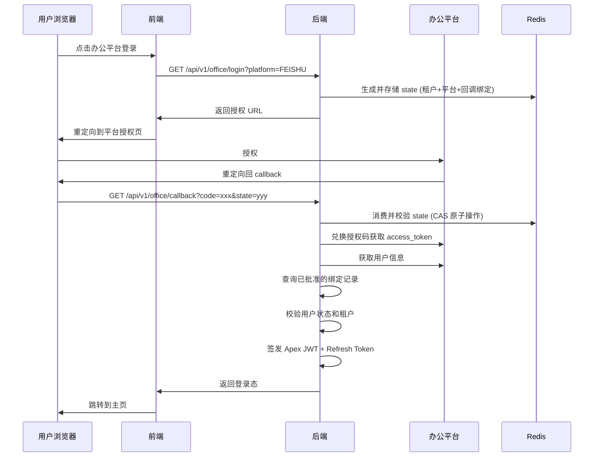
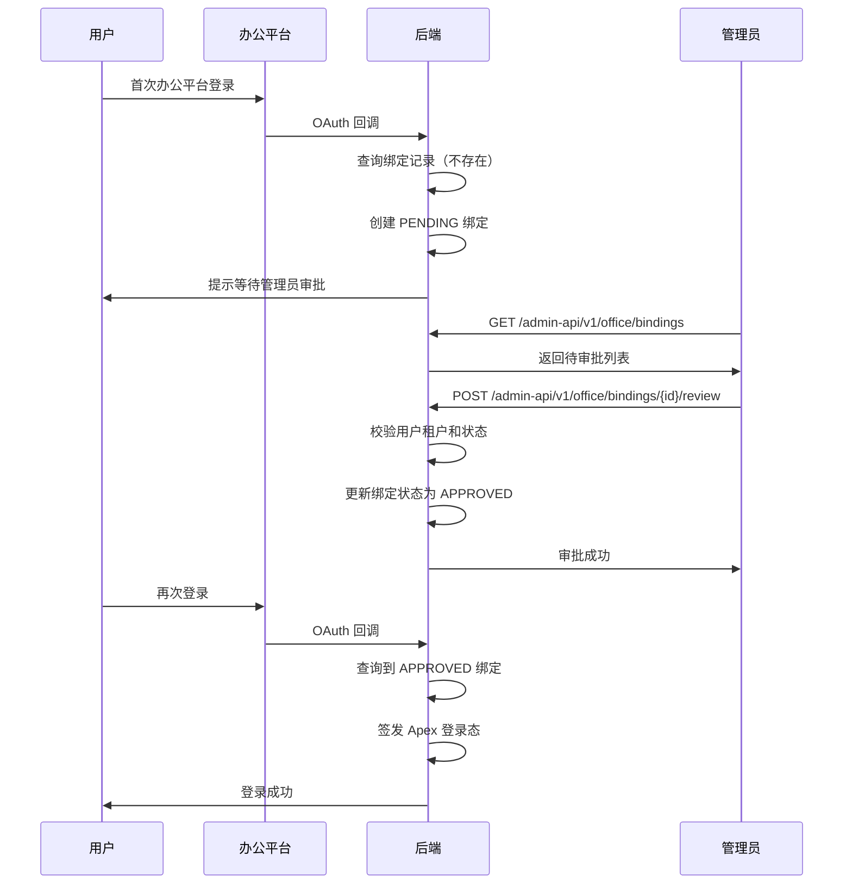

# 办公平台集成开发指南

## 1. 概述

本指南介绍如何在 Apex Scaffold 项目中集成飞书、钉钉、企业微信三大办公平台，实现统一登录、账号绑定和办公能力调用。

### 1.1 核心特性

- **统一登录**：三大平台 OAuth2 统一认证流程
- **安全闭环**：state 防重放、租户隔离、管理员审批
- **DDD 架构**：清晰的分层设计，领域驱动开发
- **WebFlux 响应式**：高并发、非阻塞 I/O
- **多租户支持**：每个租户独立的平台应用配置

### 1.2 技术栈

- Java 17 + Spring Boot 3.5.15
- Spring WebFlux (函数式编程)
- MyBatis-Plus + Flyway
- Redis (分布式 state 存储)
- MapStruct (对象转换)
- JUnit 5 + Mockito + Reactor Test

## 2. 快速开始

### 2.1 前置条件

1. **申请平台应用**

   **飞书**：
   - 访问 [飞书开放平台](https://open.feishu.cn/)
   - 创建企业自建应用
   - 获取 App ID 和 App Secret
   - 配置权限：`contact:user.base`, `authen`
   - 配置回调地址：`https://your-domain.com/api/v1/office/callback`

   **钉钉**：
   - 访问 [钉钉开放平台](https://open.dingtalk.com/)
   - 创建企业内部应用
   - 获取 AppKey 和 AppSecret
   - 配置权限：`Contact.User.Read`, `openid`
   - 配置回调域名

   **企业微信**：
   - 访问 [企业微信管理后台](https://work.weixin.qq.com/)
   - 应用管理 -> 创建应用
   - 获取 CorpID、AgentId 和 Secret
   - 配置可见范围
   - 配置网页授权回调域名

2. **环境准备**
   ```bash
   # 确保安装了 SDKMAN
   curl -s "https://get.sdkman.io" | bash
   
   # 使用项目指定的 Java 和 Maven Daemon 版本
   cd /Users/work/apex-scaffold
   sdk env
   ```

3. **启动依赖服务**
   ```bash
   # MySQL（用于数据持久化）
   docker run -d --name mysql \
     -e MYSQL_ROOT_PASSWORD=root \
     -p 3306:3306 \
     mysql:8.0
   
   # Redis（用于 state 存储）
   docker run -d --name redis \
     -p 6379:6379 \
     redis:7-alpine
   ```

### 2.2 配置环境变量

1. 复制配置模板：
   ```bash
   cp config/office-platforms.env.example config/office-platforms.env
   ```

2. 编辑 `config/office-platforms.env`，填写平台密钥：
   ```bash
   # 飞书
   FEISHU_SECRET=your-feishu-app-secret
   
   # 钉钉
   DINGTALK_SECRET=your-dingtalk-app-secret
   
   # 企业微信
   WECOM_SECRET=your-wecom-corp-secret
   
   # 全局配置
   APEX_OFFICE_ENABLED=true
   ```

3. 验证配置：
   ```bash
   ./scripts/office/validate-office-config.sh config/office-platforms.env
   ```

### 2.3 执行数据库迁移

```bash
# Flyway 会在应用启动时自动执行迁移
# 手动执行迁移（可选）
mvnd -pl apex-interfaces flyway:migrate
```

迁移文件：
- `V29__add_office_platform_tables.sql` - 核心表（平台应用、绑定记录）
- `V30__add_office_admin_permissions.sql` - 管理端权限

### 2.4 启动应用

```bash
# 加载环境变量并启动
source config/office-platforms.env
mvnd -pl apex-interfaces -am spring-boot:run -P dev
```

或使用 Docker：
```bash
# 构建镜像
mvnd clean package -DskipTests
docker build -t apex-scaffold:latest .

# 启动容器
docker run -d \
  --name apex-scaffold \
  --env-file config/office-platforms.env \
  -p 8080:8080 \
  apex-scaffold:latest
```

### 2.5 验证集成

1. **冒烟测试**：
   ```bash
   ./scripts/office/smoke-test.sh http://localhost:8080
   ```

2. **访问 Swagger 文档**：
   ```
   http://localhost:8080/swagger-ui.html
   ```
   
   查找 "办公平台" 和 "办公平台管理" 标签下的接口。

3. **测试登录流程**：
   ```bash
   # 1. 查询平台状态
   curl http://localhost:8080/api/v1/office/status
   
   # 2. 获取授权地址
   curl http://localhost:8080/api/v1/office/login?platform=FEISHU
   
   # 3. 浏览器访问返回的授权地址
   # 4. 授权后重定向回 callback 接口
   ```

## 3. 架构设计

### 3.1 分层结构

```
apex-domain          领域层
├── office/
│   ├── OfficePlatform.java           平台枚举
│   ├── OfficePlatformApp.java        应用配置聚合
│   ├── OfficeIdentityBinding.java    绑定记录聚合
│   ├── OfficeRepository.java         仓储接口
│   └── OfficeState.java              状态管理端口

apex-application     应用层
├── office/
│   ├── OfficeApplicationService.java OAuth 认证流程
│   ├── OfficeAdminService.java       管理员绑定审批
│   └── OfficeAdminAssembler.java     DTO 转换

apex-infrastructure  基础设施层
├── office/
│   ├── client/                       平台客户端
│   │   ├── AbstractOfficeClient.java    统一 OAuth 实现
│   │   ├── FeishuOfficeClient.java      飞书客户端
│   │   ├── DingTalkOfficeClient.java    钉钉客户端
│   │   └── WeComOfficeClient.java       企微客户端
│   ├── config/
│   │   └── OfficePlatformProperties.java 配置属性
│   ├── persistence/
│   │   ├── OfficeRepositoryImpl.java    仓储实现
│   │   ├── po/                          PO 对象
│   │   ├── mapper/                      MyBatis Mapper
│   │   └── converter/                   MapStruct 转换
│   ├── security/
│   │   └── OfficeStateService.java      Redis State 管理
│   └── spi/
│       ├── OfficeOAuthClient.java       OAuth SPI
│       └── OfficePlatformClient.java    业务能力 SPI

apex-interfaces      接口层
├── handler/
│   ├── OfficeHandler.java            公开接口（登录、回调）
│   └── OfficeAdminHandler.java       管理接口（配置、审批）
├── router/
│   ├── ApiRouter.java                公开路由
│   └── OfficeAdminRouter.java        管理路由
├── dto/office/                       请求响应 DTO
└── assembler/
    └── OfficeAssembler.java          接口层转换
```

### 3.2 核心流程

#### OAuth 登录流程



#### 管理员绑定审批流程



### 3.3 安全设计

#### State 防重放

```java
// 签发 state（存入 Redis，TTL 5 分钟）
String state = officeState.issue(
    tenantId,           // 绑定租户
    platform.name(),    // 绑定平台
    redirectUri,        // 绑定回调地址
    Duration.ofMinutes(5)
).block();

// 消费 state（原子 CAS，只能消费一次）
boolean valid = officeState.consume(
    state,
    tenantId,
    platform.name(),
    redirectUri
).block();
```

#### 租户隔离

```java
// 所有数据库查询带租户过滤
@Override
public Mono<OfficePlatformApp> findApp(
        String tenantId,
        OfficePlatform platform) {
    return Mono.fromCallable(() -> {
        LambdaQueryWrapper<OfficePlatformAppPO> query =
                new LambdaQueryWrapper<>();
        query.eq(OfficePlatformAppPO::getTenantId, tenantId)
             .eq(OfficePlatformAppPO::getPlatform, platform.name())
             .eq(OfficePlatformAppPO::getDeleted, 0);
        return mapper.selectOne(query);
    })
    .subscribeOn(BlockingIoSchedulers.jdbc())
    .map(converter::toDomain);
}
```

#### 权限控制

```java
@RequirePermission("office:app:create")
@OperationLog(
    module = "办公平台",
    type = OperationType.CREATE,
    description = "创建应用配置",
    saveRequest = false,  // 不保存请求体（含密钥引用）
    saveResponse = false
)
@IdempotentApi
public Mono<ServerResponse> createApp(ServerRequest request) {
    // 实现...
}
```

## 4. 开发指南

### 4.1 添加新平台

1. **扩展枚举**：
   ```java
   // apex-domain/src/main/java/com/apex/scaffold/domain/office/OfficePlatform.java
   public enum OfficePlatform {
       FEISHU,
       DINGTALK,
       WECOM,
       SLACK  // 新增平台
   }
   ```

2. **实现客户端**：
   ```java
   @Component
   public class SlackOfficeClient extends AbstractOfficeClient {
       @Override
       public OfficePlatform platform() {
           return OfficePlatform.SLACK;
       }
       
       // 实现 OAuth 和业务方法
   }
   ```

3. **添加配置**：
   ```yaml
   apex:
     office:
       platforms:
         SLACK:
           enabled: true
           appId: ${SLACK_APP_ID}
           secretReference: SLACK_SECRET
   ```

### 4.2 添加业务能力

示例：添加消息发送能力

1. **定义领域接口**：
   ```java
   // OfficePlatformClient.java
   Mono<String> sendMessage(
       OfficePlatformApp app,
       String receiverId,
       String content
   );
   ```

2. **实现平台适配**：
   ```java
   // AbstractOfficeClient.java
   @Override
   public Mono<String> sendMessage(
           OfficePlatformApp app,
           String receiverId,
           String content) {
       return switch (platform()) {
           case FEISHU -> sendFeishuMessage(...);
           case DINGTALK -> sendDingTalkMessage(...);
           case WECOM -> sendWeComMessage(...);
       };
   }
   ```

3. **添加应用服务**：
   ```java
   // OfficeApplicationService.java
   public Mono<String> sendMessage(
           OfficePlatform platform,
           String receiverId,
           String content) {
       return tenant()
           .flatMap(tenantId -> repository.findApp(tenantId, platform))
           .flatMap(app -> client(platform))
           .flatMap(client -> client.sendMessage(app, receiverId, content));
   }
   ```

4. **暴露接口**：
   ```java
   // OfficeHandler.java
   @Operation(summary = "发送消息")
   public Mono<ServerResponse> sendMessage(ServerRequest request) {
       // 实现...
   }
   ```

### 4.3 测试开发

#### 单元测试示例

```java
@Test
void sendMessageWithValidAppAndReceiver() {
    // Arrange
    TenantContext.setTenantId("tenant-a");
    
    OfficePlatformApp app = OfficePlatformApp.builder()
        .platform(OfficePlatform.FEISHU)
        .appId("app-123")
        .build();
    
    when(repository.findApp("tenant-a", OfficePlatform.FEISHU))
        .thenReturn(Mono.just(app));
    when(client.sendMessage(app, "user-456", "Hello"))
        .thenReturn(Mono.just("msg-789"));
    
    // Act & Assert
    StepVerifier.create(
        service.sendMessage(OfficePlatform.FEISHU, "user-456", "Hello"))
        .expectNext("msg-789")
        .verifyComplete();
}
```

#### 集成测试示例

```java
@SpringBootTest
@ActiveProfiles("test")
class OfficeIntegrationTest {
    @Autowired
    private WebTestClient webClient;
    
    @Test
    void platformStatusReturnsConfiguredPlatforms() {
        webClient.get()
            .uri("/api/v1/office/status")
            .exchange()
            .expectStatus().isOk()
            .expectBody()
            .jsonPath("$.code").isEqualTo(200)
            .jsonPath("$.data").isArray();
    }
}
```

## 5. 运维指南

### 5.1 监控指标

建议监控以下指标：

- OAuth 认证成功率
- 平台 API 调用延迟
- State 消费失败次数
- 绑定审批待办数量
- Token 刷新失败次数

### 5.2 日志排查

关键日志关键字：

```bash
# 查看 OAuth 认证日志
tail -f logs/application.log | grep "office\|OAuth"

# 查看错误日志
tail -f logs/application.log | grep "ERROR.*office"

# 查看 state 消费日志
tail -f logs/application.log | grep "OfficeStateService"
```

### 5.3 常见问题

**Q: 授权后回调失败，提示 state 无效**
A: 检查以下几点：
1. Redis 是否正常运行
2. state TTL 是否过短
3. 回调地址是否与签发时一致
4. 租户上下文是否正确传递

**Q: 登录后提示"等待管理员审批"**
A: 这是正常流程，需要管理员在后台审批绑定：
1. 登录管理后台
2. 访问"办公平台管理" -> "绑定审批"
3. 审批对应的绑定记录

**Q: 平台 API 调用超时**
A: 调整超时配置：
```yaml
apex:
  office:
    timeout: 10  # 增加到 10 秒
    maxRetries: 3  # 增加重试次数
```

## 6. 最佳实践

### 6.1 密钥管理

- ✅ 使用环境变量存储密钥
- ✅ 定期轮换密钥
- ✅ 生产环境使用密钥管理服务（AWS Secrets Manager / Azure Key Vault）
- ❌ 不要硬编码密钥
- ❌ 不要提交密钥到 Git

### 6.2 性能优化

- 使用 Redis 缓存平台 Token
- 批量查询优化（如批量查询用户信息）
- 设置合理的超时和重试策略
- 监控慢查询和慢接口

### 6.3 安全加固

- 启用 HTTPS
- 配置 CORS 白名单
- 限制 API 调用频率
- 记录敏感操作审计日志
- 定期安全扫描

## 7. 参考资源

- [飞书开放平台文档](https://open.feishu.cn/document/)
- [钉钉开放平台文档](https://open.dingtalk.com/document/)
- [企业微信API文档](https://developer.work.weixin.qq.com/document/)
- [Spring WebFlux 文档](https://docs.spring.io/spring-framework/reference/web/webflux.html)
- [Project Reactor 文档](https://projectreactor.io/docs/core/release/reference/)

## 8. 支持

如有问题，请联系：
- 技术支持：apex-support@example.com
- 文档反馈：apex-docs@example.com
