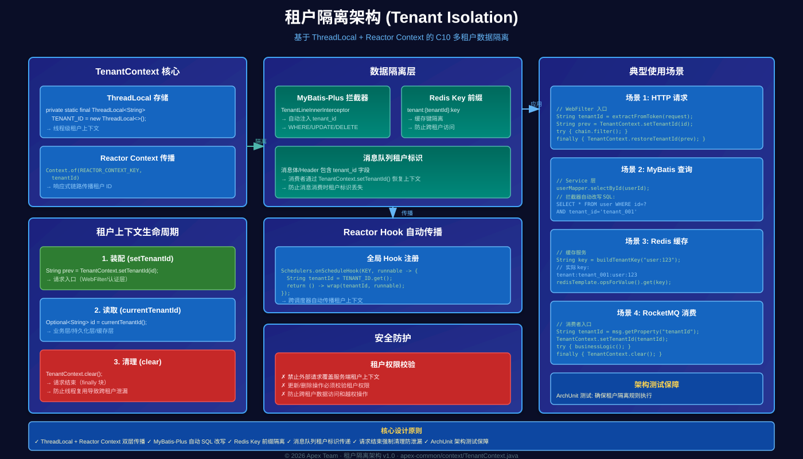

# 租户隔离实施指南

## 一、概述

Apex Scaffold 采用**共享数据库、共享 Schema、tenant_id 字段隔离**的多租户架构,通过 MyBatis-Plus 拦截器和 ThreadLocal/Reactor Context 机制实现自动化租户数据隔离,支持 1000+ 租户规模。

### 架构特点

- **自动化隔离**: SQL 自动注入 `tenant_id` 过滤条件,开发者无需手动处理
- **跨线程传播**: ThreadLocal + Reactor Context 双机制,支持响应式和阻塞式场景
- **多层防护**: 过滤器 → 拦截器 → 数据库三层防护,防止租户数据泄漏
- **零侵入**: 业务代码无需感知租户逻辑,由基础设施层统一处理

### 核心组件

| 组件 | 位置 | 职责 |
|------|------|------|
| TenantContext | apex-common | ThreadLocal + Reactor Context 租户上下文管理 |
| TenantAspect | apex-interfaces | 从认证身份提取租户 ID 并装配上下文 |
| DefaultTenantLineHandler | apex-infrastructure | MyBatis-Plus 租户隔离处理器 |
| TenantWebFilter | apex-interfaces | HTTP 请求租户 ID 提取与验证 |

### 架构图



---

## 二、租户上下文传播机制

### 2.1 ThreadLocal 存储

[TenantContext](../../apex-common/src/main/java/com/apex/scaffold/common/context/TenantContext.java) 使用 `ThreadLocal<String>` 存储当前线程的租户 ID:

```java
public final class TenantContext {
    private static final ThreadLocal<String> TENANT_ID = new ThreadLocal<>();
    
    public static Optional<String> currentTenantId() {
        return Optional.ofNullable(TENANT_ID.get());
    }
    
    public static String setTenantId(String tenantId) {
        String previous = TENANT_ID.get();
        if (tenantId == null) {
            TENANT_ID.remove();
        } else {
            TENANT_ID.set(tenantId);
        }
        return previous;
    }
    
    public static void clear() {
        TENANT_ID.remove();
    }
}
```

### 2.2 Reactor Context 传播

响应式场景下,租户 ID 通过 Reactor Context 在异步链路中传播:

```java
public static final String REACTOR_CONTEXT_KEY = TenantContext.class.getName();

public static Context withTenant(String tenantId) {
    if (tenantId == null || tenantId.isBlank()) {
        throw new IllegalArgumentException("租户 ID 不能为空");
    }
    return Context.of(REACTOR_CONTEXT_KEY, tenantId);
}

public static <T> Mono<T> withTenant(Mono<T> publisher) {
    return Mono.deferContextual(context -> {
        String tenantId = context.getOrDefault(REACTOR_CONTEXT_KEY, null);
        if (tenantId == null || tenantId.isBlank()) {
            return publisher;
        }
        return Mono.fromDirect(subscriber -> {
            String previous = install(tenantId);
            try {
                publisher.subscribe(subscriber);
            } finally {
                restore(previous);
            }
        });
    });
}
```

### 2.3 全局 Hook 自动传播

`TenantContext` 通过全局 Reactor Hook 实现租户上下文自动传播:

```java
static {
    initializeGlobalHooks();
}

public static synchronized void initializeGlobalHooks() {
    Schedulers.onScheduleHook(SCHEDULER_HOOK_KEY, runnable -> {
        String capturedTenantId = TENANT_ID.get();
        return () -> {
            String previous = install(capturedTenantId);
            try {
                runnable.run();
            } finally {
                restore(previous);
            }
        };
    });
    
    Hooks.onEachOperator(
        OPERATOR_HOOK_KEY,
        Operators.lift((scannable, subscriber) -> 
            new TenantContextSubscriber<>(subscriber))
    );
}
```

**关键点**:
- Scheduler Hook: 捕获调度前的租户 ID,切换线程后自动安装
- Operator Hook: 在每个操作符执行时从 Reactor Context 读取租户 ID 并安装到 ThreadLocal

---

## 三、数据库租户隔离

### 3.1 MyBatis-Plus 拦截器

[DefaultTenantLineHandler](../../apex-infrastructure/src/main/java/com/apex/scaffold/infrastructure/persistence/datapermission/DefaultTenantLineHandler.java) 实现 `TenantLineHandler` 接口,为 SQL 自动注入租户条件:

```java
@Override
public Expression getTenantId() {
    String tenantId = TenantContext.currentTenantId().orElse(null);
    if (tenantId == null || tenantId.isBlank()) {
        throw new IllegalStateException("租户上下文未装配，拒绝执行租户 SQL");
    }
    return new StringValue(tenantId);
}

@Override
public String getTenantIdColumn() {
    return "tenant_id";
}
```

### 3.2 系统表白名单

某些系统表不需要租户隔离,在拦截器中排除:

```java
private static final Set<String> IGNORE_TABLES = Set.of(
    "sys_menu",
    "sys_permission",
    "sys_role",
    "sys_role_permission",
    "sys_dict",
    "sys_dict_item",
    "sys_dict_type",
    "sys_dict_data",
    "sys_tenant",
    "sys_config",
    "sys_oss",
    "flyway_schema_history",
    "scheduler_job",
    "scheduler_job_log",
    "sys_domain_event_outbox"
);

@Override
public boolean ignoreTable(String tableName) {
    if (tableName == null) {
        return false;
    }
    return IGNORE_TABLES.contains(tableName.toLowerCase());
}
```

### 3.3 SQL 改写示例

**原始 SQL**:
```sql
SELECT * FROM sys_user WHERE id = 123
```

**拦截器改写后**:
```sql
SELECT * FROM sys_user WHERE id = 123 AND tenant_id = 'TENANT_A'
```

**INSERT 语句**:
```sql
INSERT INTO sys_user (id, name) VALUES (123, 'John')
```

**改写后**:
```sql
INSERT INTO sys_user (id, name, tenant_id) VALUES (123, 'John', 'TENANT_A')
```

### 3.4 拦截器注册顺序

MyBatis-Plus 拦截器按顺序执行,租户拦截器必须放在最前面:

```java
@Bean
public MybatisPlusInterceptor mybatisPlusInterceptor() {
    MybatisPlusInterceptor interceptor = new MybatisPlusInterceptor();
    
    interceptor.addInnerInterceptor(new TenantLineInnerInterceptor(tenantLineHandler()));
    interceptor.addInnerInterceptor(new DataPermissionInterceptor());
    interceptor.addInnerInterceptor(new OptimisticLockerInnerInterceptor());
    
    return interceptor;
}
```

---

## 四、缓存租户隔离

### 4.1 Redis Key 租户前缀

所有 Redis 缓存 key 必须包含租户标识:

```java
public class CacheKeyUtil {
    public static String buildKey(String module, String identifier) {
        String tenantId = TenantContext.currentTenantId()
            .orElseThrow(() -> new IllegalStateException("租户上下文未装配"));
        return String.format("apex:tenant:%s:%s:%s", tenantId, module, identifier);
    }
}
```

**示例**:
```
apex:tenant:TENANT_A:user:123
apex:tenant:TENANT_B:user:123
```

### 4.2 多级缓存租户隔离

[MultiLevelCacheService](../../apex-infrastructure/src/main/java/com/apex/scaffold/infrastructure/cache/service/MultiLevelCacheService.java) 自动为缓存 key 添加租户前缀:

```java
public <T> Mono<T> get(String key, Class<T> clazz) {
    String tenantKey = buildTenantKey(key);
    return localCacheService.get(tenantKey, clazz)
        .switchIfEmpty(Mono.defer(() -> queryL2AndBackfillL1(tenantKey, clazz)));
}

private String buildTenantKey(String key) {
    return TenantContext.currentTenantId()
        .map(tenantId -> "apex:tenant:" + tenantId + ":" + key)
        .orElse(key);
}
```

---

## 五、消息队列租户隔离

### 5.1 消息体租户标识

RocketMQ 消息必须包含租户 ID:

```java
public class DomainEventMessage {
    private String eventId;
    private String eventType;
    private String tenantId;
    private String payload;
}
```

### 5.2 消费者租户上下文恢复

消费者从消息体读取租户 ID 并装配上下文:

```java
@RocketMQMessageListener(
    topic = "apex-domain-event",
    consumerGroup = "apex-consumer"
)
public class DomainEventConsumer implements RocketMQListener<DomainEventMessage> {
    
    @Override
    public void onMessage(DomainEventMessage message) {
        String tenantId = message.getTenantId();
        String prev = TenantContext.setTenantId(tenantId);
        try {
            processEvent(message);
        } finally {
            TenantContext.restoreTenantId(prev);
        }
    }
}
```

### 5.3 幂等 Key 租户作用域

幂等 key 必须包含租户 ID:

```java
public class IdempotentKeyGenerator {
    public String generateKey(String messageId) {
        String tenantId = TenantContext.currentTenantId()
            .orElseThrow(() -> new IllegalStateException("租户上下文未装配"));
        return String.format("idempotent:tenant:%s:msg:%s", tenantId, messageId);
    }
}
```

---

## 六、配置与开关

### 6.1 租户隔离开关

```yaml
apex:
  tenant:
    enabled: true
```

- `true`: 启用租户隔离(Enterprise 版默认)
- `false`: 关闭租户隔离,所有 SQL 不做改写

### 6.2 租户验证配置

```yaml
apex:
  tenant:
    header-name: X-Tenant-Id
    validation:
      enabled: true
      pattern: '[A-Za-z0-9._-]{1,64}'
```

---

## 七、使用场景

### 7.1 HTTP 请求租户装配

[TenantAspect](../../apex-interfaces/src/main/java/com/apex/scaffold/interfaces/aspect/TenantAspect.java) 从请求头提取租户 ID:

```java
@Aspect
@Component
public class TenantAspect {
    
    @Around("@annotation(TenantAware)")
    public Object around(ProceedingJoinPoint joinPoint) throws Throwable {
        ServerWebExchange exchange = getCurrentExchange();
        String tenantId = exchange.getRequest()
            .getHeaders()
            .getFirst("X-Tenant-Id");
        
        if (tenantId == null) {
            throw new BusinessException(ResultCode.TENANT_ID_REQUIRED);
        }
        
        String prev = TenantContext.setTenantId(tenantId);
        try {
            return joinPoint.proceed();
        } finally {
            TenantContext.restoreTenantId(prev);
        }
    }
}
```

### 7.2 响应式链路租户传播

```java
@Service
public class UserService {
    
    public Mono<User> getUserById(Long userId) {
        return userRepository.findById(userId)
            .subscribeOn(BlockingIoSchedulers.jdbc())
            .contextWrite(TenantContext.withTenant(getCurrentTenantId()));
    }
}
```

### 7.3 定时任务租户上下文

定时任务需要显式装配租户上下文:

```java
@Scheduled(cron = "0 0 1 * * ?")
public void cleanExpiredData() {
    List<String> tenantIds = tenantRepository.findAllActiveTenantIds();
    
    tenantIds.forEach(tenantId -> {
        String prev = TenantContext.setTenantId(tenantId);
        try {
            performCleanup();
        } finally {
            TenantContext.restoreTenantId(prev);
        }
    });
}
```

---

## 八、安全防护

### 8.1 防止租户 ID 伪造

**❌ 错误做法**:
```java
String tenantId = request.getParameter("tenantId");
TenantContext.setTenantId(tenantId);
```

**✅ 正确做法**:
```java
String tenantId = extractFromJwtToken(token);
TenantContext.setTenantId(tenantId);
```

### 8.2 JWT Token 租户验证

```java
public Claims parseToken(String token) {
    Claims claims = Jwts.parser()
        .setSigningKey(secret)
        .parseClaimsJws(token)
        .getBody();
    
    String tokenTenantId = claims.get("tenantId", String.class);
    String requestTenantId = TenantContext.currentTenantId()
        .orElseThrow(() -> new BusinessException(ResultCode.TENANT_CONTEXT_MISSING));
    
    if (!Objects.equals(tokenTenantId, requestTenantId)) {
        throw new BusinessException(ResultCode.TENANT_ID_MISMATCH);
    }
    
    return claims;
}
```

### 8.3 跨租户查询审计

管理员查询所有租户数据时,使用 `@TenantIgnore` 注解并记录审计日志:

```java
@TenantIgnore
@OperationLog(module = "系统管理", type = "查询", detail = "查询所有租户用户")
public List<User> listAllUsers() {
    return userMapper.selectList(null);
}
```

---

## 九、常见问题

### 9.1 租户上下文未装配

**现象**: `IllegalStateException: 租户上下文未装配，拒绝执行租户 SQL`

**原因**:
- HTTP 请求头缺少 `X-Tenant-Id`
- 定时任务未手动装配租户上下文
- 异步线程未正确传播租户上下文

**解决**:
```java
String prev = TenantContext.setTenantId(tenantId);
try {
    // 业务逻辑
} finally {
    TenantContext.restoreTenantId(prev);
}
```

### 9.2 跨线程租户丢失

**现象**: 切换到 `@Async` 线程池后租户 ID 为空

**原因**: 异步线程未继承租户上下文

**解决**: 使用 `BlockingIoSchedulers` 或手动传播:
```java
String tenantId = TenantContext.currentTenantId().orElse(null);

CompletableFuture.runAsync(() -> {
    String prev = TenantContext.setTenantId(tenantId);
    try {
        // 异步业务逻辑
    } finally {
        TenantContext.restoreTenantId(prev);
    }
}, executor);
```

### 9.3 缓存穿透跨租户

**现象**: 租户 A 的请求查到了租户 B 的缓存数据

**原因**: 缓存 key 未包含租户 ID

**解决**: 确保缓存 key 包含租户前缀:
```java
String cacheKey = String.format("apex:tenant:%s:user:%d", 
    TenantContext.currentTenantId().orElseThrow(), userId);
```

---

## 十、测试验证

### 10.1 单元测试

```java
@Test
void testTenantIsolation() {
    TenantContext.setTenantId("TENANT_A");
    User userA = userMapper.selectById(1L);
    assertNotNull(userA);
    
    TenantContext.setTenantId("TENANT_B");
    User userB = userMapper.selectById(1L);
    assertNull(userB);
    
    TenantContext.clear();
}
```

### 10.2 集成测试

```java
@SpringBootTest
class TenantIsolationIntegrationTest {
    
    @Test
    void testCrossTenantAccess() {
        String tokenA = generateTokenForTenant("TENANT_A");
        String tokenB = generateTokenForTenant("TENANT_B");
        
        webTestClient.get()
            .uri("/api/users/123")
            .header("Authorization", "Bearer " + tokenA)
            .exchange()
            .expectStatus().isOk();
        
        webTestClient.get()
            .uri("/api/users/123")
            .header("Authorization", "Bearer " + tokenB)
            .exchange()
            .expectStatus().isNotFound();
    }
}
```

### 10.3 SQL 日志验证

开启 MyBatis-Plus SQL 日志:

```yaml
logging:
  level:
    com.baomidou.mybatisplus: DEBUG
```

验证 SQL 是否正确注入 `tenant_id`:
```
==>  Preparing: SELECT * FROM sys_user WHERE id = ? AND tenant_id = ?
==> Parameters: 123(Long), TENANT_A(String)
```

---

## 十一、性能优化

### 11.1 租户索引

确保业务表创建 `tenant_id` 索引:

```sql
CREATE INDEX idx_tenant_id ON sys_user(tenant_id);
CREATE INDEX idx_tenant_id_created_at ON sys_order(tenant_id, created_at);
```

### 11.2 避免全表扫描

**❌ 错误查询**:
```sql
SELECT * FROM sys_user ORDER BY created_at DESC LIMIT 10
```

**✅ 正确查询**(拦截器自动添加):
```sql
SELECT * FROM sys_user 
WHERE tenant_id = 'TENANT_A' 
ORDER BY created_at DESC 
LIMIT 10
```

### 11.3 监控指标

关注以下指标:
- 租户上下文装配失败次数
- 跨租户访问尝试次数
- 租户隔离拦截器耗时

---

## 十二、相关文档

- [多租户隔离架构设计](../architecture/multi-tenant-isolation-architecture.md)

---

**最后更新**: 2026-09-18  
**维护者**: Apex Team  
**版本**: 1.0.0
