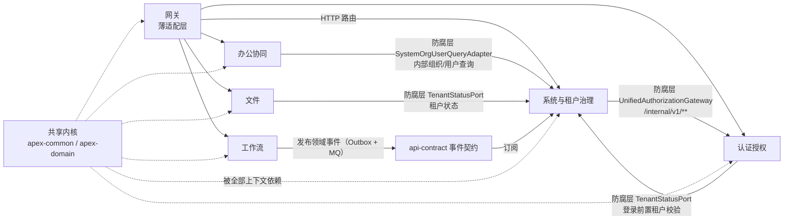

# 限界上下文映射（Context Map）

本文件是 DDD 战略设计的现行基线（方案 M3 / 批次 C0）。代码结构与本文不一致时以代码为准，并应同步修订本文。

## 1. 上下文清单

| 上下文 | 模块 | 聚合根示例 | 职责 |
| --- | --- | --- | --- |
| 系统与租户治理 | `apex-system` | `UserEntity`、`RoleEntity`、`TenantEntity`、`TenantPackageEntity` | 用户/组织/角色/菜单、租户目录与生命周期、套餐与配额、平台配置 |
| 认证授权 | `apex-auth` | `UserEntity`（认证侧）、`TokenEntity`、`SessionEntity`、`OAuth2Authorization` | 登录、令牌签发/轮换/撤销、OAuth2 四种授权、consent、MFA |
| 工作流 | `apex-workflow` | `WorkflowDefinition`、`ProcessInstance`、`Task` | 流程定义（DAG）、实例推进、任务审批 |
| 文件 | `apex-file` | `DocumentEntity`、`FileRecord`、`FileShare` | 上传/分片/下载、分享、存储后端适配 |
| 办公协同 | `apex-office` | `Message`、`MessageTemplate`、`MeetingRoom`、`OfficeOrg` | 站内信与投递、办公平台同步、会议室 |
| 网关（薄适配层） | `apex-gateway` | —（无业务聚合） | 路由、验签、限流、灰度、访问日志 |

## 2. 上下文关系（合作模式）

| 关系 | 模式 | 约束 |
| --- | --- | --- |
| 网关 → 业务上下文 | 客户-供应商（网关为调用方） | 网关不实现业务逻辑，仅路由与横切；`GatewayArchTest` 强制 |
| 系统 ← 认证/文件/办公 | **防腐层（ACL）** | 跨上下文只能经 `domain/gateway` 端口 + `/internal/v1/**` 内部契约；不得直接读取对方库表 |
| 工作流 → 系统 | **事件驱动（Outbox + MQ）** | 只经 `apex-api-contract` 事件契约，异步解耦，禁止同步回调 |
| `apex-common` / `apex-domain` | **共享内核** | 只容纳跨域复用契约（上下文、结果、异常、基础实体、通用端口）；不得出现具体业务实体 |
| 所有上下文 | 独立数据库 + 独立 Flyway 链 | 不跨库事务；一致性经既有事件/补偿模式 |

## 3. 编码约束（ArchUnit 固化）

由 `LayeringArchTest`（system）、`GatewayArchTest`、`TenantIsolationArchTest`，以及 M3 新增的跨上下文守卫共同保证：

1. **分层**：domain 不依赖 interfaces/infrastructure；application 不依赖 interfaces/infrastructure（既有）。
2. **跨上下文**：业务库之间不得相互 `import` 对方的 `domain/application/infrastructure` 包；跨上下文只能经 `apex-domain` 的 gateway 契约、`apex-api-contract` 的 DTO/事件，或 HTTP 防腐层（M3 新增）。
3. **事件发布**：业务代码不得直接持有 MQ 客户端；领域事件必须经 `DomainEventPublisher` / `DomainEventChannel` 端口（M3 新增）。
4. **租户隔离**：持久层禁用 `@InterceptorIgnore`（既有 `TenantIsolationArchTest`）。
5. **时间字段**：指定命名的时间字段类型受 `TimeFieldArchTest` 约束（既有）。

## 4. 聚合与值对象示范基线

每业务库选定一个核心聚合做示范深化（不推广为全仓重写）：

| 上下文 | 示范聚合 | 已体现的战术模式 |
| --- | --- | --- |
| 系统与租户治理 | `TenantEntity` + `TenantQuota` | 值对象封装（`TenantQuota` MB/用户数口径），不变量集中在聚合根（生命周期状态机 + 配额断言），领域异常（`TenantLifecycleException` / `TenantQuotaExceededException`） |
| 认证授权 | `TokenEntity` + `TokenPair` | 轮换族（`tokenFamily`/`previousJti`）、撤销状态机、值对象承载签发结果 |
| 文件 | `DocumentEntity` | `attachFile` 行为方法维护文件元数据不变量 |

后续新增聚合应参照以上基线：不变量放聚合根、口径封值对象、跨聚合一致用领域事件。

## 5. 演进方向

- C7：业务库升级为可独立装配的能力组件（自动装配入口 + 组件契约元数据）。
- C8：事件通道抽象（同进程 local / 跨服务 remote 自适应），支撑 C9 组合部署拓扑。
- C4：apex-system interfaces 层迁至运行模块（D07），使五服务形态统一。
