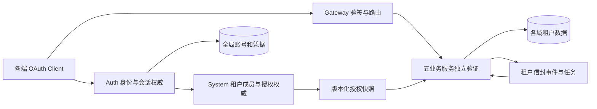
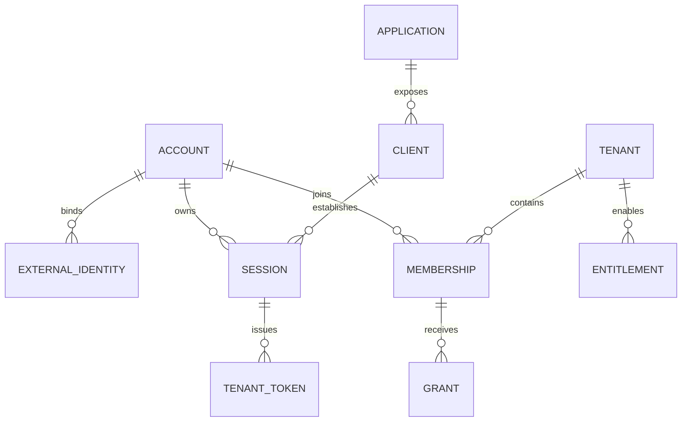
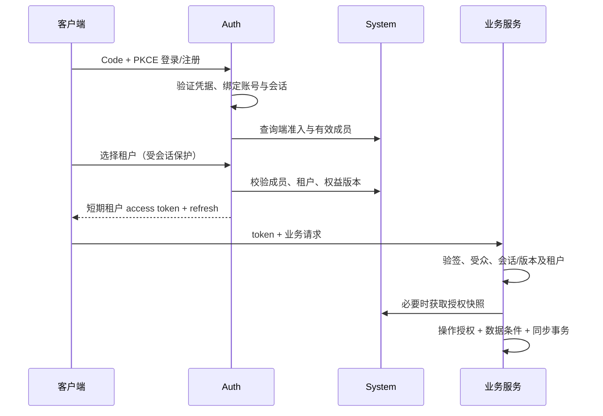

# Java 21、统一认证授权与全业务多租户实施方案

> 2026-10-19 consent V40 修复进展：已新增 system 所属 `db/upgrade/mysql`、`db/upgrade/postgresql` 显式前置修复及 PG 原始 V40 事务包装器，未修改历史迁移与旧失败证据。真实 MySQL 9/PostgreSQL 17 覆盖旧多行、部分加列、主键已丢失、已有 ID 四种结构，验证唯一键、权限/中文数据、ID/时间保留及重入。MySQL 前置完成后原 V40 全文件及重放通过；PG 按资源相对目录复制原始前置脚本、事务包装器及 V40，核对容器内 SHA-256 后实际以 `psql -v ON_ERROR_STOP=1 -f` 执行原包装器的 `\ir` 与重放；提交前除零仍单独以展开全文方式验证事务回滚。已有 `id` 非 `VARCHAR(100)` 时前置脚本明确拒绝并回滚。仍须 DBA 协调 Flyway 历史，本轮不证明 Flyway 启动、历史标记或完整升级链，不自动 repair/改 checksum。新增修复证据不计入原脚本原生分支验收，`verified_union=403/586`、剩183保持不变；详见阶段报告与部署指南。

> 2026-10-19 V51 最新结果：两个动态守卫6/6分支及完整文件重放在真实MySQL 9.x.46通过，清理成功后新增8项，独立复算有效覆盖为 **411/586，剩175**。V40原生失败45项仍不计分，consent前置修复证据仍不混入原生覆盖。详见第27节；P0仍未准出。

> 2026-10-19 本轮P0记录收口：实际调用 `verified_union()` 并以独立扫描复核，当前有效去重覆盖为 **489/586，剩97**；相对V51时点411新增78项，来自MySQL V37（15）、V44（32）及PostgreSQL V14/V15/V16（31），不是V42新增。V42部分提交诊断15场景确认、清理成功，新增0项；两轮证据hash和限制见第29节。以上旧时点411/403及历史结论保留；当前状态以本条和第29节为准，P0仍未准出、Java 21未切换。

> 2026-10-19 V42 恢复工具：新增显式离线结构恢复入口及真实隔离验证，先记录缺工具 RED 再实现；默认只读计划，显式 `--offline --apply` 才补齐结构。全预检拒绝不兼容列/索引/后三表/view，保留非空 token 与 inactive 密钥，不更新 Flyway 历史。恢复不代表原 V42 可重放，也不计原生覆盖；当前仍为 **489/586，剩97**。操作见[部署说明](../05-operations/deployment.md)，最终运行及证据见[阶段报告](../06-testing/jdk21-unified-auth/20261016-p0/report.md)新增恢复章节。

## 1. 文档状态与评审说明

> **2026-10-24 本次评审轮次说明（待评审，最新状态以本条为准）：** 本文此前在历史阶段已获用户明确批准进入实施，并已开展第18–42节记录的P0实际核查与修复工作，相关源码改动（如 `UserRegistrationTransaction`、`JdbcWorkflowTaskTransaction`、`MessageOutboxDispatcher`、`WorkflowSecurityConfig` 等）经本轮只读核实确认真实存在于当前工作区，不是虚构记录。现工作区只读 `git status` 统计的已跟踪变更已增长至 951 项，印证历史实施记录的真实性；本次评审不回退、不删除、不篡改第3–1160节已记录的任何历史事实、证据哈希或测试结果。
> 另一方面，用户于2026-10-24重新下达指令，明确要求"本任务必须分为方案编制与评审、批准后实施两个阶段"且"当前只授权第一阶段……未经我明确批准方案，不得开始代码、数据库迁移、构建环境、依赖、脚本、配置和测试代码的实际改造"，并要求方案状态为"待评审/待确认"，不得预填"已批准"。据此，本文下方"状态"字段及历史"已批准进入实施"表述，对应的是**历史已经发生、且已通过真实构建/测试验证的既成事实**，而**本次新一轮评审请求本身**（即第42节之后是否继续新增实施、是否启动Java 21切换、是否推进O01–O08产品机会点的实际开发）**处于待评审/待确认状态**，需要用户针对本次更新内容给出明确的范围或阶段批准后才能继续。沉默、仅询问方案内容、仅要求修改方案、与实施无关的"继续"均不构成本次批准。在获得本次新批准前，不会发起任何新的代码、迁移、构建、部署或测试执行动作；已完成的历史P0证据保持原状，不因本次评审而回滚。

> 2026-10-20 适用范围更正：用户明确确认项目从未部署，当前为新开发。当前交付按全新库首次部署验收；真实旧发布制品、存量前驱快照、生产原始Flyway history、存量token转换与旧生产版本回退不作为本轮P0阻塞项。此前有关这些材料缺失的记录保留为历史调查，不再作为当前必需材料。最新验收口径见第41节；本次范围更正不代表P0自动准出或Java21兼容验证通过。

- 状态：**历史阶段已获批准并进入实施（P0尚未准出，Java 21未切换）；本次2026-10-24新一轮评审请求处于待评审/待确认状态，后续是否继续实施须经用户本次明确批准**；方案版本 v1；编写及官方资料查询日期：2026-10-16（Java 21官方资料核查距今已超过一周，实施前须按第5节重新核实候选版本是否仍为当时记录的最新稳定补丁）。最新V51状态见第27节：有效覆盖**411/586，剩175**；以下第21–26节为前轮状态：V55八项、V15 184项、V16 24项、V59 16项及V43 24项限定MySQL合成fixture验证通过；V40真实轮次因非空主键改造触发1062，45项不计分，去重覆盖仍为**403/586，剩183**；该数字不代表全局语义验收完成。V15旧失败证据保留，独立重跑验证46组138次分支、46个缺表no-op及23表目录/数据重放，临时容器清理成功；重复重跑不重复计分。两条Outbox方言与消息dispatcher修复及此前Java 21全仓clean verify成功已记录；V59完整文件回填及重放在明确兼容collation的合成夹具通过，首次1267失败保留，不证明生产collation安全。本轮范围仅Python与docs，探针33项、三组采集器63项合计96项通过；V43此前真实MySQL验证21组63次分支、21个缺表及46个逐列缺失no-op；最新隔离venv全集188项通过，0失败/0错误/0跳过，540.834s，限执行当时17模块；此前cryptography缺失3错误在该范围收口，后续新增文件未包含。当前V19/V42诊断新增0项，覆盖仍为411/586、剩175。本次仅持久化摘要并复核环境，未重跑Java门禁或Python全集；详见第28节。表权威4 reviewed/67 partial/19 unknown仍为既有口径；生产时钟、过期PROCESSING恢复、真实RocketMQ、历史升级链与生产配置/启动等缺口继续保留，全部历史章节和旧hash保持原样。
- 执行授权记录：用户明确要求“请按照上述方案执行”，并再次要求继续执行；配套文档、配置、脚本、测试与真实报告随阶段交付。该授权不代替 D01–D07 中需要单独确认的许可、运行栈及不可逆操作决策。当前记录见[P0 阶段报告](../06-testing/jdk21-unified-auth/20261016-p0/report.md)。
- 调研基准提交：`0c506a7ee0f94a07b359edda8ebbab4aac60dab3`。工作区并非干净提交：历史阶段只读 Git 调查当时发现 381 项已跟踪文件变更；本次2026-10-24评审轮次重新只读核查 `git status --porcelain=v1` 统计为 **951** 项（含部分文件删除，如构建期临时脚本），说明工作区在历史P0实施过程中持续产生新改动，不是静止状态。本方案以**当前工作区实际源码**为依据，不能仅凭提交 SHA 或历史统计数字重现全部事实；本次新一轮实施前必须重新核对差异、文件清单与迁移版本，不得沿用381这一过期数字判断改动范围。
- 历史评审阶段仅执行方案编制、只读调查与文档检查，未实施改造。批准后已开展 P0 核查、构建初始化脚本修复及测试；具体执行结果按阶段报告记录，不继承历史报告的通过状态。未切换 Java 21、执行生产迁移、部署、提交或推送。
- 本文的“事实”表示静态源码或官方资料依据；“建议/目标”表示待批准设计；“待验证”表示实施阶段才能取得的运行证据。测试文件存在不表示测试已通过。
- 当前构建规则已切换为 SDKMAN Temurin JDK `21.0.13.0+9-tem` 与 mvnd `2.0.0-rc-3`（`.sdkmanrc` 固定），`release/source/target` 均为 21。本机实测 `openjdk version "21.0.13" 2026-10-20 LTS`，全仓 `mvnd -T4 -B clean verify` 以该基线执行；Java 21 全量门禁结论以 [TEST_REPORT](../06-testing/TEST_REPORT.md) 本轮记录为准。
- 本文为本次唯一评审入口，接口、模型、任务及验收细节均在本文。已有[多端集成方案](multi-client-integration-plan.md)保留历史决策，但其页首完成声明、旧模块图及正文待建设描述存在时间口径差异；本方案不据此认定统一认证已经完成，也不覆盖其内容。已有[Javadoc 方案](../08-project-management/plans/ai-assisted/javadoc-lombok-build-plan.md)仅作历史参考，本次按当前模块重新界定范围。
- 评审批准须明确范围或阶段。沉默、局部技术结论确认、询问内容或要求继续完善方案均不构成实施批准。批准后仍须执行第 15 节准入核查。

> 2026-10-21 机会点补充：已按用户提供的“能力成熟度地图”核查当前工作区源码，八类机会点均有增量建设空间，具体差距、方案、接口建议、阶段依赖及验收见第42节。该节校正截图中的成熟度描述，不表示功能已实现或测试已通过；本次授权范围为分析与更新本文，未实施新增业务能力。第41节“未部署、全新库首次部署”的适用范围继续有效。

## 2. 需求与验收目标

统一账号表示同一自然人在各端使用同一个 accountId；端准入表示某 OAuth client/终端可用；租户成员资格表示该账号属于某租户；资源权限表示可以对该租户内某资源执行某操作。这四者分别校验，任何一个都不能替代其他三个。

建议账号不属于租户，成员资格属于租户。个人租户是用户拥有的独立业务空间，组织租户是多人协作空间；同一账号可以拥有一个个人租户并加入多个组织租户。个人租户不等于全平台默认租户，跨端注册不重复创建个人租户，也不自动授予组织成员身份或管理端准入。

| 需求编号 | 场景与预期行为 | 验收编号及依据 |
| --- | --- | --- |
| R01 | 固定 Java 21 LTS，所有编译、测试、运行入口使用通过兼容验证的同一补丁基线 | A01：矩阵、全门禁和真实部署证据 |
| R02 | PC 管理/网站、H5、公众号、小程序、Android/iOS 统一登录、回调及会话 | A02：各端真实流程及非法回调反例 |
| R03 | 任一端注册后其他端识别同一账号，冲突须验证身份后处理 | A03：跨端注册、绑定、合并与重复并发 |
| R04 | 平台、租户、端、用户、用户在指定端的权限可管理且不越权 | A04：允许/拒绝/过期/委派及菜单接口一致性 |
| R05 | 每类资源按操作执行行级/对象级数据权限 | A05：列表、总数、统计、导出、读写反例 |
| R06 | 全部业务及异步基础设施真实隔离 | A06：双租户同业务键、交叉 ID、后台及消息测试 |
| R07 | 租户目录、开通、状态、配置、配额与受控扩展全生命周期 | A07：权益生效、并发限额和停用卸载 |
| R08 | 文档、脚本、配置、测试与真实报告同步交付 | A08：资产清单与证据可追溯 |
| R09 | 全仓手写生产及测试 Java 的专业 Javadoc 完善和持续检查 | A09：声明清单、doclint、覆盖及语义抽查 |
| R10 | 双库全新初始化/存量升级、兼容发布与明确回退边界 | A10：迁移演练、对账、回退/前滚证据 |

需求细分：R02.1 协议与跳转、R02.2 会话生命周期；R04.1 权限合成、R04.2 快照及撤权；R05.1 查询与写保护、R05.2 上下文；R06.1 各业务持久化、R06.2 非数据库资源；R07.1 功能权益、R07.2 扩展；R08.1 配套资产、R08.2 报告；R09.1 存量补齐、R09.2 持续门禁；R10.1 数据治理、R10.2 上线回退。细分项继承主需求验收，并由第 14、17 节展开。

## 3. 现状调查与依据

### 3.1 模块与归属

[根 POM](../../pom.xml)聚合 30 模块；[AGENTS](../../AGENTS.md)规定当前边界。common/domain/api-contract 为共享基础/端口/契约，五个 infrastructure 能力 JAR 承载持久化、缓存、消息、远程及集成；旧 infrastructure 为兼容 JAR。system/auth/workflow/file/office 为业务库，gateway 与五个 service 为运行入口，另有 job/masking、job/seata/storage/license starter、license-tools、example/generator。services-bom 无生产 Java。共享层不得反向依赖具体业务；system 实现在 system 四层中，不能恢复已退出 reactor 的 interfaces/application 模块。

### 3.2 事实、缺口与影响

下表引用工作区源码正文；类名所代表的能力只有在对应调用链实际使用时才算覆盖。

| 事实及状态 | 依据（仓库根相对路径） | 设计影响 |
| --- | --- | --- |
| auth 普通登录、OAuth2 与 system 本地/SSO 登录并存；部分统一 | [auth 登录](../../apex-auth/src/main/java/com/apex/scaffold/auth/application/service/AuthenticationApplicationService.java)、[system AuthService](../../apex-system/src/main/java/com/apex/scaffold/application/service/AuthService.java)、[system OAuth2](../../apex-system/src/main/java/com/apex/scaffold/application/service/OAuth2AuthorizationServiceImpl.java) | 必须收敛签发与主体契约 |
| auth 普通 JWT 为 RS256；system 先走对称密钥解析后才识别中心 token | [密钥服务](../../apex-auth/src/main/java/com/apex/scaffold/auth/domain/service/JwtKeyMaterialService.java)、[过滤器](../../apex-system/src/main/java/com/apex/scaffold/interfaces/security/JwtAuthenticationFilter.java)、[JwtUtil](../../apex-common/src/main/java/com/apex/scaffold/common/util/JwtUtil.java) | 当前中心签发到业务消费不能宣称已贯通 |
| auth OAuth2 的 JWKS 来自另一套 OAuth2 配置密钥；网关使用配置公钥列表 | [元数据](../../apex-auth/src/main/java/com/apex/scaffold/auth/application/service/OAuth2MetadataService.java)、[网关验证器](../../apex-gateway/src/main/java/com/apex/scaffold/gateway/security/GatewayJwtVerifierService.java) | 单一 issuer/key-ring、轮换分发待建设 |
| auth OAuth2 强制 S256、授权码及刷新条件更新；仍要求 secret，支持 password grant，缺 ID Token/UserInfo 完整闭环 | [OAuth2Service](../../apex-auth/src/main/java/com/apex/scaffold/auth/application/service/OAuth2Service.java)、[授权仓储](../../apex-auth/src/main/java/com/apex/scaffold/auth/infrastructure/persistence/repository/OAuth2AuthorizationRepository.java) | PKCE 不等于 public client/OIDC 完成 |
| auth 普通 refresh 条件消费但新签发未延续 clientType；SessionService 未形成登录创建闭环 | [TokenServiceImpl](../../apex-auth/src/main/java/com/apex/scaffold/auth/application/service/TokenServiceImpl.java)、[SessionService](../../apex-auth/src/main/java/com/apex/scaffold/auth/application/service/SessionService.java) | token/session/family 原子性与重放检测待补齐 |
| system sid 多会话已实现；全端登出清除 refresh 槽，其他 access 并非均即时撤销 | [缓存 TokenService](../../apex-infrastructure-cache/src/main/java/com/apex/scaffold/infrastructure/security/service/TokenServiceImpl.java)、AuthService 与 JWT 过滤器 | 需要显式撤销 SLA 与服务端状态校验 |
| 多渠道、一次性绑定票据存在；按端授权模型缺失 | [注册服务](../../apex-system/src/main/java/com/apex/scaffold/application/service/AuthRegistrationService.java)、[票据服务](../../apex-system/src/main/java/com/apex/scaffold/application/service/auth/AuthTicketService.java)、[ClientType](../../apex-common/src/main/java/com/apex/scaffold/common/enums/ClientType.java) | 复用渠道适配，不把标签作为授权 |
| auth account_id nullable 普通索引；system 统一授权还有配置映射，缺自动建档闭环 | [auth MySQL V55](../../apex-auth-service/src/main/resources/db/migration/mysql/V55__auth_user_account_binding.sql)、[授权客户端](../../apex-system/src/main/java/com/apex/scaffold/infrastructure/remote/AuthCenterPermissionClient.java) | 独立映射表、数据对账及事件幂等 |
| system 统一授权默认关闭；启用后检查远端 tenant/user、拒绝未知/CUSTOM 范围 | [UnifiedAuthorizationService](../../apex-system/src/main/java/com/apex/scaffold/application/service/UnifiedAuthorizationService.java)、[service 配置](../../apex-system-service/src/main/resources/application.yml) | 有可复用 fail-closed 入口，尚非全仓授权 |
| 通用 OIDC 适配器的 ID Token 为 payload 解码；Keycloak 成功回调仍有 URL token 交付 | [OidcProtocolAdapter](../../apex-system/src/main/java/com/apex/scaffold/application/support/sso/OidcProtocolAdapter.java)、[成功处理器](../../apex-system/src/main/java/com/apex/scaffold/interfaces/security/OidcAuthenticationSuccessHandler.java) | 改用验证完整的 OIDC 与一次性 code 交付 |
| 网关剥离外部身份头、拒绝 internal；auth internal permitAll，服务直连身份边界待验证 | [JwtSignatureFilter](../../apex-gateway/src/main/java/com/apex/scaffold/gateway/filter/JwtSignatureFilter.java)、[AuthCenterConfig](../../apex-auth-service/src/main/java/com/apex/scaffold/authservice/config/AuthCenterConfig.java)、[共享公开路径](../../apex-common/src/main/java/com/apex/scaffold/common/constant/SystemConstants.java) | 网关和业务独立验证；登录匿名路径须端到端核对 |
| 租户插件可选，默认 false，白名单包含角色/权限/配置/Outbox 等 | [MybatisPlusConfig](../../apex-infrastructure-persistence/src/main/java/com/apex/scaffold/infrastructure/persistence/config/MybatisPlusConfig.java)、[DefaultTenantLineHandler](../../apex-infrastructure-persistence/src/main/java/com/apex/scaffold/infrastructure/persistence/datapermission/DefaultTenantLineHandler.java) | 逐表分类，不能直接沿用白名单 |
| 数据范围只保护 SELECT，缺 scope 放行；生产接入主要是用户搜索 | [拦截器](../../apex-infrastructure-persistence/src/main/java/com/apex/scaffold/infrastructure/persistence/datapermission/DataScopeInnerInterceptor.java)、[管理用户服务](../../apex-system/src/main/java/com/apex/scaffold/application/service/AdminUserManagementService.java) | 资源注册、默认拒绝与写条件需补齐 |
| SELF 默认 user_id 与 sys_user.id 不一致；复杂 SQL 覆盖有限 | [DataScope](../../apex-common/src/main/java/com/apex/scaffold/common/annotation/DataScope.java)、[SQL 重写器](../../apex-infrastructure-persistence/src/main/java/com/apex/scaffold/infrastructure/persistence/datapermission/DataScopeSqlRewriter.java) | 类型化字段映射及真实 SQL 测试 |
| 租户状态/配额断言未普遍接入创建链；到期未纳入 canCreateBusinessData | [TenantApplicationService](../../apex-system/src/main/java/com/apex/scaffold/application/service/TenantApplicationService.java)、[TenantEntity](../../apex-system/src/main/java/com/apex/scaffold/domain/model/entity/TenantEntity.java) | 统一权益和原子配额门禁 |

### 3.3 各业务覆盖矩阵

| 业务 | 当前可复用点 | 必须补齐的具体路径 |
| --- | --- | --- |
| system | TenantContext、DataScopeJdbcBridge、权限切面、任务执行恢复租户 | 忽略表审查、全部资源/操作清单、租户生命周期、授权管理上限 |
| auth | [JdbcTenantScope](../../apex-auth/src/main/java/com/apex/scaffold/auth/infrastructure/persistence/repository/JdbcTenantScope.java)要求上下文且核对请求租户 | 全局身份与租户成员分离；[生物认证服务](../../apex-auth/src/main/java/com/apex/scaffold/auth/infrastructure/service/BiometricAuthServiceImpl.java)按 ID 管理缺归属；R2DBC 显式条件 |
| workflow | 部分显式 tenant、超时执行基础 | [持久化配置](../../apex-workflow-service/src/main/java/com/apex/scaffold/workflowservice/config/WorkflowPersistenceConfig.java)仅分页；[查询](../../apex-workflow/src/main/java/com/apex/scaffold/workflow/application/query/WorkflowQueryService.java)、[任务仓储](../../apex-workflow/src/main/java/com/apex/scaffold/workflow/infrastructure/persistence/repository/TaskRepositoryImpl.java)按 ID/更新缺统一租户；转办、委派、超时关联成员校验；String/Long 类型冲突 |
| file | [FileAccessContext](../../apex-file/src/main/java/com/apex/scaffold/file/application/service/FileAccessContext.java)及核心文件/分片归属检查 | [文档服务](../../apex-file/src/main/java/com/apex/scaffold/file/application/service/impl/DocumentServiceImpl.java)、[图表服务](../../apex-file/src/main/java/com/apex/scaffold/file/application/service/impl/ChartServiceImpl.java)详情和计数按 ID；save 不得改写 tenant；预览、下载、导出统一策略 |
| office | [消息同步事务](../../apex-office/src/main/java/com/apex/scaffold/office/off/infrastructure/persistence/repository/MessageDeliveryRepositoryImpl.java)、消息关系授权及 tenant/user WS 路由 | [消息插件](../../apex-office-service/src/main/java/com/apex/scaffold/officeservice/config/MessageTenantConfig.java)仅两表；审批、日历、模板、组织、同步历史分别治理；WS 当前单实例内存 |
| job | [JobScheduler](../../apex-system/src/main/java/com/apex/scaffold/application/job/JobScheduler.java)逐任务恢复 tenant；代理固定九接口 | [JobInitializer](../../apex-system/src/main/java/com/apex/scaffold/application/job/JobInitializer.java)无 tenant 全局扫描与插件冲突；受控枚举，不能白名单整个 sys_job |
| masking | 无持久化，独立 JWT、scope 与 tenant 策略 | [MaskingHandler](../../apex-masking-service/src/main/java/com/apex/scaffold/maskingservice/interfaces/MaskingHandler.java)使用 tenant_id，与其他 tenantId 契约收敛 |
| 基础设施 | 事务 Outbox、部分 tenant 幂等键、事件恢复样例 | [领域 Outbox dispatcher](../../apex-infrastructure-messaging/src/main/java/com/apex/scaffold/infrastructure/event/DomainEventOutboxDispatcher.java)原生执行器恢复上下文；[MQ dispatcher](../../apex-infrastructure-messaging/src/main/java/com/apex/scaffold/infrastructure/outbox/dispatcher/MessageOutboxDispatcher.java)传递 tenant；双库方言和重试状态机 |

源码迁移版本集合（不是数据库已执行版本）：system V1–V62、auth V44–V57、workflow V1–V2、file V1–V5、office V1–V3，两库目录均存在。实施时重新读取各域最新版本及 Flyway history 后分配版本。已有 system V59 社交唯一键 `(channel,open_id)` 缺 provider/app 维度，历史回填主键生成需真实迁移验证；后续身份模型变更采用新增迁移，本轮初始化缺陷历史 SQL 修订的受控例外见第 11.2 节。

### 3.4 工程现状

[根 POM](../../pom.xml)为 Boot 3.5.15、Java 21，Cloud 2025.0.0、Alibaba 2025.0.0.0、bootstrap starter 5.0.0；Security 6.5.0、Reactor 3.6.13、Micrometer 1.14.1 为主动覆盖。不能认为完全使用 Boot BOM 默认组合。

[初始化脚本](../../scripts/build/init-build-env.sh)与[SDKMAN](../../.sdkmanrc)固定 Temurin `21.0.13.0+9-tem`；[CI](../../.github/workflows/ci-cd.yml)与[发布](../../.github/workflows/release.yml)为 Temurin 21；[Containerfile](../../Containerfile)构建与运行均为 Temurin 21，预下载 POM 已补五设施及 storage；[部署 app.sh](../../scripts/deploy/service/app.sh)使用 PATH java。本轮已完成构建环境与容器镜像基线切换。

Javadoc 插件 3.6.3 仅 pluginManagement，`doclint=none/failOnError=false`；多套文本扫描脚本不覆盖全测试源码，也不能准确统计声明覆盖率。历史“100%”报告不可当作当前基线。完整运行状态、有效依赖树、真实数据库迁移与多端验收均待验证。

### 3.5 P0 本轮实测进度（2026-10-17）

以下补充当前实施事实，原评审调查与失败历史仍保留于[P0 阶段报告](../06-testing/jdk21-unified-auth/20261016-p0/report.md)，不据此宣称 P0 准出：

- Java 21 修改前完整 `clean verify`：31 个 reactor 项目成功，5050 项测试、失败 0、错误 0、跳过 1；Seata 真实 TC 跳过不算通过。此门禁早于后续 SQL 修订；修订后 system 定向 12 项及所选 10 项 reactor Spotless 通过。后续[独立完整门禁证据](../06-testing/jdk21-unified-auth/20261016-p0/post-repair-verify-evidence.json)记录 16:51:01–17:04:20 +08:00 的完整 `clean verify` **自然退出 1、BUILD FAILURE**：31 项中 26 成功、2 失败、3 跳过；Surefire 4648 项，失败/错误/跳过均 0；Failsafe 104 项，失败 0、错误 7、跳过 1。未切换 Java 21，旧成功及中断历史保留。
- [网关配置证据](../06-testing/jdk21-unified-auth/20261016-p0/gateway-config-evidence.json)：25 个来源、23 条静态路由声明、624 条引用，网关作用域 41 个去重环境变量中 29 个无显式 gateway Compose 候选。工具仅覆盖 gateway 与所选部署入口，不是全业务配置全量；未合并 Spring/Nacos 优先级、求解 profile 或验证运行注入、有效路由与可达性。
- 旧[十库结构证据](../06-testing/jdk21-unified-auth/20261016-p0/final-schema-evidence.json)与[对照](../06-testing/jdk21-unified-auth/20261016-p0/schema-comparison.json)保留历史口径（system 96/81 对象、1347/1156 列）。后续固化[数据库工具](../../scripts/ci/source-archive/scripts/ci/collect_database_schema.py.source)已真实执行 `--collect` 与 `--compare`，对 V62 最终 system 双库只读采集 catalog/history，见[新采集证据](../06-testing/jdk21-unified-auth/20261016-p0/schema-alignment-final-catalog-evidence.json)和[新对照](../06-testing/jdk21-unified-auth/20261016-p0/schema-alignment-final-comparison.json)。两库各 **96 对象、1348 列、62 条成功 history**，各自 history checksum 匹配当前源；对象、列存在性与业务列可空性差异均为 0。索引为 MySQL 451 / PostgreSQL 456，约束 152 / 141，不以数量不同直接判语义失败。
- [配对 V62 修复证据](../06-testing/jdk21-unified-auth/20261016-p0/schema-alignment-repair-evidence.json)：PostgreSQL 补14表1视图、OAuth16列和用户安全9列、keycloak_sub扩255；MySQL补off_sync_history.update_time、恢复四项业务NOT NULL并在持久DDL前拒绝存量NULL；两库workflow默认统一DRAFT且保留存量ACTIVE，补有效遗漏索引。定向8项通过，涵盖双库V61→V62、validate、无pending、重复migrate为0、数据保留及NULL负例；NULL负例恢复测试值后repair仅属隔离测试流程，不代表生产repair授权。剩余337项类型、1348项generation、242项raw default、98项列顺序、14项索引签名multiset差异未证明全部语义等价；两项可空性差异仅为视图COUNT元数据。其他四域旧表/列名集合一致也不代表业务语义验收。
- 三项修复后的[最终完整门禁证据](../06-testing/jdk21-unified-auth/20261016-p0/final-repair-verify-evidence.json)记录 21:35:03–21:53:36 +08:00 的 `mvnd -T4 -B clean verify` **自然退出 1、BUILD FAILURE**：31 项中 27 成功、1 失败、3 跳过。Surefire 4649 项，失败 1、错误 0、跳过 0；Failsafe 103 项，失败 0、错误 0、跳过 1，按插件汇总去重。Ryuk 正常启动，system 的 1542 项单测与 14 项集成测试均通过，含双库 V61→V62。office 七文件格式修复及此前检查见[修复证据](../06-testing/jdk21-unified-auth/20261016-p0/container-format-repair-evidence.json)；本轮唯一失败为 `OfficeOpenApiContractTest`：生成的 `GET /admin-api/v1/office/apps` 响应 schema 引用未满足 `OfficeAppListResult` 契约。Router/Handler 已声明 implementation，生成/合并机制的深层原因尚未证明；超出本轮 V62 计数、格式、连接的最小修复范围，未改断言或重复重跑。Spotless/PMD/JaCoCo 各覆盖 27 个模块，部分 JaCoCo 缺数据跳过；office-service 止于 Surefire，未到后续质量检查，example、system-service、auth-service 被 reactor 跳过。Seata 真实 TC 环境门控跳过仍不算通过，不能称全仓门禁成功。
- 已提供可复用的网关配置工具（当时位于临时工具工程 `scripts/ci/java/src/main/java/GatewayConfig.java`，未入库、现已移除）与[数据库结构工具](../../scripts/ci/source-archive/scripts/ci/collect_database_schema.py.source)及测试；新增测试 6+15 项来自测试子代理报告。阶段报告记录主代理加载固定环境后的组合复验已退出 0：采集测试 49 项、init 测试 13 项，合计 62 项通过；这是脚本验证，不替代 Java 完整门禁。

- OpenAPI修复后的相关单测已核对原始日志 `/Users/eric/.cache/office-openapi-related-tests-20261017-17735.log`：八模块Surefire合计 **1126项通过，Failures/Errors/Skipped均0**，含 `OfficeOpenApiContractTest` 两项；所选10个reactor项目 `BUILD SUCCESS`，结束于22:22:57 +08:00。这是局部单测，不替代完整verify；原始日志hash与行号见阶段报告。
- 后续[完整命令证据](../06-testing/jdk21-unified-auth/20261016-p0/post-openapi-verify-evidence.json)记录 **23:01:06–23:19:27 +08:00自然退出1**，客户端报 `DaemonException$StaleAddressException`；已核对原始日志及SHA-256。没有最终Reactor Summary或Maven BUILD结论，不能写成BUILD FAILURE或推算最终模块状态。同轮 `WorkflowDatabaseHttpIntegrationTest.pendingTasksUseAuthenticatedAssignee` 在HTTP响应断言前5秒blocking-read超时，根因未证实，不直接记负载flake。已完成插件的**部分统计**为Surefire **4279**（失败/错误/跳过均0）、Failsafe **38**（Failures 0、Errors **1**、Skipped **1**）；system Failsafe未汇总，不混入类级结果。office-service本轮被调度器跳过，**Office OpenAPI未执行**；infrastructure、file-service也明确跳过，example、system-service、auth-service未见启动或终态，不能自行计为Reactor SKIPPED。仅观察到Spotless/PMD各24模块、JaCoCo25模块35次check，不是全仓质量验收。

- 最新[Java17基线重试证据](../06-testing/jdk21-unified-auth/20261016-p0/baseline-retry-evidence.json)记录两次固定环境 `-T1` 构建。workflow真实H2/HTTP定向于23:45:53自然退出1：3项中Errors 1，相同111行5秒超时仍复现；无SQL/连接池/请求阶段耗时证据，不能直接认定负载flake或业务缺陷。随后23:48:06至次日00:08:06的全仓 `clean verify` 自然退出1、`BUILD FAILURE`，完整Reactor为13 SUCCESS、1 FAILURE、17 SKIPPED；唯一失败goal为system七文件Spotless。按15条完整插件汇总，Surefire2694、Failsafe22均无失败/错误/跳过，只代表失败前范围；system1549项单测和14项集成通过，workflow HTTP、Office OpenAPI本轮未执行。Spotless到达14模块、13通过；PMD到达13模块；JaCoCo14模块22次check、两次缺数据跳过，system最终质量检查未完成。Ryuk正常启动，Seata starter本轮Reactor跳过，真实TC仍未验收。两次新命令均正常收到Maven终态，旧daemon最后keepalive与客户端3秒接收超时的底层原因仍未明，不能推定OOM。独立daemon在同工作区与两次构建重叠，并执行过指定文件格式操作；不能声称全过程隔离、源码冻结或共享target专属本轮，不据此推断其造成格式失败。已停止重试，保留历史失败及独立日志/hash，未改SLA、断言或新增跳过。

- 2026-10-18 [门禁修复续验证据](../06-testing/jdk21-unified-auth/20261016-p0/p0-gate-repair-evidence-20261018.json)：清理旧 apex-example Druid/Flyway 连接等待进程后，system 七文件定向 Spotless 通过（零格式变化）；移除 WorkflowHandler 七个重复不可重复 OperationLog 声明，恢复编译并定向格式化。原 workflow H2/HTTP 三项测试自然退出0，失败/错误/跳过均0，默认5秒超时及原断言不变；首请求服务端2045ms，SQL和连接阶段无异常，历史超时未复现但根因仍未证明。首次全仓 `mvnd -T2 -B clean verify` 于06:35:56自然退出1：17 SUCCESS、1 FAILURE、13 SKIPPED，system六个Handler共14处重复OperationLog导致编译失败。移除重复声明并保留禁止请求/响应正文采集的设置，SSO回调保留LOGIN分类；六文件定向Spotless通过。第二轮于06:49:59自然退出1、BUILD FAILURE：system完整模块成功，但WorkflowOperationLogAspectTest因completeTask关闭HTTP方法/状态元数据而失败。核对本地切面不读取正文后，仅开启该方法的元数据开关，原6项审计测试与格式检查通过。第三轮于06:53:59因common DateUtil新增空行格式违规自然失败，已仅对该文件定向格式化并检查通过；第四轮于07:06:36自然失败，25 SUCCESS、1 FAILURE、5 SKIPPED；完整插件汇总Surefire4647项通过，Failsafe53项失败/错误0、跳过1项真实TC。system新增MonitorMetricsCollector import顺序违规已定向格式化并检查通过。第五至七轮分别因office格式、LicenseGenerator import及cache重复构造器自然失败；读取后相关源码已变化，其中office及cache文件本代理未修改，LicenseGenerator定向格式检查零修改，cache定向编译通过。随后仅格式化预检实际发现的四文件空行，第八、九轮又因common三文件与domain单文件空行自然失败，均只定向格式化；后续LicenseValidator及两个Chuanglan文件格式修复后全仓格式预检通过；第十轮因remote构造器编译错误自然失败，当前源码未修改即定向编译通过，第十一轮自然失败，30项目成功，仅example因异步切面链注解绑定失败；OperationLogAspect改为读取实际方法注解后原七项能力集成通过，第十二轮08:10:44因file两文件/system八文件空行格式违规自然失败（18成功/2失败/11跳过），十文件定向格式化检查通过；第十三轮08:15:40因SubscriptionEntity重复构造器及office六实体格式自然失败（15成功/2失败/14跳过）；读取时显式构造器已消失，定向格式及当前源码compile通过，第十四轮08:27:26因auth四文件/system两文件空行格式自然失败（19成功/2失败/10跳过），完整插件汇总Surefire4236项无失败/错误/跳过、Failsafe25项失败/错误0及真实TC跳过1；六文件定向格式检查通过。第十五轮完整门禁于08:51:31 +08:00自然退出0、BUILD SUCCESS，用时19:15，31个Reactor项目全部成功；完整插件汇总Surefire4790项失败/错误/跳过均0，Failsafe300项失败/错误0、真实Seata TC环境跳过1。Spotless/PMD各覆盖31项目；JaCoCo共42次check、38次通过，根项目、services-bom、license-tools及兼容infrastructure四项目因缺执行数据跳过。最终日志SHA-256为 `d8e02918875b7465b44d679550a6dcb9eaf4e7c3296e1120c99ed99cda79ada3`，全部日志路径与hash见续验证据。

P0当前声明、迁移/API候选及模块/服务映射已于2026-10-18补采，仍欠声明统计口径确认、业务权威及契约关联、配置生效/注入条件和system双库类型、默认值、索引等语义差异分类；全业务本地配置静态扩围亦已补采。完整Javadoc语义交付在P6，运行验收按所属阶段落实，P0登记证据缺口与前置条件。system原七文件格式及完整模块已通过，workflow原HTTP三项和审计六项定向通过；历史workflow超时与旧mvnd失联根因仍未证明。第三至九轮的实际格式违规均已定向检查处理；第十轮因remote构造器编译错误自然失败，随后当前源码未修改即定向编译通过，第十一轮因example异步审计注解绑定失败，该问题定向修复后七项能力集成通过，第十二至十四轮新增格式违规已定向处理，第十五轮完整门禁已成功。成功结果对应此次执行，共享工作区不能宣称源码冻结；真实Seata TC环境仍未验收。存量升级、生产repair决策和上线回退尚未验证，**P0仍未准出**。各阶段依赖与D01–D07前置决策不因局部结果自动完成。

以下09:22记录保留历史时点；其中候选未处置、当前依赖未认证的状态已由下方10:08整合更新。

2026-10-18 09:22 +08的新时点资产已采集并[关联](../06-testing/jdk21-unified-auth/20261016-p0/asset-links-20261018.json)：30模块/31 reactor项目，2221 Java文件（main1654/test567）、26301显式声明，258静态路由和139未解析候选（397项全部关联源码声明、模块与服务候选），172份五域迁移含system配对V62、836表事件、136域/表组合、112规范化表名和628文本引用候选。旧快照完整保留；新资产对2493个唯一源文件重新核对hash，不能据HEAD重建共享工作区。未解析候选按九类技术成因及精确位置保留，不算运行故障或已解析路由。P0剩余为逐候选技术处置和网关/权限/DTO契约关联、逐域/表权威与tenant/唯一键/历史NULL确认、SQL未解析及双库语义差异分类、配置优先级/注入前置登记。31份POM中27份与旧基线同hash、4份变化；旧依赖树原日志缺失，35坐标仅为历史证据，当前有效树/档位/收敛仍未认证。插件声明已采集，Javadoc与Enforcer仅pluginManagement，不可当实际严格文档/收敛门禁。精确验收条件见[P0剩余资产与归属清单](../06-testing/jdk21-unified-auth/20261016-p0/report.md#p0-可执行剩余资产与归属核查)及[本次实采](../06-testing/jdk21-unified-auth/20261016-p0/report.md#2026-10-18-当前源码声明路由与五域迁移实采关联)。完整Javadoc实施仍属P6，存量升级/repair/回退实施仍属P7；P0仍未准出。

V62已修复对象/列存在性，不再将历史14表1视图列作当前缺表；auth四张安全表与system历史同名对象的权威/保留关系、其余11个无直接生产映射历史对象、OAuth16列/sys_user九安全列及office同步历史表的消费者仍待确认。未命中代码不能推导可删除。workflow业务键租户范围、file历史NULL、账号合并及历史回填规则须由实际所有者确认，不能猜测。

2026-10-18配置补采已扩展既有工具至schema 2，按30个reactor模块发现main配置，并覆盖本地Nacos、Compose、镜像、模板及scripts（含build）入口。[新静态证据](../06-testing/jdk21-unified-auth/20261016-p0/business-config-evidence-20261018.json)为138来源、1872配置定义、4652引用（720个去重环境名）、1661部署声明、622显式注入候选、474个scope/name映射（132同名Compose候选/342未解析），保留23条网关路由声明及旧快照。3703条未解析逐行记录不等于运行故障；变量仅记录名称、来源和默认值存在性，不读取真实凭据。配置补采轮次38项纯Python相关回归通过，另13项AST工具测试当时受固定JDK前置检查限制未执行解析；本次实采已正确加载固定环境，全部51项采集回归及新增2项关联测试均通过。详情见[补采报告](../06-testing/jdk21-unified-auth/20261016-p0/report.md#2026-10-18-全业务配置与部署变量静态补采)。P0要求可追溯资产、差异分类和前置登记；存量升级/生产repair/上线回退实施在P7，不作为P0已实施准出门槛。

P1前可独立推进只读清单补全、依赖/BOM与插件规则审查、Oracle发行物/许可材料核对、容器/CI/部署JDK矩阵及Javadoc口径设计；需要执行的mvnd内嵌Maven/JDK21、编译器与处理器、JaCoCo、PMD/p3c等价规则、doclint及运行栈兼容先形成隔离核验方案，待相应授权与环境具备后采证。当前仍保持Java17基线，本轮仅执行Java17故障复现与基线门禁，未运行Java21兼容验证，不提前记P1通过。D02–D05、D07按P2相应前置点确认，D06在P3/P4前确认，不阻塞这些独立只读工作。

### 3.6 本轮P0证据整合（2026-10-18 10:08 +08）

> 本节为10:08历史时点；其中表/配置/依赖剩余状态由3.7更新，保留原始核查记录。

[路由处置证据](../06-testing/jdk21-unified-auth/20261016-p0/route-disposition-evidence-20261018-1008.json)已将原139候选完整分类为116静态端点（常量36/helper29/SpringDoc51）和23其他分类，未知候选0；新快照374路由=258+116，仍有44条原始未解析记录，全部具有关联处置。118个上下文端点不替代116端点分母。分类完成不代表运行鉴权、tenant隔离、有效网关或OpenAPI验收；P0登记契约关联及所属阶段运行前置，不重复列139技术处置未完成。

[三档依赖证据](../06-testing/jdk21-unified-auth/20261016-p0/dependency-effective-evidence-20261018.json)于09:47采集：basic/standard/enterprise各effective-pom与dependency:tree，六命令均exit0、BUILD SUCCESS，31份POM前后及本轮hash一致。原始日志显示dependency:tree每档31 SUCCESS；effective-pom为聚合目标，每档1 SUCCESS/30 SKIPPED，输出均含31项目模型，不能写成六命令各31 SUCCESS。Oracle21.0.13-oracle/mvnd2.0.0-rc-3实际内嵌Maven4.0.0-rc-3；本轮只核验保存产物，不重跑命令。

每档40组版本仲裁，basic126次、standard/enterprise129次；后两档选中坐标/scope相同，basic主要Nacos/Sentinel/Druid为provided。JUnit Jupiter聚合5.12.2与API/Engine5.10.2、Platform Engine1.10.2混用。Enforcer仅pluginManagement、无dependencyConvergence/requireUpperBoundDeps；版本仲裁本身不是自动bug，也不是收敛通过。当前模型、树、scope与插件采集完成，剩余为逐组模块/覆盖来源/保留理由/兼容验证前置/责任登记，单列JUnit及档位差异，不直接改依赖。

本轮已核验36份JSON可解析、126次来源hash匹配及139/116/23、374/44计数关联守恒。旧asset-links六工具中collect_java_routes.py与JavaRouteCollector.java的hash已变化，旧值分别为da35cb63…749d5c、e72d92ce…eb189f，当前为4a0d681d…78799a、a0500872…858458；新增collect_route_dispositions.py。完整hash见[整合报告](../06-testing/jdk21-unified-auth/20261016-p0/report.md#2026-10-18-本轮证据整合与当前p0剩余)。其余四工具及旧输入快照hash仍匹配，保留旧hash证明时点，不将旧工具hash当当前实现。08:51:31的31项目成功、Surefire4790/Failsafe300（真实TC跳过1）仅证明旧执行，本轮未重跑Java构建。

P0精确剩余分别为：136域/表权威及628文本候选的真实消费者；tenant/唯一键/历史NULL及账号冲突规则；589 SQL未解析和system337类型/1348 generation/242默认/98列序/14索引multiset的语义分类及其他四域catalog条件；配置342未解析scope/name和3703词法限制的传播/profile/优先级/注入前置；当前40组依赖仲裁、JUnit与scope/插件缺口的具体处置登记；声明分母口径、契约/运行前置及可审阅工作区基线。外部DB/Redis/Nacos/MQ/存储/Provider/TC和网络条件需具体登记。**P0仍未准出**；D01精确发行物及许可为切换前置，其他决策按原阶段确认。P6完整Javadoc/doclint交付、P7真实存量升级/生产repair/恢复及上线回退实施不扩大为P0门槛。

### 3.7 表、配置与依赖处置整合（2026-10-18）

[表复核快照](../06-testing/jdk21-unified-auth/20261016-p0/table-source-facts-20261018-reviewed.json)及[验证记录](../06-testing/jdk21-unified-auth/20261016-p0/table-source-facts-20261018-validation.json)确认136域/表组合、112规范化表名：103有实体映射、33无映射；另34无通用持久化绑定属于不同口径。859物理域关联对应628去重表/源行候选；872词法调用关联不是完整生产调用图，不能据无映射删除表。3283项双库差异=2117局部方言表示+1162需确认+4缺陷候选；office4项可空性差异和workflow两个唯一键不含tenant均须业务确认，不能直接判漏洞。589条SQL未解析、139项差异无语句级精确关联仍是剩余，分类不证明整表语义等价。

[配置传播证据](../06-testing/jdk21-unified-auth/20261016-p0/config-propagation-evidence-20261018-1208.json)已登记474个scope/name组合：472有默认、1宿主继承候选（apex-system/REDIS_PASSWORD）、1静态未知（shared_nacos/DB_HOST_PROD），均未证明运行注入或部署满足。342未解析组合/3703词法限制是旧快照口径，不与474混算或全部继续列为未登记。app.sh在有效APEX_ENV_FILE下source并自动export；后台和前台均显式传递SPRING_PROFILES_ACTIVE。激活profile、必填引用、动态服务选择、Spring/Nacos/Compose优先级和实际注入仍待相应环境验证。

[依赖处置证据](../06-testing/jdk21-unified-auth/20261016-p0/dependency-disposition-evidence-20261018-1208.json)已为三档各40组（basic126次、standard/enterprise129次）登记模块/scope、版本及管理来源、历史选中事实、风险/后续处置、责任角色和验证前置；具体人员和审阅结论待确认。不能再列“40组未登记”，也不能称依赖收敛通过。JUnit混用、basic provided差异和Enforcer缺口保持单列，未改POM。

本次实际重跑29项表/数据库/迁移脚本测试和11项配置/依赖脚本测试，均通过；不以validation里的历史29项替代本次结果。编辑文档前，表1896份来源、配置138份来源及collector、依赖11原件/31 POM/输入及collector均匹配。表来源包含本方案与report，本次更新后这两项应记录为后续漂移，不覆盖旧hash。旧asset-links六工具中路由两项已变，其他四项仍匹配；旧清单不覆盖后来表/配置传播/依赖处置能力。完整产物与工具hash见[最新整合报告](../06-testing/jdk21-unified-auth/20261016-p0/report.md#2026-10-18-表配置与依赖处置整合)。文件名1208不是采集时刻；配置/依赖内部时刻为10:45/10:47 +08，表快照10:48 +08。

**P0仍未准出**。当前未验收事项为：各域权威及真实消费链（含33无映射/34无通用绑定、auth/system历史同名对象及遗留列）；589 SQL与139无精确关联、1162需确认项及office4候选的逐项审阅；workflow键范围、file历史NULL及账号冲突规则；474配置组合的有效性前置；每档40组依赖已有登记的责任人指定及审阅；路由/Handler/网关/权限/tenant/DTO/OpenAPI关联、声明排除分母、工作区基线及外部环境台账。优先让所有者确认office4项NULL、workflow两个唯一键和两项非默认配置的规则、源行、责任及验证入口，再分派其余清单；不重复采集已完成分母。

D决策按第16节原阶段阻断：D01精确Oracle21发行物/build/checksum及用途许可在P1切换前；D02权威/个人租户在P2模型前，D03会话/撤权在P2实现前，D04在回填合并前，D05在P2状态签发契约前并于P4/P5验证，D06在P3/P4前，D07精确Provider及可行性/运行栈等在P2协议前。P0需可审阅台账、责任及前置，不能把全部决策的后期实施、P6完整Javadoc或P7迁移上线验收无边界前移。本次未运行Java构建、查询数据库、修改生产或提交推送。

### 3.8 office、workflow与配置已实施成果整合（2026-10-18，接续17:00证据）

本节更新3.7的待确认状态，保留历史章节、hash和执行时点。[office/workflow修复证据](../06-testing/jdk21-unified-auth/20261016-p0/office-workflow-repair-evidence-20261018-1700.json)已落实四标志NULL归false、数据库非空默认0：office两库追加配对V4，当前均V1–V4；workflow仍均V1–V2，含未跟踪文件扫描未见重复版本。V4仅回填四列NULL及设置约束，不改历史迁移、workflow索引或审计列声明。两个converter双向归一化；日历创建默认false、文件夹创建标志正确；更新DTO→Handler→服务传递可选`isAllDay`，null保留、true/false更新，原七参数重载兼容。实际更新返回`Result<Boolean>`与OpenAPI一致，持久化沿用`update_time`填充声明。本次静态复核未发现需改代码的明显错误；外部CalendarPort没有全天/重复参数，未验外部平台同步。

workflow因tenant闭环未具备，保留定义`(workflow_code, version, deleted)`及实例`(business_key, deleted)`全局唯一、终态键不复用。分页拦截器、定义插入未赋tenant、按ID/业务键过滤不完整及身份中继允许缺tenant的缺口仍在；跨tenant同键被数据库拒绝不等于租户安全通过。当前兼容规则已有决策，不再将其与office四项一起列为本轮尚无规则；后续tenant闭环及键范围变更按所属阶段独立验收。

原证据记录43项定向测试全部通过（含真实MySQL/PostgreSQL两项，0失败/错误/跳过），V3→V4、validate及二次migrate=0、NULL/default/true/1→0、workflow终态不复用均有断言；两个office模块Spotless退出0。命令显式启用真实双库并跳过JaCoCo，未覆盖全仓clean verify、PMD、完整Failsafe/JaCoCo、生产升级或外部平台端到端。[配置前置证据](../06-testing/jdk21-unified-auth/20261016-p0/config-preflight-verification-20261018-1641.json)记录10项通过、0失败/错误/跳过，含真实Compose渲染四场景及脱敏断言；不证明实际运行注入。本次未重复执行Java或配置测试。

REDIS_PASSWORD已有离线拒绝空白/模板回退/占位符能力；DB_HOST_PROD已有独立preflight，但Nacos模板实际使用、发布/消费链及具体责任人仍待登记。安全注入相应进程变量后可执行`python3 -B scripts/utils/local_deployment.py preflight --target compose`或`python3 -B scripts/utils/local_deployment.py preflight --target nacos-datasource-prod`；完整渲染为`python3 -B scripts/utils/local_deployment.py compose --env-file <approved-env-file>`。命令不自动加载`.env`，不联网、发布或证明最终服务属性；凭据使用受控渠道，不要求聊天传secret。

本次13/13来源hash及配置历史基线hash匹配，未观察这13项格式后漂移；两产物完整hash、测试分项及命令边界见[本次整合报告](../06-testing/jdk21-unified-auth/20261016-p0/report.md#2026-10-18-officeworkflow与配置已实施成果整合)。旧表快照中本方案/report的后续漂移继续保留说明，不覆盖旧证据，也不宣称共享工作区冻结。

**P0仍未准出，Java 21未切换**。剩余为136域/表权威与消费链、589未解析SQL/139无精确关联差异/1162需确认项的逐项审阅、tenant及历史归属/账号冲突前置、474配置组合有效性及两变量实际使用/责任/运行注入、三档各40组依赖已有处置的具体责任及审阅、契约关联与声明分母/工作区/外部环境台账。office四项候选已有修复证据，不重写旧3283快照或继续列待NULL决策。D01–D07仍按原阶段阻断，P6/P7实施验收不前移；本次仅定向静态整合，未提交、推送或恢复已删脚本。

### 3.9 最新完整门禁与P0收口（2026-10-18 18:22:53 +08）

**Java 21全仓完整门禁当前通过，P0整体仍未准出，Java 21未切换**。本节更新最新状态，3.5–3.8及报告中的历史失败、定向测试和旧计数全部保留。证据内部运行时间依次为：[1810](../06-testing/jdk21-unified-auth/20261016-p0/gate-evidence-20261018-1810.json)的17:41:27–17:46:19 daemon通信失联（客户端退出1、无Maven BUILD终态）、[1758](../06-testing/jdk21-unified-auth/20261016-p0/gate-evidence-20261018-1758.json)的17:58:04–17:58:10 noDaemon初始化失败（缺少`mvnd.java.home`、退出100、未进入reactor），最后是[1803成功证据](../06-testing/jdk21-unified-auth/20261016-p0/gate-evidence-20261018-1803.json)的18:02:15–18:21:52。文件名不决定先后；成功不证明此前失联的底层根因，不能推定OOM。

最新完整命令加载固定Oracle JDK `21.0.13-oracle`/mvnd `2.0.0-rc-3`环境、检查并停止旧daemon后，以native客户端及新daemon执行`mvnd -Dmvnd.java.home="$JAVA_HOME" -T1 -B clean verify`，无跳过参数，自然退出0、BUILD SUCCESS、31/31 reactor项目成功。Surefire4749项全部通过；Failsafe301项中0失败、0错误、2跳过，合计5050 tests、0 failure、0 error、2 skips（实际执行5048项）。两项分别缺少`apex.office.real-db`系统属性及`APEX_SEATA_IT`环境变量，因此office真实双库与Seata真实TC场景本轮未执行，不能记通过。3.8的43项定向测试含真实双库通过属于另一时点，不能合并为本轮环境验收。

Spotless、PMD check及Failsafe verify各31次；PMD有261次`aktStatus is NULL: maximum Iterations exceeded, abort 0`内部分析告警，插件成功不表示无异常或分析无遗漏。JaCoCo report/check各42次、38次check通过，根项目、services-bom、license-tools及兼容infrastructure四项目缺执行数据跳过；按文件名选取的架构/边界46项通过仅限该范围。本轮核验1157份本轮XML及原始日志hash匹配，排除2份旧报告；2537个选定路径before/after manifest相同、当前逐文件0漂移，不能扩大为全仓冻结或覆盖本次后续文档编辑。完整hash与限制见[最新报告](../06-testing/jdk21-unified-auth/20261016-p0/report.md#2026-10-18-最新完整门禁与p0收口状态)。

SQL核查先查找table/SQL证据和相关脚本并检查Git状态/diff：工具已有细分处置逻辑，但相关脚本/测试为未跟踪文件，空diff不证明无变化，也未找到可核验的新保存产物。[reviewed快照](../06-testing/jdk21-unified-auth/20261016-p0/table-source-facts-20261018-reviewed.json)仍是10:48:49 +08，589条均为`unknown_requires_statement_semantic_review`，validation引用hash匹配。**589未解析SQL、139无精确语句关联、1162需确认项仍是旧时点数据，未证明减少或清零**。office四标志已有修复、workflow全局键已有兼容决策，不重复列为尚无规则，不覆盖旧3283差异快照。

P0最优先完成已有表/SQL清单逐项审阅、保存可验证处置并复核关联，明确136域/表权威、真实消费者和责任人。其余保持既有范围：tenant/历史NULL/账号冲突的责任与前置、474配置组合和两变量实际使用/注入前置、三档各40组依赖处置的责任与审阅、契约关联/声明分母/工作区与外部环境台账。全仓门禁已是当前通过，不再列当前失败阻塞；D01–D07按原阶段确认，P6完整Javadoc与P7存量升级/生产repair/上线回退实施不扩为P0门槛。本轮仅更新两份既有文档并核验保存证据，未重跑Java、修改生产或脚本、恢复已删临时文件、提交或推送。

### 3.10 SQL逐项来源与表权威最新证据整合（2026-10-18）

本节更新3.9“未找到新保存产物”的历史状态：[逐项SQL来源](../06-testing/jdk21-unified-auth/20261016-p0/table-source-facts-20261018-itemized-1905.json)及[validation](../06-testing/jdk21-unified-auth/20261016-p0/table-source-facts-20261018-itemized-1905-validation.json)内部采集19:04:30 +08:00；[权威静态登记](../06-testing/jdk21-unified-auth/20261016-p0/table-authority-20261018-1935.json)及[validation](../06-testing/jdk21-unified-auth/20261016-p0/table-authority-20261018-1935-validation.json)内部采集19:11:45 +08:00。文件名不决定时点，旧章节和原始快照保留；完整hash及逐项限制见[报告最新补充](../06-testing/jdk21-unified-auth/20261016-p0/report.md#2026-10-18-sql逐项来源与表权威最新证据整合)。

旧589项已逐项保留并分类为121动态SQL + 465过程/预处理控制 + 3静态DDL目标，类型未知0；**586项仍需运行/语义审阅，另外3项仅目标识别，全部589项semantic_verified=false**。system MySQL V14第47–49行的old-sql-0142/0143/0144（PREPARE/EXECUTE/DEALLOCATE）仍是3项未绑定控制，包含在586内。不能继续泛称589类型全未知，也不能据类型清零声称语义通过。旧139项保留为64来源关联（47表列/条件字符串/过程体候选 + 17迁移版本语句，包含DML）+ 75 Flyway自管对象、无仓库DDL；未解释来源缺口0，全部139项仍未语义验证，64关联不表示精确DDL或双库等价通过。

当前语句2120 = 843静态DDL目标 + 465过程控制 + 358注释DDL + 333数据DML + 121动态SQL。office V4新增12项（8 DML、4 DDL目标，parser issues 0）独立列示，不计入旧589/139分母。旧3283双库差异的category/object/mysql/postgresql原值逐项保留，仍复用历史测试库快照；其中1162需确认、4旧office候选不改成当前缺陷数。office四标志已有V4修复、workflow全局键已有兼容决策，后续语义审阅须关联这些证据。

权威登记136域/表组合、112规范化表名；33无实体映射和34无通用绑定为不同口径，跨域同名21个表名/45组合。登记分区为：18静态服务边界 + 6显式SQL消费者 + 5框架本地条件 + 2迁移生命周期 + 19历史复制保留待定 + 2消费者迁移域错位 + 84候选待验证。**这些数不是全136项实际运行通过，也不是18+6项已完成运行验收**。18项由装配规则分配，不冒充逐实体上游调用人工审阅；6项SQL仅证明代码定义/直接调用，两个Outbox物理域还需验证条件装配、本地数据源与执行。两项错位是system.jwt_keys、system.mfa_config的消费者在auth；oauth2_registered_client及oauth2_authorization_consent映射在system，不误归auth。框架条件、生命周期与历史复制均不能替代租户/唯一键/历史NULL语义验收。

本次编辑前重算1901份当前来源hash无漂移、2120条语句offset切片/hash一致；权威登记1569处范围/313个唯一来源文件及范围hash、六份输入hash匹配。旧1896来源则有24漂移；逐项证据另有1203次历史输入比较，其中UserEntity/MenuEntity两项不匹配，不能说旧来源全部无漂移。1901仅当前局部采集，包含本方案/report，本次编辑后这两项继续构成后续漂移，不回写旧hash。38项与30项Python测试通过均是两份validation的原执行记录，本次未复跑；Java最新完整门禁仍为3.9的31/31成功时点，保留两项skip和PMD内部告警，不扩大覆盖。

**P0仍未准出，优先剩余按以下精确清单推进**：先核验2项错位、19项历史复制、84候选及6项SQL的装配/数据源/消费者，指定具体责任人与验收入口；先追溯V14三项未绑定控制，再按ID审阅586动态/过程控制及3项静态目标，并审阅47候选、17版本语句、75 Flyway归类适用性；在旧3283上处理1162需确认项及tenant/唯一键/历史NULL/账号冲突前置。继续补474配置组合有效性与两变量实际使用/注入/责任、每档40组依赖已有登记的责任与审阅、契约关联/声明分母/工作区和外部环境台账，不重复采集已完成分母或重列office/workflow为尚无规则。D01–D07按原阶段确认，P6/P7实施不前移。本次仅两份文档整合与JSON/hash/链接/diff核验，未执行Java/Python测试、数据库访问、生产代码或脚本修改、已删cache恢复、commit或push。

### 3.11 消费者边界与MFA V58后续状态（2026-10-18）

本节更新3.10的“2错位+19历史复制”剩余口径，依据[边界followup](../06-testing/jdk21-unified-auth/20261016-p0/table-consumer-boundary-20261018-followup.json)、[validation](../06-testing/jdk21-unified-auth/20261016-p0/table-consumer-boundary-20261018-followup-validation.json)和[20:03 MFA证据](../06-testing/jdk21-unified-auth/20261016-p0/auth-mfa-migration-20261018-2003-evidence.json)。21项当前为：**18模块生产依赖/扫描排除 + 1 system OAuth2 SQL消费者未证实 + 1 jwt_keys活跃上游未证实 + 1 MFA活跃缺口已修复**。18项关闭system补实体/仓库的误报，不关闭历史数据处置；OAuth2与JWT也不能仅凭仓储定义推断运行消费。边界采集19:44:29 +08:00早于V58，其无表断言保留为历史，不回写快照；136/112仍是旧分母，不能称为新增迁移后的全量登记。

已实际核对[MySQL V58](../../apex-auth-service/src/main/resources/db/migration/mysql/V58__create_reactive_mfa_config.sql)、[PostgreSQL V58](../../apex-auth-service/src/main/resources/db/migration/postgresql/V58__create_reactive_mfa_config.sql)、[MfaConfig](../../apex-auth/src/main/java/com/apex/scaffold/auth/domain/model/MfaConfig.java)与[测试](../../apex-auth-service/src/test/java/com/apex/scaffold/authservice/AuthMfaMigrationIntegrationTest.java)：12列匹配实体，生成ID、字符串枚举及LocalDateTime映射一致；utf8mb4唯一键(64+64+20)×4=592字节，低于767/3072字节键长上限，未见长度引入明显缺陷。secret/backup_codes保留TEXT契约。原GREEN **25项=4项真实双库迁移/仓储用例+21项MfaServiceImplTest服务单测**，0失败/错误/跳过；显式auth filesystem迁移、14→15版本、validate/pending/重跑、兼容表密文字符串保留及真实R2DBC读写均有测试来源。本轮未复跑；未测同租户重复键拒绝、最大长度值、完整HTTP/TOTP加解密及所有生产配置。

CREATE TABLE IF NOT EXISTS不能修复未知手工表及旧UNIQUE(user_id,type)，未复制system历史数据。MySQL手工fixture为TIMESTAMP、正式DDL为DATETIME，其兼容范围仅限该fixture。[auth POM](../../apex-auth/pom.xml)只有MySQL/H2生产R2DBC驱动；[auth-service POM](../../apex-auth-service/pom.xml)的PostgreSQL JDBC不提供R2DBC。测试通过apex-system test依赖取得PostgreSQL R2DBC驱动，因此生产驱动/目标profile与真实启动仍须落实。旧18:21:52的31/31全仓clean verify不覆盖后来的V58；新迁移没有新的全仓clean verify/PMD结果，P0仍未准出。

本轮Glob/Read核对最新文件与Git状态/差异，未发现比itemized-1905更新的动态SQL保存产物。collect_table_facts.py及其测试是未跟踪文件，工具改动或缺失的agent返回不构成执行证据，故仍保留**586项待运行/语义审阅**及3项仅静态目标识别，全部589项未语义验收。优先追溯V14三项控制，再按ID审阅；不虚构新统计或测试记录。

新证据SHA-256依次为：MFA `ad16a122b4aa1ad4e45942567a6a9ad43fd65d377b59f44e0c73dbf758498d25`；边界followup `a33d0758f7bf67ff3cd3222ec3e4e6c167af4b3e2bbd7c8577eafc50b6bdf908`；validation `e935d8d982cb7c1bf76d0e909d8c9a14ce2b0b88cc76221818d09dbe03bf651a`。MFA六份来源与边界376处文件/范围hash匹配；旧hash保留3.10及报告，文档编辑形成预期漂移，不回写旧JSON。

最高优先是指定system存量数据保留/迁移/归档/清理责任及对账回退方案、落实PG R2DBC生产驱动和启动验证；随后推进84候选、6项SQL装配与586项语义审阅。历史tenant/唯一键/NULL/账号冲突、配置与依赖责任及契约清单继续沿用，D01–D07和P6/P7阶段边界不变。完整静态核查与本轮文档验证见[报告后续收口](../06-testing/jdk21-unified-auth/20261016-p0/report.md#2026-10-18-消费者边界与mfa-v58后续收口)。本轮仅修改两份既有文档，未执行Java构建或数据库操作，未恢复cache、提交或推送。

### 3.12 PG生产驱动与V45最新整合（2026-10-18）

本节依据[20:46 PG运行证据](../06-testing/jdk21-unified-auth/20261016-p0/auth-postgresql-runtime-20261018-2033-evidence.json)及[20:31:33 V45证据](../06-testing/jdk21-unified-auth/20261016-p0/dynamic-auth-v45-20261018-client-evidence.json)接续3.11；旧驱动缺口、无新门禁及586未减少等描述保留为历史时点，不回写旧失败、快照或hash。

auth POM已新增runtime `org.postgresql:r2dbc-postgresql`，不写显式版本，由Spring Boot 3.5.15 BOM解析为1.0.9.RELEASE。basic/standard/enterprise三档生产jar均含PG R2DBC驱动且不含apex-system，三次跳过测试打包不计测试。enterprise生产jar在隔离PostgreSQL **17-alpine**上完成V44–V58共**15次迁移**和MFA save/read/update/tenant-query/delete；15为迁移次数。探针只运行生产classpath的最小非Web Spring上下文，不是完整auth服务启动或HTTP/MFA/TOTP加解密、TLS、Redis、Nacos与真实数据验收。

切换PG仍须`SPRING_DATASOURCE_URL=jdbc:postgresql://host:port/database`、`SPRING_DATASOURCE_DRIVER_CLASS_NAME=org.postgresql.Driver`、`SPRING_R2DBC_URL=r2dbc:postgresql://host:port/database`及`SPRING_FLYWAY_LOCATIONS=classpath:db/migration/postgresql`四配置一致，并提供正确JDBC/R2DBC凭据。仅改DB_HOST/PORT/NAME不能切vendor；base/prod仍默认MySQL，Spring basic为H2/Flyway关闭，不能与Maven basic档位混同或宣称默认已PG。

原执行28项定向测试=驱动可用性3+MFA服务21+真实双库迁移4，失败/错误/跳过均0。最新完整门禁日志`/tmp/auth-pg-final-clean-verify-20261018.log`20:45:19完成、15:06，31/31 reactor SUCCESS；按插件模块汇总独立重算：Surefire 27条汇总4816项、Failsafe 10条汇总305项，失败/错误0、跳过2。**5121总项数包含跳过，实际执行5119项**；跳过缺`APEX_SEATA_IT`和`apex.office.real-db`，不算对应外部场景通过。MFA迁移4、双服务授权5均通过，新门禁已覆盖V58和驱动修复。Spotless/PMD各31次，JaCoCo check 42次/达标消息38条仅为调用计数；PMD仍有`aktStatus is NULL`诊断。本轮只复核保存日志，未重跑构建。

V45源码hash与96条offset切片hash均匹配：24组四元组精确绑定96个唯一旧ID（old-sql-0000–0095），每组absent/present/replay共72次检查全部成功，**586剩490**；72不是Java测试数。全文件成功不额外计数，旧80项/剩506的部分失败尝试被最终重跑取代。MySQL 9.x.46合成夹具不证明完整历史升级链、PostgreSQL、已有同名列定义等价或其他490项；另3项仍只静态目标识别。用户交接“39项Python通过”未附在两份JSON的命令/清单/原始日志，本轮未独立复验，仅作为交接来源记录，不据此准出。

新JSON SHA-256：PG `02fc2ba1b946eccd90ce2dfc4dfd812ba54a3fc9f00b9ccf91e10e82ae2e7dd9`，V45 `938a8f8edcf353510859df1650a0d2db677350b14421c891d5a310a8fd7681b4`。PG来源19项编辑前全部匹配，编辑后仅两文档预期漂移，其余17项保持匹配；探针jar历史hash不代替后续clean verify重建jar的当前hash。旧JSON、旧源码hash及失败保留，详见[报告最新整合](../06-testing/jdk21-unified-auth/20261016-p0/report.md#2026-10-18-pg生产驱动与v45最新证据整合)。

**P0仍未准出**。下一批精确范围为：剩余490项中优先V14 old-sql-0142/0143/0144三项未绑定控制，另3项静态目标补语义；139项的47候选/17版本语句/75 Flyway自管适用性，3283双库差异中1162项需确认；system历史数据处置与对账回退、OAuth2消费者及JWT活跃上游、84候选和6项SQL的条件装配/数据源/责任。继续核对tenant/唯一键/NULL/账号冲突、474配置组合与两变量实际注入/责任、三档各40组依赖责任/审阅、契约与声明分母、工作区/外部环境台账。136/112仍是旧登记分母；21边界的18静态排除不等于运行验收，MFA与生产驱动不再列未修。完整PG服务及TLS/Nacos/Redis/HTTP/TOTP场景待所属阶段；D01–D07、P6、P7边界不变。本轮仅改两份既有文档，未执行Java构建、数据库操作、生产修改、删除脚本恢复、commit或push；本轮JSON/hash、链接与diff数据见报告末节。

### 3.13 V52与90项表权威最新整合（2026-10-18）

本节接续3.12，依据[V52客户端证据](../06-testing/jdk21-unified-auth/20261016-p0/dynamic-auth-v52-client-evidence.json)、[V52审计](../06-testing/jdk21-unified-auth/20261016-p0/dynamic-auth-v52-audit.json)、[表权威复核](../06-testing/jdk21-unified-auth/20261016-p0/table-authority-candidates-20261018-review.json)及[复核验证](../06-testing/jdk21-unified-auth/20261016-p0/table-authority-candidates-20261018-validation.json)。完整hash、来源边界及19 unknown迁移入口见[报告最新章节](../06-testing/jdk21-unified-auth/20261016-p0/report.md#2026-10-18-v52与90项表权威最新整合)，旧章节与旧hash不回写。

V52源码、baseline及36条offset切片hash匹配。9组SET/PREPARE/EXECUTE/DEALLOCATE精确绑定old-sql-0096–0131共36项，与V45的old-sql-0000–0095共96项无交集；absent/present/replay共27次检查通过，**累计132/586，剩454**。完整V52初次执行与重放均成功，catalog相等且夹具数据保持，单列观察、不额外计ID。present故意使用同名不兼容VARCHAR(7)，只证明名称守卫选择SELECT 1并跳过，不证明类型/默认定义等价。MySQL 9.x.46合成夹具不代表生产数据、完整历史升级链、PG、缺表/权限拒绝/并发/回滚验收。

V52原GREEN日志记录41项Python、2.113秒、OK，审计退出0，日志hash `fb3b65052afe54c2214f35ddd4c8c6785db1509c25025c86789a8eebf57cae80`；表复核原GREEN日志4项、9.247秒、OK，验证退出0，日志hash `06b695a1fae54bdd4e721333b57b7b0992670782712f26aecdaf8f55687e4009`。本轮只核对日志及hash，不重跑单测；41项不能倒补旧39项缺失原始日志，两组工具测试也不能计为业务运行验收。RED失败记录保留。

表权威分母仅**旧84 candidate+6 explicit SQL=90**，排除旧19历史副本及2错域；本轮19 unknown与旧19历史副本不是同一集合。items计数**4 reviewed/67 partial/19 unknown**，静态闭环4、静态证明未完86、运行收口0、历史tenant/NULL/唯一键语义收口0。唯一静态闭环为file.file_document、file.file_chart（POST Router/Handler/Service/repository/Mapper/TableName及file生产扫描依赖）及auth.sys_domain_event_outbox、system.sys_domain_event_outbox（EnableScheduling/条件Dispatcher.dispatch/Store.claim/当前域JDBC DataSource）。auth显式条件装配，system Store为无条件Repository、Dispatcher按enabled启用；关闭Dispatcher不证明所有Store调用消失。默认schema不是实际Nacos/profile/DataSource证明，auth→system仅test scope；词法命中不是调用链，缺少映射不证明可删表。

Outbox append/appendSync含MySQL `ON DUPLICATE KEY`与`IF()`，claim含`UPDATE ... ORDER BY ... LIMIT`，**PG方言风险未闭合，不能宣称兼容**。后续先确认append/appendSync/claim及超时恢复、失败重试、清理SQL的方言策略，再按auth/system实际enabled/profile/DataSource验证事务、幂等与领取；PG迁移存在或MFA最小探针不能代替此验证。

本轮独立核对181处源码文件/行范围证据、173唯一来源全部匹配；V52审计7个hash引用、表复核验证5个引用均匹配。表复核5个输入编辑前匹配，编辑后仅报告和本方案发生预期漂移，旧hash保留且不修改JSON。四份JSON SHA-256依次为`3e83c2f2354500ffadea9fca60bf37bb613026347d2d0464f040d9bd97ddf373`、`079e759a53eca3467f938331494c39035ac486ff391a7db5b28b38c05f8cade1`、`5d1a0aa02d37f64d1ec06c474e3291df602aeff5f7f68e893556bf120d23f2a3`、`43c4a423cdc8da4a6f1a4153500d64e1c16b5ea4a6f3719e18fcd052b0d43af9`。

**P0仍未准出**。下一批明确为剩454项中优先system MySQL V14 old-sql-0142/0143/0144三控制、另3项静态目标语义；两个Outbox方言及实际装配/数据源；67 partial逐项按review JSON的next_source_entry补生产消费者证明。19 unknown逐项核对生命周期、设计用途、生产消费者及处置责任，完整集合为：auth.auth_protocol_config；system.wf_task_history、system.wf_rollback_history、system.oauth2_scope_permission、system.oauth2_audit_log、system.sys_user_online、system.token_rotation_history、system.token_security_event、system.encryption_key_version、system.password_history、system.security_audit_log、system.jwt_key_version、system.oauth2_client_secret_history、system.login_history、system.trusted_device、system.encryption_key、system.doc_document、system.doc_chart、system.sys_gateway_access_log。不得按缺映射直接删除。

3.12其余精确台账继续保留：139分类适用性、1162待确认差异、system历史数据对账回退、OAuth2/JWT上游、tenant/NULL/唯一键/账号冲突、474配置及两变量、三档各40组依赖和契约/声明分母；D01–D07、P6/P7按原阶段边界推进。此前20:45:19生产修复后的Java 21全仓31/31 SUCCESS为旧时点，本轮脚本/证据更新无需重跑Java；PG最小MFA上下文仍不等于完整服务或Outbox运行验收。本轮仅修改两份文档、执行JSON/hash、文档链接与diff检查，未运行Java、Python单测、数据库或生产操作，未恢复删除cache、commit/push；实际文档验证结果见报告末节。

## 4. 总体目标架构

推荐 auth 作为全局账号、凭据、外部身份、OAuth2/OIDC 和会话唯一权威；system 作为租户、成员、组织、功能目录、RBAC/数据策略与授权管理权威。授权决策由 system 发布快照，各资源服务在本地执行。auth 现有 RBAC 在迁移期只读桥接，最终退出业务授权写入口，避免两处修改同一授权。全局平台身份查询使用专门平台仓储和服务权限，不复用无租户业务访问作为旁路。

accountId 是不可变全局字符串 ID；tenantId 是不可变字符串作用域 ID，tenantCode 是可显示/可调整业务编码，不能混用。membershipId 是租户成员身份；历史 sys_user.id 仅为域内兼容键。clientId 是协议注册实体；clientType 是展示/策略分类，deviceId 是不可信设备标签，均不直接赋权。会话以 account/client/device/sid 关联，租户切换签发新租户 token，旧 token 不被改写。

内部调用使用 mTLS 或 audience 限定的服务 token，区分 actor 与 subject，并限制允许代理的 tenant、资源、操作。外部输入头不能覆盖身份；服务独立验签，不以网络隔离替代认证。后台任务使用经注册的 service principal，受控平台枚举后逐租户执行，禁止伪造普通用户或默认管理员 1。

## 5. Java 21 LTS 迁移设计

### 5.1 候选与选择

已核实 Oracle JDK **21.0.12+7，2026-07-21 发布**（官方来源 S01，查询日期2026-10-16）。**2026-10-24 本次评审轮次复核发现该候选已过期**：Oracle 官方同系列已发布更新的安全补丁 **21.0.12.1（2026-08-18发布）**及更新的常规季度更新 **21.0.13**（均查询自S01同域下的官方发布说明页，查询日期2026-10-24）；Oracle Java SE Releases 页面同期显示 JDK21 当前 `latestReleaseVersion` 字段为 **21.0.13**（来源同S01域名下的官方版本查询接口，查询日期2026-10-24）。原21.0.12记录保留为历史候选留痕，**实施冻结时必须以当时实际可获得的最新受安全维护的21.x补丁重新核实并更新本节**，不得直接采用本文记录的21.0.12或21.0.12.1/21.0.13作为最终实施版本；三者均为**待实施阶段重新验证**，本文不据此声称已完成兼容性验证。Oracle 21 在 2026 年许可条款时间窗口及实际商用分发必须复核（S02）。备选为对应 Temurin 21 GA 固定补丁/构建，须另行核实实际下载、签名、镜像 digest 与支持周期；不能自行把 Oracle 版本号拼成 SDKMAN 可用标识或 Temurin 构建号。发行版选择受 D01 约束。

实施冻结时重新查询安全补丁：若已有更新 CPU，改用当时仍受安全维护的 Java 21 GA 补丁重新跑矩阵。不得把今天候选冻结为永久安全版本。目标证据必须记录 vendor、完整 build、架构、OS、来源、校验和；EA/preview 不得使用。

### 5.2 兼容矩阵

“官方支持”只表示上游范围，不表示本仓库组合已通过。

| 组件当前值 | 目标处理 | 已有依据/实施阶段待验证 |
| --- | --- | --- |
| JDK21.0.13.0+9-tem / release21 | 已以 SDKMAN 固定 Temurin 21.0.13.0+9-tem；release/source/target 均为21 | S01、S03 已完成基线与全仓构建；全部服务与工具真实启动待验证 |
| mvnd2.0.0-rc-3 | 优先保持，验证 daemon JDK和内嵌Maven；不回退mvn | S04；CLI 属性 Maven3.9.16 不等于实际内嵌版本 |
| Boot3.5.15 / Cloud2025.0.0 / Alibaba2025.0.0.0 | 保持主版本，核对对应 release train | S05 为动态3.5文档，2026-10-16查询显示3.5.16；2026-10-24复核仍为3.5.16（对应2026-06-25发布说明），版本未进一步变化；"兼容Java17至25"为上游声明，3.5.15/3.5.16与本仓库实际组合精确适配仍待实施阶段验证 |
| bootstrap5.0.0 / Security6.5.0 / Reactor3.6.13 / Micrometer1.14.1 | 先生成有效依赖和收敛报告；只修复已证实冲突 | 不凭JDK升级擅自跨Boot/Cloud主版本 |
| Lombok1.18.36 / MapStruct1.5.5.Final / binding0.2.0 | 保留并测试注解处理和delombok | S06：Lombok1.18.30起初始支持21；本组合待验证 |
| compiler3.13.0 / Javadoc3.6.3 | release21、严格Javadoc；检查局部generator属性 | 模块编译、生成源与doclint待验证 |
| Mockito5.11.0 / ByteBuddy实际解析版 | 保留显式agent，验证JDK21动态加载限制 | 测试代理与JaCoCo argLine组合待验证，不增加全局放宽参数掩盖失败 |
| Surefire/Failsafe3.2.5 / JUnit5.10.2 / ArchUnit1.3.0 / Testcontainers1.20.0 | 首轮保持 | classfile65、容器、发现/执行/取消待验证 |
| JaCoCo0.8.12 | 保持 | S07：0.8.11正式支持21；真实插桩与覆盖规则待验证 |
| Spotless2.43.0 / Palantir未显式版本 | 解析后锁定可运行21的版本 | 格式差异先审查，禁止全仓无关重排 |
| PMD插件3.19.0 / PMD6.49.0 / p3c2.1.1 | 独立阻塞项，见下文 | S08：PMD7支持21；p3c API迁移未验证 |
| MyBatisPlus3.5.10.1 / Flyway10.15.0 / JDBC MySQL8.4.0、PG42.7.4 | 保持并验证两库 | SQL重写、迁移、连接池、TLS、事务真实验证 |
| Redisson3.36.0 / RocketMQ2.3.3 / Seata2.2.0 / XXL3.1.1 / 存储SDK | 首轮保持 | 反射、序列化、agent、网络与退出待验证 |

PMD 推荐先在批准后的兼容性阶段验证原规则集在 Java21 runtime 与 source level 下是否可运行。若不能，则迁移 PMD7兼容插件及 p3c 等价规则；对不能直接加载的 p3c 自定义规则逐条移植并以正反例证明等价，保留许可证和维护责任。**不得删除 p3c、关闭 PMD或把源码级别降成17来获得通过**。PMD主版本变化是工具兼容性必要变更，需列精确版本/规则对照并单独审阅；无法证明规则等价则阶段阻塞。

### 5.3 环境切换与验证

批准后才更新 .sdkmanrc、初始化脚本、根及局部POM、AGENTS/.trae规则、CI/容器/宿主脚本。固定真实存在的SDKMAN标识，禁止 java/current；构建前在当前shell加载环境，核对 java、javac、mvnd及daemon，必要时先停止旧daemon再构建。开发、CI、容器编译和运行同一发行版/补丁，镜像digest与glibc/musl差异明确记录。所有入口缺版本直接失败。

首轮不引入虚拟线程、结构化并发、预览API或全局调度器替换；继续专用BlockingIoSchedulers。完整门禁仍以 `mvnd -T4 -B clean verify` 为基线，另执行真实多服务启动、TLS、DNS、字符集/时区、GC/内存、CPU、容器退出及agent兼容验证。命令仅为未来设计，本轮未执行。

Java21 classfile65不能运行在17。回退须保留上一版Java17镜像/JAR与独立运行环境，不能在21产物上切JAVA_HOME。数据库只扩展且旧版可读时才允许应用回退；身份/授权契约或数据已收缩后只能前滚或经过演练的一致性恢复。

## 6. 多端账号与认证

### 6.1 注册、绑定及合并

auth新增全局账号、凭据及外部身份聚合；system创建成员/个人空间并通过幂等事件完成投影。注册使用规范化手机号/邮箱验证票据，保存验证时间、渠道和防重放信息。手机号可回收，不作为不可变accountId；未验证信息不用于自动合并。全局唯一的外部身份键为 `(provider, provider_instance, subject)`；微信openid必须带appid，unionid仅在同开放平台且来源可信时作为关联依据。

任一端首次注册生成一次accountId；其他端通过已验证凭据或显式绑定找到同一accountId。冲突时要求双方凭据重新认证/MFA，冻结冲突绑定，生成可审计合并申请。合并明确主账号、每租户成员冲突、资源所有权、角色取舍和凭据撤销；不默认权限并集。账号合并是不可逆业务操作，建议先禁用旧账号并保留别名映射/审计，禁止物理删除或跨租户搬迁数据。注册/绑定/合并均有唯一键、幂等键和并发冲突处理。

沿用历史“多端互不顶号”意图：默认不主动互踢，不固定全局五会话限制；速率与异常设备风控独立。若业务要求会话上限，D03确认后按client策略原子实施，不能隐式继承未接入的SessionService常量。

### 6.2 协议与回调

推荐 auth 以经过兼容验证的标准OAuth2/OIDC实现提供Provider，不继续扩展自制协议解析器。Provider选型为D07前置决策，不能视为已选定依赖：Spring Authorization Server的常规实现基于Servlet安全过滤器链，不能直接按版本匹配嵌入当前WebFlux运行模块。须比较独立协议运行模块、外部标准Provider与可证明符合协议的响应式实现，确认精确版本、身份/会话扩展能力、运行栈、部署边界、许可和运维成本。若采用Servlet模块，必须单独批准项目规则例外及模块/部署调整，不向现有WebFlux服务混入Servlet栈。未完成可行性验证和D07确认不得进入P2协议实施。所有端 authorization_code+S256；public client不得分发secret，confidential client认证不代替PKCE。停用password grant的新接入，client_credentials仅服务身份，不模拟用户。

OIDC实现发现、JWKS、签名ID Token、nonce、UserInfo、issuer/aud/azp/exp/iat验证；资源服务只接受access token，ID Token不得调用业务。redirect_uri严格注册与精确匹配，禁止通配、协议降级和任意returnUrl。业务跳转使用服务端一次性state绑定client/redirect/nonce/PKCE/发起会话，300秒过期、原子消费。浏览器BFF建议HttpOnly/Secure/SameSite cookie并防CSRF；原生App优先claimed HTTPS app link，其他deep link必须绑定应用并防拦截；小程序/公众号保留渠道code交换，统一进入同一身份与会话服务。回调不把token放URL或日志。

### 6.3 租户选择与会话

认证前仅可取得候选租户提示，不泄露成员信息；身份验证后列出有效成员资格和端准入。登录会话可处于未选租户状态，仅允许身份/租户选择接口；业务access token必须有唯一tenantId。切换租户再次验证成员、状态、权益、client准入，生成独立token及授权版本，旧租户会话隔离，前端清理缓存和取消旧请求。

建议access TTL5分钟、refresh闲置7天/绝对30天，管理端高风险动作最近MFA5分钟（均为待确认建议）。refresh只存哈希，绑定sid/client/device、family与tenant；同事务条件消费旧token、保存新token和family状态；并发只有一个成功，已消费token重放撤销family并记录风险。网络丢响应不自动允许旧refresh复用，客户端重新认证或使用受限幂等恢复凭证。

目标设计：当前会话退出、全端退出或管理员踢出使sid或account securityVersion即时增加；业务验证会话状态。建议普通撤权传播不超过5秒，敏感写每次在线检查，缓存命中不能绕过已失效版本。中心不可用时敏感写拒绝，普通读最多使用未过期5秒状态，超时后拒绝，不以短JWT TTL冒充即时撤销。关闭账号、成员退出、租户停用触发对应作用域撤销。

### 6.4 旧链路收敛

分阶段：统一身份映射→双读验证/影子比较→新client切换→停止旧签发→等待旧refresh期限或强制重登→删除旧验证。兼容验证器按受信issuer/alg/kid静态分流，不从未验证payload选择密钥，不允许算法混淆。旧token缺tenant/account映射时不推测归属。保留HS256的短期兼容须有到期日、审计与每服务一致策略；前端独立仓库按契约改造，本仓库不创建虚假前端目录。

## 7. 统一授权与个性化权限

### 7.1 合成规则

权限键按 `resource:operation` 稳定编码；菜单/按钮只是同一权限键的展示投影。平台维护目录和商业许可上限，租户管理员在权益内分配角色，端管理员在合法端能力内管理准入，用户偏好只能隐藏/排序界面，不能授予安全权限；“用户个性化授权”必须由拥有委派资格的管理员授予。

令H为平台安全/许可上限∩租户有效权益∩client允许能力∩有效成员资格；G为有效租户角色grant∪用户grant∪该用户该client grant；D为平台、租户、client、角色、用户及用户client所有有效deny的并集。最终允许 `p ∈ H 且 p ∈ G 且 p ∉ D`。未配置grant默认拒绝；全局deny不能被局部allow覆盖；平台超级管理员也不能自动跨业务租户。角色继承只能在同租户形成无环图，继承不得越过硬上限。

用户client授权支持INHERIT、ALLOW、DENY三态；撤销覆盖意味着删除该层记录恢复继承，不等同于显式deny。时间为UTC瞬时 `[validFrom,validUntil)`，空结束时间表示长期，租户业务时间仍沿用LocalDateTime并明确转换。授权服务时钟为准。合法委派要求授予者自身可委派范围、目标租户/client/资源范围及到期时间均为子集，授权检查与写入使用版本条件事务，防止检查后撤权仍成功。

### 7.2 快照、解释与失效

快照键 `(tenantId,accountId,membershipId,clientId,policyVersion,membershipVersion,entitlementVersion,accountSecurityVersion)`，含有效权限、deny、数据策略、生成/到期时间及签名/来源。JWT仅携带身份与版本引用，不塞入无限权限列表。解释接口返回命中的上限、grant/deny、来源ID及有效期，面向用户只给脱敏原因，完整链仅审计权限可见。

授权变更同事务递增版本并写Outbox；消息驱动各服务失效，短TTL和在线版本检查兜底，处理乱序以单调版本比较，重复消息幂等。缓存/锁/失效键必须包括tenant/client/主体和版本。中心超时不得回退旧本地宽权限；未知资源、版本过期、解析失败均拒绝，协议层区分503依赖不可用与403明确拒绝。

## 8. 资源及操作级数据权限

建立资源注册表：资源类型→所属域/表→tenant字段→owner/member/dept字段→支持操作→策略适配器。每个读/创建/修改/删除/导出/审批/转办有独立策略；未注册受保护资源或缺上下文拒绝，不以未加注解视为全量。

范围包括NONE、SELF、DEPT、DEPT_TREE、TENANT_ALL、CUSTOM。TENANT_ALL仍限制当前租户；CUSTOM为受限DSL，如 `owner=self OR department IN managedSubtree`、显式资源ACL、成员关系，禁止SQL片段/SpEL/任意脚本。DSL字段和操作符白名单、参数绑定、长度/集合上限、AST版本管理。允许范围在同一操作可并集，deny条件扣除；最终谓词始终是 `tenantPredicate AND (allowPredicate) AND NOT (denyPredicate)`，显式括号保障OR优先级。

查询、分页count、聚合、统计、搜索索引、导出分块使用同一已编译策略。详情先授权再计数/预签名；批量混合归属建议全部拒绝，不部分成功泄露ID。更新/删除SQL同时带tenant、策略、id和乐观版本，检查影响行数；写入字段白名单，禁止改tenant、owner等系统字段。创建验证目标部门/办理人/父资源同租户和成员有效性。检查后状态竞态以同库事务/条件更新处理，跨域高风险操作使用短期授权决策版本及提交前复核，不把远端调用包入本地事务。

Reactor Context携带不可变VerifiedPrincipal/TenantScope/DataPolicy；JDBC边界在 `Mono.fromCallable` 内安装并finally恢复到previous，整个同步事务在jdbc池。R2DBC显式绑定tenant/policy参数，不受MyBatis插件保护。取消/超时后不复用上下文，不使用请求链手动subscribe/block。线程复用、嵌套调用、重试、onError/cancel均验证无残留。SQL重写只支持已证明的语法，CTE、UNION、JOIN、EXISTS/IN子查询和方言逐项测试；不支持时拒绝或使用显式仓储谓词，禁止静默原SQL放行。

## 9. 全业务多租户隔离

### 9.1 表分类与访问路径

实施先产出每域表/仓储/SQL/入口清单，分类为平台全局身份、平台目录、租户业务、跨域映射、基础设施系统表。平台表只通过专门权限端口读取；租户自定义角色/字典/配置不能因历史白名单而全局共享。共享模板与租户覆盖采用独立表或显式scope列，不允许nullable tenant隐含公共。

租户业务表tenantId非空且不可变；唯一键按业务语义加入tenantId，关联使用tenant+id复合键/外键或等价同事务校验；MySQL软删唯一键须覆盖重复删除问题，不能机械加deleted布尔字段；PG可用partial index，MySQL采用生成列或独立有效键设计并配对验证。原始SQL、XML、自定义mapper、jdbc template、R2DBC、批量与存储过程均入清单；插件仅是防线之一。

### 9.2 全链路要求

- system：租户成员管理与业务用户映射分离；用户、部门、角色、任务、日志/搜索均按资源策略；平台日志检索另设审计权限。
- workflow：定义、实例、任务、审批记录统一字符串tenantId；定义代码/版本、businessKey按租户唯一；转办、委派、回退、附件、历史与超时扫描校验所有关联；禁止固定管理员1和optional tenant。
- file：对象key含不可伪造tenant命名空间，元数据是授权权威；下载/预览/分片完成/删除/计数均先校验；预签名短TTL且最小对象范围，关闭租户后的既签URL残余窗口纳入验收；导出临时文件、回收和失败清理保留tenant。
- office：审批/日历/组织/模板/平台同步逐路径治理，第三方corp/app凭据按tenant加密；站内信不能跨租户收件；WS票据绑定tenant/account/client/sid且一次消费，撤权断连。多实例广播建议可信消息总线+共享一次性票据存储，断线以HTTP收件箱补偿；选择单实例必须作为显式部署限制。
- auth：全局凭据可跨端共用，成员与tenant token不能串租户；MFA/生物凭据按account所有权处理，现有tenant用户数据迁移前不松绑原隔离。
- job/masking：全局任务枚举使用最小权限服务身份，分页取tenant列表后逐租户执行；重试持久化原tenant与actor，masking规则不能由用户输入替换tenant。
- 缓存、锁、幂等、验证码、导出票据、搜索文档均明确global或tenant命名空间；带tenant的读写及失效必须一致，不能只改写入键。
- 消息/Outbox信封含eventId、tenantId、actor、service、schemaVersion、correlationId、policyVersion。生产者可信认证，消费者校验事件类型与租户关系，在实际worker安装/恢复；幂等键tenant+consumer+eventId。原业务与Outbox同事务，重试/DLQ不丢tenant。修复MySQL专用运行SQL与PG差异、PROCESSING崩溃恢复状态机。

### 9.3 生命周期、档位与跨租户管理

租户状态建议PENDING→ACTIVE↔SUSPENDED→EXPIRED→CLOSING→CLOSED；续费或恢复需审批后回ACTIVE，不能复活旧token。停用/过期先撤销普通租户token与refresh，再按D05决定是否开放受限宽限凭证，不继续接受旧token。删除为独立保留期流程，不能等价于停用。

| 租户状态 | 全局身份登录/租户凭证 | 读、写及导出 | 后台任务/消息 |
| --- | --- | --- | --- |
| PENDING | 可全局登录；不签业务token | 仅开通状态查询，不读写业务 | 仅幂等建档/开通控制任务 |
| ACTIVE | 有效成员及client通过后正常签发/刷新 | 仍逐操作授权，不自动全量允许 | 正常作用域与权益检查 |
| SUSPENDED / EXPIRED | 可全局登录；普通签发/刷新403；D05批准的宽限期内可另签受限token | 仅显式白名单的只读/导出；全部业务写拒绝 | 暂停业务写；仅对账、保留及撤销控制任务 |
| CLOSING | 可全局登录；普通签发/刷新403 | 仅经审批的数据保留/导出流程，不提供普通业务访问 | 仅关闭、对账与法定保留任务 |
| CLOSED / 安全冻结 | 全局账号未禁用仍可登录其他租户；本租户不签任何业务凭证 | 本租户全部业务访问拒绝 | 仅受审计的平台恢复/法定保留流程 |

受限token必须显式携带accessMode=READ_ONLY_GRACE、tenant状态版本、允许操作及短有效期；申请/续签每次在线核验有效成员、client、宽限截止时间和租户状态，不签可离线续期的refresh。资源服务统一拒绝其写操作，读与导出仍取原数据策略和许可/保留策略的交集；未适配此模式的服务默认拒绝。宽限时长、导出范围及费用由D05确认，未确认前不开放。状态变化递增版本并撤销受限凭证；T04/T10覆盖停用撤销后重新登录、过期首次登录、宽限终止及导出越权。

平台跨租户运维要求专用权限、理由/工单、MFA、短时范围、审计、显式租户集合；不使用InterceptorIgnore或客户端头旁路。批处理逐租户事务，错误隔离且可恢复。

Maven档位、Spring profile、Compose profile与许可独立。建议租户业务行隔离在所有支持档位强制生效；basic可限制创建多组织/高级管理功能，但不能关闭行隔离。变更商业范围须D06确认，不绕过license gate；[基础许可](../../LICENSE)和[商业许可](../../LICENSE-COMMERCIAL.md)对SaaS/OEM适用性须由权利人确认。

## 10. 租户功能与受控扩展

目录项定义featureCode、版本、资源权限、依赖、支持client、配置schema、配额维度和许可要求。租户entitlement描述开通期、enabled、配置版本、额度与来源；实际功能可用必须同时满足平台许可、租户权益、client适配、成员授权。停用隐藏入口并拒绝API/任务/事件写入；不能只隐藏菜单。

配置型扩展只允许JSON Schema验证的字段/模板/审批参数，不允许任意SQL、Java/JS脚本。可信模块是同构建发布、签名审核且有架构约束的代码，不做租户任意上传JAR；独立服务扩展以注册service principal、固定路由/audience、最小scope和数据API集成，不直连业务库。扩展声明manifest含extensionId/version/schema、client/feature依赖、事件订阅、数据归属、保留/卸载策略、兼容范围。

安装需验证许可/依赖/配额与manifest，幂等创建权益和配置；升级先校验schema迁移、灰度与回退能力；停用撤销服务凭据/路由/消费资格并排空任务；卸载先停用、导出/保留、到期清除，保留审计与迁移记录。扩展不得以平台身份任意选tenant，必须使用安装记录绑定的租户scope。

纵向例：租户A开通“文档审批”feature，PC/H5允许、MINI_PROGRAM仅查看；A管理员授予成员甲document:submit，审批人乙仅DEPT范围approve，甲在H5显式deny export。甲上传A文件并发起A工作流，同事务记录业务与事件；office只通知A审批人，乙批准需A成员、资源部门及版本一致。租户B即使猜到文件/流程/消息ID均拒绝。额度1时两次并发发起只成功一次；停用后新发起和消费侧业务写拒绝，既有待办按确认的“完成存量或冻结”策略处理。升级配置失败回到上一有效版本，卸载不自动删除法定保留记录。该例贯穿A07全部层次。

配额用原子预占→业务提交确认→失败释放，唯一reservationId保证幂等；数据库条件更新或同事务计数保证并发上限，跨服务采用可恢复预占/对账，不以先count后insert实现。额度降低低于用量只阻止新增，禁止自动删除已有资源。字节数、用户数、任务数采用long并校验溢出。

## 11. 数据模型与迁移

### 11.1 模型设计（表名为建议，均须迁移追加）

| 归属 | 实体/建议表 | 主键、约束与生命周期 |
| --- | --- | --- |
| auth | account、account_credential | accountId全局唯一字符串；登录标识规范化类型+值唯一；密码哈希可升级；禁用不重用ID |
| auth | external_identity | provider/instance/subject唯一；account FK；unionid不独立当跨主体全局键 |
| auth | identity_legacy_mapping | domain+legacyTenant+legacyUser唯一→accountId；来源/审核/冲突状态；保留可追溯映射 |
| auth | client_registration、identity_session、refresh_family | clientId、sid、familyId；token哈希唯一；状态版本及绝对/闲置过期；不明文存refresh |
| system | sys_tenant（调整）、tenant_member（新增） | tenantId稳定字符串、tenantCode独立唯一；tenant+account唯一；成员状态/部门/版本 |
| system | feature_catalog、tenant_entitlement、tenant_feature_config | code稳定唯一；tenant+feature唯一；schema/version、有效期、上限 |
| system | permission_catalog、role/grant/deny（调整/新增） | 租户角色tenant+code唯一；subjectType/id、client可选、resource/op、effect、有效期、委派来源；版本 |
| system | resource_policy、authorization_version | tenant+resource+operation+subject规则；DSL版本；条件写及Outbox |
| system | quota_reservation、extension_installation | tenant+dimension；reservation幂等键；安装tenant+extension唯一及数据保留策略 |
| 各域 | 业务表（调整） | tenant非空、不可变；关联复合约束；owner改为account/member映射或兼容字段，不擅自复用旧Long为全局ID |

不对auth/system跨库建立物理FK。权威变化通过Outbox事件投影，消费者幂等记录eventId、aggregateVersion，定期对账；注册在成员建档未完成前返回PENDING/可恢复状态，不提前签发可操作租户token。账号主体统一后，历史auth_user按租户记录保留映射，不直接把多个tenant内同名用户合成一人。system历史sys_user保留域内键和资料，凭据读写逐步迁移到auth。

### 11.2 双库及存量策略

MySQL使用DATETIME(适当精度)/UTF8MB4及明确collation；PG用合适TIMESTAMP，涉及绝对瞬时字段明确时区转换。账号标识唯一性先定义大小写/Unicode规范化，再两库一致实现；JSON/JSONB、partial index、生成列、online index、锁及DDL事务差异分别设计，不复制SQL冒充等价。

执行顺序：只读盘点/备份及恢复演练→扩展表与nullable新列→导出映射候选和冲突清单→人工确认不明归属→分批幂等回填及校验→新旧读影子对比→双写仅单权威事件投影→切换读→停止旧写→稳定观察→NOT NULL/唯一/FK约束→经另行收缩批准删除旧字段。全新库执行全部历史+新增迁移；默认不得通过任意改写历史获得“干净初始化”。

本轮受控例外：用户已明确授权修订 system 的 29 份历史 SQL，仅修复实测初始化缺陷，修订范围与证据见[P0 阶段报告](../06-testing/jdk21-unified-auth/20261016-p0/report.md)。该授权不包含任意修改生产已执行的 history/checksum、执行 repair，或对存量及生产库实施升级操作。十个成功测试库只读重采的 checksum 与各自当前源一致，不消除历史脚本修订对存量库的风险；存量仍须另行核对实际 history/schema、备份恢复及迁移策略。

无tenant数据进入隔离清单，禁止自动归默认租户、首访接管或通过当前用户覆盖归属。重复手机号/社交身份、数字与字符串tenant映射、孤儿关联、跨租户父子、软删冲突、明文/不明哈希分别定义处理策略；无法确认则阻塞对应账号/数据上线。回填使用checkpoint、批次校验和、数量/关系对账与dry-run设计；本阶段不生成或执行脚本。

新迁移按各业务域最新链追加MySQL/PG配对；版本号在实施时重新分配，本文不预占V62等版本。生产已执行脚本不可改checksum。auth/system及业务服务先部署兼容扩展读写，再回填、后开启新签发和严格策略；先升级消费者再发新事件schema。账号合并、凭据切换、资源所有权搬迁与数据清除均有不可逆边界，不能承诺SQL down migration无损回退。

## 12. API、配置与配套资产

### 12.1 API建议契约

以下为目标建议，不代表现有接口。最终路径先与Router/网关核对冲突；业务接口用函数式Router+Handler、Jakarta校验、SpringDoc元数据与实际一致。

| 建议方法及路径 | 输入/输出与用途 | 权限、幂等和错误 |
| --- | --- | --- |
| POST /auth/v2/registrations | 验证票据、clientId、凭据→accountId/provisioningStatus | 匿名限流、防重放；Idempotency-Key；409身份冲突 |
| GET /oauth2/authorize；POST /oauth2/token | 标准code+PKCE、OIDC scope/nonce→协议token | 精确redirect、public/confidential区分；标准OAuth错误，不包Result |
| GET /.well-known/openid-configuration、/jwks.json；GET /userinfo | 标准元数据/公钥/subject | UserInfo要求正确scope；协议响应 |
| POST /auth/v2/identity-bindings；POST /auth/v2/account-merges | provider票据/双方证明→绑定/审核任务 | 最近认证/MFA、幂等、审计；409冲突，不返回他人身份详情 |
| GET /auth/v2/me/tenants；POST /auth/v2/tenant-tokens | 会话、目标tenant、请求模式→有效成员/新租户token | 无成员403；非ACTIVE普通签发403；受限宽限模式仅按9.3在线批准；依赖不可用503 |
| GET /auth/v2/me/sessions；DELETE /auth/v2/me/sessions/{sid}；POST /auth/v2/me/logout-all | 分页会话/撤销结果 | 仅本人，撤销幂等，审计，不接任意userId绕权 |
| GET /api/v2/me/authorization | client及版本→权限/菜单/按钮/数据策略摘要 | tenant从token，快照身份一致；ETag和版本 |
| POST /api/v2/tenants/{tenantId}/grants；DELETE /.../grants/{id} | subject/client/effect/resource/op/有效期/expectedVersion→新版本 | 合法委派、资源上限、事务、幂等与OperationLog；409版本冲突 |
| POST /api/v2/authorization/explanations | resource/op及subject→决策来源 | 本人脱敏或授权审计人员完整，禁止越租户枚举 |
| PUT /api/v2/tenants/{tenantId}/features/{code} | enabled/config/quota/expectedVersion→权益版本 | 平台/租户管理边界，许可与依赖检查；schema错误400 |
| POST /api/v2/tenants/{tenantId}/extensions；POST /.../{id}/disable；DELETE /.../{id} | manifest引用/版本/保留策略→安装状态 | 可信目录、MFA、审计、幂等；异步202与可查询任务 |
| POST /internal/v2/authorization/decisions；GET /internal/v2/subjects/{accountId}/snapshot | 受信actor/tenant/client/resource/op/version→decision/policy | 服务token+mTLS可选，audience/scope、代理租户限制，禁止公网 |

业务JSON保持Result(code成功为0/msg/data/traceId)，分页沿用具体类型不擅自统一；HTTP401未认证/令牌失效，403确定无权，404用于不泄露对象存在性，409版本/身份冲突，429配额/速率须业务错误码区分，503中心不可用。所有用户消息同步所属模块i18n。高风险写使用现有防重放、幂等与OperationLog；标准OAuth/JWKS/流式文件保持协议。

apex-api-contract新增AccountRef、TenantMembershipSnapshot、AuthorizationSnapshotV2、DecisionRequest/Response及租户事件信封（均拟新增）；不暴露具体业务实体或secret。新增字段先可选、显式schemaVersion；消费者先升级，非法/未知枚举拒绝，旧long映射只在适配层，不能把不可表示ID转换null。接口废弃附时间窗口、调用统计和客户端迁移验收。

### 12.2 配置设计

下列键为建议新增，最终命名与@ConfigurationProperties核对；敏感值只外部注入，模板值生产拒绝。

| 键/当前项 | 建议默认或行为 | 迁移要求 |
| --- | --- | --- |
| apex.identity.issuer / audience / jwks-uri | 生产必须显式HTTPS；不提供可用默认 | 收敛当前多套issuer/key配置，保留短期兼容清单 |
| apex.identity.access-ttl / refresh-idle-ttl / refresh-max-ttl | 5m / 7d / 30d | 替代硬编码；验证绝对期限不被轮换延长 |
| apex.identity.legacy.enabled / deadline | 默认false；开启必须给deadline | 仅迁移窗口允许，启动校验 |
| apex.authorization.snapshot-ttl / revocation-max-delay | 5s / 5s建议 | 敏感写在线验证，不能超期回退 |
| apex.tenancy.enforcement | required（建议各档强制） | 替代以apex.tenant.enabled关闭业务隔离，必须D06确认 |
| apex.features.catalog-version / extension-mode | 显式发布版本 / trusted-only | 不开放动态JAR或脚本 |
| apex.quota.reservation-ttl | 10m建议，按业务确认 | 超时对账，不能直接释放已提交预占 |
| 服务间认证配置 | 每服务独立audience/scope/证书引用 | 废弃固定共享reader token，提供轮换期 |

### 12.3 逐项资产清单

| 现有资产/拟新增 | 计划修改及交付依据 |
| --- | --- |
| [pom.xml](../../pom.xml)、[services-bom](../../apex-services-bom/pom.xml)、[generator POM](../../apex-generator/pom.xml) | Java21、依赖收敛、质量与Javadoc，所有子POM局部覆盖盘点 |
| [.sdkmanrc](../../.sdkmanrc)、[init](../../scripts/build/init-build-env.sh)、[AGENTS](../../AGENTS.md)、TRAE 项目规则（本地镜像 `.trae/rules/project_rules.md`，不入库） | 批准后固定目标版本和失败策略；本轮不改现状 |
| [Containerfile](../../Containerfile)、[quick](../../Containerfile.quick)、[Compose](../../podman-compose.yml)、[CI](../../.github/workflows/ci-cd.yml)、[release](../../.github/workflows/release.yml) | 构建/运行一致、完整模块POM、镜像digest、增强服务发行矩阵 |
| [app.sh](../../scripts/deploy/service/app.sh)、[start-local](../../scripts/deploy/service/start-local.sh)、[systemd](../../scripts/deploy/apex-scaffold.service) | 固定java入口、版本校验、端口、优雅退出、回退镜像 |
| [网关配置](../../apex-gateway/src/main/resources/application.yml)、[Nacos网关](../../config/nacos/apex-gateway.yaml)、各service的application*.yml/bootstrap.yml（存在者） | 路由、匿名路径、issuer、密钥、tenant、内部认证与开关联动 |
| .env.example（实施前核对实际位置）、部署注入/Secret | 新增键与安全模板；不得写入真实凭据 |
| [Javadoc检查](../../scripts/dev/check/scan-javadoc-issues.sh)、[根扫描](../../scripts/scan-javadoc-issues.sh)、[检查脚本](../../scripts/dev/check/check_javadoc.sh)、[Handler检查](../../scripts/dev/check/check-handler-javadoc.sh)、[PMD例外](../../config/pmd-exclude.properties) | 统一AST清单与严格门禁、取消无依据豁免、保留兼容入口直到调用方迁移 |
| [脚本测试](../../scripts/test/check-migration-integrity.sh)、[报告生成](../../scripts/test/generate-test-report.sh)、[PR模板](../../.github/PULL_REQUEST_TEMPLATE.md) | 检查真实报告来源、声明覆盖算法、CI必须失败而非||true |
| [配置说明](../05-operations/configuration.md)、[清单](../05-operations/configuration-inventory.md)、[部署](../05-operations/deployment.md)、[API路由](../03-api/api-routes.md) | 每阶段同步实际路径、配置及限制，不提前写完成 |
| [多端验收](../05-operations/multi-client-acceptance-checklist.md)、[租户指南](../01-guides/tenant-isolation-guide.md)、[数据权限](../01-guides/data-scope-reference.md)、[架构索引](architecture-index.md) | 契约与事实同步，旧方案注明被新批准版本替代的范围 |
| 拟新增：scripts/dev/check/check-java-documentation.*、迁移dry-run/对账工具、契约与E2E测试 | 实施时按仓库公共脚本库和已确认技术实现新增，不在本轮创建 |
| 拟新增：docs/06-testing/jdk21-unified-auth/{run-id}/report.md、summary.json | 仅实际执行后生成；第14节定义格式，不创建空报告 |

## 13. 全仓 Javadoc 完善与持续检查

范围是根reactor中全部手写 `src/main/java/**/*.java` 与 `src/test/java/**/*.java`，含包私有/私有声明、测试辅助类、内部/匿名类中有业务含义的方法、record、枚举、注解和package-info。当前28个有生产源码模块：common、domain、api-contract、五设施、五业务库、gateway与五service、job/seata/storage/license四starter、job-service、masking-service、license-tools、example、generator。services-bom和旧infrastructure无实现源码，仍检查是否新增。大范围工具输出曾截断，本轮不虚构全仓文件总数。

实施首次用AST生成可复现清单：文件hash、module、sourceSet、声明位置/签名、visibility、生成标记、注释和标签状态；数量分母是手写声明，不是文件/测试数。排除target/generated-sources、generated-test-sources、第三方vendor、构建缓存和经证明的生成源码；只加@Generated不能把手写代码排除。资源中的生成器模板不计运行Java声明，但生成模板的文档质量另以生成后样例检查。

规范：类型说明职责、边界、不变量；构造器说明依赖约束/副作用；方法说明前置条件、参数、返回/空值、错误与副作用；字段说明单位、范围、敏感性、所有权或状态语义；record组件以类型级@param逐项解释，枚举常量说明业务含义。测试类型说明保护的契约，测试方法说明准备条件、动作、预期以及真实/Mock边界，测试数据/辅助函数说明非直观意图。override可用经过语义核实的inheritDoc，补充本实现特有行为；getter等简单声明可简洁但不得以“获取X/设置X”机械覆盖率填充。

响应式方法必须说明cold/hot、订阅时机、空完成、多订阅副作用、取消/超时、线程边界和上下文；JDBC事务说明实际同步回调、原子性及回滚；权限方法说明可信主体、tenant、授权和默认拒绝；阻塞/线程安全、幂等、缓存一致性在相关声明准确说明。无关声明不强行附加这些标签。

分批：共享契约/上下文/安全→auth与system认证授权→各业务/基础设施→starter/服务入口/工具→全测试源码及遗漏私有声明；每批随代码和测试同步，不留到最后。AST工具新增时评估JavaParser/Checkstyle等对Java21/Lombok语法支持，精确版本在兼容阶段锁定。

门禁分四层：真实源AST覆盖及@param/return/throws/record组件一致检查；JDK21 Javadoc生成与doclint（所有模块显式启用，错误及新增警告失败）；链接/引用检查；人工语义评审。Lombok用临时delombok输出生成文档但不计入手写分母，禁止修改生成代码凑覆盖率。目标手写声明文档覆盖100%、标签一致100%、doclint错误0；不能以doclint单独证明文档完整。历史问题可分批基线但只用于迁移阶段追踪，最终必须清零，任何例外逐项审批且不得永久排除测试。语义抽查每批覆盖高风险声明100%及其余按模块分层抽样，发现模板化注释则扩大范围并返工。CI阻止无有效注释的新声明并核对改动逻辑与注释一致，文档变更同样review。

## 14. 测试、验收与证据

本轮没有执行以下测试。实施门禁不得通过关闭检查、跳过核心测试、降低SLA或把Mock当真实集成获得通过。

| 场景编号 | 层次及必测内容 | 验收 |
| --- | --- | --- |
| T01 | Java21编译/注解处理、全部30模块verify、工具规则等价、服务真实启动、agent/TLS/退出、镜像固定 | A01：全reactor BUILD SUCCESS、Failures/Errors=0及运行证据 |
| T02 | 各client Code+PKCE、public无secret、OIDC nonce/iss/aud、错误redirect/state重放、业务跳转、ID token误用 | A02：各端正向完成、非法请求拒绝且不泄token |
| T03 | 跨端注册/绑定、同手机号并发、provider/app隔离、合并冲突、个人/组织成员不互授 | A03：唯一账号、无错误自动合并、事件幂等对账 |
| T04 | refresh并发/重放/丢响应、设备/端保留、踢出/全退出/租户切换、密钥轮换、旧令牌到期 | A02：family规则、撤销≤5秒建议值、敏感写立即校验 |
| T05 | 权限各层真值表、deny优先、继承撤销、有效期边界、越级委派、角色环、中心不可用、乱序失效 | A04：默认拒绝，快照与解释可复现 |
| T06 | SELF/DEPT/TREE/ALL/CUSTOM、count/聚合/导出一致、批量混租、并发撤权/乐观锁、SQL OR/CTE/JOIN/UNION/子查询 | A05：不得跨scope读写，方言失败不放行 |
| T07 | Reactor/JDBC/R2DBC、嵌套/线程复用、取消/超时/重试与事务回滚 | A05/A06：上下文无缺失默认值、无残留和提前副作用 |
| T08 | 每业务双租户同业务键、交叉ID详情/更新/删/计数/导出，workflow转办超时，file签名，office收件与WS | A06：全业务矩阵每格真实边界证据 |
| T09 | 缓存读写失效、锁、MQ/Outbox/DLQ、job全局枚举与逐tenant、崩溃/重复/乱序及搜索 | A06：重试不改归属、不重复业务写 |
| T10 | 第10节纵向例、端差异、权益停用/到期、额度并发/释放/对账、扩展凭据及升级卸载保留 | A07：硬上限不可绕过，跨tenant扩展拒绝 |
| T11 | 两库空库全链、代表性旧库逐阶段升级、冲突/空归属/孤儿、索引/外键/软删唯一及Outbox运行方言 | A10：对账全匹配、未决冲突为0或明确阻断，不篡改历史 |
| T12.1 | Javadoc AST/生成/doclint工具正反例、Java21/Lombok语法、脚本失败退出码 | 工具链可用，不等同全仓覆盖通过；P1准出 |
| T12.2 | 当前阶段配置、文档、部署注入、报告来源与资产一致性 | A08：逐阶段差异可追踪，无虚假报告；各阶段准出 |
| T12.3 | 全仓手写main/test声明覆盖、标签、doclint、链接及语义验收 | A09：最终清单完整、覆盖100%、错误0、语义评审完成；P6准出 |
| T13 | 应用回退/前滚、备份恢复、旧新混部、停止旧签发、数据收缩保护、密钥保留 | A10：演练边界和不可逆点可操作 |

单元测试验证规则和状态机；契约测试验证DTO/HTTP/claim/事件；ArchUnit验证依赖方向、无tenant绕过/阻塞池和事务边界。Mock只验证编排/外部故障，不证明租户SQL、真实Bean扫描、token互操作、事务或网络边界。集成使用真实MySQL及PostgreSQL、Redis、可信issuer、JWT多密钥、可控时钟；E2E启动gateway/auth/system/workflow/file/office及需要的job/masking，用实际HTTP/WebSocket/MQ/对象存储验证。微信/短信/Keycloak或标准IdP需测试租户和合法凭据，无法具备则记未执行/跳过，不标通过。Seata四模式需真实TC/双库条件；相关行为未改变也核对未破坏，缺环境不得计通过。

保留 `-T4`；时间敏感集成失败先分析负载、隔离重跑，保留首次失败与重跑证据，禁止降低业务SLA。既有 `mvnd ... test` 不包含完整Failsafe，`skipTests`打包不构成验证。Spotless/PMD/ArchUnit/JaCoCo维持现有实际约束，覆盖不因Javadoc/Lombok处理被误增。

实际执行后才在拟新增 `docs/06-testing/jdk21-unified-auth/{UTC时间-短SHA}/` 写报告和summary；原始日志、Surefire/Failsafe XML、JaCoCo、SQL对账、容器/镜像/环境信息、接口trace放经脱敏的证据目录或不可变CI artifact，文档链接记录URI、hash、生成时间/有效期。报告含批准方案版本、完整工作区差异摘要、实际命令/退出码、JDK vendor/build、mvnd与依赖清单、DB/Redis/外部条件、场景R/T/A映射、pass/fail/not-run/skipped及理由、首失败/重跑、风险、部署与回退结论。summary计数必须与原XML一致；没有XML不写零失败通过，历史报告不继承当前通过状态。报告不得包含token、secret、完整个人信息。

## 15. 分阶段实施任务及准入退出

用户已批准按本方案实施，当前 P0 进行中，尚未准出。阶段授权不代替各项准入门禁或另需确认的决策；不得跳过依赖阶段。每阶段随实现同步Javadoc、配置、文档、测试和报告；不创建commit/push除非单独授权。

| 任务/阶段 | 输入、步骤与具体模块/文件 | 准入、验收与退出/回退 |
| --- | --- | --- |
| P0 基线冻结 | 重读Git/AGENTS/POM/全部迁移，生成表/API/Java声明/配置清单、依赖有效树与外部环境清单；确认D01–D07或记录各自前置阻塞 | 已批准相应范围；R01–R10假设一致。关键结论变化更新方案；无法确认归属阻塞，不触碰用户其他改动 |
| P1 Java21与质量工具 | .sdkmanrc、init、根/局部POM、Containerfile/quick、CI/release/app.sh、规则；验证PMD/p3c等价及Javadoc工具链 | A01/T01、T12.1及本阶段T12.2通过；存量Javadoc欠账逐项记录但不宣称A09完成，最终由P6清零；保持前版17制品，兼容工具阻塞则停止业务切换 |
| P2 账号与协议 | auth/auth-service、api-contract、system注册适配、网关公开路径/验签，新增账号/映射/会话迁移；同时交付system最小tenant_member模型、个人租户建档、幂等事件消费、有效成员及client准入查询 | D07已确认且Provider可行性通过；R02/R03/R10；T02–T04/T11验证本阶段契约，成员建档未完成不得签业务token。完整授权叠加验收在P3/P5重跑，不提前记为全量通过；对账未通过不停止旧签发 |
| P3 成员授权与数据策略 | 复用P2成员基础，扩展system领域/应用/权限切面、shared context/persistence、远程快照，新增grant/deny/资源策略/版本 | R04/R05；T05–T07并重跑T02–T04授权交叉场景；影子比较后切权威，不允许中心失败回退宽权限 |
| P4 全业务隔离 | workflow/file/office/auth R2DBC、job/masking、五设施缓存消息/Outbox，逐域新迁移 | R06/R10；T07–T09/T11；覆盖矩阵全完成，任何跨tenant反例为阻断缺陷 |
| P5 权益与扩展 | system tenant/feature/quota/extension、业务入口与消费门禁、API契约及配置 | R07；T10纵向例与并发额度；停用可恢复但清数据需单独确认 |
| P6 全仓Javadoc与交付收口 | 28源码模块及所有测试、统一检查脚本/CI/PR、docs与配置清单；补齐之前各批剩余项 | R08/R09；T12/A08/A09，最终基线零欠账，不以模板补注释 |
| P7 迁移上线与观察 | 各域迁移、回填对账、先消费者后签发、灰度、停止旧签发、撤销演练及完整报告 | R01–R10全部A通过；T11/T13；扩展兼容期可回旧制品，收缩/合并后按已演练前滚/恢复 |

每阶段开始核对上阶段报告与依赖，退出交付代码差异、配套资产差异、验收映射、未完成项及回退限制。安全隔离、身份映射、质量工具兼容任一核心项失败不得进入依赖阶段。业务开发阶段P2–P5可以设计并行，但共享契约/迁移/同文件变更须串行协调；不承诺未经依据的工期。

发布操作顺序：备份及可恢复验证→数据库扩展→兼容服务/消费者→映射回填及对账→试点tenant/client→授权和隔离强制执行→新签发全量→旧签发停止/refresh退役→观察→独立收缩审批。灰度不能让同tenant在宽松旧实例与严格新实例之间随机路由而绕权，按tenant/client固定批次或先统一强制保护。

## 16. 风险、假设与集中决策

| 决策 | 推荐 | 备选及取舍 | 何时必须确认 |
| --- | --- | --- | --- |
| D01 JDK发行版与许可 | Oracle 21路线已选；21.0.12+7仍为历史兼容候选。冻结精确补丁/build、目标OS/架构安装包或镜像、checksum/digest、SDKMAN标识与获取渠道，并保存对应许可版本/日期 | 不要求重复选择Oracle；由实际使用方/许可责任人提供生产、开发、分发用途及已有授权事实，确认精确发行物的许可适用性 | P1前完成发行物、许可适用性及兼容核验；发行版已选不等于三项核验通过 |
| D02 账号/租户权威 | auth全局身份，system成员与授权；默认一账号一个个人租户，可加入多组织 | 不自动建个人租户，首次使用创建；影响注册与配额 | P2数据模型前 |
| D03 会话/撤权 | 多端互不顶号，5m access，7d闲置/30d绝对refresh，≤5s撤权，敏感写在线 | 端并发上限、强互踢或更长离线窗；需明确用户体验与成本 | P2实现前 |
| D04 账号合并/历史归属 | 双方验证、人工冲突审核、不并集权限、不自动默认租户 | 禁止合并，保留多个账号；迁移成本较低但体验不同 | 回填与合并前 |
| D05 过期/停用/卸载 | 按9.3撤销普通凭证，批准期限与操作白名单后另签在线核验的只读宽限凭证；扩展不自动删数据，待办冻结 | 不提供宽限、立即全面冻结，或审批后完成存量待办；需业务/合规确认 | P2签发状态契约前，P4/P5完成全链验证 |
| D06 档位/许可 | 所有支持档位强制数据隔离，高级多组织/扩展权益仍受许可 | 仅商业档开放相关功能，但不能关闭底层隔离 | P3/P4前；对外SaaS授权由权利人确认 |
| D07 OAuth2/OIDC Provider及运行栈 | 先验证标准Provider与全局身份/会话模型，保持现有服务WebFlux边界 | 独立Servlet协议模块须批准规则例外；外部Provider须明确权威、部署、许可及故障边界，不能仅替换依赖 | P2协议实施前，精确版本与可行性证据必须确认 |

可自行处理的技术细节：DTO命名、内部包结构、索引命名、测试数据构造、按实际链分配迁移版本，前提是不改变已批准契约与不可逆策略。当前假设管理前端独立、不在本仓库改；各域独立数据库；不需要任意租户脚本/JAR；生产使用TLS和可轮换持久密钥。

### 16.1 D01–D07 实施路径细化

以下为每项决策在推荐选项下的具体落地路径，供批准该决策后直接进入对应实施阶段；本细化不改变上表"何时必须确认"的业务/合规确认要求，仅说明确认后如何执行：

- **D01 JDK发行版与许可**：实施路径为（1）在P1启动前，由责任人提交目标安装渠道（Oracle官网直载/SDKMAN候选/容器基础镜像三者之一）及对应build号与SHA-256/SHA-512 checksum；（2）更新 [.sdkmanrc](../../.sdkmanrc) 的 `java=` 标识为经核验的精确候选（当前待核验候选见第5.1节：21.0.12+7历史记录、21.0.12.1、21.0.13三者之一）；（3）同步更新 [init-build-env.sh](../../scripts/build/init-build-env.sh) 中的版本校验逻辑与报错提示文案；（4）CI/容器镜像按同一 checksum 固定，不允许CI与本机解析到不同补丁版本。許可确认与渠道选择本身仍需责任人提供，本细化不代替该确认。
- **D02 账号/租户权威**：实施路径为（1）在P2数据模型设计中，`account`（auth域）与个人`tenant`按注册事务原子创建（可复用42.16节已验证的`UserRegistrationTransaction`同步事务模式扩展至租户创建步骤）；（2）`system`域的`tenant_member`表记录账号与组织租户的多对多关系，默认个人租户的`member_type`与组织租户区分，供后续权限/配额规则分支判断；（3）"不自动建个人租户、首次使用创建"为备选项，若采纳需在注册流程中增加个人租户的延迟创建触发点（例如首次创建资源时），本细化默认按推荐项（注册即建）设计，备选项需业务确认后更改触发时机，不改变表结构。
- **D03 会话/撤权**：实施路径为（1）access token TTL=5分钟、refresh TTL=闲置7天/绝对30天在auth域的token签发配置中声明为默认值，不同端（Web/小程序/桌面）共用同一套TTL语义，不按端差异化，除非后续另行确认端差异化需求；（2）撤权传播通过已有`JdbcTenantScope`及授权快照版本号机制实现，目标5秒内完成跨服务感知，具体验证见第7.2节授权失效SLA设计及T05测试场景；（3）"多端互不顶号"为默认策略，若改为互踢需要在session表增加端互斥校验，属于范围变更需重新确认。
- **D04 账号合并/历史归属**：实施路径为（1）当前阶段严格禁止自动合并，外部身份冲突（同邮箱/手机号跨渠道注册）进入人工审核队列，审核通过后仅记录身份映射关联，不做权限并集；（2）审核队列的具体数据模型（冲突记录表、审核状态机）在第11节数据模型设计中落地，审核操作本身通过system域现有管理后台能力扩展，不新增独立服务；（3）此决策为推荐且已有较强共识（无业务侧备选倾向迹象），但仍按上表标注在"回填与合并前"须经确认，不因本细化自动视为已批准。
- **D05 过期/停用/卸载**：实施路径为（1）按第9.3节已设计的凭证撤销矩阵，到期账号/租户的普通凭证立即失效；（2）"宽限只读凭证"为需业务/合规确认的推荐项，若确认启用，技术实现为签发独立的`scope=readonly`且强制在线核验（不可离线验证）的短期JWT，与正常凭证使用不同的签名`kid`便于审计区分；（3）扩展（第10章意义的租户功能扩展）在租户停用时默认不自动删除数据，仅冻结待办任务队列消费，数据保留策略与保留期限仍属于D05需确认范围，技术上通过扩展生命周期状态机的`SUSPENDED`状态实现，不单独新增状态枚举。
- **D06 档位/许可**：实施路径为（1）数据隔离（租户字段、拦截器、独立schema等核心隔离机制）在`basic/standard/enterprise`三档均强制启用，不受许可开关控制，这部分不属于需确认范围；（2）多组织成员资格、租户功能扩展等高级能力的开放与许可校验挂钩，通过现有`apex-license-spring-boot-starter`的许可声明扩展对应feature code，具体feature code清单在第10章功能目录设计中列出；（3）对外SaaS场景下的商业许可边界需权利人确认，本细化不预设该边界的具体条款。
- **D07 OAuth2/OIDC Provider及运行栈**：实施路径为（1）第一步在P2验证标准Provider（如Spring Authorization Server或等价WebFlux兼容实现）与现有全局身份/会话模型的集成可行性，产出可运行的最小验证（POC）证据而非直接替换生产链路；（2）POC需明确记录所选Provider的精确版本、WebFlux兼容性证据来源、许可条款；（3）"独立Servlet协议模块"为需批准的规则例外选项，若标准Provider在WebFlux下存在不可绕过的协议栈冲突才考虑，需先穷尽WebFlux兼容方案并记录排除依据，不得因实现便利直接跳到该例外。

主要风险及阻断：多套JWT密钥/subject/tenant不兼容→契约和真实互通；双库运行SQL差异→各方言真实执行；身份错误合并→禁止猜测回填；权限策略竞态→版本条件与提交前复核；异步漏tenant→信封和worker作用域；PMD/p3c不兼容→等价规则门禁；历史用户工作区变动→重核差异；Oracle许可与SaaS范围→D01/D06；跨服务瞬时原子性不可得→Outbox、预占和对账；长效预签URL及离线缓存→明确残余窗口和撤销策略；大规模Javadoc模板化→AST加人工语义审查。

待验证清单：当前Java17三档有效依赖模型/树已采集，每档40组来源与处置已登记，仍需指定具体责任人并审阅兼容前置及后续收敛验证；mvnd内嵌Maven/JDK21兼容、SDKMAN标识/发行镜像、全部真实Bean装配、各端provider凭据、真实DB历史/规模/冲突、服务直连网络策略、多实例WS与消息、性能/容量与配额吞吐仍按所属阶段验证。Javadoc显式声明分母已采集，统计排除口径待确认，完整语义交付在P6。未取得证据前不得升级为事实。

## 17. 完整性追踪与批准入口

| 需求 | 方案章节 | 模块/关键文件 | 文档/脚本/配置 | 测试→验收 | 实施任务 |
| --- | --- | --- | --- | --- | --- |
| R01 | 3.4、5 | 根POM、services-bom、generator | SDKMAN/init/容器/CI/app/AGENTS | T01/T12→A01 | P0/P1/P7 |
| R02.1 | 4、6.2、12 | auth OAuth2Service/Router、gateway、SSO适配 | 路由/issuer/client回调与多端契约 | T02→A02 | P2/P7 |
| R02.2 | 6.3–6.4、7.2 | auth session/token、system旧适配、资源验证器 | TTL/撤销/legacy期限配置 | T04/T05→A02 | P2/P3/P7 |
| R03 | 2、6.1、11 | account/external identity/mapping、注册服务 | 回填/冲突审核/个人租户说明 | T03/T11→A03 | P2/P7 |
| R04.1 | 7.1、11、12 | system grant/deny、PermissionService、各Router/Handler | 权限目录/菜单/种子/i18n | T05→A04 | P3 |
| R04.2 | 7.2 | api-contract快照、版本/Outbox、缓存 | 失效SLA/中心故障手册 | T05/T09→A04 | P3/P4 |
| R05.1 | 8 | persistence重写、各域仓储/查询/导出 | 资源注册及策略DSL契约 | T06→A05 | P3/P4 |
| R05.2 | 8、9.2 | common context、JDBC bridge、R2DBC | 线程/取消/事务规范与Javadoc | T07→A05 | P3/P4 |
| R06.1 | 3.3、9.1–9.2、11 | 五业务域+job/masking全部数据入口 | 每域双库迁移、表/SQL清单 | T08/T11→A06 | P4 |
| R06.2 | 9.2–9.3 | cache/messaging、存储/搜索/WS/任务 | 租户信封、重试/DLQ、部署限制 | T07/T09→A06 | P4/P7 |
| R07.1 | 9.3、10 | system权益/配额、业务入口 | feature/config schema与许可 | T10→A07 | P5 |
| R07.2 | 10 | extension安装、服务身份及事件契约 | manifest/升级/卸载保留手册 | T10→A07 | P5 |
| R08.1 | 12.3、15 | 全阶段相关模块 | 逐项资产清单及索引 | T12.2→A08 | P0–P7 |
| R08.2 | 14 | 报告生成与CI artifact | 实际run-id/report/summary | T12.2→A08 | 各阶段/P7 |
| R09.1 | 13 | 全部手写main/test声明 | AST清单、批次语义评审 | T12.3→A09 | 各阶段/P6 |
| R09.2 | 5.2、13 | Javadoc插件及检查器 | CI/PR/扫描脚本/PMD例外 | T01/T12.1工具准入，T12.3→A09 | P1/P6 |
| R10.1 | 11 | auth/system及五域迁移/映射 | dry-run/checkpoint/对账设计 | T11→A10 | P0/P2/P4/P7 |
| R10.2 | 5.3、6.4、15 | 兼容验证/旧新签发/发布制品 | 部署、观察、回退及前滚手册 | T13→A10 | P7 |

### 17.1 产品机会点（O01–O08）追踪补充

第42章新增的O01–O08机会点与T14–T22测试场景不在R01–R10原需求编号体系内，单独补充映射，避免与上表混淆：

| 机会点 | 方案章节 | 模块/关键文件 | 测试场景 | 关联验收 | 当前状态 |
| --- | --- | --- | --- | --- | --- |
| O-BASE | 42.5、42.7 | workflow/office/system监控与路由修复 | T14起始前置 | A02/A06 | 已实施，87项定向测试通过（42.7） |
| O01 自助密码找回 | 42.3、42.20 | auth、auth-service（后端已实施） | T14 | A02 | 邮箱与短信恢复链路均已实施：申请/校验/确认三端点、精确匿名白名单、限流与尝试次数、令牌撤销；短信走创蓝模板发送，未配置凭据时在发起 HTTP 前失败；独立前端恢复页已实施（`/password-recovery`，登录页弹窗保留）；handler 级集成测试已补齐（42.33，9 项） |
| O02 租户管理界面 | 42.3、42.20 | system（后端已实施，界面在前端项目） | T15 | A07 | 平台租户管理入口已实施：目录/开通/详情/状态动作/配额，tenant:read/create/lifecycle/quota 权限；用户创建、管理端建号与注册票据签发前已接入租户状态/配额断言，其余写链覆盖见 42.20；前端界面已核查存在，按钮权限绑定已补齐（42.33） |
| O03 流程定义生命周期 | 42.3、42.8–42.14、42.20 | workflow、workflow-service（部分已实施） | T16 | A05/A06 | 生命周期、图校验、发布、最小执行闭环与权限码已实施，T16 除设计器往返外均有测试证据；可视化设计器未实施；42.28 保留的 position 解析吞整图问题已修复（42.33） |
| O04 三通道统一收件箱 | 42.3、42.22 | office、office-service（后端已实施） | T17 | A06 | 收件箱聚合已实施：off_message_delivery 投递记录表（V5 双方言）、增量游标收件箱与投递查询两端点、recordDelivery 白名单与归属校验、事件 SCHEMA_VERSION；前端已补游标 API 封装与投递记录抽屉（42.33）；第三方平台真实收取与多实例广播未实施 |
| O05 文件分享链接 | 42.3、42.21 | file、file-service（后端已实施） | T18 | A05 | 限时只读分享已实施：创建/撤销/匿名兑换/代理下载四端点、token 仅存 SHA-256 摘要、过期/撤销/删文件/租户停用拒绝兑换；限流依赖网关 Sentinel 规则；前端登录态分享管理页已有，匿名兑换独立页 `/share` 已实施（42.33） |
| O06 办公同步向导 | 42.3 | office、office-service（O06a 后端已实施） | T19 | A06/A07 | 同步向导后端已实施（42.23）：镜像幂等、任务复用与分页失败恢复、可信租户与权限码接线、v2 网关路由；真实 system 用户 ID 映射已实施（42.24） |
| O06b 会议室资源管理 | 42.3、42.25 | office（后端已实施） | T20 | A06/A07 | 资源 CRUD 与预订/取消、并发占用裁决、跨租户隔离、代订分权已实施（42.25），前端会议室页面已存在；第三方日历同步补偿与 `/range`、`/my`、`/upcoming` 完整口径见 42.25 缺口，完整 T20 未达成 |
| O07 管理员体检报告 | 42.3、42.26、42.29 | system（后端已实施） | T21 | A08 | 即时可解释体检报告（O07a，42.26）与历史快照/趋势/CSV 导出/租户侧摘要（O07b，42.29）已实施；定时留存、保留期清理、签名校验与异步导出已实施（42.30）；前端租户摘要消费已补齐（42.33）；真实多实例验证未实施 |
| O08 代码生成器向导 | 42.3、42.27 | system（后端已实施） | T22 | A09 | 模板目录、预检、预览与安全产物已实施（42.27），异步生成进度（O08b）已实施（42.31）；42.31 记录的静态缺口 a–h 已修复、产物清单端点已补齐（42.33）；前端向导与异步任务交互已实施（42.33） |

“已实施”状态的依据为第42.7–42.29节记录的真实构建/测试执行结果（本次评审已核实对应关键类文件真实存在，见第1节评审轮次说明）；“未实施”项为方案设计阶段产出，进入实施须经本次或后续批准，不构成既成事实。

### 17.2 当前验证覆盖状态摘要

截至本次评审（2026-10-24），P0阶段`verified_union()`滚动统计为 **500/586**（剩余86项，分布为MySQL方言70项、PostgreSQL方言16项，明细见第19–41节滚动证据日志及 [P0证据报告](../06-testing/jdk21-unified-auth/20261016-p0/report.md)）。该覆盖率仅反映P0阶段既定验证项的完成度，不代表R01–R10全部需求或O01–O08全部机会点已验收；R04–R07涉及的P3–P5业务开发阶段尚未开始，相关验收编号A04–A07在本摘要中仍为未达成状态。

评审应确认需求完整、身份/授权权威、D01–D07（含16.1实施路径细化）、上线和不可逆边界，以及本节O01–O08机会点的实施优先级排序。用户已明确授权按历史方案执行，历史批准依据见第1节；当前实施进度与证据见阶段报告。**P0 尚未准出，D01–D07 的独立决策及运行验证不因历史整体授权而自动视为完成；本次2026-10-24新一轮评审请求本身待确认，详见第1节本次评审轮次说明。**

## 18. 官方来源与核查记录

查询日期均为2026-10-16，除S01/S05标注的2026-10-24复核外。网页为动态资料，实施冻结时应保存版本/摘要/hash；搜索摘要只支持对应已明确事实，不能推导整套项目兼容。

- S01 [Oracle JDK21.0.12 Release Notes](https://www.oracle.com/java/technologies/javase/21-0-12-relnotes.html)：搜索核实发布日2026-07-21、完整build21.0.12+7；本项目未测试。**2026-10-24复核**：Oracle同域官方发布说明另有21.0.12.1（2026-08-18发布）与21.0.13（Oracle Java SE Releases查询接口`latestReleaseVersion`字段），本文记录的21.0.12已非当前最新稳定补丁，详见第5.1节；三者均待实施冻结时重新核实。
- S02 [Oracle Java SE Support Roadmap](https://www.oracle.com/java/technologies/java-se-support-roadmap.html)：许可/更新窗口复核入口，本轮未完成法律适用判断。
- S03 [JDK21迁移变化](https://docs.oracle.com/en/java/javase/24/migrate/significant-changes-jdk-21.html)：核实迁移、已移除组件及预览特性范围的入口，不意味着使用Java24。
- S04 [Apache Maven Daemon](https://maven.apache.org/maven-daemon/)：mvnd运行支持及版本说明复核入口；2.0.0-rc-3/JDK21组合待实际验证。
- S05 [Spring Boot3.5系统要求](https://docs.spring.io/spring-boot/3.5/system-requirements.html)：2026-10-16查询时页面为3.5.16，Java17到25及Maven3.6.3+。**2026-10-24复核**：页面仍为3.5.16（对应2026-06-25发布说明），未进一步变化；仍不能替代项目3.5.15精确依赖验证。
- S06 [Lombok Changelog](https://projectlombok.org/changelog)：1.18.30初始支持JDK21；不证明所有处理器组合。
- S07 [JaCoCo Change History](https://www.jacoco.org/jacoco/trunk/doc/changes.html)：0.8.11正式支持Java21，当前0.8.12仍需项目插桩验证。
- S08 [PMD7.0 Release Notes](https://docs.pmd-code.org/pmd-doc-7.0.0/pmd_release_notes.html)：Java21/22语法支持；p3c兼容及等价规则待验证。
- S09 [OAuth2 Security BCP RFC9700](https://www.rfc-editor.org/rfc/rfc9700)、[PKCE RFC7636](https://www.rfc-editor.org/rfc/rfc7636)、[OIDC Core](https://openid.net/specs/openid-connect-core-1_0.html)：目标协议安全设计依据入口；逐条实现与一致性测试在P2完成。

工具限制记录：尝试使用现有bl进行官方资料搜索时因 `env: node: No such file or directory` 失败，未安装/切换工具，改用只读Web检索。上述S02/S04/S09为官方待深入复核入口，不把未逐页核查的条款标为已验证。2026-10-24本轮复核同样通过只读Web检索完成，未安装/切换任何工具或环境。

## 19. V14绑定与合成夹具最新状态（2026-10-18）

本节仅追加当前状态，历史结论与分母保留。已核验[采集证据](../06-testing/jdk21-unified-auth/20261016-p0/table-source-facts-20261018-v14-control-binding.json)与[V14客户端证据](../06-testing/jdk21-unified-auth/20261016-p0/dynamic-system-v14-20261018-client-evidence.json)，阶段进展见[阶段报告](../06-testing/jdk21-unified-auth/20261016-p0/report.md)。

- system MySQL V14的old-sql-0142–0144三项已由未绑定修为过程内词法绑定，关联第46行赋值；源码切片/hash匹配，`semantic_verified=false`，不等于运行语义验收。客户端JSON沿用旧基线的未绑定分类，不回写历史。
- old-sql-0140–0154共15个唯一旧ID具有MySQL 9.x.46合成fixture的absent/present/过程重放三次检查及缺表no-op记录。已有`tenant_id`时不修复索引或不兼容列定义；整文件首次执行成功，重放预期报1060（重复列），不能称整文件幂等。没有Flyway解析、history/checksum、PostgreSQL全链或真实旧库升级证明。
- 本轮直接执行`python3 -B -m unittest scripts.test.test_collect_table_facts scripts.test.test_collect_migration_tables scripts.test.test_auth_v45_dynamic_probe_20261018`，退出0，`Ran 53 tests in 24.709s`、`OK`；当前清单为表事实39项、迁移表采集7项、探针7项。旧52项交接缺原始命令/日志、旧46项复跑均保留为历史，本次53项提供当前可复现命令及实际执行记录，不反推旧52项清单，也不与46项相加。
- 本轮按实际JSON复算：V45为old-sql-0000–0095（96项），V52为old-sql-0096–0131（36项），V14为old-sql-0140–0154（15项）；三组内部无重复、两两交集均为空，且引用相同baseline SHA-256 `8f1402d62caf444d2d7343aa1b8f69ee6031e788dcf9c6d827eaf80d33eed254`。在同一限定的**MySQL 9.x.46合成fixture证据覆盖**口径下，去重累计**147/586，尚无这三批fixture证据439项**（586−147）。3.12的96/490、3.13的132/454及V14局部15/571保留为历史时点或单批统计；旧“全局490暂保留”不再作为当前fixture余额。
- 147项只合并各自fixture覆盖集合，不宣称执行了统一数据库全链。V14 JSON的`no global additive credit`、各旧ID的`semantic_verified=false`及旧JSON均保留；V45/V52组级`semantic_verified=true`也仅限其前提。**147不是全局语义完成数，439不是全局语义待办数**，本轮不据此推导总语义完成数或准出。

P0仍未准出：586项动态/过程控制的全局语义结论仍须逐项审阅，其中439项尚无上述三批限定fixture证据，已有147项仍保留各自适用限制；另3项静态目标、139项旧差异（47候选/17版本语句/75 Flyway自管）及3283项双库差异中1162项、历史数据归属/冲突与对账回退、OAuth2/jwt_keys实际消费者及条件装配/数据源责任、474配置组合与两变量、三档各40组依赖责任、契约/声明/环境台账和PG完整服务场景仍按报告待办核验。V14三项不再列为“未绑定”，但不自动关闭其语义审阅。

第16节D01–D07仍分别阻断对应依赖阶段：D01 Oracle精确补丁/build、OS/架构发行物、checksum/digest、SDKMAN/渠道及用途对应许可事实与兼容验证（P1前）；D02身份/成员授权权威与个人租户创建策略（P2建模前）；D03端并发、access/refresh期限、撤权SLA及敏感写在线规则（P2实现前）；D04双方验证、冲突审核、历史归属及不并集权限/不自动默认租户（回填合并前）；D05停用/过期/卸载、宽限期限与白名单、待办冻结及数据保留（P2契约前，P4/P5全链验证）；D06档位权益、所有支持档位强制隔离与SaaS许可（P3/P4前）；D07精确Provider版本、身份会话兼容、WebFlux/独立Servlet例外或外部部署许可故障边界及可行性证据（P2协议前）。整体执行授权不代替这些精确决策；P6语义文档与P7真实旧库升级/repair/恢复回退也未完成，不得据本节宣称全部任务完成。

## 20. Outbox修复与目录回归最新状态（2026-10-18）

本节接续第19节，保留全部历史章节及旧hash。证据见[Outbox方言修复](../06-testing/jdk21-unified-auth/20261016-p0/outbox-dialect-20261018-evidence.json)、[V52目录回归审计](../06-testing/jdk21-unified-auth/20261016-p0/dynamic-auth-v52-catalog-regression-audit.json)、[V52运行证据](../06-testing/jdk21-unified-auth/20261016-p0/dynamic-auth-v52-catalog-regression-evidence.json)及[报告末节](../06-testing/jdk21-unified-auth/20261016-p0/report.md#2026-10-18-outbox修复与目录回归最新整合)。

- 共享`DomainEventOutboxStore`在auth/system装配路径可达，按实际JDBC连接DatabaseMetaData识别方言，PostgreSQL write/claim/timeout/cleanup已修复；MySQL DEAD重复事件复活已调整赋值顺序，确保attempts等重置生效。真实双库每库6项共12项，加H2事务4项及metrics 3项，共19项无失败/错误/跳过，定向运行关闭JaCoCo，messaging Spotless/PMD通过。auth双库V56用于建表，system双库V1仅静态核对，未重放system全迁移链或启动完整服务。
- MySQL重叠claim观察SQLState 40001，测试仅对该状态允许一次重试以模拟下一轮调度；生产重试/隔离没有变化，不能宣称无死锁。过期夹具以数据库时间构造，生产retry仍为Instant.now，时钟/时区未验收。另一`sys_message_outbox`经MessageOutboxMapper仍有DATE_SUB/NOW(6)，实际message-queue/dispatcher/RocketMQTemplate装配及PG兼容仍待验；19项不自动增加旧表权威台账的服务运行收口数。
- **生产代码修改后无新全仓verify**，此前20:45:19 Java 21全仓31/31 SUCCESS只属旧时点，不能用于当前门禁；定向19项和Spotless/PMD不替代全仓门禁。本次文档整合未重跑Java、Python单测或数据库。
- 三份客户端JSON独立集合核对：V45 old-sql-0000–0095为96项，V52 old-sql-0096–0131为36项，V14 old-sql-0140–0154为15项，组内无重复且两两无交集，同基线唯一并集147/586，剩439。仍限MySQL合成fixture证据覆盖，不代表全局语义验收；已有147项的前提、586项语义审阅与另3项静态目标继续保留。旧探针局部132/454及new_unique_passed_count=36不作全局账目。
- V52此次27次分支及完整文件目录/数据回归新增唯一覆盖0，核对COLUMN_TYPE/IS_NULLABLE/COLUMN_DEFAULT/EXTRA，present不兼容VARCHAR(7)保持原样只证明按名跳过。审计绑定46项Python日志 `dynamic-catalog-regression-python.log`，退出0无失败/错误，SHA-256 `546cb9deafad8f248b733ae1320abb91a17dc0ca9bd292179bcbef3843bea355`；与第19节不同命令的53项记录独立保留、不相加。
- [V14真实证据](../06-testing/jdk21-unified-auth/20261016-p0/dynamic-system-v14-20261018-client-evidence.json)分支absent/present/过程重放通过，缺表no-op；整文件首次成功，整文件重放预期ERROR 1060 (42S21): Duplicate column name tenant_id，失败后schema/data不变。不能由过程重放通过宣称全文件幂等；本次只复核原证据，没有重跑V14。
- 下一批V55 old-sql-0132–0139共8项仍selected_not_executed，需列/索引guard三分支、精确目录/数据检查及索引guard缺表行为单列；现有列runner需测试驱动最小扩展后执行。本次没有执行该批。其余431项加该8项共439项按审计remaining_by_source继续，不自动关闭全局语义审阅。

本次P0目录68份JSON解析成功，Outbox 13项与目录审计15项hash共28项全部匹配。Outbox证据SHA-256为`1085f3a4e9db6d7884387c8f287240b153a9a203e05f185627b2a1e229ada2f9`，目录审计为`e179c22651e592b10ccda06b4786c6c28438530cb168dbe57e36ccec15e7a66f`。编辑前报告hash `9113d586e1a1c7219dc242d38d61d1f2e02e0d866658430ded66c79d24a20826`、方案hash `0854006bce4880d06e4ba1dbe68efce2c01f84efcb539b0966296a92b3c8e60f`；旧JSON中的文档source hash随文档整合产生预期漂移，本次继续记录版本变化，未回写旧JSON或替换旧hash。

**P0不准出**。当前还缺生产修改后全仓verify、另一消息Outbox和完整PG服务/历史升级/时钟边界验证；67 partial/19 unknown、139项旧差异、1162项双库差异、历史数据归属与对账回退、474配置组合及两变量、三档各40组依赖责任、契约/声明台账与D01–D07、P6/P7继续按既有阶段推进。本次仅整合两文档，未修改Java、SQL或其他生产内容，未恢复删除内容、删除cache或commit/push。

本次实际文档检查：全仓链接检查退出0，扫描663份Markdown、2889条链接、0断链；`git diff --check`退出0。两份未跟踪目标另以`git diff --no-index --check /dev/null <文档>`检查，均退出1且无诊断，1表示文件存在差异。JSON检查限P0目录全部68份，hash检查为上述28项；未重跑证据测试，全部历史章节保留。

## 21. V55执行收口与消息Outbox双库修复（2026-10-19）

本节接续第20节，保留全部历史章节及旧hash。证据见[消息Outbox双库修复证据](../06-testing/jdk21-unified-auth/20261016-p0/message-outbox-dualdb-20261019-evidence.json)（SHA-256 `ecbb118e2df41ed6d375ca14c67773ad117a5b191307809bf105697c54265a88`）、GREEN日志 `message-outbox-dualdb-20261019-green.log` 及[V55运行证据](../06-testing/jdk21-unified-auth/20261016-p0/dynamic-auth-v55-client-evidence.json)（SHA-256 `88b811c98334d55235d8a9282b38a091adbd08fe227e270ec83713f2e72e6fac`，复核于2026-10-19，与第20节编写后的文件一致）。

- **V55八项已执行闭环**，第20节"selected_not_executed"口径作废：old-sql-0132–0139在MySQL 9.x.46真实容器完成列guard与索引guard的absent/present/replay三分支、缺表行为（列guard no-op、索引guard真实ERROR 1146单列记录）、整文件首次与重放验证，8项全部verified_in_this_probe且unpassed_branches为空；容器tmpfs、无端口、network none，清理成功。`verified_union()`口径下累计155/586，剩431；本次仅复核既有证据哈希与54项Python单测（退出0），未重跑探针。
- **消息Outbox双库修复**：`MessageOutboxMapper.lockMessage`的NOW(6)改为双库公共的CURRENT_TIMESTAMP(6)，CAS同步增加`status='PENDING' AND next_attempt_at<=CURRENT_TIMESTAMP(6)`条件，消除锁定未到期/已终态消息缺口；`releaseExpiredLocks`改为`_databaseId`双分支（MySQL `DATE_SUB(NOW(6),INTERVAL)`/PG `CURRENT_TIMESTAMP(6)-(lock_timeout_seconds*INTERVAL '1 second')`），由persistence模块新增的全局VendorDatabaseIdProvider在真实装配驱动，语义保持只清锁不恢复PENDING。RED阶段确认PG下`function now(integer) does not exist`与`DATE_SUB`语法错误真实存在。
- **调度器可靠性**：`MessageOutboxDispatcher`瞬时发送失败（未达上限）原仅吞错、消息滞留PROCESSING永不重投，现一律`markAsFailed`按指数退避重试或入死信；`subscribe()`改`blockLast()`消除fixedDelay重叠调度；同步发送切到`BlockingIoSchedulers.remote()`，不再占用jdbc池。装配四项条件（RocketMQTemplate类/Bean、message-queue、dispatcher.enabled）静态确认，matchIfMissing=true与FeatureProperties注释默认false的语义差异仅记录未改动。
- **定向验证**：messaging模块verify全绿——surefire 108项（含消息Outbox双库方言8项、外部Mapper层方言4项、SQL断言4项、Dispatcher单测3项、既有DomainEventOutboxDialectTest 12项双库回归）+failsafe 2项，Failures/Errors均为0，Spotless/PMD(p3c)/JaCoCo通过。种子与断言全部以`SELECT CURRENT_TIMESTAMP(6)`数据库时钟为基准，规避容器UTC与应用Asia/Shanghai偏差；生产fetchPendingMessages/markAsFailed仍用应用时钟，时区一致性未验收。
- **已知限制**：releaseExpiredLocks只清锁不恢复PENDING，实例崩溃且锁过期后消息滞留PROCESSING需人工介入；markAsFailed读-改-写无版本条件，并发安全依赖锁持有者单写语义；未验证真实RocketMQ端到端投递；19项定向结果不自动增加旧表权威台账的服务运行收口数。

**P0仍不准出**。67 partial/19 unknown、139项旧差异、1162项双库差异、历史数据归属与对账回退、474配置组合、三档依赖责任、完整PG服务/历史升级/时钟边界验证及D01–D07、P6/P7继续按既有阶段推进。本轮生产代码变更后的全仓`mvnd -T4 -B clean verify`结果以[报告末节](../06-testing/jdk21-unified-auth/20261016-p0/report.md)记录为准，未通过前不得宣称门禁达标。

## 22. V15探针校正与重跑核验（2026-10-19）

本节接续第21节，历史章节与旧hash保持原样。编辑前方案SHA-256为`4f334f8ed9b2119b1f373f26b9bb4838a83d03305e6074bbf16e68d0fdb36b57`，报告为`b9040333ccf7ae1b0e2abd03e393d60cb288082c9441f135c9d23f663d2d4821`。

V15整文件索引检查原将PRIMARY纳入结果，23张表实际返回46行。探针已按guard中的目标tenant索引名筛选，并逐行验证表名、索引名、非唯一性、列序号、tenant_id列及BTREE类型；仍严格要求23条目标索引。缺表分支实际断言selected_sql为`SELECT 1`且表仍不存在，replay记录为复用absent结果，并比较全部23表重放前后的数据和目录。运行返回值在清理完成后依据终态判断；只有整轮passed且清理成功的分支才获得旧ID计分。

[旧失败证据](../06-testing/jdk21-unified-auth/20261016-p0/dynamic-system-v15-20261019-client-evidence.json)保持不变，SHA-256为`a42a9a42d29973c6c10ec91ab6b8a38acb4d7e6a8cf8a2023c3611e7b9ffbe37`。其中138分支通过不抵消整轮失败，其184项不得加入此前有效并集155。

[独立重跑证据](../06-testing/jdk21-unified-auth/20261016-p0/dynamic-system-v15-20261019-rerun-evidence.json)SHA-256为`37e4821b20ce16058ff0836d2f88d465ff474bc851df5f027a7d460b895fb303`：真实MySQL 9.x.46终态passed、进程退出0，46组138/138分支与46项缺表no-op通过，23个目标索引精确匹配，全部23表重放数据及目录一致，容器和匿名卷清理成功。source SHA-256为`003383a4ac436588bd27f89b6aef852e8916eeb25a77e5bdd96a4e7f072af78f`，baseline为`8f1402d62caf444d2d7343aa1b8f69ee6031e788dcf9c6d827eaf80d33eed254`；184项字符偏移切片hash与statement ID逐项匹配。新184项与旧155项无交集，独立复算有效并集**339/586，剩247**，失败轮次不计入。

定向Python验证为探针14项、采集器41项，共55项通过。固定JDK环境下Python全集160项，0失败、3错误，错误均来自既有离线迁移测试缺少cryptography依赖；全集未通过，详情见报告。追加后文档链接检查663份Markdown、2899条链接、0断链，`git diff --check`退出0。Java沿用此前JDK 21.0.12-oracle/mvnd 2.0.0-rc-3的`clean verify`明确BUILD SUCCESS结果（2026-10-19T09:33:11+08:00结束，耗时16:42），本轮未重跑Java门禁；完整运行范围及证据见[最新报告](../06-testing/jdk21-unified-auth/20261016-p0/report.md)。

**边界与准出**：V15限定真实MySQL 9合成fixture；未证明PostgreSQL、Flyway解析/history/checksum、完整旧库升级、生产租户回填、权限拒绝、并发/回滚或真实服务隔离。同名对象分支允许不兼容定义，DDL列位置仅在合成表核对。`sys_message_outbox`的databaseId双库分支、PENDING/到期条件CAS、dispatcher失败重试、remote池和blockLast修复已与现有源码核对；过期PROCESSING仅清锁、应用/数据库时钟边界及真实RocketMQ端到端投递仍属既有缺口。**P0仍不准出**，其余台账继续按既有阶段推进。

## 23. V16任务表租户DDL限定验证（2026-10-19）

[运行证据](../06-testing/jdk21-unified-auth/20261016-p0/dynamic-system-v16-20261019-client-evidence.json)SHA-256为`ee97ae2bb94a4d82a8de8e139cde76b37a1a6c1711431d401dc42bc2f7db0fad`。真实MySQL 9.x.46的6组18/18分支、6组缺表no-op通过；完整文件验证两列nullable/default NULL及AFTER deleted、四个目标索引的精确列顺序，两表非空tenant数据和目录重放一致，双表缺失时完整文件保持no-op。隔离tmpfs容器及匿名卷删除成功后，新增old-sql-0339–0362共24项计分，去重覆盖**363/586，剩223**。

探针18项、采集器41项合计59项通过；本轮仅修改Python探针、测试与证据台账，未修改历史SQL或Java，未重跑Java门禁。present夹具刻意使用同名不兼容列/索引，验证其被guard接受而非定义等价。证据不覆盖PostgreSQL、Flyway/history/checksum、真实历史升级链、生产数据、并发、权限拒绝或回滚；此前Python全集缺cryptography的错误记录仍保留。**P0仍不准出**。

## 24. V59多端账号回填限定验证（2026-10-19）

[最终运行证据](../06-testing/jdk21-unified-auth/20261016-p0/dynamic-system-v59-20261019-client-final-evidence.json)SHA-256已实算为`ba135b0fdfaa02aad4a554f68d0b0a4c662f0b58d040942eaa0b1132944c3e66`。真实MySQL 9.x.46的4组absent/present/replay共12/12分支通过，容器remove退出0、exists退出1，容器及匿名卷清理成功。V59新增覆盖old-sql-0513–0528共16项，`verified_union()`实算有效去重并集**379/586，剩207**。兼容夹具轮次与最终重跑覆盖相同ID，最终证据`new_unique_passed_count=0`，16项只计一次；静态CREATE TABLE/INSERT及完整文件成功不额外计入这16项。

完整文件验证排除`PHONE_`前缀、NULL open_id及deleted用户，`PHONEXvalid`正常回填；已有WECHAT_APP绑定原样保留，其他渠道同open_id不阻断新增。新增行id沿用用户id，tenant_id（含NULL）、union_id（含NULL）、user_id、channel及status=1均与预期一致；bound_at取create_time，缺失时取固定会话时钟。sys_user默认UNKNOWN、登录日志两列NULL，以及三表数据和列/索引目录在整文件重放前后均一致。

[首次失败证据](../06-testing/jdk21-unified-auth/20261016-p0/dynamic-system-v59-20261019-client-evidence.json)原样保留，SHA-256已实算为`ef52d2c1a060871de76838833aa11559817e6739c0ca467bda99ebd1b7f03828`。该轮默认utf8mb4_0900_ai_ci用户夹具与utf8mb4_unicode_ci社交表比较触发1267，整轮失败、16项不计分；最终仅在显式utf8mb4_unicode_ci兼容合成夹具通过，未修改历史SQL，不证明生产collation安全。

三个列guard缺表时SELECT 1且表仍不存在；索引guard与完整文件缺少sys_user时均为1146，证据标记`expected_failure`、`passed=false`，不得转述为缺表通过。全局`(channel,open_id)`唯一键及回填NOT EXISTS未含tenant作用域，已有跨tenant且已删除/解绑的同渠道绑定仍会阻止回填；这是现有模型与回填边界，尚无真实请求越权链路证据，不能直接判为可利用漏洞。同名不兼容对象被guard接受，也不证明定义等价。

本轮范围仅Python与docs，定向探针23项、采集器41项合计64项通过；本次只更新两份文档，未重跑Java或Python全集，此前cryptography缺失的3个错误仍未收口。限定fixture证据不证明PostgreSQL、Flyway/history/checksum、完整历史升级、生产数据、权限拒绝、并发或回滚。**P0仍不准出，Java 21未切换**。

## 25. V43条件索引过程限定验证（2026-10-19）

[运行证据](../06-testing/jdk21-unified-auth/20261016-p0/dynamic-system-v43-20261019-client-evidence.json)SHA-256实算为`4c76fefb305913982111e346ee4c258805b0b5f7101fc14f5f18675521514918`。21个CALL逐一完成absent/present/replay共63次分支验证，21个缺表及46个逐列缺失场景均保持no-op；索引目录精确核对NON_UNIQUE、SEQ_IN_INDEX、COLUMN_NAME与BTREE，非空数据和列目录保持不变。同名不兼容UNIQUE(id)被保留，仅证明名称guard行为，不证明定义等价。

原始完整文件在MySQL 9.x.46隔离容器执行及重放通过，两次结束后过程均已删除。过程生命周期组另有3个闭合标志，证据branch_runs=66不能转述成66个CALL分支。禁网、tmpfs、独有容器及匿名卷清理成功后，old-sql-0449–0472共24项计分；主代理独立复算`verified_union()`为**403/586，剩183**，严格核对source/baseline和statement偏移哈希绑定。

定向Python探针29项及三组采集器63项合计92项通过，探针最终修改后另重跑29项通过。未修改历史SQL或Java，未重跑Java门禁或Python全集；此前cryptography缺失的3个错误保持未收口。该证据限于合成非空数据及MySQL客户端原始SQL执行，不证明PostgreSQL、Flyway解析/history/checksum、完整历史升级链、生产性能、并发、权限拒绝或回滚；**P0仍未准出，Java 21未切换**。

## 26. V40动态列guard失败轮次（2026-10-19）

[运行证据](../06-testing/jdk21-unified-auth/20261016-p0/dynamic-system-v40-20261019-client-evidence.json)SHA-256为`e4d4a36271dee34ac07d8e9d2f9c8279cfc70051704dfb03adab2f7392a6a57d`。V40按当前baseline严格绑定45个old ID、9组guard及54条语句，source hash、baseline hash和statement偏移/hash均完成校验。真实MySQL 9.x.46禁网tmpfs临时容器执行，容器remove退出0、exists退出1，匿名卷清理成功；9组absent/present/replay共27次分支执行，其中25次通过，首组oauth2_authorization_consent在已有两条非空记录上新增NOT NULL主键时触发1062 Duplicate entry，整轮状态partial_failure，45项不计分，缺表/缺源列失败证据原样保留。完整文件初次执行和重放同样在该主键改造处失败，不能转述为完整迁移通过；present不兼容字段只证明名称guard no-op，不证明定义等价。

本轮新增4项V40探针测试；定向探针与三组采集器合计96项通过。主代理复算verified_union为**403/586，剩183**，V40本轮新增0项。未修改历史SQL或Java，未运行Java回归或Python全集；此前cryptography缺失的3个错误仍未解决。证据范围限于MySQL 9.x.46合成夹具，不证明PostgreSQL、Flyway/history/checksum、完整历史升级链、生产数据、权限拒绝、并发或回滚；**P0仍未准出，Java 21未切换**。

## 27. V51邮箱守卫与完整文件限定验证（2026-10-19）

[独立运行证据](../06-testing/jdk21-unified-auth/20261016-p0/dynamic-system-v51-20261019-7b2ec947-evidence.json) SHA-256为`5be00f8da636d88e0dfad1b715326e691cc444a901142c3368200d59af7468f0`。源文件SHA-256为`5bcce0eec1a75873b724e3c3c5bacbada38c4e90c391aca11018a2e5bd416e38`，baseline为`8f1402d62caf444d2d7343aa1b8f69ee6031e788dcf9c6d827eaf80d33eed254`。planner、CLI、verifier及union严格核对source、statement偏移/hash与baseline绑定；篡改绑定、目录或数据会被回归拒绝。先实际观察缺planner/verifier的RED，再实现GREEN。

真实MySQL 9.x.46在唯一、禁网、tmpfs容器完成email列与idx_email索引两组absent/present/replay共6/6分支，核对列类型、nullable、默认值、列顺序及索引唯一性/顺序/列/BTREE；同名VARCHAR(7) NOT NULL DEFAULT及UNIQUE(id)均保持no-op，不能解释为结构等价。非空中文与legacy-sub保留，完整原文件执行扩展keycloak_sub、添加email/索引及更新表注释，填入非空email后的完整文件重放目录、数据及注释一致。动态缺表为1146，缺phone为1054，索引缺email为1072；完整文件缺表1146、缺keycloak_sub为1054，均记录expected_failure、passed=false。

finally清理remove退出0、exists退出1，容器及匿名卷删除成功后，old-sql-0505–0512共8项计分。探针verified_union与独立扫描复算一致为**411/586，剩175**；V40原生失败45项及consent前置修复不混入。定向探针38项、三组采集器63项及consent资源4项共105项通过。未修改历史迁移或baseline，未运行Java回归或Python全集，既有cryptography缺失3错误未收口。V42本轮未开展；不证明PostgreSQL、Flyway/history/checksum、完整升级链、生产数据、权限拒绝、并发或回滚；**P0仍未准出，Java 21未切换**。

## 28. Python隔离全集、负向诊断与P0责任边界（2026-10-19）

本节接续第27节，旧时点“未运行全集”、cryptography缺失失败及历史hash保留。[持久运行摘要](../06-testing/jdk21-unified-auth/20261016-p0/python-full-20261019-run-summary.json)核对既有日志得出188项、0失败/0错误/0跳过、540.834s、OK，限执行当时17模块；不包含后续新增文件或其他代理修改，不代表最终工作区全集通过。隔离venv为 `/tmp/apex-p0-python-20261019`，Python3.13.12、cryptography46.0.7、PyYAML6.0.3、cffi2.1.1、pycparser3.11已复核，`pip check`再次退出0；requirements未改，未重跑全集或Java门禁。原日志 `/tmp/apex-p0-python-full-20261019.log` SHA-256为 `9dc11042b7c02cd72d226e28ed32ed1bc1d8cac167641dc6a18bd087425eabe7`；未复制整份日志，临时文件可能消失，持久摘要不等于保留原日志。原调用命令未记录，明确保留未知。

已读取并复算三份MySQL8.0.46诊断JSON：[V19](../06-testing/jdk21-unified-auth/20261016-p0/dynamic-system-v19-20261019-negative-evidence.json) SHA-256 `e66cdc70955faf0db7bb164c02f454b37c1d5a131f6914f27245f1e94f6320a4`，首次整文件成功，同租户FK通过、跨租户FK报1452、NULL租户报1048，整文件直接重放报1061重复索引；[V42首次失败](../06-testing/jdk21-unified-auth/20261016-p0/dynamic-system-v42-20261019-negative-evidence.json) SHA-256 `a7826ad7aeff847e4d5832a3be5ace534d096397c4e608a82f7310b1527f014d`为采集UTF-8解码失败，不能记作SQL通过；[V42独立重跑](../06-testing/jdk21-unified-auth/20261016-p0/dynamic-system-v42-20261019-negative-rerun-evidence.json) SHA-256 `c2441533121c83c9c487a2505299c314eb9b2976918565ab3441285933580898`确认token存在分支及整文件首次执行1064，列/索引IF NOT EXISTS与多语句PREPARE控制均1064，单条合法prepared DDL通过；token不存在时no-op/首次文件成功，直接重放1060重复列。三份均记录清理成功，成功诊断的14/13场景不计分、`verified_old_ids=[]`；两批新增0，覆盖仍 **411/586，剩175**。V42语法问题需后续处置；Flyway版本迁移由history管理一次执行，不能仅凭直接重放1061/1060将天然非幂等定性为缺陷。

P0准出是风险、处置责任、证据缺口与后续前置条件的冻结，当前仍未准出；P6完整Javadoc/doclint及P7真实旧库升级、生产repair、恢复、上线回退实施不全部前移为P0门槛。P0应记录实际责任人、样本、计划与阶段阻断点，未验证事项仍保持未验证。详细证据及确认清单见[阶段报告](../06-testing/jdk21-unified-auth/20261016-p0/report.md)。

仍需外部确认：

| 项目 | 待确认事实与前置 |
| --- | --- |
| D01 | Oracle已选，仅待精确发行物/build/checksum、目标平台、渠道及组织用途/许可，在P1切换前冻结。 |
| D02 | 身份权威与个人租户创建时点，P2模型前确认。 |
| D03 | 会话期限、并发与撤权语义，P2实现前确认。 |
| D04 | 账号合并、回填归属及冲突处理，在回填/合并前确认。 |
| D05 | 冻结、宽限与状态签发契约，P2契约前确认并在P4/P5验证。 |
| D06 | 权益与许可规则，在P3/P4相应实施前确认。 |
| D07 | Provider先研究可行性，仅在证明确需例外或外部选择时再问。 |
| 历史输入 | 真实旧制品及对应脱敏schema_history，登记提供责任与后续验证计划。 |
| 责任/保留期 | 具体负责人、证据和临时日志保留期限/保存责任，未提供时不编造。 |
| Nacos | shared_nacos/DB_HOST_PROD实际消费、部署注入与配置责任，静态未知不能代替运行核验。 |

## 29. P0覆盖独立复核与V42部分提交诊断收口（2026-10-19）

本节补充当前磁盘状态，不改写第27、28节的历史结论。已读取并实际调用 `scripts/ci/auth_v45_dynamic_probe_20261018.py` 的 `verified_union()`；另行扫描证据，核对基线及源文件SHA-256、旧ID的statement偏移/hash绑定、逐ID标记、分支闭合与清理，独立并集与函数返回一致：**489/586，剩97**。分母586仍为冻结基线的动态SQL/过程控制项，不包含另3项静态DDL目标。

| 有效覆盖来源 | 旧ID数 |
| --- | ---: |
| auth MySQL V45 / V52 / V55 | 96 / 36 / 8 |
| system MySQL V14 / V15 / V16 | 15 / 184 / 24 |
| system MySQL V37 / V43 / V44 / V51 / V59 | 15 / 24 / 32 / 8 / 16 |
| system PostgreSQL V14 / V15 / V16 | 4 / 23 / 4 |
| 去重合计 | 489 |

MySQL合计458、PostgreSQL合计31；相对旧411，新增78 = V37 15 + V44 32 + PostgreSQL 31，重复重跑同一旧ID不加分。新增来源已核对：[V37证据](../06-testing/jdk21-unified-auth/20261016-p0/dynamic-system-v37-20261019-2010-evidence.json)为3组9次分支及原文件首次/重放通过；[V44证据](../06-testing/jdk21-unified-auth/20261016-p0/dynamic-system-v44-20261019-2012-evidence.json)为两条租户初始化路径、原文件执行/重放及8个拒绝guard；[PostgreSQL证据](../06-testing/jdk21-unified-auth/20261016-p0/dynamic-pg-p0-d5b8c9f273a848d191ca4b7165dd8135-evidence.json)为PostgreSQL17.11的31组186次分支，包含缺表、缺对象、重放及已有列/索引组合。三份均为passed且清理成功。完整hash与剩余项分解见[报告新增收口章节](../06-testing/jdk21-unified-auth/20261016-p0/report.md)。同名不兼容定义被保留仅证明名称guard行为，不证明结构等价。

[V42部分提交成功诊断](../06-testing/jdk21-unified-auth/20261016-p0/dynamic-system-v42-20261019-partial-commit-82e3c165-evidence.json) SHA-256实算为 `3d23cbfc10eab19fabc50e1d2e13021a131f67bad6c88c9105209dfd511cc4f7`，15场景，状态 `diagnostic_expected_failures_confirmed`。在MySQL8.0.46合成fixture中关闭autocommit、启动事务并插入标记99后执行原始V42，后续PREPARE报1064；新连接仍看到前置新增10列、4个非主键索引及标记99，原行和token行保留，后续对象未创建。从该部分状态重试原文件报1060重复列，观测结果不变，证明本夹具中的DDL隐式提交风险。

[首轮采集排序失败](../06-testing/jdk21-unified-auth/20261016-p0/dynamic-system-v42-20261019-partial-commit-5d8549a1-evidence.json) SHA-256实算为 `be2c97c2b23b98496ca55cd757681928520d804f3bb403b1b970a9351691e821`，保留 `diagnostic_failed` 和14个已采集场景，错误保存了实际观测字典，不能记作完整诊断通过。两轮均为禁网、tmpfs独立容器，容器及匿名卷删除成功；两轮 `verified_old_ids=[]`、新增0项。V42诊断不证明Flyway启动/history/checksum、不证明PostgreSQL V42或生产升级，另行取得的31项PostgreSQL证据也仅限其冻结ID和合成fixture。

本轮收口实际重跑：组合Python53项通过（314.212s）、V19/V42最终6项通过（1.761s）、PostgreSQL探针11项通过（4.734s）；未重跑Java或Python全集，未重建数据库容器。剩余97 = MySQL V19 16 + V40 45 + V42 9 + PostgreSQL其他迁移27。V40失败和consent修复不混入原生计分；P0仍未准出，Java21未切换。文档链接检查扫描663份Markdown、2942个链接，断裂0；`git diff --check`通过，另查两份未跟踪目标文档全文尾随空白为0。仅补充本方案与阶段报告，代码、迁移、基线和证据未修改，未提交。

## 30. V42显式离线恢复与历史协调边界（2026-10-19）

新增 [MySQL恢复工具](../../scripts/ci/source-archive/apex-system/src/main/resources/db/upgrade/mysql/token_v42_recover.py.source)和[隔离验证器](../../scripts/ci/source-archive/scripts/test/verify_token_v42_recovery.py.source)，先执行缺工具 RED，再实现。工具默认只预检/打印计划，显式 `--offline --apply` 后补缺失列、索引、三张表与视图；任何已存在对象不兼容均在首条新增 DDL 前拒绝。oauth2 表与 view 依赖时间列必须存在，token 表可缺；已有非空 token/密文不覆盖，初始密钥仅缺失时插入，inactive 不重新激活。实际命令及严格拒绝范围见[部署指南](../05-operations/deployment.md)。

恢复仅完成限定 MySQL 9.x 结构契约，不自动加密历史明文、不删除生产列/记录、不修改 Flyway 历史和原 V42。DDL 隐式提交，执行中故障仍可能部分完成，必须停写并禁止其他 schema 变更；完成后原 V42 依然不能直接重放，历史记录需 DBA 按流程单独对账。最终[恢复证据](../06-testing/jdk21-unified-auth/20261016-p0/token-v42-recovery-0d66ed866802-evidence.json)在禁网tmpfs MySQL8.0.46下22场景通过，清理成功；SHA-256为 `e9bf228428585bbf777144e59aceac4f3eedd974d92f99d2ee65882f2313f4eb`，场景细节及实际检查追加于[阶段报告](../06-testing/jdk21-unified-auth/20261016-p0/report.md)。定向 Python 13 项通过，Java未构建；本轮恢复不计原生覆盖，实际复算仍为 **489/586，剩97**，P0尚未准出、Java21未切换。

## 31. PostgreSQL两批增量与V42恢复最终复核（2026-10-19）

本节接续第29、30节，保留旧计数、旧工具hash与各轮失败的历史时点。实际调用 `verified_union()` 并核对冻结基线、来源hash及逐ID资格，当前有效去重并集为 **500/586，剩86：MySQL70、PostgreSQL16**；已覆盖MySQL458、PostgreSQL42。另3项静态DDL不在586分母内，恢复工具不增加原生覆盖。

| 本轮PG增量 | 合格旧ID数与适用范围 | 证据SHA-256 |
| --- | --- | --- |
| [第一批](../06-testing/jdk21-unified-auth/20261016-p0/dynamic-pg-p0-448d208aed8d4db585be12204edfedac-evidence.json) | +7：V18 1、V20 1、V24 5；整体partial_diagnostic，仅通过资格校验的7项入并集 | aeedf6bbad091a9c3300ab36c535772f486c9c90e81a862c21173787a9143631 |
| [第二批](../06-testing/jdk21-unified-auth/20261016-p0/dynamic-pg-p0-4beadc1f27904043824ff937b400e3cb-evidence.json) | +4：V19 2、V41 1、V44 1；30场景，passed | d9bde84430f3a20e58e6a98490d5c3fa23471278957a9bb36b820a41716ab270 |

两批均为PostgreSQL17.11、禁网tmpfs隔离且清理成功的保存证据，本轮未重建数据库。第一批另16项函数/触发器已执行诊断，直接重放duplicate未形成合格闭合证据，不计覆盖，也不能据此认定Flyway一次性迁移缺陷。剩余精确分布为MySQL V19 16、V40 45、V42 9；PostgreSQL V26 2、V27 4、V31 2、V32 2、V34 2、V35 2、V45 2。500仅表示各冻结语句在限定合成fixture中的有效覆盖，不证明全链升级、生产数据、Flyway history/checksum或全局语义准出。

V42当前工具已复核：apply后postflight仍有待执行计划即失败；必须实际查询 `v_token_health` 才能输出完成；view规范化保留带空格的引用标识符语义；拒绝force别名及空mysql命令。最终[恢复证据](../06-testing/jdk21-unified-auth/20261016-p0/token-v42-recovery-143e4f2373bf-evidence.json) SHA-256为 `9ede559419e79355c2b1c60b3e96de2560b942574f0ab1a1a0c3b3fb4ac02ca9`，MySQL8.0.46共31场景（3恢复、28拒绝），禁网tmpfs、清理成功；已有inactive v1及active v2在重入后保持。首轮[外键fixture失败证据](../06-testing/jdk21-unified-auth/20261016-p0/token-v42-recovery-63e78ddff9c9-evidence.json)保留失败，不追认为通过。原V42、Flyway history及历史数据加密均未由恢复工具解决。

本轮组合命令 `python3 -B -m unittest scripts.test.test_pg_p0_dynamic_probe scripts.test.test_auth_v45_dynamic_probe_20261018 scripts.test.test_token_v42_recovery` 实际78项、348.625s、OK、退出0；分项为PG22、共享探针47、恢复9。当前恢复单文件实际9个测试方法；第30节13项属于当时恢复/consent/V19/V42组合，不能解释为恢复单文件13方法，也不与本轮重复相加。Java未重跑，数据库结果来自保存证据。

P0仍未准出。仓库内可继续按既有ID补86项资格、为PG函数/触发器建立与一次迁移语义匹配的分支证据，补67 partial/19 unknown消费者链、两域Outbox PG方言验证、139旧差异精确关联及1162待确认项审阅，并整理474配置组合、三档各40组依赖责任和路由/权限/tenant/DTO/OpenAPI契约。真正依赖外部输入的是具体数据所有者与历史归属/冲突/对账规则、实际部署profile/DataSource/Nacos使用及注入责任、真实环境与脱敏存量样本等；可先在仓库保存缺口、证据入口和责任前置，不预设新的批准需求。已修office/MFA/PG驱动及历史已通过Java门禁不重复列未修；D01–D07按原阶段确认，P6完整Javadoc与P7生产旧库升级/repair/恢复回退不整体前移。完整hash、范围及文档检查见[本轮阶段报告](../06-testing/jdk21-unified-auth/20261016-p0/report.md)。

## 32. shared_nacos/DB_HOST_PROD静态链缩小（2026-10-19）

新增[唯一配置链审计](../06-testing/jdk21-unified-auth/20261016-p0/config-shared-nacos-chain-20261019-a67e92c4.json)，保留旧事实JSON及其hash。五处无默认占位符已定位至 `config/nacos/apex-datasource-prod.yaml` 第22/30/38/46/54行，但属性前缀是 `apex-*-service.datasource`。README明确模板不直接参与启动；模板所称external-configs仅为注释，源码搜索未找到实际共享Data ID挂载或服务名前缀到Spring数据源的显式映射。主Compose五服务直接声明 `SPRING_DATASOURCE_*`，未注入 `DB_HOST_PROD`；`DB_HOST`、`DB_MASTER_URL`不能据名称猜作别名。缺少发布、加载、绑定关系不等于真实部署不消费或生产配置缺陷。

Nacos三个开关按配置层分别登记：五业务service bootstrap默认均false；system-service application与system业务库bootstrap/application默认均true；gateway prod三个开关为字面true。Compose三个开关默认true、namespace默认public，而部分prod配置namespace默认prod。未启动Spring求值，也未解析同名classpath资源及远端覆盖，不能只凭单个默认值或Compose传入false断言最终关闭。关闭配置中心不等于同时关闭发现与注册。

现有preflight、配置采集和部署工具组合测试实际 **25项、68.295s、0失败/错误/跳过、退出0**，包含临时目录真实app.sh加假Java及真实Compose config渲染。验证宿主export和有效 `APEX_ENV_FILE` 可传播模拟值、普通.env不自动加载、Compose插值输入不自动注入system容器；不证明Spring绑定、发布或数据库可达。无已证实错误，本轮未修改代码或生产配置，未运行Java门禁。

原474组合中的该项仍保留“静态未知；仅模板实际消费时必填”，本轮将缺口限定为：是否实际采用模板；非敏感Data ID/namespace/group/revision与加载引用；服务前缀到DataSource/ConnectionFactory的转换或绑定；实际profile和三个开关有效值；变量供给环节、preflight接入与配置责任人。无需提供秘密值，不将外部事实缺失解释为工具许可问题。P0仍未准出。

## 33. 剩余诊断清单与网关配置契约本轮收口（2026-10-19）

本节接续第31、32节，旧hash、旧失败及当时的配置声明均保留。[剩余处置审计](../06-testing/jdk21-unified-auth/20261016-p0/migration-remaining-closure-audit-20261019-c8f4d7a2.json) SHA-256实算为 `2cb79a786bf728a399f26f016500ea0a3079ca2da88d4763d8a65064905916b5`，状态为 `diagnostic_inventory_closed_acceptance_open`。有效覆盖仍为 **500/586，剩86**（已覆盖MySQL458、PostgreSQL42）；剩MySQL70 = V19 16 + V40 45 + V42 9，PostgreSQL16为V26/V27/V31/V32/V34/V35/V45的8组函数/触发器配对，逐版本2/4/2/2/2/2/2项。全部剩余ID已有诊断关联及冻结来源hash核对，本轮新增计分0、没有重跑数据库。迁移代理报告定向28项通过、16.852s；这不是86项验收通过。一次性Flyway迁移直接重复执行失败不能单独判为缺陷；原失败、诊断资格与现行计分规则不变，consent前置修复及V42恢复也不追认为原生闭合。

当前[网关prod配置](../../apex-gateway/src/main/resources/application-prod.yml)三个开关已由字面true改为 `${NACOS_CONFIG_ENABLED:true}`、`${NACOS_DISCOVERY_ENABLED:true}`、`${NACOS_REGISTER_ENABLED:true}`，默认仍为true。[配置契约测试](../../apex-gateway/src/test/java/com/apex/scaffold/gateway/GatewayNacosConfigContractTest.java)加载真实prod/application/bootstrap YAML，移除宿主系统属性和环境源，以独立环境变量覆盖八组合并验证无变量默认，共9项。配置代理记录RED 7失败后GREEN 9项，加既有路由3项共12项通过，相关reactor Spotless通过；指定Oracle21.0.13/mvnd2.0.0-rc-3环境正确，未执行clean verify。本次核对源码和现存Surefire的9+3项通过记录，不将局部属性求值解释为Spring启动、Nacos远端覆盖或部署有效值验证。

auth静态链已确认：[Compose](../../podman-compose.yml)的 `SPRING_DATASOURCE_URL` 包含 `useSSL=false`，覆盖[auth prod](../../apex-auth-service/src/main/resources/application-prod.yml) JDBC URL的 `useSSL=true&requireSSL=true`；同一prod的R2DBC URL按DB_HOST/DB_PORT/DB_NAME拼接并设 `sslMode=REQUIRED`，Compose没有 `SPRING_R2DBC_*` 注入。[JwtKeyRepositoryImpl](../../apex-auth/src/main/java/com/apex/scaffold/auth/infrastructure/repository/JwtKeyRepositoryImpl.java)实际通过R2DBC DatabaseClient访问jwt_keys，因此不能将R2DBC视为未消费配置。此为已确认的静态差异，未证实生产故障；本轮不修改TLS策略。仍需核验实际运行profile、远端/环境/本地配置源及最终DataSource/ConnectionFactory、双连接目标和TLS握手，具体说明见[配置文档](../05-operations/configuration.md)。

本次仅追加文档并核对证据，不重跑Java、数据库或完整门禁；实际文档检查结果见[报告末节](../06-testing/jdk21-unified-auth/20261016-p0/report.md)。P0仍未准出、Java21未切换，诊断清单闭合不代表生产升级、Flyway历史协调或阶段完成。

## 34. PG触发器行为与auth配置绑定本轮收口（2026-10-19）

本节接续第33节，保留历史失败、旧hash及旧计数。[PG探针](../../scripts/ci/source-archive/scripts/ci/pg_p0_dynamic_probe.py.source)新增 `--trigger-behavior`，对应[测试](../../scripts/ci/source-archive/scripts/test/test_pg_p0_dynamic_probe.py.source)新增3项，本次实际定向运行 **25项、14.981s、OK、退出0**。[保存证据](../06-testing/jdk21-unified-auth/20261016-p0/dynamic-pg-p0-b04da714fb6a403994cbc858ffd79299-evidence.json) SHA-256实算为 `50e03a27f273a7631b4e9bfd115fc1e9f4109d87bf312f6e9e171f56d8b3ea6c`，PostgreSQL17.11、禁网tmpfs、无发布端口、隔离已核验，清理成功；本次没有重跑数据库。

证据绑定7份完整原始迁移V26/V27/V31/V32/V34/V35/V45，来源hash全部与当前文件一致；8组函数/触发器配对绑定16个old-ID，每组9场景，共72场景。验证完整文件首次创建与catalog/索引/触发器绑定、INSERT不改显式旧时间、UPDATE及显式旧时间更新被事务时间覆盖、零行UPDATE、DELETE、数据更新混合DDL的事务回滚、完整迁移DDL回滚及duplicate配对重放诊断；保存观察经断言重算仍passed。duplicate是预期错误且事务后快照不变，不追认为直接重放成功。

独立调用原 `verified_union()` 得到 **500/586，剩86**：已覆盖MySQL458、PostgreSQL42，剩MySQL70、PostgreSQL16；22份合格证据，新增计分0。PG剩16项已有更强行为证据，但该证据不是旧absent/present/replay三分支计分，`coverage.verified_old_ids=[]`；不修改计分规则或追认旧失败。P0仍未准出。

[AuthDataSourceConfigContractTest](../../apex-auth-service/src/test/java/com/apex/scaffold/authservice/AuthDataSourceConfigContractTest.java)解析真实Compose YAML合并锚点，使用隔离的 `SystemEnvironmentPropertySource` 与Spring Binder绑定真实prod/application/bootstrap。现存Surefire为7项通过，加驱动3项共10项，均无失败/错误/跳过；XML确认固定Oracle JDK21.0.13，mvnd2.0.0-rc-3及相关Spotless通过按本轮交付记录，本次未重跑Java，未连接DB。

当前Compose公共 `DB_HOST/DB_PORT/DB_USERNAME/DB_PASSWORD` 已注入，auth另有 `DB_NAME=apex_auth`，双客户端目标均为 `mysql:3306/apex_auth`，用户与凭据一致；不能因没有 `SPRING_R2DBC_*` 就推断目标错误。JDBC `useSSL=false` 与R2DBC `sslMode=REQUIRED` 的静态差异仍成立。缺DB定位变量时默认localhost/3306/apex_auth；缺凭据时Binder保留占位符，而strict required解析失败，不证明启动。显式 `SPRING_R2DBC_*` 可覆盖默认。本轮无配置改动，真实握手、远端配置覆盖和Flyway历史仍未验证，见[配置补充](../05-operations/configuration.md)。本次仅维护三份既有文档，检查结果见[报告末节](../06-testing/jdk21-unified-auth/20261016-p0/report.md)。

## 35. V19失败残留与auth真实TLS核验（2026-10-19）

[V19新证据](../06-testing/jdk21-unified-auth/20261016-p0/mysql-v19-failure-residue-20261019-1850-evidence.json)记录MySQL8.0.46的22个通过场景；探针单测先RED后GREEN，8项通过。末尾复合外键创建报1452时，种子清理、管理员解绑、NOT NULL及复合唯一索引已持久化，显式事务也不能回滚这些DDL前置状态；原文件重放报1061。清理种子后因其他NULL触发1644时，autocommit保留清理，显式事务在失败客户端断连后回滚，不能归因于SIGNAL自动回滚。复合唯一索引按目录、唯一属性及列顺序核验，不将PRIMARY(id)的1062误计为新增约束证明。历史SQL未改。

[auth真实TLS证据](../06-testing/jdk21-unified-auth/20261016-p0/auth-mysql-tls-contract-20261019-2336-evidence.json)对应7项配置契约和3项集成场景，最终BUILD SUCCESS、零失败/错误/跳过。Oracle21.0.13、mvnd2.0.0-rc-3、MySQL8.0.46，JDBC8.4.0及r2dbc-mysql1.4.2。TLS可用时prod双客户端加密成功；TLS关闭时均拒绝；强制安全传输时Compose JDBC明文覆盖被拒绝。成功连接同会话核验DATABASE()及Ssl_cipher/Ssl_version空或非空；未保存具体cipher/version，未验证CA/主机名身份或完整应用启动。首次镜像标签缺失失败保留，使用现有同一镜像临时补标签重跑后已恢复原标签。

两类容器、匿名卷/网络清理已核验；auth模块Spotless及diff检查通过。两份新证据均不增加原三分支覆盖，覆盖仍500/586、剩86，P0未准出、Java21未切换。远端Nacos实际覆盖、生产TLS身份、真实旧制品及Flyway history/checksum完整升级仍待核验；本轮未执行全仓clean verify。详细命令、hash及检查见[报告](../06-testing/jdk21-unified-auth/20261016-p0/report.md)。

## 36. 覆盖资格复算与Compose多文件覆盖核验（2026-10-19）

本轮独立调用原verified_union并逐证据复算，22份合格证据的845次覆盖去重为500项，分母586、剩86，来源哈希与冻结基线一致；新增诊断不增加计分。既有PG partial_diagnostic文件有7个constraint IDs已计分，其中16个trigger IDs仍未计分，不能将整份文件描述为零计分。

配置定向回归26项通过（83.773s、无跳过），新增真实主Compose加临时override的1项测试含4子场景。仅覆盖auth DB_HOST/DB_NAME时，显式JDBC URL仍指向原mysql/apex_auth；同时显式覆盖JDBC/R2DBC URL后渲染目标对齐。公共凭据及Redis/Nacos锚点保留，system目标不变。合成URL只验证目标，不是生产TLS配置建议。当前TLS测试源码hash与上轮证据一致。

[保存证据](../06-testing/jdk21-unified-auth/20261016-p0/compose-override-coverage-audit-20261019-evidence.json)记录范围及来源。旧Nacos链证据的gateway prod字面true描述已被当前环境占位符替代，旧文件保留；实际远端加载与覆盖仍未知。未启动服务、访问生产或执行全仓verify，P0未准出、Java21未切换。

## 37. V42部分提交复验与auth Binder覆盖契约（2026-10-20）

[迁移复验证据](../06-testing/jdk21-unified-auth/20261016-p0/mysql-v19-v42-20261020-observation-8f78ab31e34f-evidence.json)记录17项Python单测通过、隔离MySQL8.0.46下V19的22个及V42的15个诊断场景完成。V42后续PREPARE报1064后，事务标记99、10列及4索引保留，原token行保留，后续三表与视图未创建；重放1060且快照不变。恢复回归actual_v42_failure完成dry-run/apply/重入，clean_predecessor的apply在90秒超时，其余29项未执行，整体partial_failure；不能宣称31项恢复回归通过。容器已清理，卷集合不变；合成样例保留不证明token加密转换。

[配置绑定证据](../06-testing/jdk21-unified-auth/20261016-p0/auth-compose-binder-override-20261020-evidence.json)记录新增2项契约后9项测试通过，零失败/错误/跳过，Spotless通过。真实Compose与prod YAML叠加合成override：仅DB_HOST/DB_NAME覆盖使JDBC保留原目标而R2DBC使用新目标；显式双URL覆盖后目标对齐、凭据保留且JDBC要求SSL/R2DBC REQUIRED参数不变。只验证离线绑定，未新跑握手。

本轮不增加原覆盖，沿用500/586、剩86；未修改原SQL、计分规则或旧证据。真实旧库升级、Flyway history/checksum及远端Nacos仍待核验，P0未准出、Java21未切换，未执行全仓verify。

## 38. V42恢复超时根因与31场景重跑（2026-10-20）

[根因与重跑证据](../06-testing/jdk21-unified-auth/20261016-p0/mysql-v42-timeout-rootcause-and-suite-rerun-20261020-evidence.json) SHA-256 为 `a88e4f7466c161ce6f2f444e3cfe9b4977c99863c1696fcfa47ed68007bb9978`。第37节 clean_predecessor 的90秒超时判定为验证器装置超时预算过紧，不是恢复工具或数据库锁缺陷：工具 hash `4e4184ebb7cd41ccc739822395ab13b66118330387ffaf97fc10d1d2ccbe9c9b` 与2026-10-19全通过证据一致，V42 原文件 hash 仍为 `df9a7c3a20b21a3be1c80ab8d2c11be37c155fee9ca5001eb1c9ceb02b75299e`。

单次恢复按条串行执行数十次 podman exec。900次往返采样窗口均值220.8–302.9ms、最差1412.9ms；本次**未重现**往返延迟随调用次数单调上升，故不将累积劣化列为可复现结论，只记录方差与负载敏感性。验证器仅改装置：`recover()` 单次调用放宽到300s，清理 `podman rm` 用300s、`container exists` 用120s并捕获超时记录标志，避免清理超时中断证据写入；断言与场景集合零改动，修改后 hash `70d38665df5103ccf070c343d3dd0fb69dc27d1333c3c8f12778cc1be5138f9e`。

[重跑证据](../06-testing/jdk21-unified-auth/20261016-p0/token-v42-recovery-suite-20261020-evidence.json) SHA-256 为 `2708b858c1b5f41a7a973d4f4e58113072880c1b45d6ba1a100189f1e6fd0bad`，`passed`、`baseline_credit=false`、31场景（3正例通过、28负例拒绝、含view_invoker），684.59s、42次恢复调用平均16.3s；隔离容器清理成功。定向单测17项、2.850s、OK。恢复回归通过不等于历史迁移原生验收，V42 的1064/1060事实与旧 partial_failure 记录均保持原状；覆盖仍500/586、剩86，新增计分0，P0未准出、Java21未切换，未执行Java构建或全仓verify。

## 39. 独立一次性迁移验收账本（2026-10-20）

已落实用户批准的一次性 Flyway 语义路径，新增[独立账本](../06-testing/jdk21-unified-auth/20261016-p0/migration-one-time-acceptance-20261020.json)与[可复算校验器](../../scripts/ci/source-archive/scripts/ci/migration_one_time_acceptance.py.source)。原 `verified_union()`、`remaining_closed`、历史 SQL 和旧证据保持原状；新文件不匹配原 `dynamic-*-evidence.json` 扫描，不增加原三分支覆盖。原账本仍为 **500/586，剩86，新增计分0**。

86项逐项绑定冻结 baseline 的 source/hash、原位置、statement IDs，以及诊断文件、首次执行观察、失败残留、前置修复或恢复引用；引用包含证据 SHA-256、JSON pointer 与观察内容 SHA-256。按保存证据分别记录：

| 独立局部分类 | 数量 | 已验证边界 |
| --- | ---: | --- |
| `local_first_execution_verified` | 32 | MySQL V19 16项完整文件首次执行及失败残留；PostgreSQL 16项首次创建与72个触发器行为场景 |
| `local_preflight_repair_verified` | 45 | MySQL V40 经显式 consent 前置修复后，未改完整文件执行与重放通过；原1062和整轮partial_failure不追认为原生成功 |
| `local_structure_recovery_verified` | 9 | MySQL V42 的31场景恢复回归通过；保留token存在时1064、隐式提交残留及重试1060 |

V40原失败观察中 consent 表结构和数据前后相同；不能据此宣称已验证完整 Flyway 升级失败的全部残留。V19、PG的直接重放预期错误也不作为一次性版本迁移首次执行失败。无需修复的32项显式记录为“观察到的首次执行无需修复”，不暗示任意旧库均无需修复。

所有86项 `full_upgrade=unverified`，独立状态为 `local_evidence_bound_full_upgrade_open`，没有整项 `accepted`。剩余阻塞是实际旧制品与前驱库的完整 Flyway 升级链、V40前置修复和V42恢复的history/checksum协调、历史token明文加密及生产数据核对与升级/回退。不能用局部合成库证据替代这些验收。

复算命令 `python3 -B scripts/ci/migration_one_time_acceptance.py`；重建命令追加 `--write`，先验证再写出。校验器核对冻结来源、诊断及修复/恢复工具hash、观察定位、86精确集合，并只读调用原计分工具确认500/586及零交集；缺证据、集合缺失/重复/混入已覆盖ID、篡改hash、移除修复引用或提升验收状态均拒绝。测试见[独立账本测试](../../scripts/ci/source-archive/scripts/test/test_migration_one_time_acceptance.py.source)，实际检查结果记录于[阶段报告](../06-testing/jdk21-unified-auth/20261016-p0/report.md)。P0未准出、Java21未切换；本次复用保存证据，未重跑数据库或Java构建。

## 40. 合成前驱库双库Flyway定向验收（2026-10-20）

本轮实际执行当前迁移源码构造的 V1–V61 合成前驱库到 V62 升级，MySQL **8.0.46**、PostgreSQL **17.11** 两项参数化测试全部通过（Failures 0、Errors 0、Skipped 0，133.696s）。[独占执行证据](../06-testing/jdk21-unified-auth/20261016-p0/synthetic-predecessor-upgrade-20261020-a13f7c9e-evidence.json) SHA-256 为 `b2fb58d9a686ac8e0b07d0c5b966c4ecd1ca3151ffd1239c70993791580e0039`，命令与原始日志见[阶段报告](../06-testing/jdk21-unified-auth/20261016-p0/report.md)。固定 Oracle JDK 21.0.12、mvnd 2.0.0-rc-3，10个选中 reactor 项目的 test-compile 与 Spotless check 成功；上游编译为 up to date，system重新编译237个测试源码，不构成 clean rebuild 或全仓 verify。

双库验证61项前驱迁移、1项V62升级、Flyway validate、无pending、重复migrate零执行及62个连续已应用版本，并完成结构、权限、菜单、合成工作流数据与社交绑定回填断言。MySQL额外验证V62对合成NULL的预期拒绝及失败残留；恢复ACTIVE后沿用既有测试fixture内repair，再重试成功。该repair仅针对本轮合成数据库，不代表真实history/checksum协调通过。

使用只读列出的本地镜像ID，两个唯一命名容器均为 `--pull never --network none`、数据目录tmpfs、无端口发布；JDBC经宿主127.0.0.1代理及podman exec进入容器。测试结束精确清理本轮容器及匿名卷，容器ID与卷名称集合前后相同、代理监听关闭；13份原始产物hash及129个受保护源码/账本hash复核一致。测试仅增加可选代理端口环境变量适配，未改断言、历史SQL或独立账本。

此结果不替代真实旧发布制品与可恢复前驱快照的升级验收。V40/V42真实Flyway history/checksum协调、历史token明文加密、生产升级/回退、服务启动及Auth MFA均未验证；未运行单测、ArchUnit、PMD、JaCoCo或完整clean verify。独立账本只读复算仍为 **500/586，剩86，新增计分0**，全部86项 `full_upgrade=unverified`；P0未准出、Java21未切换。

## 41. 未部署新开发项目的验收范围更正（2026-10-20）

用户明确确认：“当前没有部署过，只是新开发”。本轮据此将当前交付场景确定为全新库首次部署。第39、40节和阶段报告中要求补齐真实旧发行制品、脱敏前驱快照及同库原始history的结论，属于确认部署事实前的保守假设，不再作为当前P0阻塞条件。未找到这些材料符合未部署事实，不要求补造旧环境。

| 验收事项 | 当前适用性及处理 |
| --- | --- |
| 实际旧发布库升级、存量history/checksum协调、历史生产token转换、旧生产版本回退 | 当前不适用，不作为本轮准出必需证据；未来如交付存量升级能力，须另行补齐对应测试与材料 |
| 双库空库完整迁移、Flyway validate、无pending及再次migrate零执行 | 继续适用；第40节已有当前源码双库证据，保持其实际范围，不改称旧部署升级 |
| 首次部署的种子数据、权限、租户/身份归属、配置和真实服务启动 | 继续适用，按实际契约与测试逐项验收；未部署不免除隔离与安全要求 |
| 新系统数据的备份恢复及失败处置 | 仍属于上线准备；使用新系统测试数据演练，不要求不存在的旧生产快照 |
| Java21及质量工具兼容、D01–D07决策、后续各阶段需求 | 继续按所属阶段完成；范围更正不构成兼容通过或全部需求完成 |

原生三分支统计保留 **500/586、剩86、新增计分0**，独立账本及旧证据hash不变。原账本的 `full_upgrade=unverified` 仍表示真实历史升级未验证；本节将该场景的当前适用性登记为“不适用”，不将原字段改为passed，也不要求一次性迁移全部满足任意重放才能完成首次部署验收。32项首次执行、45项前置修复、9项结构恢复证据保留各自用途，不能将其中失败恢复场景误当新库必需步骤。

本次只调整适用范围，未重新运行数据库或Java测试，P0尚未作出准出结论。后续应按更正后的首次部署范围核对P0剩余清单与既有证据，完成适用项后再作准出判断，不继续等待不存在的历史部署材料。

## 42. 能力成熟度地图机会点核查与增量实施计划（2026-10-21）

### 42.1 核查口径与结论

本节对应用户上传截图“2.3 能力成熟度地图（设计前必读）”，按八个能力域核查当前工作区的实际 Router、Handler、应用服务、领域模型、持久化与代表性测试。截图属于待核实的产品描述，不能据其“完善”或“引擎能力在”认定调用链完成。当前工作区有大量既有修改，结论限定于本次读取时点；测试文件存在不等于执行通过，管理前端为独立项目，本仓库未核查其界面实现。

八类机会点均成立，但“租户管理”已属于R07，“流程/消息/文件/办公”的隔离和可信身份已属于R04–R06，须复用既有阶段交付，不能重复建设。密码恢复、定义发布、业务分享及向导等新增产品能力使用O01–O08跟踪。本文P0–P7仍专指第15节阶段；本节“前置/核心/增强”为增量任务顺序，不新增另一套P0编号，也不因增强体验未交付而自动扩大当前基线P0门禁。

| 编号／截图机会点 | 当前判定及可复用基础 | 校正与实际缺口 | 关联需求 |
| --- | --- | --- | --- |
| O01 自助密码找回 | 缺少恢复业务闭环；已有密码登录、密码策略、令牌撤销基础 | 未找到恢复申请、身份凭证消费及重设链；短信登录、创建Keycloak用户时设置密码不等于找回 | R02/R03/R08，补充账号恢复场景 |
| O02 租户管理界面 | 部分具备；已有租户模型、生命周期及配额应用服务 | 缺管理HTTP入口；状态/配额断言未普遍接入写链，到期和并发更新语义待补；界面在独立前端交付 | R04/R06/R07，原范围细化 |
| O03 流程定义管理与可视化设计器 | 部分具备；有定义CRUD底座、版本和dagJson字段及实例/任务API | 缺定义管理入口、图校验、发布及执行闭环；已读发起链保存RUNNING实例，未形成解析DAG、创建首任务及后继推进链，不能认定只差设计器 | R04–R06/R08，补定义及执行场景 |
| O04 三通道统一收件箱 | 部分具备；office站内信HTTP+WS、system SSE和第三方外发分别存在 | HTTP/WS/SSE是交付方式，飞书/钉钉/企微是平台适配；缺统一消息、收件人与投递关联，第三方外发不代表能收取第三方消息 | R05/R06/R08，补消息体验场景 |
| O05 文件分享链接 | 缺完整业务分享；已有所有者授权、LOCAL认证下载、云预签名URL | 缺分享记录、兑换、过期、撤销及审计；办公文档第三方share端口不能代替file域通用分享 | R04–R06/R08，补受控分享场景 |
| O06 办公同步向导 | 部分具备；已有租户应用配置、绑定审核、平台拉取和任务/映射框架 | 内部用户/部门ID仍为占位拼接，缺真实system写入、差异预览、可靠分页恢复；不能将向导仅安排为界面工作 | R03/R04/R06/R08，补组织同步闭环 |
| O07 管理员体检报告 | 部分具备；已有五类监控聚合、Actuator及业务统计 | 缺可解释汇总结论；当前进程指标、无数据和配置存在性不能代表全服务健康或平台连通 | R04/R06/R08，补运营验收 |
| O08 代码生成器向导 | 部分具备；已有数据源、表字段、配置、生成和历史 | 缺模板发现、预检、无副作用预览和安全产物交付；在线替换引擎与独立FreeMarker工具能力不同 | R04–R06/R08/R09，补工具交付验收 |

截图还提到“会议室资源管理深化”，作为O06的独立增强子项O06b跟踪；它不是仅增加日历字段，而是资源及并发预订能力。

### 42.2 源码证据与复用边界

以下链接为实际读取过的关键源码，供实施前复核。负向结论来自相关路由、调用链及源码检索，不能由单个文件推导全仓不存在同名概念。

| 机会点 | 关键依据 | 对方案的约束 |
| --- | --- | --- |
| O01 | [认证路由](../../apex-auth-service/src/main/java/com/apex/scaffold/authservice/interfaces/router/AuthenticationRouter.java)、[认证应用服务](../../apex-auth/src/main/java/com/apex/scaffold/auth/application/service/AuthenticationApplicationService.java)、[JdbcTenantScope](../../apex-auth/src/main/java/com/apex/scaffold/auth/infrastructure/persistence/repository/JdbcTenantScope.java) | 普通认证入口为login/logout/refresh；仓储要求可信tenant且与参数匹配，恢复入口不能接受任意tenant选择身份 |
| O02 | [TenantApplicationService](../../apex-system/src/main/java/com/apex/scaffold/application/service/TenantApplicationService.java)、[TenantEntity](../../apex-system/src/main/java/com/apex/scaffold/domain/model/entity/TenantEntity.java) | 复用生命周期；canCreateBusinessData仅判断ACTIVE；更新影响行数及断言实际接入需补验收 |
| O03 | [WorkflowRouter](../../apex-workflow-service/src/main/java/com/apex/scaffold/workflowservice/interfaces/router/WorkflowRouter.java)、[WorkflowService](../../apex-workflow/src/main/java/com/apex/scaffold/workflow/application/service/WorkflowService.java)、[定义仓储](../../apex-workflow/src/main/java/com/apex/scaffold/workflow/infrastructure/persistence/repository/WorkflowDefinitionRepositoryImpl.java)、[安全配置](../../apex-workflow-service/src/main/java/com/apex/scaffold/workflowservice/config/WorkflowSecurityConfig.java) | 现路由集中实例/任务，无定义发布；缺tenant时查询不主动拒绝，按ID和管理权限须逐路径补齐；completeTask的approverId需纳入办理人校验 |
| O04 | [站内消息服务](../../apex-office/src/main/java/com/apex/scaffold/office/off/application/service/OffMessageService.java)、[WS注册表](../../apex-office-service/src/main/java/com/apex/scaffold/officeservice/interfaces/security/MessageSocketRegistry.java)、[SSE服务](../../apex-infrastructure-messaging/src/main/java/com/apex/scaffold/infrastructure/notification/NotificationService.java)、[第三方消息服务](../../apex-office/src/main/java/com/apex/scaffold/office/application/OfficeMessageService.java) | 站内消息有租户/接收人授权；WS票据和连接为单实例内存；SSE消息缺tenant维度；第三方发送失败可留存FAILED并返回ID，不得按HTTP成功显示送达 |
| O05 | [FileService](../../apex-file/src/main/java/com/apex/scaffold/file/application/service/FileService.java) | getUrl先校验tenant和owner；LOCAL地址仍需认证，云URL限时；分享须单独授权，不能放宽现有authorized规则 |
| O06 | [组织同步服务](../../apex-office/src/main/java/com/apex/scaffold/office/application/OfficeOrganizationSyncService.java)、[办公事务配置](../../apex-office-service/src/main/java/com/apex/scaffold/officeservice/config/OfficeTransactionConfig.java)、[平台组织适配](../../apex-office/src/main/java/com/apex/scaffold/office/infrastructure/service/OfficeOrganizationServiceImpl.java)、[外发客户端基础](../../apex-office/src/main/java/com/apex/scaffold/office/infrastructure/client/AbstractOfficeApiSupport.java) | apex-dept-/apex-user-拼接不是system真实ID；NoOpReactiveTransactionManager不保护JDBC；组织拉取的租户配置与外发启动配置并非统一凭据解析链 |
| O06b | [日历Handler](../../apex-office-service/src/main/java/com/apex/scaffold/officeservice/interfaces/handler/office/OfficeCalendarHandler.java)、[日历服务](../../apex-office/src/main/java/com/apex/scaffold/office/application/OfficeCalendarService.java) | HTTP创建传入null meetingRoomId；本地可用性查询没有接入创建链，不能阻止并发占用；取消状态及远程失败需独立设计 |
| O07 | [MonitorMetricsCollector](../../apex-system/src/main/java/com/apex/scaffold/interfaces/monitor/dashboard/MonitorMetricsCollector.java)、[system-service配置](../../apex-system-service/src/main/resources/application.yml) | 健康含指标/Bean/配置推断，趋势在请求时本地采样；不能表述为跨实例连续监测；同步系统采集须隔离阻塞 |
| O08 | [GeneratorAdminRouter](../../apex-system/src/main/java/com/apex/scaffold/interfaces/router/GeneratorAdminRouter.java)、[CodeGenerationService](../../apex-system/src/main/java/com/apex/scaffold/application/service/CodeGenerationService.java)、[在线模板引擎](../../apex-system/src/main/java/com/apex/scaffold/application/support/CodeTemplateEngine.java)、[连接池管理](../../apex-system/src/main/java/com/apex/scaffold/application/support/DataSourcePoolManager.java)、[Handler模板](../../apex-generator/src/main/resources/templates/handler.ftl)、[前端API模板](../../apex-generator/src/main/resources/templates/frontendApi.ftl) | 在线引擎只做变量/Map替换；逐文件失败可被收集而整体返回；连接操作需jdbc隔离；生成的列表与PageResponse契约不一致 |

### 42.3 方案与调整内容

**O01：auth统一账号自助恢复。** 在第6节统一身份权威下实现“申请→发送验证→原子消费→重设→撤销会话”。恢复对象为经过D02确认的account，不能让请求tenant直接决定改哪个密码，也不能在system新增另一套密码权威。已有租户化账号过渡期由服务端可信入口解析并校验映射。恢复只使用已验证邮箱/手机号或已批准恢复因子；没有可信恢复通道的账号走受审计的人工恢复，不能仅凭知道联系方式重设。申请对账号存在与否保持相同响应，按IP、账号及渠道限流；凭证短期有效、绑定主体/用途，保存摘要，不进URL日志。确认执行密码策略并原子消费，两个并发确认最多一次成功。密码修改与撤销事件通过本域事务及Outbox可靠衔接，撤销失败不能伪称全端退出；对接第7.2节实际撤权SLA，并向用户说明仍在处理状态。

**O02：平台租户管理与租户自助分层。** 复用TenantApplicationService，补平台分页目录、开通、详情、状态动作和配额管理；租户管理员只能读取/管理授权范围内的本租户信息，不能调用平台全量目录。sys_tenant作为平台元数据不受普通租户行插件保护，必须显式平台权限与审计。状态/配额更新加入expectedVersion或等价条件，并检查影响行数；重复编码依赖数据库约束而非仅预查询。将到期、冻结、停用作用于签发、已有会话、读写、后台任务的矩阵纳入第9.3节；额度以原子预占/结算接入真实用户与存储创建链，不能“先计数再写入”。界面展示状态、权益与拒绝原因，对接第12.1节features/grants契约，避免创建重复租户权威。

**O03：先定义生命周期，再设计器和执行器。** workflow域提供草稿保存、结构校验、发布、版本详情及启停；设计JSON Schema、支持的节点类型、边条件、办理人规则及错误定位。首期只支持经执行器证明能执行的节点，拒绝未知节点、悬空边和不支持的环路，不因UI可画就接受。发布产生不可变版本并校验并发唯一性，实例固定定义版本；编辑产生新草稿，停用仅按契约阻止新发起。补“发起→创建首任务→授权办理→后继推进→结束”最小闭环，再扩展回退/转办等语义；当前审批参数必须验证实际办理人。所有按ID查询/更新/删除要求可信tenant、对象归属及操作权限，服务直连须验证可信身份来源。独立前端负责图编辑、校验定位、发布确认与版本比较，保存再加载不得丢失图布局或执行字段。

**O04：以持久消息为中心统一体验。** 将“三通道”定义为站内持久消息、实时通知、第三方投递三个能力面，非三套收件箱合并或第三方消息抓取。office维护业务消息、接收人和投递记录，稳定businessMessageId关联各渠道；已读属于用户收件记录，第三方送达/失败属于投递记录，不能互相覆盖。system SSE通过共享契约/事件适配，不能依赖office具体实现；补tenant/account维度及广播授权，避免以recipient为空进行无范围广播。HTTP列表、未读数及增量补查是权威，WS/SSE仅提示ID与状态变更，重复事件去重；复用现有提交后通知，跨服务投递走事务Outbox和幂等消费。单实例限制沿用第9.2节；需要多实例时先交付共享一次性票据与可信消息总线。首期不承诺第三方已读回执，平台无能力时显示未知。

**O05：file域业务分享。** 新增建议分享模型（最终表名在域内确定）：fileId、tenant、creator、token摘要、有效期、状态、版本及必要审计；首期交付限时只读、兑换和撤销，指定接收人/密码/次数限制作为后续明确需求。创建须具备文件所有权或获授分享权限且文件STORED；兑换从服务端分享记录确定tenant/file，不信任匿名请求身份头，不放宽原文件访问规则。匿名分享是显式授权能力，网关与服务只开放精确兑换路径并限流，不能公开整个文件API。不可猜测token不包含业务ID，日志不记录token和完整签名URL。LOCAL经受控下载；云存储采用短TTL重签或代理下载。撤销阻止后续兑换，已签URL的残余有效窗口必须在契约和界面明确；若要求即时撤销则使用受控下载。文件删除、分享过期和租户停用后均拒绝新兑换。

**O06：真实组织同步与引导向导。** 顺序为平台/应用选择→凭据就绪及权限预检→只读拉取→差异/冲突预览→确认→任务执行→失败项恢复。通过api-contract定义system用户/部门幂等写端口或事件，不从office直接操作system库；映射记录真实内部ID，保留tenant/platform/app/externalId维度，禁止将外部组织自动授予管理角色或自动合并自然人账号。任务至少按tenant/platform/app/同步类型隔离，逐页保存检查点，检测重复cursor并终止；重试不重复创建，删除/离职采用确认策略。短JDBC事务执行本地映射与任务写入，外部调用不置于事务内；远程成功本地失败以幂等重试/对账恢复，不再借no-op响应式事务声明原子性。组织同步与第三方外发统一采用受租户约束的凭据解析端口，密钥引用限定命名空间与授权映射，不能允许管理员任意引用进程环境变量；接口只暴露就绪状态，平台异常脱敏。

**O06b：会议室资源及预订。** office域补地点、容量、设施、启停状态等资源台账，以及关联本租户会议室/组织者的预订状态。服务端以可信当前人作为组织者，代订需独立权限；接通HTTP meetingRoomId。时间区间统一使用半开区间[start,end)，明确时区、全天和取消语义；本地事务通过资源行锁及重叠查询或等价数据库机制串行裁决同资源竞争，不能仅依赖无锁可用性查询。预留成功后异步调用平台，失败保留可恢复状态并补偿释放，避免远程调用占用长事务。先修正静态日历路径在动态/{eventId}之后的匹配风险，补真实请求回归；取消不再占用，停用拒绝新预订但保留历史。跨平台会议室同步作为后续能力，不能把已有CalendarPort假定为可预订资源接口。

**O07：可解释管理员体检。** 先复用现有五类监控，报告检查项包含status、scope、service/instance、sampledAt、source、evidence、recommendation及规则版本。区分正常、降级、失败、未知、未配置；无Gauge、无流量、未启用组件及超时不能自动计为健康。应用存活、依赖就绪、业务风险、容量分组展示，依赖连通性采用真实探测，Bean/配置存在性仅作配置项证据。当前进程指标明确范围，跨服务通过受控采集契约或监控平台汇总，不向浏览器开放Actuator管理端口。纠正无权重平均、局部分位数及硬编码成功率的口径；同步磁盘/网卡/文件采集隔离到专用阻塞池。平台报告与租户业务报告分权，聚合不能绕过子项授权，隐藏主机路径和其他租户统计。首期即时报告，历史快照/趋势及导出后置，当前请求采样不可包装成持续监测。

**O08：生成器可预览向导。** 复用数据源→表/字段→配置→执行→历史链，补模板目录/版本/引擎能力、字段映射、结构化预检、纯渲染预览和受控产物。先明确在线轻量替换与独立FreeMarker的适配关系，不能直接混用模板。预览不写服务器文件，执行引用已校验的配置/模板版本与输入摘要，版本变化须重新预览；默认拒绝覆盖，用独立任务目录暂存产物并明确部分失败和发布状态。浏览器以产物ID下载，不提交任意路径；既有路径白名单、符号链接保护继续保留，输出根改为部署配置并隔离tenant/task。修正generate可选覆盖参数说明与Handler不读取的契约差异，统一生成列表的真实分页返回与前端PageResponse类型。连接创建/测试放jdbc池，限制目标地址、数据库类型、超时及并发；密码不回传。配置、数据源、模板、历史、预览、产物下载全链校验归属，内置模板仅受控只读共享。

### 42.4 API、数据与独立前端交付

下表为建议增量契约及其当前交付状态。**O01–O08（含 O06b、O07b）均已按本表落地后端接口**，交付记录见第42.20–42.29节；表中「状态」列仅表示契约兑现程度，「部分」项的具体缺口以对应章节的缺口清单为准。实施时与第12.1节统一版本、网关前缀及资源命名；现有/api/v1/messages等API复用适配，不能并行制造不同权威。业务JSON沿用Result成功码0；OAuth、文件流、WS/SSE遵循各自协议。

| 编号 | 建议接口集合／契约重点 | 权限与配套资产 | 状态 |
| --- | --- | --- | --- |
| O01 | POST /auth/v2/password-recovery/requests、/confirmations；申请统一响应，确认返回恢复/撤销状态 | 精确匿名白名单、限流、防重放、auth i18n、恢复凭证/Outbox模型 | 部分：另有 /verifications 校验端点；短信通道已接入创蓝模板发送，未配置凭据时拒绝发起请求（42.20、42.20.1） |
| O02 | GET/POST /api/v2/platform/tenants；GET /.../{tenantId}；POST /.../{tenantId}/actions；PUT /.../{tenantId}/quota | 平台tenant:read/create/lifecycle/quota建议权限；本租户/me能力独立；与既有features/grants授权合成 | 部分：接口与权限已兑现；用户创建、管理端建号、注册票据签发前已接入状态/配额断言，Keycloak/OIDC 镜像建档入口未纳入（42.20、42.20.1） |
| O03 | /api/v2/workflow-definitions下列表/草稿、/{id}/validate、/publish、/versions及/enable、/disable | 读、编辑、发布、启停分权；定义schema/版本/实例引用及workflow双库迁移 | 已兑现（9 端点，42.8–42.14、42.20）；设计器前端属独立项目 |
| O04 | 复用站内收件箱/详情/已读/未读数，增加投递状态与增量游标；共享事件含schemaVersion及tenant | 只读本人收件，发送及管理员审计独立授权；office消息与投递关联、SSE/WS契约 | 部分：第三方真实收取与多实例广播未实施（42.22） |
| O05 | POST /api/v2/files/{fileId}/shares；DELETE /api/v2/file-shares/{shareId}；独立分享兑换/下载入口 | 创建/撤销权限；匿名兑换只验证分享授权；file双库模型、签名TTL和撤销说明 | 已兑现（42.21），前端分享交互属独立项目 |
| O06 | /api/v2/office/sync下preflight、previews、tasks、/{taskId}及受控retry | office同步预览/执行/恢复分权；凭据就绪状态和幂等system契约，office任务迁移 | 部分：实际路径为 `/sync/preview`、`/sync/tasks/{taskId}/retry`；真实内部ID映射未实施（42.23、42.24） |
| O06b | /api/v2/office/meeting-rooms下资源CRUD及availability；/api/v2/office/room-bookings下预订/取消 | 资源维护、普通预订、代订分权；office资源/预订模型和平台补偿契约 | 部分：CRUD/预订/取消与并发裁决已兑现；第三方日历同步补偿未实施（42.25） |
| O07 | GET /api/v2/operations/health-report；租户业务摘要使用独立受限接口 | 平台体检与租户摘要分权；规则及探测配置、范围/时间/未知语义 | 已兑现：`/api/v2/operations/tenant-health-summary` 独立路径与 `system:operations:health:tenant:read` 权限，仅返回聚合计数与近端趋势（42.26、42.29） |
| O08 | 生成器现有资源下templates、preflight、preview、artifacts/{id}/download等增量 | 模板读取、预览、执行、下载分权；配置/模板版本、产物保留期与审计 | 已兑现：模板目录/预检/预览/受控下载（42.27）；异步生成进度 O08b 已实施（42.31） |

权限编码为建议目录，须与现有resource:operation体系核对，不能直接作为已注册权限引用。新增Router+Handler、DTO Schema、输入校验、操作日志、i18n及菜单权限种子成套交付；管理前端由独立项目完成，本文仅列API与交互验收，不新建前端目录。UI应区分消息已读与送达、预检与执行、部分成功与全部成功、分享撤销与云URL残余窗口。

所有新表归所属业务域，MySQL/PostgreSQL追加成对迁移；实施前重新读取域内最大版本，不在计划中锁死版本号，不改已执行历史迁移。跨域仅通过契约/事件关联，不引入跨库外键或反向模块依赖。新项目按第41节全新库首次部署验收，不要求不存在的旧生产快照；仍检查唯一性、并发、种子权限及数据归属。新增配置同步对应application/bootstrap、部署注入及第12.3节既有文档；凭据引用和共享示例不得包含真实密钥。

### 42.5 调整后的阶段任务与依赖

本节为第15节的增量任务清单，原阶段顺序和Java21兼容门禁不变。当前分析与计划调整不代表新增产品任务已获业务实施授权或已完成；此前已有的隔离任务继续沿用原授权和门禁。

| 顺序／任务 | 挂接阶段与依赖 | 交付与退出 |
| --- | --- | --- |
| 前置 O-BASE | P0盘点登记、P3权限、P4隔离；不以体验功能完成作为P0准出条件 | 补workflow可信身份/缺tenant拒绝/按ID与办理人授权；office同步/日历显式操作权限、凭据引用授权和静态路由回归；SSE租户范围；监控/生成器阻塞边界。对应路径扩展前必须完成其安全前置 |
| 核心 O01 | P2账号权威/会话/验证通道，P3撤权契约 | auth负责恢复状态机、凭证与撤销；system仅适配。通过T14后交付独立前端恢复页 |
| 核心 O02 | P2成员基础、P3平台/租户分权、P5权益配额 | system API、状态/到期矩阵、原子配额、平台与租户页面契约；T15通过，复用R07验收不重复建档 |
| 核心 O03a | P3/P4完成workflow隔离，实例执行能力清单已确定 | workflow定义生命周期和最小执行闭环先行，设计器只暴露可执行节点；T16通过；复杂节点后置 |
| 核心 O04 | P4消息/Outbox及身份上下文 | office持久消息和投递关联、SSE适配、HTTP补偿；T17通过。多实例能力未交付时保留显式单实例限制 |
| 核心 O05 | P4 file对象授权、存储边界；P5租户停用策略 | file限时只读分享与撤销，独立前端分享交互；T18通过，不默认扩展密码/限次 |
| 核心 O06a | P2/P3账号映射及system写契约、P4 office隔离 | 真实内部ID同步、预检预览、分页检查点、幂等及失败恢复；T19通过后交付同步向导。当前已落地镜像幂等、任务类型隔离、分页失败恢复、可信租户与权限码、v2网关路由（42.23）；真实内部ID映射与T19完整口径仍未达成 |
| 核心 O07a/O08a | 相应授权/阻塞边界完成；不依赖先切换Java21来修复当前契约 | 即时体检报告；生成器契约修正、模板目录/预检/预览/安全产物；T21/T22通过 |
| 增强 O03b/O06b/O07b/O08b | 对应核心闭环及P3/P4/P5门禁通过，独立排入产品迭代 | 设计器高级节点、会议室、历史体检、必要的异步生成进度；T20及相关扩展场景通过；无交付记录不标完成。已交付：O06b（42.25）、O07b（42.29）、O08b 异步生成进度（42.31）；未交付：O03b 高级节点 |
| 交付收口 | P6资产/Javadoc，P7首次部署 | 将已纳入本次发布的O项映射T/A及报告，执行双库与真实运行验收；明确后置范围，不将所有增强项无条件绑定原Java21上线 |

责任按模块划分：auth维护恢复及身份权威；system维护租户、授权、体检、在线生成器与组织写契约；workflow维护定义及执行；file维护分享；office维护消息、同步与会议室；api-contract及五基础设施模块仅承载共享契约/技术能力。独立管理前端承担页面与交互，不从本仓库是否缺页面推断其项目状态。具体人员在阶段开始登记，不虚构负责人或工期。

### 42.6 新增验收与追踪

下列T14–T22为第14节扩展场景，关联既有A02–A09；新增产品行为以对应O项完整结果单独记录。场景未执行时记not-run，不能改变此前P0证据统计、历史hash或Java21状态。

| 场景／机会点 | 必测行为及拒绝/失败路径 | 关联验收 |
| --- | --- | --- |
| T14／O01 | 已存在/不存在账号申请不泄露状态；凭证过期、重放、跨主体/用途拒绝；双并发确认最多一次；新密码生效、旧密码失败、旧会话按实际SLA撤销；发送/数据库/撤销失败可追踪 | A02/A03/A08 |
| T15／O02 | 平台权限允许；租户管理员访问平台目录拒绝；同编码并发唯一、非法状态和版本冲突不返回成功；冻结/到期在签发/会话/读写/任务全矩阵生效；额度并发不突破上限 | A04/A06/A07 |
| T16／O03 | 非法图/未知节点拒绝；发布版本唯一不可变；旧实例固定旧版本；发起生成首任务、授权办理、推进到结束；缺tenant和跨tenant按ID读写/发布拒绝；普通用户无发布权限；设计器往返保真 | A04–A06/A08 |
| T17／O04 | tenant A用户仅见本人消息；跨tenant同user标识不串流；重复提示去重、读数一致、断线HTTP补齐；第三方失败显示FAILED/未知，站内已读不伪装平台已读；提交失败不推送；多实例有条件才验证并声明支持 | A05/A06/A08 |
| T18／O05 | 非所有者/无分享权限拒绝创建；跨tenant不可代撤销；过期、撤销、删文件、租户停用均拒绝新兑换；LOCAL及云存储实际访问；已签URL残余窗口符合契约；token和签名URL不入日志 | A04–A06/A08 |
| T19／O06a | 两页部门/成员同步得到真实system ID；重复执行不重复创建；第二页失败可恢复；重复cursor终止、任务类型隔离；预览不写业务数据；非法凭据引用/无执行权限拒绝；外部成功本地失败可幂等对账 | A03/A04/A06/A08 |
| T20／O06b | 同会议室重叠时段20并发最多一成功；相邻半开区间允许；取消释放、停用拒绝新预订；跨tenant不可查改；代订需权限；第三方失败可补偿；/range、/my、/upcoming实际请求命中正确Handler | A04–A06/A08 |
| T21／O07 | 缺指标、组件未启用、探测超时准确显示未知/未配置/失败；每项含来源、范围、时间；单实例不冒充全栈；平台和租户字段隔离；无权限子项不因聚合泄露；阻塞采集不占事件循环 | A04/A06/A08 |
| T22／O08 | 预览不写盘，版本/摘要改变须重验；越租户访问数据源/模板/历史/产物拒绝；路径穿越、符号链接及静默覆盖被拦截；部分失败明确；生成后Java编译、前端类型检查及HTTP分页契约一致 | A04–A06/A08/A09 |

实施验证遵守固定JDK21.0.13-oracle和mvnd2.0.0-rc-3现行环境，直到P1经兼容门禁明确切换；不能为本节设计先改构建版本。规则/状态机用单测，HTTP/事件/DTO用契约测试，租户SQL、事务、并发发布/配额/预订用真实MySQL/PostgreSQL；令牌恢复与撤权用真实Redis/签发消费链，分享用LOCAL及真实测试对象存储，外发/同步用合法平台测试凭据。Mock只验证编排，缺外部条件记未执行。仅test不能代替Failsafe及完整verify；相关阶段按第14节保存命令、环境、首失败/重跑和真实证据。

本轮仅完成截图识别、静态代码核查及本文方案整合，未新增业务接口、迁移或前端，未运行Java/数据库/平台回归，也未据此调整任何历史验收通过状态。文档检查结果随本次交付说明记录。

### 42.7 O-BASE 首批实施记录（2026-10-21）

本节记录后续实际开发，不追改42.6末尾所述原分析轮次。当前仍使用Oracle JDK21.0.13-oracle、mvnd2.0.0-rc-3，未切换Java21。

| 路径 | 已落盘修复与实际验证 | 仍未完成的范围 |
| --- | --- | --- |
| SSE | NotificationService按tenantId与账户ID双维过滤；缺租户/接收人拒绝发布或订阅；订阅不回退ThreadLocal。Handler仅接受认证主体中的userId与tenantId，不使用OpenID或客户端租户参数补全。MQ消费者拒绝缺范围消息并还原线程上下文 | 本地扇出与Mock消费不能证明真实MQ、多实例、真实JWT链或持久投递闭环；O04/T17未完成 |
| workflow我的任务 | listMyTasks订阅时要求非空Reactor租户，查询显式包含tenant条件；新增缺失/空白租户不访问Mapper回归 | 身份中继请求头验真、逐主键租户隔离、办理人及任务状态校验仍需完成；O-BASE/P4未完成 |
| office日历 | /range、/my、/upcoming先于/{eventId}注册；4项WebTestClient实际路由回归，连同既有相关测试通过 | 路由正确不等于请求userId可信或操作权限完备；会议室预订及T20未完成 |
| 监控 | 系统同步采集延迟执行并切至BlockingIoSchedulers.general()；验证重复订阅、非阻塞请求线程隔离和错误传播 | 其他体检口径、真实依赖探测及生成器阻塞边界未由本次证明；O07/T21未完成 |

格式化后组合定向测试共87项：messaging 9、workflow 32、office-service 35、workflow-service 3、system 8；Failures/Errors/Skipped均0，BUILD SUCCESS。12个相关文件定向Spotless检查与git diff --check通过。WorkflowDatabaseHttpIntegrationTest在本次由Surefire显式选中执行，不等于完整Failsafe门禁。完整命令、日志摘要与hash见[阶段报告实施记录](../06-testing/jdk21-unified-auth/20261016-p0/report.md#2026-10-21-o-base首批安全前置修复与定向回归)。

本次未执行全仓clean verify、PMD、完整Failsafe/JaCoCo、五域首次部署或真实MySQL/PostgreSQL流程隔离验收。P0适用项审阅和D01–D07决策依赖保持待办，P0未准出；不得将本批修复记为O-BASE或P0–P7全部完成，也不改变历史证据计分及hash。

### 42.8 workflow任务操作与独立JWT验签增量记录（2026-10-21）

本节追加42.7之后的实际进展，42.7及阶段报告既有记录保留为当时状态，不追改历史。构建仍使用Oracle JDK21.0.13-oracle与mvnd2.0.0-rc-3，Java21未切换。

| 范围 | 本批已完成与证据 | 仍需完成 |
| --- | --- | --- |
| 五类任务操作 | complete、reject、rollback、transfer、delegate统一要求任务存在、状态为PENDING、办理人非空且与当前操作者匹配；修复reject使用错误实例ID的问题。WorkflowServiceTest RED为69项/37失败，GREEN为69项全部通过 | 逐ID租户隔离、多步写入事务原子性及并发竞争保护仍未完成；办理人匹配不等于全部租户及数据权限验收 |
| workflow独立认证 | 独立验证RS256签名，要求exp、ACCESS类型、正userId和非空tenant；忽略X-User-Id/X-Tenant-Id身份头。HMAC须显式开启，RSA模式不降级到HMAC；密钥注入已同步application配置、.env模板、Compose及configuration文档。验签RED为10项/9失败，定向clean test处理途中共享类缺失后GREEN为10项全部通过 | `/internal/v1/**`仍为permitAll；自动JWKS发现/轮换、撤权未完成，不能据此外推全服务认证授权闭环 |
| 组合定向回归 | 首跑95项中2项失败，原H2/HTTP测试仍用身份头登录而收到401；WorkflowDatabaseHttpIntegrationTest改用真实RS256签名后，69服务+13查询+10验签+3 H2/HTTP共95项全部通过，Failures/Errors/Skipped均0，BUILD SUCCESS | H2不能证明MySQL/PostgreSQL双库隔离；本次Surefire显式执行HTTP集成类，不代表完整Failsafe门禁 |

本批所改5个Java文件定向Spotless检查通过，git diff --check通过。组合回归实际命令、RED/GREEN日志与SHA-256见[阶段报告增量记录](../06-testing/jdk21-unified-auth/20261016-p0/report.md#2026-10-21-workflow任务操作与独立jwt验签增量回归)。日志保存在本机/tmp临时目录，尚非持久归档，hash不能替代原始日志。

本批未执行全量clean verify、PMD、完整Failsafe或JaCoCo覆盖率门禁，组合命令显式跳过JaCoCo。O-BASE/P4尚未整体完成，P0未准出；D01–D07决策未代定，历史证据计分与hash不变。

### 42.9 workflow查询租户隔离、事件组合链与内部路径收紧（2026-10-21）

本节追加42.8之后的实际进展，历史记录及hash保持原样。当前仍使用Oracle JDK21.0.13-oracle与mvnd2.0.0-rc-3，Java21未切换。

| 范围 | 源码核实与定向证据 | 边界 |
| --- | --- | --- |
| 查询租户隔离 | WorkflowQueryService全部查询入口（含重载）订阅时要求非空白Reactor tenant；定义、实例、任务及关联定义/任务查询均显式添加tenant_id SQL条件，不依赖或回退ThreadLocal。查询RED为26项/17失败；GREEN组合109项全部通过（26查询+69服务+4 H2/HTTP+10 JWT） | 本次仅查询面；仓储读写和超时扫描仍无统一租户保护，不代表工作流全链路租户隔离完成 |
| 事件组合链 | WorkflowHandler移除事件旁路手动subscribe，完成、回退、转办、委派及启动事件组合入原请求链，保留Reactor context；回查/发布旁路失败记录后主操作仍成功，主操作错误继续传播。RED为48项/8失败，GREEN为48项全部通过 | 响应现在等待发布链结束；真实MQ投递与消费未验证，不代表持久投递闭环 |
| 内部路径收紧 | WorkflowSecurityConfig移除`/internal/v1/**`的permitAll；workflow无该前缀业务路由，仓内未发现对应生产调用，未引入服务凭证。缺凭证、伪造身份头或无效凭证返回401；有效用户ACCESS通过认证后到404。RED为15项/3失败，GREEN为15项全部通过 | 404说明当前无业务路由，不能记为服务间认证或内部业务调用已验收 |

主代理最终组合定向回归BUILD SUCCESS，共166项：workflow 95（26查询+69服务），workflow-service 71（4 H2/HTTP+48 Handler+15 JWT/安全链+4 Router），Failures/Errors/Skipped均0；不与分批GREEN重复累加。7个改动Java文件的定向Spotless由各代理检查通过。实际组合命令、七份日志SHA-256及文档检查结果见[阶段报告本批记录](../06-testing/jdk21-unified-auth/20261016-p0/report.md#2026-10-21-workflow查询隔离事件组合链与内部路径收紧回归)。日志在本机/tmp，非持久归档，hash不能替代原始日志。

仍需保留的限制：TaskPO、WorkflowDefinitionPO及ApprovalRecordPO的Long tenantId与字符串schema存在非数字租户映射风险；流程定义和实例业务唯一索引未包含tenant；多步事务与并发保护未完成。跨租户实例详情沿用HTTP 200空body，本次未改该契约。H2不能证明MySQL/PostgreSQL双库隔离；本批未运行全量clean verify、PMD、完整Failsafe、JaCoCo或真实MQ验收，HTTP集成类由Surefire显式选中且组合命令跳过JaCoCo。O-BASE/P4未整体完成，P0未准出，D01–D07决策未代定。

### 42.10 workflow仓储租户保护与超时扫描增量（2026-10-22）

本节承接42.9，保留已有查询SQL隔离、事件组合链和JWT验签改动。开始时工作区已存在四类仓储的Reactor tenant隔离、字符串tenant映射及专用超时扫描端口，本轮核实并保留；新增真实H2回归，在RED暴露缺陷后修复Task更新审计时间、完成时间映射及扫描SQL范围，不把全部已有实现归为本轮新增。

| 范围 | 当前行为与证据 | 限制 |
| --- | --- | --- |
| 普通仓储 | Task、ProcessInstance、WorkflowDefinition、ApprovalRecord普通入口订阅时要求非空白Reactor tenant，无ThreadLocal兜底；读和更新/删除显式tenant SQL，新增以可信context覆盖tenant，更新不修改归属。Task domain及必要PO使用String tenant | H2已覆盖缺/空白上下文读写拒绝、跨租户读写零影响；非数字tenant合法新增/更新重点覆盖Task，不能外推其他仓储全部合法写组合 |
| 任务与调度 | 相同assignee不能完成或转办另一租户任务；合法完成持久化complete_time。专用TimeoutTaskScan仅扫描PENDING且timeout_at非空并已到期的任务，处理时按持久tenant建立Reactor上下文 | 多实例调度互斥、扫描后竞争及多步事务仍未解决；专用跨租户端口仅用于后台调度 |
| 实际回归 | H2/HTTP定向RED 10项/3失败，最小修复后GREEN 10项全部通过；`-pl apex-workflow-service -am test`共773项（workflow107、service53及上游613），Failures/Errors/Skipped均0，BUILD SUCCESS；4个本轮Java文件定向Spotless通过 | 普通test不含完整Failsafe；定向H2命令显式跳过JaCoCo，全模块test未跳过，不能据此宣称全仓verify |

命令、日志和执行限制见[本轮报告](../06-testing/jdk21-unified-auth/20261016-p0/report.md#2026-10-22-workflow仓储隔离与超时扫描回归)。未修改历史SQL或唯一索引；定义/实例业务唯一索引仍未包含tenant，关联ID的写入完整性、回退/委派等合法多步写、更新行数与并发状态保护仍需继续验证和实现。H2不证明MySQL/PostgreSQL双库行为，真实MQ未验收。本轮未执行完整clean verify/PMD/Failsafe，P0未准出，Java21未切换，仍为Oracle JDK21.0.13-oracle与mvnd2.0.0-rc-3。

### 42.11 workflow任务条件更新与竞争失败截断（2026-10-22）

承接42.10，保留普通仓储Reactor tenant隔离、专用跨租户超时扫描及持久tenant处理。Task领域模型补充既有数据库version映射；TaskRepository更新同时匹配可信tenant、任务ID、PENDING和读取版本，成功递增版本，缺失版本或条件不符返回0。完成、驳回、回退、转办、委派均要求影响行数为1，否则抛错并截断后续实例更新或任务插入；委派保持原任务PENDING但递增原任务版本。版本条件保护仍为PENDING的转办/委派竞争，不使用修改后的assignee充当读取旧值。

真实H2新增4项测试：旧快照及跨租户更新不覆盖赢家；五操作各注入状态/办理人竞争（一个测试内10场景），失败后任务数及实例状态不变；扫描后用户完成不会被超时覆盖；合法回退及委派写入。合法路径暴露新任务必填名称缺失，已补齐沿用原任务名称。RED为13项/2失败/0错误；最终GREEN为14项全部通过。受影响模块及依赖`test`共773项全部通过，6个本批Java文件定向Spotless通过。实际命令和日志见[竞争保护报告](../06-testing/jdk21-unified-auth/20261016-p0/report.md#2026-10-22-workflow任务并发状态与更新行数保护回归)。

本批仅完成单行条件写及竞争失败截断。仓储各自异步切换JDBC池，跨仓储多步写仍无统一同步事务；任务更新成功后实例更新或子任务插入失败不能整体回滚。未添加Mono方法上的JDBC事务注解或全局锁，多实例扫描互斥仍未完成。未验证MySQL/PostgreSQL双库、真实MQ、完整Failsafe/PMD/clean verify；定义/实例唯一索引与关联写入完整性仍待处理，P0未准出，Java21未切换。

### 42.12 workflow多步事务原子性故障注入（2026-10-22，整改未完成）

承接42.11，本轮仅新增独立真实H2测试[WorkflowAtomicityIntegrationTest](../../apex-workflow-service/src/test/java/com/apex/scaffold/workflowservice/interfaces/handler/WorkflowAtomicityIntegrationTest.java)，不修改生产实现。先运行既有数据库基线14项全部通过；再组合运行20项，既有14项仍通过，新增6项全部失败，错误/跳过均0，BUILD FAILURE、退出1。失败保留为原子性尚未实现的证据，不将当前半成功状态作为正确期望。

三项数据库CHECK约束分别阻止reject实例更新、rollback子任务插入、delegate委派任务插入：业务均报数据库约束异常，但原任务仍残留REJECTED、ROLLED_BACK或PENDING状态及version递增、时间变更。另两项后置实例查找为空、一项真实Mapper实例更新0行，均出现业务Mono静默完成且原任务未回滚。0行场景仅用受控spy改变后续更新目标，前一步持久化及后续0行均由真实Mapper执行。每项独立建种子并清理故障约束，比较任务、实例、审批记录完整行及数量；无测试事务、禁用测试或sleep。start当前仅一次实例插入，没有初始任务写入，不虚构多步场景。

实际命令、日志、逐项残留见[原子性故障注入报告](../06-testing/jdk21-unified-auth/20261016-p0/report.md#2026-10-22-workflow多步事务原子性故障注入)。仍待实现覆盖整个多步操作的统一同步JDBC事务边界，并将后置关联缺失及更新非1行转为错误、触发同一事务回滚；仅添加返回Mono方法上的JDBC事务注解不能解决各仓储独立调度问题。本轮仅完成失败证据采集，原子性整改未完成；未执行全仓clean verify、完整Failsafe/PMD/JaCoCo或MySQL/PostgreSQL验证，P0未准出，Java21未切换。

### 42.13 workflow多步同步事务原子性修复（2026-10-22）

承接42.12，保留六项RED及完整快照断言。新增领域同步端口WorkflowTaskTransaction，基础设施JdbcWorkflowTaskTransaction使用同一DataSource的JdbcTransactionManager和TransactionTemplate执行整个回调；复用Task/ProcessInstance仓储同步SQL边界，无system依赖或领域持久层依赖。WorkflowService在订阅时从Reactor Context取得可信tenant，显式传入事务，并将整个同步操作放到BlockingIoSchedulers.jdbc()。reject、rollback、delegate的读取、任务CAS、关联检查和后续写入在同一真实JDBC事务/线程完成；关联缺失或关键写入非1行抛错回滚。保留tenant/id/PENDING/version条件，委派原任务保持PENDING并递增版本，不在Mono方法使用JDBC事务注解或生产请求链block。

原六项故障修复后全部GREEN，新增三项合法reject/rollback/delegate提交证明，原子性集成共9项；既有数据库HTTP集成14项通过，竞争赢家用REQUIRES_NEW独立提交以避免被业务回滚撤销。服务单元测试79项通过，包含新增九项缺关联/CAS失败/后续0行和一项订阅、可信tenant及JDBC线程边界测试。普通模块及依赖test共783项全部通过，8个本批Java文件定向Spotless通过。实际命令、事件失败路径验证及日志见[同步事务修复报告](../06-testing/jdk21-unified-auth/20261016-p0/report.md#2026-10-22-workflow多步同步事务原子性修复)。

本批完成三项任务操作的同步事务边界；不代表所有关联写入完整性均已验收。多实例扫描互斥、定义/实例tenant唯一索引、MySQL/PostgreSQL双库、真实MQ及全仓clean verify仍未完成；显式Surefire集成不替代完整Failsafe/PMD/JaCoCo门禁。P0未准出，Java21未切换，仍使用Oracle JDK21.0.13-oracle及mvnd2.0.0-rc-3。

### 42.14 workflow双库迁移、统计方言与扫描租约增量（2026-10-22）

后续真实MQ补验见42.15；本节中的未验收描述保留其当轮边界，不代表后续补验未执行。

承接42.13，新增配对V3迁移，将定义/实例业务唯一键纳入tenant并补齐任务、实例version；V4建立扫描租约表。统计SQL显式匹配可信Reactor tenant，缺失或空白上下文拒绝访问。平均完成时长根据DatabaseIdProvider区分MySQL TIMESTAMPDIFF与PostgreSQL EXTRACT，保留逐条整秒截断后求平均语义。真实双库定向verify日志已复核：WorkflowDualDatabaseIntegrationTest共8项、WorkflowFlywayMigrationTest共8项，失败/错误/跳过均0，BUILD SUCCESS；不等于system双库或全仓门禁通过。

扫描任务使用持久tenant、快照CAS与同步事务；租约每轮独立owner，以usingWhen统一成功、错误、取消清理，等待晚到抢占结果和异步释放结束后才允许本实例重入。新增确定性生命周期单测及真实H2取消释放、旧owner释放不影响新owner测试。租约相关文件定向Spotless及git diff --check已通过；Handler单测实际编译执行19项，失败/错误/跳过均0，新增生命周期用例已验证。完整命令、日志及结果见[本批报告](../06-testing/jdk21-unified-auth/20261016-p0/report.md#2026-10-22-workflow双库与扫描租约生命周期增量)。

最新全仓clean verify于13:18:34完成，退出码0，31个反应堆项目全部SUCCESS（日志/tmp/apex-full-verify-lease-confirmed-20261022.log）。Handler单测19项、数据库租约8项、workflow真实双库8项、system真实双库2项均实际执行且失败/错误/跳过均0。该次全仓中消息Outbox双库方言10个方法、Seata AT 1项、office布尔方言1项、auth MySQL TLS 1项条件跳过，不能计为该轮通过。随后按本次提供的执行结果补录真实Outbox双库定向补验：使用OUTBOX_DUAL_DB、独立随机库及已有真实MySQL（38645）/PostgreSQL（43997），MessageOutboxDialectTest 8项、DomainEventOutboxDialectTest 12项，失败/错误/跳过均0；此前跳过的10个方法按双库展开为20项，本次补验通过。日志路径为/tmp/apex_outbox_20261022_133854_18ed5498-direct.log；本轮文档更新时该日志在当前环境不可读取，未重新核验原始日志。此补验仅补齐Outbox双库方言证据，不等于真实MQ投递消费或完整可靠消息闭环通过；Seata、office及auth上述条件跳过项仍未计为通过。12:37的auth/target清理失败本次未复现。清理失败根因尚未证明；此前common产物缺失和gateway缺类未证明共同根因，不据此修改业务依赖或宣称全仓问题已解决。租约仍无自动续租/fencing，扫描超过TTL可能被其他实例接管；取消不保证同步JDBC业务操作立即退出，应用机时钟偏差也未解决。NOTIFY无真实通知通道、ESCALATE办理规则及真实MQ投递消费仍未验收。后续15:48:48完成真实MQ基础设施定向补验：MqConsumerBrokerIntegrationTest经真实RocketMQ broker、Redis幂等状态及PostgreSQL JDBC副作用执行3项，失败/错误/跳过均0，BUILD SUCCESS，覆盖正常落库、同租户重复及跨租户相同messageId隔离。测试消费回调调用生产MqConsumerService，未覆盖system业务listener、Spring装配、可信租户入口、Outbox、重试恢复、DLQ或跨实例广播，不能据此标记业务E2E或可靠消息闭环完成；详见本批报告。P0未准出，Java21未切换，D01–D07不代定。

### 42.15 system真实用户消息消费补验（2026-10-22）

修复隔离验收NameServer启动方式，使用容器内普通配置文件，确认Broker以127.0.0.1:41911注册且ACTIVATED=true。未恢复已删除的宿主临时配置，也未删除既有容器。system测试夹具补齐NameServer属性源、消费容器名称及同名Spring singleton，使ORDERLY回调能定位容器；未修改生产处理逻辑或弱化断言。

本轮同时执行MqConsumerBrokerIntegrationTest与UserMessageBrokerIntegrationTest，各3项，Failures/Errors/Skipped均0，定向Failsafe BUILD SUCCESS；主代理复读两份本轮XML确认。新增system覆盖真实producer→Broker→Spring消费容器→生产UserMessageListener→生产MyBatis仓储及租户插件→PostgreSQL，结合消费成功Hook、Redis SUCCESS与欢迎消息/审计行数验证正常注册、同租户去重、跨租户相同messageId独立生效。两项测试定向spotless:check和git diff --check通过。命令、日志和证据见[补验报告](../06-testing/jdk21-unified-auth/20261016-p0/report.md#system真实用户消息消费补验2026-10-22)。

该结果不是完整应用启动或可靠消息闭环验收：测试手工建表，未覆盖Flyway、可信生产租户入口、Outbox生产者、跨表事务原子性、故障重试/崩溃恢复、DLQ及跨实例广播。本轮跳过单元测试和JaCoCo，未运行新增测试后的全仓clean verify；consumer维度幂等、租约续期/fencing及其他既有未完成项不据此关闭。P0未准出，Java21未切换，D01–D07不代定。

### 42.16 用户注册消费双表事务故障注入与修复（2026-10-22）

真实RocketMQ/Redis/PostgreSQL故障注入复现：欢迎消息落库后审计约束失败，原实现残留1条欢迎消息，RED为1项/1失败。原因是两响应式仓储各自调度JDBC，顺序block不共享同步事务。新增UserRegistrationTransaction，以同一TransactionTemplate执行两个同步Mapper插入，整体隔离至BlockingIoSchedulers.jdbc()并传递、恢复租户上下文；UserMessageListener仅注册分支接入，不为Mono方法添加JDBC事务注解，无无事务fallback。

修复后真实Broker测试4项（原3项及新增回滚用例）、listener单测6项、分层/调度器检查7项均通过，无失败、错误或跳过；主代理复核当前Surefire XML及RED日志。定向Spotless通过。命令与证据见[事务补验报告](../06-testing/jdk21-unified-auth/20261016-p0/report.md#用户注册消费双表事务补验2026-10-22)。此处仅补齐注册欢迎消息和审计日志的本地双表事务证据，不代表登录等其他分支、MySQL、完整应用装配、Flyway、Redis与数据库跨资源一致性、崩溃恢复或可靠消息闭环通过；Redis FAILED TTL语义未变。新增代码后的全仓clean verify已于2026-10-22 21:55:22完成，31个反应堆项目全部SUCCESS；真实MQ基础设施3项与system注册消费4项的Failsafe XML均为Failures/Errors/Skipped=0。首轮因新增事务类缺少@author触发PMD失败，按邻近类惯例补齐Apex Team后完整重跑通过，未抑制规则。最终日志为/tmp/apex-full-verify-registration-retry-20261022.log。该轮Seata AT、office双库布尔迁移、auth MySQL TLS各1项条件跳过，不能计为通过；后续定向补验见42.17。P0未准出，Java21未切换，D01–D07不代定。

### 42.17 Auth TLS、Office双库与Seata AT真实补验（2026-10-22）

使用固定Oracle21.0.13-oracle/mvnd2.0.0-rc-3独占执行定向verify，补齐42.16所列三个条件项。Auth真实MySQL TLS的tls、no-tls、tls-required共3项于22:04:44通过；Office真实MySQL/PostgreSQL共2项于22:33:44通过；Seata AT真实TC 2.2.0、MySQL双库、两个HTTP分支的全局提交与回滚1项于22:34:34通过。三份最新Failsafe XML均为Failures/Errors/Skipped=0，相应verify均BUILD SUCCESS；Seata starter另有24项单测通过，脚本检查真实执行后清理本次隔离TC、双库和账号。共享MySQL及既有MQ基础设施保留。

Office初次补验暴露旧测试仍断言跨租户全局唯一，与现行双库V3租户唯一键及WorkflowDualDatabaseIntegrationTest不符；仅修复OfficeWorkflowBooleanIntegrationTest，明确跨租户同定义/实例键可共存、同租户重复必须SQLState 23、未删除终态实例仍占键，未修改生产逻辑或历史迁移。两轮测试通过但Spotless失败后按精确差异修正，最终verify通过；失败及修复历史保留。命令、日志、时点及验证边界见[本批补验报告](../06-testing/jdk21-unified-auth/20261016-p0/report.md#auth-tlsoffice双库与seata-at条件项补验2026-10-22)。

本批不是Office测试修复后的全仓clean verify，不覆盖生产证书身份校验、完整应用启动、生产存量升级或Seata TCC/SAGA/XA；不改写前轮条件跳过记录。Redis/数据库跨资源一致性、崩溃恢复、consumer维度幂等、DLQ租户归属、Outbox可靠消息闭环及其他既有剩余事项不据此关闭。P0未准出，Java21未切换，D01–D07不代定。

### 42.18 consumer维度幂等隔离（2026-10-23）

先通过失败测试复现空白tenant仍访问Redis及同tenant/event被其他consumer误抑制，再将MqConsumerService两个入口改为强制传入稳定consumer group，键由tenant、consumer group、messageId三个UTF-8 Base64URL无填充片段组成，避免分隔符碰撞。NotificationBroadcastListener与UserMessageListener均传入与RocketMQ注解一致的实际消费组；无旧三参数入口，空consumer和空白tenant在访问Redis前拒绝。原TTL、CAS及PROCESSING/SUCCESS/FAILED状态策略不变。

固定构建环境下定向GREEN为34项单测通过；定向verify于2026-10-23 06:51:05完成，10个reactor项目BUILD SUCCESS，34项单测及7项真实RocketMQ/Redis/PostgreSQL集成测试均Failures/Errors/Skipped=0，覆盖双consumer各消费一次、同consumer重复抑制及租户隔离。命令及日志见[本批验收记录](../06-testing/jdk21-unified-auth/20261016-p0/report.md#consumer维度幂等隔离2026-10-23)。本轮限定Spotless范围且显式跳过JaCoCo，不是完整覆盖率门禁或全仓clean verify。

新旧键不互认，本轮未执行生产滚动切换或历史幂等状态迁移，不能将测试通过视为可直接混部发布；上线前须明确停消费、在途排空及历史重复事件处置方案。Redis/DB跨资源一致性、崩溃恢复、租约续期/fencing、DLQ租户归属、Outbox可靠消息闭环保持未完成；P0未准出，Java21未切换，D01–D07不代定。

### 42.19 DLQ租户上下文边界（2026-10-23）

DeadLetterQueueProcessor拒绝缺失或空白tenantId的消息并返回RECONSUME_LATER，不使用工作线程旧租户兜底；合法消息在执行处理器前安装消息租户，在成功、失败及异常后通过finally恢复原上下文。UserMessageDlqHandler取消default租户兜底，重新入Outbox时保留消息租户，写入失败向上传播；告警日志不再输出完整载荷。

通过实际RED复现上下文未安装、非法租户仍进入处理器和缺租户写入Outbox；修复后两个测试类17项全部通过。固定Oracle21.0.13-oracle/mvnd2.0.0-rc-3下执行`mvnd -T4 -B -pl apex-infrastructure-messaging -am clean verify`，5个reactor项目BUILD SUCCESS，未跳过JaCoCo，Spotless及PMD check通过。默认条件跳过的方言与真实Broker测试不计通过，详见[本批验收记录](../06-testing/jdk21-unified-auth/20261016-p0/report.md#dlq租户上下文边界2026-10-23)。

本批闭合局部处理边界及Mock回归，未验证真实Broker重试转DLQ时租户及原Topic属性保留、DLQ到持久化Outbox全链路、可信生产者身份、头体租户一致性和重复重放。无处理器时ACK丢弃的既有策略未改变。DLQ真实归属验收及可靠消息闭环保持未完成；本轮不是全仓clean verify，P0未准出，Java21未切换，D01–D07不代定。

### 42.20 O01/O02/O03a 实施与验证（2026-10-28）

O01 在 auth 库新增恢复应用服务与凭证存储，在 auth-service 注册 `/auth/v2/password-recovery/requests`、`/verifications`、`/confirmations` 三个匿名 POST 端点，并在 AuthCenterConfig 精确放行这三条路径。恢复码 6 位、10 分钟过期，确认令牌 10 分钟过期，验证码最多校验 5 次；同一联系方式每小时 5 次、同一 IP 每小时 20 次限流。申请对不存在的账号返回统一响应，不暴露账号是否存在；确认时原子消费凭证、校验密码策略、重设密码并撤销该用户全部会话，撤销失败返回待处理状态而非伪造成功。短信通道的接入与失败语义见 42.20.1，原「直接拒绝并提示仅支持邮箱」的实现已由该节取代。

O02 在 system 新增 `/api/v2/platform/tenants` 下的目录查询、开通、详情、状态动作与配额更新五个端点，分别要求 `tenant:read`、`tenant:create`、`tenant:lifecycle`、`tenant:quota`；状态动作限定 disable/enable/freeze/unfreeze/deactivate/archive 六种迁移，写操作接受期望版本做乐观锁校验，租户编码重复由预校验加唯一键冲突双重映射为 `TENANT_CODE_EXISTS`。两项新权限码与 O03a 的 `workflow:definition:read/edit/publish/lifecycle` 一并落入 system 迁移 V63、V64（MySQL 与 PostgreSQL 成对，id 2601–2608，按编码防重）。O03a 按 42.5 交付定义生命周期与最小执行闭环，T16 除设计器往返外均有实现与测试证据。

验证按固定构建环境（JDK 21.0.13.0+9-tem、mvnd 2.0.0-rc-3）执行两次定向 verify：`mvnd -T4 -B -pl apex-auth-service,apex-system-service -am verify` 共 17 个 reactor 项目 BUILD SUCCESS，Spotless、PMD/p3c 与 JaCoCo 检查通过；`mvnd -T4 -B -pl apex-workflow-service -am verify` 共 9 个 reactor 项目 BUILD SUCCESS。集成测试实际运行且无失败：SystemDualDatabaseMigrationIntegrationTest、FlywayMigrationStartupTest、UnifiedAuthorizationServiceIntegrationTest、AuthMfaMigrationIntegrationTest、DualServiceAuthorizationIntegrationTest 及各 handler 集成类；workflow 侧六个集成类含 Testcontainers 双库与数据库 HTTP 场景共 95 项。仅 UserMessageBrokerIntegrationTest（需 `APEX_REAL_MQ_IT=true`）跳过 5 项、AuthMySqlTlsContractIntegrationTest（需 `APEX_AUTH_MYSQL_TLS_IT=true`）跳过 1 项，属既有环境门控。期间修正 SystemDualDatabaseMigrationIntegrationTest 将「target 61 之后仅剩 1 个迁移」的硬编码改为按迁移前待执行数量的断言，否则 V63、V64 新增后该用例必然误报。

本轮缺口明确保留：真实邮件发送、防重放在网关侧的按路径限流均未验证，恢复端点只有应用服务单测与 OpenAPI 契约测试，没有 handler 级集成测试，也没有独立前端恢复页；短信投递与租户门禁的补口见 42.20.1，Keycloak/OIDC 镜像建档入口未纳入租户门禁；租户管理界面在独立前端项目未核查；O03a 可视化设计器与 T16 设计器往返保真未实施，O04–O08 未开始。因此 T14、T15 只能认定为部分场景通过，本轮不是全仓 clean verify，也未执行部署或生产验证。

### 42.20.1 O01 短信通道与 O02 门禁缺口补口（2026-10-29）

O01 在 auth-service 新增 `ChuanglanSmsConfig` 显式装配创蓝短信：由于该服务扫描范围仅为 `com.apex.scaffold.authservice`、`com.apex.scaffold.auth`、`com.apex.scaffold.common`，不含 `com.apex.scaffold.infrastructure`，配置类以 `@EnableConfigurationProperties` 加 `@Import(ChuanglanWebClientConfig.class)` 引入 `chuanglanWebClient`、`chuanglanApiService`，并仅以 `ObjectProvider` 软依赖沿用既有 `ApiCallLogSink`/`MailService`，未配置短信凭据时仍可正常启动。`RecoveryChallengeSenderImpl` 的 SMS 分支直接调用 `ChuanglanApiService.sendSms(phone, code)` 并按创蓝成功码 `000000` 判定成功，不经过 `SmsCodeService`，避免 Redis 验证码存储与冷却语义和恢复凭据 TTL 冲突；非业务异常统一包装为 `SMS_SERVICE_ERROR`「验证码投递失败，请稍后重试」。`ChuanglanSmsClient.sendSms` 在组装请求前校验 `host`/`account`/`password`/`template-id` 四项必需配置，缺失即返回 `ChuanglanApiException("SMS_NOT_CONFIGURED", ...)`，不发起任何外部 HTTP 交换。

O02 补充校验点。`UserService.create` 与 `AdminUserManagementService` 的建号链在进入仓储查询前调用 `tenantGuard.assertUserQuota(1)`；`UserService.assertPhoneRegistrationAllowed`/`assertWechatRegistrationAllowed` 均委托 `tenantGuard.assertActive()`，`AuthRegistrationService.bindAgainstPhoneUser` 的渠道分支与 App 分支据此在签发注册票据前完成租户状态校验。三处门禁与下游操作全部以 `Mono.defer` 惰性组装，门禁拒绝时不会执行 `findByPhone`、`issue(...)`、`create(...)` 等下游调用，测试以 `verify(..., never())` 固定该语义，不做「先执行再返回错误」的形式化拦截。

验证按固定构建环境（JDK 21.0.13.0+9-tem、mvnd 2.0.0-rc-3）执行 `mvnd -T4 -B -pl apex-infrastructure-integration,apex-auth,apex-auth-service,apex-system-service -am verify`，17 个 reactor 项目 BUILD SUCCESS，Spotless、PMD/p3c、JaCoCo 与 Failsafe 检查通过，`git diff --check` 无空白错误。定向测试：`UserServiceTest` 25 项、`AuthRegistrationServiceTest` 16 项、`ChuanglanSmsConfigTest` 8 项、`RecoveryChallengeSenderImplTest` 8 项、`PasswordRecoveryApplicationServiceTest` 13 项、`ChuanglanApiServiceTest` 10 项、`ChuanglanGatewayImplTest` 33 项均 0 失败。期间修正 `ChuanglanSmsClient` 的 Spotless 换行，并为 Config/Dict/Generator/Job/Menu/OAuth2Client/Permission/Role 八个既有测试类补齐 `TenantGuard` 桩，否则新增门禁会在未 stub 时抛 NPE。

本轮缺口明确保留：短信仅在 mock WebClient 下验证请求构造与失败语义，未向真实创蓝环境发送短信，也未验证模板审核状态与签名报备；`KeycloakUserSyncService`、`OidcAuthenticationSuccessHandler` 属外部 IdP 镜像建档入口，不经过上述门禁，仍为已知缺口；恢复链路仍无 handler 级集成测试与独立前端恢复页；本轮验证范围限于受影响模块反应堆，不是全仓 clean verify，未执行部署或生产验证。T14、T15 仍只能认定为部分场景通过。

### 42.21 O05 实施与验证（2026-10-28）

O05 在 file 库新增分享领域模型（`FileShareEntity`/`FileShareRepository`/`TenantStatusPort`）、持久化实现（`file_share` 表 PO/Mapper/Converter/RepositoryImpl）与 `FileShareService` 应用服务；file-service 注册四个端点：`POST /api/v2/files/{fileId}/shares`（创建，仅文件所有者）、`DELETE /api/v2/file-shares/{shareId}`（撤销，仅创建者且幂等）、`POST /api/v2/file-shares/exchange` 与 `POST /api/v2/file-shares/download`（匿名兑换与代理下载，token 走请求体不入 URL/日志）。token 为 32 字节随机数 Base64URL 编码，库中仅存 SHA-256 摘要；有效期默认 86400 秒，收敛到 [60, 604800] 区间（`file.share.default/max-expire-seconds`）。兑换校验链覆盖：token 未命中、过期、已撤销、租户停用（配置驱动 `file.share.suspended-tenants`，`ConfiguredTenantStatusAdapter`）、文件已删除、租户不一致、非 STORED 状态，均按语义返回 NOT_FOUND/FORBIDDEN。下载采用服务端代理流（`DataBufferUtils.readInputStream` + `BlockingIoSchedulers.storage()`），不签发云预签名 URL，规避已签 URL 残余窗口问题。

数据层：file 域新增 V6 迁移（MySQL `DATETIME`/内联 `UNIQUE KEY`，PostgreSQL `TIMESTAMP`/`CREATE UNIQUE INDEX IF NOT EXISTS`，成对维护），`basic-schema.sql` 同步补充 H2 表与索引；`FileFlywayMigrationTest` 扩展为 5 表断言（表集合、必备列、必备索引、PO 映射）。安全放行链路：file-service `FileSecurityConfig` 精确 `permitAll` 两个匿名路径；网关白名单复用 `SystemConstants.PUBLIC_PATHS` 同步追加；网关 `application.yml`/`application-prod.yml` 与 `config/nacos/apex-gateway.yaml` 的 file-domain 路由追加 `/api/v2/files/**,/api/v2/file-shares/**`；`config/nacos/sentinel/apex-file-service-flow-rules.json` 新增 4 条限流规则（匿名精确路径 30 QPS，通配 100 QPS）。`.env.example` 同步三项 `FILE_SHARE_*` 环境变量。

验证按固定构建环境（JDK 21.0.13.0+9-tem、mvnd 2.0.0-rc-3）执行 `mvnd -T4 -B -pl apex-file-service -am verify`，9 个 reactor 项目 BUILD SUCCESS，Spotless（先 apply 修正新代码格式）、PMD/p3c 与 JaCoCo 检查通过，`git diff --check` 无空白错误。测试证据：FileShareServiceTest 20 项（创建归属授权/摘要存储/有效期收敛，撤销幂等与跨租户拒绝，兑换全部拒绝路径，代理下载）、FileFlywayMigrationTest 6 项（5 表与 V6 索引断言）、FileHandlerIntegrationTest 55 项（新增创建/撤销/匿名兑换/匿名下载 4 个端点用例，路由总数 31），均 0 失败。

本轮缺口明确保留：T18 的「LOCAL 及云存储实际访问」仅覆盖 LOCAL 代理下载，云存储端到端兑换未做真实后端验证；限流规则为 Nacos 配置未做网关级压测验证；租户停用为配置驱动端口，未接入 system 租户状态实时查询；独立前端分享交互未实施；审计仅沿用 `@OperationLog`（匿名端点不采集身份/正文）。本轮不是全仓 clean verify，未执行部署或生产验证，O04、O06/O06b、O07、O08 未开始。

### 42.22 O04 实施与验证（2026-10-28）

O04 在 office 库落地三通道统一收件箱的最小闭环：已读状态归属收件记录（off_message_recipient），送达/失败归属独立的投递记录（off_message_delivery），两者互不覆盖。新增 `OffMessageDeliveryEntity`/`OffMessageDeliveryRepository` 领域端口与持久化实现（PO/Mapper/Converter/RepositoryImpl），按（消息、接收人、渠道）唯一键 upsert；渠道白名单 INBOX/FEISHU/DINGTALK/WECOM，状态白名单 PENDING/SUCCESS/FAILED/UNKNOWN。`OffMessageRecipientRepository` 新增 `findInboxAfterId` 游标查询（id 大于指定值升序 LIMIT）。`OffMessageService` 新增三个用例：`getInboxCursor`（afterId 默认 0、负数钳到 0，limit 默认 20、钳制 [1,100]）、`getMessageDeliveries`（发送人看全量、接收人仅本人，跨租户返回空）、`recordDelivery`（白名单校验 + 接收记录存在且同租户，SUCCESS 写 deliveredAt）。`MessageCommittedEvent` 增加 `SCHEMA_VERSION = 1` 契约版本常量。

接口层：office-service 注册两个端点——`GET /api/v1/messages/inbox/cursor`（增量收件箱，operationId getInboxCursor）与 `GET /api/v1/messages/{messageId}/deliveries`（投递记录查询，operationId getMessageDeliveries），均带 `@OperationLog` 与 SpringDoc 文档模型；`/inbox/cursor` 注册在 `/{messageId}` 之前。数据层：office 域新增 V5 迁移 `V5__create_off_message_delivery.sql`（MySQL/PostgreSQL 双方言成对维护），`basic-schema.sql` 同步 H2 建表；`OfficeFlywayMigrationTest` 扩展为 15 表断言（含 off_message_delivery 必备索引与 PO 映射）。

验证按固定构建环境（JDK 21.0.13.0+9-tem、mvnd 2.0.0-rc-3）执行 `mvnd -T4 -B -pl apex-office-service -am verify`，10 个 reactor 项目 BUILD SUCCESS，Spotless（先 apply 修正新代码格式）、PMD/p3c 与 JaCoCo 检查通过，`git diff --check` 无空白错误。测试证据：OffMessageServiceTest 9 项（游标组装与 limit 钳制、发送人/接收人/跨租户投递查询、非法渠道与状态拒绝、投递落库与接收记录缺失拒绝）、MessageHandlerTest 新增 7 项（两端点 happyPath、默认参数、非法参数 400、未认证 400）、OfficeFlywayMigrationTest 15 表断言、OfficeRouterRegressionTest 端点总数更新为 65（含两个新端点），均 0 失败。既有测试适配：MessageDatabaseWebSocketTest、MessageGatewayDatabaseIntegrationTest 注册 OffMessageDeliveryMapper 并以真实 OffMessageDeliveryRepositoryImpl 装配，MessageOwnershipTest 三处构造改传接口 mock。

本轮缺口明确保留：T17 的多实例场景未交付，票据与连接注册表仍为单实例内存状态，跨实例实时广播不支持，断线仅能通过收件箱与未读数 HTTP 补偿；第三方平台（飞书/钉钉/企微）真实收取消息未实施，投递记录目前由 recordDelivery 上报入口接收，尚无平台回调适配器；SSE 侧未做侵入式改动，WS 轻帧契约未变。本轮不是全仓 clean verify，未执行部署或生产验证，O06/O06b、O07、O08 未开始。

### 42.23 O06a 实施与验证（2026-10-28）

O06a 在 office 域落地组织同步的最小可恢复闭环，围绕「重跑不重复、失败可续、租户不外溢」三条约束改造：组织镜像幂等——部门/成员镜像按（租户、平台、外部ID）判定存在则更新、不存在才插入，重复执行不新增行，同时携带乐观锁版本；同步任务按类型隔离——office_sync_task 原唯一键（tenant_id, platform）会让部门与成员同步互相覆盖游标，V6 迁移新增 sync_type（DEPARTMENT/MEMBER，存量行默认 DEPARTMENT）并把唯一键调整为三元组，fullSync 复用同一任务行并清空检查点，retry 复用同一任务行并保留 checkpoint；分页失败恢复——空页但 has_more 时继续下一轮而非提前停止，恢复时若游标与上次相同则终止以避免死循环，has_more 为真却缺 nextCursor 时直接报错而不是静默结束。

接口层：office-service 同步向导六端点改为从受信任认证上下文取租户（`AuthenticatedUser.tenantId()`），移除对 `X-Tenant-Id` 请求头的依赖；读端点挂 `@RequirePermission("office:sync:read")`，执行与重试端点挂 `@RequirePermission("office:sync:execute")`；任务 ID 与分页参数统一走 `safeParseLong`/`safeParseInt`，非法值返回 `PARAM_ERROR` 的 400 响应而不是把异常抛到全局边界。权限种子随 V65 迁移双方言成对登记（sys_permission id 2609/2610）并授权 ADMIN 角色，沿用 V63/V64 模式。网关：`spring.cloud.gateway.routes` 为列表不逐元素合并，`application.yml`、`application-prod.yml`、`config/nacos/apex-gateway.yaml` 三处整表重定义同步给 office-domain 增加 `/api/v2/office/**`，否则 v2 路径在任一份配置下会落到默认路由。

验证按固定构建环境（JDK 21.0.13.0+9-tem、mvnd 2.0.0-rc-3）执行 `mvnd -T4 -B -pl apex-office,apex-office-service,apex-gateway,apex-system -am verify`，17 个 reactor 项目 BUILD SUCCESS，Spotless（先 apply 修正新代码格式）、PMD/p3c 与 JaCoCo 检查通过，`git diff --check` 无空白错误。测试证据：OfficeOrganizationSyncServiceTest 9 项（部门映射委托、fullSync 复用任务行、retry 保留 checkpoint、非 FAILED 任务拒绝重试、空页 + has_more 续拉、恢复时重复游标终止、has_more 缺游标报错、镜像更新不重复插入、跨租户任务不可见即报错且不回退无租户查询）、OfficeSyncWizardHandlerTest 6 项（preflight 取 principal 租户、未认证/未知平台/空平台拒绝、retry 取 principal 租户并解析任务 ID、非数字任务 ID 返回 400）、OfficeRouterRegressionTest 11 项端点回归、OfficeFlywayMigrationTest 5 项、GatewayRouteProfileConfigTest 3 项（三份配置源独立绑定，含 office-domain 必须同时覆盖 v1/v2 前缀）、system FlywayMigrationVersionTest 4 项（V65 双方言版本集合一致且连续），均 0 失败。

过程中修正一处测试解析缺陷：OfficeFlywayMigrationTest 的 `addedColumns` 只匹配 `ADD COLUMN`，PostgreSQL 允许的 `ADD COLUMN IF NOT EXISTS` 会把 `IF` 误识别为列名，导致「MySQL/PostgreSQL 列集合一致」与「列对齐 PO 字段」两项误报；该缺陷在 V6 首次引入 `IF NOT EXISTS` 后暴露，已让正则跳过可选修饰，未改动任何迁移脚本。

本轮缺口明确保留：T19 完整口径未达成——镜像父子部门层级与员工→部门归属未实现，镜像写入的 `apexUserId` 仍为占位/员工外部 ID，不是真实 system 用户 ID，预检预览的真实账号映射能力随之受限；`TransactionalOperator` 对同步 JDBC 的真实事务边界未验证，多步写失败回滚缺少真实数据库证据；外部平台成功而本地落库失败的幂等对账仅由单测覆盖，未接真实平台测试凭据；权限码只做种子登记与注解静态对齐，未做端到端 403/放行验证。本轮不是全仓 clean verify，未执行部署或生产验证，O06b、O07、O08、O03b 未开始。

### 42.24 T19 补齐：真实用户映射、部门层级与员工归属（2026-10-28）

system 侧新增组织目录内部接口，供集群内服务把外部通讯录身份解析为本租户真实 `sys_user.id`：`POST /internal/v1/org/users/resolve`（`InternalOrganizationRouter` + `InternalOrganizationHandler`），不经网关、不校验 JWT，调用方必须通过 `X-Tenant-Id` 声明目标租户，缺失即返回 `PARAM_ERROR`，不以默认租户兜底；租户经 `TenantContext::withTenant` 安装到执行线程，租户拦截器照常过滤。单次最多 200 条，条目缺少手机号、邮箱、登录名与已绑定主键时直接跳过（拒绝优先，不模糊匹配）。匹配优先级为已绑定主键 → 手机号 → 邮箱 → 登录名，多个外部标识命中同一系统用户只回传一条，`matchedBy` 记录命中字段；结果按请求顺序返回。

分层实现：`OrganizationDirectoryApplicationService` 只做仓储查询（`findByIds` + `findByPhonesOrEmailsOrUsernames`），入参为已过滤的匹配字段集合、出参为本租户用户实体，不引用接口层 DTO；DTO 组装、字段回填与去重集中在 `interfaces/handler/OrgUserResolveAdapter`。这样既满足 `LayeringArchTest` 的 application 不得依赖 interfaces，也不把匹配规则散落到 Handler。

office 侧 `SystemOrgUserQueryAdapter` 实现 `OfficeOrgUserQueryPort`，调用该内部接口并把结果折叠为外部 ID → 真实用户 ID 的映射；`OfficeOrganizationSyncService` 在部门/成员镜像写入前先解析，解析不到的条目按原逻辑保留占位，不伪造 ID。部门镜像补齐 `parentExternalId` 与层级深度：先把本轮部门整体 upsert 一遍（父引用可能后到），再按外部 ID 回填 `parentId`，最后做一次父链环检测，出现环时终止并报错而不是写入脏层级。成员镜像落库时写入 `deptId`（员工 → 部门归属）与真实 `apexUserId`，部门未命中时 `deptId` 留空而不猜测。

验证按固定构建环境（JDK 21.0.13.0+9-tem、mvnd 2.0.0-rc-3）执行 `mvnd -T4 -B -pl apex-office,apex-office-service,apex-system -am verify`：Spotless、PMD/p3c 与 JaCoCo 通过。测试证据：`OrgUserResolveAdapterTest` 5 项（手机号优先、邮箱→登录名回退、已绑定主键优先、同用户去重、无可匹配字段不查仓储）、`OfficeOrganizationSyncServiceTest` 扩展覆盖部门父子回填、环检测拒绝、员工真实 ID 与部门归属、未解析条目保留占位，均 0 失败。

本轮缺口明确保留：内部接口仅靠网络隔离与 `X-Tenant-Id` 声明，未做服务间 mTLS 或签名，恶意调用方可枚举他人租户的用户映射；解析结果不做缓存，大批量同步会放大 system 读压力；部门层级只覆盖父引用回填与环检测，不支持跨同步批次的层级重排；`TransactionalOperator` 对同步 JDBC 的真实事务边界仍未验证。

### 42.25 O06b 会议室资源管理（2026-10-28）

office 域新增会议室领域（`office/meetingroom`）与 `OfficeMeetingRoomService`，落地资源 CRUD、可用性查询与预订/取消：会议室按租户维护名称、位置、容纳人数、设备与启用状态；可用性查询按时间段判断与既有预订的冲突（半开区间，首尾相接不算冲突，已取消的预订不参与占用）；预订要求会议室启用、时间段合法（结束晚于开始）、与既有预订不冲突，取消按预订人校验归属并幂等返回。

接口层 office-service 注册 `OfficeMeetingRoomRouter` + `OfficeMeetingRoomHandler` 与 `MeetingRoomAssembler`，读端点挂 `@RequirePermission("office:meeting-room:read")`，写端点挂 `@RequirePermission("office:meeting-room:manage")`，预订/取消挂 `@RequirePermission("office:meeting-room:book")`；写操作带 `@OperationLog`。租户一律取自 `AuthenticatedUser.tenantId()`，不接受请求头覆盖；路径参数非法值返回 `PARAM_ERROR`。数据层 office 域新增 V7 迁移 `V7__create_office_meeting_room.sql`（MySQL/PostgreSQL 双方言成对，`basic-schema.sql` 同步 H2 建表）；权限种子随 system V66 迁移登记并授予 ADMIN，沿用 V63–V65 模式。网关三份路由配置同步覆盖会议室路径。

验证按固定构建环境执行 `mvnd -T4 -B -pl apex-office,apex-office-service -am verify`，Spotless、PMD/p3c 与 JaCoCo 通过。测试证据：`OfficeMeetingRoomServiceTest`（CRUD 归属与租户隔离、可用性冲突边界、取消幂等、非法时间段拒绝）、`OfficeMeetingRoomHandlerTest`、`OfficeMeetingRoomRouterTest`（端点注册与权限注解）、`OfficeFlywayMigrationTest` V7 表与索引断言，均 0 失败。

本轮缺口明确保留：会议室仅支持固定资源与简单时间段冲突，不含周期性预订、审批流、参会人日历联动与会议通知；冲突判定为应用层先查后写，未加数据库级排他约束，并发抢占存在窗口；会议室设备与容量只做存储，未参与推荐或筛选；未做前端交互验证。

### 42.26 O07 管理员体检报告（2026-10-28）

system 新增 `GET /api/v2/operations/health-report`（`OperationsRouter` + `OperationsHealthHandler` + `HealthReportAssembler`），复用既有五类监控采集（overview/system/middleware/business/governance），不新开探测通道。报告按 LIVENESS、DEPENDENCY、BUSINESS_RISK、CAPACITY 四组输出检查项，每项含 `status`、`scope`、`service`、`instance`、`sampledAt`、`source`、`evidence`、`recommendation` 与 `ruleVersion`（`health-report-v1`），`scope` 首期固定 `INSTANCE`，响应内附「不代表集群其他实例」的提示文案。

状态语义：`UP`/`DEGRADED`/`DOWN`/`UNKNOWN`/`NOT_CONFIGURED`。总体取最差项，`NOT_CONFIGURED` 不参与总体判定且在被选为最差时降为 `UNKNOWN`。证据不足一律不判健康：Gauge 缺失或 NaN → `UNKNOWN`；无 API 流量时错误率 → `UNKNOWN` 并提示「尚无 API 流量」；MQ、链路追踪、熔断器未接入 → `NOT_CONFIGURED`。`process.alive` 由启动时间是否可解析且不晚于采样时间（容忍 60 秒时钟偏差）判定，不再以 uptime 大于零作为存活依据。依赖连通性使用真实采集结果，Bean/配置存在性只作为配置项证据。磁盘证据只输出文件系统数量与最大使用率，不输出主机挂载路径。阈值取实测硬编码：堆/磁盘 0.85 降级、0.95 失败，文件句柄 0.8，连接池 0.8，阻塞池饱和度 0.8，5xx 率 0.05。权限 `system:operations:health:read` 随 system V67 迁移双方言登记并授予 ADMIN；Handler 以 `@OperationLog` 记录查询但不落请求/响应体。组装在 `BlockingIoSchedulers.general()` 执行，避免阻塞事件循环。

验证按固定构建环境执行定向 `mvnd -T4 -B -pl apex-system,apex-system-service -am verify` 通过（Spotless 先 apply 修正新代码与测试格式），随后执行全仓 `mvnd -T4 -B clean verify`：32 个 reactor 项目全部 BUILD SUCCESS，测试 Failures 0 / Errors 0，Spotless、PMD/p3c、JaCoCo、ArchUnit 与 Failsafe 均通过。测试证据：`HealthReportAssemblerTest` 6 项（全健康 → UP 且未配置/未知计数为 0、未接入组件 → NOT_CONFIGURED 且不污染总体、Gauge 缺失 → UNKNOWN、阈值达 DOWN 且优先于 DEGRADED、无流量错误率 → UNKNOWN、检查项携带 scope/service/instance/采样时间/来源与规则版本且证据不含挂载路径）、`OperationsHealthHandlerTest` 3 项（延迟组装、general 池线程、异常透传），均 0 失败。

本轮缺口明确保留：仅覆盖单实例即时报告，历史快照、趋势、导出后置；平台报告与租户业务报告的分权只有权限码粒度，租户侧业务体检未实现；MQ、链路追踪、熔断器在本地环境未接入，其 `NOT_CONFIGURED` 分支只有单测证据，没有真实组件联调；阈值硬编码在组装器中，未做配置化与告警联动；报告依赖 `MonitorMetricsCollector` 的采集时效，采集自身阻塞时的超时不单独降级为 `UNKNOWN`。历史快照、趋势、导出与租户侧分权见 42.29。

### 42.27 O08 代码生成器向导（2026-10-28）

补齐 42.4 中 O08 行承诺的向导链路。新增 `GeneratorWizardService` 承担五段能力：`templates`（模板目录，内置模板按 `system` 租户只读共享，外部租户模板按归属过滤并标记 `builtin`）、`preflight`（结构预检）、`preview`（渲染不写盘）、`execute`（落盘 + 产物登记）、`download`（按产物 ID 读取）。新增 DTO：`GenTemplateCatalogDTO`、`GenFieldMappingDTO`、`GenPreflightRequest/Response`、`GenPreviewRequest/Response`、`GenIssueDTO`、`GenExecutionResponse`、`GenArtifactDTO`，`GenGenerateRequest` 修正为只带 `configId` 与 `previewToken`。

产物持久化：新增 `gen_artifact` 表（system V68 迁移，MySQL/PostgreSQL 双方言），配套 `GenArtifactEntity`、`GenArtifactRepository` 端口、`GenArtifactPO`/`GenArtifactMapper`/`GenArtifactPoConverter`/`GenArtifactRepositoryImpl`；同迁移登记向导权限码并授予 ADMIN。契约按 42.4 落地：浏览器只提交产物 ID，不提交任意路径。

安全与隔离：输出根通过 `apex.generator.output-root` 配置（缺省 `/tmp/apex-gen`），目录按 `tenant/taskId` 隔离；写盘前校验目标位于任务目录内、`toRealPath` 仍在真实任务目录下、拒绝符号链接；`!overwrite` 时同名文件直接拒绝而非静默覆盖；预览令牌与配置版本/摘要绑定，过期令牌拒绝执行。配置、数据源、模板、历史与产物下载全链校验租户归属，`TenantContext` 缺失一律 `FORBIDDEN`。连接创建/测试经 `DataSourcePoolManager` 在 jdbc 池执行，只允许 `jdbc:mysql:` 与 `jdbc:postgresql:`，协议不支持时同步拒绝且日志不含密码与 JDBC URL。

本轮修复的两个实现缺陷：其一，`loadContext` 在数据源解析为空时会返回 `Mono.empty()`，导致预检与预览整条链路无输出，改为 `switchIfEmpty` 兜底为空数据源/空模板的上下文；其二，预检原先只判断 `templateIds` 字符串非空，配置了模板 ID 但解析不到模板时仍报 `ready=true`，改为以解析后的模板集合为准产出 `TEMPLATE_NOT_CONFIGURED` 错误项。另将任务序号从静态 `AtomicLong` 改为实例字段，避免测试与多实例间共享状态。

生成配置与历史列表改为真实 DB 分页并支持 `configName` 过滤，修正此前内存分页与前端 `PageResponse` 类型不一致的问题。

验证按固定构建环境（JDK 21.0.13.0+9-tem、mvnd 2.0.0-rc-3）执行：`mvnd -T4 -B -pl apex-system spotless:check` BUILD SUCCESS；定向 `mvnd -T4 -B -pl apex-system test -Dtest='GeneratorWizardServiceTest,GeneratorServicesTest,DataSourcePoolManagerTest'` 共 18 项，Failures 0 / Errors 0。测试证据：`GeneratorWizardServiceTest` 12 项（跨租户模板隐藏与内置标记、不支持数据库类型被预检拒绝、预览渲染但不落盘、过期预览令牌被拒、产物落在租户任务目录、跨租户下载拒绝、未发布产物下载拒绝、路径逃逸任务目录被拒、已发布产物内容可读、模板缺失时预检不通过、重复执行使用独立任务目录且不覆盖既有产物、五段能力均要求租户上下文）、`DataSourcePoolManagerTest` 2 项（连接失败响应与日志不含凭据、不支持协议在连接前被拒）、`GeneratorServicesTest` 4 项。

本轮缺口明确保留：仅支持 `${var}` 变量替换的单一引擎，无字段类型映射表驱动的多语言模板；预检只覆盖模板、数据库类型、表与字段可达性，不含 Java 编译或前端类型检查；产物无保留期清理与过期回收任务，`gen_artifact` 只增不删；`overwrite` 在「每次执行独立任务目录」语义下不会命中同名冲突，实际边界是同一任务目录内的重入而非跨任务覆盖；未做前端交互验证。收口阶段已执行全仓 `mvnd -T4 -B clean verify`：32 个 reactor 项目 BUILD SUCCESS，测试 Failures 0 / Errors 0，Spotless、PMD/p3c、JaCoCo、ArchUnit 与 Failsafe 均通过；`scripts/ci/check-doc-links.sh` 扫描 684 个 Markdown、3145 条链接 0 断裂，`git diff --check` 无空白错误。O03b 后端校验收紧见 42.28；可视化设计器前端不在本仓实现。

### 42.28 O03b 设计器契约与执行器对齐（2026-10-28）

O03b 的可视化图编辑界面属于独立管理后台项目，本仓不生成前端目录。本轮交付后端可独立验证的部分：让设计器契约只暴露执行器真正解释的字段，避免「画得出、存得下、跑不起来」。

核查发现的契约漂移：`WorkflowDefinitionDTO.WorkflowNodeDTO` 的 `@Schema` 把 `approverType` 示例写成 `ROLE`、`approvalStrategy` 写成 `OR/AND`、`timeoutAction` 示例写成 `REMIND`（候选值还列出 `AUTO_APPROVE`/`AUTO_REJECT`），而 `WorkflowService.buildTask` 只在 `timeoutHours` 非空且 `timeoutAction ∈ {AUTO_COMPLETE, ESCALATE}` 时建立超时，`handleTimeoutTask` 对其它策略直接抛「未知的超时策略」，`approvalStrategy` 执行器完全不读取。原 `WorkflowDefinitionGraph` 也未校验 `timeoutAction` 与 `approvalStrategy`，因此上述取值能通过校验并发布。

改动：`WorkflowDefinitionGraph` 新增 `TIMEOUT_AUTO_COMPLETE`、`TIMEOUT_ESCALATE`、`APPROVAL_STRATEGY_SINGLE` 常量，`Node` 增加 `approvalStrategy` 组件并由 `parseNodes` 解析；新增 `validateTimeout` 在审批节点校验阶段拒绝三类不可执行配置——未知 `timeoutAction`（含大小写不符）、设置了 `timeoutAction` 却缺 `timeoutHours`、非 `SINGLE` 的 `approvalStrategy`（留空视为单办理人）。错误消息沿用 `流程定义不合法：` 前缀并带上节点 ID 与字段名，设计器可直接定位到节点。`WorkflowNodeDTO` 的六个字段说明与示例同步改为执行器实际支持值，并注明首期不支持条件分支节点、`ROLE`/`SUPERIOR` 与 `OR`/`AND`。

验证：`mvnd -T4 -B -o -pl apex-workflow,apex-workflow-service -am test` BUILD SUCCESS；`WorkflowDefinitionGraphTest` 26 项 Failures 0 / Errors 0，其中新增 9 项（接受 `SINGLE`+`AUTO_COMPLETE`+`timeoutHours` 并保留到节点、留空时三字段为 null、4 项不支持 `timeoutAction` 参数化拒绝、缺 `timeoutHours` 拒绝、3 项非单办理人策略参数化拒绝）；`apex-workflow-service` 68 项 Failures 0 / Errors 0；两模块 `spotless:check` BUILD SUCCESS。

本轮缺口明确保留：设计器的图渲染、连线交互、保存-加载往返保真、校验错误高亮均由独立前端实现，本仓未验证；`position` 字段在 `WorkflowQueryService.convertToNodeDTO` 中解析失败会被吞掉并返回空图，本次未改其容错策略；条件分支、会签、角色/上级审批人仍未支持，`WorkflowDefinitionGraph` 继续按单链拒绝。

### 42.29 O07b 体检历史快照、趋势、导出与租户侧分权（2026-10-29）

承接 42.26 保留的历史快照、趋势、导出与租户侧分权缺口。新增四类端点，均挂在既有 `/api/v2/operations` 前缀下，由 `OperationsRouter` + `OperationsHealthHandler` 注册，路径与 `@RouterOperation` 元数据一致：

| 方法与路径 | 权限码 | 说明 |
| --- | --- | --- |
| `POST /api/v2/operations/health-snapshots` | `system:operations:health:snapshot:create` | 立即组装一次单实例体检报告并固化快照 |
| `GET /api/v2/operations/health-snapshots` | `system:operations:health:snapshot:list` | 按 `from`/`to`/`status` 分页查询快照 |
| `GET /api/v2/operations/health-snapshots/export` | `system:operations:health:snapshot:export` | 按同一过滤条件导出 CSV（上限 5000 行） |
| `GET /api/v2/operations/health-trend` | `system:operations:health:snapshot:list` | 按 `from`/`to`/`limit` 返回趋势取样与首尾对比 |
| `GET /api/v2/operations/tenant-health-summary` | `system:operations:health:tenant:read` | 租户侧聚合摘要，只暴露计数与近端趋势 |

快照口径：只固化总体结论 + 五类状态计数 + 摘要 + `captureSource`/`serviceName`/`instanceId`/`scope`/`ruleVersion`/`generatedAt`，不复制逐项 `source`/`evidence`，避免把单实例证据长期留存为跨实例事实；`scope` 固定 `INSTANCE`，接口继续提示「不代表集群其他实例」。`captureSource` 首期为 `MANUAL`。趋势按生成时间升序取样，取样上限 500 点，返回 `ruleVersions` 集合提示跨规则版本口径可能不一致；`improving` 按严重度终点低于起点判定，样本不足 2 个时为 `null` 而非默认健康。租户摘要取该租户最新快照作为当前结论，无快照时回退 `UNKNOWN` 并显式标记，不下发逐项证据。

导出安全：CSV 走 RFC 4180 引号转义，并对以 `=`、`+`、`-`、`@`、制表符、回车开头的单元格前置单引号防公式注入；行数超过 5000 时直接拒绝并要求缩小时间范围，不做静默截断。

分层与隔离：DTO（`HealthSnapshotDTO`、`HealthSnapshotCommand`、`HealthTrendDTO`、`TenantHealthSummaryDTO`）置于 `application/dto/admin`，避免 application 依赖 interfaces；`HealthReportResponse`（`interfaces/dto/monitor`）由 Handler 映射为 `HealthSnapshotCommand`，组装在 `BlockingIoSchedulers.general()`，落库与查询经 `BlockingIoSchedulers.jdbc()`，Handler 链路无 `.block()`。租户一律取自 `TenantContext` 的 Reactor Context，缺失即 `FORBIDDEN`；`ops_health_snapshot` 带 `tenant_id` 由 MyBatis-Plus 租户拦截器自动加条件，未使用 `@InterceptorIgnore`。参数校验（状态取值、时间格式、区间倒置、分页边界）在 `Mono.defer` 内执行，非法入参返回 `PARAM_ERROR` 且不触达仓储。

数据层：system V69 迁移 `V69__create_operations_health_snapshot_and_permissions.sql`（MySQL/PostgreSQL 双方言）建 `ops_health_snapshot` 表并按 V67/V68 模式登记 2615–2618 四个权限码授予 ADMIN；配套 `HealthSnapshotEntity`、`HealthSnapshotRepository` 端口、`HealthSnapshotPO`/`HealthSnapshotMapper`/`HealthSnapshotPoConverter`/`HealthSnapshotRepositoryImpl`。`HealthSnapshotEntity` 显式构造器调用 `initTimestamps()`，因为 `BaseEntity.initTimestamps()` 为 `protected` 且 PO 的自动填充不覆盖领域实体。

实现期修正的两个缺陷：`export` 原先把实体列表直接传给 DTO 形参导致类型不匹配，改为 `stream().map(this::toDto).toList()`；`search`/`trend`/`export` 原先在方法体内同步执行参数校验，异常会在 `Mono` 返回前直接抛出、绕过响应式错误处理，改为统一包进 `Mono.defer`。

验证：`mvnd -T4 -B -pl apex-system -am spotless:apply` 与定向 `test -Dtest=OperationsHealthServiceTest,OperationsHealthHandlerTest` 通过（14 项，Failures 0 / Errors 0）；随后 `mvnd -T4 -B -pl apex-system -am verify` BUILD SUCCESS，含 `apex-system` 单元测试 1612 项 0 失败、Failsafe 19 项 0 失败（5 项按环境跳过）、Spotless、PMD/p3c、JaCoCo 与 ArchUnit（`LayeringArchTest`、`NoBoundedElasticArchGuardTest`、`FlywayMigrationVersionTest`）通过。测试证据：`OperationsHealthServiceTest` 11 项（租户缺失拒绝、租户取自上下文且默认 scope/source、非法状态在触达仓储前拒绝、状态规范化与分页映射、区间倒序拒绝、严重度下降判为改善、单样本不判定、导出超上限拒绝、CSV 含表头且公式注入被前置单引号中和、无快照回退 UNKNOWN、租户摘要取最新快照且不含证据）、`OperationsHealthHandlerTest` 3 项（延迟组装、general 池线程、异常透传）。

本轮缺口明确保留：快照只由手工 `POST` 触发，未接入定时任务自动留存，也未做保留期清理与容量回收；趋势为按时间取样，非按固定窗口聚合，跨规则版本的比较仅以 `ruleVersions` 提示而不做口径归一；租户摘要的「业务体检」仍是单实例报告聚合，未按业务域拆分租户级子体检项；导出为同步一次性生成，超过 5000 行只拒绝不提供异步导出任务；快照无签名与防篡改校验；未做前端交互验证，也未在真实多实例集群下验证跨实例数据不互相冒充。

### 42.30 O07b 补充：体检快照定时留存、保留期清理、签名校验与异步导出（2026-10-29）

承接 42.29 末段保留的四处缺口，本轮补齐采集自动化、容量回收、防篡改与大数据量导出。配置统一挂在 `apex.operations.health` 下（`OperationsHealthProperties`，`@ConfigurationPropertiesScan` 自动发现，无需 `@Configuration`）：`schedule.enabled/tenant-id/cron`、`retention.enabled/days/batch-size/max-batches/cron`、`signature.enabled/secret`、`async-export.enabled/poll-delay-ms/tenant-id/max-rows/result-ttl-hours/max-attempts`。全部开关默认开启，环境变量前缀 `APEX_HEALTH_*`，已同步到 [.env.example](../../.env.example) 与[配置文档](../05-operations/configuration.md)。

**定时留存**：`HealthSnapshotCaptureScheduler` 按 `schedule.cron`（缺省整点 `0 0 * * * ?`）复用 `HealthReportAssembler.report()` 执行与手工采集完全相同的实例内体检，在 `BlockingIoSchedulers.general()` 组装（含磁盘与文件描述符读取），收敛为结论级 `HealthSnapshotCommand` 后调用 `OperationsHealthService.capture`，`captureSource` 标记为 `SCHEDULED` 与手工采集区分，逐项证据不落库。`@Scheduled` 无请求上下文，租户取自 `schedule.tenant-id`（缺省 `default`），未配置时只记警告并跳过本轮，不落无租户数据。

该类位于 `interfaces/monitor/health`，与 `HealthReportAssembler`、`HealthReportResponse` 同层。首版放在 `infrastructure/scheduler` 时触发 `LayeringArchTest.infrastructure_does_not_depend_on_interfaces` 共 17 处违规（构造器参数、字段、`assembler.report()` 与报告全部访问器调用），按 AGENTS.md「Infrastructure 实现端口，不依赖 interfaces」改由接口适配层承载调度入口，而不是在架构规则上开口子。

**保留期清理**：`HealthSnapshotRetentionScheduler` 按 `retention.cron`（缺省 `0 30 3 * * ?`）分两段执行。快照侧调用 `OperationsHealthService.purge(before, batchSize, maxBatches)`，按 `generated_at` 早于「当前时间减 `days`」分批删除，单批 `batch-size`、单次最多 `max-batches` 批，避免长事务；租户取 `async-export.tenant-id`，注解 SQL 显式带 `tenant_id`（注解 SQL 不经租户拦截器）。导出侧调用 `HealthExportService.purgeExpired(tenantId, 200)` 递归分批，直到返回条数不足一批为止。两段均为物理删除：`HealthSnapshotEntity` 带 `@TableLogic`，大字段（`LONGBLOB content`）回收必须走 `@Delete` 物理删除，否则行保留、内容不回收。

**签名防篡改**：`HealthSnapshotSigner` 用 HMAC-SHA256 对 `captureSource`、`serviceName`、`instanceId`、`scope`、`ruleVersion`、`overallStatus`、`summary`、五类计数与 `generatedAt` 计算十六进制摘要，写入新增的 `ops_health_snapshot.signature` 列；`tenantId`、`createTime` 不参与，租户隔离由拦截器保证，时间戳变化不应误判为篡改。读取侧 `verify` 返回三态：`VALID`、`INVALID`（签名存在但重算不一致，即落库后被改写）、`UNVERIFIABLE`（无签名或密钥未配置）。V69 存量快照没有签名，标记为 `UNVERIFIABLE` 而不是判为篡改，避免误伤历史数据。密钥取 `signature.secret`，留空时复用 `apex.security.data-encryption-key`；轮换密钥会让旧快照整体转为 `INVALID`，需在轮换前评估保留期或接受该判定。

**异步导出**：`HealthExportService` 在提交阶段校验状态取值、时间区间倒置与 `countByRange` 是否超过 `max-rows`（缺省 200000），超限即拒绝（同步导出仍保持 5000 行上限，不做静默截断）；任务落库为 `PENDING` 并带租户。`HealthExportTaskScheduler` 按 `poll-delay-ms`（缺省 5000 毫秒）轮询，`findNextCandidate → claim → runTask`，`claim` 通过乐观锁把 `PENDING` 置为 `RUNNING` 并写入 `locked_by`（`health-export-` + UUID）与 `locked_at`；`RUNNING` 超过 10 分钟视为租约过期，可被其他实例重新认领，`attempts` 达到 `max-attempts`（缺省 3）后停止重试。生成复用 `OperationsHealthService.renderCsv`（RFC 4180 转义 + 公式注入中和），完成后写入 `content`、`row_count`、`file_name`、`completed_at`，失败经 `onErrorResume` 写 `FAILED` 与截断到 500 字符的 `last_error`。下载接口对 `content` 为空的任务返回 `PARAM_ERROR`「导出任务尚未完成，暂不可下载」，不返回空文件。

接口层新增三个端点，权限码随 V70 迁移双方言登记（2619/2620）并授权 ADMIN：`POST /api/v2/operations/health-snapshots/export-tasks` 用 `system:operations:health:export:task:create`，查询与下载两个 `GET` 端点用 `system:operations:health:export:task:read`。权限码刻意短于同期其他用例：`sys_permission.code` 声明为 `VARCHAR(50)`，初版拟用的 `...:snapshot:export:task:create` 实测在 MySQL 9.0 触发 `Data truncation: Data too long for column 'code'`，Flyway V70 迁移直接失败；改为 44/42 字符后通过，`@RequirePermission` 与迁移种子保持完全一致。数据层为 system V70 迁移 `V70__enhance_operations_health_snapshot_retention_and_export.sql`（MySQL/PostgreSQL 成对维护）：为 `ops_health_snapshot` 增加 `signature` 列与 `(tenant_id, generated_at)` 复合索引（支撑保留期批量清理，避免全表扫描），并建 `ops_health_export_task` 表（状态索引 `(status, locked_at, id)`、租户索引 `(tenant_id, status)`）。

验证：在固定构建环境（JDK 21.0.13.0+9-tem、mvnd 2.0.0-rc-3）下执行 `mvnd -T4 -B -pl apex-system test -Dtest='LayeringArchTest,HealthSnapshot*Test,HealthExportServiceTest,OperationsHealthHandlerTest'`，全部通过；`HealthSnapshotSignerTest` 6 项（同载荷签名稳定、缺密钥返回 null、未改动判定有效、结论被改写判定失效、缺签名或密钥返回 UNVERIFIABLE、租户与时间戳不参与签名）、`HealthExportServiceTest` 9 项（缺租户拒绝、非法状态在计数前拒绝、区间倒置拒绝、超上限不建任务、任务落库或状态规范化、CSV 由仓储分页生成、未完成任务拒绝下载、已完成返回内容、分批清理直到不足一批）、`HealthSnapshotCaptureSchedulerTest` 3 项（报告映射为结论级命令、缺平台租户跳过、装配失败被吞并记录）、`HealthSnapshotSchedulerTest` 3 项（先清理快照再清导出、缺平台租户跳过、清理失败不继续导出清理）、`OperationsHealthHandlerTest` 3 项、`LayeringArchTest` 6 项，均 Failures 0 / Errors 0。

本轮缺口明确保留：定时留存只覆盖采集与保留期两条链路，趋势仍为按时间取样而非固定窗口聚合；签名只保护结论级字段，证据本身不入库，因此无法证明原始逐项证据未被改写；异步导出内容存于数据库 `LONGBLOB`，大结果集的分片下载与断点续传未实现，单任务上限（`max-rows`）与数据库行长度/内存需按部署量评估；导出任务轮询为多实例竞争同一批候选，未验证高并发下的租约争抢分布；未做前端交互验证，也未在真实多实例集群下验证跨实例数据不互相冒充。

### 42.31 O08b 代码生成器异步生成进度（2026-10-30）

> 2026-10-30 范围说明：用户批准 O08b 收口，本轮仅做只读核对既有实现、追加本节并执行全仓门禁；不修改业务源码、迁移、配置与测试，发现的问题只记录不修复。42.27 已记录同步向导（V68）；本节记录其后新增的异步任务链（O08b），实现以当前工作区源码为准，未经用户批准不推进其他机会点。

**接口层**：`GeneratorAdminRouter` 在既有生成器路由上新增三条路由并配 `@RouterOperation` 元数据；`CodeGeneratorHandler` 新增对应方法，路径校验正整数 ID，权限码与 V71 种子一致：`POST /admin-api/v1/generator/tasks`（submit，`system:generator:task:create`）、`GET /admin-api/v1/generator/tasks/{id}`（taskProgress，`system:generator:task:read`）、`POST /admin-api/v1/generator/tasks/{id}/cancel`（cancelTask，`system:generator:task:cancel`，`@OperationLog` 记审计不存请求响应）。取消语义为协作式：待执行任务直接置为 CANCELED，执行中任务在下一次进度推进时感知并停止。

**提交**：`GeneratorTaskService.submit` 调用 `GeneratorWizardService.prepareTask`：加载当前配置上下文并 `validateExecutable`，字段映射为 null 时按空列表处理，重算 `inputDigest` 与请求 `previewToken` 比对（不一致抛参数错误），`totalCount` 按「表数 × 当前模板数」计算，字段映射序列化为 JSON 快照，随后插入 `gen_task`（PENDING、计数清零、attempts=0）并返回 `GenTaskSubmitResponse(taskId, PENDING)`。`getProgress` 限定当前租户与任务 ID，无记录返回 NOT_FOUND；`GenTaskDTO` 的 `progressPercent` 向下取整、封顶 100，总量未知或为 0 时返回 0。

**后台执行**：`GeneratorTaskScheduler` 配置前缀 `apex.generator.async-task`（未配置即启用），`@Scheduled` 按 `poll-delay-ms` 轮询候选租户，按租户分链处理，单租户失败记录后返回空、不阻断其他租户；候选条件为 PENDING 且 attempts 未达上限，或 RUNNING 且 `locked_at` 超过租约期；认领 SQL 置 RUNNING、`attempts+1` 并写入 `locked_at/locked_by`（进程内静态 `WORKER_ID`），认领失败跳过。`processTask` 调用 `GeneratorWizardService.runTask`：每次执行重新加载配置、模板与表元数据，表为空判 NOT_FOUND，按表、模板两层 `concatMap` 串行渲染；写盘用 `Mono.fromCallable + subscribeOn(BlockingIoSchedulers.storage())`，仓储 JDBC 访问隔离到 `jdbc()` 池；进度监听器把 processed/failed 与截断到 500 字符的错误摘要回写任务表（仅 RUNNING 且租户匹配）。字段映射从任务持久化 JSON 反序列化恢复，解析失败记 warn 并回退空列表，不直接令任务失败。

**完成语义**：`processedCount` 含失败单元。执行链返回 `TaskOutcome(historyId, processed, failed, stopped)`：`stopped` 为 true（取消或进度监听器失败）时不写终态、不保存本次历史、不登记产物批次，已写文件不回滚；有 `historyId` 时任务服务标记 COMPLETED——即使 `failedCount > 0`，即「流程完成」不等于「全部单元成功」；无 `historyId` 且未停止时标记 FAILED。执行异常仅在传入任务对象的 `attempts >= max-attempts` 时写 FAILED，否则保留数据库 RUNNING 等待租约过期重试。保留期清理按 `purge-cron` 对终态任务按完成时间物理删除，单批上限 500。

**配置默认值**（前缀 `apex.generator.async-task`）：`enabled` true、`max-attempts` 3、`lease-minutes` 10、`tenant-batch` 20、`retention-hours` 24、`poll-delay-ms` 5000、`purge-cron` `0 40 3 * * ?`。

**数据层**：system 迁移 `V71__create_generator_task_and_async_permissions.sql` 双方言建 `gen_task`：状态、总/已处理/失败计数、预览令牌（VARCHAR(128)，敏感数据）、覆盖开关、操作人、错误摘要（VARCHAR(1000)）、次数、租约（`locked_at/locked_by`）、终态时间、租户、乐观锁与逻辑删除；时间字段 MySQL 用 `DATETIME`、PostgreSQL 用 `TIMESTAMP`；索引 `(status, locked_at, id)`、`(tenant_id, status)`、`(create_time)`；权限码 3017-3019 双方言登记并授权 ADMIN（MySQL `INSERT IGNORE`，PostgreSQL 显式 `500000+p.id` 加 `ON CONFLICT DO NOTHING`）。`V72__add_generator_task_field_mappings.sql` 双方言补 `field_mappings_json TEXT`：MySQL 用 information_schema 判断后动态 ALTER，PostgreSQL 用 `ADD COLUMN IF NOT EXISTS`。已知口径不一致：V71 两条方言的运维注释写 `apex.generator.task.retention.*`，实际配置前缀为 `apex.generator.async-task.*`；注释不影响执行，但修改已执行迁移会变更 Flyway checksum，存量环境需评估后 repair。

**静态核对确认的缺口（本轮只记录，未修复）**：`renewLease` 仅在仓储端口、Mapper 与实现三处定义，已读执行链无任何调用方，长任务不续租，完全依赖租约过期接管；进度与终态更新条件只要求租户、未删除、RUNNING，无执行者或认领代次条件，接管后旧执行者的进度/终态写入和后续文件写盘不被 SQL 阻止；认领只返回 Boolean，不刷新调度器持有的内存 candidate，`WORKER_ID` 为进程内静态标识，内存 attempts 与数据库认领次数可能偏差；RUNNING 过期候选分支无 `attempts < max-attempts` 条件；取消感知发生在单元渲染写盘之后，首次写盘前不检查，停止后不登记历史与产物，取消完成不保证存在可下载数据库产物记录；执行期重载配置但不重验预览令牌、不重算回写 `totalCount`，提交与执行之间配置/模板变化时输入可能漂移且计数与提交值不一致；字段映射 JSON 无效回退空列表而非失败，可能生成与预览不一致的产物；清理 SQL 为 MySQL 风格 `DELETE ... ORDER BY ... LIMIT`，PostgreSQL 等价性未在真实 PG 上验证；`LayeringArchTest` 无针对 scheduler 包的专门条款，infrastructure 调度器依赖 application 服务的合规性由门禁与既有规则裁决；以上均未在真实多实例集群验证。

**测试静态覆盖**：`GeneratorTaskServiceTest` 10 项（提交持久化并返回任务 ID、进度字段映射、未知任务拒绝、取消成功、终态任务取消拒绝、进度推进并标记完成、停止后跳过终态写入、无产物判失败、次数耗尽判失败、次数未满保持 RUNNING 等待重试）；`GeneratorTaskSchedulerTest` 6 项（无候选租户跳过、认领后处理、认领失败跳过、单租户失败隔离、按保留期清理、无完成租户跳过）。测试文件存在不表示通过，结果以下述门禁为准。

**门禁（complete verification passed）**：环境为 JDK 21.0.13.0+9-tem、mvnd 2.0.0-rc-3，执行 `mvnd -T4 -B clean verify`，31 个反应堆模块全部 `BUILD SUCCESS`，日志中无 `Failures: [1-9]`、无 `Errors: [1-9]`、无 `BUILD FAILURE`，覆盖 Surefire、Failsafe（含 `FlywayMigrationStartupTest`、`SystemDualDatabaseMigrationIntegrationTest`）、Spotless、PMD(p3c)、ArchUnit 与 JaCoCo。本次通过前修复了 PostgreSQL `V75__register_keycloak_admin_permissions.sql` 的两条 `sys_role_permission` 插入缺失显式 `id` 的问题（`sys_role_permission.id` 为 `BIGINT NOT NULL` 主键），改为与 V74 一致的 `500000 + p.id` / `3600000 + r.id * 100000 + p.id` 并保留 `ON CONFLICT DO NOTHING`；MySQL 侧该表 id 自增，无需改动。此前 `AbstractMySqlContainerBase` 的 `mysql:9.0` 容器启动失败在重跑中未复现，属负载 flake。该结果覆盖执行时整个工作区，不单独代表 O08b 或其他任一主题的独立验收；本节静态缺口仍按上文保留。

### 42.32 网关路由缺口收口：租户管理、MFA/IP、办公/图表/认证管理面（2026-10-30）

> 本节记录用户指出的前端无法自行补齐的后端路由缺口的核对结论与修复。缺口共四类：平台租户管理端点经网关不可达、认证中心 MFA/IP 访问控制路由缺失、生产/Nacos 整表覆盖丢失 masking 等路由、以及 auth 路由误承接由 system 承载的管理面前缀。

**核对结论**（以源码为准逐项验证）：

- 平台租户管理端点已在 system 实现（`PlatformTenantRouter`：`/api/v2/platform/tenants` 目录/开通/详情/状态动作/配额，见 42.3/42.20），但三份网关配置的 system-domain 兜底均只显式声明 `/api/v2/operations/**`，`/api/v2/platform/**` 不匹配任何路由而 404——端点存在但不可达。
- 认证中心 MFA/IP 路由已在 auth-service 实现：`MfaRouter`（`/api/v1/mfa/**`）、`AuthCenterRouterConfig`（`/api/mfa/**`、`/api/ip-access-control/**`）、`AuthConfigRouter`（`/api/v1/auth/configs/**`）、`AuditLogRouter`（`/api/v1/auth/audit-logs/**`）、`PasswordRecoveryRouter`（`/auth/v2/password-recovery/**`）；旧注释「过渡期由单体兜底」已失效（单体退役，兜底目标是 system，而 system 无这些端点），经网关全部 404。
- `application-prod.yml` 与 `config/nacos/apex-gateway.yaml` 整表重定义 routes，`job-domain`、`masking-domain` 仅在 application.yml 声明，生产/Nacos 生效时丢失；生产 office-domain 还缺 `/api/office/**`（`OfficeMessageRouter` 站内信 HTTP 接口）与 `/admin-api/v1/message-templates`；file-domain 缺 `/admin-api/v1/charts/**`（`ChartRouter`），落入 system 兜底后 404。
- 反向纠偏：auth 路由声明的 `/admin-api/v1/auth/**`、`/admin-api/v1/sso/**` 在 auth-service 无任何实现（全量字面路径核对为零命中），实际由 system 的 `AuthConfigRouter`（`/admin-api/v1/auth/config/**`）与 `SsoAdminRouter`（`/admin-api/v1/sso/**`）承载，该前缀被 auth 路由截走后在 auth-service 404。

**修复**（仅网关配置与契约测试，业务源码不动）：`apex-gateway/src/main/resources/application.yml`、`application-prod.yml`、`config/nacos/apex-gateway.yaml` 三处同步——auth 路由改为 `/auth/v1/**`、`/auth/v2/**`、`/oauth2/**`、`/.well-known/**`、`/api/v1/mfa/**`、`/api/mfa/**`、`/api/ip-access-control/**`、`/api/v1/auth/configs/**`、`/api/v1/auth/audit-logs/**`，并移除 `/admin-api/v1/auth/**`、`/admin-api/v1/sso/**`（回落 system 兜底；其余 `/api/v1/auth/**` 如 Keycloak OIDC 登录亦由 system 承载）；office-domain 补 `/api/office/**`（生产/Nacos 另补 `/admin-api/v1/message-templates`）；file-domain 补 `/admin-api/v1/charts/**`；system-domain 补 `/api/v2/platform/**`；生产与 Nacos 显式补回 `job-domain`、`masking-domain` 路由，并在声明 instances 的文件补 `jobService`、`maskingService` 熔断实例。`GatewayRouteProfileConfigTest` 扩展为对三个配置源逐一断言上述路径契约（含 auth 路由不得承接 admin-api auth|sso 前缀的反向断言）。

**已知保留**：Nacos 的 auth-domain 路由 id 与基础/生产配置（auth-service）不一致，测试已兼容；限流规则 `/api/v1/auth/**` 为路径级匹配，与路由归属解耦，不受本次调整影响；`/internal/v1/**`（auth 内部接口）按既有约定不经网关暴露，未新增路由；本轮未做前端联调验证，仅静态核对路由与 Router 字面路径一致。

**验证**：`mvnd -T4 -B -pl apex-gateway test` 通过，`GatewayRouteProfileConfigTest` 3 项（`application.yml`、`application-prod.yml`、`config/nacos/apex-gateway.yaml` 各一）Failures 0 / Errors 0；随后在固定 JDK 21.0.13.0+9-tem 与 mvnd 2.0.0-rc-3 环境执行 `mvnd -T4 -B clean verify`，反应堆全模块 `BUILD SUCCESS`。全仓结果覆盖执行时整个工作区，不等同于真实 Nacos 发布、生产部署或前端联调；未验证项按本节保留。

### 42.33 需求评审与缺口收口：前端对齐、O08b 静态缺口修复与到期门禁（2026-10-31）

> 本节记录用户 2026-10-31 指令「评审确认方案文档中所有需求是否已实现、补齐遗漏、修复错误实现、需要时在前端项目同步实现、同步完成文档/配置/测试代码/测试报告、代码按规范补齐 Javadoc」的评审结论与实施内容。评审对后端四个方向与前端项目做只读核对；修复仅覆盖可代码收口的明确缺口，P2–P5 深水区不做虚构推进。

**评审结论（以当前工作区源码为准）**：

- R01 构建基线已落地：`.sdkmanrc` 固定 `21.0.13.0+9-tem` 与 mvnd `2.0.0-rc-3`，根 POM `java.version=21`，CI/容器/部署脚本同基线；第 1 节状态行中「Java 21 未切换」为过时表述，实际以本节与第 3.4 节为准。
- 42.20–42.32 记录的 O01–O08 后端实现经逐项核对与文档声称一致（含迁移版本、权限种子、菜单种子与前端页面组件路径 9/9 可达）。
- 42.31 记录的生成器异步链 9 条静态缺口（a–i）修复前**全部保持原状**；42.32 网关收口已落地，但新发现 Nacos `workflow-domain` 路由缺 `/api/v2/workflow-definitions/**`（契约测试当时未覆盖 workflow 路径）。
- 另发现一个方案文档未记录的缺陷：三条调度器链路（生成器任务、体检导出、体检保留期清理）仅用 `contextWrite` 传播 Reactor Context，未按项目既有模式以 `TenantContext.withTenant(Mono)` 桥接执行线程 ThreadLocal；企业档（`apex.tenant.enabled=true`）开启租户拦截器时，任务表 SQL 会因 ThreadLocal 租户缺失被 `DefaultTenantLineHandler` 拒绝，且跨租户 `DISTINCT tenant_id` 扫描本身不可执行。
- R02–R7 深水区（`tenant_member` 模型与个人租户建档、授权快照/版本与 grant∪deny 合成引擎、资源注册表、标准 OAuth2/OIDC Provider 完整闭环、租户状态机向 PENDING/SUSPENDED/EXPIRED/CLOSING/CLOSED 扩展）仍属 P2–P5 规划，未实施；17.2 口径不变，不因本节而自动达成。

**后端修复**（全部新增/修改代码按仓库 Javadoc 规范补充类/方法/字段级注释）：

1. **O08b 生成器异步链**（对应 42.31 缺口 a–h；i 为历史迁移注释，按 AGENTS 不改已执行迁移，继续保留）：
   - RUNNING 过期候选补 `attempts < maxAttempts` 条件（findNextCandidate）；
   - `updateProgress`/`markCompleted`/`markFailed` 全部限定 `locked_by`，进度回写同时刷新 `locked_at` 充当租约心跳；0 行更新即作为「停止处理」信号；
   - 调度器认领成功后按主键重读任务实体再执行，不使用候选内存快照；
   - `renewLease` 以新增 `LeaseGuard` 接口接入执行链：任务入口、每单元渲染写盘前、生成历史落库前复检执行权——取消在首次写盘前即可感知，接管后旧执行者不再写历史与产物批次；
   - 执行期重算输入摘要比对 `previewToken`（漂移即失败，不生成与预览不一致的产物）、以实际可读表重算 `totalCount` 并回写；
   - 字段映射 JSON 损坏抛 `PARAM_ERROR` 快速失败（空值仍按空列表，兼容历史行）；
   - 保留期清理改为「先查主键、后按主键物理删除」两步实现，替代 MySQL 专属 `DELETE ... ORDER BY ... LIMIT`，双方言可移植；
   - 调度器租户发现改为读取白名单表 `sys_tenant` 逐租户执行；生成器、体检导出、体检保留期三条调度器链路补 `TenantContext.withTenant(Mono)` 桥接；
   - 新增 `GET /admin-api/v1/generator/tasks/{id}/artifacts`（权限 `system:generator:task:read`，跨租户任务统一 404），补齐异步「提交→轮询→列产物→下载」闭环；
   - `preview`/`execute` 与异步提交的空字段映射摘要统一规范化（`null` 与 `[]` 折叠为同一表示），修复省略字段映射时预览令牌在提交阶段必然失配的问题。
2. **租户到期门禁**：`TenantEntity.canCreateBusinessData()` 纳入 `expireTime` 断言（新增 `expired()` 领域行为，null 视为长期有效），`assertCanCreateBusinessData` 按到期/状态区分错误消息；到期不改变状态机、不清理既有数据。
3. **WorkflowQueryService.convertToNodeDTO 容错**：`position` 类型漂移仅降级该字段并记录告警、`timeoutHours` 按数值提取（容忍 Long/Double），单节点异常不再把整张定义图收敛为空。
4. **OfficeFlywayMigrationTest 类头注释** 15 表更正为 16 表（对齐 V7 后实际断言，注释滞后修复）。
5. **网关**：Nacos `workflow-domain` 路由补 `/api/v2/workflow-definitions/**`；`GatewayRouteProfileConfigTest` 扩展对三个配置源的 workflow 路径断言。
6. **O01 handler 级集成测试补齐**：新增 `PasswordRecoveryHandlerIntegrationTest` 9 项（三端点成功响应形态、限流 429、短信不可用 503、业务校验 400、确认撤销 PENDING 如实返回、OpenAPI 契约、联系方式与客户端 IP 透传）。

**前端对齐**（apex-admin-web 独立仓库，Vue 3 + Element Plus）：

1. 生成器页面新增「生成向导」页签：模板目录、结构预检、纯渲染预览（含片段）、提交异步任务（携带预览令牌与覆盖开关）、进度对话框（2 秒轮询、取消、产物清单与按产物 ID 下载）；`api/generator.ts` 补齐向导与异步任务封装并更新头部契约注释。
2. 运维健康页新增「租户摘要」页签，消费既有 `GET /tenant-health-summary` 封装（此前无页面消费）。
3. 站内信：`api/message.ts` 新增游标增量收件箱（`afterId`/`limit`）与投递记录封装；消息页新增「投递记录」抽屉（渠道/状态/送达时间/失败原因）。
4. 新增匿名可访问页面：`/share` 文件分享兑换页（token 兑换与代理下载，支持 `?token=` 直达）与 `/password-recovery` 独立密码找回页（三步流程），注册为 public 静态路由。
5. 租户管理页按钮补齐 `v-permission` 绑定（`tenant:create`/`tenant:lifecycle`/`tenant:quota`）。
6. 前端测试：新增 `generator.test.ts` 7 项、`message.test.ts` 扩展 3 项（游标收件箱默认/自定义参数、投递记录路径）。

**验证**（固定构建环境 JDK 21.0.13.0+9-tem、mvnd 2.0.0-rc-3）：

- 定向单测/集成测试：`GeneratorTaskServiceTest` 13 项、`GeneratorWizardServiceTest` 18 项（含异步链 lease/令牌漂移/损坏映射新用例）、`GeneratorTaskSchedulerTest` 9 项（含认领后重读与空租户过滤）、`GeneratorServicesTest` 4 项、`GenTaskMapperSqlContractTest` 4 项（新增，反射锁定注解 SQL 契约）、`TenantEntityTest` 20 项（含新增 ExpireTests 4 项）、`PasswordRecoveryHandlerIntegrationTest` 9 项（新增）、`GatewayRouteProfileConfigTest` 3 项、`OfficeFlywayMigrationTest` 5 项，均 Failures 0 / Errors 0；`apex-workflow` 全模块 164 项测试通过（含 convertToNodeDTO 容错改动）。
- 受影响反应堆 `mvnd -T4 -B -pl apex-gateway,apex-system,apex-workflow,apex-office-service,apex-auth-service -am verify` 于 2026-10-31 12:30:37 +08:00 自然退出 0、BUILD SUCCESS，20 个反应堆项目全部成功；Surefire 汇总 4944 项（失败 0 / 错误 0 / 跳过 10，均为 messaging 真实 MQ 环境门控）、Failsafe 汇总 227 项（失败 0 / 错误 0 / 跳过 10：system 5 项含真实 Seata TC 门控、messaging 3 项真实 MQ、office-service 1 项、auth-service 1 项 TLS 门控），Spotless、PMD/p3c 与 JaCoCo 检查通过；`git diff --check` 无空白错误。
- 前端：`vue-tsc --noEmit` 通过、Vitest 44/44 通过、`npm run build` 成功。

**本轮缺口明确保留**：`V71` 迁移注释配置前缀与实际不符（不改已执行迁移）；生成器任务长租约依赖每单元心跳，单元间无更细粒度续租；认领后重读与终态写入仍存在极小的接管竞态窗口（以 `locked_by` 条件兜底，不保证历史表零重复）；三条调度器链路的租户桥接修复未在真实企业档 MySQL/PostgreSQL 环境联调验证；前端新页签/新页面的浏览器交互与真实后端联调未执行；O03 可视化设计器、O04 第三方平台真实收取与多实例广播、O06b 第三方日历同步补偿仍为未实施项。本轮不是全仓 clean verify 承诺，未执行部署或生产验证。
