# 多端对接调整方案（PC / 小程序 / 公众号 / App · 统一账户体系）

> **历史快照**：本文为 2026-10-06 时点的方案与实施基线（批次 1–6 已实施完成）；此后仓库经历第二阶段模块物理嵌套等演进，模块路径、计数与端口以当前代码为准。
>
> 状态：批次 1–6 已全部实施完成（2026-10-06 评审通过；四端联调验收见 docs/05-operations/multi-client-acceptance-checklist.md）
> 范围：本仓库后端改造 + 四端前端对接契约（管理后台为独立前端仓库）
> 图表索引：第三节 = 系统 / 对接 / 集成 / 部署四张架构视图 + 统一账户 ER 图；4.2 客户端标识判定流程；4.3 多会话令牌时序；4.4 账户归一流程 + 小程序 / 公众号登录时序；4.5 PC 管理端信任链时序；第六节 = 前端对接总流程 + App 登录时序 + 无感续期流程

## 一、结论

当前项目**部分支持**多端对接。App 链路成熟（微信开放平台 + 创蓝一键登录 + 短信 + 密码 + 图形验证码），PC 可密码登录；但存在以下结构性缺口，需分 6 批改造：

| # | 缺口 | 证据 |
|---|------|------|
| 1 | 小程序登录缺失（无 jscode2session） | `application-prod.yml` 微信配置注释明确"非小程序 jscode2session 接口" |
| 2 | 公众号网页授权未接入登录 | `WeChatOAuthService` 无任何调用方 |
| 3 | `sys_user` 单列 `open_id` + 唯一索引，同一用户多端 openid 无法共存 | 主库 `V1__init_schema.sql`（sys_user） |
| 4 | 令牌每用户单槽（`token:access:{subject}`），多端同时在线互顶 | `TokenServiceImpl` |
| 5 | 令牌无终端标识、账户无来源字段 | JWT claims 仅 subject+deviceId；sys_user 无 register_channel |
| 6 | CORS 请求头白名单缺 `X-Tenant-Id` / `Idempotency-Key` / `X-Client-Type` | `CorsConfig` |

**已具备**：统一 `Result<T>` 契约 + traceId、i18n 四语言、六种登录方式（WX_CODE/WX_PHONE/WX_SMS/CL_PHONE/CL_SMS/PASSWORD）、双令牌 + 设备指纹校验 + 滑动续期（`X-New-Access-Token`）、令牌黑名单、IP 限流 + Sentinel、防重放、租户上下文、认证中心 OAuth2 Token Endpoint（authorization_code/password/client_credentials/refresh_token）与按租户动态客户端注册（`auth_config` 表 OAUTH2_CLIENT 类型）、模板消息/订阅消息/企业微信基建。

## 二、已确认决策

1. 四端共用一套后端、**同一账户体系**，且**可区分账户来源**（注册渠道 + 每端绑定身份 + 登录终端三个维度）。
2. 会话策略：**全局多会话无限制**（各端各自保留会话，互不顶号）。
3. PC 管理端**走认证中心独立登录**（MFA/TOTP、设备信任、暴力破解防护、JWT 密钥轮换）。
4. 微信主体归属不确定 → 归一算法采用**手机号为主、unionid 辅助、绑定表兜底**的兼容设计。
5. 前端不在本仓库，本方案交付后端改造 + 四端前端对接契约。
6. **分批推进**：每批完成 → mvnd 验证（以退出码为准）→ 按主题分组提交 → 停下等确认 → 下一批。

## 三、目标架构

本节以四张架构视图描述目标形态：**系统架构**（3.1 整体分层）、**对接架构**（3.2 四端与端点契约）、**集成架构**（3.3 微信生态与内部组件）、**部署架构**（3.4 运行拓扑），并给出**统一账户数据模型 ER 图**（3.5）。登录链路时序图与流程图见 4.3 / 4.4 / 4.5 与第六节。

### 3.1 系统架构图

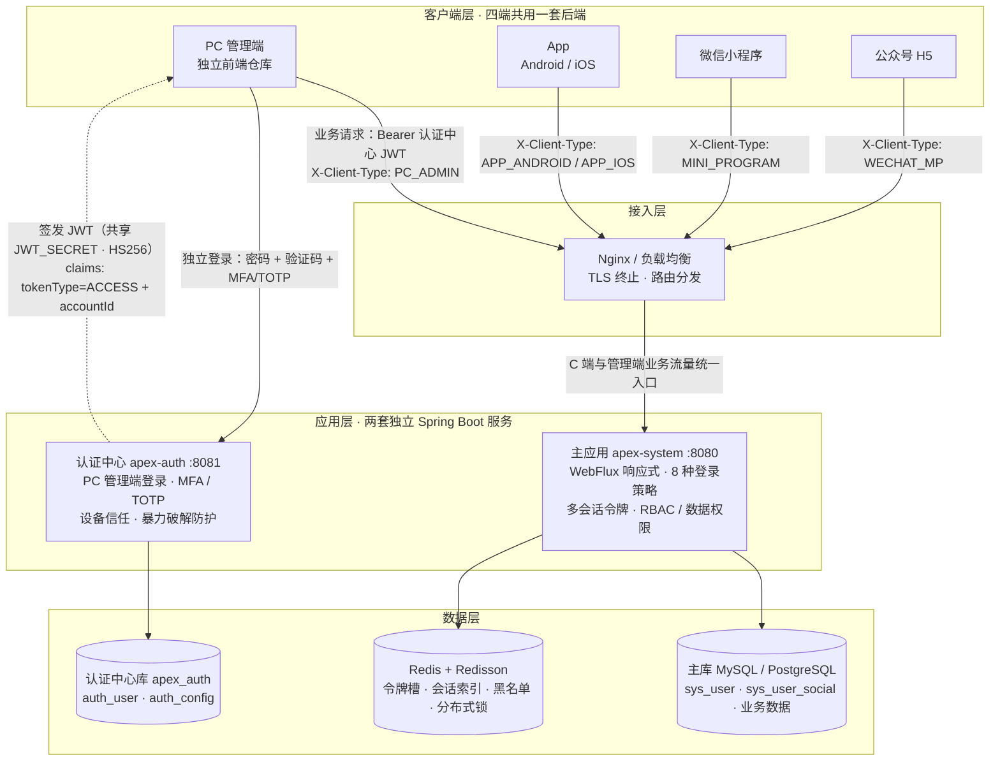

### 3.2 对接架构图（四端 → 接入契约）

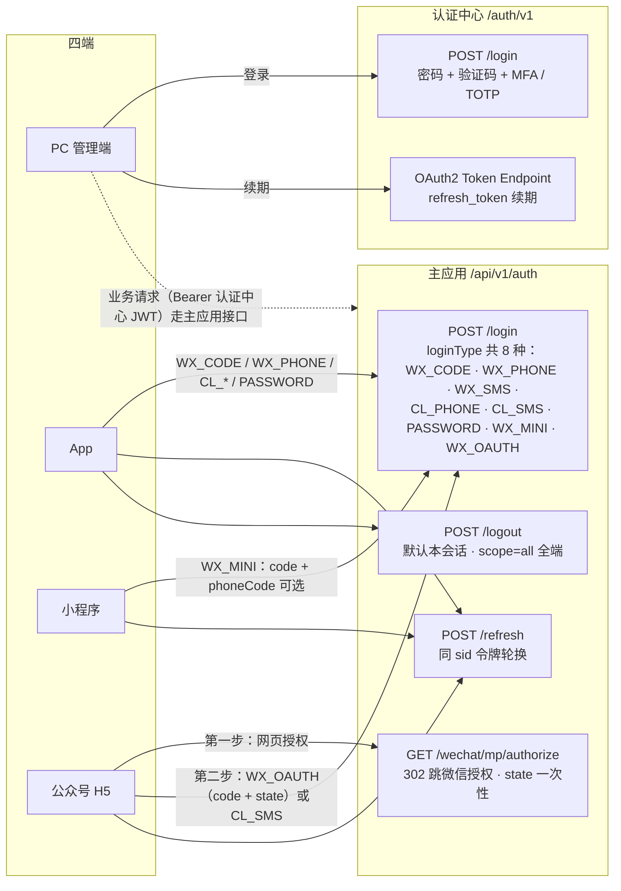

### 3.3 集成架构图（微信生态 × 内部组件）

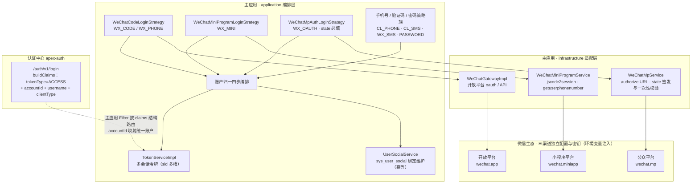

### 3.4 部署架构图

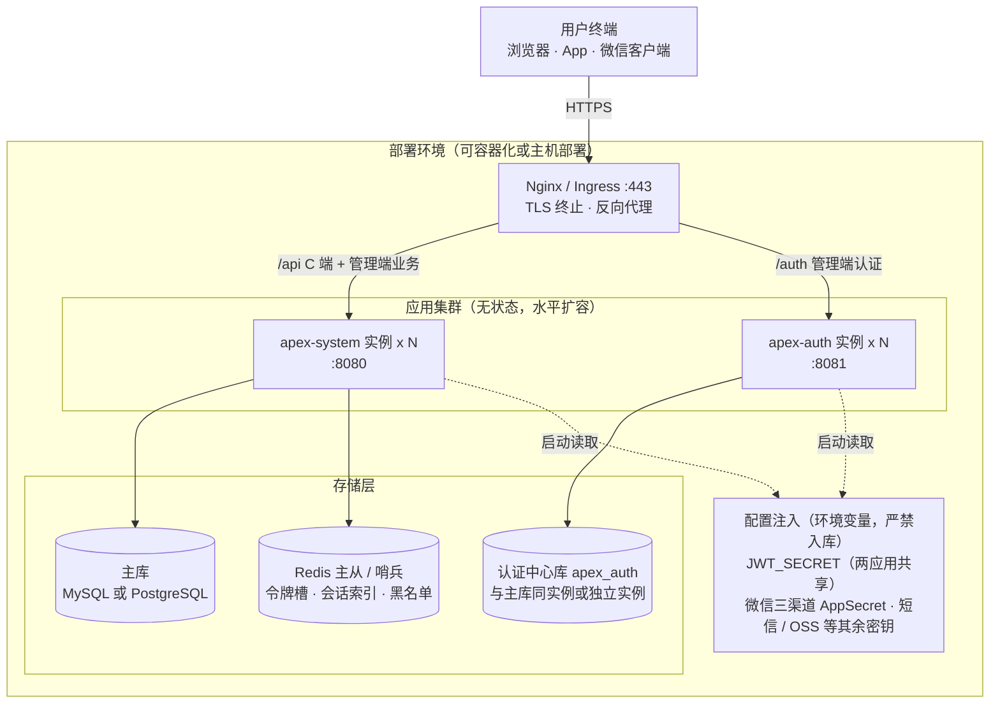

### 3.5 账户模型（统一账户 + 区分来源）

- `sys_user`：唯一账户主数据，新增 `register_channel`（注册来源）。
- 新增 `sys_user_social`：多端微信身份绑定表（user_id + channel + open_id + union_id），同一用户在 App/小程序/公众号的三个不同 openid 各占一行。
- `auth_user`（认证中心，仅凭证/MFA/风控）：新增 `account_id` 关联 `sys_user.id`，登录签发的 JWT 携带 account_id；权限仍走主应用 RBAC（`@RequirePermission`/`@DataScope` 链路不变），认证中心不复制权限。
- 来源三维度：`register_channel`（注册来源）+ `sys_user_social.channel`（绑定渠道）+ 登录日志/操作日志 `client_type`（请求终端）。

**统一账户数据模型 ER 图**（两库仅经 `account_id` 弱关联，权限能力不复制；渠道身份只入绑定表，不写 `sys_user.open_id`）：

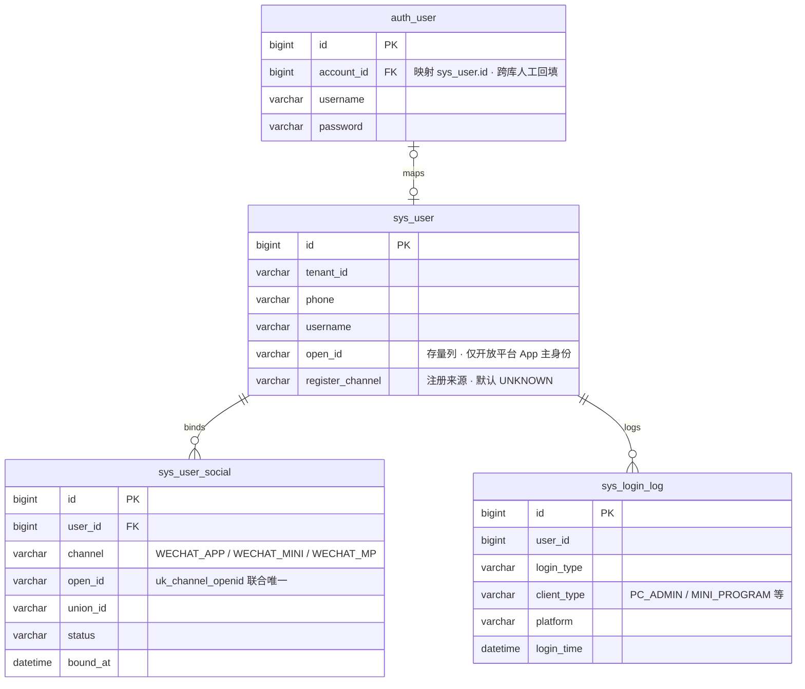

## 四、详细设计

### 4.1 数据模型（Flyway；主库 V59 起，认证中心 V55 起，MySQL/PostgreSQL 双份、幂等）

**主库 V59__multi_client_account.sql**：

- `sys_user` 增加 `register_channel VARCHAR(32) NOT NULL DEFAULT 'UNKNOWN'` + 索引。
- 新建 `sys_user_social`：id、tenant_id、user_id、channel（WECHAT_APP/WECHAT_MINI/WECHAT_MP）、open_id、union_id、status、bound_at、create_time、update_time、version、deleted；唯一键 `uk_channel_openid(channel, open_id)`、索引 `idx_user_id`、`idx_union_id`。
- 存量 `sys_user.open_id` 迁移为 channel=WECHAT_APP 绑定行（幂等 INSERT SELECT）。
- `sys_login_log` 增加 `client_type`、`platform`。

**认证中心 V55__auth_user_account_binding.sql**：`auth_user` 增加 `account_id BIGINT NULL` + 索引；存量数据按 username/phone 匹配 `sys_user` 补齐（主库迁移，输出未匹配清单人工处理）。

### 4.2 客户端标识

- 新增枚举 `ClientType`（apex-common）：PC_ADMIN、PC_WEB、WECHAT_MP、MINI_PROGRAM、APP_ANDROID、APP_IOS、H5、UNKNOWN。
- 请求头 `X-Client-Type`（优先）+ `LoginRequest.clientType`（兜底），缺省 UNKNOWN 完全兼容存量客户端。
- JWT claims 增加 `sid`（会话 UUID）、`clientType`；`TokenStoreEntry` 增加 clientType、platform、loginType、deviceId、sid。

**客户端标识判定流程图**（来源解析优先级：请求头 > 请求体 > UNKNOWN）：

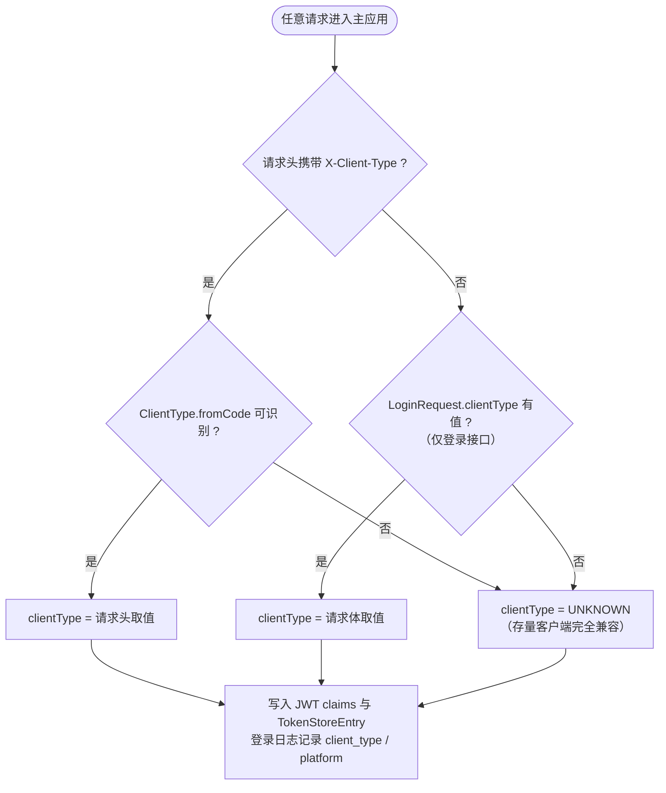

### 4.3 多会话令牌模型（改 TokenServiceImpl，主应用）

- Redis 键：`token:access:{tenant}:{subject}:{sid}` 与 `token:refresh:{tenant}:{subject}:{sid}`；会话索引 `token:sessions:{tenant}:{subject}`（Set）。
- 登录=生成新 sid 新槽，不覆盖旧会话；刷新轮换与并发锁按 sid 隔离（沿用 Redisson 锁模式）；黑名单按 jti 不变。
- 登出默认仅本会话（`?scope=all` 全端登出，预留）；滑动续期 `X-New-Access-Token` 机制不变。
- 兼容：存量无 sid 的 token 视为 `sid=legacy` 单槽，自然过期淘汰。
- 在线会话列表查询对接现有 `OnlineUserHandler`。

**多会话令牌时序图**（登录各占新槽 → 按 sid 轮换刷新 → 登出按 scope 生效）：

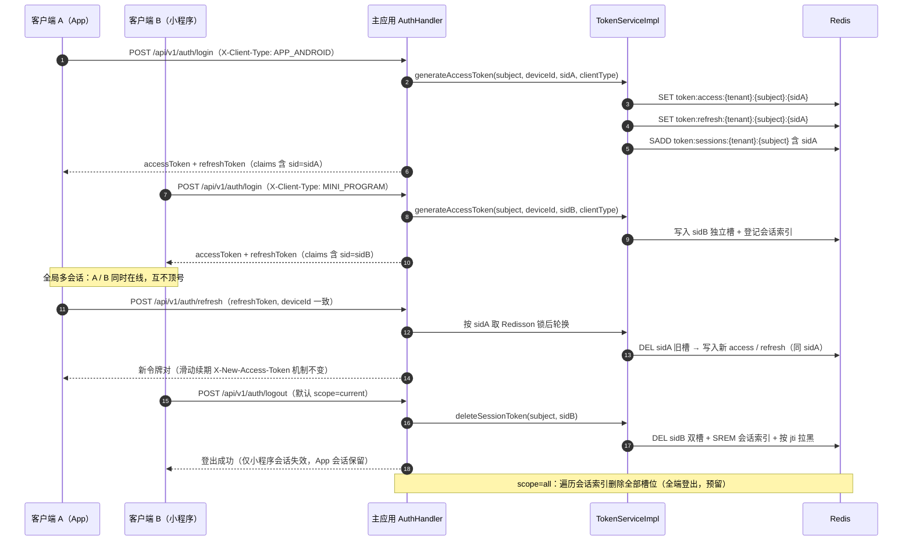

### 4.4 登录方式扩展与账户归一算法

统一归一四步（LoginStrategy 公共编排）：

1. 按 `(channel, openid)` 查 `sys_user_social` → 命中则登录该账户；
2. 未命中按 `union_id` 查绑定 → 命中则登录并为当前 channel 新增绑定行（同主体自动归一）；
3. 未命中且有手机号（WX_MINI phoneCode / 短信验证码）按手机号查 `sys_user` → 命中则登录 + 绑定；
4. 均未命中 → 返回 `nextAction=REGISTER` 一次性票据（复用现有 AuthTicket/AuthNextAction 机制），注册成功写 `register_channel`。

- **WX_MINI（小程序）**：新增 `MiniProgramService`（infrastructure/wechat）实现 `/sns/jscode2session`；`getuserphonenumber` 改用小程序 appid 的全局 access_token；`LoginType=WX_MINI`（code 必填、phoneCode 可选）。
- **WX_OAUTH（公众号 H5）**：复用 `WeChatOAuthService`（snsapi_userinfo 网页授权），新增 `GET /api/v1/auth/wechat/mp/authorize`（302 跳转）+ 登录策略 `WX_OAUTH`。
- **微信配置拆分**：`wechat.app`（开放平台，保持兼容）/ `wechat.miniapp`（新增）/ `wechat.mp`（新增）；各自独立全局 access_token 缓存键；未配置的渠道对应 LoginType 返回明确错误码（新增 ResultCode + i18n 四语言）。

**账户归一四步流程图**（`isChannelBoundIdentity` 渠道身份走绑定表，绝不写 `sys_user.open_id`）：

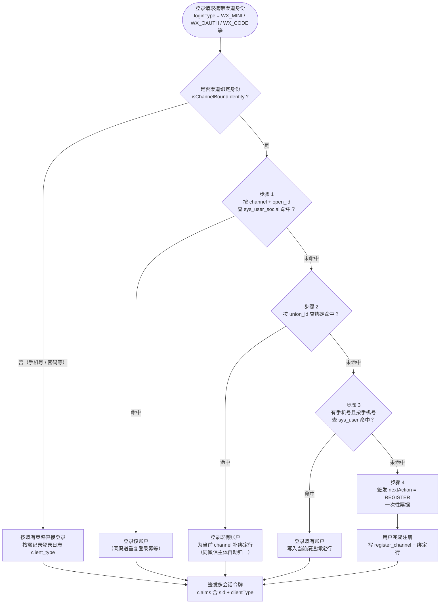

**小程序登录时序图（WX_MINI）**：

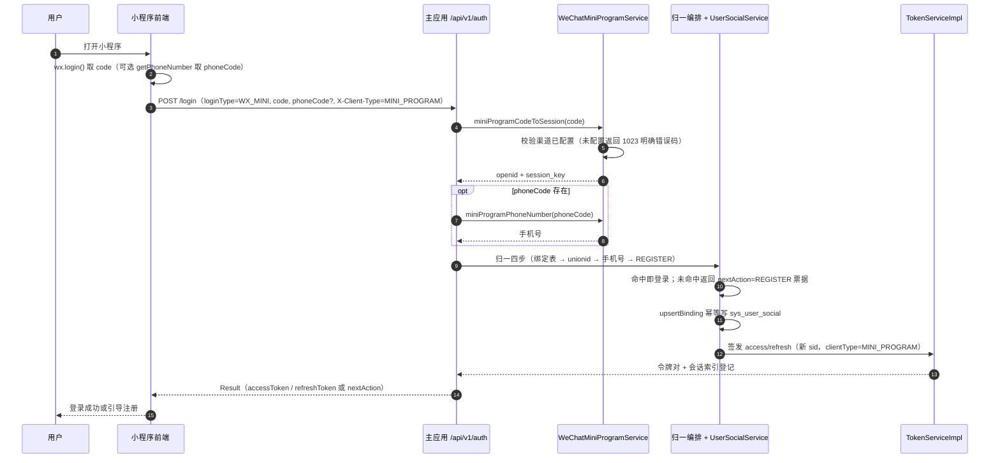

**公众号 H5 登录时序图（WX_OAUTH · state 防 CSRF）**：

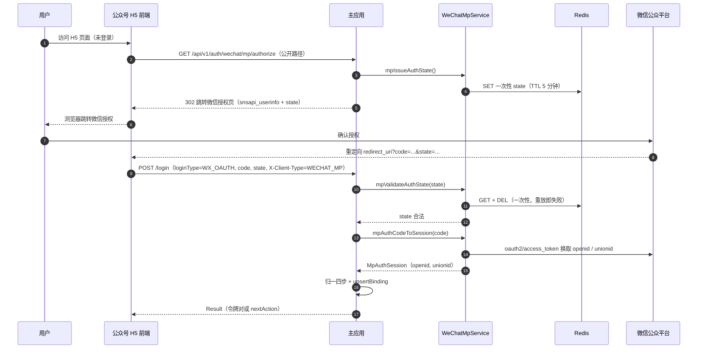

### 4.5 PC 管理端信任链（认证中心）

> **实施偏差（2026-10-07 确认）**：勘察发现认证中心 `/auth/v1/login` 链路实际与主应用共用同一 `JWT_SECRET`（HS256），其 RS256/JWKS 属于独立的 OAuth2 端点体系，与 PC 管理端登录无关。因此本节从「双密钥体系 + JWKS 验签」调整为「**claims 结构区分**」方案，安全语义等价：
>
> - 认证中心令牌 claims：`tokenType=ACCESS` + `accountId`（主应用 `sys_user.id`）+ `username` + `tenantId` + `jti`；主应用令牌：`type=access` + `sid`。两类令牌以 claims 结构天然互斥，不会误识别。
> - 主应用 `JwtAuthenticationFilter` 入口按 claims 结构路由：命中认证中心结构时按 `accountId` 加载统一账户，复用既有 RBAC 链路（统一授权服务 / 角色缓存 / 角色仓储），不滑动续期、不查主应用注销黑名单（认证中心令牌以库内 jti 撤销状态为准）。
> - 部署要求两侧使用相同 `JWT_SECRET`；存量 `auth_user ↔ sys_user` 映射跨库人工回填（`scripts/data/backfill_auth_user_account_id.sql`）。

- 认证中心登录响应与 JWT claims 增加 `accountId`、`username`、`clientType`（`PC_ADMIN`）；会话身份由既有 jti/tokenFamily 承担（令牌全量落库、按 jti 撤销，无需另加 sid）。
- 权限、数据权限、审计、租户上下文全部沿用主应用现有链路（`materializeUserContext` 与 C 端共用）。
- 认证中心保持既有能力：暴力破解防护、IP 访问控制、TOTP/MFA、设备信任、密钥轮换。

**PC 管理端信任链时序图**（认证中心独立登录 + 主应用 claims 路由鉴权）：

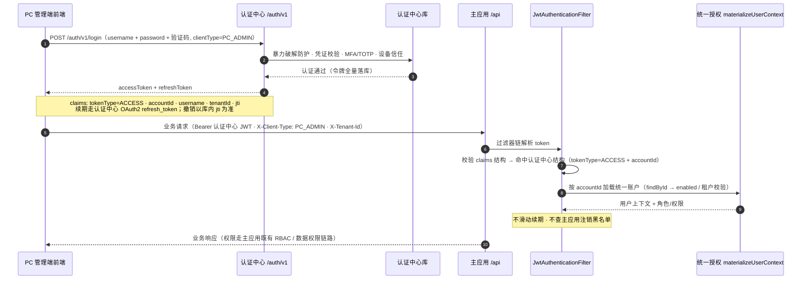

### 4.6 横切配套

- CORS allowedHeaders 增加：`X-Client-Type`、`X-Tenant-Id`、`Idempotency-Key`、`X-Device-Id`。
- `SystemConstants.PUBLIC_PATHS` 最小化增量：`/api/v1/auth/wechat/mp/authorize`。
- 限流：登录端点保留 IP 限流 + Sentinel；新增按 phone 维度参数限流（短信端点同样处理）。
- 审计：登录日志写 `client_type`/`platform`；`@OperationLog` 机制不变。
- 消息触达：SSE 仅 PC/H5；小程序订阅消息、公众号模板消息（基建已有）。
- 文件：复用 MinIO/TOS 预签名与代理路径；小程序 uploadFile 兼容性列入批次 6 实测项。

## 五、分批实施计划（每批验证 + 提交后停下等确认）

| 批次 | 内容 | 验证 | 状态 |
|------|------|------|------|
| 1 | 账户来源与多端身份基础：V59/V55 迁移（双库）、`sys_user_social` 域模型/仓储、登录链路写绑定行 + register_channel、登录日志字段 | 受影响模块 test + 迁移完整性校验 | ✅ 完成 |
| 2 | 客户端标识与多会话令牌：ClientType、sid、TokenServiceImpl 多槽、登出 scope、CORS 头 | 受影响模块 test + spotless + pmd | ✅ 完成 |
| 3 | 微信多应用配置 + 小程序登录：wechat.miniapp、WeChatMiniProgramService、WX_MINI 策略、归一四步 | 单测（mock 微信 API）+ 全量回归 | ✅ 完成 |
| 4 | 公众号网页授权登录：wechat.mp、authorize 端点、WX_OAUTH 策略、OAuth state 防 CSRF（JS-SDK 签名按需后续） | 单测 + RouterOpenApi 覆盖测试 | ✅ 完成 |
| 5 | PC 管理端接入认证中心：auth_user.account_id、统一账户 claims、主应用令牌分支（claims 区分，见 4.5 偏差说明）、存量映射回填脚本 | 双侧 test + spotless + pmd | ✅ 完成 |
| 6 | 配套、文档与验收：PASSWORD 登录 username 维度防爆破、docs 更新、四端联调清单 | 全量测试 + 迁移完整性校验 | ✅ 完成 |

**实施过程中顺带修复的存量质量债**：apex-infrastructure 51 处、apex-auth 18 处接口 Javadoc 缺失（PMD 存量违规清零）；apex-system 排除 MapStruct 生成代码的 PMD 检查（与 infrastructure 模块对齐）。

每批按 Conventional Commits 分主题提交，不触碰无关 WIP。

## 六、四端前端对接契约（供独立前端仓库实施）

| 端 | 登录方式 | 关键请求头 | 令牌续期 | 推送/其他 |
|----|---------|-----------|---------|----------|
| PC 管理端 | 认证中心 `/auth/v1/login`（密码+验证码+MFA） | `X-Client-Type: PC_ADMIN`、`X-Tenant-Id` | 认证中心 refresh | SSE、菜单按权限 |
| App（现有链路 + 新增头） | WX_CODE/WX_PHONE/CL_PHONE/CL_SMS | `X-Client-Type: APP_ANDROID/APP_IOS`、`X-Device-Id` | `/api/v1/auth/refresh`（deviceId 一致性） | 厂商推送（后续） |
| 小程序 | `wx.login()` → WX_MINI（code，可选 phoneCode）；按 `data.nextAction` 分支处理 | `X-Client-Type: MINI_PROGRAM` | 同 App | 订阅消息；request 域名白名单 |
| 公众号 H5 | 网页授权 → WX_OAUTH（code）或短信验证码 | `X-Client-Type: WECHAT_MP` | 同 App | 模板消息；JS 安全域名 |

通用契约：`Result<T>` 解包（code/msg/data/traceId）、traceId 透传（`X-Trace-Id`）、`X-New-Access-Token` 无感续期、错误码 i18n、注册接口 `Idempotency-Key` 幂等头。

**前端对接总流程图**（各端前端接入后端的统一步骤，泳道按端拆分）：

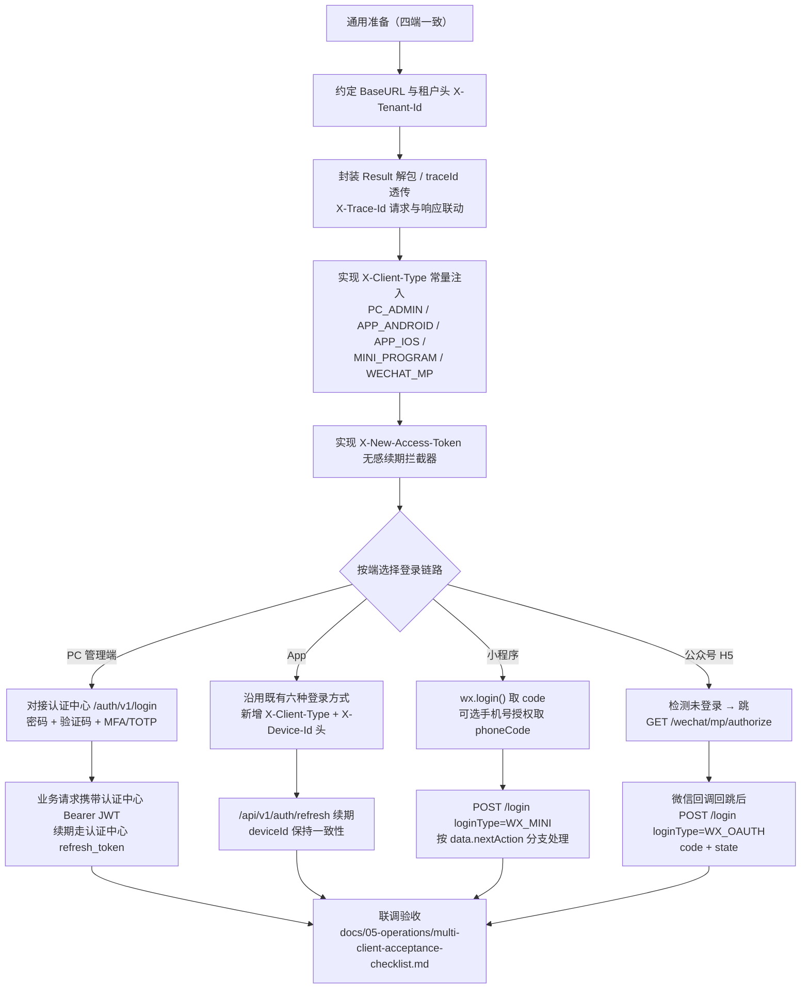

**App 登录时序图（既有链路 + 新增终端标识）**：

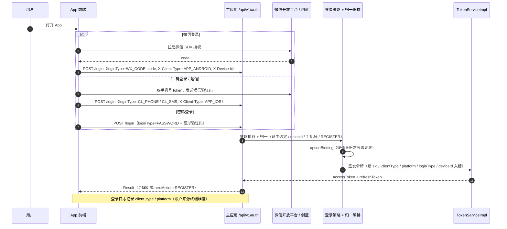

**无感续期流程图（X-New-Access-Token）**：

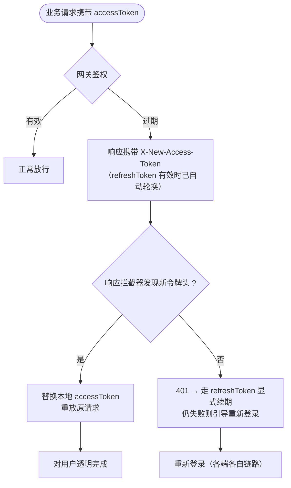

**四端会话并存示意（全局多会话）**：

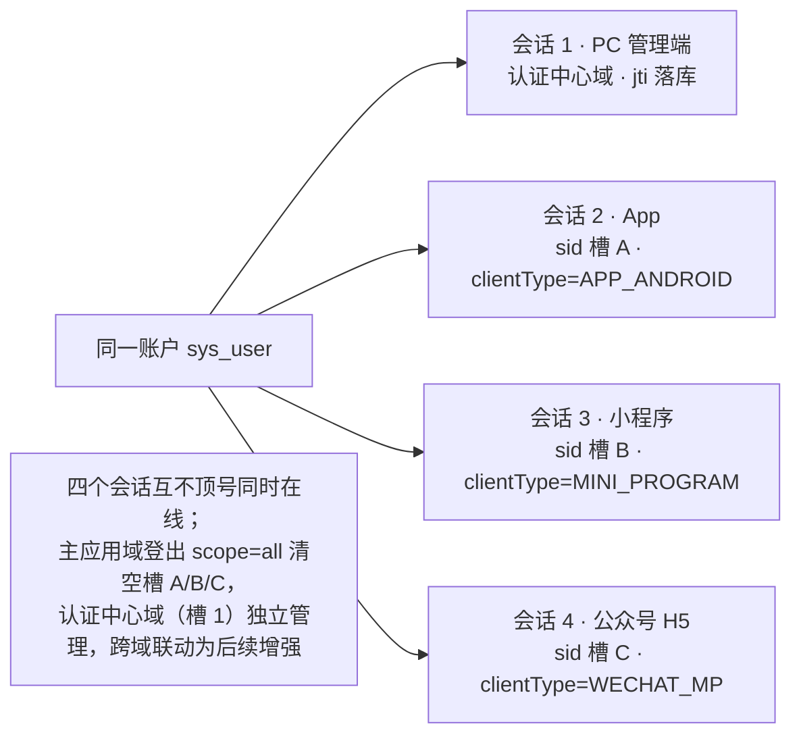

## 七、兼容与回滚

- 存量客户端不传 clientType/sid → UNKNOWN + legacy 槽，行为不变；未配置 miniapp/mp 时对应登录方式返回明确错误码，不影响现有渠道。
- 迁移脚本幂等、版本号只增不改；每批独立提交可单独回滚。
- `keycloak.enabled=false` 时 SocialLoginHandler 不装配（现状保持）；认证中心不可用时主应用 PASSWORD 登录保留作为后备。

## 八、风险与未决项

1. 微信主体归属需运营确认——影响 unionid 自动归一是否生效，手机号归一兜底已覆盖两种情况。
2. `auth_user` ↔ `sys_user` 存量映射依赖 username/phone 匹配率，迁移脚本输出未匹配清单人工处理。
3. 两应用会话域独立，"跨域全端登出"本方案只做单域实现，跨域联动列为后续增强。
4. 小程序/公众号的服务器域名、JS 安全域名、AppSecret 环境变量注入需运维配合（严禁入库）。
5. 全局多会话无限制存在账号共享滥用风险（已按决策执行）；会话索引设计预留"按端限量"扩展点。
