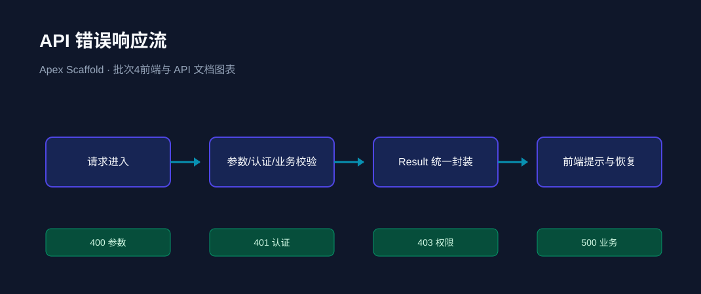

# API 路由文档

> **维护口径**：本文件为早期整理的路由快照，不再随端点增删逐条维护；现行权威清单为 [API_ROUTES.md](API_ROUTES.md)（含计数口径与运行边界）。两个文件的差异以 API_ROUTES.md 与各 Router 源码为准。

本文档整理了 Apex Scaffold 项目所有 API 路由配置，包括 HTTP 方法、路径、Handler 方法、权限要求等信息。

## 文件接口安全与存储约束

文件接口要求 Bearer ACCESS Token，经独立验签后使用可信租户/用户上下文校验记录归属；`X-User-Id`、`X-Tenant-Id` 不能替代认证。云预签名地址仍须先通过业务授权，且签名有效期为 1—604800 秒。Local 不提供无认证预签名地址，使用授权的 `/api/v1/file/content`、`/api/v1/file/preview` 内容接口；参数必须定位已授权记录，不能任意拼接对象路径。未知历史归属拒绝访问，详见[迁移与接入说明](../05-operations/object-storage-integration.md)。

## 文档说明

- **路由前缀**：
  - `/api/v1/**` — 业务接口（C 端 / 开放接口）
  - `/admin-api/v1/**` — 管理后台接口（需权限校验）
- **权限注解**：`@RequirePermission("权限码")` 标记需要的权限
- **响应式模型**：所有接口基于 Spring WebFlux 函数式端点实现
- **统一响应**：返回 `Result<T>` 结构 `{code, msg, data, traceId}`



---

## 目录

1. [认证与授权](#1-认证与授权)
2. [用户管理](#2-用户管理)
3. [文件管理](#3-文件管理)
4. [系统管理](#4-系统管理)
5. [工作流管理](#5-工作流管理)
6. [监控与日志](#6-监控与日志)
7. [健康检查](#7-健康检查)
8. [内部服务化接口（/internal/v1/**）](#8-内部服务化接口internalv1)

---

<a id="1-认证与授权"></a>

## 1. 认证与授权

### 1.1 认证接口（AuthHandler）

**路由前缀**：`/api/v1/auth`

| HTTP 方法 | 路径 | Handler 方法 | 权限要求 | 说明 |
|-----------|------|--------------|----------|------|
| POST | `/login` | `login` | 无 | 用户登录（支持微信授权码、手机号短信验证码、一键登录） |
| POST | `/register` | `register` | 无 | 用户注册（使用一次性票据完成注册） |
| POST | `/wechat/bind-phone` | `bindWechatPhone` | 无 | 注册前验证并绑定微信手机号 |
| POST | `/refresh` | `refresh` | 无 | 刷新 Token（使用 refreshToken 换取新 accessToken） |
| POST | `/logout` | `logout` | 需登录 | 退出登录 |
| POST | `/sms/code` | `sendSmsCode` | 无 | 发送短信验证码（微信短信登录） |
| POST | `/cl/sms/code` | `sendClSmsCode` | 无 | 发送创蓝短信验证码 |
| POST | `/cl/validate-mobile` | `validateMobile` | 无 | 本机号校验（创蓝闪验） |
| POST | `/wx/phone` | `bindPhone` | 需登录 | 绑定微信手机号 |

### 1.2 图形验证码（CaptchaHandler）

**路由前缀**：`/api/v1/auth`

| HTTP 方法 | 路径 | Handler 方法 | 权限要求 | 说明 |
|-----------|------|--------------|----------|------|
| GET | `/captcha` | `generate` | 无 | 获取图形验证码（返回 ID + Base64 图片） |
| POST | `/captcha/verify` | `verify` | 无 | 校验图形验证码 |

### 1.3 授权管理（AuthorizationHandler）

**路由前缀**：`/api/v1/auth`

| HTTP 方法 | 路径 | Handler 方法 | 权限要求 | 说明 |
|-----------|------|--------------|----------|------|
| GET | `/roles/my` | `getMyRoles` | 需登录 | 获取当前用户角色 |
| GET | `/permissions/my` | `getMyPermissions` | 需登录 | 获取当前用户权限 |
| GET | `/roles` | `getAllRoles` | 需登录 | 获取所有角色 |
| GET | `/permissions` | `getAllPermissions` | 需登录 | 获取所有权限 |
| POST | `/roles` | `createRole` | 需登录 | 创建角色 |
| POST | `/roles/update` | `updateRole` | 需登录 | 更新角色 |
| DELETE | `/roles/{id}` | `deleteRole` | 需登录 | 删除角色 |
| POST | `/permissions` | `createPermission` | 需登录 | 创建权限 |
| POST | `/permissions/update` | `updatePermission` | 需登录 | 更新权限 |
| DELETE | `/permissions/{id}` | `deletePermission` | 需登录 | 删除权限 |
| POST | `/users/{userId}/roles/{roleId}` | `assignRoleToUser` | 需登录 | 为用户分配角色 |
| DELETE | `/users/{userId}/roles/{roleId}` | `removeRoleFromUser` | 需登录 | 移除用户角色 |

---

<a id="2-用户管理"></a>

## 2. 用户管理

### 2.1 用户信息（UserHandler）

**路由前缀**：`/api/v1/user`

| HTTP 方法 | 路径 | Handler 方法 | 权限要求 | 说明 |
|-----------|------|--------------|----------|------|
| GET | `/info` | `getCurrentUserInfo` | 需登录 | 获取当前用户信息 |
| POST | `/me/deletion-code` | `sendAccountDeletionCode` | 需登录 | 发送账号注销验证码 |
| DELETE | `/me` | `deleteCurrentUser` | 需登录 | 注销当前账号 |
| GET | `/{userId}` | `getUserById` | 需登录 | 根据 ID 获取用户信息 |
| POST | `/list` | `listUsers` | 需登录 | 分页查询用户列表 |

### 2.2 后台用户管理（AdminUserManagementHandler）

**路由前缀**：`/admin-api/v1/users`

| HTTP 方法 | 路径 | Handler 方法 | 权限要求 | 说明 |
|-----------|------|--------------|----------|------|
| GET | `/staff-roles` | `roles` | `staff:manage` | 查询可配置的后台角色 |
| GET | `` | `list` | `staff:manage` | 分页检索用户（支持关键词搜索和状态过滤） |
| POST | `` | `create` | `staff:manage` | 后台创建用户 |
| GET | `/{userId}` | `detail` | `staff:manage` | 查看用户资料 |
| PUT | `/{userId}` | `update` | `staff:manage` | 编辑用户资料 |
| POST | `/{userId}/sessions/revoke` | `revokeSessions` | `staff:session:revoke` | 强制撤销用户全部会话 |
| PUT | `/{userId}/status` | `updateStatus` | `staff:manage` | 启用或停用用户 |
| PUT | `/{userId}/roles` | `replaceRoles` | `staff:manage` | 替换用户后台角色 |

---

<a id="3-文件管理"></a>

## 3. 文件管理

### 3.1 文件操作（FileHandler）

**路由前缀**：`/api/v1/file` 和 `/api/v1/files`

以下路径均为完整路径，由 apex-file-service 注册。

| HTTP 方法 | 路径 | Handler 方法 | 权限要求 | 说明 |
|-----------|------|--------------|----------|------|
| POST | `/api/v1/file/upload` | `upload` | ACCESS Token | 上传图片（已过时，兼容入口） |
| POST | `/api/v1/files/generic` | `uploadGenericFile` | ACCESS Token | 上传普通图片（推荐使用） |
| GET | `/api/v1/file/url` | `getUrl` | ACCESS Token + 记录归属 | 获取访问 URL；Local 的 expiresIn=0 表示签名 TTL 不适用，访问仍须授权 |
| GET | `/api/v1/file/content` | `content` | ACCESS Token + 记录归属 | 授权流式读取文件内容 |
| GET | `/api/v1/file/preview` | `preview` | ACCESS Token + 记录归属 | inline 内容预览 |
| DELETE | `/api/v1/file/delete` | `delete` | ACCESS Token + 记录归属 | 确认对象删除后清理记录 |
| GET | `/api/v1/file/exists` | `exists` | ACCESS Token + 记录归属 | 检查已授权文件是否存在 |
| POST | `/api/v1/file/orphan/{fileId}/retry` | `retryOrphanCleanup` | ACCESS Token + 记录归属 | 仅 ORPHANED；data=true 为确认清理，false 为未确认，异常传播 |

### 3.2 分片操作（ChunkHandler）

| HTTP 方法 | 完整路径 | Handler 方法 | 权限要求 | 说明 |
| --- | --- | --- | --- | --- |
| POST | `/api/v1/file/chunk/init` | `init` | ACCESS Token | JSON 初始化归属明确的会话 |
| POST | `/api/v1/file/chunk/upload` | `uploadChunk` | ACCESS Token + 会话归属 | 二进制请求体，fileId/chunkIndex 为查询参数 |
| POST | `/api/v1/file/chunk/merge` | `merge` | ACCESS Token + 会话归属 | JSON 合并全部分片，缺片拒绝 |
| GET | `/api/v1/file/chunk/status/{fileId}` | `status` | ACCESS Token + 会话归属 | 查询分片进度 |
| POST | `/api/v1/file/chunk/cleanup/{fileId}/retry` | `retryCleanup` | ACCESS Token + 会话归属 | 仅 STORED；data=true 代表尝试已执行，清理失败保留分片元数据 |

两类清理重试均无请求体，以 fileId 定位记录，校验同租户、同用户。业务成功包装 code=0。MERGING 不由清理接口自动恢复，需受控人工核查；参见[恢复说明](../05-operations/object-storage-integration.md)。

---

<a id="4-系统管理"></a>

## 4. 系统管理

### 4.1 菜单管理（MenuHandler）

**路由前缀**：`/admin-api/v1/menus`

| HTTP 方法 | 路径 | Handler 方法 | 权限要求 | 说明 |
|-----------|------|--------------|----------|------|
| GET | `` | `tree` | `system:menu:list` | 查询菜单树 |
| GET | `/{menuId}` | `detail` | `system:menu:query` | 查询菜单详情 |
| POST | `` | `create` | `system:menu:add` | 创建菜单 |
| PUT | `/{menuId}` | `update` | `system:menu:edit` | 更新菜单 |
| DELETE | `/{menuId}` | `delete` | `system:menu:remove` | 删除菜单 |
| PUT | `/{menuId}/status` | `updateStatus` | `system:menu:edit` | 启用/停用菜单 |

### 4.2 字典管理（DictHandler）

**路由前缀**：`/admin-api/v1/dict`

| HTTP 方法 | 路径 | Handler 方法 | 权限要求 | 说明 |
|-----------|------|--------------|----------|------|
| GET | `/types` | `listTypes` | `system:dict:list` | 查询字典类型列表 |
| GET | `/types/{id}` | `getType` | `system:dict:query` | 查询字典类型详情 |
| POST | `/types` | `createType` | `system:dict:add` | 创建字典类型 |
| PUT | `/types/{id}` | `updateType` | `system:dict:edit` | 更新字典类型 |
| DELETE | `/types/{id}` | `deleteType` | `system:dict:remove` | 删除字典类型 |
| PUT | `/types/{id}/status` | `updateTypeStatus` | `system:dict:edit` | 启用/停用字典类型 |
| GET | `/data` | `listData` | `system:dict:list` | 按类型查询字典数据 |
| GET | `/data/{id}` | `getData` | `system:dict:query` | 查询字典数据详情 |
| POST | `/data` | `createData` | `system:dict:add` | 创建字典数据 |
| PUT | `/data/{id}` | `updateData` | `system:dict:edit` | 更新字典数据 |
| DELETE | `/data/{id}` | `deleteData` | `system:dict:remove` | 删除字典数据 |
| PUT | `/data/{id}/status` | `updateDataStatus` | `system:dict:edit` | 启用/停用字典数据 |

### 4.3 部门管理（DeptHandler）

**路由前缀**：`/admin-api/v1/depts`

| HTTP 方法 | 路径 | Handler 方法 | 权限要求 | 说明 |
|-----------|------|--------------|----------|------|
| GET | `` | `listTree` | `system:dept:list` | 查询部门树 |
| GET | `/{id}` | `detail` | `system:dept:query` | 查询部门详情 |
| POST | `` | `create` | `system:dept:add` | 新增部门 |
| PUT | `/{id}` | `update` | `system:dept:edit` | 更新部门 |
| DELETE | `/{id}` | `delete` | `system:dept:remove` | 删除部门 |

### 4.4 参数配置（ConfigHandler）

**路由前缀**：`/admin-api/v1/configs`

| HTTP 方法 | 路径 | Handler 方法 | 权限要求 | 说明 |
|-----------|------|--------------|----------|------|
| GET | `` | `list` | `system:config:list` | 查询参数配置列表 |
| GET | `/{id}` | `detail` | `system:config:query` | 查询参数配置详情 |
| POST | `` | `create` | `system:config:add` | 创建参数配置 |
| PUT | `/{id}` | `update` | `system:config:edit` | 更新参数配置 |
| DELETE | `/{id}` | `delete` | `system:config:remove` | 删除参数配置 |
| PUT | `/{id}/status` | `updateStatus` | `system:config:edit` | 启用/停用参数配置 |

### 4.5 定时任务（JobHandler）

**路由前缀**：`/admin-api/v1/jobs`

| HTTP 方法 | 路径 | Handler 方法 | 权限要求 | 说明 |
|-----------|------|--------------|----------|------|
| GET | `` | `list` | `system:job:list` | 查询定时任务列表 |
| GET | `/page` | `page` | `system:job:list` | 分页查询定时任务 |
| GET | `/{id}` | `detail` | `system:job:query` | 查询任务详情 |
| POST | `` | `create` | `system:job:add` | 创建定时任务 |
| PUT | `/{id}` | `update` | `system:job:edit` | 更新定时任务 |
| DELETE | `/{id}` | `delete` | `system:job:remove` | 删除定时任务 |
| PUT | `/{id}/status` | `updateStatus` | `system:job:edit` | 启用/停用定时任务 |
| POST | `/{id}/run` | `runOnce` | `system:job:run` | 立即执行一次任务 |
| GET | `/{id}/logs` | `logs` | `system:job:query` | 查询任务执行日志 |

> 部署归属：`/admin-api/v1/jobs/**` 由网关路由到 `apex-job-service`（8095），`JobProxy` 以纯代理转发回 system，契约路径与权限要求一致。

### 4.6 数据库配置（DatabaseConfigHandler）

**路由前缀**：`/admin-api/v1/database`

| HTTP 方法 | 路径 | Handler 方法 | 权限要求 | 说明 |
|-----------|------|--------------|----------|------|
| POST | `/test` | `testConnection` | `system:database:test` | 测试数据库连接 |
| POST | `/generate-config` | `generateConfig` | `system:database:generate` | 生成部署配置 |
| GET | `/current` | `getCurrentInfo` | `system:database:info` | 获取当前数据库信息 |

---

<a id="5-工作流管理"></a>

## 5. 工作流管理

### 5.1 工作流业务接口（WorkflowHandler）

**路由前缀**：`/api/v1/workflows`

| HTTP 方法 | 路径 | Handler 方法 | 权限要求 | 说明 |
|-----------|------|--------------|----------|------|
| POST | `/{workflowCode}/instances` | `startProcessInstance` | 需登录 | 发起流程实例 |
| GET | `/tasks/pending` | `listPendingTasks` | 需登录 | 查询当前用户待办任务 |
| POST | `/tasks/{taskId}/complete` | `completeTask` | 需登录 | 完成任务（审批通过） |

### 5.2 工作流高级操作（WorkflowHandler）

**路由前缀**：`/api/workflow`

| HTTP 方法 | 路径 | Handler 方法 | 权限要求 | 说明 |
|-----------|------|--------------|----------|------|
| POST | `/tasks/{taskId}/rollback` | `rollbackTask` | 需登录 | 流程回退到指定节点 |
| POST | `/tasks/{taskId}/transfer` | `transferTask` | 需登录 | 任务转办（责任人变更） |
| POST | `/tasks/{taskId}/delegate` | `delegateTask` | 需登录 | 任务委派（临时委托） |
| POST | `/instances/{instanceId}/suspend` | `suspendInstance` | 需登录 | 挂起流程实例 |
| POST | `/instances/{instanceId}/resume` | `resumeInstance` | 需登录 | 恢复流程实例 |

### 5.3 工作流查询（WorkflowHandler）

**路由前缀**：`/admin-api/v1/workflows`

| HTTP 方法 | 路径 | Handler 方法 | 权限要求 | 说明 |
|-----------|------|--------------|----------|------|
| GET | `/instances` | `listInstances` | 需登录 | 查询工作流实例列表（支持分页和状态过滤） |
| GET | `/instances/{instanceId}` | `getInstanceDetail` | 需登录 | 查询流程实例详情 |
| GET | `/statistics` | `getStatistics` | 需登录 | 获取工作流统计数据 |
| GET | `/statistics/trend` | `getTrend` | 需登录 | 获取工作流趋势数据 |

---

<a id="6-监控与日志"></a>

## 6. 监控与日志

### 6.1 登录日志（LoginLogHandler）

**路由前缀**：`/admin-api/v1/login-logs`

| HTTP 方法 | 路径 | Handler 方法 | 权限要求 | 说明 |
|-----------|------|--------------|----------|------|
| GET | `` | `list` | `system:login-log:list` | 查询登录日志（分页） |

### 6.2 审计日志（AuditLogHandler）

**路由前缀**：`/admin-api/v1/audit-logs`

| HTTP 方法 | 路径 | Handler 方法 | 权限要求 | 说明 |
|-----------|------|--------------|----------|------|
| GET | `` | `list` | `system:audit-log:list` | 查询操作审计日志（分页） |

### 6.3 API 调用日志（ApiCallLogHandler）

**路由前缀**：`/admin-api/v1/api-call-logs`

| HTTP 方法 | 路径 | Handler 方法 | 权限要求 | 说明 |
|-----------|------|--------------|----------|------|
| GET | `` | `list` | `system:api-call-log:list` | 查询外部 API 调用日志（分页） |

### 6.4 运行时日志（RuntimeLogHandler）

**路由前缀**：`/admin-api/v1/logs/runtime`

| HTTP 方法 | 路径 | Handler 方法 | 权限要求 | 说明 |
|-----------|------|--------------|----------|------|
| GET | `` | `queryLogs` | 需登录 | 查询运行时日志 |
| GET | `/count` | `countLogs` | 需登录 | 统计日志数量 |

### 6.5 业务日志统一查询（UnifiedBusinessLogHandler）

**路由前缀**：`/admin-api/v1/logs/business`

| HTTP 方法 | 路径 | Handler 方法 | 权限要求 | 说明 |
|-----------|------|--------------|----------|------|
| GET | `` | `queryLogs` | 需登录 | 统一查询业务日志（登录、操作、API 调用） |
| GET | `/count` | `countLogs` | 需登录 | 统计业务日志数量 |

### 6.6 在线用户（OnlineUserHandler）

**路由前缀**：`/admin-api/v1/online-users`

| HTTP 方法 | 路径 | Handler 方法 | 权限要求 | 说明 |
|-----------|------|--------------|----------|------|
| GET | `` | `list` | `system:online-user:list` | 查询在线用户列表 |

### 6.7 监控大盘（MonitorDashboardHandler）

**路由前缀**：`/admin-api/v1/monitor`

| HTTP 方法 | 路径 | Handler 方法 | 权限要求 | 说明 |
|-----------|------|--------------|----------|------|
| GET | `/overview` | `overview` | `system:monitor:view` | 监控概览 |
| GET | `/system` | `system` | `system:monitor:view` | 系统资源监控 |
| GET | `/middleware` | `middleware` | `system:monitor:view` | 中间件监控 |
| GET | `/governance` | `governance` | `system:monitor:view` | 治理监控 |
| GET | `/business` | `business` | `system:monitor:view` | 核心业务监控 |

### 6.8 数据导出（ExcelExportHandler）

**路由前缀**：`/admin-api/v1/export`

| HTTP 方法 | 路径 | Handler 方法 | 权限要求 | 说明 |
|-----------|------|--------------|----------|------|
| GET | `/users` | `exportUsers` | `system:user:list` | 导出用户数据（Excel） |

### 6.9 站内通知（NotificationSseHandler / SystemMessageHandler）

**路由前缀**：`/api/v1/notifications`（system 侧系统通知；`/api/v1/messages/**` 归属 office 站内信，见 §6.11）

| HTTP 方法 | 路径 | Handler 方法 | 权限要求 | 说明 |
|-----------|------|--------------|----------|------|
| GET | `/stream` | `stream` | 需登录 | SSE 实时通知推送 |
| GET | `/inbox` | `inbox` | 需登录 | 分页查询当前用户通知收件箱 |
| GET | `/unread-count` | `unreadCount` | 需登录 | 查询当前用户未读通知数 |
| POST | `/{id}/read` | `markRead` | 需登录 | 标记单条通知已读（幂等） |
| POST | `/read-all` | `markAllRead` | 需登录 | 全部标记已读 |

### 6.10 统一搜索（UnifiedSearchHandler）

**路由前缀**：`/admin-api/v1/search`

| HTTP 方法 | 路径 | Handler 方法 | 权限要求 | 说明 |
|-----------|------|--------------|----------|------|
| GET | `` | `search` | 需登录 | 全文搜索（Meilisearch） |
| POST | `/rebuild` | `rebuildIndex` | 需登录 | 重建搜索索引 |

---

### 6.11 Office 站内信 HTTP 与 WebSocket

office 站内信使用独立的 HTTP 消息路由和 WebSocket 握手路由，不套用 SSE 或普通 JSON 端点的响应/认证假设。HTTP 端点包括 `POST /api/v1/messages/ws-ticket`、`GET /api/v1/messages/inbox`、`GET /api/v1/messages/unread/count` 及消息详情、发送、已读接口；WebSocket 地址为 `/api/v1/messages/ws?ticket=...`。访问 JWT 只用于获取一次性 30 秒票据，票据在握手时消费一次；连接建立后只推送消息 ID，正文通过 HTTP 查询。HTTP/WS 网关目标必须指向同一 office 实例，单实例内存票据和连接状态不提供跨实例广播，断线通过收件箱和未读数补偿。完整协议与限制见[站内信说明](../05-operations/in-app-messaging.md)。

---

<a id="7-健康检查"></a>

## 7. 健康检查

### 7.1 健康检查（HealthHandler）

**路由前缀**：无 / `/api/v1`

| HTTP 方法 | 路径 | Handler 方法 | 权限要求 | 说明 |
|-----------|------|--------------|----------|------|
| GET | `/` | `root` | 无 | 根路径探活 |
| GET | `/api/v1/health` | `health` | 无 | 健康检查（负载均衡器使用） |
| GET | `/api/v1/info` | `info` | 无 | 系统信息（版本、环境等） |

---

<a id="8-内部服务化接口internalv1"></a>

## 8. 内部服务化接口（/internal/v1/**）

服务间同步调用统一走内部 API 契约（`apex-api-contract` 仅含 DTO 与事件，不承载 Feign 界面）。该类接口**仅注册在业务服务端口**，网关路由层强制拒绝，只允许集群内直连调用。调用方一律使用 `WebClient`（`apex-integration` 与各服务适配器均不引入 Feign），同步阻塞场景经 `BlockingIoSchedulers.remote()` 隔离。

### 8.1 内部调用约定

- 请求头 `X-Tenant-Id` 携带租户作用域，`X-Trace-Id` 透传链路标识。
- 调用签名由 `InternalAuthExchangeFilter` 统一注入（`InternalAuthProperties` + `InternalServiceSigner`），未配置签名时按无签名语义放行内部端点。
- 响应统一为 `Result<T>`；调用失败按调用方语义 fail-closed（权限/令牌校验）或 fail-open（限流档查询等保护性手段）。

### 8.2 认证服务内部接口（`apex-auth-service`）

| HTTP 方法 | 路径 | 说明 |
|-----------|------|------|
| GET | `/internal/v1/users/{accountId}/permissions` | 获取指定用户在指定租户（`tenantId` 查询参数）下的权限码集合 |
| POST | `/internal/v1/tokens/validate` | 校验存量 Token 并返回用户语义快照（auth 不可用时优先 403 拒绝） |
| GET | `/internal/v1/tokens/revocations` | 吊销列表增量拉取（供网关侧本地缓存） |

### 8.3 系统服务内部接口（`apex-system-service`）

| HTTP 方法 | 路径 | 说明 |
|-----------|------|------|
| POST | `/internal/v1/org/users/resolve` | 批量解析外部身份到系统用户快照（`/internal/v1/org/**` 仅安全链前缀放行，无 GET 路由实现） |
| GET | `/internal/v1/tenants/{code}/status` | 租户状态与能力快照 |
| GET | `/internal/v1/tenants/{code}/capabilities` | 租户能力订阅快照（`exists/unbounded/features`） |
| GET | `/internal/v1/overview` | 平台概览汇总 |
| GET | `/internal/v1/open-apps/{clientId}/rate-limit-tier` | 开放应用限流档查询 |

开放应用注册中心内部端点由 **auth-service** 提供（system 经 `AuthOpenAppRegistryRemoteAdapter` 反向调用，完整清单见 internal-api-contracts.md）：`POST/GET /internal/v1/open-apps`、`GET/PUT/DELETE /internal/v1/open-apps/{clientId}`、`PUT /internal/v1/open-apps/{clientId}/status`、`POST /internal/v1/open-apps/{clientId}/reset-secret`、`POST /internal/v1/open-apps/import`。

### 8.4 其他业务服务内部接口

| 服务 | 路径 | 说明 |
|------|------|------|
| `apex-workflow-service` | `/internal/v1/workflow/stats` | 工作流统计汇总 |
| `apex-file-service` | `/internal/v1/file/stats` | 文件统计汇总 |
| `apex-office-service` | `/internal/v1/office/messages/stats`、`/internal/v1/notify` | 站内信统计与通知投递 |
| `apex-integration` | `/internal/v1/iot/mqtt/auth`、`/internal/v1/iot/mqtt/acl`、`/internal/v1/iot/devices/{key}/commands`、`/internal/v1/iot/devices/stats` | MQTT 接入鉴权、ACL 与设备命令下发 |

### 8.5 契约模块结构（apex-api-contract）

```
apex-api-contract/src/main/java/com/apex/scaffold/contract/
├── dto/internal/      # 内部接口共享 DTO
└── event/             # 跨服务领域事件
```

模块不含 `client/`、`config/`、`support/` 等 Feign 相关目录；服务间调用由各消费方自行用 `WebClient` 实现。
## 附录

### A. 权限码分类

权限码采用分层命名规范：`模块:资源:操作`

**系统管理模块**：
- `system:menu:*` — 菜单管理权限
- `system:dict:*` — 字典管理权限
- `system:dept:*` — 部门管理权限
- `system:config:*` — 参数配置权限
- `system:job:*` — 定时任务权限
- `system:database:*` — 数据库配置权限
- `system:login-log:list` — 登录日志查询
- `system:audit-log:list` — 审计日志查询
- `system:api-call-log:list` — API 调用日志查询
- `system:online-user:list` — 在线用户查询
- `system:monitor:view` — 监控查看权限
- `system:user:list` — 用户列表查询（用于导出）

**用户管理模块**：
- `staff:manage` — 后台用户管理
- `staff:session:revoke` — 会话撤销权限

### B. 路由注册机制

业务路由由各域的 Router 以 `@Bean` 方式注册，返回 `RouterFunction<ServerResponse>`。例如，system 的菜单路由位于 [RbacRouter.java](../../apex-system/src/main/java/com/apex/scaffold/interfaces/router/RbacRouter.java)，workflow 的管理路由位于 [WorkflowRouter.java](../../apex-workflow-service/src/main/java/com/apex/scaffold/workflowservice/interfaces/router/WorkflowRouter.java)。

**示例**：
```java
@Bean
public RouterFunction<ServerResponse> adminMenuRoutes(MenuHandler handler) {
    return RouterFunctions.route()
        .path("/admin-api/v1/menus", routes -> routes
            .GET("", handler::tree)
            .GET("/{menuId}", handler::detail)
            .POST("", contentType(MediaType.APPLICATION_JSON), handler::create)
            .PUT("/{menuId}", contentType(MediaType.APPLICATION_JSON), handler::update)
            .DELETE("/{menuId}", handler::delete)
            .PUT("/{menuId}/status", contentType(MediaType.APPLICATION_JSON), handler::updateStatus))
        .build();
}
```

### C. Handler 层职责

Handler 负责：
1. 接收 `ServerRequest` 并解析参数
2. 调用 Application 层 Service 执行业务逻辑
3. 构建 `ServerResponse` 返回统一响应

system 中继承 [BaseHandler](../../apex-system/src/main/java/com/apex/scaffold/interfaces/handler/BaseHandler.java) 的 Handler 复用其参数解析、响应构建和国际化能力；其他业务域沿用各自的 Handler 实现。

### D. 安全机制

- **JWT 认证**：Access Token + Refresh Token 双 Token 机制
- **权限校验**：`@RequirePermission` 注解 + `RequirePermissionAspect` AOP 拦截
- **限流保护**：`@RateLimiter`、`@HotSpotRateLimit`、`@UserRateLimit` + Sentinel
- **防重放**：`@AntiReplay` 时间戳 + nonce 校验
- **接口幂等**：`@IdempotentApi` 幂等键控制
- **操作审计**：`@OperationLog` 自动记录操作日志

---

**文档生成时间**：2026-10-08
**项目版本**：1.3.1
**维护团队**：Apex Team
> 配套图表：[54 API 契约流转](../diagrams/54_api_contract_flow.svg)

