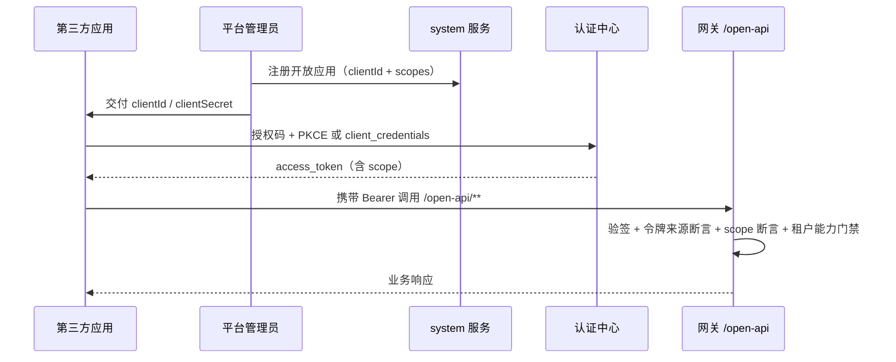

# 开放平台接入契约（M4 / D2 + D6）

本文件描述第三方与前台应用接入中台能力中心的完整流程。实现基线：认证中心 `OpenAppScopes` scope 注册表、system 服务 `/api/v1/open-apps` 管理端点、认证中心 OAuth2 授权服务器，以及网关 `OpenApiScopeGatewayFilter` 与 `/open-api/**` 路由组。

## 1. 接入流程

## 2. 应用注册

- 应用复用认证中心 `OAUTH2_CLIENT` 注册表（`auth_config`，租户级），凭据签发/轮换沿用既有管理端点
- 注册时声明：`appName`、`description`、`scopes`、`rateLimitTier`、`redirectUris`
- 声明 scope 必须来自平台目录（`GET /api/v1/open-apps/scopes`），非法 scope 在详情接口的 `invalidScopes` 中回报

## 3. scope 目录与权限映射

| scope | 服务侧权限码 | 能力 |
| --- | --- | --- |
| `open:file:read` | `file:read` | 文件读取 |
| `open:file:write` | `file:write` | 文件写入 |
| `open:workflow:read` | `workflow:read` | 工作流读取 |
| `open:workflow:write` | `workflow:write` | 工作流发起 |
| `open:user:read` | `user:read` | 用户只读 |
| `open:message:send` | `office:message:send` | 站内信发送 |

- scope 收窄遵循 RFC 6749 §3.3：请求 scope 必须是应用已授权 scope 的子集（`OpenAppScopes.covers`）
- 新增能力 = 在 `OpenAppScopes` 目录登记 + 在能力目录（`CapabilityCatalog`）登记对应能力编码

## 4. 调用约定

- 网关开放路由组：`/open-api/**`（**不接受用户个人令牌**，仅接受开放应用令牌），由 `OpenApiScopeGatewayFilter`（order 25）执行令牌来源、scope 与能力三道断言；通过后注入可信头 `X-Client-Scopes`、`X-Client-Id` 与 `X-Open-Api-Capability`（能力标记，服务侧二次校验的触发依据），外部伪造值由 `JwtSignatureFilter` 剥离
- 令牌类型：`client_credentials`（服务间调用）或授权码 + PKCE（代用户访问）
- 限流：`/open-api/**` 固定按应用维度 `client:{clientId}` 判定（order 30），阈值按应用注册档位 `rateLimitTier` 经 system 内部端点 `GET /internal/v1/open-apps/{clientId}/rate-limit-tier` 查询（TTL 缓存，fail-open 回退 `default` 档），档位 → 阈值映射配置于网关 `apex.gateway.rate-limit.open-api-tiers`；无法识别 client_id 时回退既有租户 → 用户 → IP 维度
- 服务侧二次校验（D4）：业务服务对携带 `X-Open-Api-Capability` 的请求经共享 `CapabilityGate` 复核租户订阅（`apex.open-api.guard.enabled` 缺省 `true`，即默认开启，与网关门禁默认口径一致；TTL 缓存，fail-closed），与网关门禁同源判定。确需关闭的实例显式配置 `apex.open-api.guard.enabled=false` 并在配置注释中写明原因与补偿措施
- 审计：开放访问写入网关访问日志（含 `client_id` 维度，迁移 V87）
- 错误：统一 `Result<T>` 包装；scope 不足返回 403，令牌无效/过期返回 401

## 5. 事件订阅（可选）

- 工作流事件契约见 `apex-api-contract` 的 `contract/event/**`（`WorkflowInstanceStartedEvent`、`TaskAssignedEvent`、`TaskCompletedEvent`）
- 订阅方式：由部署侧配置 MQ 消费方，事件经 Outbox 可靠投递

## 6. 与套餐/能力订阅的关系

- 应用声明的 scope 属于**技术授权范围**；租户实际可用的能力由套餐 `features` 决定（`GET /api/v2/capabilities/subscribed`）
- 两者同时生效：scope 允许 + 租户已订阅能力，调用才成功
- 套餐未订阅某能力时，即使应用持有对应 scope 也应被拒绝（网关按路由→能力映射校验）

## 7. 边界与明确不做项

- 按 `clientId` 分档的 `rateLimitTier` 限流：**已实现**（应用维度限流 + 档位阈值映射 + system 内部档位查询端点）；档位数值映射（`open-api-tiers`）按部署配置
- 下游承接路径：网关 `/open-api/**` 路由组当前以原路径转发，业务服务的开放承接路由（含开放应用令牌的服务侧认证语义）仍在演进中，开放链路的端到端调用未验证（见能力目录文档与批次报告的未验证项）
- 自定义 HMAC 请求签名：明确不做（Bearer 令牌已满足 v1）
- 开放平台计费：不做

`/open-api/**` 网关路由组、令牌来源断言、scope 断言与租户能力门禁均已实现，见 `OpenApiScopeGatewayFilter` 与网关路由 `metadata.open-api`。
