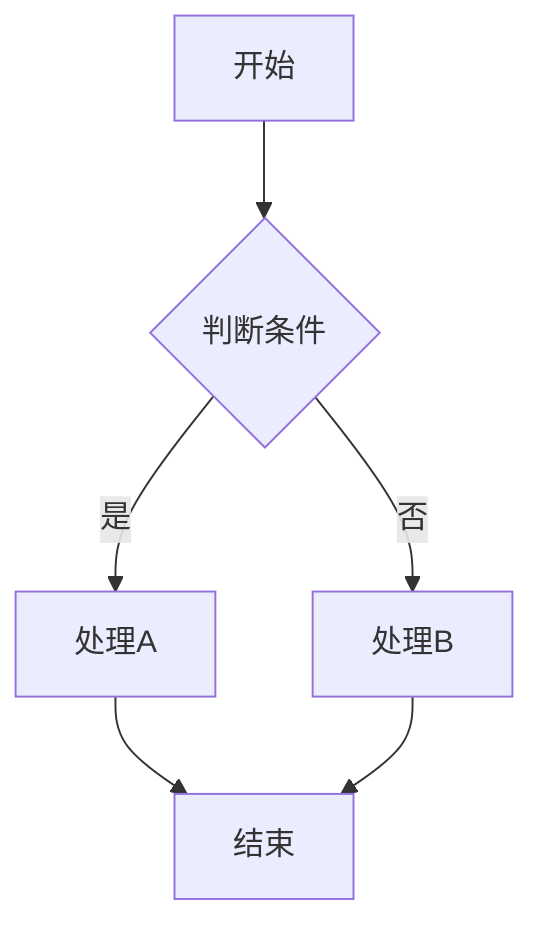
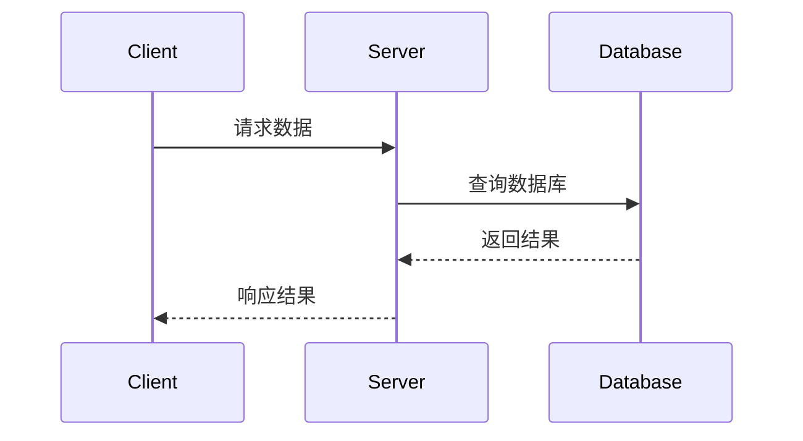
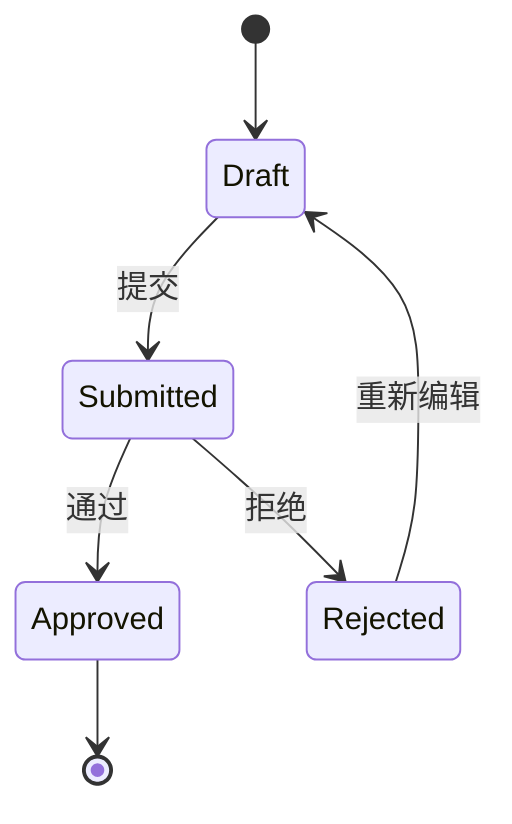
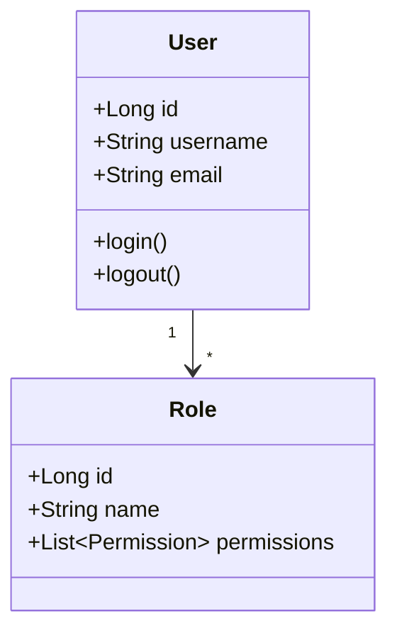

# Mermaid 图表查看指南

**版本**: 1.0.0  
**更新日期**: 2026-09-12  
**适用于**: Apex Scaffold 1.2.0+

---

## 📋 概述

Apex Scaffold 项目文档中包含大量 Mermaid 流程图、时序图、状态机图等可视化图表。这些图表以代码形式嵌入在 Markdown 文档中，需要使用支持 Mermaid 渲染的工具才能正常显示。

本文档提供了多种查看 Mermaid 图表的方法，帮助您选择最适合的工具。

---

## 🚀 快速开始

### 方法一：使用项目内置查看器（推荐）

项目提供了专门的 Mermaid 图表查看器，开箱即用，无需安装任何插件。

**使用步骤**：

1. 在浏览器中打开：[docs/mermaid-viewer.html](./mermaid-viewer.html)

2. 从下拉菜单选择要查看的文档

3. 选择查看模式：
   - **完整文档**：查看完整文档内容 + 渲染所有 Mermaid 图表
   - **仅图表**：只显示文档中的所有图表
   - **仅文本**：隐藏图表，只查看文本内容

**快捷键**：
- `Alt + 1`：切换到完整文档模式
- `Alt + 2`：切换到仅图表模式
- `Alt + 3`：切换到仅文本模式

**特点**：
- ✅ 无需安装插件
- ✅ 支持三种查看模式
- ✅ 实时统计图表数量
- ✅ 支持所有 Mermaid 图表类型
- ✅ 自适应主题样式

---

## 🛠️ 其他查看方法

### 方法二：VS Code + 插件

**适用场景**：本地开发，需要编辑文档

**安装步骤**：

1. 安装 VS Code 插件：`Markdown Preview Mermaid Support`
   ```bash
   code --install-extension bierner.markdown-mermaid
   ```

2. 打开 Markdown 文档

3. 使用预览功能：`Ctrl+Shift+V` (Windows/Linux) 或 `Cmd+Shift+V` (Mac)

**优点**：
- ✅ 集成到编辑器
- ✅ 实时预览
- ✅ 支持编辑和查看

**缺点**：
- ❌ 需要安装插件
- ❌ 仅限本地文件

---

### 方法三：IntelliJ IDEA / WebStorm / PyCharm

**适用场景**：使用 JetBrains IDE 的开发者

**使用步骤**：

1. IntelliJ IDEA Ultimate 内置支持 Mermaid（无需安装插件）

2. 社区版或其他 IDE：安装 `Mermaid` 插件
   - `Settings` → `Plugins` → 搜索 `Mermaid`

3. 打开 Markdown 文档，右键选择 `Show Preview`

**优点**：
- ✅ 与 IDE 无缝集成
- ✅ 支持代码高亮
- ✅ 企业级稳定性

---

### 方法四：在线 Mermaid Live Editor

**适用场景**：无法安装插件，需要快速查看单个图表

**使用步骤**：

1. 访问：[https://mermaid.live/](https://mermaid.live/)

2. 复制 Markdown 文档中的 Mermaid 代码（不包括 \`\`\`mermaid 标记）

3. 粘贴到在线编辑器

4. 实时预览图表

**优点**：
- ✅ 无需安装
- ✅ 支持导出图片
- ✅ 可分享链接

**缺点**：
- ❌ 需要手动复制代码
- ❌ 无法查看完整文档

---

### 方法五：GitHub 在线查看

**适用场景**：查看 GitHub 仓库中的文档

**使用步骤**：

1. 将项目推送到 GitHub

2. 在 GitHub 网页上打开 Markdown 文档

3. GitHub 会自动渲染 Mermaid 图表

**优点**：
- ✅ 无需任何配置
- ✅ 支持代码审查和协作

**缺点**：
- ❌ 需要互联网连接
- ❌ 仅限 GitHub 平台

---

## 📚 包含 Mermaid 图表的文档列表

以下文档包含 Mermaid 图表，建议使用 Mermaid 查看器查看：

### 架构设计

| 文档 | 图表类型 | 图表数量 | 描述 |
|------|---------|---------|------|
| [WebFlux 响应式编程指南](../architecture/reactive-programming-guide.md) | 时序图 | 1 | WebFlux 响应式调用链完整流程 |
| [多租户隔离架构](../architecture/multi-tenant-isolation-architecture.md) | 流程图 | 1 | 租户隔离机制和数据流转 |
| [服务治理落地方案](../architecture/service-governance-solution.md) | 流程图 | 2+ | 服务治理架构和熔断流程 |
| [核心技术图表索引](../architecture/core-tech-diagrams-index.md) | 多种 | 10+ | 汇总所有核心技术图表 |

### 功能指南

| 文档 | 图表类型 | 图表数量 | 描述 |
|------|---------|---------|------|
| [工作流引擎指南](../08-project-management/features/workflow-engine-guide.md) | 状态机图 | 1 | 工作流生命周期状态转换 |
| [消息中间件说明](../01-guides/message-middleware.md) | 流程图 | 1 | RocketMQ 消息可靠性架构 |
| [数据权限使用指南](../01-guides/data-scope-usage.md) | 时序图 | 1 | 数据权限自动过滤流程 |

### 高级特性

| 文档 | 图表类型 | 图表数量 | 描述 |
|------|---------|---------|------|
| [多级缓存完整指南](../architecture/advanced-features/multi-level-cache-complete-guide.md) | 流程图 | 2+ | 多级缓存架构和读写流程 |

---

## 🎨 Mermaid 图表类型说明

项目文档中使用的 Mermaid 图表类型：

### 1. 流程图 (Flowchart / Graph)

**用途**：展示系统架构、数据流转、业务流程

**示例**：多租户隔离架构图、消息队列可靠性架构



### 2. 时序图 (Sequence Diagram)

**用途**：展示组件间的交互顺序和消息传递

**示例**：WebFlux 响应式调用链、数据权限过滤流程



### 3. 状态机图 (State Diagram)

**用途**：展示对象的状态转换和生命周期

**示例**：工作流引擎状态机



### 4. 类图 (Class Diagram)

**用途**：展示类的结构和关系

**示例**：DDD 领域模型设计



---

## ⚙️ 配置与定制

### Mermaid 主题配置

项目查看器使用自定义主题，主色调为 `#667eea`（紫色），与项目品牌色一致。

如需修改主题，可编辑 [mermaid-viewer.html](./mermaid-viewer.html) 中的配置：

```javascript
mermaid.initialize({
    theme: 'base',
    themeVariables: {
        primaryColor: '#667eea',      // 主色调
        primaryTextColor: '#1e293b',  // 文本颜色
        primaryBorderColor: '#4f46e5', // 边框颜色
        lineColor: '#64748b',         // 连线颜色
        secondaryColor: '#f1f5f9',    // 次要颜色
        tertiaryColor: '#f8fafc'      // 第三颜色
    }
});
```

### 添加新文档

如需在查看器中添加新的包含 Mermaid 的文档：

1. 打开 [mermaid-viewer.html](./mermaid-viewer.html)

2. 找到 `<select id="fileSelect">` 元素

3. 添加新的 `<option>`：

```html
<option value="path/to/your-document.md">您的文档标题</option>
```

---

## 🐛 常见问题

### Q1: 图表不显示，只显示代码？

**原因**：您使用的查看器不支持 Mermaid 渲染。

**解决方案**：
- 使用项目内置的 [Mermaid 查看器](./mermaid-viewer.html)
- 安装支持 Mermaid 的 IDE 插件
- 使用在线 Mermaid Live Editor

### Q2: 查看器加载文档失败？

**原因**：文件路径不正确或浏览器安全限制。

**解决方案**：
- 确认文件路径正确
- 使用本地 Web 服务器（如 `python -m http.server`）而不是直接打开 HTML 文件
- 检查浏览器控制台的错误信息

### Q3: 图表显示不完整或错位？

**原因**：Mermaid 语法错误或版本不兼容。

**解决方案**：
- 检查 Mermaid 代码语法是否正确
- 在 [Mermaid Live Editor](https://mermaid.live/) 中验证代码
- 查看浏览器控制台的错误日志

### Q4: 如何导出图表为图片？

**方法一**：使用在线编辑器
1. 访问 [Mermaid Live Editor](https://mermaid.live/)
2. 粘贴图表代码
3. 点击 `Export` 按钮，选择 PNG/SVG 格式

**方法二**：使用浏览器开发工具
1. 在查看器中打开图表
2. 右键点击图表
3. 选择 `检查元素`
4. 在开发工具中右键 SVG 元素，选择 `Capture node screenshot`

### Q5: 图表渲染速度慢？

**原因**：图表复杂度高或文档较大。

**解决方案**：
- 使用"仅图表"模式，减少渲染内容
- 将复杂图表拆分为多个简单图表
- 考虑将图表导出为静态 SVG 图片

---

## 📖 扩展阅读

- [Mermaid 官方文档](https://mermaid.js.org/)
- [Mermaid 语法参考](https://mermaid.js.org/intro/)
- [Mermaid Live Editor](https://mermaid.live/)
- [项目架构文档索引](../02-architecture/architecture-index.md)

---

## 🤝 贡献

如果您发现文档中的 Mermaid 图表有问题，或有改进建议，欢迎提交 Issue 或 Pull Request。

**反馈渠道**：
- 项目 Issue Tracker
- 技术文档维护团队

---

## 📄 许可证

本文档遵循项目统一的 Apache 2.0 许可证。
