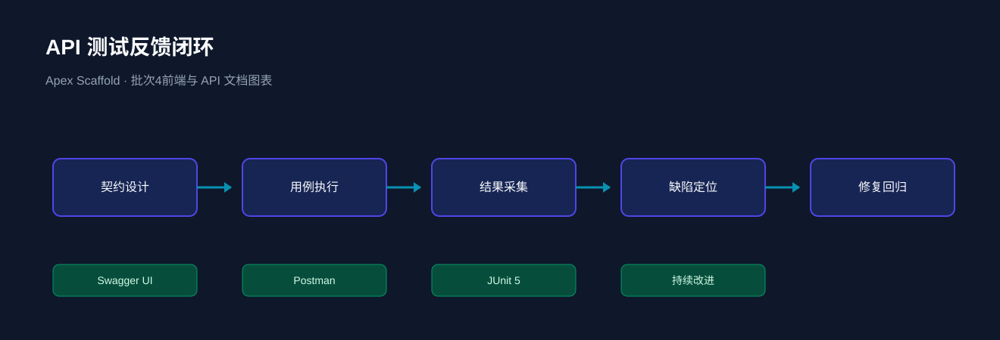

# API接口测试计划

## 项目信息

| 项目 | 信息 |
|------|------|
| 项目名称 | Apex Scaffold |
| 版本 | 1.2.0 |
| 测试环境 | http://localhost:8080 |
| 文档地址 | http://localhost:8080/doc.html |
| 计划制定日期 | 2026-09-07 |
| 计划执行周期 | 3-5个工作日 |

## 一、测试目标

### 1.1 主要目标

- 验证所有API接口的功能正确性
- 确保SpringDoc注解生成的API文档准确无误
- 验证请求参数类型定义的准确性
- 测试接口的异常处理和错误响应
- 验证接口的性能和稳定性
- 确保接口符合RESTful规范

### 1.2 测试范围

- **Handler数量**: 24个
- **接口数量**: 110+个
- **测试模块**: 15个功能模块

## 二、测试策略

### 2.1 测试类型

| 测试类型 | 优先级 | 描述 |
|---------|--------|------|
| 功能测试 | P0 | 验证接口基本功能 |
| 参数验证测试 | P0 | 验证参数校验逻辑 |
| 异常测试 | P1 | 验证错误处理 |
| 权限测试 | P1 | 验证权限控制 |
| 性能测试 | P2 | 验证接口响应时间 |
| 接口联调测试 | P1 | 验证接口间的依赖关系 |

### 2.2 测试方法

- **手动测试**: 通过Swagger UI进行交互式测试
- **自动化测试**: 使用Postman/JMeter编写测试脚本
- **单元测试**: Handler层单元测试
- **集成测试**: 端到端集成测试

### 2.3 测试工具

| 工具 | 用途 |
|------|------|
| Swagger UI | 接口文档和手动测试 |
| Postman | API测试和集合管理 |
| JMeter | 性能测试和压力测试 |
| JUnit 5 | 单元测试 |
| RestAssured | API自动化测试 |
| cURL | 命令行接口测试 |

## 三、测试模块划分

### 3.1 核心业务模块（优先级：P0）

#### 模块1：认证管理（AuthHandler）
**接口数量**: 9个

| 接口 | 方法 | 路径 | 测试重点 |
|------|------|------|----------|
| 用户登录 | POST | /api/v1/auth/login | 登录成功、密码错误、账号不存在 |
| Token刷新 | POST | /api/v1/auth/refresh | Token有效性、过期处理 |
| 退出登录 | POST | /api/v1/auth/logout | 清除会话、Token失效 |
| 用户注册 | POST | /api/v1/auth/register | 注册成功、重复注册 |
| 发送验证码 | POST | /api/v1/auth/sms/code | 验证码生成、频率限制 |
| 绑定手机号 | POST | /api/v1/auth/wx/phone | 微信授权、手机号验证 |
| 微信绑定手机号 | POST | /api/v1/auth/wechat/bind-phone | 注册前绑定 |
| 创蓝短信验证码 | POST | /api/v1/auth/cl/sms/code | 第三方短信服务 |
| 本机号校验 | POST | /api/v1/auth/cl/validate-mobile | 表单提交、参数验证 |

**测试用例数**: 约25个

#### 模块2：用户管理（UserHandler）
**接口数量**: 5个

| 接口 | 方法 | 路径 | 测试重点 |
|------|------|------|----------|
| 获取当前用户信息 | GET | /api/v1/user/me | 登录状态、用户信息完整性 |
| 根据ID获取用户 | GET | /api/v1/user/{userId} | ID有效性、权限控制 |
| 分页查询用户 | POST | /api/v1/user/list | 分页参数、排序、过滤 |
| 发送注销验证码 | POST | /api/v1/user/me/deletion-code | 验证码发送、频率限制 |
| 注销当前账号 | DELETE | /api/v1/user/me | 幂等性、验证码校验 |

**测试用例数**: 约15个

#### 模块3：授权管理（AuthorizationHandler）
**接口数量**: 12个

| 接口 | 方法 | 路径 | 测试重点 |
|------|------|------|----------|
| 获取当前用户角色 | GET | /api/v1/auth/roles/me | 角色列表正确性 |
| 获取当前用户权限 | GET | /api/v1/auth/permissions/me | 权限列表正确性 |
| 获取所有角色 | GET | /api/v1/auth/roles | 角色树结构 |
| 获取所有权限 | GET | /api/v1/auth/permissions | 权限树结构 |
| 创建角色 | POST | /api/v1/auth/roles | 参数校验、重复创建 |
| 更新角色 | POST | /api/v1/auth/roles/update | 数据更新、权限变更 |
| 删除角色 | DELETE | /api/v1/auth/roles/{id} | 关联检查、级联删除 |
| 创建权限 | POST | /api/v1/auth/permissions | 参数校验、权限编码 |
| 更新权限 | POST | /api/v1/auth/permissions/update | 数据更新 |
| 删除权限 | DELETE | /api/v1/auth/permissions/{id} | 关联检查 |
| 分配角色 | POST | /api/v1/auth/users/{userId}/roles/{roleId} | 用户角色绑定 |
| 移除角色 | DELETE | /api/v1/auth/users/{userId}/roles/{roleId} | 用户角色解绑 |

**测试用例数**: 约30个

### 3.2 管理后台模块（优先级：P0）

#### 模块4：菜单管理（MenuHandler）
**接口数量**: 6个

| 接口 | 方法 | 路径 | 测试重点 |
|------|------|------|----------|
| 查询菜单树 | GET | /admin-api/v1/menus | 树形结构、权限过滤 |
| 查询菜单详情 | GET | /admin-api/v1/menus/{menuId} | ID有效性 |
| 创建菜单 | POST | /admin-api/v1/menus | 参数校验、父菜单验证 |
| 更新菜单 | PUT | /admin-api/v1/menus/{menuId} | 数据更新、权限验证 |
| 删除菜单 | DELETE | /admin-api/v1/menus/{menuId} | 子菜单检查 |
| 启用/停用菜单 | PUT | /admin-api/v1/menus/{menuId}/status | 状态切换 |

**测试用例数**: 约18个

#### 模块5：字典管理（DictHandler）
**接口数量**: 12个

**字典类型管理**: 6个接口
- 查询字典类型列表
- 查询字典类型详情
- 创建字典类型
- 更新字典类型
- 删除字典类型
- 启用/停用字典类型

**字典数据管理**: 6个接口
- 按类型查询字典数据
- 查询字典数据详情
- 创建字典数据
- 更新字典数据
- 删除字典数据
- 启用/停用字典数据

**测试用例数**: 约30个

#### 模块6：部门管理（DeptHandler）
**接口数量**: 5个

| 接口 | 方法 | 路径 | 测试重点 |
|------|------|------|----------|
| 查询部门树 | GET | /admin-api/v1/depts | 树形结构 |
| 查询部门详情 | GET | /admin-api/v1/depts/{id} | ID有效性 |
| 新增部门 | POST | /admin-api/v1/depts | 父部门验证 |
| 更新部门 | PUT | /admin-api/v1/depts/{id} | 数据更新 |
| 删除部门 | DELETE | /admin-api/v1/depts/{id} | 子部门检查、人员检查 |

**测试用例数**: 约15个

#### 模块7：配置管理（ConfigHandler）
**接口数量**: 6个

| 接口 | 方法 | 路径 | 测试重点 |
|------|------|------|----------|
| 查询配置列表 | GET | /admin-api/v1/configs | 分页、搜索 |
| 查询配置详情 | GET | /admin-api/v1/configs/{id} | ID有效性 |
| 创建配置 | POST | /admin-api/v1/configs | 参数校验、Key唯一性 |
| 更新配置 | PUT | /admin-api/v1/configs/{id} | 数据更新 |
| 删除配置 | DELETE | /admin-api/v1/configs/{id} | 关联检查 |
| 启用/停用配置 | PUT | /admin-api/v1/configs/{id}/status | 状态切换 |

**测试用例数**: 约18个

#### 模块8：后台用户管理（AdminUserManagementHandler）
**接口数量**: 8个

| 接口 | 方法 | 路径 | 测试重点 |
|------|------|------|----------|
| 后台创建用户 | POST | /admin-api/v1/users | 参数校验、用户名唯一性 |
| 分页检索用户 | GET | /admin-api/v1/users | 分页、搜索、过滤 |
| 查看用户资料 | GET | /admin-api/v1/users/{userId} | ID有效性 |
| 编辑用户资料 | PUT | /admin-api/v1/users/{userId} | 数据更新 |
| 查询后台角色 | GET | /admin-api/v1/users/roles | 角色列表 |
| 替换用户角色 | PUT | /admin-api/v1/users/{userId}/roles | 角色分配 |
| 强制撤销会话 | POST | /admin-api/v1/users/{userId}/sessions/revoke | 会话失效 |
| 启用/停用用户 | PUT | /admin-api/v1/users/{userId}/status | 状态切换 |

**测试用例数**: 约25个

### 3.3 功能辅助模块（优先级：P1）

#### 模块9：文件管理（FileHandler）
**接口数量**: 6个

| 接口 | 方法 | 路径 | 测试重点 |
|------|------|------|----------|
| 上传文件（已废弃） | POST | /api/v1/file/upload | 向后兼容性 |
| 通用文件上传 | POST | /api/v1/files/generic | 文件大小、类型、上传成功 |
| 获取文件URL | GET | /api/v1/file/url | URL有效性、签名 |
| 删除文件 | DELETE | /api/v1/file/delete | 文件存在性、删除成功 |
| 检查文件存在 | GET | /api/v1/file/exists | 存在性判断 |
| 获取文件内容 | GET | /api/v1/file/content | 内容完整性 |

**测试用例数**: 约20个（包含文件类型、大小等测试）

#### 模块10：定时任务（JobHandler）
**接口数量**: 8个

| 接口 | 方法 | 路径 | 测试重点 |
|------|------|------|----------|
| 查询任务列表 | GET | /admin-api/v1/jobs | 分页、过滤 |
| 查询任务详情 | GET | /admin-api/v1/jobs/{id} | ID有效性 |
| 创建定时任务 | POST | /admin-api/v1/jobs | Cron表达式验证 |
| 更新定时任务 | PUT | /admin-api/v1/jobs/{id} | 数据更新 |
| 删除定时任务 | DELETE | /admin-api/v1/jobs/{id} | 删除成功 |
| 启用/停用任务 | PUT | /admin-api/v1/jobs/{id}/status | 状态切换 |
| 立即执行任务 | POST | /admin-api/v1/jobs/{id}/run | 手动触发 |
| 查询执行日志 | GET | /admin-api/v1/jobs/{id}/logs | 日志列表 |

**测试用例数**: 约25个

#### 模块11：工作流管理（WorkflowHandler）
**接口数量**: 8个

| 接口 | 方法 | 路径 | 测试重点 |
|------|------|------|----------|
| 查询工作流实例 | GET | /api/v1/workflow/instances | 分页、过滤 |
| 获取统计数据 | GET | /api/v1/workflow/statistics | 数据准确性 |
| 获取趋势数据 | GET | /api/v1/workflow/trend | 时间维度统计 |
| 流程回退 | POST | /api/v1/workflow/tasks/{taskId}/rollback | 回退逻辑 |
| 任务转办 | POST | /api/v1/workflow/tasks/{taskId}/transfer | 转办成功 |
| 任务委派 | POST | /api/v1/workflow/tasks/{taskId}/delegate | 委派成功 |
| 挂起流程实例 | POST | /api/v1/workflow/instances/{instanceId}/suspend | 挂起成功 |
| 恢复流程实例 | POST | /api/v1/workflow/instances/{instanceId}/resume | 恢复成功 |

**测试用例数**: 约25个

### 3.4 日志与监控模块（优先级：P2）

#### 模块12：日志管理
**包含Handler**: LoginLogHandler, ApiCallLogHandler, AuditLogHandler

| 接口 | 方法 | 路径 | 测试重点 |
|------|------|------|----------|
| 查询登录日志 | GET | /admin-api/v1/logs/login | 分页、过滤 |
| 查询API调用日志 | GET | /admin-api/v1/logs/api-call | 分页、过滤 |
| 查询审计日志 | GET | /admin-api/v1/logs/audit | 分页、过滤 |

**测试用例数**: 约10个

#### 模块13：监控管理
**包含Handler**: MonitorDashboardHandler, OnlineUserHandler

| 接口 | 方法 | 路径 | 测试重点 |
|------|------|------|----------|
| 监控概览 | GET | /admin-api/v1/monitor/overview | 数据准确性 |
| 系统资源监控 | GET | /admin-api/v1/monitor/system | CPU、内存等 |
| 中间件监控 | GET | /admin-api/v1/monitor/middleware | Redis、MySQL等 |
| 治理监控 | GET | /admin-api/v1/monitor/governance | 限流、熔断等 |
| 核心业务监控 | GET | /admin-api/v1/monitor/business | 业务指标 |
| 在线用户列表 | GET | /admin-api/v1/online-users | 分页、实时性 |

**测试用例数**: 约15个

### 3.5 其他辅助模块（优先级：P2）

#### 模块14：数据库配置（DatabaseConfigHandler）
**接口数量**: 3个

| 接口 | 方法 | 路径 | 测试重点 |
|------|------|------|----------|
| 测试数据库连接 | POST | /admin-api/v1/database/test | 连接成功、失败处理 |
| 生成部署配置 | POST | /admin-api/v1/database/generate | 配置生成 |
| 获取当前数据库信息 | GET | /admin-api/v1/database/current | 信息完整性 |

**测试用例数**: 约8个

#### 模块15：其他功能
**包含Handler**: CaptchaHandler, HealthHandler, ExcelExportHandler, UnifiedSearchHandler等

| 接口 | 测试重点 |
|------|----------|
| 获取验证码 | 验证码生成、图片格式 |
| 校验验证码 | 验证成功、失败、过期 |
| 健康检查 | 服务状态 |
| 系统信息 | 信息完整性 |
| 导出用户列表 | Excel格式、数据完整性 |
| 统一搜索 | 搜索准确性、分页 |
| 重建索引 | 索引重建成功 |
| 统一日志查询 | 日志查询、过滤 |
| SSE通知流 | 实时推送 |

**测试用例数**: 约25个

## 四、测试用例设计

### 4.1 功能测试用例模板

```markdown
| 用例ID | 接口名称 | 测试场景 | 前置条件 | 测试步骤 | 预期结果 | 优先级 |
|--------|---------|---------|---------|---------|---------|--------|
| TC001 | 用户登录 | 正确的用户名密码登录 | 用户已注册 | 1. 输入用户名<br>2. 输入密码<br>3. 点击登录 | 返回200，包含Token | P0 |
| TC002 | 用户登录 | 错误的密码 | 用户已注册 | 1. 输入用户名<br>2. 输入错误密码<br>3. 点击登录 | 返回401，错误提示 | P0 |
```

### 4.2 参数验证测试用例

每个接口需要测试：
- 必填参数缺失
- 参数类型错误
- 参数格式错误
- 参数长度超限
- 特殊字符处理
- SQL注入防护
- XSS防护

### 4.3 异常测试用例

- HTTP 400: 参数错误
- HTTP 401: 未认证
- HTTP 403: 权限不足
- HTTP 404: 资源不存在
- HTTP 409: 资源冲突
- HTTP 500: 服务器错误

### 4.4 性能测试用例

- 单接口响应时间（< 200ms为优秀）
- 并发用户数测试（100、500、1000用户）
- 吞吐量测试（TPS > 1000）
- 资源使用率（CPU < 70%, 内存 < 80%）

## 五、测试执行计划

### 5.1 测试阶段

| 阶段 | 时间 | 内容 | 负责人 |
|------|------|------|--------|
| 准备阶段 | Day 1 | 环境搭建、数据准备、工具配置 | 测试工程师 |
| 冒烟测试 | Day 1 | 核心功能快速验证 | 测试工程师 |
| 功能测试 | Day 2-3 | 全功能测试用例执行 | 测试工程师 |
| 集成测试 | Day 3 | 接口联调测试 | 测试工程师 |
| 性能测试 | Day 4 | 性能和压力测试 | 性能工程师 |
| 回归测试 | Day 5 | Bug修复后回归 | 测试工程师 |
| 测试总结 | Day 5 | 测试报告编写 | 测试负责人 |

### 5.2 测试优先级

**P0（必须）- Day 1-2**
- 认证管理（登录、注册、Token）
- 用户管理（用户信息查询）
- 授权管理（角色、权限）

**P1（重要）- Day 2-3**
- 菜单管理
- 字典管理
- 部门管理
- 配置管理
- 后台用户管理
- 文件管理
- 定时任务
- 工作流管理

**P2（一般）- Day 4**
- 日志管理
- 监控管理
- 数据库配置
- 其他辅助功能

## 六、测试数据准备

### 6.1 基础数据

```sql
-- 测试用户
INSERT INTO sys_user (username, password, phone, email, status) 
VALUES 
  ('testuser1', 'password123', '13800138001', 'test1@example.com', 1),
  ('testuser2', 'password123', '13800138002', 'test2@example.com', 1),
  ('testadmin', 'admin123', '13800138000', 'admin@example.com', 1);

-- 测试角色
INSERT INTO sys_role (name, code, description, status)
VALUES
  ('管理员', 'admin', '系统管理员', 1),
  ('普通用户', 'user', '普通用户', 1),
  ('访客', 'guest', '访客用户', 1);

-- 测试权限
INSERT INTO sys_permission (name, code, type, status)
VALUES
  ('用户查询', 'system:user:query', 'API', 1),
  ('用户创建', 'system:user:create', 'API', 1),
  ('用户删除', 'system:user:delete', 'API', 1);
```

### 6.2 测试文件

- 图片文件: test-image.jpg (< 5MB)
- 文档文件: test-document.pdf (< 10MB)
- 超大文件: large-file.zip (> 100MB)
- 错误格式: test.exe (不允许的类型)

### 6.3 边界值数据

- 空字符串: ""
- 最小值: 1
- 最大值: Integer.MAX_VALUE
- 负数: -1
- 特殊字符: `<script>alert('xss')</script>`
- SQL注入: `' OR '1'='1`

## 七、测试环境要求

### 7.1 服务器环境

| 组件 | 版本 | 配置 |
|------|------|------|
| JDK | 17+ | - |
| Spring Boot | 3.5.15 | - |
| MySQL | 8.0+ | 4核8G |
| Redis | 7.0+ | 2核4G |
| Nginx | 1.24+ | 2核4G |

### 7.2 测试客户端

- Chrome浏览器 (最新版)
- Postman (最新版)
- JMeter 5.5+
- cURL命令行工具

### 7.3 网络环境

- 测试环境与生产环境隔离
- 可访问外部短信服务（测试环境）
- 可访问对象存储服务（测试环境）

## 八、测试工具配置

### 8.1 Postman集合

创建Postman Collection，包含：
- 环境变量配置（baseUrl, token等）
- 预置请求脚本（自动添加Token）
- 测试断言脚本（验证响应）
- 数据驱动测试（CSV文件）

### 8.2 JMeter脚本

性能测试脚本包含：
- 线程组配置（用户数、循环次数）
- HTTP请求采样器
- 断言验证
- 监听器（结果树、聚合报告）

### 8.3 自动化测试框架

```java
// RestAssured测试示例
@Test
public void testUserLogin() {
    given()
        .contentType(ContentType.JSON)
        .body(loginRequest)
    .when()
        .post("/api/v1/auth/login")
    .then()
        .statusCode(200)
        .body("code", equalTo(200))
        .body("data.token", notNullValue());
}
```

## 九、缺陷管理

### 9.1 缺陷等级

| 等级 | 描述 | 响应时间 | 修复时间 |
|------|------|---------|---------|
| P0-致命 | 系统崩溃、数据丢失、安全漏洞 | 立即 | 4小时内 |
| P1-严重 | 核心功能不可用、影响大量用户 | 2小时 | 24小时内 |
| P2-一般 | 功能缺陷、影响部分用户 | 8小时 | 3天内 |
| P3-轻微 | 界面问题、文档错误 | 24小时 | 1周内 |

### 9.2 缺陷报告模板

```markdown
**缺陷ID**: BUG-001
**标题**: 用户登录时密码错误返回500
**严重程度**: P1
**优先级**: 高
**模块**: 认证管理
**接口**: POST /api/v1/auth/login

**复现步骤**:
1. 打开Swagger UI
2. 输入正确的用户名
3. 输入错误的密码
4. 点击Execute

**预期结果**: 返回401，提示密码错误

**实际结果**: 返回500，服务器内部错误

**环境信息**:
- 版本: 1.2.0
- 浏览器: Chrome 120.0
- 时间: 2026-09-07 10:00:00

**附件**: 错误截图、日志文件
```

### 9.3 缺陷跟踪流程

```
新建 → 待确认 → 已确认 → 修复中 → 待验证 → 已关闭
              ↓                      ↓
            已拒绝                 重新打开
```

## 十、测试交付物

### 10.1 测试文档

- [ ] 测试计划（本文档）
- [ ] 测试用例文档
- [ ] 测试数据说明
- [ ] 测试环境配置文档

### 10.2 测试脚本

- [ ] Postman测试集合
- [ ] JMeter性能测试脚本
- [ ] 自动化测试代码

### 10.3 测试报告

- [ ] 冒烟测试报告
- [ ] 功能测试报告
- [ ] 性能测试报告
- [ ] 最终测试总结报告

### 10.4 缺陷清单

- [ ] 缺陷汇总表
- [ ] 缺陷趋势图
- [ ] 遗留缺陷说明

## 十一、测试通过标准

### 11.1 功能测试

- ✅ P0用例通过率 = 100%
- ✅ P1用例通过率 ≥ 98%
- ✅ P2用例通过率 ≥ 95%
- ✅ 无P0、P1级别遗留缺陷

### 11.2 性能测试

- ✅ 接口平均响应时间 < 200ms
- ✅ 接口95分位响应时间 < 500ms
- ✅ 接口99分位响应时间 < 1000ms
- ✅ 并发100用户时系统稳定运行
- ✅ CPU使用率 < 70%
- ✅ 内存使用率 < 80%
- ✅ 数据库连接池使用率 < 80%

### 11.3 稳定性测试

- ✅ 7x24小时压力测试无崩溃
- ✅ 内存无泄漏
- ✅ 错误率 < 0.1%

### 11.4 兼容性测试

- ✅ 支持Chrome、Firefox、Safari浏览器
- ✅ 支持iOS、Android移动设备
- ✅ API响应符合OpenAPI 3.0规范

## 十二、风险与应对

### 12.1 潜在风险

| 风险 | 影响 | 概率 | 应对措施 |
|------|------|------|----------|
| 测试环境不稳定 | 高 | 中 | 提前搭建并验证环境 |
| 测试数据准备不足 | 中 | 中 | 编写数据生成脚本 |
| 接口文档不完整 | 高 | 低 | 与开发确认接口规范 |
| 测试时间不足 | 高 | 中 | 优先测试P0、P1用例 |
| 第三方服务不可用 | 中 | 低 | 准备Mock服务 |
| 性能测试资源不足 | 中 | 中 | 申请云端测试资源 |

### 12.2 依赖项

- 开发完成时间：测试前1天
- 数据库脚本提供：测试前2天
- 测试环境就绪：测试前3天
- API文档完整性：测试前1天

## 十三、测试指标

### 13.1 过程指标

- 测试用例数量：预计280个
- 测试用例执行数量：每日统计
- 测试用例通过率：每日统计
- 缺陷发现数量：每日统计
- 缺陷修复数量：每日统计

### 13.2 质量指标

- 接口可用性：99.9%
- 接口响应时间达标率：95%
- 缺陷密度：< 5个/模块
- 代码覆盖率：> 80%

## 十四、测试总结

测试完成后，需要编写测试总结报告，包括：

1. **测试概述**
   - 测试目标达成情况
   - 测试范围覆盖情况
   - 测试执行进度

2. **测试结果**
   - 用例执行统计
   - 缺陷统计分析
   - 性能测试结果

3. **质量评估**
   - 功能质量评价
   - 性能质量评价
   - 稳定性评价
   - 发布建议

4. **遗留问题**
   - 遗留缺陷清单
   - 风险说明
   - 后续建议

5. **经验总结**
   - 测试过程中的问题
   - 改进建议
   - 最佳实践

## 附录

### 附录A：接口清单

详见API接口测试报告.md（目标不存在，无已核实替代文件；原路径：`./API接口测试报告.md`）

### 附录B：测试用例模板

详见`测试用例.xlsx`

### 附录C：缺陷报告模板

详见`缺陷报告模板.xlsx`

### 附录D：测试环境配置

详见`测试环境配置.md`



---

**文档版本**: 1.0  
**制定人**: 测试团队  
**审核人**: 技术负责人  
**批准人**: 项目经理  
**制定日期**: 2026-09-07  
**最后更新**: 2026-09-07
