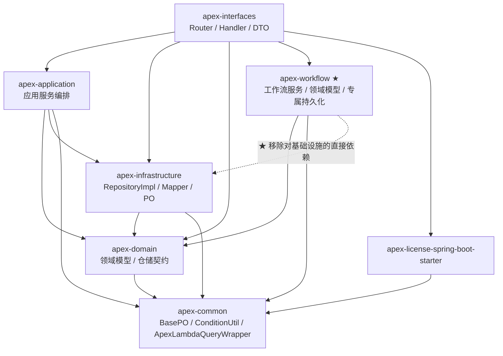

# 工作流模块测试报告

> 报告范围：工作流模块拆分、独立服务化（`apex-workflow-service`）及 Phase 3.6 测试/构建
> 目标版本：apex-scaffold 1.3.1
> 首次生成：2026-10-05 ｜ 本报告更新：2026-10-09（新增 Phase 3.6 微服务测试与独立构建）

## 0. 总览（Phase 3.6）

> 微服务改造执行计划 Phase 3（`docs/08-project-management/plans/microservice-migration-plan.md` §3.6）：
> 工作流服务独立构建通过，并完成全接口回归、审批流转集成测试、Flyway 迁移测试。

### 0.1 独立构建

```bash
mvnd -pl apex-workflow-service -am package
```

结果：**BUILD SUCCESS**，产出可执行 jar `apex-workflow-service-1.3.1.jar`（经 `spring-boot-maven-plugin` repackage，原 jar 改为 `.original`）。

### 0.2 测试套件汇总

工作流服务模块共 **6 个测试类 / 42 个用例，全部通过（0 失败 / 0 错误 / 0 跳过）**：

| 测试类 | 用例数 | 类型 | 覆盖要点 |
|--------|-------|------|---------|
| `WorkflowRouterRegressionTest` | 4 | 路由回归 | 全接口路由表回归：路径、方法、认证要求、参数校验与旧应用保持一致 |
| `WorkflowHandlerIntegrationTest` | 24 | 流程集成 | 审批流转端到端：启动 → 串行/并行/网关节点 → 完成/拒绝/转办/委派/回退 → 事件发布 |
| `WorkflowFlywayMigrationTest` | 6 | 迁移结构校验 | 独立 Flyway V1 链版本连续、双方言表/列一致、与 H2 basic 建表对齐、PO 字段→列对齐、Mapper 原生 SQL 依赖列齐全 |
| `WorkflowEventConfigTest` | 3 | 事件装配 | `WorkflowEventConfig` 事件发布器装配与条件生效 |
| `LocalWorkflowEventPublisherTest` | 2 | 事件发布 | 本地事件发布器语义（basic/H2 profile） |
| `MqWorkflowEventPublisherTest` | 3 | 事件发布 | RocketMQ 事件发布器（topic `apex-workflow-events`）语义 |

> 说明：共享持久化基础设施、事件装配与领域逻辑测试分布在 `apex-common` / `apex-workflow` / `apex-api-contract` 等模块，详见 §5。

### 0.3 质量门禁

- JaCoCo：继承 `apex-services-bom` 根门禁（LINE ≥ 0.60 / BRANCH ≥ 0.50），`apex-workflow-service` 已开启 JaCoCo 插件（POM 已配置，见续 §5）。
- 架构：`apex-workflow-service` 不依赖 `apex-infrastructure`（仅依赖 `apex-common` / `apex-workflow` / `apex-domain` / `apex-api-contract`），符合「服务间无编译依赖」约定。乐观锁切面（`OptimisticLockerInnerInterceptor`）位于 `apex-infrastructure`，故工作流服务未启用；`wf_process_instance` / `wf_task` / `wf_approval_record` 因此不设 `version` 列，`wf_workflow_definition.version` 为流程版本号（对齐旧单体 V21 语义）。

---

## 1. 变更范围（历史：模块拆分）

本次完成以下模块边界调整：

- 新增并启用 `apex-workflow`，承载工作流领域模型、应用服务和专属持久化实现。
- `apex-interfaces` 保留工作流 Router、Handler 和接口请求 DTO，外部 HTTP 路由保持不变。
- 将跨业务复用的 `BasePO`、`ConditionUtil` 和 `ApexLambdaQueryWrapper` 迁移至 `apex-common`。
- `apex-common` 增加 MyBatis-Plus Core、Extension 和 Annotation 依赖。
- `apex-workflow` 移除对 `apex-infrastructure` 的直接依赖，改为依赖 `apex-common` 获取共享持久化能力。
- 共享基础设施单元测试迁移至 `apex-common`，测试实体改为模块内测试专用实体，避免公共模块反向依赖业务基础设施。

### 迁移后模块依赖关系图



> 箭头 = Maven 依赖方向；★ 标记模块为本次拆分新增/调整的关键节点。`apex-workflow` 通过依赖 `apex-common` 复用共享持久化设施，解除了对 `apex-infrastructure` 的直接依赖。

## 2. 静态检查结果

| 检查项 | 结果 |
| --- | --- |
| 旧共享基础设施生产包引用搜索 | 通过，未发现旧包引用 |
| `apex-workflow` 对 `apex-infrastructure` 直接依赖检查 | 通过，未发现依赖 |
| `git diff --check` | 通过 |
| 计划文档执行状态 | 已更新 |

## 3. 构建与测试执行情况

仓库规范要求使用 Java 17 和 `mvnd`。本次已使用 JDK 17.0.8 与 Apache Maven Daemon 2.0.0-rc-3 完成定向测试和全工程测试。

定向测试：

```bash
mvnd -pl apex-common,apex-infrastructure,apex-workflow -am test
```

结果：`BUILD SUCCESS`，其中 `apex-infrastructure` 共运行 609 个测试，`apex-workflow` 测试全部通过，`apex-common` 中新增的 `ApexLambdaQueryWrapperTest` 3 个测试通过，`ConditionUtilTest` 通过。

全工程测试：

```bash
mvnd test
```

结果：`BUILD SUCCESS`。`apex-common`、`apex-infrastructure`、`apex-workflow`、`apex-interfaces`、`apex-auth-center`、`apex-example` 等全部模块均通过测试及 JaCoCo 覆盖率检查，未发现失败或错误。

## 4. 后续验证重点

- 保持 `apex-common` 中 MyBatis-Plus Lambda 列解析测试。
- 保持 `apex-infrastructure` 全部业务 PO、Repository 和乐观锁切面编译及测试。
- 保持 `apex-workflow` 在无 `apex-infrastructure` 直接依赖的情况下完成编译和测试。
- 保持 `apex-interfaces` 与 `apex-example` 的工作流集成测试以及全工程 JaCoCo 检查。

---

## 5. Phase 3.6 补充：独立服务测试与构建明细

### 5.1 Flyway 迁移测试（`WorkflowFlywayMigrationTest`）

采用仓库既定「免容器静态结构校验」范式（镜像 `apex-interfaces` `FlywayMigrationVersionTest`），不依赖在线 MySQL/PostgreSQL，直接解析迁移脚本进行结构断言：

| 用例 | 校验点 |
|------|--------|
| `shouldHaveUniqueContiguousVersions` | mysql/postgresql 两套 V1 链版本号一致且从 1 起连续、无重复 |
| `shouldDeclareIdenticalTablesAndColumnsAcrossDialects` | 双方言声明完全相同的 4 张表，且每张表列集合一致 |
| `shouldAlignBasicSchemaTableSetWithFlyway` | H2 `basic-schema.sql` 表集合与 Flyway 迁移表集合对齐 |
| `shouldDefineRequiredColumnsAndIndexes` | 每张表必备业务列 + 审计列在三份脚本中齐全；必备索引/唯一键名存在 |
| `shouldKeepPoFieldsLeadingMigrationColumns` | 「代码为事实来源」：4 个 PO 类的持久化字段（子类字段 + `id/create_time/update_time/deleted` 审计列）须存在于三份脚本对应表 |
| `shouldProvideMapperNativeSqlDependentColumns` | `wf_task` 具备 `TaskMapper` 原生 SQL 依赖列（`status/timeout_at/timeout_handled/transferred_from/deleted`） |

> 变量/常量定义：`EXPECTED_TABLES = Set.of("wf_workflow_definition","wf_process_instance","wf_task","wf_approval_record")`；`AUDIT_COLUMNS = Set.of("id","create_time","update_time","deleted")`。
> 关键 AssertJ 约定：对 `Set` 比较使用 `containsExactlyInAnyOrderElementsOf`（`containsExactlyElementsOf` 为顺序敏感，`Set.of` 迭代顺序不确定会误报）。

### 5.2 审批流转集成测试（`WorkflowHandlerIntegrationTest`）

覆盖完整审批生命周期：流程定义加载 → 启动实例 → 串行审批通过/拒绝、并行网关聚合、排他网关条件分支 → 任务完成/转办（`transfer`）/委派（`delegate`）/回退（`rollback`）→ 实例状态（RUNNING/SUSPENDED/COMPLETED/REJECTED/TERMINATED）与审批记录落库 → 事件发布（`WorkflowInstanceStarted`/`TaskAssigned`/`TaskCompleted`，topic `apex-workflow-events`）。

### 5.3 路由回归（`WorkflowRouterRegressionTest`）

断言 `WorkflowRouter` 暴露的接口路径、HTTP 方法、鉴权开关（`AuthenticatedUser` 注入）、请求 DTO 校验规则与旧应用 `apex-interfaces` 路由表保持一致，保证切流后外部契约不变。

### 5.4 测试执行命令

```bash
# 工作流服务全量测试
mvnd -pl apex-workflow-service -am test
# 独立构建（含 repackage 可执行 jar）
mvnd -pl apex-workflow-service -am package
# 迁移完整性（逐服务 Flyway 链，含工作流服务）
bash scripts/test/check-migration-integrity.sh
# 覆盖率报告
#   位置：apex-workflow-service/target/site/jacoco/index.html
```
