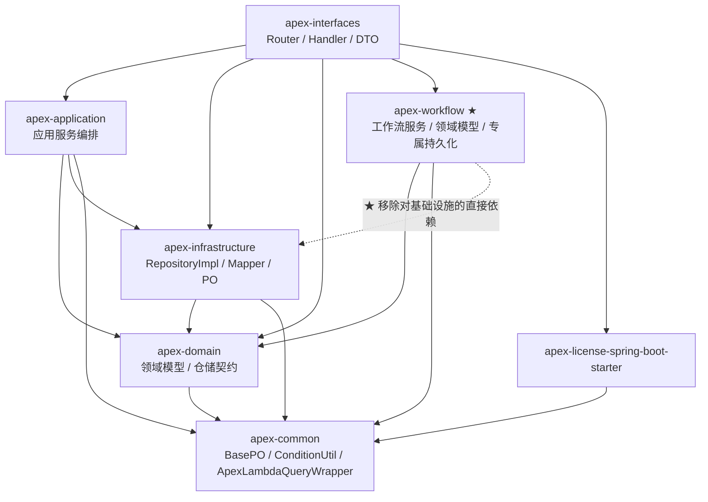

# 工作流模块化测试报告

> 报告范围：工作流模块拆分及方案 1 共享持久化基础设施迁移
> 目标版本：apex-scaffold 1.3.1
> 生成日期：2026-10-05

## 1. 变更范围

本次完成以下模块边界调整：

- 新增并启用 `apex-workflow`，承载工作流领域模型、应用服务和专属持久化实现。
- `apex-interfaces` 保留工作流 Router、Handler 和接口请求 DTO，外部 HTTP 路由保持不变。
- 将跨业务复用的 `BasePO`、`ConditionUtil` 和 `ApexLambdaQueryWrapper` 迁移至 `apex-common`。
- `apex-common` 增加 MyBatis-Plus Core、Extension 和 Annotation 依赖。
- `apex-workflow` 移除对 `apex-infrastructure` 的直接依赖，改为依赖 `apex-common` 获取共享持久化能力。
- 共享基础设施单元测试迁移至 `apex-common`，测试实体改为模块内测试专用实体，避免公共模块反向依赖业务基础设施。

### 迁移后模块依赖关系图



> 箭头 = Maven 依赖方向；★ 标记模块为本次拆分新增/调整的关键节点。`apex-workflow` 通过依赖 `apex-common` 复用共享持久化设施，解除了对 `apex-infrastructure` 的直接依赖。

## 2. 静态检查结果

| 检查项 | 结果 |
| --- | --- |
| 旧共享基础设施生产包引用搜索 | 通过，未发现旧包引用 |
| `apex-workflow` 对 `apex-infrastructure` 直接依赖检查 | 通过，未发现依赖 |
| `git diff --check` | 通过 |
| 计划文档执行状态 | 已更新 |

## 3. 构建与测试执行情况

仓库规范要求使用 Java 17 和 `mvnd`。本次已使用 JDK 17.0.8 与 Apache Maven Daemon 2.0.0-rc-3 完成定向测试和全工程测试。

定向测试：

```bash
mvnd -pl apex-common,apex-infrastructure,apex-workflow -am test
```

结果：`BUILD SUCCESS`，其中 `apex-infrastructure` 共运行 609 个测试，`apex-workflow` 测试全部通过，`apex-common` 中新增的 `ApexLambdaQueryWrapperTest` 3 个测试通过，`ConditionUtilTest` 通过。

全工程测试：

```bash
mvnd test
```

结果：`BUILD SUCCESS`。`apex-common`、`apex-infrastructure`、`apex-workflow`、`apex-interfaces`、`apex-auth-center`、`apex-example` 等全部模块均通过测试及 JaCoCo 覆盖率检查，未发现失败或错误。

## 4. 后续验证重点

- 保持 `apex-common` 中 MyBatis-Plus Lambda 列解析测试。
- 保持 `apex-infrastructure` 全部业务 PO、Repository 和乐观锁切面编译及测试。
- 保持 `apex-workflow` 在无 `apex-infrastructure` 直接依赖的情况下完成编译和测试。
- 保持 `apex-interfaces` 与 `apex-example` 的工作流集成测试以及全工程 JaCoCo 检查。
