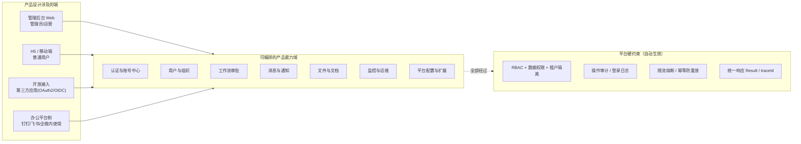
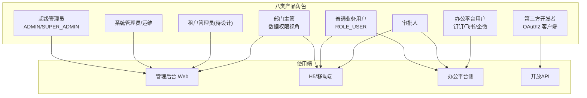
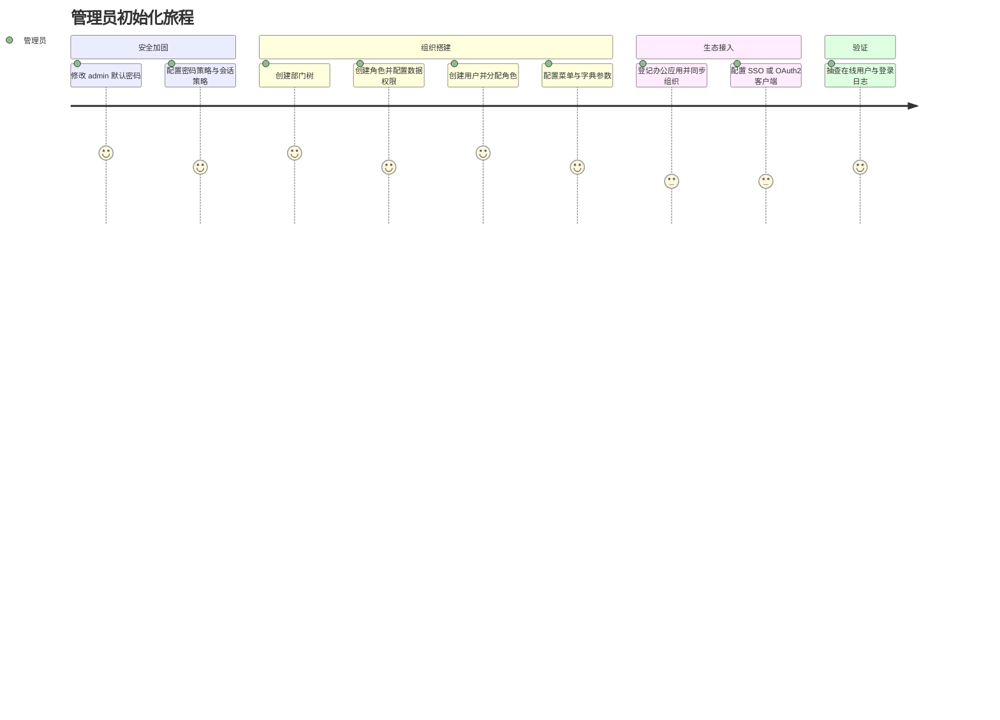
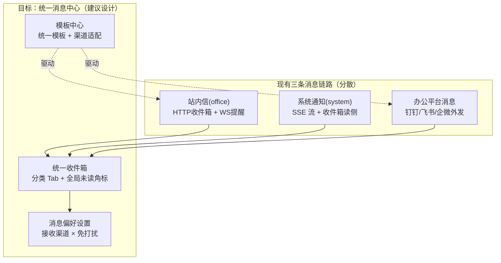

# Apex Scaffold 产品设计指导文档

> **角色画像 · 能力地图 · 模块设计指引 · 设计规范 · 机会点路线 —— 产品经理的设计工作台**
>
> | 项目 | 说明 |
> |---|---|
> | 文档版本 | V1.0 |
> | 编制日期 | 2026-10-21 |
> | 代码基线 | v1.3.1 |
> | 配套文档 | 《Apex Scaffold 产品解决方案文档》V1.1（现状基线） |
> | 目标读者 | 产品经理 / 产品设计师 / 交互设计师 |
>
> 本文档与《产品解决方案文档》配套使用：基线文档回答「系统现在是什么」，本文档回答「在这个基础上，产品该怎么设计」。全部结论均来自代码实盘核对，设计时可直接引用其中的权限码、路由约定与能力边界，避免设计与实现脱节。

---

## 目录

1. [文档使用指南](#1-文档使用指南)
2. [产品全局认知](#2-产品全局认知)
3. [用户角色与场景设计](#3-用户角色与场景设计)
4. [功能模块设计指引](#4-功能模块设计指引)
5. [全局设计规范（红线与约定）](#5-全局设计规范红线与约定)
6. [产品机会点与路线建议](#6-产品机会点与路线建议)
7. [设计交付清单与附录](#7-设计交付清单与附录)

---

## 1. 文档使用指南

### 1.1 两份文档如何配合

| 场景 | 用哪份 / 用哪一节 |
|---|---|
| 写 PRD 前了解系统能做什么 | 本文档 §2 能力地图 + §4 模块设计指引；细节查基线文档对应章节 |
| 定义某个页面给谁用、看什么数据 | 本文档 §3 角色画像 + 基线文档 §4 权限模型（权限码 / 数据权限五档） |
| 画原型 / 定菜单结构 | 本文档 §5.1 信息架构约定 + §4 各模块「建议信息架构」 |
| 规划新功能 / 排期 | 本文档 §6 机会点卡片（含优先级与验收要点） |
| 查接口路径、权限码原文 | 基线文档 §5 功能清单、§9 附录；全量路由见 `docs/API_ROUTES.md` |

### 1.2 三条设计总原则

- **能力复用优先**：本平台的认证、权限、审计、通知、文件能力均为共享底座，新功能设计时先问「底座能不能直接挂」，不要为单模块重新发明账号体系或消息通道。
- **权限先行**：任何页面的第一张草稿应是「谁看得见、谁点得动、数据范围多大」（功能权限 + 数据权限 + 租户三问），再画布局。
- **约定即规范**：§5 的约定全部由代码强制执行（网关、拦截器、门禁），产品设计若与其冲突，实现成本会急剧上升——这些是红线不是建议。

---

## 2. 产品全局认知

### 2.1 一句话定位

Apex Scaffold 是一套**企业级 Java 后端平台底座**：以「网关 + 微服务」形态交付认证、权限、系统管理、工作流、办公集成、文件、任务调度等公共能力，业务方在其上快速搭建企业内部系统或行业 SaaS。

### 2.2 总体架构（设计时的能力边界图）

*图 2-1 · 产品设计视角的全局地图：四个端 × 七个能力域 × 平台硬约束*

### 2.3 能力成熟度地图（设计前必读）

| 能力域 | 成熟度 | 已具备（可直接用） | 需要补设计（机会点） |
|---|---|---|---|
| 认证与账号 | **完善** | 登录、双令牌、MFA 三通道、会话管理、OAuth2/OIDC、SSO、IP 管控、密码策略 | 自助密码找回（缺端点） |
| 用户与组织 | **完善** | 用户/角色/权限/菜单/部门/字典/参数全套 CRUD、数据权限五档、Excel 导入导出 | 租户管理界面（模型已备、无端点） |
| 工作流 | **半成品** | 实例发起/待办/通过/回退/转办/委派/挂起/统计/超时升级 | 流程定义管理与可视化设计器（引擎能力在、入口缺） |
| 消息通知 | **完善** | 站内信（HTTP+WS）、SSE 通知、消息模板、办公平台外发、失败重发/撤回 | 三通道统一收件箱的体验整合 |
| 文件 | **完善** | 直传/分片、预览、预签名 URL、五后端存储、文档图表台账 | 文件分享链接（无端点） |
| 办公集成 | **完善** | 钉钉/飞书/企微组织同步、消息、审批、日历、文档、应用管理与绑定审核 | 同步向导化、会议室资源管理深化 |
| 监控运维 | **完善** | 大屏五视图、四类日志、在线用户、统一搜索、任务调度、数据源管理 | 面向管理员的「体检报告」类汇总视图 |
| 扩展工具 | **完善** | 代码生成器（选表→配置→生成五层代码）、SSO/OAuth2 客户端管理 | 生成器引导式向导体验 |

> **给 PM 的一句话**：平台底座能力已经相当完整，设计的重心不是「从零造功能」，而是：**补齐 3 个半成品入口（工作流设计器、租户管理、密码找回）**、**整合分散体验（消息中心、同步向导）**，以及在业务侧把底座能力编排成可用的产品故事。

---

## 3. 用户角色与场景设计

### 3.1 角色全景（谁在用、用什么、注意什么）

*图 3-1 · 角色全景：八类角色与四个使用端的映射（角色码为系统预置）*

### 3.2 角色画像与设计要点

| 角色 | 核心诉求 | 主要功能入口 | 设计要点 |
|---|---|---|---|
| **超级管理员** `ADMIN / SUPER_ADMIN` | 掌控全局：账号、权限、系统配置、安全治理 | 系统管理全部目录 + 监控中心 + 认证配置 | 关键操作是双保险（管理角色硬校验 + 权限码），高危操作（改权限、踢人、删菜单）设计二次确认 + 审计留痕提示；界面默认全量可见，但应支持按模块折叠。 |
| **系统管理员/运维** | 系统健康、日志排查、任务与数据源运维 | 监控中心、日志四件套、任务调度、数据源管理 | 大屏五视图（总览/系统/中间件/治理/业务）适合做导航首页；日志检索页面要突出 traceId 关联跳转；权限码 `system:monitor:view` 一码控五视图，如需细分要提需求拆码。 |
| **租户管理员**（当前无此界面） | 管本租户的用户、套餐配额、到期情况 | 待设计（租户模型与配额字段已备） | 租户身份来自 JWT、不可伪造切换——UI 上若做「租户切换器」仅是视觉呈现，后端无感知；配额四项（套餐/到期/用户数/存储）适合做仪表卡。 |
| **部门主管** | 看本部门（及下级）的人员与业务数据 | 后台用户列表、各类业务列表 | 数据范围由角色的 data_scope 决定（本部门/本部门及以下等五档），**界面上不需要也不应提供范围切换**；列表页应明确展示「当前数据范围」提示，避免误解为数据缺失。 |
| **普通业务用户** `ROLE_USER` | 个人事务：待办、消息、文件、个人信息 | 工作台（/dashboard）、我的待办、收件箱、个人中心 | 所有接口走 `/api/v1/**`；个人中心含自助注销（验证码二次确认）属合规要求不可省略；首页信息密度要低，聚焦待办 + 未读消息 + 快捷入口。 |
| **审批人** | 高效处理待办、了解流程上下文 | 我的待办、审批详情、历史 | 四个干预动作（通过/回退/转办/委派）语义不同，交互上要分开呈现且不可合并；超时升级（转办管理员）产生的任务要有特殊标识。 |
| **第三方开发者** | 接入 OAuth2/OIDC 拿到用户授权 | 开放端点 + 管理侧客户端管理 | 面向开发者的文档页需要 OIDC 发现地址、JWKS、端点清单；客户端密钥有自动轮换调度，开发者文档要写明轮换后的处理。 |
| **办公平台用户** | 在钉钉/飞书/企微里用核心功能，免双系统切换 | 办公扫码登录、平台内消息/审批卡片 | 账号绑定有审核流（binding review），设计要包含「绑定申请→审核→生效」状态可见；消息外发失败有重发/撤回，需要给状态反馈。 |

### 3.3 关键用户旅程（现状能力串联）

#### 旅程一：管理员初始化一套新系统（首次 30 分钟）

*图 3-2 · 管理员初始化旅程（步骤均对应现有接口；办公应用登记环节建议后续向导化）*

> 设计启示：旅程中的「创建角色并配置数据权限」是理解成本最高的一步——数据权限五档 + 自定义部门集合的配置界面是这个旅程的关键体验点。

#### 旅程二：员工办公审批（跨办公平台）

| 阶段 | 用户动作 | 背后能力（设计时对照） |
|---|---|---|
| 发起 | 在 Web/办公平台提交申请 | `POST /api/office/approvals` → 工作流引擎建实例 |
| 触达 | 审批人收到站内信/办公平台消息 | 站内信 WS 实时提醒 + 办公平台外发（失败可重发） |
| 处理 | 通过 / 回退 / 转办 / 委派 | 四个任务动作接口，语义互斥 |
| 升级 | （超时未处理）管理员接管 | 超时扫描：ESCALATE 转办管理员 / NOTIFY 通知 |
| 回执 | 发起人收到结果、查归档 | 实例详情、审批记录、流程统计 |

#### 旅程三：文件协作

小文件直传 → 大文件分片上传（可查进度）→ 预览/预签名 URL 分发 → 文档台账管理 → 孤儿文件清理。设计时注意：**Local 存储后端不提供无认证预签名**，涉及外部分发的交互要提示后端存储类型前提。

---

## 4. 功能模块设计指引

每个模块给出四件事：现有能力（浓缩）、建议信息架构、设计要点、风险与依赖。详细接口清单查基线文档 §5。

### 4.1 认证与账号中心

| 维度 | 内容 |
|---|---|
| 现有能力 | 账密登录（5 次失败锁 30 分）、ACCESS 2h/REFRESH 7d 双令牌（刷新一次性轮换）、MFA（TOTP/短信/邮箱+备份码）、会话管理/强踢、OAuth2/OIDC、SSO、IP 黑白名单、密码策略可配、登录审计。 |
| 建议信息架构 | 登录页（账密 / 验证码 / SSO 入口 / MFA 步进式）→ 个人安全中心（改密、MFA 管理、设备信任、登录记录、账号注销）→ 管理侧：认证配置（JWT/会话/安全策略）、在线会话、登录日志。 |
| 设计要点 | ① MFA 绑定走「setup→verify→生效」三步向导，备份码展示一次性且要求确认已保存；② 刷新令牌被重复使用会整族撤销，前端需对 401 做统一「回到登录」处理；③ 图形验证码一次性，失败后要刷新。 |
| 风险与依赖 | **密码找回无后端端点**——PRD 需与后端排期；认证中心错误消息暂为硬编码中文（i18n 机会点）。 |

### 4.2 用户与组织管理

| 维度 | 内容 |
|---|---|
| 现有能力 | 用户（增删改查/启停/角色替换/会话撤销/Excel 导出）、角色（CRUD+数据范围）、权限码、菜单树（目录/页面/按钮三级）、部门树（ancestors 链）、字典（类型+数据）、参数配置。 |
| 建议信息架构 | 组织管理（部门树 + 成员列表双栏）→ 权限管理（角色列表 → 角色详情页三个 Tab：功能权限 / 数据权限 / 成员）→ 系统配置（字典 / 参数）。 |
| 设计要点 | ① 角色详情页是本模块核心：**数据权限五档选择器**（全部/本部门/本部门及以下/仅本人/自定义）+ 自定义时的部门树多选，务必做「保存前预览影响范围」；② 按钮级权限 = 菜单类型 2，前端按钮显隐按权限码渲染；③ 用户状态变更与删除要联动提示「将撤销其在线会话」。 |
| 风险与依赖 | 权限码即种子数据，新增页面需同步提权限码种子与菜单种子（有迁移脚本流程）；菜单种子历史上有 id 冲突（V33/V38），前端按最终形态设计。 |

### 4.3 工作流与审批

| 维度 | 内容 |
|---|---|
| 现有能力 | 按编码发起实例、我的待办、通过/回退/转办/委派、挂起/恢复、实例列表与统计趋势、超时升级扫描（本地或 XXL 接管）。 |
| 建议信息架构 | 用户侧：发起入口（流程中心）→ 我的待办 → 我发起的 → 详情页（轨迹时间线 + 操作区）。管理侧：流程定义管理（待建）→ 实例监控 → 统计报表。 |
| 设计要点 | ① **流程定义管理是本模块最大空白**，建议蓝图见 §6 机会点 2；② 详情页轨迹需要展示 审批记录 + 回退/转办/委派痕迹 + 超时升级标识；③ 统计趋势适合管理驾驶舱首页。 |
| 风险与依赖 | 定义 CRUD/设计器端点尚未实现，PRD 需与后端共同评审模型；多实例部署时超时扫描需单机路由，属部署约束。 |

### 4.4 消息与通知（建议整合为统一消息中心）

| 维度 | 内容 |
|---|---|
| 现有能力 | 自研站内信（HTTP 收件箱 + WS 实时提醒，30s 一次性握手票据，断线 HTTP 补偿）、SSE 通知流、消息模板管理、办公平台消息外发（状态/重发/撤回）。 |
| 建议信息架构 | 统一收件箱（全部 / 系统通知 / 审批 / 办公平台，Tab 化）+ 未读角标（顶栏全局）+ 消息详情（按类型差异化渲染）+ 模板管理（管理侧）。 |
| 设计要点 | ① 当前站内信（office）与系统通知（system SSE/收件箱）是两条链路，建议按下方目标架构整合呈现、逐步合并存储；② WS 断线重连后必须调 HTTP 收件箱补拉，前端要做「连接状态」降级提示；③ 实时推送仅在单实例内有连接态，横向扩展需粘性路由——SLA 文案要如实。 |
| 风险与依赖 | 站内信连接注册表为单实例内存态；多实例广播依赖 RocketMQ（企业能力域）。 |

*图 4-1 · 统一消息中心蓝图：三条现有链路整合为一个收件箱 + 偏好 + 模板中心*

### 4.5 文件与文档中心

| 维度 | 内容 |
|---|---|
| 现有能力 | 直传、分片上传（init/upload/merge/status/cleanup）、授权流式下载、预览、预签名 URL（云存储 1s~7 天）、孤儿清理、文档与图表台账、五后端存储（Local/MinIO/OSS/TOS/七牛）。 |
| 建议信息架构 | 我的文件（列表 + 上传器组件）→ 分享（待建）→ 文档台账（管理侧）→ 存储配置（运维侧）。 |
| 设计要点 | ① 上传器组件按大小自动切换直传/分片，分片展示进度与失败重试（cleanup 接口兜底）；② 预签名有效期要作为可配置项透出到产品设置；③ 删除后涉及孤儿文件对账，交互上提示「异步清理」。 |
| 风险与依赖 | **分享链接无端点**（见 §6 机会点 5）；Local 后端无无认证预签名，外链功能依赖云存储。 |

### 4.6 监控与运维中心

| 维度 | 内容 |
|---|---|
| 现有能力 | 大屏五视图（overview/system/middleware/governance/business）、登录/操作审计/API 调用/运行时/业务日志、在线用户、统一搜索（可配 Meilisearch）、任务调度（CRUD/执行/日志）、数据源管理（多源/指标/主从）。 |
| 建议信息架构 | 监控首页（五视图 Tab 或卡片宫格）→ 日志中心（四类日志统一检索壳 + 类型切换）→ 任务中心 → 数据源管理 → 在线用户。 |
| 设计要点 | ① 日志中心统一壳设计价值最高：一个检索页 + 类型维度切换，共享时间范围/traceId 过滤器；② 在线用户页强踢操作要二次确认且写入操作审计；③ 大屏指标来自 Prometheus，页面文案避免承诺实时性（采集有周期）。 |
| 风险与依赖 | Grafana 已有 96+14+11 面板，管理后台的自研大屏与其定位要区分（自研 = 业务向摘要，Grafana = 技术向深查）。 |

### 4.7 平台配置与扩展

| 维度 | 内容 |
|---|---|
| 现有能力 | SSO 提供商管理（CRUD/测试/元数据/会话/审计）、OAuth2 客户端管理（密钥自动轮换）、Keycloak 对接（条件装配）、代码生成器（数据源→选表→配置→生成）、数据库配置与多数据源管理、办公应用与绑定审核。 |
| 建议信息架构 | 集成中心（SSO / OAuth2 / 办公平台 三个子页）→ 开发者工具（代码生成器向导）→ 系统配置（数据库/数据源）。 |
| 设计要点 | ① 代码生成器建议做成四步向导（连数据源 → 选表 → 配置选项 → 预览生成），历史记录可回溯；② 办公应用登记（按平台填凭据）建议做成向导并内置「连接测试」；③ 绑定审核列表是安全敏感页，操作留痕要显著。 |
| 风险与依赖 | Keycloak/OIDC 相关页面仅在 `keycloak.enabled=true` 时出现，前端要做条件菜单。 |

---

## 5. 全局设计规范（红线与约定）

以下条目均由代码或网关强制执行，产品设计必须遵守；每条附「对设计的含义」。

### 5.1 信息架构与路由约定

| 平台约定 | 对设计的含义 |
|---|---|
| 接口分三类前缀：`/api/v1`（用户侧）、`/admin-api/v1`（管理侧）、`/auth/v1`（认证协议） | 前端路由与菜单按「用户门户 / 管理后台」两大区组织；同一功能不要横跨两类前缀混排。 |
| 菜单三级模型：目录(0) / 页面(1) / 按钮(2)，按钮即操作权限 | 原型阶段的每个按钮都应标注权限码；没有权限码的按钮等于人人可用。 |
| 管理接口双重校验：管理角色硬校验 + Handler 权限码 | 仅给用户分配「管理角色」不够，必须在角色上勾选具体权限码；权限配置界面按此双维度设计。 |
| 统一响应 `Result<T>`：业务成功码为 0（≠HTTP 200），含 `traceId` | 全局错误提示组件按 `code` 分支；所有错误弹层展示可复制的 traceId，便于排障。 |

### 5.2 权限与数据设计红线

> **六条红线（违反即返工）**
>
> 1. 数据权限五档由角色决定，**不得设计「用户自选数据范围」**；
> 2. 租户身份来自 JWT，**不得设计「请求头切换租户」**的交互（如需多租户视图，走账号体系设计）；
> 3. 刷新令牌一次性，**任何页面不得缓存/复用旧令牌**；401 统一回登录；
> 4. 审计与日志是平台行为（操作审计/登录日志/API 调用日志），**产品上不得设计「关闭审计」开关**；
> 5. 高危操作（强踢、删菜单、改权限、解绑、撤会话）**必须二次确认**并提示将留痕；
> 6. 身份相关请求头（X-User-Id 等）网关强制剥离，**前端不得依赖任何本地身份伪装**。

### 5.3 实时与异步交互规范

| 场景 | 平台行为 | 交互设计要求 |
|---|---|---|
| 站内信实时提醒 | WS + 20s 心跳、60s 失活；断线后 HTTP 补拉 | 显示连接状态；重连后合并去重补拉消息；票据 30s 一次性由前端静默获取。 |
| 系统通知 | SSE 流（`/notifications/stream`） | SSE 断开自动重连；未读数以 HTTP 接口为准。 |
| 长任务（生成/导入） | 同步接口 + 任务日志/状态接口 | 超过 3s 的操作用任务进度模式而非转圈；失败给重试入口。 |
| 全局响应超时 | 网关响应超时 30s（504） | 任何请求型交互不要设计成「无限等待」；504 文案引导重试或联系管理员。 |

### 5.4 国际化与合规

- 主应用已支持 zh_CN / zh_TW / en_US / th_TH 四语言，新增文案必须登记 i18n key（system 的 `i18n/` 资源）；认证中心暂为硬编码中文，涉及该模块的文案在 PRD 标注 i18n 待补。
- 账户自助注销（验证码二次确认）是既有合规能力，个人中心设计必须保留。
- 密码策略（长度 8+、复杂度、90 天有效期、历史 5 次、失败 5 次锁 30 分）可由管理员配置——改密/登录页面要能承接动态策略提示。

---

## 6. 产品机会点与路线建议

基于代码实盘的 10 个机会点，每条含现状缺口、建议方案与验收要点；优先级建议 P0 > P1 > P2。

### 6.1 机会点总表

| # | 机会点 | 现状缺口 | 建议方案（设计抓手） | 优先级 |
|---|---|---|---|---|
| 1 | 租户管理 | 模型与配额字段齐备，无任何管理端点 | 租户生命周期页（创建/启停/冻结/归档）+ 套餐配额四卡（套餐/到期/用户数/存储）+ 租户内管理员指派；蓝图见图 6-1 | **P0** |
| 2 | 工作流设计器 | 引擎可用，定义建模无入口 | 定义列表 → 可视化建模（节点/条件/审批人规则）→ 版本管理 → 发布审核；蓝图见图 6-2 | **P0** |
| 3 | 密码找回 | 无自助 reset 端点 | 短信/邮箱验证码找回向导，与既有创蓝短信通道、密码策略联动；登录页入口 + 安全中心入口 | **P1** |
| 4 | 统一消息中心 | 三条消息链路分散 | 整合蓝图见图 4-1；先做呈现层聚合（收件箱 Tab + 全局角标），再收敛存储 | **P1** |
| 5 | 文件分享 | 无分享端点 | 带有效期与提取码的分享链接（区别于预签名 URL），注意 Local 后端限制；分享管理与访问审计 | P1 |
| 6 | 统一权限中心 | 双 RBAC（主应用 sys_* 与认证中心 auth_*）体验割裂 | 先在管理后台做「权限总览页」对照展示两套体系；中期评估映射同步（已有 permission:sync 入口） | P1 |
| 7 | 办公同步向导 | 组织同步为单接口，无向导 | 四步向导：选平台 → 填凭据（内置连接测试）→ 预览差异 → 执行同步 + 历史对比 | P2 |
| 8 | 邮件通道 | 无邮件集成 | 通知渠道矩阵补 Email（复用消息模板 + 可靠投递），偏好设置里加渠道开关 | P2 |
| 9 | 认证 i18n | 认证中心错误消息硬编码中文 | 出海场景前置改造项；PRD 中标注受影响页面清单 | P2 |
| 10 | 管理员体检报告 | 监控数据分散在五视图与日志 | 周报式汇总页（安全事件、慢请求、任务失败、存储水位），面向非技术管理员 | P2 |

### 6.2 机会点蓝图一：租户管理（P0）

*图 6-1 · 租户管理模块蓝图（数据模型已有，端点与界面待建）*

### 6.3 机会点蓝图二：工作流设计器（P0）

*图 6-2 · 工作流设计器功能蓝图（引擎侧已有运行能力，本图为其补建模入口）*

### 6.4 建议路线图（三个迭代主题）

| 迭代主题 | 包含机会点 | 主题目标 |
|---|---|---|
| **主题一：补齐关键入口** | 1 租户管理、2 工作流设计器、3 密码找回 | 把三个「引擎已备、入口缺失」的半成品变成可售、可用的完整闭环，是产品完整性的分水岭。 |
| **主题二：体验整合** | 4 统一消息中心、5 文件分享、6 统一权限中心 | 降低理解与使用成本：一个收件箱、一个分享故事、一个权限认知。 |
| **主题三：生态与运营** | 7 同步向导、8 邮件、9 i18n、10 体检报告 | 强化办公生态接入体验与平台运营能力，为规模化推广做准备。 |

> **排期提醒**：机会点 1、2、3 均需要后端新增端点与迁移脚本（租户管理、流程定义、密码找回），PRD 评审时必须拉后端共同确认数据模型与权限码；机会点 4 第一阶段为纯前端聚合，可先行启动。

---

## 7. 设计交付清单与附录

### 7.1 PRD 自检清单（提交评审前逐项打勾）

| 维度 | 自检项 |
|---|---|
| 权限 | ☐ 页面归属用户侧/管理侧已明确 ☐ 每个按钮标注权限码 ☐ 新权限码已按 `域:资源:动作` 命名 ☐ 列表页说明数据范围来源 ☐ 不存在「用户自选数据范围/切换租户」设计 |
| 菜单与路由 | ☐ 菜单树挂载位置明确（目录/页面层级）☐ 按钮级权限作为菜单类型 2 提交 ☐ 前端路由符合两大区组织 |
| 接口与状态 | ☐ 引用现有端点路径已核对（基线文档/API_ROUTES.md）☐ 新端点需求已与后端评审 ☐ 错误态（401/403/429/504）交互已设计 ☐ traceId 展示位置明确 |
| 实时与异步 | ☐ 长任务有进度/任务化设计 ☐ WS/SSE 断线补偿交互已定义 ☐ 不存在无限等待交互 |
| 审计与合规 | ☐ 高危操作有二次确认 ☐ 操作留痕提示到位 ☐ i18n key 已登记（四语言）☐ 密码策略动态提示已考虑 |
| 多端 | ☐ 办公平台侧（钉钉/飞书/企微）体验是否覆盖 ☐ H5 适配说明 ☐ 移动端不承载管理后台重操作 |

### 7.2 常用权限码速查（前端直接引用）

| 页面/操作 | 权限码 |
|---|---|
| 后台用户管理 / 会话撤销 | `staff:manage` / `staff:session:revoke` |
| 用户/角色/菜单/部门/字典/参数 | `system:user:*`、`system:role:*`、`system:menu:*`、`system:dept:*`、`system:dict:*`、`system:config:*`（各含 list/query/add\|create/edit\|update/remove） |
| 监控大屏 | `system:monitor:view` |
| 四类日志 | `system:login-log:list`、`system:audit-log:list/query`、`system:api-call-log:list`、`system:log:runtime:query`、`system:log:business:query` |
| 任务调度 | `system:job:list/query/add/edit/remove/run/page` |
| 办公应用 / 绑定 / 消息 | `office:app:*`、`office:binding:*`、`office:message:*` |
| 认证配置 / OAuth2 客户端 | `system:auth:config:jwt\|session\|security:*`、`system:oauth2:client:*` |
| SSO 管理 | `system:sso:provider:*`、`system:sso:session:*`、`system:sso:auditlog:*` |
| 代码生成器 / 数据源 | `system:generator:*`、`system:database:*` |

### 7.3 配套资料索引

| 资料 | 用途 |
|---|---|
| 《Apex Scaffold 产品解决方案文档》V1.1（docs/ 下同名 html/docx/pdf） | 现状基线：架构、角色权限全景、功能清单、关键流程图、平台能力 |
| `docs/API_ROUTES.md` | 340 条路由全量清单（含一致性检查） |
| 网关聚合文档 `/doc.html`（运行时） | 接口调试与参数详情（SpringDoc） |
| `docs/05-operations/` 运维指南系列 | 部署、加固、存储接入等非功能约束 |

### 7.4 术语速查

- **TokenPair**：访问令牌（2h）+ 刷新令牌（7d），刷新一次性轮换；**DataScope**：五档数据权限；**Tenant 隔离**：行级 tenant_id 自动过滤；**Result<T>**：统一响应（业务成功码 0）。
- **Outbox**：本地消息表最终一致；**Single-Flight**：并发回源合并防缓存击穿；**灰度路由**：请求头 > 租户白名单 > 用户尾号百分比。
- 更多术语见基线文档 §9.1。

---

*Apex Scaffold 产品设计指导文档 · V1.0 · 2026-10-21（基于 v1.3.1 代码实盘与《产品解决方案文档》V1.1 整合编制）。使用反馈与新机会点请回填 §6 机会点总表，保持本文档与实现同步演进。*
