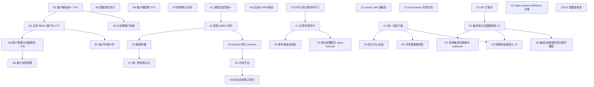

# 评审收口调整方案：统一认证、多租户、组件化服务化、中台架构与对外集成

- 状态：**执行中（v3.1）**（编制日期 2026-10-31）。2026-10-31 用户下达执行指令并将批次节奏与决策选择委托实施方（"根据当前项目的实现情况帮忙选择合适的方案执行，最终就是实现方案中所有的需求"）；据此确认：**批次从 M1 的 A1+A2 起按 §16 顺序推进，D01–D14 全部采纳 §3 推荐值**。每批次完成后交付测试报告并经用户验收再进入下一批；未验收前不自行跨批。未经用户新指令，本状态之外的批准不构成实施授权。
- 执行进度：**A1–A5、A7、B1–B9 已完成实施**（2026-10-31 至 2026-11-01；报告：`docs/06-testing/jwt-unification/20261031-a1-a2/report.md` 至 `.../20261101-b9/report.md`；B2/B4/B7/B8 各含真实双库演练 2/2）。**M1 统一认证收口与 M2 多租户完整化均已收官**。下一阶段 M3（组件化服务化：C0 DDD 基线/C1 starter 裁剪/C2 api-contract 去死代码/C3 SPI/C7 组件入口/C8 事件通道/C9 组合拓扑/C4 interfaces 迁移）。
- 编制依据：2026-10-31 对当前工作区源码的四维静态评审（多租户 / 统一认证与 OAuth2 / 模块化可拔插 / 中台形态），承重结论均经源码逐条核对；v2 依用户 2026-10-31 补充指令新增四项范围：对外集成（系统集成、物联网设备接入）服务组件、真正的 DDD 与组件化服务化（任意组合拔插）、真正的中台架构、文档/脚本/测试代码/测试报告同步交付；v3 依用户同日补充指令：明确逐批次前端项目影响判定与调整清单，前端变更随对应批次同步实施并纳入验收（§12）。
- 修订记录：v1（2026-10-31）初版四批次；v2（2026-10-31）批次 C 升级为"组件化与服务化"、批次 D 升级为"完整中台架构"、新增批次 E（对外集成与物联网）、新增 §13 同步交付物纪律、决策点扩展至 D01–D14；v3（2026-10-31）§12 升级为前端同步实施方案（全批次影响判定 + 页面级实施清单 + 前端测试门禁），§2/§13/§16 联动更新，交付原则由"后端先行不阻塞"改为"同批次交付"；v3.1（2026-10-31）记录执行授权与决策采纳口径（本节首条），批次 A1+A2 进入实施。
- 与既有方案的关系：不推翻、不覆盖 [Java 21、统一认证授权与全业务多租户实施方案](../../02-architecture/jdk21-unified-auth-multitenancy-implementation-plan.md)（下称"大方案"）。大方案面向 R01–R10 的深度改造与迁移验证体系，其迁移验证工具与口径仍是本方案迁移演练的基线；本文是大方案之外的评审驱动落地批次。两者描述同一能力域时若存在口径冲突，以用户裁决为准。
- 关联文档：[多端统一账户集成方案](../../02-architecture/multi-client-integration-plan.md)、[配置文档](../../05-operations/configuration.md)（§11 配置变更需同步）、[SPI 优化方案](design-pattern-starter-spi-optimization-plan.md)（C3/C10 实施前必读，避免重复建设）。

---

## 1. 评审结论基线（本方案的事实起点）

| 维度 | 判定 | 承重证据（已逐条核对源码） |
| --- | --- | --- |
| 多租户 | 行级隔离骨架真实（ThreadLocal + Reactor Context + fail-closed TenantLineHandler + ArchUnit 禁绕过 + 平台租户生命周期 API），但**主库 RBAC/菜单/功能全局共享、隔离默认关闭、两套默认租户编码脱节、租户运营层缺失** | `MybatisPlusConfig`（`apex.tenant.enabled:false`，仅 enterprise 开启）；`DefaultTenantLineHandler.IGNORE_TABLES` 含 `sys_role`/`sys_menu`/`sys_permission`/`sys_dict*`/`sys_config`；`PlatformTenantRouter` 存在但开通只插一行；主库 V44 初始化 `apex-default`、认证中心代码与种子用 `default` |
| 统一认证 | 密码登录 / 授权码（认证中心强制 PKCE）/ 客户端模式 / refresh 轮换 / introspect-revoke 均为真实现；但**双认证体系并存、RS256 与 HS256 双轨互不兼容、撤销传播为空实现、会话与 MFA 未接线** | `JwtUtil` 仅 `Keys.hmacShaKeyFor`（HS256）；`JwtKeyMaterialService` 以 RS256 签发；`JwtAuthenticationFilter` L244 先 HS256 验签、L250 认证中心令牌分支对 RS256 令牌不可达；`LocalDomainEventPublisher` 为空实现；`SessionService.createSession` 无调用方；MFA 未接入登录 |
| 可拔插 / DDD | 分层单向依赖与 ArchUnit 门禁达标、端口/适配器分离真实（system 30+ 仓储接口、domain 无 MyBatis 泄漏）；但**拔插止步于 Bean 装配**（xxl-job-core / seata-all 硬依赖常驻 classpath）、api-contract 内 Feign 为死代码、无 SPI 扩展点、业务库无组件级自动装配入口、无组合部署拓扑、apex-system 为四层合一巨库 | `apex-job-spring-boot-starter/pom.xml`、`apex-seata-spring-boot-starter/pom.xml` 依赖非 optional；api-contract 3 组 `@FeignClient` + `FeignReactiveBridge` 全仓零消费（已核实）；全仓无 `ServiceLoader` 扩展点；业务库无 `AutoConfiguration.imports`；`apex-example` 以 `scanBasePackages="com.apex.scaffold"` 全根扫描近似组合（无组件边界） |
| 中台形态 | 不构成中台；是"多租户多端 SaaS 化微服务脚手架/应用基座"。缺开放平台、消息能力碎片化、能力未按中心运营、无共享数据服务层 | 文档自我定位为"后端脚手架"；站内信（office）/ 办公平台推送 / 短信邮件（integration）三套并存无统一门面；无 appkey / 开放应用管理 / `/open-api` 路由；跨域数据仅零散内部 API |
| 对外集成 | 第三方 SDK 客户端（微信 / 创蓝 / 邮件）真实但散落在 infrastructure-integration（技术组件），**无业务级集成域**：无连接器模型、无租户级外部凭据管理、无入站 webhook、无设备接入能力 | `apex-domain/gateway` 已有 `ChuanglanGateway` / `WeChatGateway` / `CircuitBreakerPort` 防腐层契约先例；`apex-infrastructure-integration` 含 chuanglan/mail/wechat/excel 等包；全仓无 MQTT / 设备模型 / 规则引擎 |

## 2. 目标与非目标

**目标（对应评审四维 + v2 补充两项）**

- G1 统一认证成立：一套令牌体系（RS256 + JWKS 闭环）、一套授权服务器（认证中心）、撤销/登出/权限变更跨服务传播、会话与 MFA 真实接线。
- G2 多租户完整：主库权限/角色/功能租户化（角色真租户隔离、菜单/功能按租户套餐裁剪）、租户开通引导、配额真实执行、租户级配置、隔离默认开启、租户编码统一、认证期租户校验、租户管理员自助管理。
- G3 真正的 DDD 与组件化服务化：限界上下文映射与聚合边界固化（战略+战术双层）、业务库升级为**可独立装配的能力组件**（组件入口自动装配 + 组件契约 + 组件测试）、事件通道自适应（同进程 local / 跨服务 remote 零代码切换）、**组件可按需组合成任意部署拓扑**（五服务拆分 / all-in-one 单体 / 任意子集）、SPI 免改库扩展。
- G4 真正的中台架构：能力中心化（认证授权 / 用户组织 / 消息 / 文件 / 工作流 / 集成 / 设备七大能力中心）+ 能力目录与能力运营（租户能力订阅、计量）+ 开放平台（第三方应用接入）+ 轻量共享数据服务层（主数据分发 + 跨域只读聚合）。
- G5 对外集成与物联网组件：业务级集成域（连接器模型 / 租户级外部凭据 / 出站熔断重试 / 入站 webhook 签名防重放）与设备接入域（设备注册与认证、MQTT 遥测上行、幂等命令下行、轻量规则引擎）。
- G6 同步交付：每批次文档、脚本、测试代码、测试报告四类产物同步交付（§13），且该批次对应的前端项目变更随批同步实施并纳入验收（§12）；缺一不验收。

**非目标**

- BI 数仓 / 实时数仓 / 计费系统（G4 的"数据服务层"限定为主数据事件分发 + 跨域只读聚合 API，见 D13）。
- OSGi / 动态模块加载级别的运行期热拔插。本方案"任意组合拔插"的语义为：**组件级组装（POM 依赖 + 配置开关）、构建期 JAR 裁剪、运行期条件装配、SPI 免改库扩展、部署拓扑任意组合**；组件的新增与移除是装配决策，不是运行时热插拔。
- 前端代码不在本仓生成（管理后台为独立仓库 `apex-admin-web`）；但 v3 起前端变更为本方案实施范围的一部分：逐批次影响判定与页面级清单见 §12，随对应批次在 `apex-admin-web` 仓库同步实施并纳入验收（§13.4）。
- 大方案中"账号与租户成员资格分离"（个人租户 / 组织租户 / 一账号多租户）模型的完整落地——本方案按"单用户单租户归属 + 租户化 RBAC"收敛（见 D02），并保持向该模型演进的兼容路径。

## 3. 关键决策点（须用户确认后进入实施）

| 编号 | 决策 | 推荐 | 备选与影响 |
| --- | --- | --- | --- |
| D01 | 统一默认租户编码方向 | **统一为 `default`**：与认证中心代码默认值、网关健康任务默认值一致；改名只发生在 system 数据（新迁移 UPDATE），代码零改动 | 改为 `apex-default`：需改认证中心默认值与种子、网关默认值。工作量相当，`default` 使代码与数据语义一致 |
| D02 | 主库 RBAC 租户化模型 | **乙案（本方案采纳）**：`sys_user.tenant_id` 单租户归属不变；`sys_role`/`sys_role_permission` 加 `tenant_id` 真租户隔离；`sys_menu`/`sys_permission` 保持平台全局定义，租户套餐做"每租户可用菜单/功能/权限码"裁剪 | 甲案（大方案 R04 模型）：账号与成员资格分离、一账号多租户多角色。触及用户/会话/登录全链路，列为 G2 验收后的演进专项 |
| D03 | OAuth2 授权服务器收口 | **认证中心为唯一 AS**：consent 移植到认证中心；主应用 `/oauth2/*` 端点进入弃用周期（开关保留两个发布周期），`/oauth2/jwks` 空壳随弃用移除 | 双 AS 长期并存：客户端管理分裂、密钥体系三套，与 G1 冲突 |
| D04 | 跨服务撤销传播通道 | **网关拉取式撤销流**：auth-service 暴露增量撤销查询，网关定时拉取进本地缓存；敏感端点可配强制 introspect | 网关订阅 MQ：网关新增中间件依赖；纯短 TTL + introspect：时延上限为 access TTL |
| D05 | 登录密钥与 OAuth2 签名密钥统一 | **单一密钥家族**：OAuth2 令牌改用 `JwtKeyMaterialService`（Redis RSA + 轮换 + 宽限），`OAuth2Properties` 静态密钥保留一个发布周期回退后下线；JWKS 聚合暴露全部活跃公钥 | 双密钥家族：JWKS 聚合两套、轮换运维两处 |
| D06 | 统一消息门面落点 | **扩展 apex-office 消息子域**：站内信、办公平台推送、WS 协议已在 office，短信/邮件适配器从 integration 注入 | 新建模块：模块数 +2 且需搬迁站内信/WS 协议 |
| D07 | apex-system interfaces 层是否迁移 | **迁移**：21 Router + 44 Handler + 切面/安全配置迁至 apex-system-service，五服务运行模块形态统一；须同步修订 AGENTS.md"system 归属"节并调整 `LayeringArchTest` | 保持现状：符合 AGENTS.md 现行文字，但"运行模块=装配壳"一致性破口与巨库问题不收敛 |
| D08 | `apex.features.auth-center-permission` 默认值 | **批次 A 验收后默认改 `true`** | 维持 false：统一授权停留在"渐进开关" |
| D09 | basic 档租户隔离是否保留关闭 | **保留关闭**（离线最小档），standard 档起默认开启；`TenantGuard` 配额守卫修复为不依赖开关（B5） | basic 也开启：无收益且抬高离线门槛 |
| D10 | 集成/物联网模块形态 | **新增 `apex-integration` 业务库（connector 与 device 两个子域，包结构隔离）+ `apex-integration-service` 运行模块**；中台口径为"集成中心"一个能力中心，避免模块爆炸；库内子域边界清晰，后续流量独立扩缩容时拆分成本低 | 拆 `apex-iot` + `apex-integration` 双库双服务：物理隔离彻底但模块数 +4，初期运维面大 |
| D11 | MQTT broker 选型 | **生产用外部 EMQX（集群）**，设备认证/授权经 EMQX 钩子对接认证中心与租户 ACL；dev/测试档用可关闭的内嵌 broker 或跳过（MQTT 客户端依赖 optional，同 C1 裁剪模式） | 自研 Netty MQTT 接入层：工作量与稳定性风险极高，不推荐 |
| D12 | 事件通道抽象默认模式 | **`apex.events.channel=auto`**：同进程存在订阅方走进程内派发（事务后异步），否则走 Outbox+MQ；显式 `local`/`remote` 可覆盖 | 固定 remote：组合拓扑失去意义；固定 local：拆分部署失效 |
| D13 | 中台数据服务层范围 | **轻量**：主数据（用户/组织/租户）变更事件分发 + 各域只读统计内部端点 + system 聚合门面 `GET /internal/v1/overview` | 完整数据中台（数仓/ETL）：超出项目定位，仍非目标 |
| D14 | all-in-one 组合包 | **新增可选模块 `apex-boot-all`**（basic/示例/演示档单进程装配全部组件）；`apex-example` 保留为开发样例并瘦身 | 不提供：G3"任意组合"缺实证形态 |

## 4. 批次总览与依赖

- 批次 A（认证收口）与批次 B（多租户完整化）内部各自串行，可并行推进（仅 A6 依赖 B1）。
- 批次 C 是 G3 的主体，建议在 A/B 核心验收后集中执行（C0 先行可提前）；批次 E 依赖 C3（SPI）与 D1（规则动作/通知通道）。
- 批次 D 依赖 A5（开放平台复用统一 AS）与 B3（套餐承载能力订阅）。

## 5. 批次 A：统一认证收口

### A1 JWT 验签统一（RS256 支持 + 双轨过渡）

| 项 | 内容 |
| --- | --- |
| 改动点 | `apex-common`：`JwtUtil` 新增 `parseToken(String token, JwtKeyLocator locator)` 与 `JwtKeyLocator` SPI（按 header `kid` 解析 `PublicKey`），保留现有 HMAC 方法仅供过渡；`apex-system`：`JwtAuthenticationFilter` 注入组合定位器（kid → RSA 公钥；未命中且开关 `apex.auth.legacy-hmac-tokens-enabled=true` → HMAC 兜底），使 L250 认证中心令牌分支真正可达；file/workflow/office service 的 `IdentityRelayAuthenticationFilter` 同步支持 |
| 密钥分发 | 第一阶段：复用网关既有机制，`apex.gateway.jwks.ks`（kid 列表，Nacos 热更新）扩展为各服务可引用的公共配置段；第二阶段（A2 后）改 JWKS 自动拉取 |
| 过渡策略 | 双读窗口 = 一个发布周期：RS256 与存量 HS256 同时可验；窗口结束后 `legacy-hmac-tokens-enabled=false` 并删除 HMAC 分支 |
| 测试 | 双算法签发/验签单测；RS256 令牌走通全部五服务过滤器的集成测试；伪造 kid / 无 kid / 算法混淆反例测试 |
| 验收 | 认证中心登录签发的 RS256 令牌可直接访问全部业务服务接口，无需网关转换 |

### A2 密钥 JWKS 闭环

| 项 | 内容 |
| --- | --- |
| 改动点 | `apex-auth`：`OAuth2Service` / `OAuth2MetadataService` 签发切换到 `JwtKeyMaterialService`（D05）；`OauthMetadataRouter` 的 `/.well-known/jwks.json` 聚合 `JwtKeyMaterialService.availablePublicKeys()`（活跃 + 宽限期，带 `kid`）；`OAuth2Properties` 静态密钥转入回退验签，一个发布周期后删除 |
| 网关与服务 | `GatewayJwtVerifierService` 增加 JWKS 自动拉取（默认间隔 5 分钟，失败保留快照并告警；Nacos 静态列表兜底）；各业务服务以共享组件复用同一 JWKS 客户端 |
| 测试 | JWKS 端点契约测试（kid 完整性、轮换后新 kid 可见、宽限期双公钥并存）；JWKS 公钥验签 OAuth2 令牌端到端测试；轮换期间旧令牌不失效回归测试 |
| 验收 | 密钥轮换无需人工同步 Nacos；`/.well-known/jwks.json` 是唯一公钥分发点 |

### A3 撤销与事件传播

| 项 | 内容 |
| --- | --- |
| 发布侧 | `LocalDomainEventPublisher` 空实现落地：基于 auth 库既有 `sys_domain_event_outbox`（V56）+ 共享 `TransactionalOutboxExecutor` / `DomainEventOutboxDispatcher` 模式经 RocketMQ 派发；事件载荷：`TokenRevokedEvent`（jti / accountId / tenantId / 原因）、`PermissionChangedEvent` |
| 网关侧（D04） | auth-service 暴露 `GET /internal/v1/tokens/revocations?since=<cursor>`（增量、游标幂等）；网关新增撤销缓存过滤器（Caffeine，TTL ≥ 拉取间隔 ×2），命中撤销集即 401；高敏路径清单可配强制 introspect |
| 服务侧 | system 既有 Redis 黑名单与 subject 撤销检查保留；核实并接通登出 / 强制下线时的黑名单写入点（以代码核实为准） |
| 测试 | 登出后网关 ≤ 撤销间隔内拒绝 IT；refresh 重放 → 全会话撤销 → 各端失效链路测试；游标断点续传、重复拉取幂等测试 |
| 验收 | "登出 / 踢人 / 撤权"在网关与全部业务服务的生效时延 ≤ 30 秒（可配） |

### A4 会话与 MFA 接线

| 项 | 内容 |
| --- | --- |
| 会话 | `SessionService.createSession` 接入 login / refresh / 登出：写 `auth_session`（V44 已建表）+ 并发会话上限（默认 5，可配）踢最旧；`SessionRouter` 端点从空壳变为可用 |
| MFA | 接入既有 MFA 能力（V58 配置表、`MfaRouter` verify 端点）：启用 MFA 的用户登录返回 `mfa_required=true` + 一次性短 TTL challenge 凭据；verify 通过后签发正式令牌；未启用用户零影响；`apex.auth.mfa-required` 默认 false |
| i18n | MFA 挑战、会话上限、撤销原因等新消息同步 i18n 资源 |
| 前端 | 见 §12（登录页 MFA 二步、在线会话页） |
| 测试 | 并发会话上限与踢出 IT；MFA 开/关双路径 IT；challenge 一次性与过期反例测试 |

### A5 OAuth2 收口（D03）

| 项 | 内容 |
| --- | --- |
| consent 移植 | auth V60：`auth_oauth2_consent`（tenant_id、account_id、client_id、scope、consented_at、expired_at；唯一键 (tenant_id, account_id, client_id)）；`OAuth2Service.authorize` 增加同意检查（实现参照 system 侧既有 consent 存储与撤销逻辑）；新增 `POST /oauth2/consent`（approve/deny） |
| 主应用端点弃用 | 新增开关 `apex.features.system-oauth2-endpoints`（默认 true）；文档与 OpenAPI 元数据标注 deprecated；两个发布周期后移除 `OAuth2RouterConfig` 的 `/oauth2/*` 端点与 `OAuth2ResourceServerFilter`；`/oauth2/jwks` 空壳（硬编码 oct 元数据）在弃用期首日即下线 |
| 客户端迁移 | 一次性迁移工具：导出 system 侧注册客户端 → 写入认证中心 `auth_config`（OAUTH2_CLIENT）；secret 哈希不可逆迁移走 reset-secret 流程并通知客户端方 |
| 测试 | consent 同意 / 拒绝 / 撤销 / 过期 IT；迁移工具集成测试（含 secret 不可迁移分支）；弃用开关双态契约测试 |
| 验收 | 对外仅认证中心一个 AS；授权码（强制 PKCE S256）+ consent + `client_credentials` + `password` + `refresh_token` + introspect/revoke 全部可用 |

### A6 认证期租户校验（依赖 B1）

| 项 | 内容 |
| --- | --- |
| 改动点 | system 新增 `InternalTenantRouter` / `InternalTenantHandler`：`GET /internal/v1/tenants/{code}/status`（存在性 / 状态机 / 过期 / 配额摘要）；认证中心 login 前置租户校验：内部调用 + Caffeine 60s 缓存 + Resilience4j 熔断；`default` 租户本地白名单兜底；不可达策略可配（默认 fail-closed） |
| 关联 | 文件分享挂起租户静态清单（`ConfiguredTenantStatusAdapter`）改为消费该内部 API，静态清单保留为降级 |
| 测试 | 冻结 / 停用 / 过期租户登录拒绝 IT（认证中心与 C 端短信/微信两条链路）；缓存 TTL 内状态变更时延上限测试 |

### A7 统一授权默认化（D08）

- 批次 A 全部验收后：`apex.features.auth-center-permission` 默认 `true`；保留本地 RBAC 快照降级与 ≤30s 缓存口径；配置文档与 AGENTS.md 同步。
- 验收：system 的 `@RequirePermission` 校验数据源默认来自认证中心，权限变更传播时延满足 A3 口径。

## 6. 批次 B：多租户完整化

### B1 租户编码统一（D01，前置批次）

| 项 | 内容 |
| --- | --- |
| 迁移 | system V76（MySQL / PostgreSQL 成对）：`UPDATE sys_tenant SET tenant_code='default' WHERE tenant_code='apex-default'`；对 V14/V15/V16/V19/V44 覆盖的全部含 `tenant_id` 数据表执行改名回填；脚本内置前置冲突校验与受影响行数断言，失败回滚 |
| 前提 | 大方案 2026-10-20 口径确认项目从未部署、按全新库交付；若存在已初始化环境，先按大方案迁移验证工具做升级演练 |
| 测试 | `FlywayMigrationVersionTest` 自动纳入新版本；改名后登录 / CRUD / 数据权限 / 定时任务租户上下文 E2E |
| 涉及核对 | `application.yml` office login-tenant-id 注入值、部署 `.env` 显式 tenant 变量 |

### B2 主库 RBAC 租户化（D02 乙案核心）

| 项 | 内容 |
| --- | --- |
| 迁移 | system V77（成对）：`sys_role` 加 `tenant_id VARCHAR(64) NOT NULL DEFAULT 'default'`、`uk_code(code)` 重建为 `uk_tenant_code(tenant_id, code)`；`sys_role_permission` 加 `tenant_id` 并建组合索引；全部回填 `'default'`；`sys_user_role` 已有 tenant_id（V14）核对回填完整 |
| 拦截器 | `DefaultTenantLineHandler.IGNORE_TABLES` 移除 `sys_role`、`sys_role_permission`（菜单/权限码/字典/配置维持平台全局，经 B3 套餐裁剪）；`TenantIsolationArchTest`、`TenantLineE2eTest` 扩展 sys_role 用例 |
| 代码 | `RoleService` / `PermissionService` / `MenuService`：角色 CRUD 租户上下文自动隔离；平台超管以 `default` 租户管理全局角色；租户管理员角色管理接口在应用服务层再校验一次租户归属（防跨租户 role_id 传入，fail-closed 风格） |
| 种子 | 核对 V1 种子角色与 V63 权限码关联的 ADMIN 角色归属 `default`；sys_permission 与 auth_permission 两套权限码建立一致性校验测试（编码集合 diff 为空） |
| 测试 | 双租户同 role_code 隔离 IT；跨租户 role_id 越权反例 IT；租户拦截器 + 数据权限拦截器叠加语义测试 |

### B3 租户套餐与功能裁剪

| 项 | 内容 |
| --- | --- |
| 迁移 | system V78（成对）：`sys_tenant_package`（id、package_code 唯一、package_name、menu_ids JSON/JSONB、permission_codes JSON/JSONB、**features JSON**（能力订阅，见 D4）、status、remark、version、deleted、审计列）；种子 `platform-full`（全量） |
| 代码 | `MenuService`：用户菜单树 = 全局菜单 ∩（套餐 menu_ids 及父链补全）；`PermissionService`：租户用户有效权限 = 角色权限 ∩ 套餐 permission_codes（`default` 租户不裁剪）；角色授予约束 ⊆ 套餐集合；换套餐即时收敛（配合 A3 权限变更事件） |
| 管理接口 | 套餐 CRUD + 权限码 `tenant:package:*`（跟随 B6 权限种子批） |
| 测试 | 套餐裁剪菜单树与父链完整性 IT；越套餐授予拒绝 IT；换套餐后既有用户权限收敛测试 |

### B4 租户开通引导

- `TenantApplicationService.createTenant` 由"只插一行"扩展为同步事务开通（`TransactionTemplate` 于 jdbc 池）：`sys_tenant` + 租户管理员账号 + 租户内 ADMIN 角色（默认 `tenant_admin`）+ 按套餐默认集建立 role_permission + 默认部门 + user_role；全程 `@OperationLog` 审计；事务内任一步失败整体回滚。
- 测试：开通后管理员直接登录且仅见本租户数据 IT；并发开通同编码冲突 IT；中途失败回滚无残留行验证。

### B5 配额真实执行

- `TenantGuard` 在拦截器关闭时的静默失效修复：`UserRepositoryImpl.countByCurrentTenant` 改为显式 `eq(tenant_id)` 条件查询，配额守卫与开关解耦（D09）。
- 存储配额：system 暴露 `GET /internal/v1/tenants/{code}/quotas`；file-service 上传链路前置校验 + 本地聚合（file 表 size 按租户求和 + 缓存），超限返回新增错误码并同步 i18n。
- 并发口径：软上限语义保留并以唯一约束兜底 + 乐观重试；文档明示不引入分布式锁强一致配额。
- 测试：用户数 / 存储双维超限拒绝 IT；拦截器关闭态配额仍生效回归 IT。

### B6 租户级配置与权限种子

- system V79（成对）：`sys_tenant_config`（tenant_id、config_key、config_value、审计列；唯一键 (tenant_id, config_key)）；同批权限种子迁移（参照 V63 模式，双份）：`tenant:package:*`、`tenant:config:*`、B8 自助管理权限码。
- `ConfigService` 读取优先级 租户 → 全局；`sys_tenant_config` 不进拦截器白名单。
- 测试：覆盖 / 回退 IT；跨租户配置越权反例 IT。

### B7 隔离默认开启

| 项 | 内容 |
| --- | --- |
| 配置 | `apex.tenant.enabled: true` 写入 apex-system（全档）、apex-file-service、apex-office-service；basic 档维持关闭（D09）并写入配置文档 |
| file-service | `IdentityRelayAuthenticationFilter` 已桥接 `TenantContext`（已核实），预期纯配置；file V8（成对）：启用前全表 `tenant_id` 覆盖盘点，缺失表补列迁移 |
| office-service | 启用统一拦截器并移除 `MessageTenantConfig` 专用注册（收敛为一条拦截链）；office V8（成对）：`off_*` 全表覆盖盘点，缺失补列 + 回填策略 |
| workflow / auth | 均为 JdbcTemplate 持久化（已核实），维持手写 fail-closed（`WorkflowTenantAccess` / `JdbcTenantScope`），例外口径写入 AGENTS.md |
| 灰度顺序 | file → office → system 全档；每步双租户交叉访问反例 IT |
| 新服务 | 批次 E 的 apex-integration 自建库起即按"拦截器默认开启 + fail-closed"标准实现，不留同类欠账 |

### B8 租户管理员自助管理

- 复用现有 admin 用户/角色/部门/字典接口（B2/B7 后天然租户内隔离）；新增权限种子（B6 批）：`tenant:user:manage`、`tenant:role:manage`、`tenant:dept:manage` 等；租户管理员开通时（B4）默认授予。
- 平台接口权限码（租户平台管理、套餐管理等）只授 `default` 租户 ADMIN，形成权限码层面的平台/租户分界。
- 测试：租户管理员管理本租户用户/角色 IT；访问平台接口 403 反例 IT；菜单树仅含套餐内项 IT。

### B9 租户化缓存键与上下文助手

- `apex-infrastructure-cache` 新增 `TenantCacheKeys` 助手（统一 `prefix:tenant:<code>:...` 规则），替换 `UnifiedAuthorizationService` 手拼 base64 写法；补一条架构测试引导新缓存键携带租户维度。
- 消息 / Outbox / 任务调度租户携带已核实完整（`EnhancedDomainEventPublisherImpl`、`MqProducerService`、`JobInvoker`），仅做缺口扫描记录。

## 7. 批次 C：真正的 DDD 与组件化服务化（G3 主体）

### C0 DDD 深化基线（战略 + 战术）

| 项 | 内容 |
| --- | --- |
| 战略设计 | 输出**限界上下文映射图（Context Map）**文档（docs/02-architecture）：system / auth / workflow / file / office / integration（connector+device）/ gateway 各上下文关系与合作模式（客户-供应商、防腐层、共享内核标注）；跨上下文唯一合法通道 = 共享 domain gateway 契约 + api-contract 事件（现状正确，固化为规则） |
| 战术守卫（ArchUnit） | 新增：①跨上下文 import 白名单守卫（除 domain gateway 契约与 api-contract 外禁止跨业务库 import）；②领域事件必须经端口发布（禁止业务代码直接持有 MQ 客户端）；③聚合仓储只返回聚合根/值对象（扩展既有 LayeringArchTest，范围先行限定示范聚合） |
| 战术示范（有界重构） | 每业务库选 **1 个核心聚合**做示范深化：聚合根不变量集中、原语偏执消除（值对象替代 String/Long 滥用点，如 TenantCode、DeviceKey）、工厂与领域事件补充；**明确不推广为全仓重写**（工作纪律），示范结果作为后续迭代范式 |
| 文档 | DDD 实践说明落 docs/04-development（上下文划分、聚合设计清单、值对象规范、防腐层规则），成为 development-standards 关联章节 |

### C7 业务库组件化（组件入口自动装配）

| 项 | 内容 |
| --- | --- |
| 组件入口 | 每个业务库（system / auth / workflow / file / office / integration）提供 `ApexXxxAutoConfiguration` + `META-INF/spring/...AutoConfiguration.imports`：引入组件 JAR 即装配就绪（组件内 domain/application/infrastructure 及可选 interfaces 全部条件装配；配置属性扫描限定组件根包，吸取 SystemServiceApplication 显式扫描六包的教训） |
| 协议层开关 | 组件的 interfaces 层（Router/Handler/安全配置）由 `apex.component.<name>.interfaces-enabled` 独立开关控制（默认 true）：**"组件但不含协议层"** 复用形态成立（如 all-in-one 内多组件共享一个网关入口时按需关闭部分协议层） |
| 组件契约清单 | 每组件输出标准化元数据：对外端口（domain gateway 接口）、发布/消费事件、配置属性表、依赖组件、拔插步骤——成为 G4 能力目录（D4）的代码侧数据源 |
| 组件测试 | 每业务库新增 `ApplicationContextRunner` 组件装配测试：默认装配完整、开关关闭零 Bean、与 common/infrastructure 自动配置共存无冲突；组合装配契约测试（任两组件同上下文无 Bean 冲突，覆盖 C9 拓扑组合） |
| 与 C4 联动 | system 组件入口按 D07 结论适配：interfaces 层迁移后组件开关装配库内三层 + service 模块承载协议层 |

### C8 事件通道自适应（组合的技术前提）

- 泛化既有先例（workflow 已有 `LocalWorkflowEventPublisher` / `MqWorkflowEventPublisher` 双实现）为共享 `DomainEventChannel` 抽象（apex-infrastructure-messaging）：发布方只声明领域事件与端口，通道按 `apex.events.channel=auto|local|remote`（D12）选择进程内派发或 Outbox+MQ；业务代码零感知。
- 订阅方双绑定：进程内监听器（同上下文直接回调，事务提交后异步）与 MQ listener 按拓扑装配其一；SeataOutboxGuard 等既有横切防护不变。
- 测试：同一事件在 local / remote 两通道下的投递语义一致性契约测试（顺序、至少一次、幂等消费）；auto 模式上下文探测单测。

### C9 组合部署拓扑（G3 的"任意组合"实证）

| 项 | 内容 |
| --- | --- |
| apex-boot-all（D14） | 新增可选模块 `apex-boot-all`：单进程装配全部组件（system / auth / workflow / file / office / integration），H2 + 本地存储 + local 事件通道即可全功能运行；仅 basic/示例档分发，企业部署仍为五+服务拆分 |
| 拓扑矩阵验证 | 契约测试覆盖代表性拓扑：①五服务拆分（现状）；②all-in-one；③system+file 合并 / 其余拆分（抽样验证"任意子集"可行性）；每拓扑 clean verify 通过 + 启动冒烟 |
| 网关旁路 | all-in-one 拓扑下 `ROUTE_*_URI=http://127.0.0.1:<port>` 直连机制（既有）写入手册；单端口分配与安全配置模板 |
| 风险控制 | 组件根包隔离防 Bean 冲突；端口/配置冲突由拓扑模板统一；`SystemServiceBoundaryTest` 类比新增 `BootAllAssemblyTest`（装配完整性 + 类可加载性） |

### C1 starter JAR 级裁剪（保留自 v1）

- job-starter：`xxl-job-core` 改 `<optional>true</optional>`，`JobExecutorAutoConfiguration` 顶层与嵌套配置以 `@ConditionalOnClass(name="...")` 守卫；seata-starter 同法处理 `seata-all`（四模式分别守卫）。
- 消费方 POM 显式声明（standard 默认引入，basic 经排除真正移除 JAR）；根 POM basic exclusions 双处维护收敛为 dependencyManagement 单源。
- 验证：排除依赖构建 apex-file-service 通过 clean verify；开关关闭且 classpath 无 JAR 的回归测试。

### C2 api-contract 去死代码（保留自 v1）

- 删除（零消费已核实）：3 组 `@FeignClient` + FallbackFactory、`FeignReactiveBridge`、openfeign 依赖；`FeignTenantTraceConfiguration` 核实引用面后删除或迁至 `apex-infrastructure-remote` 作为 WebClient 交换过滤器。
- 保留：事件契约（真实使用）与内部 DTO；新增"禁止重新引入 Feign"架构守卫（防回潮）。

### C3 SPI 扩展点（保留并扩展）

- storage starter：`StorageBackendFactory` ServiceLoader 扩展点，第三方 JAR 注册新后端免改 starter；实施前必读 [SPI 优化方案](design-pattern-starter-spi-optimization-plan.md)。
- 扩展点清单统一登记（与 C7 组件契约清单同页）：storage 后端、登录策略（既有 Spring Bean 范式文档化）、C8 事件订阅绑定、E1 连接器（`IntegrationConnector`）、D1 通知通道（`NotifyChannelPort`）。

### C4 apex-system interfaces 层迁移（D07，独立收尾批次）

- 范围：21 Router + 44 Handler + 切面/安全配置迁至 `apex-system-service`（纯移动 + 包名调整 + ArchUnit/边界测试修订）；AGENTS.md"system 归属"节与相关文档同步；迁移前后各跑一次全量 clean verify 对比测试集合一致。

### C5/C6 配置面收敛（保留自 v1）

- 网关路由单一来源：prod 以 Nacos 为准，`application-prod.yml` 保留兜底并注明优先级；新增契约测试比对两处路由集合差集。
- Nacos 关闭自检：discovery 关闭但路由仍 `lb://` 且无 `ROUTE_*_URI` 时启动即快速失败。

## 8. 批次 D：真正的中台架构（G4 主体）

中台形态定义（本方案的验收口径）：**能力中心层**（七大能力中心，组件形态可拔插）+ **能力运营层**（目录、订阅、计量）+ **开放层**（统一 AS + 网关开放入口）+ **数据服务层**（主数据分发 + 只读聚合）+ **前台接入层**（多端 + 第三方应用）。

### D1 统一消息门面（D06：扩展 apex-office）

| 项 | 内容 |
| --- | --- |
| 迁移 | office V8（成对，与 B7 盘点合并交付）：`off_notify_template`（tenant_id、template_code、channel、title、body、params_schema、status；唯一键 (tenant_id, template_code)）、`off_notify_request`（tenant_id、channel、template_code、recipient JSON、params JSON、status、错误与时间戳、outbox 关联） |
| 领域端口 | office domain 定义 `NotifyChannelPort`；适配器：`InboxNotifyChannel`（复用 off_message 与 WS 提醒协议）、`SmsNotifyChannel`（创蓝）、`MailNotifyChannel`、`ImNotifyChannel`（FEISHU / DINGTALK / WECOM） |
| 编排 | `NotifyApplicationService`：模板渲染 → 通道路由 → Outbox 异步投递（event 池 + 重试 + DLQ）；阻塞 SDK 调用隔离到 `remote()` / `event()` 调度器 |
| 接口 | 内部 API `POST /internal/v1/notify`；管理接口：模板 CRUD + 发送记录查询（权限码 `office:notify:*`） |
| 验收 | 四通道经同一 API、同一模板体系、同一租户隔离与审计投递；既有站内信与 WS 协议行为不变（回归保护） |

### D2 开放平台（保留自 v1，中台开放层）

| 项 | 内容 |
| --- | --- |
| 应用注册 | 复用认证中心 OAUTH2_CLIENT 注册表：configValue JSON 扩展开放应用元数据（名称 / 描述 / 回调 / scope 清单 / 限流档 / 联系人 / 状态）；`OpenAppAdminRouter` 管理接口（平台权限 + 审计）；凭据发放走统一 AS 的 `client_credentials` 与授权码 + PKCE |
| scope 模型 | 平台 scope 注册表（`open:file:read`、`open:iot:telemetry:read` 等，含各服务 scope→权限映射）；网关验签后注入 `X-Client-Scopes` 可信头（剥离外部伪造，对齐既有中继过滤器模式） |
| 网关入口 | `/open-api/**` 路由组：强制认证中心令牌 + scope 断言 + 按 client_id 限流档 + 开放访问审计（访问日志库补 client 维度） |
| 明确不做 | 自定义 HMAC 请求签名（列为未来增强）、开放平台计费 |
| 测试 | scope 越权反例矩阵 IT；client_credentials + 限流档 IT；`/open-api/**` 拒绝用户个人令牌反例测试 |

### D4 能力中心运营（v2 新增）

| 项 | 内容 |
| --- | --- |
| 能力目录 | 代码侧：C7 组件契约元数据（端口 / 事件 / 配置 / scope / 依赖）作为唯一数据源；文档侧：docs 能力目录页（能力名 / 所属中心 / 接入方式 / 开放 scope / 套餐关联）；两者以契约测试对齐（目录页引用的 scope 必须在注册表中存在） |
| 能力订阅 | B3 套餐 `features` JSON 承载租户级能力开关；未订阅能力 → 网关按路由→能力映射拒绝（403 + "能力未开通"业务错误码）+ 服务侧二次校验（共用判定组件） |
| 能力计量 | 复用审计与访问日志，按 租户 × 能力 输出用量查询 API（调用次数 / 存储用量 / 设备数 / 消息量）；只读、不做计费 |
| 测试 | 套餐订阅生效 / 拒绝矩阵 IT；计量口径一致性测试 |

### D5 共享数据服务层（v2 新增，D13 轻量口径）

| 项 | 内容 |
| --- | --- |
| 主数据分发 | 用户 / 组织 / 租户主数据变更以领域事件（Outbox + MQ）分发；订阅方（office / file / integration 等）维护本地只读投影或缓存（泛化既有 `UserMessageListener` 消费模式）；事件 schema 入 api-contract |
| 跨域只读聚合 | 各域暴露只读统计内部端点（file 存储用量、iot 设备数、workflow 进行中实例等）；system 提供 `GET /internal/v1/overview` 聚合门面（WebClient 并行拉取 + 短 TTL 缓存 + 熔断降级部分可用） |
| 明确不做 | 跨库 join、数仓 / ETL、跨域写传播（写一律走各域 API/事件） |
| 测试 | 聚合门面部分降级（某域不可达返回部分结果 + 降级标记）IT；主数据事件消费幂等 IT |

### D6 前台应用接入契约（v2 新增）

- 本仓交付：接入文档（第三方/前台应用经 D2 开放平台 + 能力 scope 接入能力中心的完整流程：注册 → 授权 → 调用 → 事件订阅）+ 示例配置（客户端注册 JSON、网关路由、scope 映射）+ Postman/HTTP 文件样例。
- 不实现新前台项目；管理后台（独立仓库）补能力目录页与租户能力订阅视图（§12）。

### D3 定位与能力目录文档（保留自 v1）

- README 与 docs 以"多租户多端应用基座 + 能力中心化中台"如实定位（按 G4 验收后口径更新，不超前宣称）；`architecture-evolution.md` 陈旧结论修订；`check-doc-links.sh` 全量通过。

## 9. 批次 E：对外集成与物联网设备接入（v2 新增，G5 主体）

### E1 集成域与连接器框架（D10：apex-integration 单库双子域）

| 项 | 内容 |
| --- | --- |
| 模块 | 新增 `apex-integration` 业务库（`com.apex.scaffold.integration.connector` 与 `...integration.device` 两个子域，包结构隔离）+ `apex-integration-service` 运行模块；根 POM 聚合与 AGENTS.md 模块表/依赖表同步；组件入口自动装配按 C7 标准 |
| 依赖 | common、domain（gateway 契约扩展）、infrastructure-persistence/remote/messaging；MQTT 客户端依赖 optional（basic 裁剪，同 C1 模式）；自建库起租户拦截器默认开启（B7 口径） |
| 连接器 SPI | domain 端口 `IntegrationConnector`（config schema / connect / execute / healthCheck）+ ServiceLoader 与 Spring 条件装配双注册（C3 扩展点）；连接器实现可由第三方 JAR 免改库提供；沿用 `CircuitBreakerPort` 防腐层模式（`apex-domain/gateway` 既有先例） |
| 凭据管理 | 租户级外部系统凭据：AES-256-GCM 加密存储（复用 `TokenEncryptionService` 模式）、轮换、按租户隔离、审计；凭据明文不落日志（安全纪律） |
| 迁移 | integration V1（成对）：`int_connector_config`（tenant_id、connector_type、config JSON、status）、`int_credential`（tenant_id、connector_type、credential 密文、版本、轮换时间）、`int_outbound_call_log`（tenant_id、connector、幂等键、耗时、状态、错误）、`int_inbound_event`、`int_webhook_dedup`（幂等去重） |
| 权限与种子 | 权限码 `integration:connector:*`、`integration:credential:*`、菜单种子（成对迁移）；i18n 资源 |
| 测试 | 连接器 SPI 注册/发现测试；凭据加密存储与轮换 IT；出站熔断 / 重试 / 幂等键 IT；租户间连接器配置隔离 IT |

### E2 系统集成连接器与 webhook

| 项 | 内容 |
| --- | --- |
| 内置连接器 | 首批通用连接器：HTTP 通用连接器（任意 REST 端点 + 认证配置）、Webhook 出站连接器、既有微信 / 创蓝 / 邮件客户端迁移为标准连接器实现（`apex-infrastructure-integration` 保留为技术 SDK 层，业务语义上移集成域，`ChuanglanGateway` / `WeChatGateway` 契约保持兼容） |
| 出站 | Resilience4j 熔断 + 指数退避重试 + 幂等键 + 出站审计表；阻塞 SDK 走 `remote()` 池；失败入 DLQ 可重放 |
| 入站 | `POST /integration/v1/webhook/{connector}`：HMAC 签名验证 + 时间戳防重放 + `int_webhook_dedup` 幂等去重 → 校验通过转领域事件（Outbox）→ 规则引擎 / 业务订阅方 |
| 测试 | 入站签名伪造 / 重放 / 重复投递反例矩阵 IT；出站失败重试与 DLQ 重放 IT；真实第三方（微信回调）联调记录入测试报告 |

### E3 物联网设备接入（D11：EMQX + 租户命名空间）

| 项 | 内容 |
| --- | --- |
| 设备模型 | `iot_device`（tenant_id、device_key、secret_hash / 证书指纹、状态 online/offline、固件版本、标签、最后活跃）、`iot_device_shadow`（desired / reported JSON + version 乐观锁）、`iot_telemetry`（遥测记录 + 保留窗口清理任务）、`iot_command`（command_id 唯一、status PENDING/SENT/ACK/TIMEOUT、超时扫描）——integration V2（成对） |
| 接入通道 | MQTT 3.1.1/5 over TLS；topic 命名空间 `apex/{tenantCode}/{deviceKey}/up|down/...`；服务以 reactive MQTT 客户端（共享订阅组水平扩展）消费上行；生产 broker 为外部 EMQX，dev/测试档内嵌或跳过 |
| 设备认证 | 设备侧凭据（secret / X.509 指纹）经 EMQX 认证钩子对接认证中心或集成域校验；按租户 topic ACL（设备只能访问本租户命名空间）；设备级连接数与消息速率限额（broker 侧 + 网关侧双层） |
| 遥测上行 | 上行 → 设备认证与租户校验 → 影子更新（乐观锁）→ `DeviceTelemetryReceived` 领域事件（Outbox）→ 规则引擎 / 消息门面 / 业务订阅方；高频遥测写路径走批量落库（jdbc 池隔离） |
| 命令下行 | 内部 API `POST /internal/v1/iot/devices/{key}/commands`（幂等 command_id）→ 下行发布 → ACK / 超时状态机；命令历史可查 |
| 规则引擎（轻量） | `iot_rule`（tenant_id、结构化条件 JSON：字段/操作符/阈值、动作：notify（接 D1 消息门面）/ webhook（接 E2 出站）/ event 转发、启停）；结构化条件不做自由脚本执行（无注入面） |
| WebFlux 纪律 | MQTT 客户端回调与 Reactor 桥接遵循阻塞 I/O 约束（批量写 jdbc 池、SDK 阻塞点隔离）；长连接资源（会话、订阅）与租户上下文桥接沿用 `TenantContext` 双通道 |
| 测试 | 双租户设备/topic 交叉访问反例矩阵 IT；设备认证失败矩阵 IT；命令幂等 / 超时 / ACK IT；遥测批量落库与影子乐观锁并发 IT；broker 不可用降级（上行缓冲丢弃策略明示 + 告警）；吞吐基线记录入测试报告（作为基线数据，不承诺 SLA） |

### E4 集成/设备组件回归组件模型

- 集成域组件按 C7/C8/C9 标准纳入：组件契约元数据登记能力目录（D4）、事件走 `DomainEventChannel`、纳入 `apex-boot-all` 装配矩阵与拓扑契约测试、MQTT 客户端在 all-in-one/basic 档可裁剪。
- 验收：集成中心作为第七个能力中心出现在能力目录与套餐 features 中（`integration-connector`、`iot-device` 可独立订阅）。

## 10. 数据库迁移清单汇总

| 域 | 新版本 | 内容 | 成对要求 |
| --- | --- | --- | --- |
| apex-system | V76 | 默认租户编码统一（D01 数据改名回填） | MySQL + PostgreSQL |
| apex-system | V77 | sys_role / sys_role_permission 租户化 + 唯一键重建 + 回填 | 同上 |
| apex-system | V78 | sys_tenant_package（含 features JSON）+ platform-full 种子 | 同上 |
| apex-system | V79 | sys_tenant_config + 新权限/菜单种子（套餐、租户配置、自助管理、office:notify、integration、iot） | 同上 |
| apex-system | V80+（备用） | 实施中拆分出的种子/修正版本顺延 | 同上 |
| apex-file-service | V8 | tenant_id 覆盖盘点补列（如有缺失） | 同上 |
| apex-office-service | V8 | off_notify_template / off_notify_request + tenant_id 覆盖盘点补列（如有缺失） | 同上 |
| apex-auth-service | V60 | auth_oauth2_consent | 同上 |
| apex-integration | V1 | 连接器/凭据/出站审计/入站事件/去重表 | 同上 |
| apex-integration | V2 | 设备/影子/遥测/命令/规则表 | 同上 |
| apex-workflow-service | 无 | 本方案不新增 workflow 迁移 | — |

- 全部新版本由 `FlywayMigrationVersionTest` 自动纳入版本集合一致性与连续性校验；不修改、不重排任何历史迁移；MySQL / PostgreSQL 语义逐条人工配对核对。
- 数据改名 / 回填迁移（V76、V77）执行前升级演练 + 脚本内行数断言；新模块 apex-integration 自 V1 起，无历史包袱。

## 11. 配置变更清单

| 配置 | 位置 | 批次 | 说明 |
| --- | --- | --- | --- |
| `apex.tenant.enabled: true` | system / file / office / integration 服务 yml（basic 除外） | B7/E1 | 隔离默认化 |
| `apex.auth.legacy-hmac-tokens-enabled` | 各验签服务 + 网关 | A1 | 过渡开关，窗口结束置 false 并删分支 |
| `apex.gateway.jwks.pull-interval` 等 | 网关 | A2 | JWKS 自动拉取；Nacos 列表兜底 |
| `apex.gateway.revocation.pull-interval` / 敏感路径清单 | 网关 | A3 | 撤销流拉取与强制 introspect |
| `apex.features.system-oauth2-endpoints` | apex-system | A5 | 弃用开关 |
| `apex.features.auth-center-permission` 默认值 → true | apex-system | A7 | 统一授权默认化（D08） |
| `apex.auth.mfa-required` / 会话上限 | 认证中心 | A4 | 默认 false / 默认 5 |
| `apex.events.channel`（auto/local/remote） | 各服务 / boot-all | C8 | 事件通道模式（D12 默认 auto） |
| `apex.component.<name>.interfaces-enabled` | 组件消费方 | C7 | 组件协议层开关（默认 true） |
| `apex.integration.mqtt.*`（broker 地址、内嵌开关、认证钩子、保留窗口） | integration 服务 | E3 | dev 档可内嵌，生产 EMQX |
| `apex.integration.connector.<type>.*`、限流/重试参数 | integration 服务 | E1/E2 | 连接器级配置 |
| 能力订阅（套餐 features）拒绝开关、计量开关 | 网关 / system | D4 | 能力运营 |
| `apex.boot-all.*`（拓扑装配清单、端口模板） | apex-boot-all | C9 | 组合拓扑 |

- 全部新配置"代码默认值 + yml 显式声明 + `.env.example` 占位"三处一致；生产敏感值（凭据、broker 地址、JWT 密钥）由部署注入；新增属性同步 [配置文档](../../05-operations/configuration.md)。

## 12. 前端项目同步调整方案（apex-admin-web，独立仓库）

### 12.1 项目定位与同步实施承诺

- 管理后台前端为独立仓库 `apex-admin-web`（不在本仓，以下引用均为行内代码路径）。现状已核实：Vue 3 + TypeScript + Vite + Element Plus + Pinia；路由与权限由**后端菜单驱动**（`v-permission` 指令控制显隐）；匿名页采用 `router` 静态路由 `public: true` 模式（既有 `src/views/public/password-recovery.vue`、`src/views/public/share-exchange.vue`）；测试为与 api 模块同目录的 vitest 用例（既有 `src/api/generator.test.ts` 等）；构建门禁 `vue-tsc --noEmit && vite build`，另有 `check:comments` 脚本。
- **同步实施承诺**：本方案每一批次的实施范围包含该批次对应的前端变更（页面、api 层、路由、store、测试），与后端**同批次交付**；前端仓库遵循其自带 AGENTS.md 与提交纪律，独立分组提交（后端仓库与前端仓库各自成体系，不混仓）；前端产物纳入 §13 批次验收口径。
- 边界：C 端（小程序 / 公众号 H5 / App）的 MFA、consent、设备接入适配由各自前端项目按四端统一账户方案的后端契约实施，本方案锁定后端契约与 PC 管理端页面；PC 管理端 consent 页承担浏览器场景的授权同意交互。

### 12.2 逐批次前端影响判定（全批次覆盖）

| 批次 | 前端判定 | 变更内容 / 回归要求 |
| --- | --- | --- |
| A1 验签统一 | 无功能变更 | token 对前端透明；回归 401 全局拦截、重登流程、`X-New-Access-Token` 滑动续期处理 |
| A2 JWKS 闭环 | 无变更 | 纯后端；无感知 |
| A3 撤销传播 | 小 | 被踢下线 / 单点登出的提示文案（i18n）；401 → 登录重定向回归 |
| A4 会话与 MFA | 高 | 登录页 MFA 挑战二步；在线会话管理页 |
| A5 OAuth2 收口 | 高 | consent 授权同意匿名页；既有 `src/views/oauth2/callback.vue` 回归 |
| A6 认证期租户校验 | 小 | 登录错误文案补充（租户冻结 / 停用 / 过期） |
| A7 统一授权默认化 | 无变更 | 权限加载回归 |
| B1 租户编码统一 | 小 | 登录页租户编码可选输入；租户名展示回归 |
| B2 RBAC 租户化 | 小 | 角色管理页回归（租户上下文隔离后数据范围变化）；越权错误文案 |
| B3 租户套餐 | 高 | 套餐管理页（菜单树多选、权限码、features 能力订阅编辑）；菜单按套餐过滤回归 |
| B4 开通引导 | 高 | 租户开通向导（基本信息 + 管理员 + 套餐选择） |
| B5 配额执行 | 中 | 租户详情配额展示；文件上传的存储超限错误处理 |
| B6 租户配置 | 中 | 租户配置管理页签 |
| B7 隔离默认开启 | 无变更 | 双租户账号数据隔离回归 |
| B8 自助管理 | 无变更 | 权限码驱动显隐，回归即可 |
| C0–C9 DDD / 组件化 | 无变更 | 后端架构改造；boot-all 示例部署文档；全功能回归 |
| D1 消息门面 | 中 | 模板管理 + 发送记录（扩展既有消息页与 `api/message.ts`） |
| D2 开放平台 | 高 | 开放应用管理页 |
| D4 能力运营 | 中 | 能力目录页 + 租户能力订阅与用量视图 |
| D5 数据服务层 | 中 | 数据总览（跨域聚合展示） |
| D6 前台接入契约 | 无变更 | 文档交付 |
| E1/E2 集成域 | 高 | 连接器管理（配置 / 凭据轮换 / 出站日志）、入站 webhook 日志 |
| E3 物联网 | 高 | 设备管理（列表 / 详情 / 影子 / 遥测）、规则管理、命令下发与历史 |

### 12.3 页面与代码级实施清单（落位前端真实文件）

**新增页面**（新建组件目录与路由，页面由后端菜单种子驱动注册）：

| 前端落位 | 内容 | 后端契约来源 | 批次 |
| --- | --- | --- | --- |
| `src/views/oauth2/consent.vue` | 授权同意页（匿名可访问，`staticRoutes public: true` 模式，复用 `src/views/public/` 匿名页范式）；approve / deny 提交与已授权应用列表 | `POST /oauth2/consent`；authorize 302 | A5 |
| `src/views/system/tenant-package/` | 套餐 CRUD：菜单树多选（含父链补全提示）、权限码集合、features 能力订阅编辑 | 套餐管理接口（B3） | B3 |
| `src/views/system/tenant/`（扩展） | 开通向导（B4 步骤表单）、详情页配额展示（B5）、租户配置页签（B6） | `/api/v2/platform/tenants` 扩展 | B4/B5/B6 |
| `src/views/system/open-app/` | 开放应用管理：应用 CRUD、scope 配置、凭据重置、限流档 | `OpenAppAdminRouter` | D2 |
| `src/views/integration/connector.vue` | 连接器管理：类型注册、租户配置、凭据轮换、出站调用日志 | integration 管理接口 | E1/E2 |
| `src/views/integration/webhook-log.vue` | 入站 webhook 日志与重放 | `int_inbound_event` 查询接口 | E2 |
| `src/views/iot/device.vue` | 设备列表 / 详情：影子查看、遥测记录、命令下发与历史（详情页签） | iot 管理接口 + 命令 API | E3 |
| `src/views/iot/device-rule.vue` | 规则管理：结构化条件编辑（字段 / 操作符 / 阈值）、动作绑定（通知 / webhook / 事件） | 规则 CRUD 接口 | E3 |
| `src/views/monitor/session.vue` | 在线会话管理：列表、单会话注销 | `SessionRouter` | A4 |
| 数据总览 | 既有 `src/views/data` 或 dashboard 视图内新增总览页签 | 聚合只读接口（D5） | D5 |

**修改页面 / 模块**：

| 前端落位 | 变更 | 批次 |
| --- | --- | --- |
| `src/views/login/index.vue` | 租户编码可选输入（B1）、MFA 挑战二步分支（`mfa_required` → challenge → verify）、租户状态错误文案 | B1/A4/A6 |
| `src/api/auth.ts`、`src/api/mfa.ts` | 登录请求/响应契约扩展、MFA verify 流程封装 | A4 |
| `src/api/tenant.ts` | 开通、配额、配置、套餐绑定等新端点 | B3–B6 |
| `src/api/message.ts` | 通知模板 CRUD、发送记录查询 | D1 |
| `src/views/office/`（消息页） | 模板管理入口与发送记录抽屉（沿用既有抽屉范式） | D1 |
| 菜单驱动页面 | 全部依赖后端菜单/权限种子（B6/E 批次迁移内交付），前端路由零改动 | B8/E1/E3 |

**新增 api 模块**（命名与既有模块风格一致）：`src/api/iot.ts`、`src/api/integration.ts`、`src/api/open-app.ts`、`src/api/tenant-package.ts`、consent 提交逻辑并入 `src/api/oauth2.ts`。
**store**：`src/stores/` 用户 store 增加 MFA challenge 临时状态；乙案单租户模型下无需租户切换 store。

### 12.4 契约对接纪律

- 全部新接口沿 `Result<T>` 包装；权限码与菜单组件字段遵循现有契约；分页逐接口标注实际 `PageResponse` 版本（common 版含 `hasNext`，system/file 版无）。
- 对接基准：后端每批次重导出的 OpenAPI 契约快照（`docs/03-api/openapi/`）；前端 api 层按仓库既有约定实施。
- 时序依赖：后端菜单/权限种子随迁移先行（天然先于前端联调）；前端页面合并前以种子环境联调，避免"菜单不可达"假缺陷。

### 12.5 前端测试与门禁

- 新增 api 模块均配同目录 vitest 用例（与既有 `generator.test.ts` 范式一致）：`iot.test.ts`、`integration.test.ts`、`open-app.test.ts`、`tenant-package.test.ts`，及登录 MFA 流程、consent 流程用例。
- 门禁：`npm run test`（vitest）、`npm run build`（vue-tsc + vite build，类型零错误）、`npm run check:comments`。
- 菜单回归清单：新种子注册页面的显隐、`v-permission` 控制点、双租户账号（平台超管 / 租户管理员）视图差异。
- 前端测试结果与构建证据纳入该批次测试报告（§13.4），与后端证据同报告分节呈现。

### 12.6 灰度与上线对齐

- 后端功能开关与前端交互同步开放：MFA（`apex.auth.mfa-required` 与登录页分支）、consent（认证中心启用即切）、设备/连接器能力（套餐 features + 菜单种子）。
- 交付原则（v3 起）：**同批次交付**；确因联调依赖需拆分前后端合并时序的，在该批次测试报告"未验证项"中如实声明并给出补齐时间。

## 13. 同步交付物纪律（文档 / 脚本 / 测试代码 / 测试报告）

**每批次产物同步交付，缺一不验收该批次：**

1. **文档**：批次涉及的全部文档同步为完成条件之一——AGENTS.md（模块表、边界约束、例外口径）、README、架构文档（上下文映射图、能力目录）、[配置文档](../../05-operations/configuration.md)、OpenAPI 契约快照重导出（`docs/03-api/openapi/`）；全部变更过 `scripts/ci/check-doc-links.sh`（0 断裂）。
2. **脚本**：新增脚本落 `scripts/` 对应子目录，复用 [公共函数库](../../../scripts/lib/common.sh)（根目录、日志、安全查找），统一 `sdk env` 环境初始化并显式失败，不静默回退；本方案涉及脚本：双库迁移演练与对账脚本（V76/V77）、组件拓扑装配/启动/停止脚本（C9）、MQTT 联调辅助脚本（E3，dev 档）、报告骨架生成脚本（§13.4）；敏感值不写日志。
3. **测试代码**：按仓库既有约定交付——单元测试、`*IntegrationTest` / `*E2ETest`（默认 Failsafe 门禁）、ArchUnit 守卫、`FlywayMigrationVersionTest` 自动覆盖新迁移；各批次测试清单已写入批次条目，实施时若增删用例须在测试报告中说明。
4. **前端产物**：§12 所列该批次前端变更（页面、api 模块、路由、store）与 vitest 用例，在 `apex-admin-web` 仓库随批同步实施；前端门禁（vitest / `vue-tsc` 构建 / `check:comments`）与菜单回归清单通过；前端仓库独立分组提交，不混入后端仓库。
5. **测试报告**：每批次产出 `docs/06-testing/<campaign>/<yyyyMMdd>-<batch>/report.md`（沿用既有 `jdk21-unified-auth/20261016-p0/report.md` 惯例）：实际执行的命令与环境（JDK / mvnd / 数据库 / broker / Node 版本）、结果（`Failures: 0 / Errors: 0` 或如实记录失败与重跑）、覆盖范围与**未验证项声明**（含前端联调依赖项）；静态核对不得写成运行验证；报告数据人工核定后入库，不虚构数量、默认账号或通过状态。

**报告骨架生成脚本**输出目录与章节模板（环境 / 用例清单 / 结果 / 未验证项 / 证据路径），内容人工填写核定——脚本辅助格式，不替代事实。

## 14. 测试与验证门禁

- 每批次最小门禁：受影响模块及上游 `mvnd -T4 -B -pl <module> -am test`；批次完成 `mvnd -T4 -B spotless:check` + `git diff --check`；阶段性 `mvnd -T4 -B clean verify` 全反应堆 `BUILD SUCCESS`、`Failures: 0 / Errors: 0`。
- 新增架构测试：`TenantIsolationArchTest` 扩展（sys_role）、缓存键租户维度引导（B9）、api-contract 禁 Feign 回潮（C2）、跨上下文 import 白名单与事件端口发布守卫（C0）、组件装配契约（C7）、拓扑组合矩阵（C9）。
- 迁移验证：V76/V77 与新模块迁移先在合成夹具与真实 MySQL/PostgreSQL 容器演练（复用大方案迁移验证工具口径），再入常规链。
- E2E 重点：双租户交叉访问反例矩阵；认证中心令牌贯通全部服务（A1，含 E 批次新服务）；登出撤销传播时延；开通→登录→管理闭环；**all-in-one 与拆分双拓扑全功能冒烟（C9/E4）**；设备遥测上行→规则→通知全链路（E3）。
- 计时敏感测试（真实 Redis/HTTPS/MQTT）失败按日志分析重跑或降低并行度，不改弱业务 SLA。
- 全部文档变更过 `check-doc-links.sh`；每批次完成时按 §13 交付报告。

## 15. 风险与回滚

| 风险 | 缓解 | 回滚 |
| --- | --- | --- |
| A1 令牌双轨切换破坏存量会话 | 双读窗口 + 过渡开关 + 灰度先行 | 开关回切 HS256（窗口内） |
| A3 撤销缓存误杀 / 漏杀 | 幂等游标 + 命中二次 introspect 复核（可配） | 关闭撤销过滤器 |
| B1/B2 数据改名与回填错误 | 脚本内行数断言 + 真实双库演练 + 对账查询 | 迁移前快照备份 |
| B7 拦截器默认开启引发回归 | 灰度 file → office → system；反例 IT；basic 不动 | 单服务配置回退 |
| A5 主应用 OAuth2 弃用影响存量客户端 | 迁移工具 + 两个发布周期 + 客户端清单核对 | 开关回开 |
| C7 组件化改造回归面大 | 每库上下文加载测试先行 + 组件开关默认行为不变（装配结果等价）+ 双拓扑 verify | 组件入口保留但默认装配路径不变（渐进收紧） |
| C9 all-in-one Bean/端口冲突 | 组件根包隔离 + 拓扑契约测试 + 装配完整性测试 | boot-all 独立模块，移除即回退，不影响拆分拓扑 |
| C8 事件双通道语义漂移 | local/remote 投递语义一致性契约测试（顺序/至少一次/幂等） | `apex.events.channel` 显式固定为既有模式 |
| E3 长连接服务稳定性与资源 | broker 外置（EMQX 承担连接层）+ 租户/设备级连接数与速率限额 + 吞吐基线记录 | MQTT 客户端 optional 可裁剪；设备能力经套餐 features 关闭 |
| E1/E2 第三方凭据泄露 | AES-GCM 加密存储 + 轮换 + 审计 + 不落日志 | 凭据立即失效与重发流程 |
| D1 消息门面影响既有站内信 | off_message 协议回归保护 + 内部 API 并行不替换 | 通道适配器逐个下线 |
| 中台范围蔓延 | 能力目录先行 + 能力逐个纳入订阅 + 每批次验收口径明确 | features JSON 未订阅即关闭 |

- 不可逆迁移（V76/V77）先演练后执行；全部批次不自动提交 Git，按批次经用户确认后分组提交（Conventional Commits）。

## 16. 实施顺序建议

1. **M1 认证收口**：A1 → A2 → A3 → A4 → A5 → A7（A6 在 B1 完成后插入）。
2. **M2 多租户完整**：B1 → B2 → B3/B4/B5/B6 → B7 → B8（B5 修复项可提前）。
3. **M3 组件化与服务化**：C0（可提前）→ C1/C2/C3（穿插）→ C7 → C8 → C9 → C4（独立收尾）。
4. **M4 中台架构**：D1 → D2 → D4 → D5 → D6 → D3（文档收口）。
5. **M5 对外集成与物联网**：E1 → E2 → E3 → E4（E1 依赖 C3，E3 规则动作依赖 D1；E 批次可与 M4 尾段并行）。
6. M1 与 M2 可并行（除 A6↔B1）；M3 建议在 M1/M2 核心验收后集中执行；每个 M 完成即按 §13 交付该里程碑汇总报告。
7. **前端同步**：§12 所列前端变更随对应批次实施（同批次完成页面、api 模块、vitest 用例），后端仓库与前端仓库分别分组提交；后端功能开关与前端交互按 §12.6 同步开放，拆分时序须在测试报告"未验证项"声明。

## 17. 待确认清单（批准时请逐项给出结论）

- D01 默认租户编码方向（推荐 `default`）。
- D02 RBAC 租户化模型（推荐乙案；甲案列入演进专项）。
- D03 OAuth2 收口到认证中心（推荐是）与弃用周期长度（推荐两个发布周期）。
- D04 撤销传播通道（推荐网关拉取式）与时延目标（推荐 ≤30s）。
- D05 密钥家族统一（推荐 `JwtKeyMaterialService` 单家族）。
- D06 消息门面落点（推荐扩展 office）。
- D07 apex-system interfaces 层迁移（推荐迁移；涉及 AGENTS.md 修订）。
- D08 统一授权默认开启时点（推荐 A 批次验收后）。
- D09 basic 档隔离保持关闭（推荐是）。
- D10 集成/物联网模块形态（推荐 apex-integration 单库双子域 + 单服务）。
- D11 MQTT broker 选型（推荐生产 EMQX + dev 内嵌/跳过）。
- D12 事件通道默认模式（推荐 auto）。
- D13 数据服务层范围（推荐轻量：主数据事件 + 只读聚合）。
- D14 all-in-one 组合包（推荐提供 apex-boot-all，限 basic/示例档）。
- 批次执行顺序与首批范围（推荐先 M1 的 A1+A2）。
