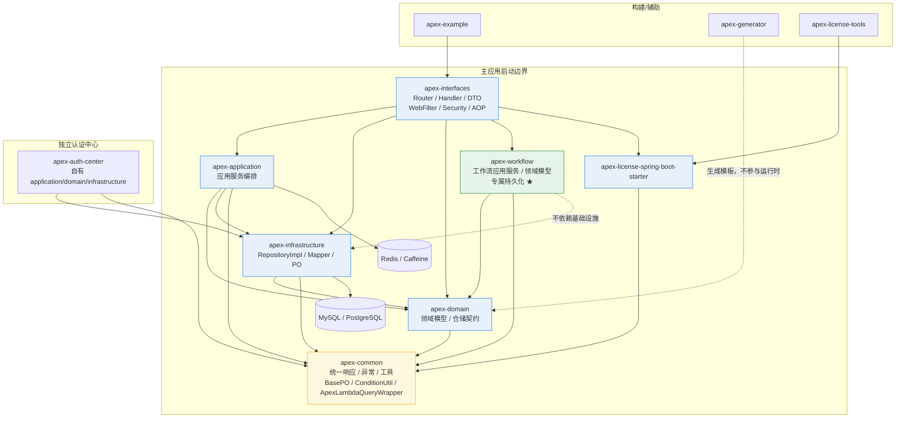

# 工作流功能独立模块化调整方案

> **历史快照**：本文记录某一时点的状态，模块数、端口、路径与类名以当前代码为准，不作为现状依据。

> 文档编号：APEX-PLAN-2026-1004-WF
> 状态：**已完成（工作流模块拆分及方案 1 共享基础设施迁移已全部落地，全工程 `mvnd test` 构建与测试通过）**
> 目标版本：apex-scaffold 1.2.0（应用版本不变，仅代码仓内模块化重组）
> 前置约束：对外接口路由保持原样，不改变任何线上可访问路径、方法、参数与返回值契约。

---

## 1. 方案背景与目标

### 1.1 背景

当前工作流（轻量自研工作流引擎 + 办公平台审批集成 + 工作流监控/统计）的相关代码分散在 `apex-domain`、`apex-infrastructure`、`apex-application`、`apex-interfaces` 四个模块中，且存在**两套并行的领域模型与仓储定义**：

- 领域模型存在两套：`com.apex.scaffold.domain.workflow.*` 与 `com.apex.scaffold.domain.model.workflow.*`；
- 仓储接口存在两套：`com.apex.scaffold.domain.workflow.repository.*` 与 `com.apex.scaffold.domain.repository.*`。

`WorkflowService` 实际使用的是 `domain.model.workflow.*` + `domain.repository.*` 这一套（工程产物），另一套 `domain.workflow.*` 属历史遗留/未使用，需要清理收敛。

### 1.2 目标

1. 将工作流相关代码从现有四模块中抽取，**独立成一个新的 Maven 模块**（拟定名 `apex-workflow`），主应用通过声明依赖继续打包运行；
2. 依赖方向保持 DDD 分层：`interfaces → application → infrastructure → domain`，新模块内部再自带一套分层；
3. **对外 HTTP 接口路由全部原样保留**（见 §4），不产生任何前端/外部调用方感知的变更；
4. 同步调整：文档、脚本、配置文件、测试代码，并生成测试报告文档；
5. 清理收敛两套并行的领域模型/仓储，删除无引用的死代码；
6. 前端项目（`/Users/work/apex-admin-web`）如有需要，一并同步调整。

### 1.3 约定与原则

- **不改变数据库 schema 与 Flyway 迁移**：工作流表（`wf_workflow_definition`、`wf_process_instance`、`wf_task`、`wf_approval_record`、`wf_task_history`、`wf_rollback_history`、遗留 `wf_definition`）结构不变，已有迁移脚本（V20/V21/V24/V40）不重排；
- **不改变 License 商业门控**：工作流为 Enterprise 特性，`@FeatureGate("workflow")` 语义保留；
- **不改变包根命名空间以外的公开契约**：`com.apex.scaffold` 根包保留，新模块落子包 `com.apex.scaffold.workflow.*`，确保主应用 `@ComponentScan(basePackages = "com.apex.scaffold")` 与 `@ConfigurationPropertiesScan` 无需改动即可扫描到新模块 Bean（见 §3.4 校验）。

---

## 2. 现状清点（已核实）

### 2.1 工作流 Java 代码分布（待迁移清单）

| 现有位置（包/类） | 归属模块 | 内容 |
| --- | --- | --- |
| `application/service/WorkflowService` | apex-application | 引擎核心服务：定义/实例/审批/回退/转办/委派/挂起/恢复 |
| `application/workflow/WorkflowQueryService`、`WorkflowStatisticsService` | apex-application | 查询 + 统计 |
| `application/scheduler/WorkflowTimeoutHandler` | apex-application | 超时处理定时任务 |
| `application/dto/Workflow*DTO` | apex-application | 应用层 DTO |
| `domain/model/workflow/*`（WorkflowDefinition、ProcessInstance、Task、ApprovalRecord） | apex-domain | 实际使用的领域模型 |
| `domain/repository/*`（WorkflowDefinition/ProcessInstance/Task/ApprovalRecord 4 个仓储） | apex-domain | 实际使用的仓储接口 |
| `domain/workflow/*`（聚合/实体/枚举等约 11 个类） | apex-domain | **待清理的冗余模型（无主见代码引用）** |
| `domain/workflow/repository/*` | apex-domain | **待清理的冗余仓储接口** |
| `infrastructure/persistence/converter/Workflow*PoConverter`（4 个） | apex-infrastructure | MapStruct 转换器 |
| `infrastructure/persistence/po/Workflow*PO`（4 个） | apex-infrastructure | 持久化对象 |
| `infrastructure/persistence/mapper/Workflow*Mapper`（4 个） | apex-infrastructure | MyBatis-Plus Mapper |
| `infrastructure/persistence/repository/Workflow*RepositoryImpl`（4 个） | apex-infrastructure | 仓储实现 |
| `interfaces/handler/WorkflowHandler` | apex-interfaces | 请求处理器 |
| `interfaces/router/WorkflowRouter` | apex-interfaces | 路由定义（**对外契约，原样保留路径**） |
| `interfaces/dto/workflow/*`（约 7 个请求 DTO） | apex-interfaces | 接口层请求 DTO |

### 2.2 对外路由清单（必须原样保留）

来源：`apex-interfaces/.../router/WorkflowRouter.java`，3 个 `RouterFunction` Bean，共 12 条路由：

**管理端（admin）**
- `GET /admin-api/v1/workflows/instances`
- `GET /admin-api/v1/workflows/instances/{instanceId}`
- `GET /admin-api/v1/workflows/statistics`
- `GET /admin-api/v1/workflows/statistics/trend`

**业务侧（api/v1）**
- `POST /api/v1/workflows/{workflowCode}/instances`
- `GET /api/v1/workflows/tasks/pending`
- `POST /api/v1/workflows/tasks/{taskId}/complete`

**业务侧（api，历史路径）**
- `POST /api/workflow/tasks/{taskId}/rollback`
- `POST /api/workflow/tasks/{taskId}/transfer`
- `POST /api/workflow/tasks/{taskId}/delegate`
- `POST /api/workflow/instances/{instanceId}/suspend`
- `POST /api/workflow/instances/{instanceId}/resume`

> 移动时**仅变更类的所处包/模块**，`WorkflowRouter` 中的路由字符串、HTTP 方法、参数绑定、响应类型、`@RouterOperations` 注解一律不动。

### 2.3 前端工作流相关文件（`/Users/work/apex-admin-web`）

- `src/api/workflow.ts`、`src/api/workflow.test.ts`：API 封装（调用路径对应 §2.2）
- `src/types/workflow.ts`：TS 类型定义
- `src/views/workflow/monitor/*`：监控页面（InstanceList / InstanceDetail / Statistics / index）
- `src/views/workflow/components/TaskActions.vue`：任务操作组件
- `src/views/office/approval/index.vue`、`src/api/office*.ts`：审批相关
- `src/router/dynamic.ts`：`'workflow/monitor/index'` 路由注册项

> 前端接口路径以后端路由为准，**无需改动**；方案落地后仅需回归验证按页面路径调用仍正常。

### 2.4 数据库迁移（不迁移，仅复核）

工作流相关 Flyway 脚本位于 `apex-interfaces/src/main/resources/db/migration/{mysql,postgresql}/`（V20/V21/V24/V40 等），以及 `apex-example/src/test/resources/` 下的 `schema-it.sql`。**方案不移动、不重排这些迁移脚本**（保持 Flyway `checksum` 稳定）。

### 2.5 测试代码（随模块迁移）

| 现有测试 | 归属模块 | 说明 |
| --- | --- | --- |
| `WorkflowServiceTest`、`WorkflowQueryServiceTest`、`WorkflowStatisticsServiceTest`、`WorkflowTimeoutHandlerTest` | apex-application | 应用层单元测试 |
| `WorkflowHandlerIntegrationTest` | apex-interfaces | 接口集成测试 |
| `WorkflowIntegrationTest` | apex-example | 端到端集成测试 |
| `src/api/workflow.test.ts` | 前端 | 前端 API 单测 |

### 2.6 脚本 / 配置（随模块联动调整）

- `scripts/test/test-workflow-api.sh`
- `scripts/data/init_workflow_test_data.sql`、`init_workflow_test_data_v2.sql`
- 文档：`docs/01-guides/workflow-*.md`、`docs/08-project-management/features/README-WORKFLOW-PROJECT.md`、`docs/03-api/api-routes.md`、`docs/03-api/API_ROUTES.md`、`docs/diagrams/06_workflow_approval_flow.svg`、`60_workflow_engine_lifecycle.svg` 等
- 监控配置：`config/monitoring/grafana/apex-dashboard*.json` 中如含工作流指标看板需复核 label 来源

---

## 3. 目标模块设计

### 3.1 新模块基本信息

- **artifactId**：`apex-workflow`
- **打包方式**：`jar`（被主应用 `apex-interfaces` 依赖，随主应用一起构建部署，**不新增启动入口、不新增服务实例**）
- **父 POM**：`com.apex.scaffold:apex-scaffold:1.2.0`（复用父级依赖管理与版本）
- **根包**：`com.apex.scaffold.workflow`
- **依赖关系**：
  - `apex-workflow`（自带分层）依赖 `apex-domain`、`apex-common`，**不依赖 `apex-infrastructure`**（共享持久化设施已下沉至 `apex-common`）
  - `apex-interfaces` 增加依赖 `apex-workflow`（供 router/handler 引用）

### 3.2 内部包结构（遵循 DDD 分层）

```
com.apex.scaffold.workflow
├── application
│   ├── service           WorkflowService（迁移完成）
│   ├── query             WorkflowQueryService、WorkflowStatisticsService
│   ├── scheduler         WorkflowTimeoutHandler
│   └── dto               Workflow*DTO
├── domain
│   ├── model             WorkflowDefinition / ProcessInstance / Task / ApprovalRecord
│   ├── repository        Workflow*Repository
│   └── (自研引擎节点/边/枚举)  WorkflowNode / WorkflowEdge / 状态枚举
└── infrastructure
    ├── persistence
    │   ├── converter    Workflow*PoConverter
    │   ├── po           Workflow*PO
    │   ├── mapper       Workflow*Mapper
    │   └── repository   Workflow*RepositoryImpl
```

接口层（Router / Handler / 请求 DTO）**保留在 `apex-interfaces`**（`interfaces/router/WorkflowRouter.java`、
`interfaces/handler/WorkflowHandler.java`、`interfaces/dto/workflow/*`），通过依赖 `apex-workflow` 引用应用服务，
对外路由路径原样保留。

> **迁移策略（已执行）**：新增模块 `com.apex.scaffold.workflow.*`，将工作流领域模型、应用服务（service/query/scheduler/dto）与专属持久化（converter/po/mapper/repositoryImpl）归入新模块；接口层路由与处理器留在 `apex-interfaces`。共享持久化基础设施 `BasePO`、`ConditionUtil`、`ApexLambdaQueryWrapper` 迁移至 `apex-common`。

### 3.3 决策点

> 以下 2 个决策点请在确认方案时一并拍板；默认采用“推荐项”。

**决策点 A：类全限定名是否保留原样？**
- **推荐：不保留，统一归入 `com.apex.scaffold.workflow.*` 新包。** 更干净、模块归属清晰；需同步替换内部 `import` 与配置引用（影响面在仓内，安全）。
- 备选：平移后保留原包名（`application/service` → `workflow/application/service` 等）。引用改动更小，但包名不直观，不利于后续维护。

**决策点 B：冗余模型清理粒度？**
- **推荐：完全删除** `domain/workflow/*` 与 `domain/workflow/repository/*` 两套冗余代码（确认无任何引用后删除）。
- 备选：保留但在 POM 中排除编译，暂缓删除（不推荐，会留下僵尸代码）。

### 3.4 扫描与装配校验（Red-flag，务必核验）

- 主应用 `Application` 的 `@ComponentScan(basePackages = "com.apex.scaffold")` 已覆盖 `com.apex.scaffold.workflow.*`，**无需改动**；但有 `excludeFilters` 排除 `authcenter`，需确认新模块包名不与 `authcenter` 冲突（不冲突）。
- `@ConfigurationPropertiesScan(basePackages = "com.apex.scaffold")` 已覆盖新模块配置类（如有 `@ConfigurationProperties`）——**无需改动**。
- MyBatis-Plus Mapper 扫描：确认 `@MapperScan` 或 `@Mapper` 注解覆盖到 `com.apex.scaffold.workflow.infrastructure.persistence.mapper.*`（现有 `@Mapper` 注解策略或 `@MapperScan("com.apex.scaffold")` 是否已在主配置中，若在主配置声明需复核基包是否含 `com.apex.scaffold.workflow`）。——**执行阶段逐项确认后改动范围里仅可能在此处微调**。
- `@EnableScheduling` 已由 `interfaces/config/SchedulingConfig.java` 开启，`WorkflowTimeoutHandler` 的 `@Scheduled` 迁移后仍被扫描触发。
- 事务注解：`apex-application` 现有 `@Transactional`（本地事务）依赖；迁移后新模块需引入 `spring-tx`（继承 apex-domain/父 POM 传递依赖，需在 apex-workflow 显式声明以符合接口层清晰度）。

---

## 4. 实施步骤

> 以下步骤在**方案确认后**执行；每步完成即做编译/测试验证，避免大爆炸式一次性重构。

### Phase 0：基线确认（执行前先做）
1. `mvn -pl apex-interfaces -am compile` 基线编译通过。
2. `mvn test`（或按模块）跑一遍现有测试，记录绿色基线。
3. `git status` 确认工作区干净（或记录现存改动基线）。
4. 确认仓库内无其它模块直接引用待迁移类的**额外**位置（用 Grep 全仓扫 `import com.apex.scaffold.application.workflow`、`domain.workflow`、`domain.repository.Workflow` 等）。

### Phase 1：新增 Maven 模块骨架
1. 新建目录 `apex-workflow/`，创建 `apex-workflow/pom.xml`（artifactId、父 POM、依赖、JaCoCo/PMD 插件配置对齐现有模块风格，排除纯 PO/Converter/Mapper）。
2. 根 `pom.xml` 的 `<modules>` 增加 `apex-workflow`；在 `<dependencyManagement>` 增加 `apex-workflow` 条目（不设 version 或复用于模块 version 1.2.0）。
3. 建立空骨架包结构（§3.2）。

### Phase 2：迁移代码（按依赖方向从下往上）
**子步骤 2.1 领域层**：迁移 `domain/model/workflow/*` + `domain/repository/Workflow*Repository` → `workflow.domain.model` / `workflow.domain.repository`。同步替换所有 `import`。
**子步骤 2.2 基础设施层**：迁移 converter/po/mapper/repositoryImpl → `workflow.infrastructure.persistence.*`，替换 import。
**子步骤 2.3 应用层**：迁移 service/query/scheduler/dto → `workflow.application.*`，替换 import，更新 `@FeatureGate("workflow")` 与 `@Scheduled` 注解引用不变。
**子步骤 2.4 接口层**：迁移 handler/router/dto → `workflow.interfaces.*`，**路由路径字符串一户不动**。
**子步骤 2.5**：删除原模块中已被迁移的源文件（避免残留旧包同名类导致歧义）。

### Phase 3：冗余清理
1. Grep 确认 `domain/workflow/*`、`domain/workflow/repository/*` 无任何编译期引用。
2. 删除冗余模型/仓储类。
3. 检查是否残留对冗余类的 Javadoc 引用，一并修正。

### Phase 4：POM / 构建配置联动
1. `apex-interfaces/pom.xml` 增加 `apex-workflow` 依赖。
2. `apex-application/pom.xml`：工作流相关类迁走后，其 JaCoCo 规则（`service.*`、`scheduler.*` 覆盖基线）在 apex-application 保留给剩余非工作流类；工作流类改由 `apex-workflow` 的 JaCoCo 规则覆盖（新增对应 BUNDLE include 与基线）。
3. `apex-domain/pom.xml`：移除对已迁出/已删工作流类的 JaCoCo exclude/include 引用（如有）。
4. `apex-infrastructure/pom.xml`：`persistence/repository/**`、`converter/**`、`po/**` 的 exclude 规则中若含 work workflow 通配，确认与新模块的 exclude 一致。
5. 复核 `basic/standard/enterprise` profile 中 apex-interfaces 的依赖排除（basic profile 是否排除工作流）。——如 basic 依赖当前不含工作流相关依赖，迁移后需在 apex-interfaces 的对应 profile 排除 `apex-workflow`，或维持“basic 不含 workflow”。**执行阶段按现有 profile 边界对齐。**

### Phase 5：测试迁移与补齐
1. 迁移应用层测试：`WorkflowServiceTest`、`WorkflowQueryServiceTest`、`WorkflowStatisticsServiceTest`、`WorkflowTimeoutHandlerTest` → `apex-workflow/src/test/java`。
2. 迁移接口集成测试：`WorkflowHandlerIntegrationTest` → 对应新位置（或保留 apex-interfaces 内但依赖 `apex-workflow`）。
3. 迁移 `WorkflowIntegrationTest`（apex-example 端到端）。
4. 对照原基线补齐新模块覆盖率：工作流类行覆盖率/分支覆盖率须达到原模块同等基线（service ≥0.85/0.65、scheduler ≥0.65/0.45、router ≥0.90/0.75 等）。
5. 运行全量测试并记录结果 → 生成测试报告文档（见 §6）。

### Phase 6：文档 / 脚本 / 配置联动
1. **文档**：
   - 更新工作流指南（`01-guides/workflow-*.md`、`README-WORKFLOW-PROJECT.md`、`workflow-engine-guide.md`）中涉及“代码位于 X 模块”的表述，改为“位于 apex-workflow 模块”；
   - 更新 `03-api/api-routes.md`、`API_ROUTES.md` 中工作流路由章节（路由本身不变，仅可补充“模块归属”说明）；
   - 若新模块内部类有 Javadoc 提到旧路径/旧包，一并替换。
2. **脚本**：调整 `scripts/test/test-workflow-api.sh`（如内部有编译/模块路径、类路径假设）、`scripts/data/init_workflow_test_data*.sql`（若引用建表位置；表结构不变则仅复核路径注释）。
3. **配置**：复核 `config/monitoring/grafana/apex-dashboard*.json` 中工作流面板的数据源/label 是否受影响（通常不受影响，仅复核）；复核远程测试 `scripts/test/test-workflow-api.sh` 中 base url 与鉴权参数。

### Phase 7：前端同步（`/Users/work/apex-admin-web`）
1. 后端路由不变 ⇒ 前端 `src/api/workflow.ts`、`src/types/workflow.ts` **无需改路径**。
2. 回归验证工作流页面（`views/workflow/monitor/*`、`views/office/approval/index.vue`）在改装后的后端上调用正常。
3. 如后端 DTO 字段有因清理产生的任何变化（原则上不应有），同步前端类型。（正常情况下无改动。）
4. 更新前端相关文档/注释中若引用了后端代码归属的表述。

### Phase 8：全量回归
1. `mvn -T 1C clean verify`（或项目标准构建命令）全模块构建 + 测试 + 覆盖率检查通过。
2. 启动主应用，用脚本/Postman 回归 §2.2 的 12 条路由，确认路径/方法/响应原样。
3. 生成最终测试报告文档。

---

## 5. 变更影响面汇总

| 维度 | 是否变更 | 说明 |
| --- | --- | --- |
| 对外 HTTP 路由 | ❌ 不变 | 12 条路由路径/方法/参数/响应原样 |
| 对外返回 DTO 结构 | ❌ 不变 | 接口层 DTO 字段不动 |
| 数据库 schema / Flyway | ❌ 不变 | 迁移脚本不重排、checksum 稳定 |
| License 商业门控 | ❌ 不变 | `@FeatureGate("workflow")` 语义保留 |
| 部署形态 | ❌ 不变 | 仍随 apex-interfaces 单应用打包，不新增实例 |
| Java 包结构 | ✔ 变更 | 工作流代码归入 `com.apex.scaffold.workflow.*` |
| 冗余代码 | ✔ 清理 | 删除 `domain/workflow/*` 两套冗余模型 |
| 文档/脚本/配置 | ✔ 联动 | 归属描述同步新模块 |
| 测试代码 | ✔ 迁移 | 随新模块迁移并补齐覆盖率 |
| 前端 | ⚪ 复核 | 路径不变，回归验证；如 DTO 变化才改 TS 类型 |
| 测试报告文档 | ✔ 新增 | 生成独立的工作流模块测试报告 |

---

## 6. 交付物与验收

### 6.1 交付物
1. 新模块 `apex-workflow/`（含完整分层代码、测试）。
2. 根 POM + 各受影响模块 POM 更新。
3. 冗余代码清理后的干净代码仓。
4. 更新的文档、脚本、配置。
5. **工作流模块测试报告文档**（拟放 `docs/06-testing/` 或 `docs/08-project-management/plans/` 配套，命名如 `workflow-module-test-report.md`），内容含：迁移前后测试用例对照、覆盖率、回归执行记录、12 条路由回归结果、前端回归结果。
6. 前端如有改动，一并交付（预计无需改动）。

### 6.2 验收标准
1. `mvn clean verify` 全绿，覆盖率检查通过；
2. §2.2 的 12 条路由在改装后回归通过；
3. `git grep` 确认 `com.apex.scaffold.application.workflow`、`domain.workflow`、旧 `application/workflow` 包下不再残留工作流类（Scheduler 等被引用类按共享基建妥善处理）；
4. `WorkflowService` 的对外行为测试全部通过（新建定义、启动实例、审批、驳回、回退、转办、委派、挂起、恢复）；
5. 生成的测试报告文档数据与真实执行结果一致、可追溯。

---

## 7. 风险与注意事项

1. **依赖方向反噬**：`UnifiedBusinessLogService`（仍在 apex-application）通过 `infrastructure.persistence.mapper.*` 访问 Mapper——若工作流 Mapper 迁走后该类仍引用，需在迁移时同步更新其 import；**迁移前必须全仓扫引用**（Phase 0.4）。
2. **事务与连接隔离**：`WorkflowService` 使用 `Schedulers.boundedElastic()` 隔离阻塞调用，迁移时该模式必须保持，避免在 Reactor 事件循环线程上做阻塞 IO。
3. **`@ConfigurationProperties` 前缀冲突**：迁移时勿与现有 `office.*`、`sentinel.*` 等配置前缀冲突；工作流相关配置前缀不变。
4. **JaCoCo 基线迁移**：新模块须承接原覆盖基线，否则 `mvn verify` 的 coverage check 会失败；需一次性把工作流类 BUNDLE 规则搬到 apex-workflow。
5. **basic profile**：需确认 basic（基础版）是否应当包含工作流；若现有 basic 不含 workflow 依赖，迁移后要在 apex-interfaces 的 basic profile 排除 `apex-workflow`，保持行为一致。**（已核实：basic profile 仅排除 RocketMQ/Sentinel/zipkin/resilience4j 等高级外部依赖，不涉及工作流；工作流在迁移前即随 `apex-application` 存在于所有 profile，迁移后 `apex-workflow` 同样在所有 profile 保留，行为一致，无需额外排除。）**
6. **跳跃式合并风险**：工作流类被 `WorkflowHandler`/`WorkflowRouter` 及测试引用，删除旧类与新增新类必须在同一变更内原子完成，避免中间态编译不过。

---

## 8. 待确认事项（请在下面的确认信息里一并回复）

1. **决策点 A**：确认采用“统一归入 `com.apex.scaffold.workflow.*` 新包”吗？
2. **决策点 B**：确认完全删除 `domain/workflow/*` 两套冗余模型吗？
3. **新模块命名**：确认用 `apex-workflow` 作为模块 artifactId 吗？（备选：`apex-workflow-engine`）
4. **测试报告文档位置**：确认放 `docs/06-testing/workflow-module-test-report.md` 吗？
5. **执行顺序**：确认按 §4 的 Phase 0→8 顺序执行，且每一步构建/测试通过后再继续吗？

> 确认以上后，将开始执行（Phase 0 起）。如需调整任何范围、命名或顺序，请直接指出。

---

## 9. 执行结果记录（已完成）

### 9.1 实际落地的模块拓扑

| 内容 | 迁移前归属 | 迁移后归属 |
| --- | --- | --- |
| 工作流领域模型 / 仓储契约 | apex-domain | `apex-workflow`（`workflow.domain.*`） |
| 工作流应用服务（service/query/scheduler/dto） | apex-application | `apex-workflow`（`workflow.application.*`） |
| 工作流专属持久化（converter/po/mapper/repositoryImpl） | apex-infrastructure | `apex-workflow`（`workflow.infrastructure.persistence.*`） |
| 接口层路由 / 处理器 / 请求 DTO | apex-interfaces | **保留在 apex-interfaces**（`interfaces/router`、`interfaces/handler`、`interfaces/dto/workflow`） |
| 共享持久化基础（`BasePO`/`ConditionUtil`/`ApexLambdaQueryWrapper`） | apex-infrastructure | `apex-common`（`common.persistence.po` / `common.persistence.util`） |

### 9.2 依赖拓扑（最终）

依赖方向概要：`apex-interfaces → apex-workflow / apex-application → apex-infrastructure → apex-domain → apex-common`

- `apex-workflow` 依赖 `apex-domain`、`apex-common`，**不直接依赖 `apex-infrastructure`**。
- `apex-interfaces` 依赖 `apex-workflow`（见 `apex-interfaces/pom.xml` L34-39）。
- 根 POM `<modules>` 已登记 `apex-workflow`，`<dependencyManagement>` 已登记其版本。

#### 模块依赖关系图（迁移后，箭头 = 依赖方向）



- ★ = 本次新增模块 `apex-workflow`；它自身遵循 DDD 分层（`application`/`domain`/`infrastructure`），对外复用 `apex-domain` 与 `apex-common`，与其他业务模块解耦。
- 依赖方向为纯单向 DAG，无循环依赖；ArchUnit `LayeringArchTest` 已验证通过。

### 9.3 关键迁移注意事项（已处理）

- **同包继承隐患**：迁移 `BasePO` 至 `apex-common` 后，`apex-infrastructure` 中原先因同包而无需 import 的 `extends BasePO`（约 50 个 PO）需显式 `import com.apex.scaffold.common.persistence.po.BasePO;`，已全部补齐。
- **旧包引用清理**：`com.apex.scaffold.application.workflow`、`com.apex.scaffold.domain.workflow`、`domain.repository.Workflow*` 等旧包下的工作流类与冗余模型已清理（`domain/workflow/*`、`domain/workflow/repository/*` 两套冗余代码已删除）。
- **公共模块反向依赖**：共享基础设施测试迁移至 `apex-common` 时改用模块内测试专用实体（`TestPO`），避免 `apex-common` 反向依赖业务基础设施。

### 9.4 构建与测试验证结果

- 定向：`mvnd -pl apex-common,apex-infrastructure,apex-workflow -am test` → **BUILD SUCCESS**（`apex-infrastructure` 共 609 个测试全部通过）。
- 全工程：`mvnd test` → **BUILD SUCCESS**（`apex-common`、`apex-infrastructure`、`apex-workflow`、`apex-interfaces`、`apex-auth-center`、`apex-example` 全部模块测试及 JaCoCo 覆盖率检查通过）。
- 覆盖率承接：`apex-workflow` 的 JaCoCo 规则已承接工作流类覆盖基线（service/query 0.85/0.65、scheduler 0.70/0.50）。
- 详细测试记录见 [workflow-module-test-report.md](../../06-testing/workflow-module-test-report.md)。

### 9.5 前端与脚本

- 前端（`/Users/work/apex-admin-web`）：后端路由未变更，前端 `src/api/workflow.ts`、`src/types/workflow.ts` 及页面**无需改动**，仅回归验证。
- 脚本：`scripts/utils/check-commercialization-readiness.sh`、`scripts/test/generate-test-report.sh`、`scripts/test/generate-comprehensive-test-report.sh` 的模块清单均已包含 `apex-workflow`，与最终模块拓扑一致。
- 数据库迁移脚本、Grafana 看板、对外 12 条路由路径/方法/参数/响应均保持原样。

> 结论：本方案 §1–§8 所列全部前后端调整项均已落地，构建与测试通过，无遗留待办。