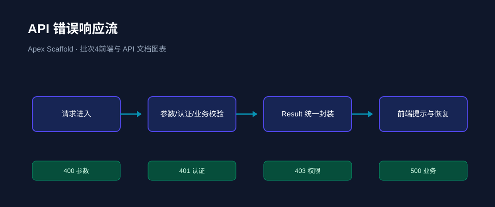

# API 路由文档

本文档整理了 Apex Scaffold 项目所有 API 路由配置，包括 HTTP 方法、路径、Handler 方法、权限要求等信息。

## 文档说明

- **路由前缀**：
  - `/api/v1/**` — 业务接口（C 端 / 开放接口）
  - `/admin-api/v1/**` — 管理后台接口（需权限校验）
- **权限注解**：`@RequirePermission("权限码")` 标记需要的权限
- **响应式模型**：所有接口基于 Spring WebFlux 函数式端点实现
- **统一响应**：返回 `Result<T>` 结构 `{code, msg, data, traceId}`



---

## 目录

1. [认证与授权](#1-认证与授权)
2. [用户管理](#2-用户管理)
3. [文件管理](#3-文件管理)
4. [系统管理](#4-系统管理)
5. [工作流管理](#5-工作流管理)
6. [监控与日志](#6-监控与日志)
7. [健康检查](#7-健康检查)

---

## 1. 认证与授权

### 1.1 认证接口（AuthHandler）

**路由前缀**：`/api/v1/auth`

| HTTP 方法 | 路径 | Handler 方法 | 权限要求 | 说明 |
|-----------|------|--------------|----------|------|
| POST | `/login` | `login` | 无 | 用户登录（支持微信授权码、手机号短信验证码、一键登录） |
| POST | `/register` | `register` | 无 | 用户注册（使用一次性票据完成注册） |
| POST | `/wechat/bind-phone` | `bindWechatPhone` | 无 | 注册前验证并绑定微信手机号 |
| POST | `/refresh` | `refresh` | 无 | 刷新 Token（使用 refreshToken 换取新 accessToken） |
| POST | `/logout` | `logout` | 需登录 | 退出登录 |
| POST | `/sms/code` | `sendSmsCode` | 无 | 发送短信验证码（微信短信登录） |
| POST | `/cl/sms/code` | `sendClSmsCode` | 无 | 发送创蓝短信验证码 |
| POST | `/cl/validate-mobile` | `validateMobile` | 无 | 本机号校验（创蓝闪验） |
| POST | `/wx/phone` | `bindPhone` | 需登录 | 绑定微信手机号 |

### 1.2 图形验证码（CaptchaHandler）

**路由前缀**：`/api/v1/auth`

| HTTP 方法 | 路径 | Handler 方法 | 权限要求 | 说明 |
|-----------|------|--------------|----------|------|
| GET | `/captcha` | `generate` | 无 | 获取图形验证码（返回 ID + Base64 图片） |
| POST | `/captcha/verify` | `verify` | 无 | 校验图形验证码 |

### 1.3 授权管理（AuthorizationHandler）

**路由前缀**：`/api/v1/auth`

| HTTP 方法 | 路径 | Handler 方法 | 权限要求 | 说明 |
|-----------|------|--------------|----------|------|
| GET | `/roles/my` | `getMyRoles` | 需登录 | 获取当前用户角色 |
| GET | `/permissions/my` | `getMyPermissions` | 需登录 | 获取当前用户权限 |
| GET | `/roles` | `getAllRoles` | 需登录 | 获取所有角色 |
| GET | `/permissions` | `getAllPermissions` | 需登录 | 获取所有权限 |
| POST | `/roles` | `createRole` | 需登录 | 创建角色 |
| POST | `/roles/update` | `updateRole` | 需登录 | 更新角色 |
| DELETE | `/roles/{id}` | `deleteRole` | 需登录 | 删除角色 |
| POST | `/permissions` | `createPermission` | 需登录 | 创建权限 |
| POST | `/permissions/update` | `updatePermission` | 需登录 | 更新权限 |
| DELETE | `/permissions/{id}` | `deletePermission` | 需登录 | 删除权限 |
| POST | `/users/{userId}/roles/{roleId}` | `assignRoleToUser` | 需登录 | 为用户分配角色 |
| DELETE | `/users/{userId}/roles/{roleId}` | `removeRoleFromUser` | 需登录 | 移除用户角色 |

---

## 2. 用户管理

### 2.1 用户信息（UserHandler）

**路由前缀**：`/api/v1/user`

| HTTP 方法 | 路径 | Handler 方法 | 权限要求 | 说明 |
|-----------|------|--------------|----------|------|
| GET | `/info` | `getCurrentUserInfo` | 需登录 | 获取当前用户信息 |
| POST | `/me/deletion-code` | `sendAccountDeletionCode` | 需登录 | 发送账号注销验证码 |
| DELETE | `/me` | `deleteCurrentUser` | 需登录 | 注销当前账号 |
| GET | `/{userId}` | `getUserById` | 无 | 根据 ID 获取用户信息 |
| POST | `/list` | `listUsers` | 无 | 分页查询用户列表 |

### 2.2 后台用户管理（AdminUserManagementHandler）

**路由前缀**：`/admin-api/v1/users`

| HTTP 方法 | 路径 | Handler 方法 | 权限要求 | 说明 |
|-----------|------|--------------|----------|------|
| GET | `/staff-roles` | `roles` | `staff:manage` | 查询可配置的后台角色 |
| GET | `` | `list` | `staff:manage` | 分页检索用户（支持关键词搜索和状态过滤） |
| POST | `` | `create` | `staff:manage` | 后台创建用户 |
| GET | `/{userId}` | `detail` | `staff:manage` | 查看用户资料 |
| PUT | `/{userId}` | `update` | `staff:manage` | 编辑用户资料 |
| POST | `/{userId}/sessions/revoke` | `revokeSessions` | `staff:session:revoke` | 强制撤销用户全部会话 |
| PUT | `/{userId}/status` | `updateStatus` | `staff:manage` | 启用或停用用户 |
| PUT | `/{userId}/roles` | `replaceRoles` | `staff:manage` | 替换用户后台角色 |

---

## 3. 文件管理

### 3.1 文件操作（FileHandler）

**路由前缀**：`/api/v1/file` 和 `/api/v1/files`

| HTTP 方法 | 路径 | Handler 方法 | 权限要求 | 说明 |
|-----------|------|--------------|----------|------|
| POST | `/file/upload` | `upload` | 无 | 上传图片（已过时，兼容入口） |
| POST | `/files/generic` | `uploadGenericFile` | 无 | 上传普通图片（推荐使用） |
| GET | `/file/url` | `getUrl` | 无 | 获取文件访问 URL |
| GET | `/file/content` | `content` | 无 | 读取本地存储文件内容 |
| DELETE | `/file/delete` | `delete` | 无 | 删除文件 |
| GET | `/file/exists` | `exists` | 无 | 检查文件是否存在 |

---

## 4. 系统管理

### 4.1 菜单管理（MenuHandler）

**路由前缀**：`/admin-api/v1/menus`

| HTTP 方法 | 路径 | Handler 方法 | 权限要求 | 说明 |
|-----------|------|--------------|----------|------|
| GET | `` | `tree` | `system:menu:list` | 查询菜单树 |
| GET | `/{menuId}` | `detail` | `system:menu:query` | 查询菜单详情 |
| POST | `` | `create` | `system:menu:add` | 创建菜单 |
| PUT | `/{menuId}` | `update` | `system:menu:edit` | 更新菜单 |
| DELETE | `/{menuId}` | `delete` | `system:menu:remove` | 删除菜单 |
| PUT | `/{menuId}/status` | `updateStatus` | `system:menu:edit` | 启用/停用菜单 |

### 4.2 字典管理（DictHandler）

**路由前缀**：`/admin-api/v1/dict`

| HTTP 方法 | 路径 | Handler 方法 | 权限要求 | 说明 |
|-----------|------|--------------|----------|------|
| GET | `/types` | `listTypes` | `system:dict:list` | 查询字典类型列表 |
| GET | `/types/{id}` | `getType` | `system:dict:query` | 查询字典类型详情 |
| POST | `/types` | `createType` | `system:dict:add` | 创建字典类型 |
| PUT | `/types/{id}` | `updateType` | `system:dict:edit` | 更新字典类型 |
| DELETE | `/types/{id}` | `deleteType` | `system:dict:remove` | 删除字典类型 |
| PUT | `/types/{id}/status` | `updateTypeStatus` | `system:dict:edit` | 启用/停用字典类型 |
| GET | `/data` | `listData` | `system:dict:list` | 按类型查询字典数据 |
| GET | `/data/{id}` | `getData` | `system:dict:query` | 查询字典数据详情 |
| POST | `/data` | `createData` | `system:dict:add` | 创建字典数据 |
| PUT | `/data/{id}` | `updateData` | `system:dict:edit` | 更新字典数据 |
| DELETE | `/data/{id}` | `deleteData` | `system:dict:remove` | 删除字典数据 |
| PUT | `/data/{id}/status` | `updateDataStatus` | `system:dict:edit` | 启用/停用字典数据 |

### 4.3 部门管理（DeptHandler）

**路由前缀**：`/admin-api/v1/depts`

| HTTP 方法 | 路径 | Handler 方法 | 权限要求 | 说明 |
|-----------|------|--------------|----------|------|
| GET | `` | `listTree` | `system:dept:list` | 查询部门树 |
| GET | `/{id}` | `detail` | `system:dept:query` | 查询部门详情 |
| POST | `` | `create` | `system:dept:add` | 新增部门 |
| PUT | `/{id}` | `update` | `system:dept:edit` | 更新部门 |
| DELETE | `/{id}` | `delete` | `system:dept:remove` | 删除部门 |

### 4.4 参数配置（ConfigHandler）

**路由前缀**：`/admin-api/v1/configs`

| HTTP 方法 | 路径 | Handler 方法 | 权限要求 | 说明 |
|-----------|------|--------------|----------|------|
| GET | `` | `list` | `system:config:list` | 查询参数配置列表 |
| GET | `/{id}` | `detail` | `system:config:query` | 查询参数配置详情 |
| POST | `` | `create` | `system:config:add` | 创建参数配置 |
| PUT | `/{id}` | `update` | `system:config:edit` | 更新参数配置 |
| DELETE | `/{id}` | `delete` | `system:config:remove` | 删除参数配置 |
| PUT | `/{id}/status` | `updateStatus` | `system:config:edit` | 启用/停用参数配置 |

### 4.5 定时任务（JobHandler）

**路由前缀**：`/admin-api/v1/jobs`

| HTTP 方法 | 路径 | Handler 方法 | 权限要求 | 说明 |
|-----------|------|--------------|----------|------|
| GET | `` | `list` | `system:job:list` | 查询定时任务列表 |
| GET | `/{id}` | `detail` | `system:job:query` | 查询任务详情 |
| POST | `` | `create` | `system:job:add` | 创建定时任务 |
| PUT | `/{id}` | `update` | `system:job:edit` | 更新定时任务 |
| DELETE | `/{id}` | `delete` | `system:job:remove` | 删除定时任务 |
| PUT | `/{id}/status` | `updateStatus` | `system:job:edit` | 启用/停用定时任务 |
| POST | `/{id}/run` | `runOnce` | `system:job:run` | 立即执行一次任务 |
| GET | `/{id}/logs` | `logs` | `system:job:query` | 查询任务执行日志 |

### 4.6 数据库配置（DatabaseConfigHandler）

**路由前缀**：`/admin-api/v1/database`

| HTTP 方法 | 路径 | Handler 方法 | 权限要求 | 说明 |
|-----------|------|--------------|----------|------|
| POST | `/test` | `testConnection` | `system:database:test` | 测试数据库连接 |
| POST | `/generate-config` | `generateConfig` | `system:database:config` | 生成部署配置 |
| GET | `/current` | `getCurrentInfo` | `system:database:query` | 获取当前数据库信息 |

---

## 5. 工作流管理

### 5.1 工作流业务接口（WorkflowHandler）

**路由前缀**：`/api/v1/workflows`

| HTTP 方法 | 路径 | Handler 方法 | 权限要求 | 说明 |
|-----------|------|--------------|----------|------|
| POST | `/{workflowCode}/instances` | `startProcessInstance` | 需登录 | 发起流程实例 |
| GET | `/tasks/pending` | `listPendingTasks` | 需登录 | 查询当前用户待办任务 |
| POST | `/tasks/{taskId}/complete` | `completeTask` | 需登录 | 完成任务（审批通过） |

### 5.2 工作流高级操作（WorkflowHandler）

**路由前缀**：`/api/workflow`

| HTTP 方法 | 路径 | Handler 方法 | 权限要求 | 说明 |
|-----------|------|--------------|----------|------|
| POST | `/tasks/{taskId}/rollback` | `rollbackTask` | 需登录 | 流程回退到指定节点 |
| POST | `/tasks/{taskId}/transfer` | `transferTask` | 需登录 | 任务转办（责任人变更） |
| POST | `/tasks/{taskId}/delegate` | `delegateTask` | 需登录 | 任务委派（临时委托） |
| POST | `/instances/{instanceId}/suspend` | `suspendInstance` | 需登录 | 挂起流程实例 |
| POST | `/instances/{instanceId}/resume` | `resumeInstance` | 需登录 | 恢复流程实例 |

### 5.3 工作流查询（WorkflowHandler）

**路由前缀**：`/admin-api/v1/workflows`

| HTTP 方法 | 路径 | Handler 方法 | 权限要求 | 说明 |
|-----------|------|--------------|----------|------|
| GET | `/instances` | `listInstances` | 需登录 | 查询工作流实例列表（支持分页和状态过滤） |
| GET | `/instances/{instanceId}` | `getInstanceDetail` | 需登录 | 查询流程实例详情 |
| GET | `/statistics` | `getStatistics` | 需登录 | 获取工作流统计数据 |
| GET | `/statistics/trend` | `getTrend` | 需登录 | 获取工作流趋势数据 |

---

## 6. 监控与日志

### 6.1 登录日志（LoginLogHandler）

**路由前缀**：`/admin-api/v1/login-logs`

| HTTP 方法 | 路径 | Handler 方法 | 权限要求 | 说明 |
|-----------|------|--------------|----------|------|
| GET | `` | `list` | `system:login-log:list` | 查询登录日志（分页） |

### 6.2 审计日志（AuditLogHandler）

**路由前缀**：`/admin-api/v1/audit-logs`

| HTTP 方法 | 路径 | Handler 方法 | 权限要求 | 说明 |
|-----------|------|--------------|----------|------|
| GET | `` | `list` | `system:audit-log:list` | 查询操作审计日志（分页） |

### 6.3 API 调用日志（ApiCallLogHandler）

**路由前缀**：`/admin-api/v1/api-call-logs`

| HTTP 方法 | 路径 | Handler 方法 | 权限要求 | 说明 |
|-----------|------|--------------|----------|------|
| GET | `` | `list` | `system:api-call-log:list` | 查询外部 API 调用日志（分页） |

### 6.4 运行时日志（RuntimeLogHandler）

**路由前缀**：`/admin-api/v1/logs/runtime`

| HTTP 方法 | 路径 | Handler 方法 | 权限要求 | 说明 |
|-----------|------|--------------|----------|------|
| GET | `` | `queryLogs` | 需登录 | 查询运行时日志 |
| GET | `/count` | `countLogs` | 需登录 | 统计日志数量 |

### 6.5 业务日志统一查询（UnifiedBusinessLogHandler）

**路由前缀**：`/admin-api/v1/logs/business`

| HTTP 方法 | 路径 | Handler 方法 | 权限要求 | 说明 |
|-----------|------|--------------|----------|------|
| GET | `` | `queryLogs` | 需登录 | 统一查询业务日志（登录、操作、API 调用） |
| GET | `/count` | `countLogs` | 需登录 | 统计业务日志数量 |

### 6.6 在线用户（OnlineUserHandler）

**路由前缀**：`/admin-api/v1/online-users`

| HTTP 方法 | 路径 | Handler 方法 | 权限要求 | 说明 |
|-----------|------|--------------|----------|------|
| GET | `` | `list` | `system:online-user:list` | 查询在线用户列表 |

### 6.7 监控大盘（MonitorDashboardHandler）

**路由前缀**：`/admin-api/v1/monitor`

| HTTP 方法 | 路径 | Handler 方法 | 权限要求 | 说明 |
|-----------|------|--------------|----------|------|
| GET | `/overview` | `overview` | `system:monitor:view` | 监控概览 |
| GET | `/system` | `system` | `system:monitor:view` | 系统资源监控 |
| GET | `/middleware` | `middleware` | `system:monitor:view` | 中间件监控 |
| GET | `/governance` | `governance` | `system:monitor:view` | 治理监控 |
| GET | `/business` | `business` | `system:monitor:view` | 核心业务监控 |

### 6.8 数据导出（ExcelExportHandler）

**路由前缀**：`/admin-api/v1/export`

| HTTP 方法 | 路径 | Handler 方法 | 权限要求 | 说明 |
|-----------|------|--------------|----------|------|
| GET | `/users` | `exportUsers` | `system:user:list` | 导出用户数据（Excel） |

### 6.9 站内通知（NotificationSseHandler）

**路由前缀**：`/api/v1/notifications`

| HTTP 方法 | 路径 | Handler 方法 | 权限要求 | 说明 |
|-----------|------|--------------|----------|------|
| GET | `/stream` | `stream` | 需登录 | SSE 实时通知推送 |

### 6.10 统一搜索（UnifiedSearchHandler）

**路由前缀**：`/admin-api/v1/search`

| HTTP 方法 | 路径 | Handler 方法 | 权限要求 | 说明 |
|-----------|------|--------------|----------|------|
| GET | `` | `search` | 需登录 | 全文搜索（Meilisearch） |
| POST | `/rebuild` | `rebuildIndex` | 需登录 | 重建搜索索引 |

---

## 7. 健康检查

### 7.1 健康检查（HealthHandler）

**路由前缀**：无 / `/api/v1`

| HTTP 方法 | 路径 | Handler 方法 | 权限要求 | 说明 |
|-----------|------|--------------|----------|------|
| GET | `/` | `root` | 无 | 根路径探活 |
| GET | `/api/v1/health` | `health` | 无 | 健康检查（负载均衡器使用） |
| GET | `/api/v1/info` | `info` | 无 | 系统信息（版本、环境等） |

---

## 附录

### A. 权限码分类

权限码采用分层命名规范：`模块:资源:操作`

**系统管理模块**：
- `system:menu:*` — 菜单管理权限
- `system:dict:*` — 字典管理权限
- `system:dept:*` — 部门管理权限
- `system:config:*` — 参数配置权限
- `system:job:*` — 定时任务权限
- `system:database:*` — 数据库配置权限
- `system:login-log:list` — 登录日志查询
- `system:audit-log:list` — 审计日志查询
- `system:api-call-log:list` — API 调用日志查询
- `system:online-user:list` — 在线用户查询
- `system:monitor:view` — 监控查看权限
- `system:user:list` — 用户列表查询（用于导出）

**用户管理模块**：
- `staff:manage` — 后台用户管理
- `staff:session:revoke` — 会话撤销权限

### B. 路由注册机制

所有路由在 [ApiRouter.java](file:///Users/work/apex-scaffold/apex-interfaces/src/main/java/com/apex/scaffold/interfaces/router/ApiRouter.java) 和 [WorkflowRouter.java](file:///Users/work/apex-scaffold/apex-interfaces/src/main/java/com/apex/scaffold/interfaces/router/WorkflowRouter.java) 中以 `@Bean` 方式注册，返回 `RouterFunction<ServerResponse>`。

**示例**：
```java
@Bean
public RouterFunction<ServerResponse> adminMenuRoutes(MenuHandler handler) {
    return RouterFunctions.route()
        .path("/admin-api/v1/menus", routes -> routes
            .GET("", handler::tree)
            .GET("/{menuId}", handler::detail)
            .POST("", contentType(MediaType.APPLICATION_JSON), handler::create)
            .PUT("/{menuId}", contentType(MediaType.APPLICATION_JSON), handler::update)
            .DELETE("/{menuId}", handler::delete)
            .PUT("/{menuId}/status", contentType(MediaType.APPLICATION_JSON), handler::updateStatus))
        .build();
}
```

### C. Handler 层职责

Handler 负责：
1. 接收 `ServerRequest` 并解析参数
2. 调用 Application 层 Service 执行业务逻辑
3. 构建 `ServerResponse` 返回统一响应

所有 Handler 继承自 [BaseHandler](file:///Users/work/apex-scaffold/apex-interfaces/src/main/java/com/apex/scaffold/interfaces/handler/BaseHandler.java)，提供统一的参数解析、响应构建和国际化支持。

### D. 安全机制

- **JWT 认证**：Access Token + Refresh Token 双 Token 机制
- **权限校验**：`@RequirePermission` 注解 + `RequirePermissionAspect` AOP 拦截
- **限流保护**：`@RateLimiter`、`@HotSpotRateLimit`、`@UserRateLimit` + Sentinel
- **防重放**：`@AntiReplay` 时间戳 + nonce 校验
- **接口幂等**：`@IdempotentApi` 幂等键控制
- **操作审计**：`@OperationLog` 自动记录操作日志

---

**文档生成时间**：2026-09-10  
**项目版本**：1.2.0  
**维护团队**：Apex Team
> 配套图表：[54 API 契约流转](diagrams/54_api_contract_flow.svg)

