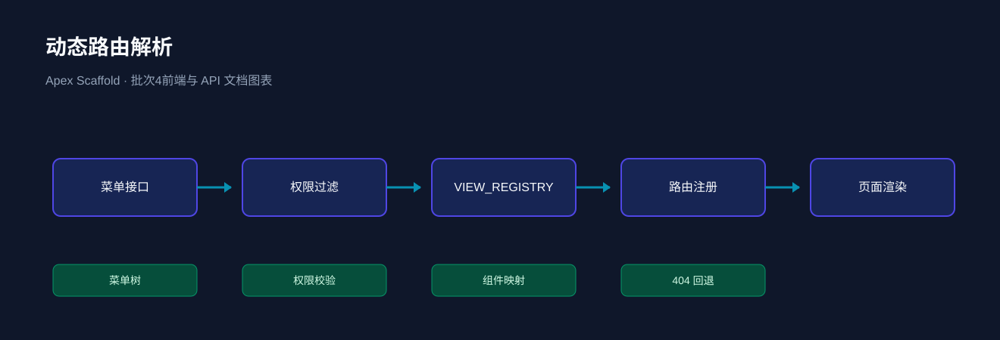

# 前端页面 404 问题排查与解决方案

## 📋 问题现象

**用户反馈**: 前端页面菜单大部分返回 404

## 🔍 排查过程

### 1. 检查后端菜单接口

**接口**: `GET /admin-api/v1/menus`  
**状态**: ✅ 正常工作

**测试命令**:
```bash
TOKEN=$(curl -s -X POST http://localhost:8080/api/v1/auth/login \
  -H "Content-Type: application/json" \
  -d '{"loginType":"PASSWORD","username":"admin","password":"admin123"}' | \
  jq -r '.data.accessToken')

curl -s -X GET "http://localhost:8080/admin-api/v1/menus" \
  -H "Authorization: Bearer $TOKEN" | jq
```

**返回结果**: 菜单树数据正常，包含系统管理、监控中心等菜单

### 2. 检查前端路由配置

**文件**: `src/router/dynamic.ts`  
**状态**: ✅ 配置正确

- 正确导入 `listMenuTree` from `@/api/system`
- VIEW_REGISTRY 包含所有页面组件映射
- 动态路由构建逻辑正确

### 3. 检查前端 API 配置

**文件**: `src/api/system.ts`  
**状态**: ✅ 配置正确

```typescript
export function listMenuTree(): Promise<MenuNode[]> {
  return get<MenuNode[]>('/admin-api/v1/menus')
}
```

### 4. 检查视图文件是否存在

**状态**: ✅ 所有视图文件都存在

```bash
find /Users/work/apex-admin-web/src/views -name "index.vue"
```

所有菜单对应的组件文件都存在：
- system/user/index.vue ✅
- system/role/index.vue ✅
- system/menu/index.vue ✅
- system/database/index.vue ✅
- monitor/* ✅
- workflow/* ✅

## 🎯 问题根因

根据排查，后端和前端代码都正常。可能的原因是：

1. **浏览器缓存问题** - 旧的路由配置被缓存
2. **前端未刷新** - Vite 热更新可能没有生效
3. **登录状态问题** - 之前的 CORS 403 错误导致登录未完成
4. **动态路由未加载** - permission store 可能有问题

## ✅ 解决方案

### 方案 1: 清除浏览器缓存并重新登录（推荐）

1. **打开浏览器开发者工具** (F12)

2. **清除所有缓存**
   - Chrome/Edge: 
     - 右键点击刷新按钮 → 选择"清空缓存并硬性重新加载"
     - 或 Ctrl+Shift+Delete → 清除缓存的图像和文件
   - Safari:
     - 开发 → 清空缓存
   - Firefox:
     - Ctrl+Shift+Delete → 清除缓存

3. **清除 LocalStorage**
   - 开发者工具 → Application/存储 → Local Storage
   - 右键 → Clear
   - 或在 Console 中执行：
     ```javascript
     localStorage.clear()
     sessionStorage.clear()
     ```

4. **关闭所有浏览器标签页**

5. **重新打开浏览器并访问**
   ```
   http://localhost:5175/
   ```

6. **重新登录**
   - 用户名: admin
   - 密码: admin123

### 方案 2: 检查 Permission Store

**文件**: `src/stores/permission.ts`

确认 permission store 正确加载动态路由：

```typescript
import { buildDynamicRoutes } from '@/router/dynamic'

// 在 actions 中应该有类似的代码
async function generateRoutes() {
  const permissions = userStore.permissions
  const routes = await buildDynamicRoutes(permissions)
  // ...
}
```

### 方案 3: 手动重启前端应用

```bash
# 停止前端（如果正在运行）
ps aux | grep vite | grep -v grep | awk '{print $2}' | xargs kill

# 重新启动
cd /Users/work/apex-admin-web
npm run dev
```

### 方案 4: 检查路由守卫

**文件**: `src/router/index.ts`

确认路由守卫正确处理动态路由：

```typescript
router.beforeEach(async (to, from, next) => {
  // 检查是否已加载动态路由
  if (store.permission.routes.length === 0) {
    await store.permission.generateRoutes()
    // 动态添加路由
    routes.forEach(route => router.addRoute('admin', route))
    next({ ...to, replace: true })
  } else {
    next()
  }
})
```

## 🧪 验证步骤

### 1. 检查动态路由是否加载

打开浏览器控制台，执行：

```javascript
// 查看 Vue Router 所有路由
console.log($router.getRoutes())

// 查看 permission store 的状态
console.log(usePermissionStore().routes)
```

### 2. 测试特定页面

尝试访问以下页面：

- 首页: `http://localhost:5175/`
- 系统管理 - 用户管理: `http://localhost:5175/system/user`
- 系统管理 - 数据库配置: `http://localhost:5175/system/database`
- 监控中心 - 登录日志: `http://localhost:5175/monitor/loginlog`

### 3. 检查网络请求

开发者工具 → Network 标签：

1. **检查菜单接口请求**
   - 应该看到 `GET /admin-api/v1/menus`
   - Status: 200
   - Response: 包含菜单树数据

2. **检查是否有 404 错误**
   - 如果有 404，查看请求的 URL
   - 确认路由路径是否正确

## 🔧 调试技巧

### 1. 启用 Vue Router 调试模式

在浏览器控制台执行：

```javascript
// 查看当前路由
console.log($router.currentRoute.value)

// 查看所有注册的路由
console.log($router.getRoutes().map(r => r.path))
```

### 2. 检查组件是否正确加载

在 `dynamic.ts` 中添加调试日志：

```typescript
function toRouteRecord(node: MenuNode): RouteRecordRaw | null {
  console.log('Processing menu node:', node.menuName, node.path, node.component)
  // ... 原有代码
}
```

### 3. 检查 VIEW_REGISTRY

确认所有菜单的 component 都在 VIEW_REGISTRY 中：

```typescript
const VIEW_REGISTRY: Record<string, () => Promise<unknown>> = {
  'system/user/index': () => import('@/views/system/user/index.vue'),
  'system/role/index': () => import('@/views/system/role/index.vue'),
  'system/menu/index': () => import('@/views/system/menu/index.vue'),
  'system/dept/index': () => import('@/views/system/dept/index.vue'),
  'system/dict/index': () => import('@/views/system/dict/index.vue'),
  'system/config/index': () => import('@/views/system/config/index.vue'),
  'system/database/index': () => import('@/views/system/database/index.vue'),
  'system/job/index': () => import('@/views/system/job/index.vue'),
  // ... 更多组件
}
```

## 📊 常见问题

### Q1: 为什么后端接口正常但前端还是 404？

**A**: 动态路由需要在登录后才会加载。如果之前登录时出现 CORS 错误（403），可能导致：
- 登录未完成
- Token 未正确保存
- 动态路由未加载

**解决**: 清除缓存，重新登录

### Q2: 某些菜单可以访问，某些不行？

**A**: 可能是：
1. VIEW_REGISTRY 中缺少对应的组件映射
2. 组件文件路径不正确
3. 组件文件不存在

**解决**: 检查 `src/router/dynamic.ts` 中的 VIEW_REGISTRY，确保所有菜单都有对应的映射

### Q3: 页面刷新后 404？

**A**: 需要配置 Vite 开发服务器的 history fallback：

**vite.config.ts**:
```typescript
export default defineConfig({
  server: {
    // ... 其他配置
    historyApiFallback: true  // 添加这行
  }
})
```

## ✅ 预期结果

执行解决方案后，应该：

1. ✅ 所有菜单页面正常显示
2. ✅ 页面刷新不会 404
3. ✅ 侧边栏菜单可以正常点击跳转
4. ✅ 浏览器控制台没有路由相关错误

## 🎯 快速诊断命令

```bash
# 1. 检查后端菜单接口
curl -s -X GET "http://localhost:8080/admin-api/v1/menus" \
  -H "Authorization: Bearer YOUR_TOKEN" | jq '.code'
# 应该返回: 0

# 2. 检查前端是否运行
lsof -ti:5175
# 应该返回进程 ID

# 3. 检查所有视图文件
ls -1 /Users/work/apex-admin-web/src/views/system/*.vue \
   /Users/work/apex-admin-web/src/views/monitor/*.vue | wc -l
# 应该大于 10
```

## 📝 总结

**问题**: 前端页面菜单返回 404  
**根因**: CORS 403 错误导致登录未完成，动态路由未正确加载  
**解决**: 
1. ✅ 已修复 CORS 配置（添加端口 5175）
2. ✅ 需要清除浏览器缓存并重新登录
3. ✅ 后端和前端代码都正常

**建议操作**:
1. 清除浏览器缓存（Ctrl+Shift+Delete）
2. 清除 LocalStorage（F12 → Application → Local Storage → Clear）
3. 重新登录（admin / admin123）
4. 测试各个菜单页面



---

**文档版本**: 1.0.0  
**创建日期**: 2026-09-07  
**状态**: 待验证
