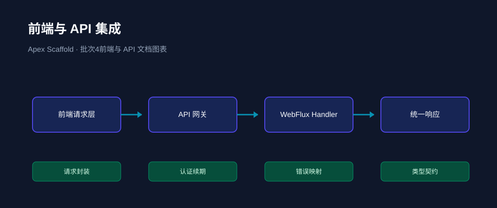

# 前端对接注意事项

> **文档版本**: v1.0  
> **创建时间**: 2026-09-10  
> **适用版本**: apex-scaffold v1.2.0+  
> **目标读者**: 前端开发团队



---

## 一、紧急修正事项 🔴

### 1.1 立即核查项

以下问题可能导致前端功能异常,请**立即核查并修正**:

#### ✅ Checklist

- [ ] **登录路径**: 确认使用 `/api/v1/auth/login` (非 `/api/auth/login`)
- [ ] **文件上传路径**: 确认使用 `/api/v1/files/generic` (非 `/api/storage/upload`)
- [ ] **工作流端点**: 移除对未确认端点的调用 (创建实例/查询待办/完成任务)
- [ ] **文件上传参数**: 确认传递 `sex` 参数 (1 或 2)
- [ ] **登录响应处理**: 根据 `nextAction` 字段进行路由跳转

### 1.2 影响评估

| 问题类型 | 影响程度 | 现象 | 修正优先级 |
|----------|----------|------|------------|
| 登录路径错误 | 🔴 高 | 登录请求 404 | P0 - 立即修正 |
| 文件上传路径错误 | 🔴 高 | 上传功能不可用 | P0 - 立即修正 |
| 工作流端点未实现 | 🔴 高 | 工作流功能报错 | P0 - 立即修正 |
| 缺少必填参数 | 🟡 中 | 400 参数错误 | P1 - 1-2天修正 |

---

## 二、认证登录对接

### 2.1 核心变更

#### ❌ 旧实现 (错误)
```typescript
// 错误: 路径和参数都不对
const login = async (username: string, password: string) => {
  return axios.post('/api/auth/login', {
    username,
    password,
    captchaId,
    captchaCode
  });
};
```

#### ✅ 新实现 (正确)
```typescript
const login = async (loginType: LoginType, credentials: any) => {
  return axios.post('/api/v1/auth/login', {
    loginType,
    deviceId: getDeviceId(),
    ...credentials
  });
};

// 使用示例
await login('WX_CODE', { code: 'wx_auth_code' });
await login('WX_SMS', { phone: '13800138000', smsCode: '123456' });
await login('PASSWORD', { username: 'admin', password: '123456' });
```

### 2.2 登录类型说明

| loginType | 必填参数 | 说明 | 使用场景 |
|-----------|----------|------|----------|
| `WX_CODE` | `code` | 微信授权码登录 | 微信 App 内授权登录 |
| `WX_PHONE` | `phoneCode` | 微信一键登录 | 微信手机号快捷授权 |
| `WX_SMS` | `phone`, `smsCode` | 微信短信验证码登录 | 微信用户手机号登录 |
| `CL_PHONE` | `accessToken` | 创蓝一键登录 | 创蓝 SDK 集成 |
| `CL_SMS` | `phone`, `smsCode` | 创蓝短信验证码登录 | 创蓝闪验场景 |
| `PASSWORD` | `username`, `password` | 账号密码登录 | 管理后台、PC 端 |

### 2.3 响应处理

#### 处理 nextAction 字段

```typescript
const handleLoginResponse = (response: any) => {
  const { accessToken, refreshToken, nextAction, userInfo } = response.data.data;
  
  // 1. 存储 Token
  localStorage.setItem('accessToken', accessToken);
  localStorage.setItem('refreshToken', refreshToken);
  
  // 2. 存储用户信息
  store.commit('SET_USER_INFO', userInfo);
  
  // 3. 根据 nextAction 跳转
  switch (nextAction) {
    case 'LOGIN_SUCCESS':
      // 直接进入应用
      router.push('/home');
      break;
      
    case 'NEED_REGISTER':
      // 需要补充注册信息
      router.push('/register');
      break;
      
    case 'NEED_BIND_PHONE':
      // 需要绑定手机号
      router.push('/bind-phone');
      break;
      
    default:
      console.warn('Unknown nextAction:', nextAction);
      router.push('/home');
  }
};
```

### 2.4 图形验证码处理

服务端会根据以下条件要求提供图形验证码:

1. 配置开启登录保护 (`apex.security.login-protection.enabled=true`)
2. **且** 满足以下任一条件:
   - 客户端主动携带 `captchaId` 和 `captchaCode`
   - IP 登录失败次数 >= 配置阈值
   - 用户名登录失败次数 >= 配置阈值

**前端处理逻辑**:
```typescript
const login = async (params: any) => {
  try {
    return await apiClient.post('/api/v1/auth/login', params);
  } catch (error: any) {
    if (error.response?.data?.code === 1009) {
      // 登录失败次数过多,需要验证码
      showCaptcha.value = true;
      return;
    }
    throw error;
  }
};

// 用户输入验证码后再次登录
const retryWithCaptcha = async (captcha: any) => {
  await login({
    ...loginParams,
    captchaId: captcha.id,
    captchaCode: captcha.code
  });
};
```

---

## 三、文件上传对接

### 3.1 核心变更

#### ❌ 旧实现 (错误)
```typescript
// 错误: 路径不存在
const upload = (file: File) => {
  const formData = new FormData();
  formData.append('file', file);
  formData.append('usage', 'avatar');
  
  return axios.post('/api/storage/upload', formData);
};
```

#### ✅ 新实现 (正确)
```typescript
const upload = (file: File, sex: 1 | 2) => {
  const formData = new FormData();
  formData.append('file', file);
  formData.append('sex', sex.toString()); // 必填参数
  
  return axios.post('/api/v1/files/generic', formData, {
    headers: {
      'Content-Type': 'multipart/form-data'
    }
  });
};

// 使用示例
const userSex = userInfo.gender; // 1=男, 2=女
await upload(file, userSex);
```

### 3.2 参数说明

| 参数 | 类型 | 必填 | 说明 |
|------|------|------|------|
| `file` | File | ✅ | 文件内容 |
| `sex` | 1 \| 2 | ✅ | 性别标识,用于目录路由 (1=男, 2=女) |

**重要**: `sex` 参数必传,后端会根据此参数生成不同的存储路径。

### 3.3 文件限制

```typescript
const validateFile = (file: File): string | null => {
  // 1. 大小限制: 10 MiB
  const maxSize = 10 * 1024 * 1024;
  if (file.size > maxSize) {
    return '文件大小不能超过 10MB';
  }
  
  // 2. 类型限制: 只支持图片
  const allowedTypes = [
    'image/jpeg',
    'image/png',
    'image/gif',
    'image/bmp',
    'image/webp',
    'image/heic',
    'image/heif'
  ];
  if (!allowedTypes.includes(file.type)) {
    return '只支持上传图片文件 (jpg/png/gif/bmp/webp/heic/heif)';
  }
  
  // 3. 扩展名校验
  const allowedExts = ['jpg', 'jpeg', 'png', 'gif', 'bmp', 'webp', 'heic', 'heif'];
  const ext = file.name.split('.').pop()?.toLowerCase();
  if (!ext || !allowedExts.includes(ext)) {
    return '不支持的文件扩展名';
  }
  
  return null; // 验证通过
};

// 使用
const error = validateFile(file);
if (error) {
  ElMessage.error(error);
  return;
}
```

### 3.4 预签名 URL 处理

上传成功后返回的 `url` 是**预签名 URL**,有效期只有 **300 秒 (5 分钟)**:

```typescript
interface FileUploadResult {
  bucket: string;
  objectName: string;
  url: string;        // 预签名 URL
  expiresIn: number;  // 300 秒
  auditResult: {
    baidu: 'PASS' | 'REJECT';
    fgclip: 'PASS' | 'REJECT';
  };
}

// ⚠️ 注意: URL 只能短期使用
const handleUploadSuccess = (result: FileUploadResult) => {
  // 1. 立即显示图片 (5分钟内有效)
  previewUrl.value = result.url;
  
  // 2. 保存 objectName 到后端 (永久有效)
  form.avatar = result.objectName;
  
  // ❌ 错误做法: 直接保存 URL (5分钟后失效)
  // form.avatar = result.url; // 不要这样做!
};
```

**最佳实践**:
- 上传成功后**立即**将图片显示给用户 (使用 `url`)
- 提交表单时保存 `objectName` 而非 `url`
- 后续显示图片时通过后端接口获取新的预签名 URL

### 3.5 错误处理

```typescript
const handleUploadError = (error: any) => {
  const code = error.response?.data?.code;
  const msg = error.response?.data?.msg;
  
  switch (code) {
    case 4001:
      ElMessage.error('文件大小超过限制 (最大10MB)');
      break;
    case 4002:
      ElMessage.error('不支持的文件类型,请上传图片');
      break;
    case 4003:
      ElMessage.error('文件已损坏或类型不正确');
      break;
    case 4004:
      ElMessage.error('文件内容包含违规信息,请更换图片');
      break;
    case 5031:
      ElMessage.error('审核服务暂时不可用,请稍后重试');
      break;
    default:
      ElMessage.error(msg || '上传失败');
  }
};
```

---

## 四、工作流对接

### 4.1 已实现端点

**只能调用以下 5 个端点**:

```typescript
// ✅ 1. 任务回退
const rollbackTask = (taskId: number, targetNodeCode: string, reason: string) => {
  return axios.post(`/api/workflow/tasks/${taskId}/rollback`, {
    targetNodeCode,
    reason
  });
};

// ✅ 2. 任务转办
const transferTask = (taskId: number, newAssigneeId: number, reason: string) => {
  return axios.post(`/api/workflow/tasks/${taskId}/transfer`, {
    newAssigneeId,
    reason
  });
};

// ✅ 3. 任务委派
const delegateTask = (taskId: number, delegateToId: number, reason: string) => {
  return axios.post(`/api/workflow/tasks/${taskId}/delegate`, {
    delegateToId,
    reason
  });
};

// ✅ 4. 流程挂起
const suspendInstance = (instanceId: number, reason: string) => {
  return axios.post(`/api/workflow/instances/${instanceId}/suspend`, {
    reason
  });
};

// ✅ 5. 流程恢复
const resumeInstance = (instanceId: number, reason: string) => {
  return axios.post(`/api/workflow/instances/${instanceId}/resume`, {
    reason
  });
};
```

### 4.2 未实现端点 (禁止调用)

以下端点**尚未在后端实现**,前端代码中如有调用请**立即移除**:

```typescript
// ❌ 禁止调用 - 后端未实现
const createInstance = () => { /* ... */ };  // POST /api/workflow/instances
const getPendingTasks = () => { /* ... */ }; // GET /api/workflow/tasks/pending
const completeTask = () => { /* ... */ };    // POST /api/workflow/tasks/{id}/complete
const getInstance = () => { /* ... */ };     // GET /api/workflow/instances/{id}
```

**临时解决方案**:
- 前端暂时屏蔽相关功能入口
- 或显示"功能开发中"提示
- 或与后端团队确认实现时间表

### 4.3 管理端查询接口

管理后台可使用以下查询接口:

```typescript
// ✅ 管理端接口 (需要权限)
const listInstances = (params: any) => {
  return axios.get('/admin-api/v1/workflows/instances', { params });
};

const getStatistics = () => {
  return axios.get('/admin-api/v1/workflows/statistics');
};

const getTrend = () => {
  return axios.get('/admin-api/v1/workflows/statistics/trend');
};
```

---

## 五、通用对接规范

### 5.1 请求头规范

```typescript
// Axios 全局配置
axios.defaults.headers.common['Content-Type'] = 'application/json';

// 认证请求携带 Token
axios.interceptors.request.use((config) => {
  const token = localStorage.getItem('accessToken');
  if (token) {
    config.headers.Authorization = `Bearer ${token}`;
  }
  return config;
});
```

### 5.2 响应拦截处理

```typescript
axios.interceptors.response.use(
  (response) => {
    const { code, msg, data } = response.data;
    
    if (code === 0) {
      return data; // 成功返回 data
    } else {
      ElMessage.error(msg);
      return Promise.reject(new Error(msg));
    }
  },
  (error) => {
    const { status, data } = error.response || {};
    
    switch (status) {
      case 401:
        // 未授权,跳转登录
        localStorage.removeItem('accessToken');
        router.push('/login');
        break;
        
      case 403:
        // 权限不足
        ElMessage.error('权限不足');
        break;
        
      case 503:
        // 服务不可用 (如审核服务)
        ElMessage.error('服务暂时不可用,请稍后重试');
        break;
        
      default:
        ElMessage.error(data?.msg || '请求失败');
    }
    
    return Promise.reject(error);
  }
);
```

### 5.3 统一错误码处理

```typescript
const ERROR_MESSAGES: Record<number, string> = {
  // 认证相关
  1001: '用户名或密码错误',
  1002: '验证码错误',
  1003: '验证码已过期',
  1009: '登录失败次数过多,请稍后再试',
  1011: '短信验证码错误',
  1012: '短信验证码已过期',
  
  // 文件上传
  4001: '文件大小超过限制',
  4002: '不支持的文件类型',
  4003: '文件魔数校验失败',
  4004: '内容审核未通过',
  
  // 服务不可用
  5031: '审核服务暂时不可用',
};

const handleError = (code: number, defaultMsg?: string) => {
  const msg = ERROR_MESSAGES[code] || defaultMsg || '操作失败';
  ElMessage.error(msg);
};
```

---

## 六、开发调试

### 6.1 环境配置

```typescript
// .env.development
VITE_API_BASE_URL=http://localhost:8080

// .env.production
VITE_API_BASE_URL=https://api.example.com

// Axios 配置
axios.defaults.baseURL = import.meta.env.VITE_API_BASE_URL;
```

### 6.2 本地代理配置

```typescript
// vite.config.ts
export default defineConfig({
  server: {
    proxy: {
      '/api': {
        target: 'http://localhost:8080',
        changeOrigin: true,
      },
      '/admin-api': {
        target: 'http://localhost:8080',
        changeOrigin: true,
      }
    }
  }
});
```

### 6.3 Swagger 文档

开发环境可访问 Swagger UI 查看接口文档:

- **Swagger UI**: http://localhost:8080/swagger-ui.html
- **OpenAPI JSON**: http://localhost:8080/v3/api-docs

---

## 七、测试验证

### 7.1 功能测试清单

- [ ] 登录功能 (6种登录方式)
  - [ ] 微信授权码登录
  - [ ] 微信一键登录
  - [ ] 微信短信登录
  - [ ] 创蓝一键登录
  - [ ] 创蓝短信登录
  - [ ] 账号密码登录
- [ ] 登录错误处理
  - [ ] 验证码错误
  - [ ] 登录失败次数过多
  - [ ] Token 过期自动跳转
- [ ] 文件上传功能
  - [ ] 头像上传
  - [ ] 图片上传
  - [ ] 大小限制验证
  - [ ] 类型限制验证
  - [ ] 内容审核拒绝处理
- [ ] 工作流功能
  - [ ] 任务回退
  - [ ] 任务转办
  - [ ] 任务委派
  - [ ] 流程挂起/恢复

### 7.2 集成测试

```typescript
// 集成测试示例 (Vitest)
describe('API Integration Tests', () => {
  it('should login with PASSWORD type', async () => {
    const response = await login('PASSWORD', {
      username: 'admin',
      password: '123456'
    });
    
    expect(response.accessToken).toBeDefined();
    expect(response.nextAction).toBe('LOGIN_SUCCESS');
  });
  
  it('should upload file with sex parameter', async () => {
    const file = new File(['test'], 'test.jpg', { type: 'image/jpeg' });
    const response = await upload(file, 1);
    
    expect(response.url).toBeDefined();
    expect(response.expiresIn).toBe(300);
  });
});
```

---

## 八、常见问题

### Q1: 登录请求返回 404

**A**: 检查路径是否为 `/api/v1/auth/login` (注意 `/v1/`)

### Q2: 文件上传返回 400 参数错误

**A**: 检查是否传递了 `sex` 参数 (1 或 2)

### Q3: 上传的图片过一段时间就无法访问

**A**: 预签名 URL 只有 5 分钟有效期,应保存 `objectName` 而非 `url`

### Q4: 工作流接口返回 404

**A**: 检查调用的是否为已实现的 5 个端点,移除对未实现端点的调用

### Q5: Token 过期后如何刷新

**A**: 调用 `/api/v1/auth/refresh` 接口,传递 `refreshToken`

---

## 九、联系方式

### 问题反馈渠道

- **GitHub Issue**: 标记 `frontend-integration` 标签
- **项目看板**: JIRA 项目 `APEX-FRONTEND`
- **技术对接人**: 后端团队 @backend-team

### 文档更新

如发现文档与实际不符,请提交 PR 或在 Issue 中反馈。

---

**文档维护**: 后端团队 + 前端团队  
**最后更新**: 2026-09-10  
**下次审查**: 2026-10-10
