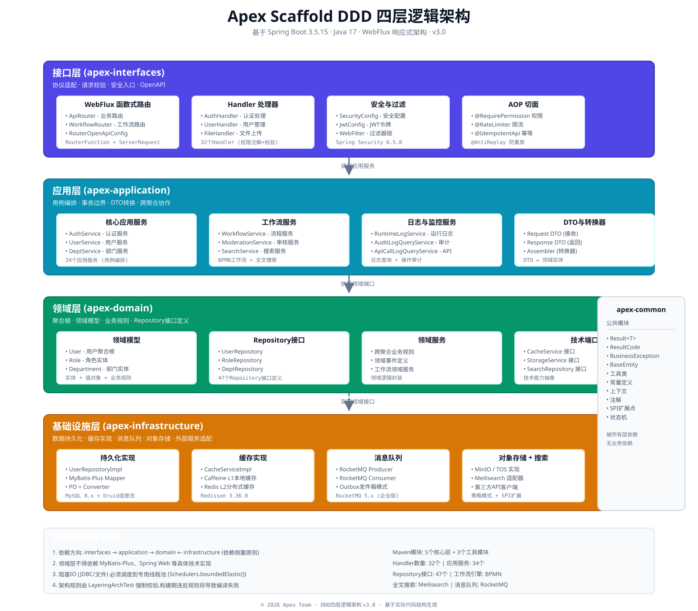
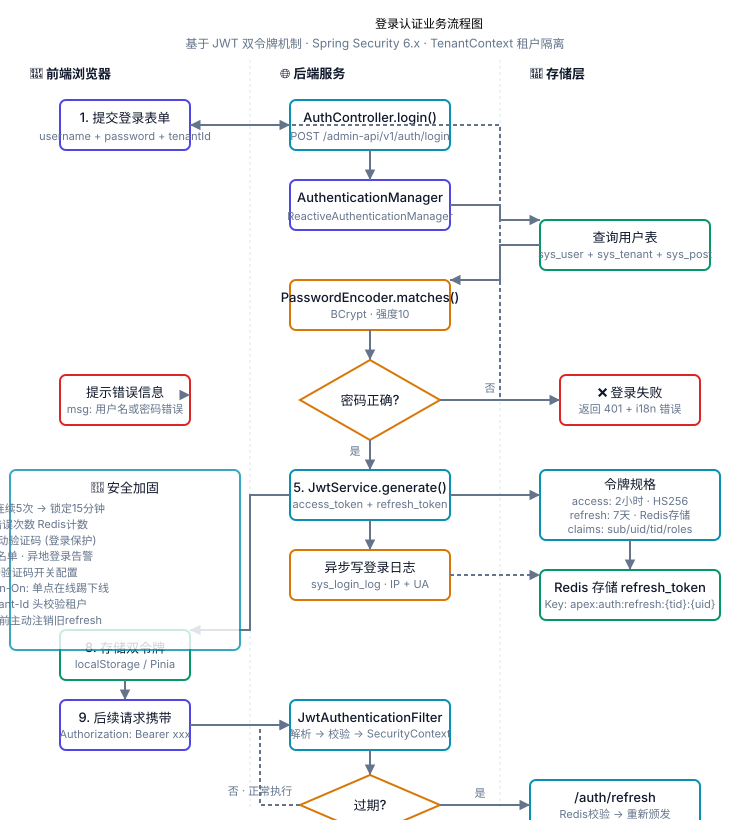
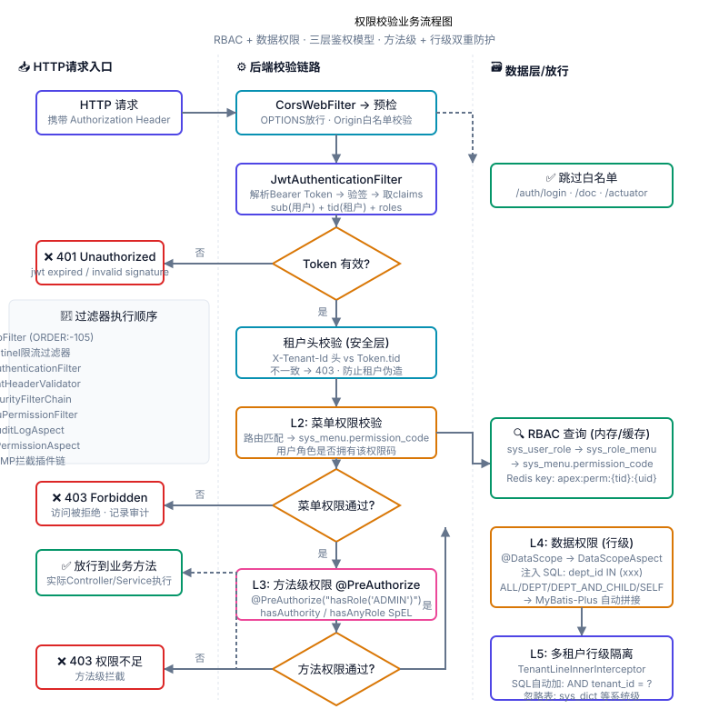
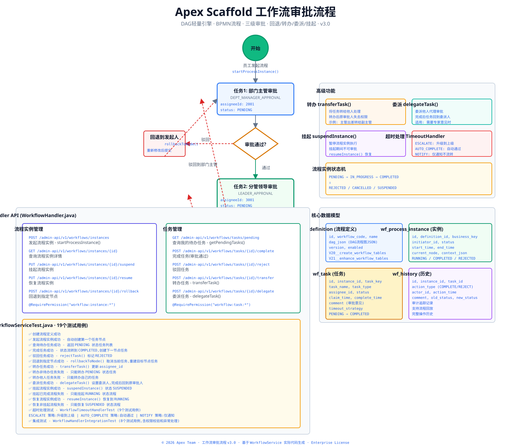
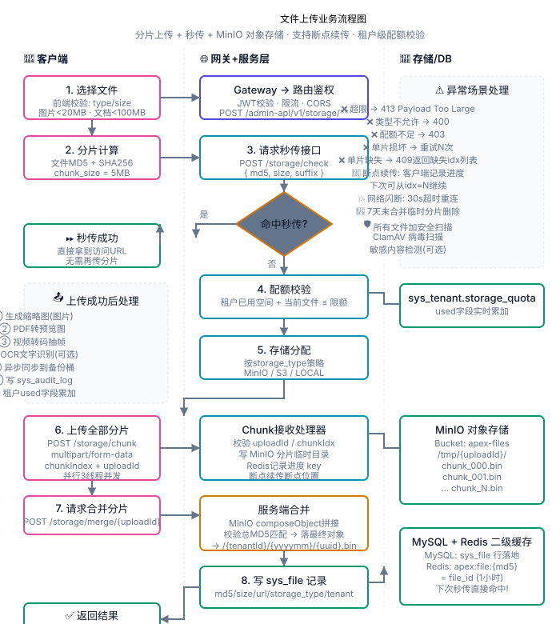
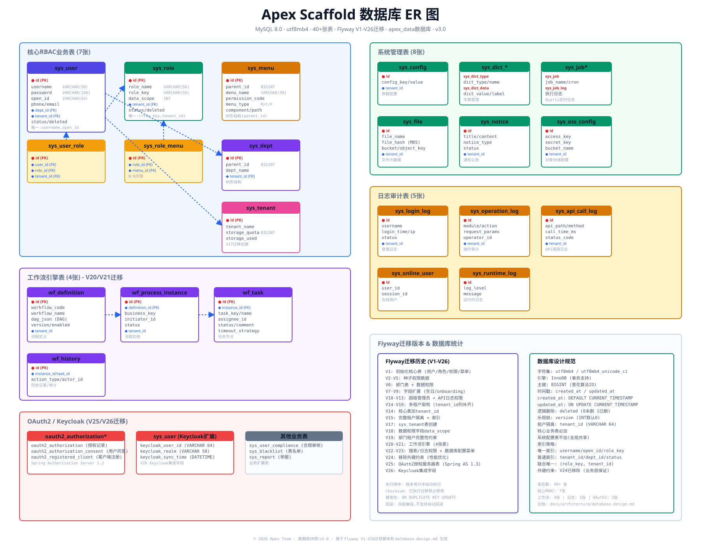
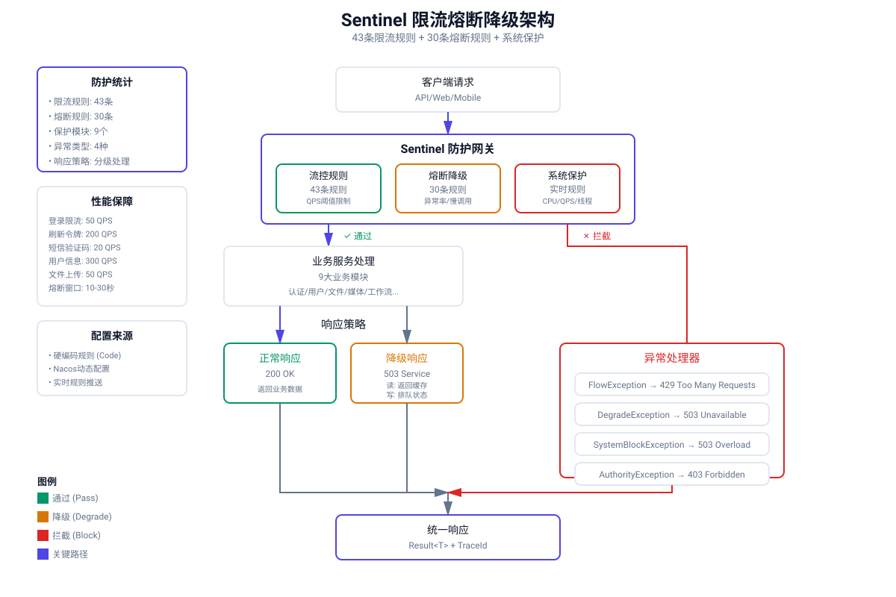
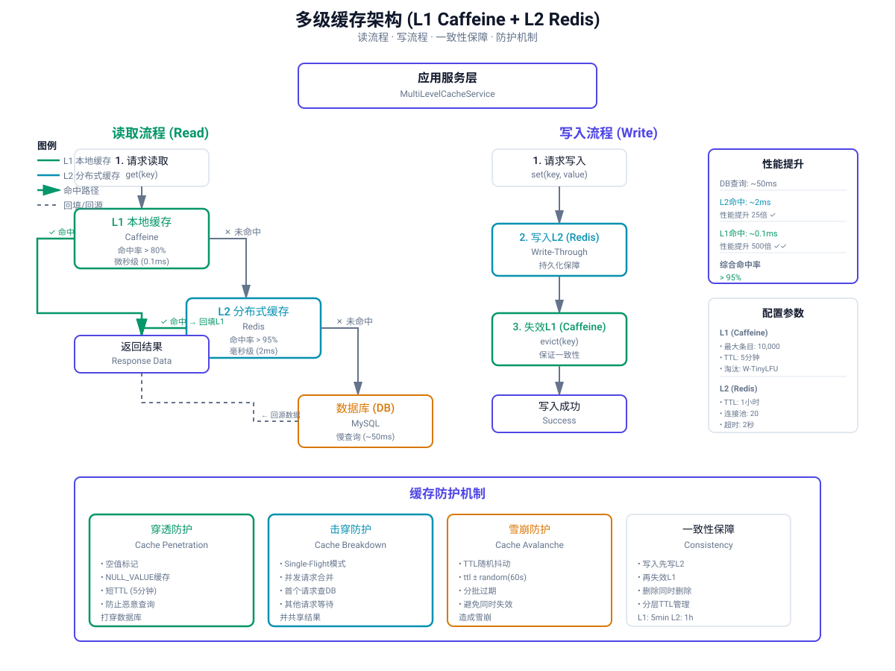
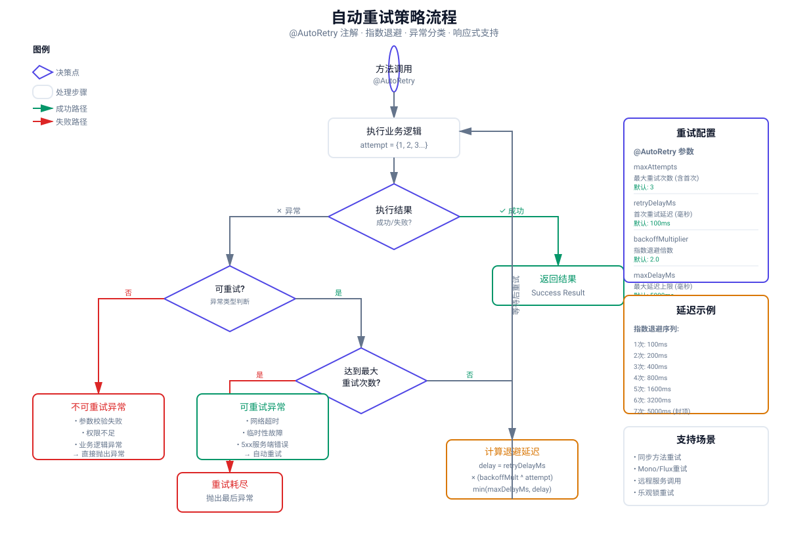
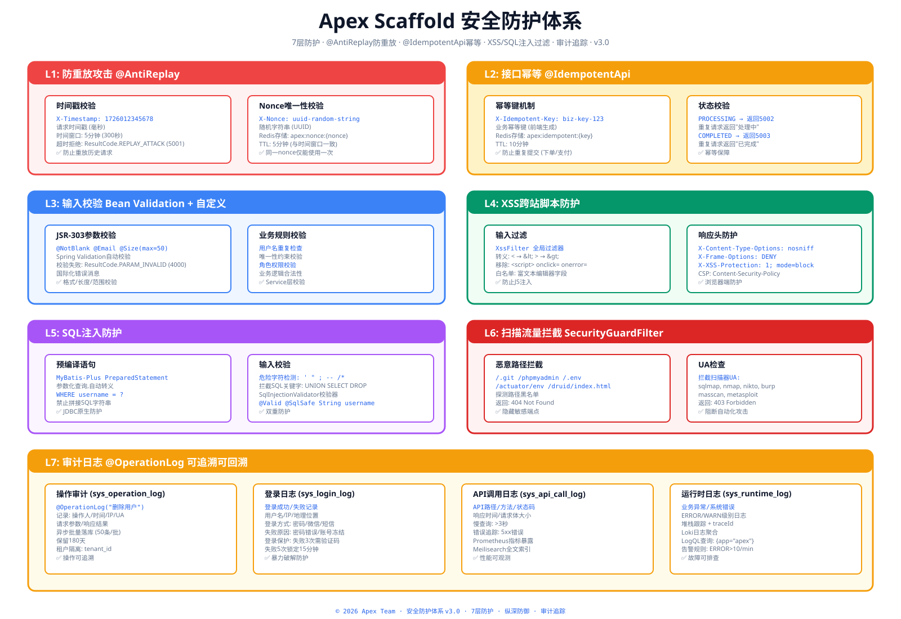

# 📚 Apex Scaffold 文档中心

欢迎来到 Apex Scaffold 文档中心！这里汇集了系统架构、运维部署、API 接口、前端开发等全方位的技术文档。

***

## 🏗️ 架构设计

深入了解系统的架构设计、数据模型和业务流程。

### 核心文档

| 文档                                              | 描述                          | 配套图表                                                                                                                                                                               |
| ----------------------------------------------- | --------------------------- | ---------------------------------------------------------------------------------------------------------------------------------------------------------------------------------- |
| [系统架构设计](./architecture/system-architecture.md) | DDD 四层架构、微服务拆分、技术选型全景       | [逻辑架构](diagrams/01_logical_architecture.svg) · [物理架构](diagrams/02_physical_architecture.svg) · [技术架构](diagrams/03_technical_architecture.svg)                                      |
| [数据库设计](./architecture/database-design.md)      | 43 张表完整设计、E-R 图、Flyway 迁移管理 | [E-R 关系图](diagrams/08_database_er_diagram.svg)                                                                                                                                     |
| [业务流程](./architecture/business-flows.md)        | 登录认证、权限校验、工作流、文件上传流程        | [登录流程](diagrams/04_login_auth_flow.svg) · [权限流程](diagrams/05_permission_check_flow.svg) · [工作流](diagrams/06_workflow_approval_flow.svg) · [文件上传](diagrams/07_file_upload_flow.svg) |

### 扩展阅读

- [架构演进历程](./ARCHITECTURE_EVOLUTION.md) - 从单体到微服务的演进路线

- [架构使用指南](./ARCHITECTURE_USAGE_GUIDE.md) - DDD 实践与分层设计原则

- [架构文档](./architecture.md) - 技术架构详解

***

## ⚙️ 运维部署

生产环境部署、监控告警、配置管理的完整指南。

### 部署文档

| 文档                                             | 描述                                      | 适用场景 |
| ---------------------------------------------- | --------------------------------------- | ---- |
| [部署运维文档](./operations/deployment.md)           | 单机 / Docker Compose / Kubernetes 三种部署方式 | 生产部署 |
| [部署检查清单](./operations/deployment-checklist.md) | 部署前检查项、验证步骤                             | 上线检查 |
| [快速开始指南](./QUICK_START.md)                     | 5 分钟快速启动项目                              | 本地开发 |
| [部署指南](./DEPLOYMENT.md)                        | 详细部署步骤与配置                               | 环境搭建 |

### 监控与配置

| 文档                                         | 描述           | 核心内容                      |
| ------------------------------------------ | ------------ | ------------------------- |
| [Grafana 监控面板](./operations/monitoring.md) | 66 个专业监控面板配置 | JVM / Sentinel / 网关 / 熔断器 |
| [配置文件检查](./operations/configuration.md)    | 8 套环境配置验证报告  | 开发 / 测试 / 预发 / 生产         |
| [配置管理](./CONFIGURATION.md)                 | 配置项详解与最佳实践   | 环境变量 / Nacos / Apollo     |

### 故障排查

- [故障排查指南](./TROUBLESHOOTING.md) - 常见问题与解决方案

- [性能报告](./sales/PERFORMANCE_REPORT.md) - 性能测试与优化建议

***

## 🔗 API 与集成

前后端接口对接、API 版本管理、第三方集成。

### API 文档

| 文档                                      | 描述               | 接口数量   |
| --------------------------------------- | ---------------- | ------ |
| [前后端 API 路由对比](./api/route-mapping.md)  | 前后端接口对齐验证清单      | 56 个接口 |
| [API 规范](./sales/API_SPECIFICATION.md)  | RESTful API 设计规范 | -      |
| [API 版本管理](./API_VERSION_MANAGEMENT.md) | 接口版本控制策略         | -      |

### 在线 API 文档

启动项目后访问：

- **Swagger UI**: <http://localhost:8080/swagger-ui.html>

- **Knife4j UI**: <http://localhost:8080/doc.html>

- **OpenAPI JSON**: <http://localhost:8080/v3/api-docs>

***

## 🖥️ 前端开发

Vue 3 前端项目的开发指南、路由配置和迁移说明。

### 前端文档

| 文档                                      | 描述               | 技术栈                           |
| --------------------------------------- | ---------------- | ----------------------------- |
| [前端迁移指南](./frontend/migration-guide.md) | Vue 3 前端项目迁移完整指南 | Vue 3.5 + Vite 6 + TypeScript |
| [路由配置与启动](./frontend/routing-guide.md)  | 前端路由配置、开发服务器启动   | Vue Router 4                  |

### 前端项目

前端代码位于独立仓库：`apex-admin-web`

- 基于 Vue 3.5 + Vite 6 + TypeScript + Element Plus

- Pinia 状态管理 + Axios HTTP 客户端

- 完整的权限控制、动态路由、主题切换

***

## 💼 商业化与增强

商业版本特性、增强方案、销售资料。

### 商业文档

| 文档                                                   | 描述                                 | 目标用户 |
| ---------------------------------------------------- | ---------------------------------- | ---- |
| [商业化增强方案](./commercial/enhancement-proposal.md)      | 后端脚手架商业化售卖增强方案                     | 产品团队 |
| [商业版本对比](./COMMERCIAL_VERSIONS.md)                   | Basic / Standard / Enterprise 版本对比 | 采购决策 |
| [许可证管理](./LICENSE_MANAGEMENT.md)                     | 许可证激活、验证、续费                        | 客户支持 |
| [商业化差距分析](./COMMERCIAL_GAP_ANALYSIS.md)              | 当前脚手架与商业化标准的差距分析                   | 产品规划 |
| [商业化优化方案](./COMMERCIAL_OPTIMIZATION_PROPOSAL.md)     | 商业化优化建议与实施路线图                      | 产品经理 |
| [商业化重构计划](./COMMERCIAL_REFACTORING_PLAN.md)          | 商业化代码重构与架构优化计划                     | 技术团队 |
| [商业化就绪度评审](./COMMERCIAL_READINESS_REVIEW_2026-08.md) | 2026-08 商业化准备情况评估报告                | 管理层  |
| [商业化改进任务](./COMMERCIAL_IMPROVEMENT_TASKS.md)         | 商业化功能改进任务清单                        | 开发团队 |

### 销售资料

- [交付清单](./sales/DELIVERY_CHECKLIST.md) - 项目交付检查清单

- [安全白皮书](./sales/SECURITY_WHITEPAPER.md) - 安全防护能力说明

- [性能报告](./sales/PERFORMANCE_REPORT.md) - 性能测试报告

- [API 规范](./sales/API_SPECIFICATION.md) - RESTful API 设计规范

***

## 🎓 开发指南

编码规范、最佳实践、代码生成工具使用。

### 核心指南

| 分类         | 文档                                     | 说明            |
| ---------- | -------------------------------------- | ------------- |
| **系统管理**   | [P0 系统管理](./P0_SYSTEM_MANAGEMENT.md)   | 用户、角色、菜单、部门管理 |
| **数据权限**   | [数据权限使用](./DATA_SCOPE_USAGE.md)        | 5 层数据权限控制     |
| **数据权限**   | [数据权限详解](./DATA_SCOPE.md)              | 数据权限实现原理与源码分析 |
| **数据源切换**  | [数据源切换](./DATA_SOURCE_SWITCH_USAGE.md) | 多数据源动态切换      |
| **审计日志**   | [审计日志使用](./AUDIT_LOG_USAGE.md)         | 操作日志记录与审计追踪   |
| **工作流**    | [工作流指南](./WORKFLOW_GUIDE.md)           | BPMN 2.0 流程引擎 |
| **工作流设计器** | [工作流设计器](./WORKFLOW_DESIGNER_GUIDE.md) | 可视化流程设计       |
| **工作流监控**  | [工作流监控](./WORKFLOW_MONITOR_GUIDE.md)   | 流程实例监控        |
| **消息中间件**  | [消息中间件](./MESSAGE_MIDDLEWARE.md)       | RocketMQ 集成   |
| **SPI 插件** | [SPI 插件开发](./SPI_PLUGIN_GUIDE.md)      | 插件化扩展机制       |
| **代码生成**   | [代码生成器](./CODEGEN.md)                  | 自动生成 CRUD 代码  |
| **示例代码**   | [示例指南](./EXAMPLE_GUIDE.md)             | 快速上手示例        |
| **示例汇总**   | [示例总结](./EXAMPLES_SUMMARY.md)          | 所有代码示例索引与说明   |
| **高级特性**   | [高级特性](./ADVANCED_FEATURES.md)         | 高级功能使用指南      |

### 代码规范

| 文档                                                      | 描述                                  | 技术栈                            |
| ------------------------------------------------------- | ----------------------------------- | ------------------------------ |
| [后端开发规范](./standards/backend-development-standards.md)  | DDD 架构、响应式编程、数据访问、API 设计、安全与测试      | Java 17 + Spring WebFlux + DDD |
| [前端开发规范](./standards/frontend-development-standards.md) | Vue 组件、TypeScript、Pinia、路由、权限、样式与构建 | Vue 3 + Vite + TypeScript      |
| [Javadoc 规范](./JAVADOC_GUIDE.md)                        | Java 文档注释规范                         | -                              |
| [Lombok 使用指南](./LOMBOK_GUIDE.md)                        | Lombok 注解最佳实践                       | -                              |
| [最佳实践](./BEST_PRACTICES.md)                             | 编码最佳实践                              | -                              |

### 性能与安全

- [JMH 性能测试](./JMH_BENCHMARK_GUIDE.md) - 微基准测试指南

- [安全防护](./SECURITY_PROTECTIONS.md) - XSS / CSRF / SQL 注入防护

- [读降级指南](./READ_DEGRADATION_GUIDE.md) - 高并发读降级策略

- [分布式舱壁](./DISTRIBUTED_BULKHEAD_GUIDE.md) - 故障隔离模式

***

## 🖼️ 可视化图表

所有架构图和流程图一览，点击缩略图可查看高清 SVG 矢量版。

### 架构图（3 张）

|                                              图表预览                                              | 图表名称与说明                                |                                              下载链接                                             |
| :--------------------------------------------------------------------------------------------: | -------------------------------------- | :-------------------------------------------------------------------------------------------: |
|     | **DDD 四层逻辑架构图**接口层 / 应用层 / 领域层 / 基础设施层 |   [SVG](diagrams/01_logical_architecture.svg) · [PNG](diagrams/01_logical_architecture.svg)   |
|    | **网络物理部署架构图**负载均衡 / 服务集群 / 数据库 / 缓存    |  [SVG](diagrams/02_physical_architecture.svg) · [PNG](diagrams/02_physical_architecture.svg)  |
|  | **全栈技术选型全景图**前后端技术栈 / 中间件 / 监控 / 部署    | [SVG](diagrams/03_technical_architecture.svg) · [PNG](diagrams/03_technical_architecture.svg) |

### 业务流程图（4 张）

|                                              图表预览                                              | 图表名称与说明                               |                                              下载链接                                             |
| :--------------------------------------------------------------------------------------------: | ------------------------------------- | :-------------------------------------------------------------------------------------------: |
|               | **JWT 登录认证流程图**双令牌机制 / 刷新令牌 / 单点登录    |        [SVG](diagrams/04_login_auth_flow.svg) · [PNG](diagrams/04_login_auth_flow.svg)        |
|  | **RBAC 权限校验流程图**5 层数据权限 / 角色继承 / 权限缓存 |  [SVG](diagrams/05_permission_check_flow.svg) · [PNG](diagrams/05_permission_check_flow.svg)  |
|   | **三级审批工作流图**BPMN 引擎 / 条件分支 / 并行审批     | [SVG](diagrams/06_workflow_approval_flow.svg) · [PNG](diagrams/06_workflow_approval_flow.svg) |
|              | **文件分片上传流程图**秒传 / 断点续传 / MinIO 存储     |       [SVG](diagrams/07_file_upload_flow.svg) · [PNG](diagrams/07_file_upload_flow.svg)       |

### 数据模型（1 张）

|                                           图表预览                                           | 图表名称与说明                           |                                           下载链接                                          |
| :--------------------------------------------------------------------------------------: | --------------------------------- | :-------------------------------------------------------------------------------------: |
|  | **核心表数据库关系图**24 张核心表 crow-foot 关系 | [SVG](diagrams/08_database_er_diagram.svg) · [PNG](diagrams/08_database_er_diagram.svg) |

### 高级主题图（4 张）

|                                                             图表预览                                                            | 图表名称与说明                                         | 配套文档                                                                            |                             下载                             |
| :-------------------------------------------------------------------------------------------------------------------------: | ----------------------------------------------- | ------------------------------------------------------------------------------- | :--------------------------------------------------------: |
|  | **Sentinel 限流熔断降级架构**43条限流规则 + 30条熔断规则 + 系统保护   | [架构文档](./architecture/advanced-features/sentinel-rate-limit-circuit-breaker.md) | [SVG](diagrams/09_sentinel_rate_limit_circuit_breaker.svg) |
|                    | **多级缓存架构**L1 Caffeine + L2 Redis / 读写流程 / 一致性保障 | [架构文档](./architecture/advanced-features/multi-level-cache-architecture.md)      |    [SVG](diagrams/10_multi_level_cache_architecture.svg)   |
|                                | **自动重试策略流程**@AutoRetry 注解 / 指数退避 / 响应式支持        | [架构文档](./architecture/advanced-features/auto-retry-strategy.md)                 |       [SVG](diagrams/11_auto_retry_strategy_flow.svg)      |
|                            | **安全防护体系**7层防护 / 幂等防重放 / XSS·SQLi·CSRF 拦截       | [架构文档](./architecture/advanced-features/security-protection-system.md)          |      [SVG](diagrams/12_security_protection_system.svg)     |

> **💡 使用提示**：
>
> - 点击缩略图查看 **SVG 矢量版**（自适应浅色/深色主题，可无限缩放不失真）
>
> - PNG 图片为 150dpi 高清位图（2000-2500px 宽），适合下载用于 PPT 演示文稿
>
> - 如图片显示异常，请刷新浏览器缓存或直接访问图片文件
>
> - **高级主题图**配有详细的架构文档，点击「配套文档」链接查看技术细节

***

## 📋 历史报告

项目演进过程中的重要报告和变更记录。

### 2026年报告

- [文档迁移完成报告](./reports/2026-09-03-documentation-migration.md) (2026-09-03)

- [图表显示问题修复](./reports/2026-09-03-diagram-fix.md) (2026-09-03)

- [v1.3.0 商业化增强](./reports/2026-08-xx-v1.3.0-commercial.md)

### 实施报告

- [任务完成总结](./reports/task-completion-summary.md)

- [执行总结报告](./reports/execution-summary.md)

- [交付总结](./reports/delivery-summary.md)

### 技术报告

- [Flyway 问题修复说明](./reports/flyway-fix-notes.md)

- [工作流实现方案](./reports/workflow-implementation.md)

- [工作流进度报告](./reports/workflow-progress.md)

- [工作流监控完成报告](./reports/workflow-monitor-complete.md)

- [Lombok 改造计划](./reports/lombok-refactoring-plan.md)

- [系统优化计划](./reports/system-optimization-plan.md)

- [重构完成报告](./REFACTORING_COMPLETION_REPORT.md)

- [脚手架增强评审](./SCAFFOLD_ENHANCEMENT_REVIEW.md)

- [脚手架评审指南](./SCAFFOLD_REVIEW_GUIDE.md)

- [Phase2 修复示例](./PHASE2_FIX_EXAMPLES.md)

- [业务功能增强需求](./BUSINESS_CODE_FUNCTION_ENHANCEMENT_REQUIREMENTS.md)

### 前端报告

- [前端创建报告](./reports/frontend-creation-report.md)

- [前端代码文件清单](./reports/frontend-code-files.md)

### 变更记录

- [并发修复总结](./changes/concurrency-fix-summary.md)

### 版本发布

- [Release v1.0.0](./RELEASE_v1.0.0.md) - v1.0.0 版本发布说明

### 超能力计划

- [缓存高负载增强](./superpowers/plans/2026-08-30-cache-high-load-enhancement.md) - 缓存性能优化方案

- [MQ 重试配置加固](./superpowers/plans/2026-08-30-mq-retry-configuration-hardening.md) - 消息队列重试机制优化

***

## 🚀 快速导航

### 新手入门

1. [快速开始](./QUICK_START.md) - 5 分钟启动项目
2. [系统架构](./architecture/system-architecture.md) - 理解系统设计
3. [示例代码](./EXAMPLE_GUIDE.md) - 参考示例快速上手

### 开发任务

- **添加新功能**: [代码生成器](./CODEGEN.md) → [最佳实践](./BEST_PRACTICES.md)

- **接口对接**: [API 路由对比](./api/route-mapping.md) → [Swagger UI](http://localhost:8080/swagger-ui.html)

- **权限控制**: [数据权限使用](./DATA_SCOPE_USAGE.md) → [RBAC 流程图](diagrams/05_permission_check_flow.svg)

- **工作流开发**: [工作流指南](./WORKFLOW_GUIDE.md) → [工作流设计器](./WORKFLOW_DESIGNER_GUIDE.md)

### 部署上线

1. [部署检查清单](./operations/deployment-checklist.md) - 上线前检查
2. [部署运维文档](./operations/deployment.md) - 部署步骤
3. [监控面板配置](./operations/monitoring.md) - Grafana 监控
4. [故障排查](./TROUBLESHOOTING.md) - 问题定位

***

## 🔍 文档搜索

**按功能查找**：

- 架构设计 → [architecture/](./architecture/)

- 运维部署 → [operations/](./operations/)

- API 接口 → [api/](./api/)

- 前端开发 → [frontend/](./frontend/)

- 商业化 → [commercial/](./commercial/)

**按文档类型查找**：

- 使用指南 → `*_USAGE.md` / `*_GUIDE.md`

- 技术规范 → `*_SPECIFICATION.md`

- 问题排查 → `TROUBLESHOOTING.md`

- 最佳实践 → `BEST_PRACTICES.md`

**按受众查找**：

- 开发人员 → 开发指南、代码规范

- 运维人员 → 部署文档、监控配置

- 架构师 → 架构设计、技术选型

- 产品经理 → 商业文档、销售资料

***

## 📖 相关资源

### 在线文档

- **主 README**: [../README.md](../README.md) - 项目首页

- **更新日志**: [../CHANGELOG.md](../CHANGELOG.md) - 版本发布记录

- **贡献指南**: [../CONTRIBUTING.md](../CONTRIBUTING.md) - 如何贡献代码

- **行为准则**: [../CODE\_OF\_CONDUCT.md](../CODE_OF_CONDUCT.md) - 社区行为准则

### 外部链接

- **GitHub 仓库**: <https://github.com/your-org/apex-scaffold>

- **问题反馈**: <https://github.com/your-org/apex-scaffold/issues>

- **Wiki**: <https://github.com/your-org/apex-scaffold/wiki>

- **官方网站**: <https://apex-scaffold.example.com>

***

## 💬 反馈与支持

### 遇到问题？

1. 查阅 [故障排查指南](./TROUBLESHOOTING.md)
2. 搜索 [GitHub Issues](https://github.com/your-org/apex-scaffold/issues)
3. 提交新的 [Issue](https://github.com/your-org/apex-scaffold/issues/new)

### 文档改进

发现文档错误或有改进建议？欢迎：

- 提交 [Pull Request](https://github.com/your-org/apex-scaffold/pulls)

- 发送邮件至：<docs@apex-scaffold.example.com>

***

**📚 Apex Scaffold 文档中心** | 让技术文档触手可及

最后更新：2026-09-03 | [返回项目首页](../README.md)

