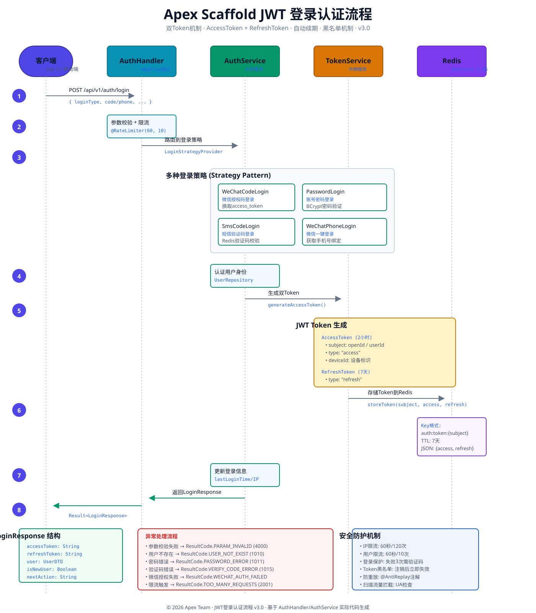
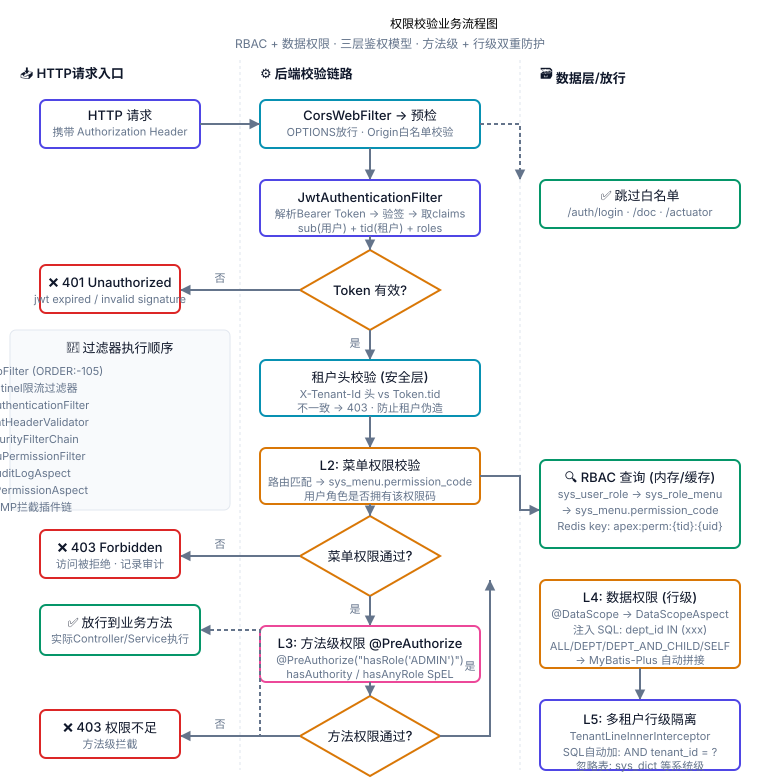
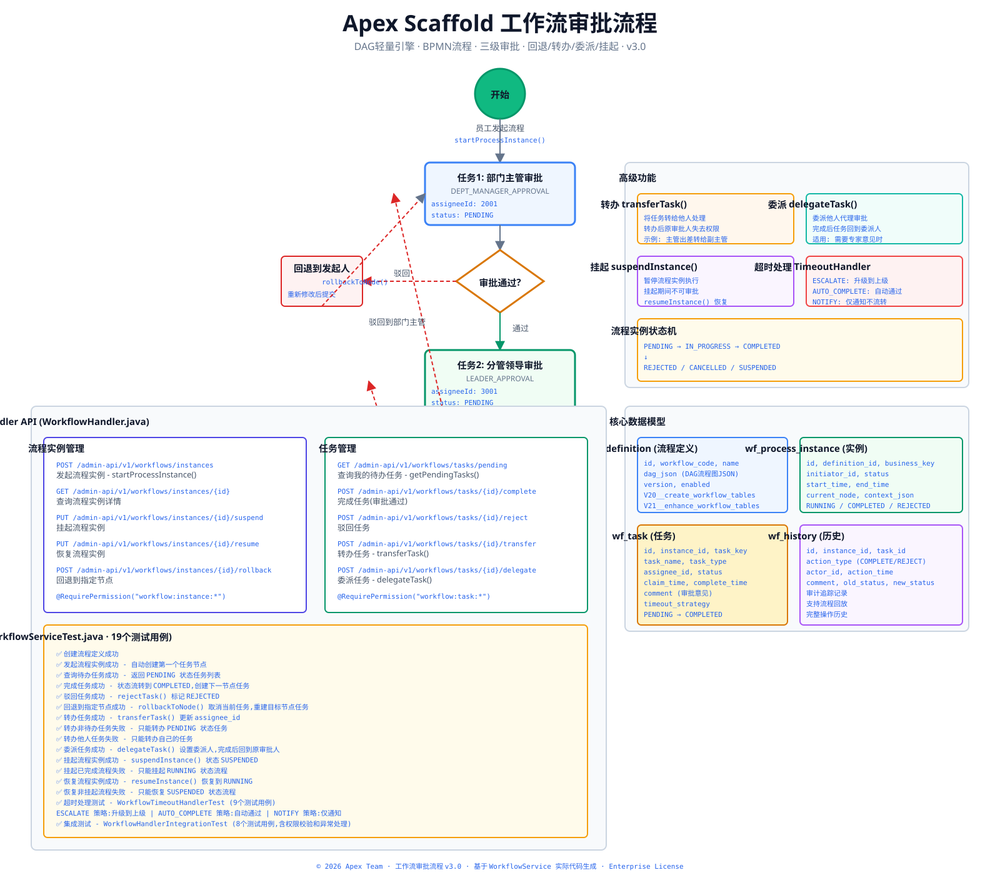
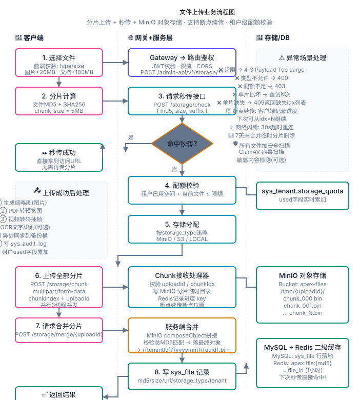
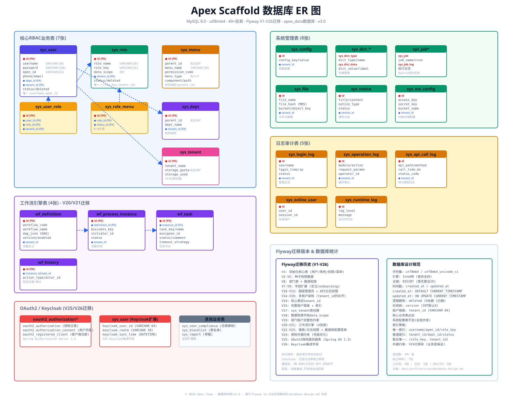
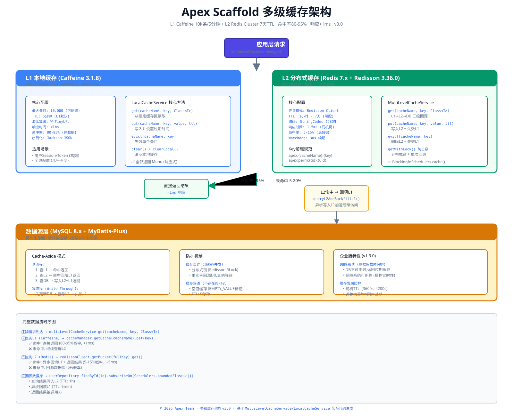
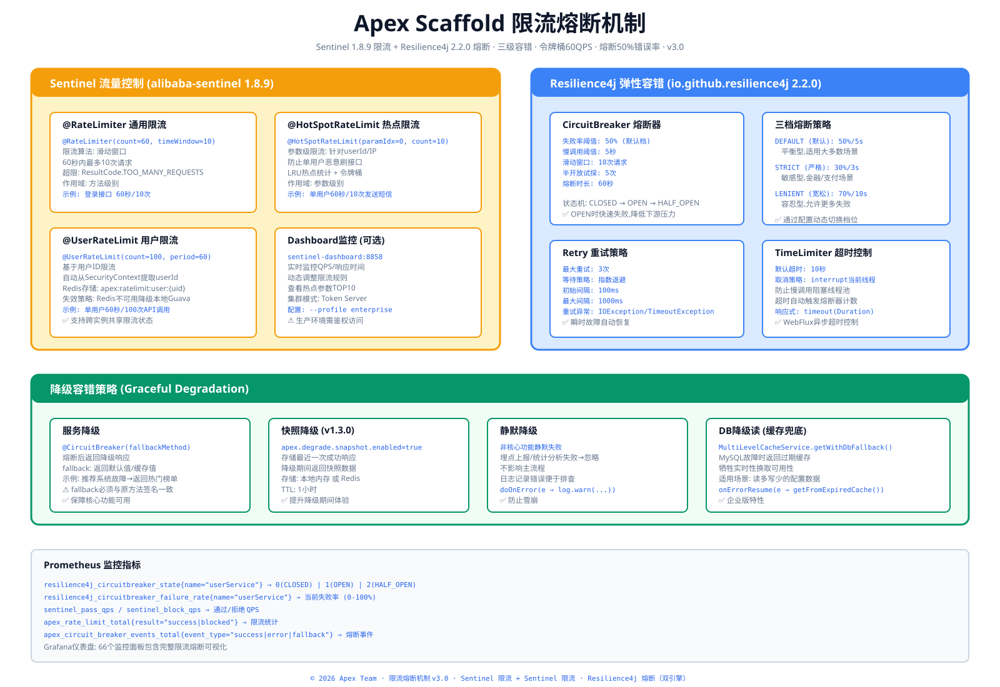
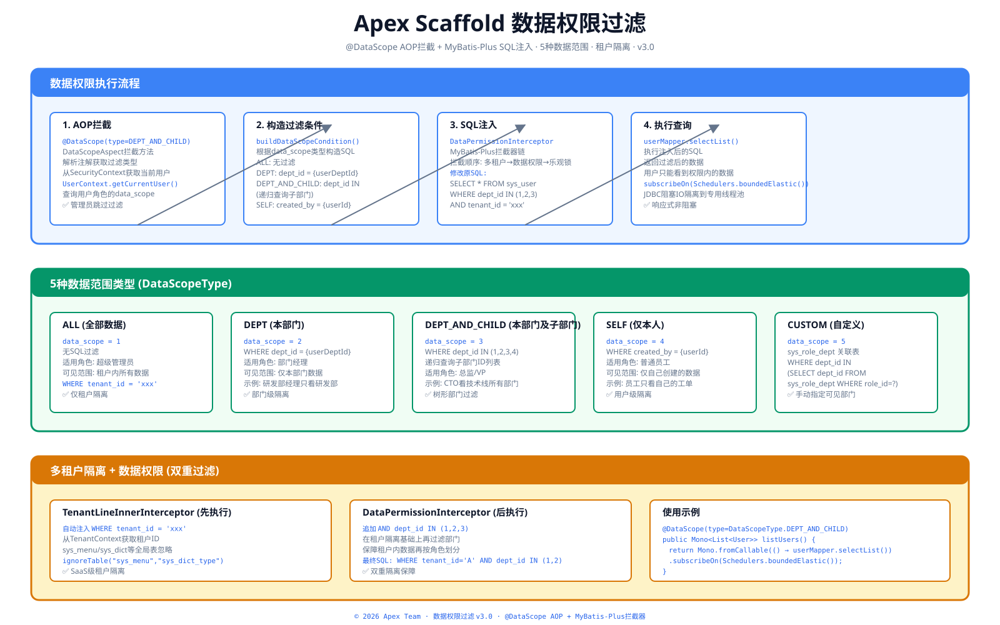
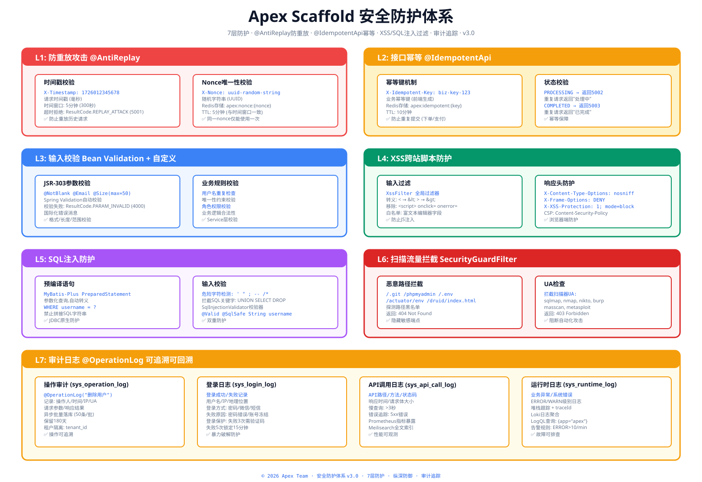

<!--
# 使用说明
本文件可以使用以下工具转换为PPT:
1. Marp: https://marp.app/
2. reveal.js: https://revealjs.com/
3. VS Code + Marp扩展

命令行导出:
marp --pdf 培训课件-Markdown版.md
marp --pptx 培训课件-Markdown版.md
-->

<style>
section {
  font-family: -apple-system, BlinkMacSystemFont, "Segoe UI", "PingFang SC", "Hiragino Sans GB", "Microsoft YaHei", sans-serif;
}
section.title-slide {
  background: linear-gradient(135deg, #667eea 0%, #764ba2 100%);
  color: #fff;
  text-align: center;
  display: flex;
  flex-direction: column;
  justify-content: center;
}
section.content-slide {
  background: #ffffff;
  color: #1d1d1f;
}
h1 { font-size: 3.5em; font-weight: 700; margin-bottom: 0.5em; }
h2 { color: #667eea; font-size: 2em; margin-bottom: 0.8em; }
h3 { color: #764ba2; font-size: 1.5em; }
</style>

---

<!-- _class: title-slide -->

# Apex Scaffold
## 架构图表新人培训

### 快速理解项目架构 · 掌握核心技术栈 · 提升开发效率

📅 2026-09-10 | ⏱️ 培训时长: 2小时 | 👥 架构团队

---

<!-- _class: content-slide -->

## 🎯 培训目标

✅ **理解 DDD 四层架构设计**
掌握接口层、应用层、领域层、基础设施层的职责划分及依赖规则

✅ **掌握前后端技术栈选型及版本**
熟悉60+技术组件: Spring Boot 3.5.15, Vue 3.5.13等关键版本

✅ **了解生产环境部署拓扑和运维流程**
理解Docker/Kubernetes部署架构、监控体系及故障排查

✅ **熟悉核心业务流程实现**
掌握JWT认证、RBAC权限、工作流引擎、文件上传等关键流程

✅ **学会快速查找架构文档**
知道在哪里查找特定技术问题的架构图表和配套文档

---

<!-- _class: content-slide -->

## 📚 学习路径总览

| 阶段 | 时长 | 主题 | 内容 |
|------|------|------|------|
| **第1阶段** | 30分钟 | 架构基础 | DDD四层、技术栈、部署拓扑 |
| **第2阶段** | 30分钟 | 核心业务流程 | JWT、RBAC、工作流、文件上传 |
| **第3阶段** | 30分钟 | 基础设施与安全 | 数据库、缓存、限流、权限、安全 |
| **实践任务** | 30分钟 | 动手实践 | 环境搭建、创建接口、查看监控 |

**学习策略**: 按照4个阶段循序渐进,每个阶段包含必读图表、重点关注内容、实践建议和自测题

---

<!-- _class: title-slide -->

# 第1阶段
## 架构基础 (30分钟)

建立整体认知 · 理解项目分层设计

---

<!-- _class: content-slide -->

## DDD 四层逻辑架构


**关键数据**:
- 接口层: **32个Handler** (路由+请求响应)
- 应用层: **34个Service** (用例编排+事务)
- 领域层: **47个Repository接口** (领域模型)
- 基础设施层: PO/Mapper/RepositoryImpl

**依赖方向**: 只能从上往下/从外向内 ⚠️

---

<!-- _class: content-slide -->

## 全栈技术选型全景


**关键版本** (60+技术组件):
- **前端**: Vue 3.5.13 + Vite 6 + TypeScript 5
- **后端**: Spring Boot 3.5.15 + WebFlux + MyBatis-Plus
- **中间件**: MySQL 8.0 + Redis 7.4 + RocketMQ 5.3
- **监控**: Prometheus + Grafana(66个面板) + Loki + Zipkin

💡 **实践**: 打开 `pom.xml` 和 `package.json`,对照图表确认版本号

---

<!-- _class: content-slide -->

## 网络物理部署架构


**5层网络拓扑**:
客户端层 → DMZ安全层 → 应用服务层 → 数据存储层 → 监控可观测层

**端口配置**: 8080(业务) | 8081(管理)
**Profile**: basic(开发) | standard(标准) | enterprise(企业)

💡 **实践**: `docker compose up -d` 启动本地开发环境

---

<!-- _class: content-slide -->

## 第1阶段自测题 ✅

**请检查你是否能够**:

❓ 能画出DDD四层架构及依赖方向吗?

❓ 能说出Spring Boot和Vue的版本号吗?

❓ 知道本地开发环境如何一键启动吗?

---

<!-- _class: title-slide -->

# 第2阶段
## 核心业务流程 (30分钟)

理解关键业务逻辑的实现流程

---

<!-- _class: content-slide -->

## JWT 登录认证流程



**双Token机制**:
- **Access Token**: 2小时有效期
- **Refresh Token**: 7天有效期
- **自动续期**: 剩余时间<30分钟触发刷新

**安全防护**: IP限流 | 登录保护 | 防重放(时间戳+Nonce)

💡 **实践**: Postman测试 `POST /api/v1/auth/login` 接口

---

<!-- _class: content-slide -->

## RBAC 权限校验流程



**三层权限模型**:
1. JWT认证(Token验证)
2. RBAC校验(`@RequirePermission`)
3. 数据权限(`@DataScope`)

**数据模型**: 5张表 (user/role/menu/user_role/role_menu)
**缓存策略**: Caffeine L1(60秒TTL) + Redis L2

💡 **实践**: 查看 `sys_menu` 表的 `perms` 字段,理解权限点命名规范

---

<!-- _class: content-slide -->

## 三级审批工作流



**审批流程**: 发起请假 → 部门主管 → 分管领导 → 总经理 → 完成

**高级功能**: 回退 | 转办 | 委派 | 挂起 | 超时处理

**数据模型**: 4张表 (flow_definition/instance/task/history)

💡 **实践**: 管理后台创建请假流程,体验完整审批流程

---

<!-- _class: content-slide -->

## 文件分片上传流程



**关键技术**:
- **5MB分片策略**: 并发上传,提升速度
- **MD5秒传机制**: 文件哈希对比,秒传大文件
- **断点续传**: Redis记录已上传分片
- **MinIO对象存储**: 可切换TOS/Local

💡 **实践**: 上传100MB文件,观察浏览器Network面板的分片请求

---

<!-- _class: content-slide -->

## 第2阶段自测题 ✅

**请检查你是否能够**:

❓ 能说出Access Token和Refresh Token的有效期吗?

❓ 知道权限点命名规范(如`system:user:list`)吗?

❓ 理解工作流的回退和转办的区别吗?

---

<!-- _class: title-slide -->

# 第3阶段
## 基础设施与安全 (30分钟)

理解数据访问、缓存、安全防护机制

---

<!-- _class: content-slide -->

## 数据库 ER 图



**关键信息**:
- **40+张表**: RBAC(7张) | 系统管理(8张) | 日志审计(5张) | 工作流(4张)
- **Flyway迁移**: V1-V26完整迁移历史
- **设计规范**: UTF8MB4字符集 | 租户隔离(`tenant_id`) | 复合索引

---

<!-- _class: content-slide -->

## 多级缓存架构



**两级缓存**:
- **L1 Caffeine**: 10k条 | 5分钟TTL | 微秒级响应
- **L2 Redis**: 7天TTL | 1-5ms响应 | 跨实例共享

**防护机制**: 防击穿(分布式锁) | 防穿透(空值缓存) | 防雪崩(随机TTL)
**命中率**: 80-95% (正常值)

---

<!-- _class: content-slide -->

## 限流熔断机制



**Sentinel流量控制**:
- `@RateLimiter`: 通用限流
- `@HotSpotRateLimit`: 热点参数限流
- `@UserRateLimit`: 用户维度限流

**Resilience4j弹性容错**:
- 熔断器: 三档策略(默认/严格/宽松)
- 重试: 指数退避
- 超时: TimeLimiter控制

---

<!-- _class: content-slide -->

## 数据权限过滤



**5种数据范围**:
ALL(全部) | DEPT(本部门) | DEPT_AND_CHILD(本部门及子部门) | SELF(仅本人) | CUSTOM(自定义)

**实现机制**: `@DataScope` AOP拦截 + MyBatis-Plus SQL动态注入

💡 **实践**: 用不同角色登录,查看用户列表的数据范围差异

---

<!-- _class: content-slide -->

## 安全防护体系



**7层防护**:
1. `@AntiReplay` 防重放攻击(时间戳+Nonce)
2. `@IdempotentApi` 接口幂等(幂等键机制)
3. 输入校验(JSR-303 + 业务规则)
4. XSS防护(输入过滤 + 响应头)
5. SQL注入防护(预编译语句 + 输入校验)
6. 扫描流量拦截(恶意路径 + UA检查)
7. 审计日志(操作/登录/API/运行时)

---

<!-- _class: title-slide -->

# 实践任务
## 动手实践 (30分钟)

环境搭建 · 创建接口 · 查看监控

---

<!-- _class: content-slide -->

## 实践任务1: 本地环境搭建 (15分钟)

```bash
# 1. 启动 Docker Compose
docker compose up -d

# 2. 等待服务启动(约1分钟)
docker compose ps

# 3. 访问服务
open http://localhost:8080/doc.html      # Swagger文档
open http://localhost:3000               # Grafana监控(admin/admin)
open http://localhost:9411               # Zipkin链路追踪

# 4. 测试登录接口
curl -X POST http://localhost:8080/api/v1/auth/login \
  -H "Content-Type: application/json" \
  -d '{"username":"admin","password":"admin123"}'
```

---

<!-- _class: content-slide -->

## 实践任务2: 创建第一个接口 (30分钟)

**按照DDD四层架构创建 `GET /api/v1/products/{id}` 接口**:

1. **领域层** (`apex-domain`): 定义 `Product` 实体和 `ProductRepository` 接口
2. **基础设施层** (`apex-infrastructure`): 实现 `ProductPO`/`ProductMapper`/`ProductRepositoryImpl`
3. **应用层** (`apex-application`): 实现 `ProductService`
4. **接口层** (`apex-interfaces`): 实现 `ProductHandler` + 注册路由

**快捷方式**: 使用代码生成器
```bash
./scripts/codegen/generate.sh -i examples/product.json
```

---

<!-- _class: content-slide -->

## 实践任务3: 查看监控大盘 (10分钟)

**访问 Grafana**: http://localhost:3000 (admin/admin)

**查看关键指标**:
1. **Apex Scaffold - 应用概览** 面板
2. QPS (每秒请求数)
3. 响应时间 P99 (99分位数)
4. 错误率 (异常请求百分比)
5. 缓存命中率 (80-95%正常)

**制造慢请求**: 观察"慢请求Top10"面板

---

<!-- _class: content-slide -->

## 培训考核清单 ✅

**通过以下6项考核即可完成新人培训**:

- [ ] 能独立启动本地开发环境
- [ ] 能按照DDD四层架构创建一个CRUD接口
- [ ] 能在Grafana中查看监控指标
- [ ] 能解释JWT双Token机制和自动续期流程
- [ ] 能说出项目使用的核心技术栈及版本号
- [ ] 能找到特定技术问题对应的架构图表

---

<!-- _class: content-slide -->

## 学习资源与获取帮助 📖

**架构文档**:
- 📊 [ARCHITECTURE_INDEX.md](../../../02-architecture/architecture-index.md) - 架构文档索引
- 📈 [diagrams/README.md](../../../diagrams/README.md) - SVG图表使用指南
- 📝 [development-standards.md](../../../04-development/development-standards.md) - 后端开发规范

**获取帮助**:
- 💬 企业微信 **Apex 开发群**
- 🔍 [FAQ.md](../../../01-guides/troubleshooting.md) - 常见问题
- 👥 提交PR后 **@架构团队** 进行Code Review

---

<!-- _class: title-slide -->

# 恭喜完成培训! 🎉

## 现在你已具备独立开发能力

欢迎加入 Apex Scaffold 团队
开启高效开发之旅

---

© 2026 Apex Team · 帮助新人快速融入团队,理解项目架构
