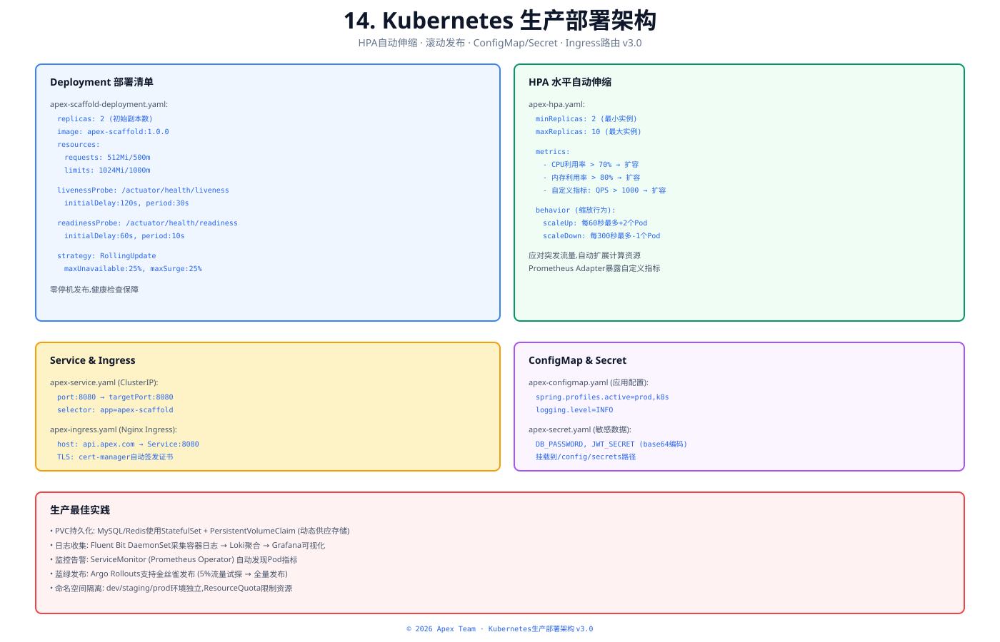
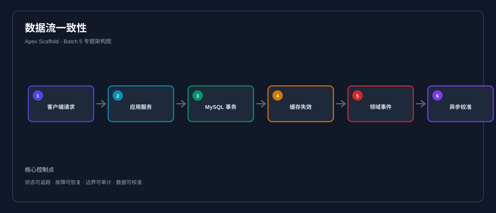
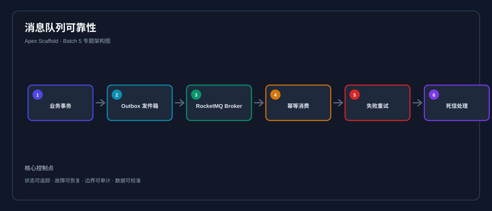
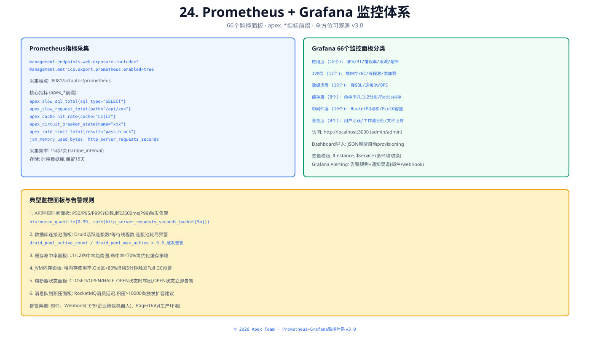
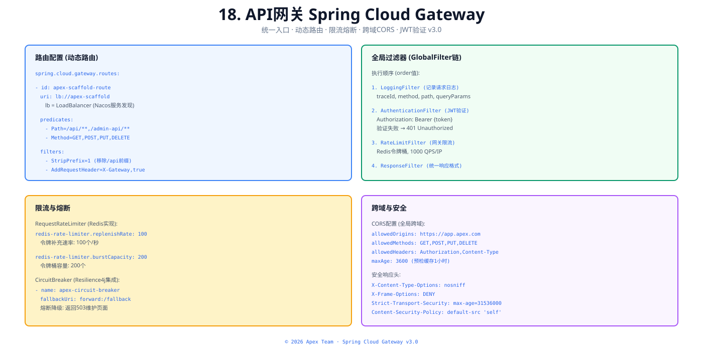

# SVG 图表显示测试

> 归档件：链接已重定向至 `docs/diagrams/` 下的在役同号图表。

本文件用于测试SVG图表在markdown中的显示效果。

---

## 14. 网络架构图

---

## 15. 数据流转架构图

---

## 16. RocketMQ消息队列架构图

---

## 17. 监控体系架构图

---

## 18. 微服务治理架构图

---

## 测试说明

如果上述图表无法显示，可能的原因：

1. **Markdown查看器不支持SVG** - 某些markdown查看器不支持直接嵌入SVG
2. **相对路径问题** - 确保图片路径正确
3. **浏览器缓存** - 清除浏览器缓存后重试
4. **文件编码问题** - 确保SVG文件使用UTF-8编码

### 解决方案

1. 使用支持SVG的markdown查看器（如VS Code、Typora、GitHub）
2. 或者在浏览器中直接打开 [test_svg.html](test_svg.html) 查看
3. 或者直接在浏览器中打开SVG文件查看

### 文件信息

- 所有SVG文件已添加XML声明 `<?xml version="1.0" encoding="UTF-8"?>`
- 所有emoji字符已替换为纯文本标签（如 [Globe]、[Users] 等）
- 文件编码: UTF-8
- 文件格式: SVG 1.1
