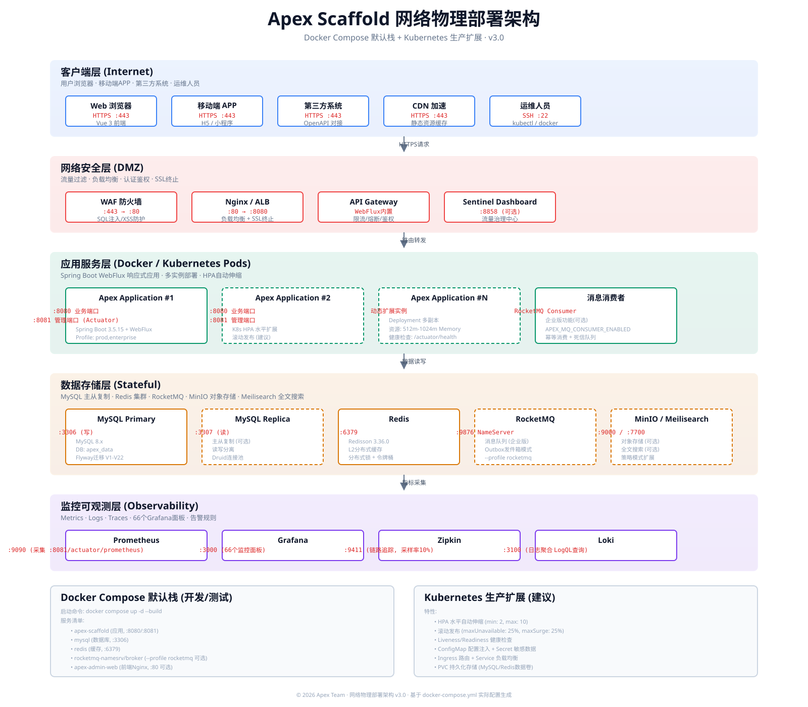

# 02 网络物理部署架构 - 架构决策记录 (ADR)

> 文档版本: v1.0  
> 创建时间: 2026-09-04  
> 适用版本: apex-scaffold v1.2.0

## 架构图



---

## ADR-002: 采用五层网络拓扑架构

**状态**: ✅ 已采纳  
**决策日期**: 2024-Q4  
**决策人**: 架构团队

### 背景

系统需要清晰的网络层次划分,既要保证安全隔离,又要便于运维管理和监控。

### 决策

采用五层网络拓扑架构:
1. 客户端层 (Internet)
2. 网络安全层 (DMZ)
3. 应用服务层 (K8s Pods / Docker)
4. 数据存储层 (高可用集群)
5. 运维监控层 (可观测性)

### 理由

**优势**:
- **职责清晰**: 每层职责单一,便于团队分工
- **安全隔离**: DMZ 隔离外网与内网,数据层不对外暴露
- **易于扩展**: 每层可独立扩展,不影响其他层
- **监控独立**: 运维监控层独立部署,不占用业务资源

**取舍**:
- 放弃了"应用与数据混部"以降低延迟的可能性
- 选择了"清晰隔离"以换取安全性和可维护性

### 后果

- ✅ 安全性提升: DMZ 隔离、数据层内网隔离
- ✅ 运维效率提升: 监控独立部署,不影响业务
- ⚠️ 网络跳数增加: 客户端到数据库需经过 4 跳

### 验证方式

- 网络延迟测试: 端到端 P99 < 200ms
- 安全扫描: 数据层端口不对外暴露
- 监控独立性: 应用宕机不影响监控系统运行

---

## ADR-003: Docker Compose 作为默认本地栈

**状态**: ✅ 已采纳  
**决策日期**: 2024-Q4  
**决策人**: 架构团队

### 背景

开发和测试环境需要快速启动完整基础设施栈,降低环境搭建成本。

### 决策

采用 Docker Compose 作为默认本地开发和测试栈:
- `docker-compose.infra.yml`: 基础设施 (MySQL/Redis/RocketMQ/Nacos/Meilisearch/监控栈)
- `docker-compose.yml`: 应用服务

### 理由

**优势**:
- **一键启动**: `docker-compose up -d` 启动完整环境
- **环境一致**: 所有开发者使用相同镜像版本
- **资源友好**: 单机运行,无需 K8s 集群
- **快速迭代**: 修改配置后快速重启验证

**取舍**:
- 放弃了"完全模拟生产环境"(无真正高可用)
- 选择了"开发效率优先",生产环境另行设计

### 后果

- ✅ 开发效率提升: 新人 5 分钟启动完整环境
- ✅ 环境一致性: 避免"我电脑能跑"问题
- ⚠️ 与生产环境差异: Compose 单实例 vs K8s 多实例
- ⚠️ 无法测试高可用: 无法模拟主从切换、故障转移

### 验证方式

- 新人入职测试: 30 分钟内完成环境搭建并运行测试
- 环境一致性测试: 所有开发者本地测试通过率 > 95%

### 迁移路径

当需要测试生产级能力时,改用 K8s 测试环境:
```bash
# 本地开发
docker-compose up -d

# 集成测试
kubectl apply -f k8s/test/

# 生产部署
kubectl apply -f k8s/prod/
```

---

## ADR-004: Kubernetes 作为生产部署平台

**状态**: ✅ 已采纳 (建议)  
**决策日期**: 2024-Q4  
**决策人**: 架构团队

### 背景

生产环境需要支持多实例部署、自动伸缩、滚动发布、故障自愈等云原生能力。

### 决策

推荐使用 Kubernetes 作为生产部署平台,但不强制:
- **推荐场景**: 需要高可用、自动伸缩、多环境管理
- **可选场景**: 小规模部署可继续使用 Docker Compose + Nginx

### 理由

**Kubernetes 优势**:
- ✅ 自动伸缩 (HPA): 根据 CPU/内存/QPS 自动调整实例数
- ✅ 滚动发布: 零停机发布,自动回滚
- ✅ 故障自愈: Pod 异常自动重启,Node 故障自动迁移
- ✅ 配置管理: ConfigMap/Secret 集中管理配置
- ✅ 服务发现: Service/Ingress 自动负载均衡

**Compose 优势**:
- ✅ 简单易用: 无需学习 K8s 概念
- ✅ 资源占用低: 无需 K8s 控制平面
- ✅ 单机足够: 小流量场景无需多实例

**取舍**:
- 放弃了"统一运行时"(开发用 Compose,生产用 K8s)
- 选择了"环境适配性",按需选择部署方式

### 后果

- ✅ 灵活性提升: 小团队可用 Compose,大团队用 K8s
- ⚠️ 学习成本: 需要掌握 K8s 运维技能
- ⚠️ 环境差异: 需要保证 Compose 与 K8s 行为一致性

### 验证方式

- 压测验证: K8s HPA 能在 1 分钟内完成扩容
- 发布验证: 滚动发布过程中无 5xx 错误
- 故障演练: Pod 删除后 30 秒内自动恢复

### K8s 最低要求

- 集群版本: >= 1.24
- 节点规格: 2C4G * 3 节点 (最小高可用配置)
- 网络插件: Calico / Flannel / Cilium
- 存储类: 云盘 / Ceph / NFS
- Ingress: Nginx Ingress Controller

---

## ADR-005: 应用端口与管理端口分离

**状态**: ✅ 已采纳  
**决策日期**: 2024-Q4  
**决策人**: 架构团队

### 背景

生产环境需要保护管理端点 (`/actuator/*`),防止外部访问泄露系统信息。

### 决策

采用端口分离策略:
- **业务端口**: `8080` (对外暴露)
- **管理端口**: `8081` (仅内网/K8s Service 访问)

配置:
```yaml
server:
  port: 8080

management:
  server:
    port: 8081
    address: 127.0.0.1  # Compose 默认本地绑定
    # address: 0.0.0.0  # K8s 改为允许 Service 访问
```

### 理由

**优势**:
- ✅ 安全隔离: 管理端点不对外暴露,防止信息泄露
- ✅ 监控独立: Prometheus 通过内网抓取 `/actuator/prometheus`
- ✅ 性能隔离: 管理端点流量不影响业务流量

**取舍**:
- 放弃了"单端口简化配置"
- 选择了"安全优先",管理端口独立

### 后果

- ✅ 安全性提升: 外部无法访问 `/actuator/env`、`/actuator/heapdump`
- ✅ 监控稳定: Prometheus 抓取不受外部限流影响
- ⚠️ 配置复杂度增加: 需要在 K8s Service 中暴露两个端口

### 验证方式

- 安全扫描: 外部无法访问 `http://public-ip:8080/actuator/env`
- 内网可访问: `curl http://localhost:8081/actuator/prometheus` 正常返回

### K8s 配置示例

```yaml
apiVersion: v1
kind: Service
metadata:
  name: apex-application
spec:
  ports:
  - name: http
    port: 80
    targetPort: 8080  # 业务端口
  - name: management
    port: 8081
    targetPort: 8081  # 管理端口 (仅供 Prometheus 抓取)
  clusterIP: None  # Headless Service
```

---

## ADR-006: 能力分级标注策略

**状态**: ✅ 已采纳  
**决策日期**: 2026-09  
**决策人**: 架构团队

### 背景

架构图和文档中需要明确区分"已实现"、"默认启用"、"可选启用"、"建议能力",避免将未验证能力描述为既定事实。

### 决策

采用三级标注策略:

| 标识 | 含义 | 示例 |
|------|------|------|
| ✅ **默认启用** | Compose 默认启动 | MySQL 8.0, Redis, Meilisearch |
| 🔧 **可选启用** | 需修改配置启用 | RocketMQ 消费者, Nacos 服务发现 |
| 🚀 **建议拓扑** | 需环境验证 | K8s 多实例, HPA, MySQL 主从 |

### 理由

**优势**:
- ✅ 事实准确: 不将未验证能力写成既定事实
- ✅ 用户明确: 清楚知道哪些能力需要额外配置
- ✅ 避免误导: 不夸大系统已有能力

**取舍**:
- 放弃了"统一描述所有能力"的简洁性
- 选择了"准确性优先",明确能力边界

### 后果

- ✅ 文档可信度提升: 用户按文档操作不会遇到"写了但不能用"的问题
- ✅ 架构扩展清晰: 明确哪些是当前已有,哪些是未来规划
- ⚠️ 描述复杂度增加: 需要在图表和文档中多处标注

### 验证方式

- 文档审查: 所有"默认启用"能力在 Compose 中实际启动
- 配置验证: 所有"可选启用"能力有明确的启用步骤
- 用户反馈: 新用户按文档操作成功率 > 95%

---

## ADR-007: 监控系统独立部署

**状态**: ✅ 已采纳  
**决策日期**: 2024-Q4  
**决策人**: 架构团队

### 背景

监控系统需要在应用故障时仍能正常运行,以便及时发现和定位问题。

### 决策

监控系统 (Prometheus/Grafana/Loki/Zipkin) 作为独立的"运维监控层"部署:
- Compose: 独立的 `docker-compose.infra.yml` 服务组
- K8s: 独立的 Namespace `monitoring`

### 理由

**优势**:
- ✅ 故障隔离: 应用宕机不影响监控系统
- ✅ 资源隔离: 监控系统资源独立,不与应用竞争
- ✅ 权限隔离: 监控系统权限独立管理

**取舍**:
- 放弃了"应用与监控混部"降低延迟的可能性
- 选择了"可靠性优先",监控独立部署

### 后果

- ✅ 监控可靠性提升: 应用全部宕机时监控仍可查询历史数据
- ✅ 故障定位效率提升: 通过监控数据快速定位问题
- ⚠️ 资源占用增加: 监控系统需要独立资源

### 验证方式

- 故障演练: 应用全部 Pod 删除,监控系统仍正常运行
- 历史数据查询: 应用宕机期间的监控数据完整保留

### K8s 独立部署示例

```yaml
# monitoring namespace
apiVersion: v1
kind: Namespace
metadata:
  name: monitoring

---
# Prometheus Deployment
apiVersion: apps/v1
kind: Deployment
metadata:
  name: prometheus
  namespace: monitoring
spec:
  replicas: 1
  template:
    spec:
      containers:
      - name: prometheus
        image: prom/prometheus:v2.53.0
        resources:
          requests:
            memory: "2Gi"
            cpu: "500m"
```

---

## ADR-008: 数据库高可用交由外部实现

**状态**: ✅ 已采纳  
**决策日期**: 2024-Q4  
**决策人**: 架构团队

### 背景

生产环境需要数据库高可用,但自建数据库集群运维成本高。

### 决策

Compose 提供 MySQL 8.0 单实例,生产环境推荐使用:
1. **云数据库**: 云厂商 RDS (阿里云/腾讯云/AWS)
2. **自建集群**: MySQL MGR / Galera Cluster
3. **主从复制**: 1 主 2 从 + Sentinel / ProxySQL

应用层通过 Dynamic Datasource 支持读写分离:
```yaml
spring:
  datasource:
    dynamic:
      primary: master
      datasource:
        master:
          url: jdbc:mysql://db-master:3306/apex_data
        slave:
          url: jdbc:mysql://db-slave:3306/apex_data
```

### 理由

**优势**:
- ✅ 降低维护成本: 数据库高可用由专业团队负责
- ✅ 灵活选择: 根据预算和规模选择合适方案
- ✅ 应用解耦: 应用层不关心数据库拓扑

**取舍**:
- 放弃了"应用内置数据库高可用"(如 Vitess)
- 选择了"外部依赖",简化应用复杂度

### 后果

- ✅ 应用简化: 无需在应用内实现数据库故障转移
- ✅ 成本可控: 小规模单实例,大规模云数据库
- ⚠️ 外部依赖: 需要团队具备数据库运维能力或云服务预算

### 验证方式

- 主从切换测试: 主库宕机后,应用自动切换到从库
- 读写分离测试: 读请求路由到从库,写请求路由到主库

---

## 重新评估条件

以下情况需要重新评估部署架构:

### 触发条件

1. **并发量超预期**:
   - 日活用户 > 100 万
   - QPS > 10,000
   - 需要真实压测验证

2. **数据量增长**:
   - 数据库容量 > 500 GB
   - 需要分库分表

3. **团队扩大**:
   - 开发团队 > 20 人
   - 需要微服务拆分和独立部署

4. **多地域部署**:
   - 需要多区域容灾
   - 需要跨地域数据同步

5. **安全合规要求**:
   - 需要等保三级认证
   - 需要数据加密和审计

### 重新评估内容

- **是否拆分微服务**: 当前模块化单体是否仍满足需求
- **是否需要服务网格**: Istio / Linkerd
- **是否需要多活架构**: 跨地域部署
- **是否需要自建 K8s**: 当前云厂商 K8s 是否满足需求

---

## 相关文档

- **详细说明**: [02 网络物理部署架构 - 详细说明](02-physical-architecture-detail.md)
- **快速参考**: [02 网络物理部署架构 - 快速参考](02-physical-architecture-quick-ref.md)
- **商业价值**: [02 网络物理部署架构 - 商业价值](02-physical-architecture-business-value.md)
- **逻辑架构决策**: [01 DDD 四层逻辑架构 - 架构决策](01-logical-architecture-decision.md)

---

**下一步**: 阅读 [商业价值文档](02-physical-architecture-business-value.md) 了解部署架构的业务价值。
