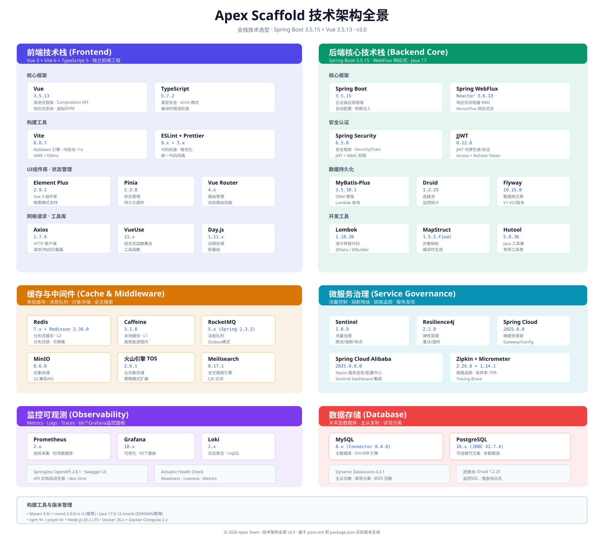

# 03 技术架构全景图 - 快速参考

> 文档版本: v1.1  
> 最后更新: 2026-09-05  
> 适用版本: apex-scaffold v1.2.0+

## 架构图



---

## 技术栈版本速查

### 前端技术栈

| 技术 | 版本 | 命令 |
|------|------|------|
| Vue | 3.5.13 | `npm list vue` |
| TypeScript | 5.7.2 | `tsc --version` |
| Vite | 6.0.7 | `vite --version` |
| Element Plus | 2.9.1 | `npm list element-plus` |
| Pinia | 2.3.0 | `npm list pinia` |
| Axios | 1.7.9 | `npm list axios` |

### 后端技术栈

| 技术 | 版本 | 查看方式 |
|------|------|----------|
| Java | 17 LTS | `java -version` |
| Spring Boot | 3.5.15 | `pom.xml` |
| Spring Security | 6.5.0 | `pom.xml` |
| MyBatis-Plus | 3.5.10.1 | `pom.xml` |
| Druid | 1.2.25 | `pom.xml` |
| Flyway | 10.15.0 | `pom.xml` |

### 基础设施

| 组件 | 版本 | 镜像 |
|------|------|------|
| MySQL | 8.4.0 | `mysql:8.4.0` |
| Redis | 7-alpine | `redis:7-alpine` |
| MinIO | RELEASE.2024-08-17T01-24-54Z | `minio/minio:latest` |
| RocketMQ | 5.3.1 | `apache/rocketmq:5.3.1` |
| Nacos | 2.4.3 | `nacos/nacos-server:v2.4.3` |
| Meilisearch | 1.10 | `getmeili/meilisearch:v1.10` |
| Prometheus | 2.54.1 | `prom/prometheus:v2.54.1` |
| Grafana | 11.2.0 | `grafana/grafana:11.2.0` |
| Grafana Loki | 3.0.0 | `grafana/loki:3.0.0` |
| Grafana Alloy | 1.0.0 | `grafana/alloy:v1.0.0` |
| Zipkin | 2.27.4 | `openzipkin/zipkin:2.27.4` |

---

## 七层架构速查

| 层级 | 核心技术 | 职责 |
|------|----------|------|
| 💻 **前端层** | Vue 3 + TypeScript + Vite | UI 渲染、状态管理、路由 |
| 🌐 **接入层** | Nginx + Sentinel + JWT | 负载均衡、限流熔断、认证 |
| ☕ **后端核心** | Spring Boot + WebFlux + DDD | 业务逻辑、响应式编排 |
| 💾 **数据层** | MySQL + Redis + MinIO + Meilisearch | 持久化、缓存、对象存储、全文搜索 |
| 🐳 **基础设施** | JDK 17 + Docker + K8s | 运行时、容器编排 |
| 🔍 **可观测性** | Prometheus + Grafana + Loki + Alloy | 指标、日志、链路追踪 |

---

## 快速命令

### 前端开发

```bash
# 安装依赖
npm install

# 开发环境
npm run dev  # http://localhost:5173

# 生产构建
npm run build

# 类型检查
npm run type-check

# 代码检查
npm run lint
```

### 后端开发

```bash
# 编译
mvn clean compile

# 运行测试
mvn test

# 打包
mvn clean package -DskipTests

# 运行
java -jar target/*.jar

# 代码格式化
mvn spotless:apply
```

### Docker 部署

```bash
# 启动基础设施
docker-compose -f docker-compose.infra.yml up -d

# 启动应用
docker-compose up -d

# 查看日志
docker-compose logs -f apex-app

# 停止
docker-compose down
```

### Kubernetes 部署

```bash
# 部署应用
kubectl apply -f k8s/

# 查看状态
kubectl get pods -l app=apex-application

# 查看日志
kubectl logs -f deployment/apex-application

# 端口转发
kubectl port-forward svc/apex-application 8080:80
```

---

## 技术能力矩阵

### 前端能力

| 能力 | 技术实现 | 配置位置 |
|------|----------|----------|
| 组件化开发 | Vue 3 Composition API | `<script setup>` |
| 状态管理 | Pinia | `src/stores/` |
| 路由管理 | Vue Router 4 | `src/router/` |
| UI 组件 | Element Plus | 按需导入 |
| HTTP 请求 | Axios | `src/utils/request.ts` |
| 类型检查 | TypeScript strict | `tsconfig.json` |
| 构建优化 | Vite 6 | `vite.config.ts` |

### 后端能力

| 能力 | 技术实现 | 配置位置 |
|------|----------|----------|
| 响应式编程 | WebFlux + Reactor | `Mono`/`Flux` |
| 数据访问 | MyBatis-Plus | `apex-infrastructure/persistence/` |
| 缓存 | Caffeine L1 + Redis L2 | `@Cacheable` |
| 对象存储 | MinIO / 火山云 TOS | `apex-infrastructure/storage/` |
| 消息队列 | RocketMQ (可选) | `APEX_MQ_CONSUMER_ENABLED` |
| 全文检索 | Meilisearch | `MEILISEARCH_ENABLED` |
| 认证鉴权 | Spring Security + JWT | `@RequirePermission` |
| 数据权限 | MyBatis-Plus Interceptor | `@DataPermission` |
| 多租户 | TenantLineInnerInterceptor | `tenant_id` 字段 |
| API 文档 | SpringDoc OpenAPI | `/swagger-ui.html` |

### 可观测性

| 能力 | 技术实现 | 访问地址 |
|------|----------|----------|
| 指标采集 | Micrometer + Prometheus | `http://localhost:8081/actuator/prometheus` |
| 可视化 | Grafana | `http://localhost:3000` (admin/admin) |
| 日志聚合 | Loki + Alloy | Grafana Explore |
| 链路追踪 | Zipkin + Brave | `http://localhost:9411` |
| 健康检查 | Spring Actuator | `http://localhost:8081/actuator/health` |

---

## Maven Profile 速查

| Profile | 包含组件 | 适用场景 |
|---------|----------|----------|
| **basic** | Spring Boot + MySQL + Caffeine | MVP 快速验证 |
| **standard** | basic + Redis + MinIO + Meilisearch + 监控 | 标准生产环境 |
| **enterprise** | standard + RocketMQ + Nacos + Sentinel | 企业级生产 |

**切换 Profile**:
```bash
# 编译时指定
mvn clean package -P enterprise

# 运行时指定
java -jar target/*.jar --spring.profiles.active=prod,enterprise
```

---

## 依赖关系速查

### 前端 → 后端

```
Axios → Spring WebFlux RouterFunction
  ├─ URL: /api/v1/* (业务), /admin-api/v1/* (管理)
  ├─ 认证: Authorization: Bearer <token>
  ├─ 请求: application/json
  └─ 响应: { code, message, data, timestamp, traceId }
```

### 后端 → 数据库

```
MyBatis-Plus → HikariCP → MySQL
  ├─ 连接池: max=20, min=5
  ├─ 读写分离: Dynamic Datasource
  └─ 迁移: Flyway V1-V20
```

### 后端 → 缓存

```
Spring Cache → Caffeine (L1) + Redis (L2)
  ├─ L1: 堆内, < 1ms, max 10000
  ├─ L2: 分布式, < 5ms, TTL 可配
  └─ 策略: Cache-Aside Pattern
```

### 后端 → 监控

```
应用 → Micrometer → Prometheus (Pull)
应用 → Logback → Alloy → Loki (Push)
应用 → Brave → Zipkin (Report)
```

---

## 环境变量速查

### 数据库

```bash
DB_MASTER_URL=jdbc:mysql://mysql:3306/apex_data
DB_USERNAME=root
DB_PASSWORD=your_password
DB_MAX_POOL_SIZE=20
```

### 缓存

```bash
REDIS_HOST=redis
REDIS_PORT=6379
REDIS_PASSWORD=your_password
REDIS_DATABASE=0
```

### 对象存储

```bash
MINIO_ENDPOINT=http://minio:9000
MINIO_ACCESS_KEY=your_access_key
MINIO_SECRET_KEY=your_secret_key
MINIO_BUCKET=apex-files
```

### RocketMQ (可选)

```bash
ROCKETMQ_NAME_SERVER_ADDR=rocketmq-namesrv:9876
APEX_MQ_CONSUMER_ENABLED=false  # 改为 true 启用
```

### 监控

```bash
MEILISEARCH_ENABLED=true
MEILISEARCH_URL=http://meilisearch:7700
LOKI_ENABLED=true
LOKI_URL=http://loki:3100
ZIPKIN_BASE_URL=http://zipkin:9411
```

---

## API 端点速查

### 认证接口

```bash
# 登录
POST /api/v1/auth/login
Body: { "username": "admin", "password": "admin123" }
Response: { "accessToken": "...", "refreshToken": "..." }

# 刷新 Token
POST /api/v1/auth/refresh
Header: Authorization: Bearer <refresh_token>

# 登出
POST /api/v1/auth/logout
Header: Authorization: Bearer <access_token>
```

### 业务接口

```bash
# 查询部门树
GET /api/v1/depts/tree
Header: Authorization: Bearer <access_token>

# 查询用户列表
GET /api/v1/users?page=1&size=10
Header: Authorization: Bearer <access_token>
```

### 管理接口

```bash
# 健康检查
GET /actuator/health

# Prometheus 指标
GET /actuator/prometheus

# API 文档
GET /swagger-ui.html
```

---

## 故障排查速查

### 应用启动失败

```bash
# 1. 查看日志
docker-compose logs apex-app

# 2. 检查健康状态
curl http://localhost:8081/actuator/health

# 3. 检查依赖服务
docker-compose ps
```

### 数据库连接失败

```bash
# 1. 测试连接
docker-compose exec mysql mysql -uroot -p -e "SELECT 1"

# 2. 检查配置
echo $DB_MASTER_URL

# 3. 查看连接池状态
curl http://localhost:8081/actuator/metrics/hikaricp.connections.active
```

### Redis 连接失败

```bash
# 1. 测试连接
docker-compose exec redis redis-cli PING

# 2. 查看连接数
docker-compose exec redis redis-cli CLIENT LIST

# 3. 检查内存
docker-compose exec redis redis-cli INFO memory
```

### 前端构建失败

```bash
# 1. 清理依赖
rm -rf node_modules package-lock.json
npm install

# 2. 清理缓存
npm cache clean --force

# 3. 更新依赖
npm update
```

---

## 性能调优速查

### JVM 参数

```bash
# 开发环境 (2C4G)
JAVA_OPTS="-Xms512m -Xmx1g -XX:+UseG1GC"

# 生产环境 (4C8G)
JAVA_OPTS="-Xms2g -Xmx4g -XX:+UseG1GC -XX:MaxGCPauseMillis=200"

# 大内存环境 (8C16G)
JAVA_OPTS="-Xms4g -Xmx8g -XX:+UseG1GC -XX:MaxGCPauseMillis=100"
```

### 数据库连接池

```yaml
# 推荐配置: CPU * 2 + 磁盘数
hikari:
  maximum-pool-size: 20  # 8 CPU → 20
  minimum-idle: 5
  connection-timeout: 30000
```

### Redis 连接池

```yaml
# 推荐配置: CPU * 2
lettuce:
  pool:
    max-active: 16  # 8 CPU → 16
    max-idle: 8
    min-idle: 4
```

### Netty 线程池

```yaml
# 推荐配置: CPU 核心数
reactor:
  netty:
    ioWorkerCount: 8  # 8 CPU → 8
```

---

## 测试命令速查

### 单元测试

```bash
# 运行所有测试
mvn test

# 运行单个测试类
mvn test -Dtest=UserServiceTest

# 运行单个测试方法
mvn test -Dtest=UserServiceTest#testCreateUser

# 跳过测试
mvn clean package -DskipTests
```

### 集成测试

```bash
# 使用 Testcontainers
mvn verify -P integration-test

# 指定测试环境
mvn verify -Dspring.profiles.active=test
```

### 压力测试

```bash
# 使用 k6
k6 run --vus 100 --duration 30s load-test.js

# 使用 ab
ab -n 10000 -c 100 http://localhost:8080/api/v1/users
```

---

## 监控指标速查

### JVM 指标

```promql
# 堆内存使用
jvm_memory_used_bytes{area="heap"}

# GC 耗时
rate(jvm_gc_pause_seconds_sum[1m])

# 线程数
jvm_threads_live_threads
```

### HTTP 指标

```promql
# QPS
rate(http_server_requests_seconds_count[1m])

# P99 响应时间
histogram_quantile(0.99, rate(http_server_requests_seconds_bucket[1m]))

# 错误率
sum(rate(http_server_requests_seconds_count{status=~"5.."}[1m])) 
/ sum(rate(http_server_requests_seconds_count[1m]))
```

### 数据库指标

```promql
# 活跃连接数
hikaricp_connections_active

# 等待连接数
hikaricp_connections_pending

# 连接超时数
hikaricp_connections_timeout_total
```

---

## 安全检查清单

### 应用层

- [ ] JWT Token 配置正确 (secret key 足够复杂)
- [ ] CORS 白名单配置 (不使用 `*`)
- [ ] 管理端口仅内网访问 (8081 绑定 `127.0.0.1`)
- [ ] 敏感接口需要权限注解 (`@RequirePermission`)

### 数据库层

- [ ] 生产环境使用强密码
- [ ] 数据库不对外暴露 (仅内网访问)
- [ ] 定期备份数据
- [ ] 慢查询日志开启

### 基础设施

- [ ] Docker 镜像使用非 root 用户
- [ ] K8s Security Context 配置正确
- [ ] 密钥使用 Secret 存储 (不写在配置文件)
- [ ] 定期更新依赖版本

---

## 相关文档

- **详细说明**: [03 技术架构全景图 - 详细说明](03-technical-architecture-detail.md)
- **架构决策**: [03 技术架构全景图 - 架构决策](03-technical-architecture-decision.md)
- **商业价值**: [03 技术架构全景图 - 商业价值](03-technical-architecture-business-value.md)
- **逻辑架构**: [01 DDD 四层逻辑架构 - 快速参考](01-logical-architecture-quick-ref.md)
- **部署架构**: [02 网络物理部署架构 - 快速参考](02-physical-architecture-quick-ref.md)

---

**提示**: 本文档为速查手册，详细配置和原理请参考详细说明文档。
