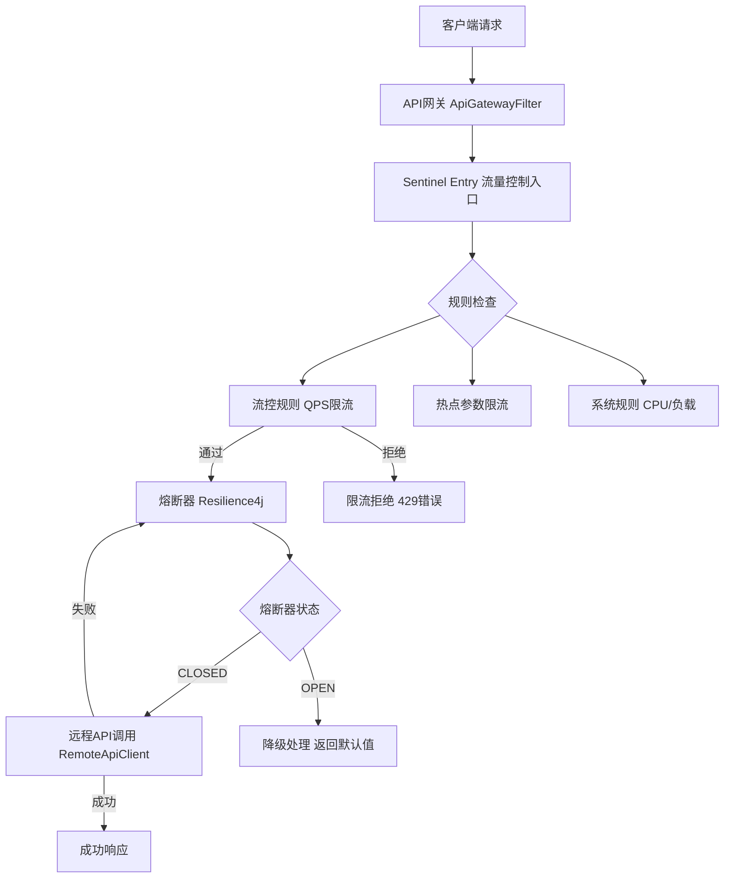
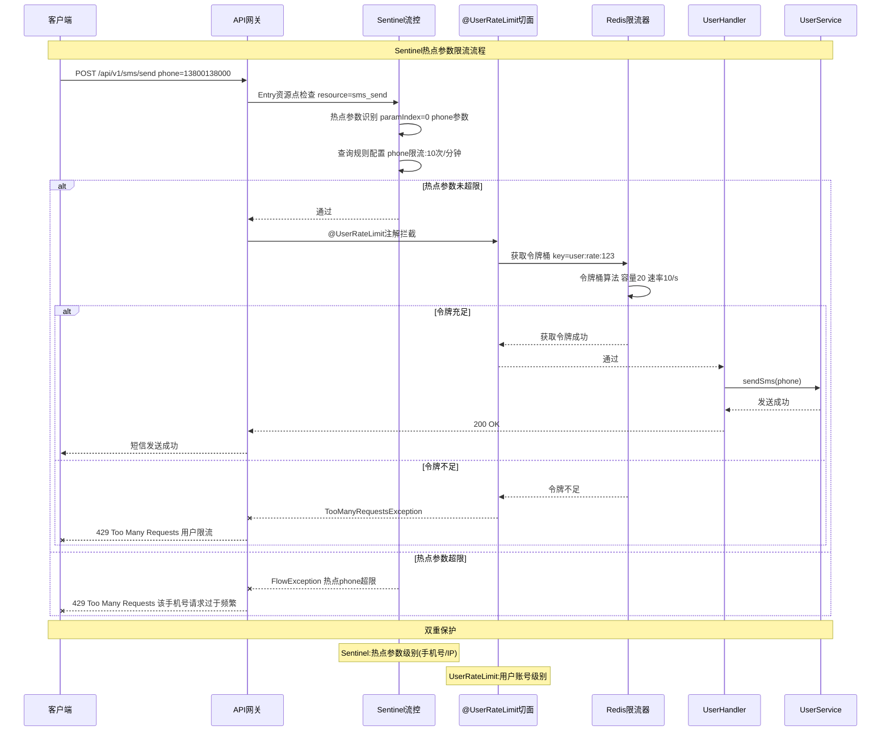
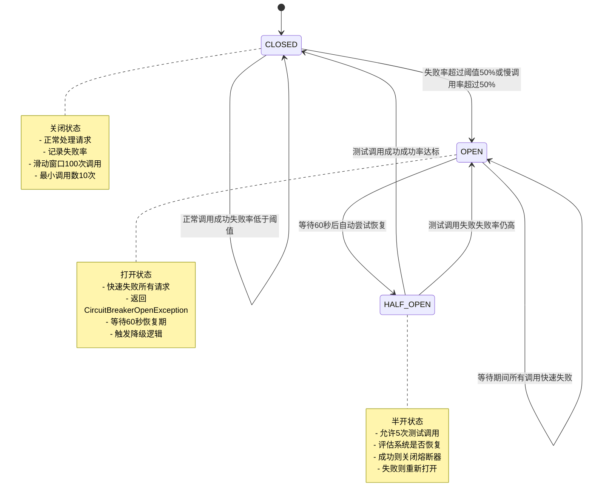

# Sentinel与Resilience4j熔断限流完整技术指南

**版本**: 1.0  
**更新日期**: 2026-09-12  
**适用版本**: Apex Scaffold 1.2.0+  
**作者**: Apex Team

---

## 一、架构概述

### 1.1 双引擎熔断限流架构

Apex Scaffold采用**Sentinel + Resilience4j**双引擎架构,提供多层次的流量治理和故障隔离能力。

**双引擎架构图**:



详细架构源文件: [82_sentinel_circuit_breaker_flow.mmd](../../diagrams/sequence/82_sentinel_circuit_breaker_flow.mmd)

**流程说明**:
1. 客户端请求首先经过API网关
2. Sentinel进行流量规则检查(QPS/热点/系统)
3. 通过Sentinel后,Resilience4j熔断器检查状态
4. 熔断器关闭时正常调用远程API
5. 熔断器打开时快速失败,返回降级响应

> **图表查看提示**: 如果上述Mermaid图表无法显示,请在GitHub/GitLab仓库中直接查看[82_sentinel_circuit_breaker_flow.mmd](../../diagrams/sequence/82_sentinel_circuit_breaker_flow.mmd)文件,或使用[Mermaid Live Editor](https://mermaid.live/)在线查看。详见[图表查看指南](circuit-breaker-diagrams-guide.md)。

### 1.2 技术选型对比

| 特性 | Sentinel | Resilience4j | 选择策略 |
|------|---------|--------------|---------|
| **定位** | 流量控制入口 | 外部调用保护 | 互补使用 |
| **限流** | ✅ QPS/并发/热点 | ❌ 无 | Sentinel |
| **熔断** | ✅ 异常率/慢调用 | ✅ 状态机 | Resilience4j |
| **监控** | ✅ Dashboard | ✅ Actuator | 两者都用 |
| **动态规则** | ✅ Nacos推送 | ❌ 静态配置 | Sentinel |
| **轻量级** | 中等 | ✅ 极轻 | Resilience4j |

**使用场景**:
- **Sentinel**: API入口流控、热点参数防刷、系统保护
- **Resilience4j**: 外部API调用熔断、重试、超时控制

---

## 二、Sentinel流量控制

### 2.1 Sentinel核心能力

**四大流控维度**:

1. **QPS限流**: 限制每秒请求数
2. **并发线程数限流**: 限制同时处理的请求数
3. **热点参数限流**: 针对特定参数值限流(如手机号、IP)
4. **系统规则**: CPU、负载、响应时间、入口QPS、线程数

### 2.2 流控规则配置

**application.yml配置**:

```yaml
spring:
  cloud:
    sentinel:
      transport:
        dashboard: localhost:8858
        port: 8719
      datasource:
        nacos:
          server-addr: localhost:8848
          dataId: sentinel-rules
          groupId: DEFAULT_GROUP
```

**代码中定义规则**:

```java
@Configuration
public class SentinelRulesConfig {
    
    @PostConstruct
    public void initFlowRules() {
        List<FlowRule> rules = new ArrayList<>();
        
        // QPS限流: 登录接口限制10 QPS
        FlowRule loginRule = new FlowRule();
        loginRule.setResource("loginApi");
        loginRule.setGrade(RuleConstant.FLOW_GRADE_QPS);
        loginRule.setCount(10);
        loginRule.setStrategy(RuleConstant.STRATEGY_DIRECT);
        rules.add(loginRule);
        
        // 并发线程数限流: 支付接口最多20并发
        FlowRule paymentRule = new FlowRule();
        paymentRule.setResource("paymentApi");
        paymentRule.setGrade(RuleConstant.FLOW_GRADE_THREAD);
        paymentRule.setCount(20);
        rules.add(paymentRule);
        
        FlowRuleManager.loadRules(rules);
    }
}
```

### 2.3 热点参数限流

**场景**: 防止恶意用户对特定手机号或IP进行刷量攻击。

**热点参数限流时序图**:



详细时序图源文件: [84_rate_limit_hotspot_sequence.mmd](../../diagrams/sequence/84_rate_limit_hotspot_sequence.mmd)

**双重保护机制**:
- **Sentinel层**: 针对热点参数(手机号/IP)进行限流,粒度更细
- **UserRateLimit层**: 针对用户账号进行限流,防止账号级别刷量

> **图表查看提示**: 如果上述Mermaid图表无法显示,请在GitHub/GitLab仓库中直接查看[84_rate_limit_hotspot_sequence.mmd](../../diagrams/sequence/84_rate_limit_hotspot_sequence.mmd)文件,或使用[Mermaid Live Editor](https://mermaid.live/)在线查看。

**代码实现**:

```java
@RestController
public class SmsController {
    
    @PostMapping("/api/v1/sms/send")
    @SentinelResource(
        value = "smsSend",
        blockHandler = "handleBlock"
    )
    public Mono<Result<Void>> sendSms(
        @RequestParam @ParamFlow(index = 0, count = 10, durationInSec = 60) 
        String phone
    ) {
        return smsService.send(phone)
            .then(Mono.just(Result.success()));
    }
    
    public Mono<Result<Void>> handleBlock(String phone, BlockException ex) {
        return Mono.just(Result.error(ResultCode.TOO_MANY_REQUESTS, 
            "该手机号请求过于频繁,请1分钟后重试"));
    }
}
```

**热点参数规则配置**:

```java
ParamFlowRule rule = new ParamFlowRule("smsSend")
    .setParamIdx(0)  // 第0个参数(phone)
    .setCount(10)    // 10次
    .setDurationInSec(60);  // 60秒

ParamFlowRuleManager.loadRules(Collections.singletonList(rule));
```

### 2.4 系统自适应保护

**自动降级**: 当系统CPU/负载过高时自动拒绝部分请求,保护系统不崩溃。

```java
@PostConstruct
public void initSystemRules() {
    List<SystemRule> rules = new ArrayList<>();
    
    // CPU使用率超过80%时限流
    SystemRule cpuRule = new SystemRule();
    cpuRule.setHighestCpuUsage(0.8);
    rules.add(cpuRule);
    
    // 平均RT超过1000ms时限流
    SystemRule rtRule = new SystemRule();
    rtRule.setAvgRt(1000);
    rules.add(rtRule);
    
    // 并发线程数超过500时限流
    SystemRule threadRule = new SystemRule();
    threadRule.setMaxThread(500);
    rules.add(threadRule);
    
    SystemRuleManager.loadRules(rules);
}
```

---

## 三、Resilience4j熔断器

### 3.1 熔断器状态机

**熔断器状态机图**:



详细状态机源文件: [83_resilience4j_state_machine.mmd](../../diagrams/sequence/83_resilience4j_state_machine.mmd)

**状态转换触发条件**:
- **CLOSED → OPEN**: 失败率>50% 或 慢调用率>50%
- **OPEN → HALF_OPEN**: 等待60秒后自动尝试恢复
- **HALF_OPEN → CLOSED**: 测试调用成功率达标
- **HALF_OPEN → OPEN**: 测试调用失败率仍高

> **图表查看提示**: 如果上述Mermaid图表无法显示,请在GitHub/GitLab仓库中直接查看[83_resilience4j_state_machine.mmd](../../diagrams/sequence/83_resilience4j_state_machine.mmd)文件,或使用[Mermaid Live Editor](https://mermaid.live/)在线查看。

**三种状态详解**:

| 状态 | 行为 | 转换条件 |
|------|------|---------|
| **CLOSED** (关闭) | 正常处理请求,记录失败率 | 失败率>50% → OPEN |
| **OPEN** (打开) | 快速失败,返回熔断异常 | 等待60s → HALF_OPEN |
| **HALF_OPEN** (半开) | 允许5次测试调用 | 成功→CLOSED / 失败→OPEN |

### 3.2 熔断器配置

**application.yml配置**:

```yaml
resilience4j:
  circuitbreaker:
    configs:
      default:
        failure-rate-threshold: 50
        slow-call-rate-threshold: 50
        slow-call-duration-threshold: 3s
        wait-duration-in-open-state: 60s
        sliding-window-size: 100
        minimum-number-of-calls: 10
        permitted-number-of-calls-in-half-open-state: 5
        
      strict:
        failure-rate-threshold: 30
        wait-duration-in-open-state: 120s
        
    instances:
      paymentService:
        base-config: strict
      userService:
        base-config: default
```

**配置参数说明**:

| 参数 | 默认值 | 说明 |
|------|--------|------|
| `failure-rate-threshold` | 50 | 失败率阈值(%) |
| `slow-call-rate-threshold` | 50 | 慢调用率阈值(%) |
| `slow-call-duration-threshold` | 3s | 慢调用判定时间 |
| `wait-duration-in-open-state` | 60s | 打开状态等待时间 |
| `sliding-window-size` | 100 | 滑动窗口大小(次) |
| `minimum-number-of-calls` | 10 | 最小调用次数 |
| `permitted-calls-in-half-open` | 5 | 半开状态允许调用数 |

### 3.3 代码中使用熔断器

**RemoteApiClient实现**:

```java
@Service
@RequiredArgsConstructor
public class RemoteApiClient {
    private final CircuitBreakerRegistry circuitBreakerRegistry;
    private final WebClient webClient;
    
    public Mono<OrderResponse> callOrderApi(OrderRequest request) {
        CircuitBreaker circuitBreaker = circuitBreakerRegistry
            .circuitBreaker("orderService");
        
        return Mono.fromSupplier(() -> 
                CircuitBreaker.decorateSupplier(circuitBreaker, () -> 
                    callApiInternal(request)
                ).get()
            )
            .flatMap(Function.identity())
            .onErrorResume(CallNotPermittedException.class, e -> {
                // 熔断器打开,快速失败
                log.warn("熔断器打开: {}", e.getMessage());
                return Mono.just(getDefaultResponse());
            })
            .timeout(Duration.ofSeconds(10))
            .retry(3);
    }
    
    private Mono<OrderResponse> callApiInternal(OrderRequest request) {
        return webClient.post()
            .uri("/api/orders")
            .bodyValue(request)
            .retrieve()
            .bodyToMono(OrderResponse.class);
    }
    
    private OrderResponse getDefaultResponse() {
        return OrderResponse.builder()
            .success(false)
            .message("服务暂时不可用,请稍后重试")
            .build();
    }
}
```

### 3.4 熔断器监控

**Actuator端点**:

```bash
# 查看所有熔断器状态
curl http://localhost:8080/actuator/circuitbreakers

# 查看特定熔断器
curl http://localhost:8080/actuator/circuitbreakers/orderService

# 查看熔断器事件
curl http://localhost:8080/actuator/circuitbreakerevents/orderService
```

**Prometheus指标**:

```yaml
# 熔断器状态
resilience4j_circuitbreaker_state{name="orderService",state="closed"} 1

# 失败率
resilience4j_circuitbreaker_failure_rate{name="orderService"} 0.35

# 慢调用率
resilience4j_circuitbreaker_slow_call_rate{name="orderService"} 0.20

# 调用总数
resilience4j_circuitbreaker_calls_total{name="orderService",kind="successful"} 850
resilience4j_circuitbreaker_calls_total{name="orderService",kind="failed"} 150
```

---

## 四、用户级别限流(@UserRateLimit)

### 4.1 设计目标

**问题**: Sentinel的QPS限流是全局的,无法区分用户。恶意用户可能消耗所有配额,影响正常用户。

**解决**: @UserRateLimit注解实现用户维度的令牌桶限流。

### 4.2 实现原理

**令牌桶算法**:

```
容量: 20个令牌
速率: 10个令牌/秒

请求到来时:
1. 尝试从桶中取1个令牌
2. 如果有令牌,放行请求
3. 如果无令牌,拒绝请求(429)
4. 令牌以恒定速率补充
```

**代码实现**:

```java
@Target(ElementType.METHOD)
@Retention(RetentionPolicy.RUNTIME)
public @interface UserRateLimit {
    int capacity() default 20;
    int refillTokens() default 10;
    Duration refillDuration() default Duration.ofSeconds(1);
}
```

```java
@Aspect
@Component
@RequiredArgsConstructor
public class UserRateLimitAspect {
    private final Bucket4jService bucket4jService;
    
    @Around("@annotation(userRateLimit)")
    public Object rateLimit(ProceedingJoinPoint pjp, UserRateLimit userRateLimit) {
        Long userId = SecurityContextHolder.getCurrentUserId();
        String bucketKey = "user:rate:" + userId;
        
        Bucket bucket = bucket4jService.resolveBucket(
            bucketKey,
            userRateLimit.capacity(),
            userRateLimit.refillTokens(),
            userRateLimit.refillDuration()
        );
        
        if (bucket.tryConsume(1)) {
            return pjp.proceed();
        } else {
            throw new TooManyRequestsException("用户请求过于频繁");
        }
    }
}
```

### 4.3 使用示例

```java
@RestController
@RequiredArgsConstructor
public class UserController {
    
    @PostMapping("/api/v1/profile/update")
    @UserRateLimit(capacity = 10, refillTokens = 5)
    public Mono<Result<Void>> updateProfile(@RequestBody UpdateProfileRequest request) {
        return userService.updateProfile(request)
            .then(Mono.just(Result.success()));
    }
    
    @PostMapping("/api/v1/orders/create")
    @UserRateLimit(capacity = 20, refillTokens = 10)
    public Mono<Result<OrderDTO>> createOrder(@RequestBody CreateOrderRequest request) {
        return orderService.create(request)
            .map(Result::success);
    }
}
```

---

## 五、监控与运维

### 5.1 Sentinel Dashboard

**访问地址**: http://localhost:8858

**核心功能**:
- 实时监控: QPS、响应时间、拒绝数
- 规则管理: 流控/熔断/热点/系统规则
- 集群流控: 跨实例的全局限流

**规则推送**:

```java
// Nacos动态规则推送
@Configuration
public class SentinelNacosConfig {
    
    @Bean
    public NacosDataSourceProperties nacosDataSource() {
        return NacosDataSourceProperties.builder()
            .serverAddr("localhost:8848")
            .dataId("sentinel-flow-rules")
            .groupId("DEFAULT_GROUP")
            .ruleType(RuleType.FLOW)
            .build();
    }
}
```

### 5.2 Grafana监控面板

**关键指标**:

1. **限流拒绝率**:
   ```promql
   rate(sentinel_block_qps_total[5m]) / rate(sentinel_pass_qps_total[5m])
   ```

2. **熔断器状态**:
   ```promql
   resilience4j_circuitbreaker_state{state="open"}
   ```

3. **慢调用P99**:
   ```promql
   histogram_quantile(0.99, rate(http_server_requests_seconds_bucket[5m]))
   ```

### 5.3 告警规则

**Prometheus告警配置**:

```yaml
groups:
  - name: circuit_breaker_alerts
    rules:
      - alert: CircuitBreakerOpen
        expr: resilience4j_circuitbreaker_state{state="open"} == 1
        for: 1m
        annotations:
          summary: "熔断器打开:{{ $labels.name }}"
          
      - alert: HighRejectRate
        expr: rate(sentinel_block_qps_total[5m]) > 100
        for: 5m
        annotations:
          summary: "限流拒绝率过高"
          
      - alert: HighSlowCallRate
        expr: resilience4j_circuitbreaker_slow_call_rate > 0.5
        for: 5m
        annotations:
          summary: "慢调用率超过50%"
```

---

## 六、最佳实践

### 6.1 限流配置策略

| 接口类型 | QPS限制 | 说明 |
|---------|---------|------|
| **登录/注册** | 10 QPS | 防止暴力破解 |
| **短信发送** | 手机号10次/分钟 | 防止刷量 |
| **支付接口** | 20并发 | 保护第三方API |
| **查询接口** | 100 QPS | 正常业务流量 |
| **导出功能** | 5并发 | 防止大量导出压垮系统 |

### 6.2 熔断器配置策略

| 场景 | 失败率阈值 | 等待时间 | 说明 |
|------|-----------|---------|------|
| **关键支付** | 30% | 120s | 严格模式 |
| **一般查询** | 50% | 60s | 默认模式 |
| **非关键功能** | 80% | 30s | 宽松模式 |

### 6.3 降级策略

**三级降级**:

```java
public Mono<UserDTO> getUserInfo(Long userId) {
    return Mono.defer(() -> {
        // 1. 尝试从缓存获取
        return cacheService.get("user:" + userId, UserDTO.class)
            .switchIfEmpty(Mono.defer(() -> 
                // 2. 缓存未命中,调用远程API
                remoteApiClient.getUserInfo(userId)
                    .doOnSuccess(user -> cacheService.set("user:" + userId, user))
            ))
            .onErrorResume(e -> 
                // 3. 远程API失败,返回降级数据
                Mono.just(getDefaultUserInfo(userId))
            );
    });
}

private UserDTO getDefaultUserInfo(Long userId) {
    return UserDTO.builder()
        .id(userId)
        .nickname("用户" + userId)
        .avatar("/default-avatar.png")
        .build();
}
```

---

## 七、故障处理

### 7.1 熔断器频繁打开

**症状**: 熔断器反复打开关闭,服务不稳定。

**原因分析**:
1. 失败率阈值设置过低
2. 下游服务不稳定
3. 超时时间设置不合理

**解决方案**:

```yaml
resilience4j:
  circuitbreaker:
    instances:
      unstableService:
        failure-rate-threshold: 70  # 提高到70%
        wait-duration-in-open-state: 180s  # 延长到3分钟
        slow-call-duration-threshold: 5s  # 放宽慢调用判定
```

### 7.2 限流误伤正常用户

**症状**: 正常用户也被限流拒绝。

**原因**: 全局QPS限流配置过低。

**解决方案**: 使用用户级别限流替代全局限流。

```java
// ❌ 错误: 全局10 QPS,所有用户共享
@SentinelResource(value = "createOrder", count = 10)

// ✅ 正确: 每个用户20 QPS
@UserRateLimit(capacity = 20, refillTokens = 10)
```

---

## 八、相关文档

- [Sentinel官方文档](https://sentinelguard.io/zh-cn/docs/introduction.html)
- [Resilience4j官方文档](https://resilience4j.readme.io/)
- [自动重试策略](auto-retry-strategy.md)
- [服务治理方案](../service-governance-solution.md)

---

**最后更新**: 2026-09-12  
**维护者**: Apex Team  
**版本**: 1.0
