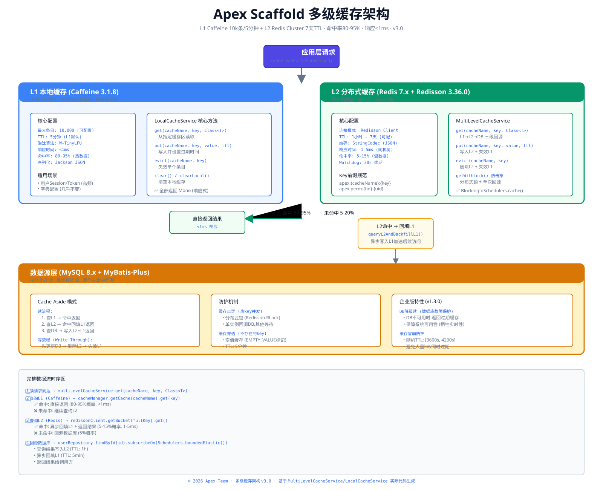

# 多级缓存架构

> ## 架构图



## 一、概述

Apex Scaffold 实现了完整的 **L1 Caffeine + L2 Redis** 多级缓存架构，结合读降级、防击穿、防穿透等防护机制，在保障数据一致性的同时最大化系统性能和可用性。

###  1.1 架构设计目标

- **性能优化**：本地缓存减少 90% 以上 Redis 网络开销
- **高可用**：DB 故障时自动降级到过期缓存
- **一致性保障**：写操作先更新 DB 再删除缓存（Cache-Aside）
- **防护机制**：缓存击穿（加锁）、缓存穿透（空值）、缓存雪崩（随机 TTL）

### 1.2 核心能力

| 能力 | L1 Caffeine | L2 Redis | 说明 |
|------|------------|----------|------|
| **容量** | 10000 条（可配置） | 无限制（受 Redis 内存限制） | L1 使用 LRU 淘汰 |
| **命中率** | 80-95%（热数据） | 5-15%（温数据） | L1 未命中才查 L2 |
| **响应时间** | < 1ms | 1-5ms（同机房） | L1 极致性能 |
| **数据一致性** | 最终一致性 | 最终一致性 | 写操作删除缓存 |
| **防护能力** | 单机限流 | 分布式锁防击穿 | 双层防护 |

### 1.3 适用场景

| 场景 | L1 策略 | L2 策略 | 说明 |
|------|---------|---------|------|
| **用户资料** | 60s | 1h | 高频读取，变更不频繁 |
| **商品详情** | 30s | 30min | 价格/库存实时性要求适中 |
| **系统配置** | 5min | 24h | 几乎不变，可长时间缓存 |
| **热门内容** | 10s | 10min | 超高并发，L1 扛流量 |
| **订单状态** | 0（禁用） | 5min | 强一致性，只用 L2 |

---

## 二、架构设计

### 2.1 整体架构

```
┌───────────────────────────────────────────────────────────┐
│                        应用层                              │
│  ┌──────────────┬──────────────┬───────────────────────┐ │
│  │  读流程       │  写流程       │   防护机制              │ │
│  └──────────────┴──────────────┴───────────────────────┘ │
└────────────────────┬──────────────────────────────────────┘
                     │
         ┌───────────┼───────────┐
         ↓           ↓           ↓
   ┌─────────┐ ┌─────────┐ ┌──────────────┐
   │L1 Caffeine│ │L2 Redis │ │   数据库     │
   │本地缓存   │ │分布式缓存│ │   MySQL      │
   └─────────┘ └─────────┘ └──────────────┘
       ↑                              ↑
       └──────── 回源查询 ─────────────┘
```

### 2.2 读流程

#### 正常读取流程

```
1. 查询 L1 Caffeine
   ├─ 命中 → 直接返回（< 1ms）
   └─ 未命中 ↓

2. 查询 L2 Redis
   ├─ 命中 → 回填 L1 → 返回（1-5ms）
   └─ 未命中 ↓

3. 回源查询 DB
   ├─ 成功 → 写入 L1 + L2 → 返回（10-100ms）
   └─ 失败 ↓

4. 读降级（可选，Enterprise）
   ├─ 启用 → 读取过期缓存 → 返回旧数据
   └─ 禁用 → 抛出异常
```

#### 批量读取流程

```java
public Mono<Map<String, Object>> getBatch(List<String> keys) {
    // 1. L1 批量查询
    Map<String, Object> l1Results = caffeine.getAllPresent(keys);
    
    // 2. 计算 L1 未命中的 key
    List<String> l1Missed = keys.stream()
        .filter(k -> !l1Results.containsKey(k))
        .collect(Collectors.toList());
    
    if (l1Missed.isEmpty()) {
        return Mono.just(l1Results);  // 全部命中 L1
    }
    
    // 3. L2 批量查询（仅查询 L1 未命中）
    return redisBatchGet(l1Missed)
        .map(l2Results -> {
            // 4. L2 命中回填 L1
            l2Results.forEach((k, v) -> caffeine.put(k, v));
            
            // 5. 合并 L1 + L2 结果
            Map<String, Object> merged = new HashMap<>(l1Results);
            merged.putAll(l2Results);
            return merged;
        });
}
```

### 2.3 写流程

#### Cache-Aside 模式（推荐）

```
1. 更新数据库（事务提交）
   ↓
2. 删除 L2 Redis 缓存
   ↓
3. 删除 L1 Caffeine 缓存
   ↓
4. 下次读取时重新加载最新数据
```

**优点**：
- 简单可靠，不会出现数据不一致
- DB 是唯一数据源，缓存只是加速层

**注意事项**：
- 删除顺序：先 L2 再 L1（避免其他实例从 L2 读取旧数据）
- 删除失败处理：记录日志并告警，必要时手动清理

#### Write-Through 模式（高级）

```
1. 同步更新 DB + L2 Redis（事务）
   ↓
2. 删除 L1 Caffeine 缓存
   ↓
3. 下次读取时从 L2 加载到 L1
```

**优点**：
- 写入即生效，无需等待下次读取
- 适合读多写少场景

**缺点**：
- 实现复杂，需要分布式事务
- 写入性能略低

### 2.4 一致性保障

#### 问题 1：并发读写导致缓存脏数据

**场景**：
```
时间线：
T1: 线程 A 读取 DB（值=10）
T2: 线程 B 更新 DB（值=20）并删除缓存
T3: 线程 A 将旧值（10）写入缓存
结果：缓存=10，DB=20（不一致）
```

**解决方案**：延迟双删（异步，第二次删除不阻塞业务响应）

```java
@Override
public Mono<Boolean> evictWithDelayedDoubleDelete(String cacheName, String key) {
    if (key == null || cacheName == null) {
        return Mono.just(false);
    }
    CacheProperties.DoubleDelete config = cacheProperties.getDoubleDelete();
    if (config == null || !config.isEnabled()) {
        return evict(cacheName, key);            // 未启用时退化为单次删除
    }
    int retryTimes = Math.max(0, config.getRetryTimes());
    long delayMillis = Math.max(0, config.getDelayMillis());

    // 第一次删除（L2→L1），失败按配置重试
    return deleteBothLevels(cacheName, key)
        .retry(retryTimes)
        .doOnSuccess(deleted ->
            // 延迟 delayMillis 后异步二次删除（fire-and-forget，不阻塞响应）
            Mono.delay(Duration.ofMillis(delayMillis), BlockingIoSchedulers.cache())
                .then(deleteBothLevels(cacheName, key).retry(retryTimes))
                .subscribe(
                    ignored -> { },
                    e -> log.error("延迟双删二次删除失败，交由补偿机制兜底", e)));
}
```

#### 问题 2：L1 和 L2 数据不一致

**场景**：
```
实例 A：L1=旧值，L2=新值
实例 B：L1=新值，L2=新值
```

**解决方案**：L1 设置较短 TTL

```java
// L1 TTL = 60s
cacheService.set(key, value, Duration.ofSeconds(60), Duration.ofMinutes(30));
//                            ↑ L1 TTL           ↑ L2 TTL
```

#### 问题 3：缓存删除失败

**解决方案**：异步补偿 + 监控告警

```java
public Mono<Void> deleteWithRetry(String key) {
    return cacheService.delete(key)
        .retry(3)  // 重试 3 次
        .doOnError(ex -> {
            log.error("缓存删除失败，记录补偿任务", ex);
            compensationService.record(key);  // 记录补偿任务
        })
        .then();
}
```

---

## 三、配置与使用

### 3.1 基础配置

```yaml
apex:
  cache:
    # Caffeine L1 配置
    caffeine:
      maximum-size: 10000              # 最大条目数
      expire-after-write: 60s          # 写入后过期时间
      expire-after-access: 30s         # 访问后过期时间（可选）
      initial-capacity: 256            # 初始容量
      
    # Redis L2 配置
    redis:
      default-ttl: 1800s               # 默认 TTL 30 分钟
      key-prefix: "apex:cache:"        # Key 前缀
      
    # 读降级配置（Enterprise）
    read-degradation:
      enabled: true                    # 启用读降级
      max-stale-seconds: 3600          # 最大过期时间 1 小时

    # 延迟双删配置（防止并发读写脏数据）
    double-delete:
      enabled: true                    # 启用延迟双删（默认 true）
      delay-millis: 500                # 第二次删除延迟（毫秒，默认 500）
      retry-times: 3                   # 每次删除失败的最大重试次数（默认 3）
```

### 3.2 基本使用

#### 单条读取

```java
@Service
@RequiredArgsConstructor
public class UserService {
    
    private final MultiLevelCacheService cacheService;
    private final UserRepository userRepository;
    
    public Mono<User> getUser(Long userId) {
        return cacheService.getWithLoader(
            "user:" + userId,
            () -> userRepository.findById(userId),
            Duration.ofMinutes(30)  // Redis TTL
        );
    }
}
```

#### 批量读取

```java
public Mono<List<User>> getUsersBatch(List<Long> userIds) {
    List<String> keys = userIds.stream()
        .map(id -> "user:" + id)
        .collect(Collectors.toList());
    
    return cacheService.getBatch(keys, User.class)
        .flatMap(cached -> {
            // 查找未命中的 ID
            Set<Long> cachedIds = cached.values().stream()
                .map(User::getId)
                .collect(Collectors.toSet());
            
            List<Long> missedIds = userIds.stream()
                .filter(id -> !cachedIds.containsKey(id))
                .collect(Collectors.toList());
            
            if (missedIds.isEmpty()) {
                return Mono.just(new ArrayList<>(cached.values()));
            }
            
            // 批量查询未命中的数据
            return userRepository.findByIds(missedIds)
                .collectList()
                .flatMap(dbUsers -> {
                    // 回填缓存
                    Map<String, User> toCache = dbUsers.stream()
                        .collect(Collectors.toMap(
                            u -> "user:" + u.getId(),
                            u -> u
                        ));
                    
                    return cacheService.setBatch(toCache, Duration.ofMinutes(30))
                        .thenReturn(Stream.concat(
                            cached.values().stream(),
                            dbUsers.stream()
                        ).collect(Collectors.toList()));
                });
        });
}
```

#### 更新数据

```java
public Mono<User> updateUser(Long userId, UserUpdateRequest request) {
    return userRepository.update(userId, request)
        .flatMap(user -> 
            // Cache-Aside：先更新 DB，再删除缓存
            cacheService.delete("user:" + userId)
                .thenReturn(user)
        );
}
```

### 3.3 防护机制

#### 防缓存击穿（分布式锁）

```java
public Mono<Product> getProduct(Long productId) {
    String key = "product:" + productId;
    String lockKey = "lock:" + key;
    
    return cacheService.get(key, Product.class)
        .switchIfEmpty(
            // 缓存未命中，尝试获取分布式锁
            distributedLockService.tryLock(lockKey, Duration.ofSeconds(10))
                .flatMap(locked -> {
                    if (!locked) {
                        // 未获取到锁，等待并重试
                        return Mono.delay(Duration.ofMillis(100))
                            .then(cacheService.get(key, Product.class));
                    }
                    
                    // 获取到锁，查询 DB 并回填缓存
                    return productRepository.findById(productId)
                        .flatMap(product -> 
                            cacheService.set(key, product, Duration.ofMinutes(30))
                                .thenReturn(product)
                        )
                        .doFinally(signal -> 
                            distributedLockService.unlock(lockKey).subscribe()
                        );
                })
        );
}
```

#### 防缓存穿透（空值缓存）

```java
public Mono<User> getUserSafe(Long userId) {
    String key = "user:" + userId;
    
    return cacheService.getWithLoader(
        key,
        () -> userRepository.findById(userId)
            .switchIfEmpty(Mono.just(User.EMPTY)),  // 不存在时缓存空对象
        Duration.ofMinutes(30)
    ).filter(user -> user != User.EMPTY)  // 过滤掉空对象
     .switchIfEmpty(Mono.error(new UserNotFoundException()));
}
```

#### 防缓存雪崩（随机 TTL）

```java
public Mono<Void> cacheWithRandomTTL(String key, Object value) {
    // 基础 TTL + 随机 0-300 秒
    Duration ttl = Duration.ofMinutes(30)
        .plusSeconds(ThreadLocalRandom.current().nextInt(300));
    
    return cacheService.set(key, value, ttl);
}
```

---

## 四、最佳实践

### 4.1 Key 设计规范

```
格式：{业务模块}:{实体类型}:{主键}[:子资源]

示例：
✅ user:profile:123
✅ product:detail:456
✅ order:status:789
✅ user:avatar:123:thumbnail

❌ 123                    # 缺少业务含义
❌ getUserById_123        # 不应包含方法名
❌ user-profile-123       # 不应使用 - 分隔
```

### 4.2 TTL 设置建议

```
L1 TTL = L2 TTL × 5% ~ 20%

示例：
- L2 TTL = 30 分钟 → L1 TTL = 60 秒
- L2 TTL = 1 小时 → L1 TTL = 5 分钟
- L2 TTL = 24 小时 → L1 TTL = 2 小时
```

### 4.3 批量操作优化

```java
// ✅ 推荐：一次性批量查询
List<User> users = cacheService.getBatch(userIds).block();

// ❌ 不推荐：循环单次查询（N+1 问题）
List<User> users = userIds.stream()
    .map(id -> cacheService.get("user:" + id).block())
    .collect(Collectors.toList());
```

### 4.4 大对象缓存策略

```java
// 方案 1：压缩后缓存
public Mono<LargeObject> getLargeObject(String key) {
    return cacheService.get(key, byte[].class)
        .map(CompressionUtil::decompress)
        .map(json -> JsonUtil.parse(json, LargeObject.class));
}

// 方案 2：分片缓存
public Mono<LargeObject> getLargeObjectSharded(String key) {
    return Flux.range(0, 10)
        .flatMap(i -> cacheService.get(key + ":part:" + i, String.class))
        .collectList()
        .map(parts -> String.join("", parts))
        .map(json -> JsonUtil.parse(json, LargeObject.class));
}

// 方案 3：仅缓存 ID 列表
public Mono<List<Product>> getProductList(String categoryId) {
    String key = "category:products:" + categoryId;
    return cacheService.get(key, List.class)
        .flatMap(productIds -> productService.getBatch(productIds));
}
```

---

## 五、监控与运维

### 5.1 Prometheus 指标

```prometheus
# L1 命中率
apex_cache_l1_hit_ratio 0.92

# L2 命中率
apex_cache_l2_hit_ratio 0.08

# 总命中率
apex_cache_total_hit_ratio 1.00

# 读降级次数
apex_cache_read_degradation_total 5

# 缓存大小
apex_cache_l1_size 8523
apex_cache_l2_size 125340
```

### 5.2 Grafana 面板

```yaml
- title: "多级缓存命中率"
  expr: |
    apex_cache_l1_hit_ratio * 100
  legend: "L1 命中率"

- title: "缓存容量趋势"
  expr: |
    apex_cache_l1_size
  legend: "L1 容量"
```

### 5.3 告警规则

```yaml
- alert: LowCacheHitRate
  expr: apex_cache_total_hit_ratio < 0.7
  for: 10m
  labels:
    severity: warning
  annotations:
    summary: "缓存总命中率过低"

- alert: CacheReadDegradation
  expr: rate(apex_cache_read_degradation_total[5m]) > 0
  for: 5m
  labels:
    severity: critical
  annotations:
    summary: "缓存读降级触发，DB 可能故障"
```

---

## 六、故障排查

### 6.1 L1 命中率低

**原因**：
- L1 容量过小（`maximum-size`）
- L1 TTL 过短（`expire-after-write`）
- 数据变更频繁

**解决**：
```yaml
apex:
  cache:
    caffeine:
      maximum-size: 20000      # 扩容
      expire-after-write: 120s # 延长 TTL
```

### 6.2 缓存不一致

**排查**：
1. 检查删除缓存是否成功
2. 检查延迟双删是否生效
3. 检查 L1 TTL 是否合理

**解决**：
```java
// 添加日志追踪
log.info("删除缓存: key={}", key);
cacheService.delete(key)
    .doOnSuccess(v -> log.info("删除成功"))
    .doOnError(ex -> log.error("删除失败", ex));
```

---

## 七、相关文档

- [DB 故障读降级使用指南](../../01-guides/read-degradation-guide.md)
- [缓存与三高能力增强计划](../../_archive/superpowers/plans/2026-08-30-cache-high-load-enhancement.md)
- [配置项详解](../../05-operations/configuration.md)
- [系统架构设计](../system-architecture.md)

---

**版本**: v1.0.0  
**最后更新**: 2026-09-04  
**配套图表**: [多级缓存架构](../../diagrams/09_multi_level_cache_architecture.svg)
