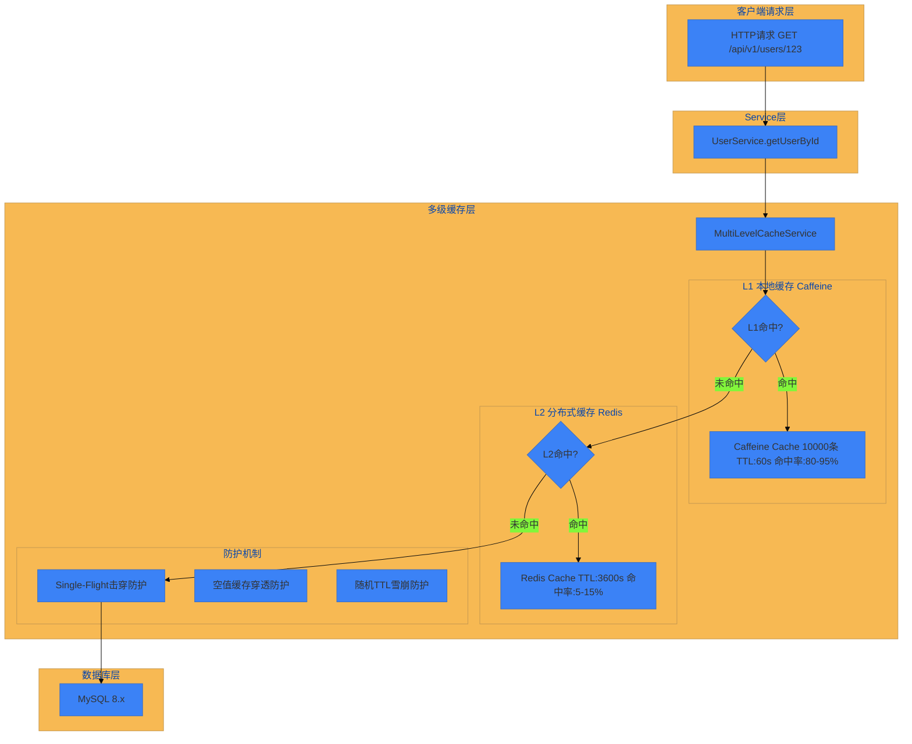

# 多级缓存完整技术指南

**版本**: 2.0  
**更新日期**: 2026-09-12  
**适用版本**: Apex Scaffold 1.2.0+  
**作者**: Apex Team

---

## 一、架构概述

### 1.1 多级缓存架构图

下图展示了完整的L1 Caffeine + L2 Redis多级缓存架构,包括读取流程、写入流程和三大防护机制:



详细架构源文件: [77_multi_level_cache_architecture.mmd](../../diagrams/sequence/77_multi_level_cache_architecture.mmd)

### 1.2 核心特性

| 特性 | L1 (Caffeine) | L2 (Redis) | 说明 |
|------|---------------|-----------|------|
| **访问延迟** | < 1ms | 1-5ms (同机房) | L1极致性能 |
| **容量限制** | 10000条 (可配置) | 无限制 (受Redis内存限制) | L1使用W-TinyLFU淘汰 |
| **数据范围** | 单实例本地 | 跨实例共享 | L1各实例独立 |
| **命中率** | 80-95% (热数据) | 5-15% (温数据) | L1未命中才查L2 |
| **一致性** | 最终一致性 | 最终一致性 | 写操作删除缓存 |
| **防护能力** | 单机限流 | 分布式锁防击穿 | 双层防护 |

### 1.3 性能指标

**延迟对比**:

| 数据访问路径 | 延迟 | 命中率 | QPS |
|-------------|------|--------|-----|
| L1 Caffeine | < 1ms | ~80-95% | 无上限 |
| L2 Redis | 1-5ms | ~5-15% | ~10,000 |
| MySQL查询 | 50-200ms | ~5% (未命中) | ~2,000 |

**资源节省**:
- 缓存命中率 > 95%,数据库QPS从10,000降至< 500 (降低95%)
- P99响应时间从200ms降至< 50ms (降低75%)

---

## 二、读取流程详解

### 2.1 完整读取链路

```
1. 客户端请求 → Handler → Service
2. Service调用MultiLevelCacheService.get(key)
3. 查询L1 Caffeine缓存
   ├─ 命中 → 返回数据 (< 1ms) → 结束
   └─ 未命中 → 查询L2 Redis缓存
       ├─ 命中 → 回填L1 → 返回数据 (1-5ms) → 结束
       └─ 未命中 → Single-Flight防击穿
           └─ 查询数据库 → 写入L2 → 写入L1 → 返回数据 (50-200ms)
```

### 2.2 代码实现示例

**Service层调用**:

```java
@Service
@RequiredArgsConstructor
public class UserService {
    private final MultiLevelCacheService cacheService;
    private final UserRepository userRepository;
    
    public Mono<UserDTO> getUserById(Long userId) {
        String cacheKey = "user:" + userId;
        
        return cacheService.get(cacheKey, User.class)
            .switchIfEmpty(Mono.defer(() -> 
                userRepository.findById(userId)
                    .flatMap(user -> cacheService.set(cacheKey, user, Duration.ofHours(1))
                        .thenReturn(user))
            ))
            .map(this::toDTO);
    }
}
```

**MultiLevelCacheService实现**:

```java
@Override
public <T> Mono<T> get(String key, Class<T> valueType) {
    return Mono.fromCallable(() -> localCache.getIfPresent(key))
        .flatMap(cached -> {
            if (cached != null) {
                metrics.recordL1Hit();
                return Mono.just(fromStoreValue(cached, valueType));
            }
            
            return Mono.fromCallable(() -> redissonClient.getBucket(key))
                .subscribeOn(BlockingIoSchedulers.cache())
                .flatMap(bucket -> {
                    String redisValue = bucket.get();
                    if (redisValue != null) {
                        metrics.recordL2Hit();
                        localCache.put(key, redisValue);
                        return Mono.just(fromStoreValue(redisValue, valueType));
                    }
                    metrics.recordCacheMiss();
                    return Mono.empty();
                });
        });
}
```

### 2.3 Single-Flight击穿防护

**问题场景**:
```
缓存失效瞬间,1000个并发请求同时穿透到数据库
→ 数据库瞬时压力暴增1000倍 → 雪崩
```

**解决方案**:
```java
private final ConcurrentHashMap<String, Mono<?>> inflightRequests = new ConcurrentHashMap<>();

public <T> Mono<T> getOrLoad(String key, Supplier<Mono<T>> loader) {
    return Mono.defer(() -> {
        Mono<?> inflight = inflightRequests.get(key);
        if (inflight != null) {
            return (Mono<T>) inflight;
        }
        
        Mono<T> newRequest = loader.get()
            .cache()
            .doFinally(signal -> inflightRequests.remove(key));
        
        Mono<?> existing = inflightRequests.putIfAbsent(key, newRequest);
        return existing != null ? (Mono<T>) existing : newRequest;
    });
}
```

**效果**: 1000个并发请求合并为1个数据库查询,其余999个等待第一个查询结果。

---

## 三、写入流程详解

### 3.1 Cache-Aside模式

**标准写入流程**:

```
1. 更新数据库 (事务提交)
   ↓
2. 删除L2 Redis缓存
   ↓
3. 删除L1 Caffeine缓存
   ↓
4. 下次读取时重新加载最新数据
```

**代码实现**:

```java
@Service
@RequiredArgsConstructor
public class UserService {
    private final UserRepository userRepository;
    private final CacheConsistencyService cacheService;
    
    @Transactional
    public Mono<Void> updateUser(Long userId, UpdateUserRequest request) {
        return userRepository.update(userId, request)
            .then(cacheService.evict("user:" + userId));
    }
}
```

**CacheConsistencyService实现**:

```java
@Override
public Mono<Void> evict(String key) {
    return Mono.fromRunnable(() -> {
                localCache.invalidate(key);
            })
            .then(Mono.fromCallable(() -> {
                        RBucket<String> bucket = redissonClient.getBucket(key);
                        bucket.delete();
                        return true;
                    })
                    .subscribeOn(BlockingIoSchedulers.cache()))
            .then();
}
```

### 3.2 延迟双删防止脏数据

**问题场景**:

```
时间线:
T1: 线程A读取DB (值=10)
T2: 线程B更新DB (值=20) 并删除缓存
T3: 线程A将旧值(10)写入缓存
结果: 缓存=10, DB=20 (不一致!)
```

**解决方案**:

```java
@Autowired
private CacheConsistencyPort cacheConsistencyService;

@Override
public Mono<Void> updateWithDelayedDelete(String key, Object newValue) {
    return userRepository.update(newValue)
        .then(cacheConsistencyService
            // 延迟双删：立即删除 + 延迟再删（异步，不阻塞响应）
            .evictWithDelayedDoubleDelete(cacheName, key)
            .then());
}
```

**原理**: 更新后调用 `evictWithDelayedDoubleDelete`,内部先立即删除两级缓存(L2→L1),延迟 `delayMillis`(默认 500ms)后再异步删除一次,确保慢查询线程写入的旧值被清除;每次删除带失败重试(`retry-times`),失败记录日志交由补偿兜底。

### 3.3 Write-Through模式 (高级)

**适用场景**: 读多写少,要求写入即生效。

```java
@Override
public Mono<Void> set(String key, Object value, Duration ttl) {
    return Mono.fromCallable(() -> {
                RBucket<String> bucket = redissonClient.getBucket(key);
                bucket.set(toStoreValue(value), ttl);
                return true;
            })
            .subscribeOn(BlockingIoSchedulers.cache())
            .doOnSuccess(v -> localCache.put(key, toStoreValue(value)))
            .then();
}
```

---

## 四、三大防护机制

### 4.1 缓存击穿防护 (Single-Flight)

**定义**: 热点key失效瞬间,大量请求穿透到数据库。

**实现**: 见2.3节Single-Flight机制。

**配置**:

```yaml
apex:
  cache:
    single-flight:
      enabled: true
      max-wait-time: 5s
```

### 4.2 缓存穿透防护 (空值缓存)

**定义**: 查询不存在的数据,每次都穿透到数据库。

**实现**:

```java
@Override
public <T> Mono<T> getOrLoad(String key, Supplier<Mono<T>> loader) {
    return get(key, Object.class)
        .switchIfEmpty(loader.get()
            .flatMap(value -> {
                if (value == null) {
                    return set(key, NULL_PLACEHOLDER, Duration.ofMinutes(5))
                        .thenReturn((T) null);
                }
                return set(key, value, Duration.ofHours(1))
                    .thenReturn(value);
            }));
}
```

**效果**: 不存在的key缓存空值5分钟,防止反复查询数据库。

### 4.3 缓存雪崩防护 (随机TTL)

**定义**: 大量key同时过期,导致数据库瞬时压力暴增。

**实现**:

```java
private Duration addRandomOffset(Duration baseTtl) {
    long baseSeconds = baseTtl.getSeconds();
    long randomOffset = ThreadLocalRandom.current().nextLong(0, baseSeconds / 10);
    return Duration.ofSeconds(baseSeconds + randomOffset);
}

@Override
public Mono<Boolean> set(String key, Object value, Duration ttl) {
    Duration actualTtl = addRandomOffset(ttl);
    return setInternal(key, value, actualTtl);
}
```

**效果**: TTL基础值1小时,随机偏移±6分钟,避免同时过期。

---

## 五、配置与使用

### 5.1 配置文件

**application.yml**:

```yaml
apex:
  cache:
    local:
      max-size: 10000
      expire-after-write: 300
      initial-capacity: 500
    remote:
      default-ttl: 3600
      batch-size: 100
    single-flight:
      enabled: true
      max-wait-time: 5s
    null-cache:
      enabled: true
      ttl: 300
```

### 5.2 使用示例

**基础用法**:

```java
@Service
@RequiredArgsConstructor
public class ProductService {
    private final MultiLevelCacheService cacheService;
    private final ProductRepository productRepository;
    
    public Mono<Product> getProduct(Long productId) {
        String key = "product:" + productId;
        return cacheService.get(key, Product.class)
            .switchIfEmpty(productRepository.findById(productId)
                .flatMap(product -> cacheService.set(key, product, Duration.ofMinutes(30))
                    .thenReturn(product)));
    }
    
    @Transactional
    public Mono<Void> updateProduct(Long productId, UpdateRequest request) {
        return productRepository.update(productId, request)
            .then(cacheService.evict("product:" + productId));
    }
}
```

**批量操作**:

```java
public Mono<Map<Long, Product>> getProducts(List<Long> productIds) {
    List<String> keys = productIds.stream()
        .map(id -> "product:" + id)
        .collect(Collectors.toList());
    
    return cacheService.getBatch(keys, Product.class)
        .flatMap(cachedMap -> {
            Set<Long> missedIds = productIds.stream()
                .filter(id -> !cachedMap.containsKey("product:" + id))
                .collect(Collectors.toSet());
            
            if (missedIds.isEmpty()) {
                return Mono.just(cachedMap);
            }
            
            return productRepository.findByIds(missedIds)
                .collectList()
                .flatMap(products -> {
                    Map<String, Product> toCache = products.stream()
                        .collect(Collectors.toMap(
                            p -> "product:" + p.getId(),
                            Function.identity()
                        ));
                    return cacheService.setBatch(toCache, Duration.ofMinutes(30))
                        .thenReturn(merge(cachedMap, toCache));
                });
        });
}
```

---

## 六、监控与运维

### 6.1 关键指标

**Prometheus指标**:

```yaml
# L1命中率
apex_cache_l1_hit_rate{cache="user"} 0.85

# L2命中率
apex_cache_l2_hit_rate{cache="user"} 0.12

# 总命中率
apex_cache_total_hit_rate{cache="user"} 0.97

# 缓存响应时间
apex_cache_get_duration_seconds{cache="user",level="l1",quantile="0.99"} 0.0008
apex_cache_get_duration_seconds{cache="user",level="l2",quantile="0.99"} 0.0045

# Single-Flight合并次数
apex_cache_single_flight_merge_total{cache="user"} 1523
```

### 6.2 Grafana看板

**多级缓存监控面板**:

1. **命中率趋势图**: L1/L2/总命中率时序曲线
2. **延迟分布图**: P50/P95/P99延迟直方图
3. **容量监控**: L1当前条目数/最大容量,Redis内存使用
4. **防护触发**: 击穿/穿透/雪崩防护触发次数
5. **错误监控**: 缓存读写失败次数/错误率

### 6.3 告警规则

```yaml
groups:
  - name: cache_alerts
    rules:
      - alert: CacheHitRateLow
        expr: apex_cache_total_hit_rate < 0.90
        for: 5m
        annotations:
          summary: "缓存命中率低于90%"
          
      - alert: CacheL2HighLatency
        expr: apex_cache_get_duration_seconds{level="l2",quantile="0.99"} > 0.010
        for: 5m
        annotations:
          summary: "Redis访问延迟P99超过10ms"
          
      - alert: CacheSingleFlightHigh
        expr: rate(apex_cache_single_flight_merge_total[5m]) > 100
        for: 5m
        annotations:
          summary: "缓存击穿防护频繁触发"
```

---

## 七、最佳实践

### 7.1 缓存key设计

**规范**:
- 使用`:`分隔命名空间: `user:123`, `product:456`
- 版本化: `user:v2:123` (schema变更时升级版本)
- 避免特殊字符: 不使用空格、换行、二进制字符

### 7.2 TTL设置建议

| 数据类型 | L1 TTL | L2 TTL | 说明 |
|---------|--------|--------|------|
| 用户资料 | 60s | 1h | 高频读取,变更不频繁 |
| 商品详情 | 30s | 30min | 价格/库存实时性要求适中 |
| 字典配置 | 5min | 24h | 几乎不变更,可长时间缓存 |
| 会话数据 | 30s | 30min | 可接受秒级不一致 |

### 7.3 避坑指南

**❌ 错误用法**:

```java
// 错误1: 缓存大对象
cacheService.set("order:detail:123", hugeOrderObject);

// 错误2: 无限期缓存
cacheService.set("user:123", user, Duration.ofDays(365));

// 错误3: 缓存非序列化对象
cacheService.set("connection:pool", jdbcConnectionPool);
```

**✅ 正确用法**:

```java
// 正确1: 缓存轻量DTO
cacheService.set("order:summary:123", OrderSummaryDTO.from(order));

// 正确2: 合理TTL
cacheService.set("user:123", user, Duration.ofHours(1));

// 正确3: 缓存可序列化对象
cacheService.set("user:123", serializableUserDTO);
```

---

## 八、故障处理

### 8.1 Redis不可用

**降级策略**: DB故障读降级 (Enterprise特性)

```java
@Override
public <T> Mono<T> getWithFallback(String key, Supplier<Mono<T>> dbLoader) {
    return get(key, Object.class)
        .switchIfEmpty(dbLoader.get()
            .onErrorResume(e -> {
                log.warn("DB查询失败,尝试读取过期缓存: {}", key);
                return getExpiredCache(key);
            }));
}
```

**效果**: DB故障时返回过期缓存,保证服务可用性。

### 8.2 缓存穿透攻击

**现象**: 恶意请求大量不存在的key,绕过缓存直击数据库。

**解决**:
1. 启用空值缓存 (已实现)
2. 布隆过滤器预判 (可选增强)

```java
private final BloomFilter<String> existingKeys = BloomFilter.create(
    Funnels.stringFunnel(Charsets.UTF_8), 
    100_000_000, 
    0.01
);

public Mono<User> getUser(Long userId) {
    String key = "user:" + userId;
    if (!existingKeys.mightContain(key)) {
        return Mono.empty();
    }
    return getFromCache(key);
}
```

### 8.3 缓存雪崩恢复

**场景**: Redis重启,所有缓存失效。

**恢复策略**:
1. 启用空缓存保护
2. 限流保护数据库
3. 分批预热热点数据

```java
@PostConstruct
public void warmUp() {
    if (isRedisRestarted()) {
        List<String> hotKeys = loadHotKeysFromConfig();
        Flux.fromIterable(hotKeys)
            .flatMap(key -> preloadCache(key), 10)
            .subscribe();
    }
}
```

---

## 九、性能调优

### 9.1 L1容量优化

**监控指标**:
```bash
# Caffeine淘汰率
apex_cache_l1_eviction_rate > 20% → 容量不足,需扩容
```

**调优**:
```yaml
apex:
  cache:
    local:
      max-size: 20000  # 从10000扩容到20000
```

### 9.2 批量操作优化

**优化前** (N次Redis调用):
```java
for (String key : keys) {
    get(key);
}
```

**优化后** (1次Pipeline调用):
```java
getBatch(keys);
```

**效果**: 延迟从N×5ms降至5ms,降低N倍。

---

## 十、相关文档

- [多级缓存架构SVG](../../diagrams/09_multi_level_cache_architecture.svg)
- [缓存一致性方案](multi-level-cache-architecture.md)
- [Redis配置最佳实践](../../05-operations/configuration.md#redis)
- [性能优化指南](../../04-development/backend-development-standards.md)

---

**最后更新**: 2026-09-12  
**维护者**: Apex Team  
**版本**: 2.0
