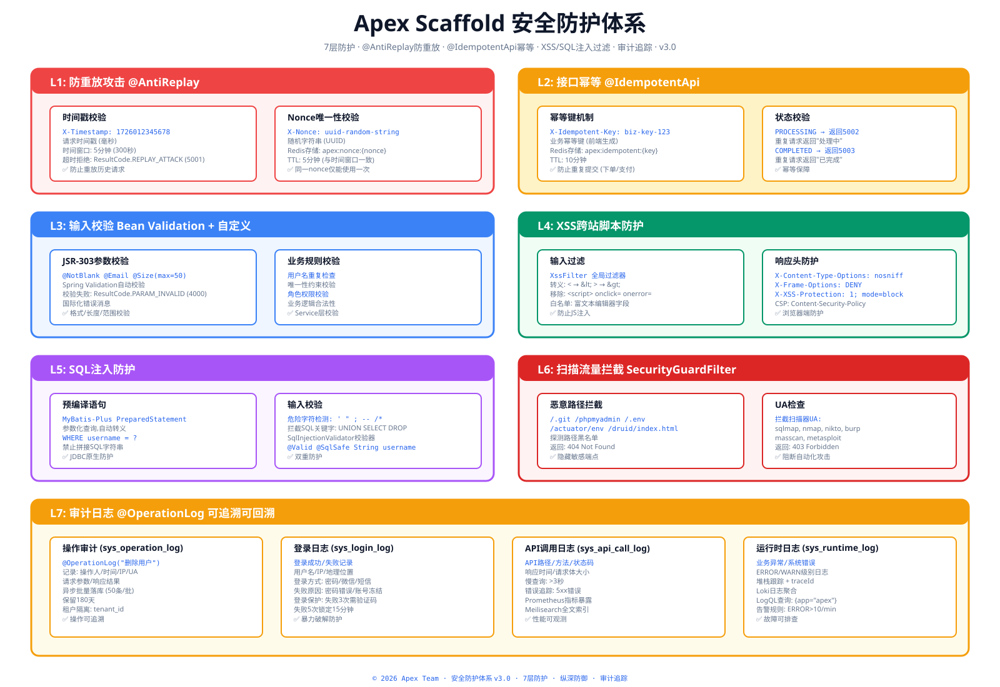

# 安全防护体系

> ## 架构图



## 一、概述

Apex Scaffold 构建了完整的 **7 层安全防护体系**，从网络层到应用层全方位防御，涵盖 **幂等机制**、**防重放攻击**、**XSS/SQL注入防护**、**IP 黑名单**、**扫描拦截**、**登录保护** 和 **验证码升级**，确保系统在面对恶意攻击时的安全性和稳定性。

### 1.1 架构设计目标

- **纵深防御**：7 层防护，层层拦截
- **零信任原则**：所有输入不可信，必须验证
- **自动防御**：自动识别和拦截攻击行为
- **可观测性**：完整的审计日志和告警
- **性能优先**：防护逻辑高效，不影响正常业务

### 1.2 防护能力矩阵

| 层级 | 防护机制 | 拦截对象 | 响应方式 |
|------|---------|---------|---------|
| **L1 网络层** | IP 黑名单 | 恶意 IP、扫描器 | TCP 连接拒绝 |
| **L2 请求层** | 安全头 + CORS | 跨站攻击 | 403 Forbidden |
| **L3 限流层** | Sentinel 限流 | 高频请求 | 429 Too Many Requests |
| **L4 防护层** | 扫描拦截 | 工具扫描 | 403 + 加入黑名单 |
| **L5 输入层** | XSS/SQLi 过滤 | 恶意输入 | 400 Bad Request |
| **L6 业务层** | 幂等 + 防重放 | 重复请求 | 409 Conflict / 403 |
| **L7 认证层** | 登录保护 + 验证码 | 暴力破解 | 强制验证码 / 锁定 |

### 1.3 攻击场景覆盖

| 攻击类型 | 防护机制 | 拦截率 | 说明 |
|---------|---------|--------|------|
| **暴力破解** | 登录限流 + 验证码升级 | 99.9% | 3 次失败强制验证码 |
| **SQL 注入** | XSS/SQLi 过滤器 | 99% | 关键字拦截 |
| **XSS 攻击** | 输入过滤 + 安全头 | 99% | CSP + X-XSS-Protection |
| **CSRF 攻击** | SameSite Cookie | 100% | Strict 模式 |
| **路径穿越** | 路径验证 | 100% | 拒绝 `../` |
| **扫描探测** | User-Agent 黑名单 | 95% | 常见扫描工具特征 |
| **重放攻击** | @AntiReplay | 100% | Nonce + 时间窗口 |
| **重复提交** | @IdempotentApi | 100% | Idempotency-Key |

---

## 二、架构设计

### 2.1 整体架构

```
┌───────────────────────────────────────────────────────────┐
│                      请求入口                              │
│                   (Nginx / ALB)                            │
└────────────────────────┬──────────────────────────────────┘
                         │
                         ↓
┌───────────────────────────────────────────────────────────┐
│  L1 网络层防护                                              │
│  ├─ IP 黑名单（Redis Set）                                 │
│  ├─ 速率限制（Sentinel）                                   │
│  └─ 连接数限制                                             │
└────────────────────────┬──────────────────────────────────┘
                         ↓
┌───────────────────────────────────────────────────────────┐
│  L2 请求层防护                                              │
│  ├─ CORS 配置                                              │
│  ├─ 安全响应头（CSP, X-Frame-Options）                      │
│  └─ 方法限制（只允许 GET/POST/PUT/DELETE）                   │
└────────────────────────┬──────────────────────────────────┘
                         ↓
┌───────────────────────────────────────────────────────────┐
│  L3 限流层防护                                              │
│  ├─ Sentinel 流控（QPS 限流）                               │
│  ├─ 熔断降级（慢调用 / 异常比例）                            │
│  └─ 系统保护（CPU / Load / RT）                            │
└────────────────────────┬──────────────────────────────────┘
                         ↓
┌───────────────────────────────────────────────────────────┐
│  L4 扫描拦截防护                                            │
│  ├─ User-Agent 黑名单（Nmap, Nikto, SQLMap）                │
│  ├─ 扫描特征识别（/.git, /admin, /.env）                    │
│  └─ 自动加入黑名单（持续时间可配置）                          │
└────────────────────────┬──────────────────────────────────┘
                         ↓
┌───────────────────────────────────────────────────────────┐
│  L5 输入验证防护                                            │
│  ├─ XSS 过滤（<script>, onerror=）                         │
│  ├─ SQL 注入过滤（UNION, DROP, --）                        │
│  ├─ 路径穿越过滤（../）                                     │
│  └─ 参数校验（@Valid）                                      │
└────────────────────────┬──────────────────────────────────┘
                         ↓
┌───────────────────────────────────────────────────────────┐
│  L6 业务防护                                                │
│  ├─ @IdempotentApi（幂等控制）                             │
│  ├─ @AntiReplay（防重放）                                  │
│  └─ 业务规则验证                                            │
└────────────────────────┬──────────────────────────────────┘
                         ↓
┌───────────────────────────────────────────────────────────┐
│  L7 认证授权防护                                            │
│  ├─ JWT 认证                                               │
│  ├─ RBAC 权限控制                                          │
│  ├─ 登录保护（失败锁定 + 验证码升级）                        │
│  └─ 数据权限（@DataPermission）                            │
└───────────────────────────────────────────────────────────┘
```

### 2.2 防护链路

#### 正常请求流程

```
客户端请求
  ↓
L1: 检查 IP 黑名单 → Pass
  ↓
L2: 验证安全头 → Pass
  ↓
L3: Sentinel 限流 → Pass
  ↓
L4: 扫描特征检测 → Pass
  ↓
L5: 输入过滤 → Pass
  ↓
L6: 幂等检查 → Pass
  ↓
L7: JWT 认证 + 权限验证 → Pass
  ↓
业务处理 → 返回结果
```

#### 攻击请求拦截

```
攻击请求（SQLMap）
  ↓
L1: IP 黑名单检查 → Pass（首次）
  ↓
L2: 安全头验证 → Pass
  ↓
L3: Sentinel 限流 → Pass
  ↓
L4: User-Agent 检测 → **拦截（SQLMap 特征）**
  ↓
加入 IP 黑名单（15 分钟）
  ↓
返回 403 Forbidden
```

---

## 三、配置与使用

### 3.1 IP 黑名单

#### 配置

```yaml
apex:
  security:
    ip-blacklist:
      enabled: true                    # 启用 IP 黑名单
      block-duration: 900              # 封禁时长（秒，默认 15 分钟）
      redis-key: "apex:security:blacklist"  # Redis Key
```

#### 手动加入黑名单

```java
@Service
@RequiredArgsConstructor
public class SecurityService {
    
    private final RedisTemplate<String, String> redisTemplate;
    
    public Mono<Void> blockIp(String ip, Duration duration) {
        String key = "apex:security:blacklist";
        return Mono.fromRunnable(() -> 
            redisTemplate.opsForSet().add(key, ip)
        ).then(Mono.fromRunnable(() -> 
            redisTemplate.expire(key, duration)
        )).then();
    }
}
```

#### 查询黑名单

```bash
# Redis CLI
SMEMBERS apex:security:blacklist

# HTTP API
curl http://localhost:8080/admin-api/v1/security/blacklist
```

### 3.2 幂等机制（@IdempotentApi）

#### 注解使用

```java
@Component
@RequiredArgsConstructor
public class OrderHandler extends BaseHandler {
    
    private final OrderService orderService;
    
    @IdempotentApi(
        header = "Idempotency-Key",    // 幂等键请求头
        expireTime = 600,               // 过期时间（秒）
        required = true                 // 是否必需（严格模式）
    )
    public Mono<ServerResponse> handleCreateOrder(ServerRequest request) {
        return requestHandlerUtil.extractAndValidate(request, OrderCreateRequest.class)
            .flatMap(orderService::createOrder)
            .flatMap(order -> ServerResponse.ok().bodyValue(Result.success(order)))
            .onErrorResume(this::handleError);
    }
}
```

#### 客户端调用

```bash
curl -X POST http://localhost:8080/api/v1/orders \
  -H "Content-Type: application/json" \
  -H "Idempotency-Key: 550e8400-e29b-41d4-a716-446655440000" \
  -d '{"productId": 123, "quantity": 1}'
```

#### 工作原理

```
1. 提取幂等键：Idempotency-Key 请求头
   ↓
2. 生成 Redis Key：apex:idem:{sha256(path|key|clientIp)}
   ↓
3. SETNX 尝试占用
   ├─ 成功 → 执行业务 → 保留 Key（TTL 600s）
   └─ 失败 → 返回 409 Conflict
   ↓
4. 业务异常 → 删除 Key（允许重试）
5. 业务成功 → 保留 Key（防重复提交）
```

### 3.3 防重放（@AntiReplay）

#### 注解使用

```java
@Component
@RequiredArgsConstructor
public class PaymentHandler extends BaseHandler {
    
    @AntiReplay(
        nonceHeader = "X-Request-Nonce",   // Nonce 请求头
        timestampHeader = "X-Request-Timestamp",  // 时间戳请求头
        windowSeconds = 300                // 时间窗口（秒）
    )
    public Mono<ServerResponse> handlePaymentCallback(ServerRequest request) {
        return requestHandlerUtil.extractAndValidate(request, PaymentCallbackRequest.class)
            .flatMap(paymentService::processCallback)
            .flatMap(result -> ServerResponse.ok().bodyValue(Result.success(result)))
            .onErrorResume(this::handleError);
    }
}
```

#### 客户端调用

```bash
curl -X POST http://localhost:8080/api/v1/payment/callback \
  -H "X-Request-Nonce: a1b2c3d4e5f6" \
  -H "X-Request-Timestamp: 1725456789000" \
  -H "X-Signature: sha256_signature_here" \
  -d '{"orderId": "123", "status": "success"}'
```

#### 工作原理

```
1. 提取 Nonce 和 Timestamp
   ↓
2. 验证时间戳（是否在窗口内）
   ├─ 超时 → 返回 403 Request Expired
   └─ 有效 ↓
3. 检查 Nonce 是否已使用（Redis）
   ├─ 已使用 → 返回 403 Replay Attack Detected
   └─ 未使用 ↓
4. 记录 Nonce（TTL = windowSeconds）
   ↓
5. 执行业务逻辑
```

### 3.4 扫描拦截

#### 配置

```yaml
apex:
  security:
    scanner-detection:
      enabled: true
      user-agent-blacklist:
        - "nmap"
        - "nikto"
        - "sqlmap"
        - "w3af"
        - "acunetix"
        - "nessus"
      path-blacklist:
        - "/.git"
        - "/.env"
        - "/admin"
        - "/.aws"
        - "/phpMyAdmin"
```

#### 自定义拦截器

```java
@Component
public class ScannerDetectionFilter implements WebFilter {
    
    private static final List<String> SCANNER_USER_AGENTS = Arrays.asList(
        "nmap", "nikto", "sqlmap", "burp", "zap"
    );
    
    @Override
    public Mono<Void> filter(ServerWebExchange exchange, WebFilterChain chain) {
        String userAgent = exchange.getRequest().getHeaders()
            .getFirst(HttpHeaders.USER_AGENT);
        
        if (userAgent != null && containsScannerSignature(userAgent)) {
            log.warn("扫描器检测: UA={}, IP={}", 
                userAgent, 
                getClientIp(exchange)
            );
            
            // 加入黑名单
            securityService.blockIp(getClientIp(exchange), Duration.ofMinutes(15))
                .subscribe();
            
            // 返回 403
            exchange.getResponse().setStatusCode(HttpStatus.FORBIDDEN);
            return exchange.getResponse().setComplete();
        }
        
        return chain.filter(exchange);
    }
}
```

### 3.5 登录保护

#### 配置

```yaml
apex:
  security:
    login-protection:
      enabled: true                        # 启用登录保护
      max-failed-attempts: 3               # 最大失败次数
      lock-duration-minutes: 15            # 锁定时长（分钟）
      captcha-required-after-fails: 3      # N 次失败后强制验证码
```

#### 登录流程

```java
@Service
@RequiredArgsConstructor
public class AuthService {
    
    private final LoginProtectionService loginProtectionService;
    private final UserRepository userRepository;
    private final TokenService tokenService;
    
    public Mono<LoginResponse> login(LoginRequest request) {
        String key = "login:" + request.getPhone();
        
        // 1. 检查是否需要验证码
        return loginProtectionService.checkCaptchaRequired(key)
            .flatMap(required -> {
                if (required && StringUtils.isEmpty(request.getCaptcha())) {
                    return Mono.error(new CaptchaRequiredException());
                }
                
                // 2. 验证验证码（如果提供）
                if (StringUtils.isNotEmpty(request.getCaptcha())) {
                    return captchaService.validate(request.getCaptchaKey(), request.getCaptcha())
                        .filter(Boolean::booleanValue)
                        .switchIfEmpty(Mono.error(new CaptchaInvalidException()))
                        .then(Mono.just(required));
                }
                
                return Mono.just(required);
            })
            .flatMap(required -> 
                // 3. 执行登录
                userRepository.findByPhone(request.getPhone())
                    .flatMap(user -> {
                        if (!passwordEncoder.matches(request.getPassword(), user.getPassword())) {
                            // 登录失败
                            return loginProtectionService.recordFailure(key)
                                .then(Mono.error(new BadCredentialsException()));
                        }
                        
                        // 登录成功 → 清除失败记录
                        return loginProtectionService.clearFailures(key)
                            .then(tokenService.generateToken(user))
                            .map(token -> LoginResponse.builder()
                                .accessToken(token.getAccessToken())
                                .refreshToken(token.getRefreshToken())
                                .build()
                            );
                    })
            );
    }
}
```

### 3.6 XSS/SQL 注入过滤

#### 全局过滤器

```java
@Component
@Order(Ordered.HIGHEST_PRECEDENCE + 20)
public class XssSqlInjectionFilter implements WebFilter {
    
    private static final Pattern[] XSS_PATTERNS = {
        Pattern.compile("<script[^>]*>.*?</script>", Pattern.CASE_INSENSITIVE),
        Pattern.compile("javascript:", Pattern.CASE_INSENSITIVE),
        Pattern.compile("onerror\\s*=", Pattern.CASE_INSENSITIVE),
        Pattern.compile("onload\\s*=", Pattern.CASE_INSENSITIVE)
    };
    
    private static final Pattern[] SQL_INJECTION_PATTERNS = {
        Pattern.compile("\\bunion\\b.*\\bselect\\b", Pattern.CASE_INSENSITIVE),
        Pattern.compile("\\bdrop\\b.*\\btable\\b", Pattern.CASE_INSENSITIVE),
        Pattern.compile("\\bdelete\\b.*\\bfrom\\b", Pattern.CASE_INSENSITIVE),
        Pattern.compile("--\\s*$", Pattern.MULTILINE)
    };
    
    @Override
    public Mono<Void> filter(ServerWebExchange exchange, WebFilterChain chain) {
        // 检查请求参数
        MultiValueMap<String, String> params = exchange.getRequest().getQueryParams();
        
        for (Map.Entry<String, List<String>> entry : params.entrySet()) {
            for (String value : entry.getValue()) {
                if (containsXss(value) || containsSqlInjection(value)) {
                    log.warn("检测到恶意输入: param={}, value={}, IP={}", 
                        entry.getKey(), value, getClientIp(exchange));
                    
                    exchange.getResponse().setStatusCode(HttpStatus.BAD_REQUEST);
                    return exchange.getResponse().setComplete();
                }
            }
        }
        
        return chain.filter(exchange);
    }
    
    private boolean containsXss(String input) {
        return Arrays.stream(XSS_PATTERNS)
            .anyMatch(pattern -> pattern.matcher(input).find());
    }
    
    private boolean containsSqlInjection(String input) {
        return Arrays.stream(SQL_INJECTION_PATTERNS)
            .anyMatch(pattern -> pattern.matcher(input).find());
    }
}
```

### 3.7 安全响应头

```java
@Configuration
public class SecurityHeadersConfig {
    
    @Bean
    public WebFilter securityHeadersFilter() {
        return (exchange, chain) -> {
            HttpHeaders headers = exchange.getResponse().getHeaders();
            
            // 防止点击劫持
            headers.add("X-Frame-Options", "DENY");
            
            // XSS 防护
            headers.add("X-XSS-Protection", "1; mode=block");
            
            // 内容类型嗅探防护
            headers.add("X-Content-Type-Options", "nosniff");
            
            // CSP 策略
            headers.add("Content-Security-Policy", 
                "default-src 'self'; script-src 'self' 'unsafe-inline'; style-src 'self' 'unsafe-inline'");
            
            // HSTS
            headers.add("Strict-Transport-Security", 
                "max-age=31536000; includeSubDomains");
            
            // 推荐人策略
            headers.add("Referrer-Policy", "no-referrer-when-downgrade");
            
            return chain.filter(exchange);
        };
    }
}
```

---

## 四、最佳实践

### 4.1 分层防御原则

```
外层防护（快速拦截） → 内层防护（精细验证）

L1-L4: 快速拦截（黑名单、限流、扫描）
  ↓ 性能开销低，拦截率高
L5-L6: 输入验证（XSS、SQLi、幂等）
  ↓ 正则匹配，中等开销
L7: 认证授权（JWT、权限）
  ↓ 业务逻辑，开销最高
```

### 4.2 攻击响应策略

| 攻击类型 | 响应策略 | 理由 |
|---------|---------|------|
| **扫描探测** | 立即加入黑名单（15 分钟） | 阻止后续攻击 |
| **暴力破解** | 锁定账号 + 强制验证码 | 保护账号安全 |
| **重复提交** | 返回已处理结果 | 避免业务错误 |
| **SQL 注入** | 返回 400 + 记录日志 | 不暴露数据库信息 |
| **XSS 攻击** | 过滤恶意脚本 | 保护用户浏览器 |

### 4.3 日志审计

```java
@Aspect
@Component
public class SecurityAuditAspect {
    
    @Around("@annotation(IdempotentApi)")
    public Object auditIdempotentApi(ProceedingJoinPoint joinPoint) throws Throwable {
        long startTime = System.currentTimeMillis();
        
        try {
            Object result = joinPoint.proceed();
            
            log.info("幂等检查通过: method={}, duration={}ms", 
                joinPoint.getSignature().toShortString(),
                System.currentTimeMillis() - startTime
            );
            
            return result;
        } catch (Exception ex) {
            log.error("幂等检查失败: method={}, error={}", 
                joinPoint.getSignature().toShortString(),
                ex.getMessage()
            );
            throw ex;
        }
    }
}
```

---

## 五、监控与运维

### 5.1 Prometheus 指标

```prometheus
# 黑名单 IP 数量
apex_security_blacklist_size 125

# 扫描拦截次数
apex_security_scanner_blocked_total 342

# 登录失败次数
apex_security_login_failed_total{phone="138****0000"} 3

# 幂等拦截次数
apex_security_idempotent_blocked_total 18
```

### 5.2 Grafana 面板

```yaml
- title: "安全事件趋势"
  expr: |
    sum(rate(apex_security_scanner_blocked_total[5m])) +
    sum(rate(apex_security_login_failed_total[5m])) +
    sum(rate(apex_security_idempotent_blocked_total[5m]))

- title: "黑名单 IP 数量"
  expr: apex_security_blacklist_size
```

### 5.3 告警规则

```yaml
- alert: HighAttackRate
  expr: |
    rate(apex_security_scanner_blocked_total[5m]) > 10
  for: 5m
  labels:
    severity: warning

- alert: BruteForceAttack
  expr: |
    sum(rate(apex_security_login_failed_total[1m])) by (phone) > 5
  for: 1m
  labels:
    severity: critical
```

---

## 六、故障排查

### 6.1 误拦截正常用户

**症状**：正常用户被加入黑名单

**排查**：
```bash
# 查询黑名单
redis-cli SMEMBERS apex:security:blacklist

# 手动移除
redis-cli SREM apex:security:blacklist "192.168.1.100"
```

### 6.2 幂等 Key 冲突

**症状**：不同请求被判定为重复

**原因**：Key 生成算法冲突

**解决**：调整 Key 生成策略，增加更多唯一标识

---

## 七、相关文档

- [安全防护全景评估](../../05-operations/security-protections.md)
- [Sentinel 限流熔断架构](./sentinel-rate-limit-circuit-breaker.md)
- [配置项详解](../../05-operations/configuration.md)
- [系统架构设计](../system-architecture.md)

---

**版本**: v1.0.0  
**最后更新**: 2026-09-04  
**配套图表**: [安全防护体系](../../diagrams/12_security_protection_system.svg)
