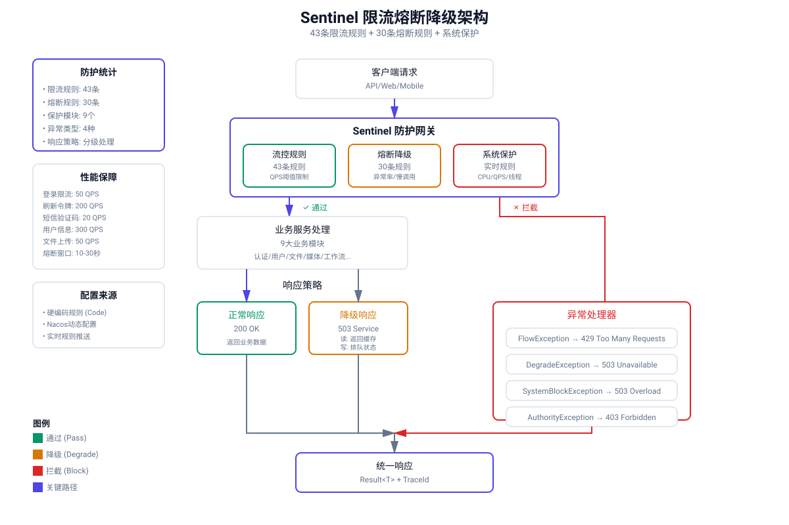

# Sentinel 限流熔断降级架构

> ## 架构图



## 一、概述

Apex Scaffold 基于 **Alibaba Sentinel** 构建了完整的流量控制、熔断降级和系统保护体系，提供 **43 条限流规则** 和 **30 条熔断规则**，覆盖接口层、应用层、外部调用等所有关键路径，确保系统在高并发和故障场景下的稳定性。

### 1.1 架构设计目标

- **流量削峰填谷**：限制突发流量，防止系统过载
- **快速失败**：故障快速隔离，避免雪崩效应
- **分层防护**：接口 → 应用 → 外部调用三层防护
- **动态调整**：支持 Nacos 配置中心热更新规则
- **可观测性**：完整的监控指标和控制台面板

### 1.2 核心能力

| 能力 | 说明 | 规则数量 |
|------|------|---------|
| **流量控制** | QPS 限流、并发线程数限流、关联限流、链路限流 | 43 条 |
| **熔断降级** | 慢调用比例、异常比例、异常数熔断 | 30 条 |
| **系统保护** | CPU、Load、RT、线程数、入口 QPS 自适应保护 | 5 维度 |
| **热点参数限流** | 针对特定参数值的细粒度限流 | 支持 |
| **授权规则** | 黑白名单访问控制 | 支持 |

### 1.3 适用场景

| 场景 | 限流策略 | 熔断策略 |
|------|---------|---------|
| **核心业务接口** | QPS 限流（如登录 100 QPS） | 慢调用熔断（RT > 1s） |
| **外部 API 调用** | 并发线程数限流（如支付 20 并发） | 异常比例熔断（> 50%） |
| **数据库查询** | 链路限流（如慢查询 5 QPS） | 异常数熔断（> 10 次/min） |
| **消息发送** | 关联限流（与主流程关联） | 快速失败 |
| **报表生成** | 并发线程数 + QPS 双重限流 | 慢调用 + 异常双重熔断 |

---

## 二、架构设计

### 2.1 整体架构

```
┌─────────────────────────────────────────────────────────────┐
│                      Sentinel 控制台                          │
│                   (localhost:8858)                            │
└────────────────────────┬────────────────────────────────────┘
                         │ 规则推送
                         ↓
┌─────────────────────────────────────────────────────────────┐
│                    Nacos 配置中心                             │
│   flow-rules (43条) | degrade-rules (30条)                  │
└────────────────────────┬────────────────────────────────────┘
                         │ 动态拉取（~30s 热生效）
                         ↓
┌─────────────────────────────────────────────────────────────┐
│                   Sentinel 客户端                             │
│  ┌──────────────┬──────────────┬──────────────────────────┐ │
│  │  流量控制     │  熔断降级     │   系统保护                │ │
│  │  FlowSlot    │  DegradeSlot │   SystemSlot             │ │
│  └──────────────┴──────────────┴──────────────────────────┘ │
└────────────────────────┬────────────────────────────────────┘
                         │
         ┌───────────────┼───────────────┐
         ↓               ↓               ↓
    ┌─────────┐    ┌─────────┐    ┌─────────────┐
    │接口层限流│    │应用层限流│    │外部调用熔断  │
    │43条规则  │    │30条规则  │    │Resilience4j │
    └─────────┘    └─────────┘    └─────────────┘
```

### 2.2 三层防护体系

#### 第一层：接口层限流（Interface Layer）

- **保护目标**：Handler 和 RouterFunction
- **限流维度**：QPS、并发线程数
- **典型规则**：
  - 登录接口：100 QPS
  - 注册接口：50 QPS
  - 文件上传：20 并发线程
  - 查询接口：200 QPS

#### 第二层：应用层熔断（Application Layer）

- **保护目标**：ApplicationService 业务方法
- **熔断维度**：慢调用比例、异常比例
- **典型规则**：
  - 支付服务：RT > 1000ms，比例 > 50%，熔断 10s
  - 短信服务：异常比例 > 30%，熔断 30s
  - 报表服务：慢调用 > 3000ms，熔断 60s

#### 第三层：外部调用保护（External Call）

- **保护目标**：第三方 API、微服务调用
- **组合策略**：Sentinel 限流 + Resilience4j 熔断 + 分布式舱壁
- **典型规则**：
  - 支付网关：20 并发 + 异常熔断
  - AI 推理：10 并发 + 慢调用熔断
  - 微信 API：50 QPS + 黑名单

### 2.3 关键组件

| 组件 | 职责 | 配置位置 |
|------|------|---------|
| **SentinelConfig** | 静态规则初始化，作为启动兜底 | `com.apex.scaffold.interfaces.config.SentinelConfig` |
| **NacosSentinelDataSource** | Nacos 动态规则拉取 | `apex.sentinel.nacos.enabled=true` |
| **SentinelResourceAspect** | `@SentinelResource` 注解切面 | 自动配置 |
| **SentinelWebFilter** | WebFlux 请求入口埋点 | 自动注册 |
| **SentinelMetrics** | Prometheus 指标暴露 | `/actuator/prometheus` |

### 2.4 规则类型详解

#### 流量控制规则（FlowRule）

```java
FlowRule rule = new FlowRule(resourceName)
    .setGrade(RuleConstant.FLOW_GRADE_QPS)      // QPS 模式
    .setCount(100)                               // 阈值 100
    .setControlBehavior(RuleConstant.CONTROL_BEHAVIOR_DEFAULT)  // 快速失败
    .setStrategy(RuleConstant.STRATEGY_DIRECT); // 直接限流
```

**流控模式**：
- `STRATEGY_DIRECT`：直接限流（默认）
- `STRATEGY_RELATE`：关联限流（关联资源达到阈值时限流当前资源）
- `STRATEGY_CHAIN`：链路限流（只针对特定调用链路限流）

**流控效果**：
- `CONTROL_BEHAVIOR_DEFAULT`：快速失败（默认）
- `CONTROL_BEHAVIOR_WARM_UP`：预热（Warm Up，冷启动）
- `CONTROL_BEHAVIOR_RATE_LIMITER`：匀速排队（漏桶算法）

#### 熔断降级规则（DegradeRule）

```java
DegradeRule rule = new DegradeRule(resourceName)
    .setGrade(CircuitBreakerStrategy.SLOW_REQUEST_RATIO.getType())  // 慢调用比例
    .setCount(1000)                              // RT 阈值 1000ms
    .setSlowRatioThreshold(0.5)                  // 慢调用比例 50%
    .setMinRequestAmount(5)                      // 最小请求数 5
    .setStatIntervalMs(10000)                    // 统计时长 10s
    .setTimeWindow(10);                          // 熔断时长 10s
```

**熔断策略**：
- **慢调用比例**（SLOW_REQUEST_RATIO）：RT > 阈值的比例超过配置比例时熔断
- **异常比例**（ERROR_RATIO）：异常比例超过配置比例时熔断
- **异常数**（ERROR_COUNT）：异常数超过配置数量时熔断

---

## 三、配置与使用

### 3.1 基础配置

#### 启用 Sentinel

```yaml
# application.yml
spring:
  cloud:
    sentinel:
      enabled: true                    # 启用 Sentinel 客户端
      transport:
        dashboard: localhost:8858      # 控制台地址
        port: 8719                     # 客户端端口
      eager: true                      # 启动即初始化，避免首请求延迟
```

#### Nacos 动态规则配置

```yaml
apex:
  sentinel:
    nacos:
      enabled: true                                         # 启用动态规则
      server-addr: 127.0.0.1:18848                         # Nacos 地址
      namespace: ${NACOS_NAMESPACE:}                       # 命名空间
      group-id: SENTINEL_GROUP                             # 分组
      flow-data-id: apex-sentinel-flow-rules               # 流控规则 DataId
      degrade-data-id: apex-sentinel-degrade-rules         # 熔断规则 DataId
```

#### 系统保护配置

```yaml
apex:
  api:
    response-timeout: 30s              # 请求超时时间（SSE 自动豁免）
```

### 3.2 使用 @SentinelResource 注解

#### 基本用法

```java
@Service
@RequiredArgsConstructor
public class PaymentService {
    
    @SentinelResource(
        value = "payment:process",           // 资源名
        blockHandler = "handleBlock",        // 限流/降级处理方法
        fallback = "handleFallback"          // 异常降级方法
    )
    public Mono<PaymentResult> processPayment(PaymentRequest request) {
        return paymentGateway.pay(request);
    }
    
    public Mono<PaymentResult> handleBlock(PaymentRequest request, BlockException ex) {
        log.warn("Payment blocked: {}", ex.getRule());
        return Mono.just(PaymentResult.blocked("系统繁忙，请稍后重试"));
    }
    
    public Mono<PaymentResult> handleFallback(PaymentRequest request, Throwable ex) {
        log.error("Payment failed", ex);
        return Mono.just(PaymentResult.failed("支付失败，请重试"));
    }
}
```

#### 热点参数限流

```java
@SentinelResource(
    value = "user:query",
    blockHandler = "handleBlock"
)
public Mono<User> queryUser(@SentinelParam("userId") Long userId) {
    return userRepository.findById(userId);
}
```

配合热点规则：

```java
ParamFlowRule rule = new ParamFlowRule("user:query")
    .setParamIdx(0)                    // 第一个参数（userId）
    .setCount(10)                      // 每秒 10 次
    .setDurationInSec(1);
```

#### WebFlux Handler 集成

```java
@Component
@RequiredArgsConstructor
public class UserHandler extends BaseHandler {
    
    private final UserService userService;
    
    @SentinelResource(
        value = "handler:user:create",
        blockHandler = "handleCreateBlock"
    )
    public Mono<ServerResponse> handleCreate(ServerRequest request) {
        return requestHandlerUtil.extractAndValidate(request, UserCreateRequest.class)
            .flatMap(userService::createUser)
            .flatMap(user -> ServerResponse.ok().bodyValue(Result.success(user)))
            .onErrorResume(this::handleError);
    }
    
    public Mono<ServerResponse> handleCreateBlock(
        ServerRequest request, 
        BlockException ex
    ) {
        return ServerResponse.status(HttpStatus.TOO_MANY_REQUESTS)
            .bodyValue(Result.error(ErrorCode.RATE_LIMIT_EXCEEDED));
    }
}
```

### 3.3 编程式 API

#### 手动埋点

```java
Entry entry = null;
try {
    entry = SphU.entry("custom-resource");
    // 业务逻辑
    return doBusinessLogic();
} catch (BlockException ex) {
    // 限流/降级处理
    log.warn("Blocked by Sentinel", ex);
    return handleBlock();
} finally {
    if (entry != null) {
        entry.exit();
    }
}
```

#### 异步场景（Reactor）

```java
public Mono<Result> processAsync(Request request) {
    return Mono.defer(() -> {
        Entry entry = null;
        try {
            entry = SphU.entry("async-resource");
            final Entry finalEntry = entry;
            
            return businessService.process(request)
                .doFinally(signal -> finalEntry.exit());
                
        } catch (BlockException ex) {
            log.warn("Blocked", ex);
            return Mono.just(Result.blocked());
        }
    });
}
```

### 3.4 动态规则推送（Nacos）

#### 流控规则 JSON 示例

```json
[
  {
    "resource": "handler:auth:login",
    "limitApp": "default",
    "grade": 1,
    "count": 100,
    "strategy": 0,
    "controlBehavior": 0,
    "clusterMode": false
  },
  {
    "resource": "handler:user:create",
    "limitApp": "default",
    "grade": 0,
    "count": 20,
    "strategy": 0,
    "controlBehavior": 0,
    "clusterMode": false
  }
]
```

**字段说明**：
- `resource`：资源名
- `limitApp`：来源应用（default 表示不区分）
- `grade`：限流阈值类型（0=并发线程数，1=QPS）
- `count`：阈值
- `strategy`：流控模式（0=直接，1=关联，2=链路）
- `controlBehavior`：流控效果（0=快速失败，1=预热，2=匀速排队）

#### 熔断规则 JSON 示例

```json
[
  {
    "resource": "service:payment:process",
    "grade": 0,
    "count": 1000,
    "slowRatioThreshold": 0.5,
    "minRequestAmount": 5,
    "statIntervalMs": 10000,
    "timeWindow": 10
  },
  {
    "resource": "service:sms:send",
    "grade": 1,
    "count": 0.3,
    "minRequestAmount": 10,
    "statIntervalMs": 60000,
    "timeWindow": 30
  }
]
```

**字段说明**：
- `grade`：熔断策略（0=慢调用比例，1=异常比例，2=异常数）
- `count`：阈值（RT 毫秒 / 异常比例 / 异常数）
- `slowRatioThreshold`：慢调用比例阈值（仅慢调用模式）
- `minRequestAmount`：最小请求数
- `statIntervalMs`：统计时长（毫秒）
- `timeWindow`：熔断时长（秒）

---

## 四、最佳实践

### 4.1 规则设计原则

#### 分层设计

```
接口层（粗粒度）
  ↓ 限流保护
应用层（中粒度）
  ↓ 熔断保护
外部调用（细粒度）
  ↓ 舱壁隔离 + 熔断
```

#### 阈值设定公式

**QPS 限流**：
```
阈值 = 实例容量 × 80% / 实例数量

示例：单实例 500 QPS，集群 4 实例
阈值 = 500 × 0.8 / 4 = 100 QPS/实例
```

**并发线程数**：
```
阈值 = 下游容量 × 安全系数 / 上游实例数

示例：支付网关 100 并发，集群 5 实例
阈值 = 100 × 0.8 / 5 = 16 并发/实例
```

**慢调用比例**：
```
RT 阈值 = P95 响应时间 × 1.5
慢调用比例 = 50%（默认推荐）
熔断时长 = RT 阈值 × 10（给下游恢复时间）

示例：P95 = 500ms
RT 阈值 = 500 × 1.5 = 750ms
熔断时长 = 750 × 10 / 1000 = 7.5s ≈ 10s
```

### 4.2 资源命名规范

```
模式：{层级}:{模块}:{操作}

示例：
✅ handler:auth:login           # 接口层-认证-登录
✅ service:payment:process      # 应用层-支付-处理
✅ gateway:wechat:send          # 外部调用-微信-发送
✅ repository:user:findById     # 持久层-用户-查询

❌ login                        # 过于简单
❌ user_service_find_by_id      # 不符合规范
```

### 4.3 限流 + 熔断 + 舱壁组合

```java
@Service
@RequiredArgsConstructor
public class ThirdPartyService {
    
    private final DistributedBulkheadService bulkheadService;
    private final ThirdPartyClient client;
    
    @SentinelResource(
        value = "gateway:third-party:call",
        blockHandler = "handleBlock",
        fallback = "handleFallback"
    )
    public Mono<ApiResponse> callApi(ApiRequest request) {
        // 三层防护：Sentinel限流 → 舱壁并发控制 → 熔断保护
        return bulkheadService.execute(
            "third-party-api",
            () -> client.call(request)
        );
    }
    
    public Mono<ApiResponse> handleBlock(ApiRequest request, BlockException ex) {
        log.warn("API call blocked by Sentinel: {}", ex.getRule());
        return Mono.just(ApiResponse.rateLimited());
    }
    
    public Mono<ApiResponse> handleFallback(ApiRequest request, Throwable ex) {
        log.error("API call failed", ex);
        return Mono.just(ApiResponse.fallback());
    }
}
```

### 4.4 预热模式使用

**适用场景**：系统重启、流量突增

```java
FlowRule warmUpRule = new FlowRule("handler:search")
    .setGrade(RuleConstant.FLOW_GRADE_QPS)
    .setCount(1000)                                      // 最终阈值
    .setControlBehavior(RuleConstant.CONTROL_BEHAVIOR_WARM_UP)  // 预热模式
    .setWarmUpPeriodSec(60);                            // 预热时长 60s
```

**预热曲线**：
```
QPS
  │
1000├─────────────────── 最终阈值
  │         ╱
  │       ╱
  │     ╱
 100├───┘                初始阈值（最终/10）
  │
  └─────────────────────► 时间（秒）
  0    10   20   30   40   50   60
      ← 预热期（60s）→
```

### 4.5 关联限流示例

**场景**：写操作影响读性能时，限制读操作

```java
// 读操作关联写操作
FlowRule readRule = new FlowRule("service:order:query")
    .setGrade(RuleConstant.FLOW_GRADE_QPS)
    .setCount(500)
    .setStrategy(RuleConstant.STRATEGY_RELATE)    // 关联模式
    .setRefResource("service:order:create");      // 关联资源：写操作

// 当创建订单 QPS > 阈值时，查询订单操作被限流
```

---

## 五、监控与运维

### 5.1 Prometheus 指标

Sentinel 自动暴露以下指标：

```prometheus
# 通过指标（成功请求数）
sentinel_pass_qps{resource="handler:auth:login"} 95.5

# 阻塞指标（被限流/降级数）
sentinel_block_qps{resource="handler:auth:login"} 4.5

# 异常指标
sentinel_exception_qps{resource="service:payment:process"} 0.1

# 响应时间（RT）
sentinel_avg_rt{resource="handler:user:create"} 125.8
```

### 5.2 Grafana 面板

#### QPS 监控

```yaml
- title: "接口 QPS"
  expr: |
    sum(rate(sentinel_pass_qps[1m])) by (resource)
  legend: "{{resource}}"

- title: "限流拒绝率"
  expr: |
    sum(rate(sentinel_block_qps[1m])) 
    / 
    sum(rate(sentinel_pass_qps[1m]) + rate(sentinel_block_qps[1m]))
```

#### 熔断状态监控

```yaml
- title: "熔断器状态"
  expr: sentinel_circuit_breaker_state
  legend: "{{resource}}"
  # 0=关闭，1=开启，2=半开

- title: "慢调用比例"
  expr: |
    sentinel_slow_request_ratio{resource=~"service:.*"}
```

### 5.3 告警规则

```yaml
# 高拒绝率告警
- alert: HighSentinelBlockRate
  expr: |
    rate(sentinel_block_qps[5m]) 
    / 
    (rate(sentinel_pass_qps[5m]) + rate(sentinel_block_qps[5m])) > 0.1
  for: 5m
  labels:
    severity: warning
  annotations:
    summary: "Sentinel 限流拒绝率过高"
    description: "资源 {{$labels.resource}} 过去 5 分钟拒绝率超过 10%"

# 熔断器持续开启告警
- alert: CircuitBreakerOpen
  expr: sentinel_circuit_breaker_state == 1
  for: 3m
  labels:
    severity: critical
  annotations:
    summary: "熔断器持续开启"
    description: "资源 {{$labels.resource}} 熔断器已开启超过 3 分钟"

# RT 异常告警
- alert: HighAverageRT
  expr: sentinel_avg_rt > 1000
  for: 5m
  labels:
    severity: warning
  annotations:
    summary: "平均响应时间过高"
    description: "资源 {{$labels.resource}} 平均 RT 超过 1 秒"
```

### 5.4 Sentinel 控制台

访问 `http://localhost:8858` 查看：

- **实时监控**：QPS、RT、并发线程数
- **规则管理**：流控、熔断、热点、授权规则
- **集群流控**：跨实例限流（Enterprise）
- **机器列表**：查看所有接入实例

### 5.5 日志示例

```log
# 限流日志
2026-09-04 10:30:15.123 WARN  [SentinelBlockExceptionHandler] - Blocked by flow control, resource: handler:auth:login, rule: FlowRule{resource='handler:auth:login', count=100.0}

# 熔断日志
2026-09-04 10:30:20.456 WARN  [SentinelBlockExceptionHandler] - Blocked by circuit breaker, resource: service:payment:process, rule: DegradeRule{resource='service:payment:process', grade=SLOW_REQUEST_RATIO}

# 系统保护日志
2026-09-04 10:30:25.789 WARN  [SystemSlot] - System protection triggered, currentLoad: 8.5, threshold: 8.0
```

---

## 六、故障排查

### 6.1 规则不生效

**症状**：配置了规则但未触发限流/熔断

**排查步骤**：

1. **检查 Sentinel 是否启用**
   ```yaml
   spring.cloud.sentinel.enabled: true
   ```

2. **检查资源名是否匹配**
   ```bash
   # 查看已注册资源
   curl http://localhost:8719/clusterNode
   ```

3. **检查 Nacos 规则是否推送成功**
   ```bash
   # 查看当前生效规则
   curl http://localhost:8719/getRules?type=flow
   curl http://localhost:8719/getRules?type=degrade
   ```

4. **检查日志**
   ```bash
   grep "Sentinel" logs/apex.log
   ```

### 6.2 误拦截正常请求

**症状**：正常请求被限流/熔断

**排查步骤**：

1. **检查阈值设置是否合理**
   - QPS 是否过低
   - RT 阈值是否过严格

2. **检查统计窗口**
   - `statIntervalMs` 是否过短
   - `minRequestAmount` 是否过小

3. **检查流控模式**
   - 是否误用了关联/链路模式
   - `limitApp` 是否配置正确

**解决方案**：

```java
// 调整阈值
rule.setCount(200);  // 从 100 提升到 200

// 调整统计窗口
rule.setStatIntervalMs(60000);  // 从 10s 延长到 60s

// 调整最小请求数
rule.setMinRequestAmount(10);  // 从 5 提升到 10
```

### 6.3 熔断器频繁开启

**症状**：熔断器反复打开/关闭

**排查步骤**：

1. **检查下游服务健康状态**
   ```bash
   curl http://downstream-service/actuator/health
   ```

2. **检查网络延迟**
   ```bash
   ping downstream-service
   ```

3. **检查熔断参数**
   - `timeWindow` 是否过短
   - `slowRatioThreshold` 是否过低

**解决方案**：

```java
// 延长熔断时长，给下游更多恢复时间
rule.setTimeWindow(60);  // 从 10s 延长到 60s

// 提高慢调用比例阈值
rule.setSlowRatioThreshold(0.7);  // 从 50% 提升到 70%

// 增加统计时长，减少抖动
rule.setStatIntervalMs(30000);  // 从 10s 延长到 30s
```

### 6.4 Nacos 规则不生效

**症状**：修改 Nacos 配置后规则未更新

**排查步骤**：

1. **检查 Nacos 配置**
   ```yaml
   apex.sentinel.nacos.enabled: true
   apex.sentinel.nacos.server-addr: 127.0.0.1:18848
   ```

2. **检查 DataId 和 Group**
   ```yaml
   flow-data-id: apex-sentinel-flow-rules
   group-id: SENTINEL_GROUP
   ```

3. **检查 Nacos 监听器**
   ```bash
   # 查看 Nacos 日志
   tail -f logs/nacos/naming.log
   ```

4. **手动触发规则加载**
   ```bash
   curl http://localhost:8719/reload
   ```

---

## 七、高级特性

### 7.1 集群流控（Enterprise）

跨实例全局限流：

```java
FlowRule clusterRule = new FlowRule("global:resource")
    .setGrade(RuleConstant.FLOW_GRADE_QPS)
    .setCount(500)                       // 全局 500 QPS
    .setClusterMode(true)                // 启用集群模式
    .setClusterConfig(
        new ClusterFlowConfig()
            .setThresholdType(ClusterRuleConstant.FLOW_THRESHOLD_GLOBAL)
    );
```

### 7.2 网关流控

针对 API 网关的特殊流控：

```java
GatewayFlowRule gatewayRule = new GatewayFlowRule("api-gateway")
    .setResourceMode(SentinelGatewayConstants.RESOURCE_MODE_ROUTE_ID)
    .setGrade(RuleConstant.FLOW_GRADE_QPS)
    .setCount(1000)
    .setIntervalSec(1);
```

### 7.3 热点参数流控

针对特定参数值的限流：

```java
ParamFlowRule paramRule = new ParamFlowRule("user:query")
    .setParamIdx(0)                      // 第一个参数
    .setCount(10)                        // 默认阈值
    .setParamFlowItemList(Arrays.asList(
        new ParamFlowItem()
            .setObject("1001")           // VIP 用户 ID
            .setClassType(Long.class.getName())
            .setCount(100)               // VIP 阈值
    ));
```

---

## 八、与其他组件集成

### 8.1 与分布式舱壁集成

```java
// 舱壁（并发控制） → Sentinel（QPS限流） → 熔断器
bulkheadService.execute("api", () ->
    Mono.defer(() -> {
        Entry entry = null;
        try {
            entry = SphU.entry("sentinel:api");
            final Entry finalEntry = entry;
            return circuitBreakerService.execute("api", () ->
                apiClient.call()
            ).doFinally(signal -> finalEntry.exit());
        } catch (BlockException ex) {
            return Mono.just(Response.blocked());
        }
    })
);
```

### 8.2 与 Spring Cloud Gateway 集成

```yaml
spring:
  cloud:
    gateway:
      routes:
        - id: user-service
          uri: lb://user-service
          predicates:
            - Path=/api/users/**
          filters:
            - name: RequestRateLimiter
              args:
                key-resolver: "#{@userKeyResolver}"
                sentinel-resource: gateway:user-service
```

### 8.3 与 OpenFeign 集成

```java
@FeignClient(
    name = "user-service",
    fallback = UserServiceFallback.class
)
public interface UserServiceClient {
    
    @GetMapping("/api/users/{id}")
    @SentinelResource("feign:user-service:getUser")
    User getUser(@PathVariable Long id);
}
```

---

## 九、性能调优

### 9.1 统计滑动窗口优化

```java
// 默认滑动窗口：1 秒，分 2 个样本
// 高并发场景建议调整
System.setProperty(
    SentinelConfig.STATISTIC_MAX_RT, 
    "5000"  // 最大 RT 5 秒
);

System.setProperty(
    SentinelConfig.METRIC_MAX_RT,
    "10000"  // 指标记录最大 RT 10 秒
);
```

### 9.2 规则缓存优化

```yaml
# 减少 Nacos 规则拉取频率
apex:
  sentinel:
    nacos:
      refresh-interval: 30000  # 30 秒拉取一次
```

### 9.3 日志级别调整

```yaml
logging:
  level:
    com.alibaba.csp.sentinel: WARN  # 生产环境降低日志级别
```

---

## 十、相关文档

- [分布式舱壁隔离使用指南](../../DISTRIBUTED_BULKHEAD_GUIDE.md)
- [安全防护全景评估](../../SECURITY_PROTECTIONS.md)
- [配置项详解](../../CONFIGURATION.md)
- [系统架构设计](../system-architecture.md)
- [Sentinel 官方文档](https://sentinelguard.io/)

---

**版本**: v1.0.0  
**最后更新**: 2026-09-04  
**配套图表**: [Sentinel 限流熔断降级架构](../../diagrams/09_sentinel_rate_limit_circuit_breaker.svg)
