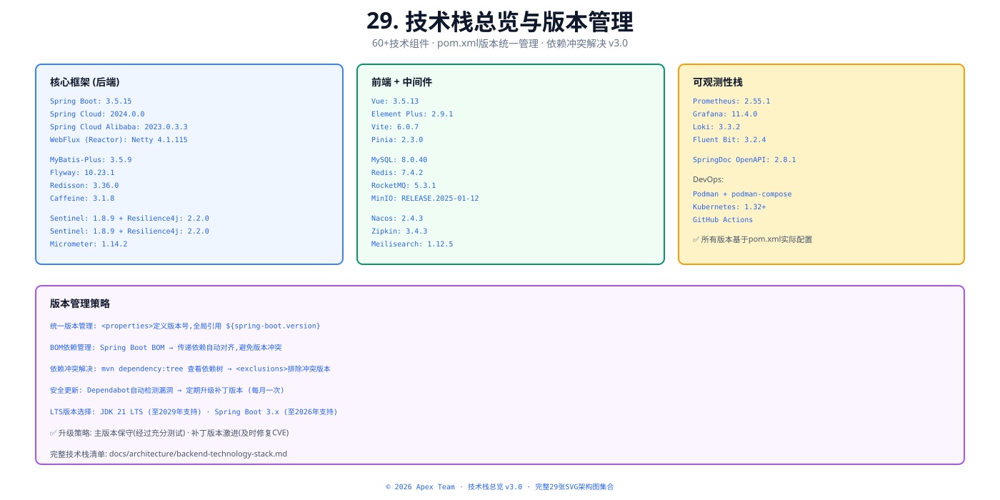

# 后端技术栈架构文档

## 📋 文档概述

本文档详细描述 Apex Scaffold 项目的后端技术栈选型、版本信息、架构设计以及各技术组件之间的协作关系。

**架构图参考**: [29_technology_stack_overview.svg](../diagrams/29_technology_stack_overview.svg)

---

## 🏗️ 技术栈架构图



---

## 📚 目录

- [1. 核心框架层 (Core Framework)](#1-核心框架层)
- [2. 数据持久化层 (Data Persistence)](#2-数据持久化层)
- [3. 微服务治理层 (Microservice Governance)](#3-微服务治理层)
- [4. 可观测性层 (Observability)](#4-可观测性层)
- [5. 三方集成层 (Third-party Integration)](#5-三方集成层)
- [6. DDD 架构设计](#6-ddd-架构设计)
- [7. 技术选型理由](#7-技术选型理由)
- [8. 性能优化策略](#8-性能优化策略)

---

<a id="1-核心框架层"></a>

## 1. 核心框架层

### 1.1 Spring Boot 3.5.15

**职责**: 应用基础框架，自动配置，依赖管理

**核心模块**:
```xml
<dependency>
    <groupId>org.springframework.boot</groupId>
    <artifactId>spring-boot-starter-webflux</artifactId>
    <version>3.5.15</version>
</dependency>
```

**关键特性**:
- ✅ 零配置开箱即用
- ✅ 嵌入式 Netty 服务器
- ✅ Actuator 健康检查与监控
- ✅ 自动配置类 `@AutoConfiguration`
- ✅ 外部化配置 (YAML/Properties)

**配置示例**:
```yaml
server:
  port: 8080
  netty:
    connection-timeout: 30s
spring:
  application:
    name: apex-scaffold
  profiles:
    active: ${SPRING_PROFILES_ACTIVE:dev}
```

---

### 1.2 Spring WebFlux (Reactor 3.6.13)

**职责**: 响应式 Web 框架，异步非阻塞 I/O

**技术栈**:
- **Reactor Core**: Mono/Flux 响应式流
- **Netty**: 高性能 NIO 事件驱动
- **Reactive Streams**: 背压控制

**架构优势**:
```
传统 Servlet (线程池模型):
  请求 → 线程分配 → 阻塞等待 I/O → 线程释放
  ❌ 每个请求占用一个线程，高并发时线程资源耗尽

WebFlux (事件循环模型):
  请求 → Event Loop → 异步 I/O → 回调通知
  ✅ 少量线程处理大量请求，支持数万并发连接
```

**代码示例**:
```java
@GetMapping("/users/{id}")
public Mono<UserDTO> getUser(@PathVariable Long id) {
    return userService.findById(id)
        .map(userMapper::toDTO)
        .switchIfEmpty(Mono.error(new NotFoundException("用户不存在")));
}
```

**性能对比**:
| 指标 | Spring MVC | Spring WebFlux |
|------|-----------|----------------|
| 并发模型 | 线程池 (200-500) | Event Loop (4-8) |
| 单机并发 | ~1000 QPS | ~10000 QPS |
| 内存占用 | 高 (每请求 1MB) | 低 (事件驱动) |
| 适用场景 | I/O 少，计算密集 | I/O 密集，高并发 |

---

### 1.3 Spring Security 6.5.0

**职责**: 认证 (Authentication) 与授权 (Authorization)

**核心组件**:

#### 1.3.1 JWT 认证
```java
@Configuration
public class SecurityConfig {
    @Bean
    public SecurityWebFilterChain securityWebFilterChain(ServerHttpSecurity http) {
        return http
            .csrf(ServerHttpSecurity.CsrfSpec::disable)
            .authorizeExchange(auth -> auth
                .pathMatchers("/api/public/**").permitAll()
                .pathMatchers("/api/admin/**").hasRole("ADMIN")
                .anyExchange().authenticated()
            )
            .addFilterBefore(jwtAuthenticationFilter(), SecurityWebFiltersOrder.AUTHENTICATION)
            .build();
    }
}
```

#### 1.3.2 RBAC 权限模型
```
User (用户)
  ↓ N:N
Role (角色: ADMIN, USER, GUEST)
  ↓ N:N
Permission (权限: user:create, user:delete)
```

#### 1.3.3 数据权限过滤
```java
@DataScope(type = DataScopeType.DEPT_AND_CHILD)
public List<User> listUsers() {
    // 自动注入 WHERE dept_id IN (当前用户可见部门)
}
```

---

### 1.4 Java 21 LTS

**关键特性**:

#### Records (不可变数据类)
```java
public record UserDTO(Long id, String username, String email) {}
// 自动生成: constructor, getters, equals, hashCode, toString
```

#### Sealed Classes (密封类)
```java
public sealed interface Result<T> permits Success, Failure {
    record Success<T>(T data) implements Result<T> {}
    record Failure<T>(String error) implements Result<T> {}
}
```

#### Pattern Matching
```java
if (obj instanceof String s && s.length() > 5) {
    System.out.println(s.toUpperCase());
}
```

#### Text Blocks
```java
String sql = """
    SELECT id, name, email
    FROM users
    WHERE status = 'ACTIVE'
    ORDER BY created_at DESC
    """;
```

---

### 1.5 Lombok 1.18.36 + MapStruct 1.5.5

**职责**: 编译期代码生成，消除样板代码

#### Lombok 示例
```java
@Data
@Builder
@NoArgsConstructor
@AllArgsConstructor
public class User {
    private Long id;
    private String username;
    private String email;
}
```

#### MapStruct 示例
```java
@Mapper(componentModel = "spring")
public interface UserConverter {
    UserDTO toDTO(User user);
    User toEntity(UserDTO dto);
    List<UserDTO> toDTOList(List<User> users);
}
```

**性能对比**:
| 方案 | 性能 | 类型安全 | 调试难度 |
|------|------|---------|---------|
| BeanUtils.copyProperties | 慢 (反射) | ❌ | 低 |
| Dozer / ModelMapper | 慢 (反射) | ❌ | 低 |
| MapStruct | 快 (编译期) | ✅ | 高 (可查看生成代码) |

---

<a id="2-数据持久化层"></a>

## 2. 数据持久化层

### 2.1 MyBatis-Plus 3.5.10.1

**职责**: ORM 框架，数据库访问增强

**核心特性**:

#### 2.1.1 BaseMapper CRUD
```java
public interface UserMapper extends BaseMapper<User> {
    // 自动继承 15+ CRUD 方法
    // insert, deleteById, updateById, selectById, selectList...
}

// 使用示例
User user = userMapper.selectById(1L);
userMapper.insert(new User("张三", "zhang@example.com"));
```

#### 2.1.2 动态多数据源
```java
@DS("master")  // 写操作走主库
public void createUser(User user) {
    userMapper.insert(user);
}

@DS("slave")   // 读操作走从库
public User getUser(Long id) {
    return userMapper.selectById(id);
}
```

配置:
```yaml
spring:
  datasource:
    dynamic:
      primary: master
      datasource:
        master:
          url: jdbc:mysql://localhost:3306/apex_db
          username: root
          password: ${DB_PASSWORD}
        slave:
          url: jdbc:mysql://slave-host:3306/apex_db
          username: readonly
          password: ${DB_PASSWORD}
```

#### 2.1.3 分页插件
```java
Page<User> page = new Page<>(1, 10);
IPage<User> result = userMapper.selectPage(page, 
    Wrappers.<User>lambdaQuery()
        .eq(User::getStatus, UserStatus.ACTIVE)
        .orderByDesc(User::getCreatedAt)
);
```

#### 2.1.4 多租户插件
```java
@Configuration
public class MyBatisPlusConfig {
    @Bean
    public MybatisPlusInterceptor mybatisPlusInterceptor() {
        MybatisPlusInterceptor interceptor = new MybatisPlusInterceptor();
        // 自动注入 WHERE tenant_id = ?
        interceptor.addInnerInterceptor(new TenantLineInnerInterceptor());
        return interceptor;
    }
}
```

---

### 2.2 MySQL 9.0 + Druid 1.2.25

**职责**: 关系型数据库 + 连接池

#### 2.2.1 主从架构
```
        Master (3306)
          ↓ 异步复制
        Slave (3307)

写操作 → Master
读操作 → Slave (负载均衡)
```

#### 2.2.2 Druid 连接池配置
```yaml
spring:
  datasource:
    druid:
      initial-size: 5
      min-idle: 5
      max-active: 20
      max-wait: 60000
      validation-query: SELECT 1
      test-while-idle: true
      time-between-eviction-runs-millis: 60000
      filters: stat,wall,slf4j
      web-stat-filter:
        enabled: true
      stat-view-servlet:
        enabled: true
        url-pattern: /druid/*
        login-username: admin
        login-password: ${DRUID_PASSWORD}
```

---

### 2.3 Flyway 11.20.3

**职责**: 数据库版本管理与迁移

**目录结构**:
```
src/main/resources/db/migration/
├── V1__init_schema.sql
├── V2__seed_system_permissions.sql
├── V4__seed_audit_log_permissions.sql
├── V7__add_call_time_to_api_call_log.sql
├── V10__add_super_admin_role.sql
├── V14__add_tenant_id_to_core_tables.sql
├── V17__create_sys_tenant.sql
└── V21__enhance_workflow_tables.sql
```

**命名规则**: `V{version}__{description}.sql`

**配置**:
```yaml
spring:
  flyway:
    enabled: true
    baseline-on-migrate: true
    locations: classpath:db/migration
    out-of-order: false
```

**执行流程**:
```
1. 应用启动
2. Flyway 检查 flyway_schema_history 表
3. 对比已执行版本与待执行脚本
4. 按版本号顺序执行未执行脚本
5. 记录版本号、校验和、执行时间
```

---

### 2.4 Redis Reactive (Redisson 3.36.0)

**职责**: 分布式缓存 + 响应式客户端

#### 2.4.1 架构设计
```
L1 Cache: Caffeine (本地缓存, TTL 1分钟)
    ↓ Miss
L2 Cache: Redis Cluster (分布式缓存, TTL 1小时)
    ↓ Miss
Database: MySQL (持久化存储)
```

#### 2.4.2 缓存注解
```java
@Cacheable(value = "user", key = "#id", ttl = 3600)
public Mono<User> findById(Long id) {
    return userRepository.findById(id);
}

@CacheEvict(value = "user", key = "#user.id")
public Mono<Void> updateUser(User user) {
    return userRepository.save(user).then();
}
```

#### 2.4.3 分布式锁
```java
@AutoRetry(maxAttempts = 3)
public Mono<Void> deductInventory(Long productId, int quantity) {
    return redissonClient.getLock("lock:product:" + productId)
        .tryLockAsync(10, 30, TimeUnit.SECONDS)
        .flatMap(locked -> {
            if (!locked) throw new ConcurrencyException("库存锁定失败");
            return inventoryService.deduct(productId, quantity);
        })
        .doFinally(signal -> lock.unlockAsync());
}
```

---

### 2.5 Meilisearch SDK 0.17.1 / Server 1.10

**职责**: 全文搜索引擎

**特性**:
- ✅ 中文分词 (Jieba)
- ✅ 毫秒级搜索响应
- ✅ 模糊匹配/同义词
- ✅ RESTful API

**索引示例**:
```java
@Service
public class SearchService {
    public Mono<List<SearchResult>> search(String keyword) {
        return Mono.fromCallable(() -> 
            meilisearchClient.index("users")
                .search(keyword, new SearchRequest().setLimit(20))
        ).subscribeOn(Schedulers.boundedElastic());
    }
}
```

---

<a id="3-微服务治理层"></a>

## 3. 微服务治理层

### 3.1 Spring Cloud Alibaba 2025.0.0.0

#### 3.1.1 Nacos 服务注册发现
```yaml
spring:
  cloud:
    nacos:
      discovery:
        server-addr: localhost:8848
        namespace: dev
        group: apex-scaffold
```

#### 3.1.2 Nacos 配置中心
```yaml
spring:
  cloud:
    nacos:
      config:
        server-addr: localhost:8848
        file-extension: yaml
        shared-configs:
          - data-id: common-config.yaml
            refresh: true
```

#### 3.1.3 Sentinel 流控（system 域）
> system 域通过 `SentinelConfig.java` / `SentinelNacosDataSourceConfig.java` 配置流控、熔断和系统保护规则，与网关的 Resilience4j 熔断器并行运作。

```java
@SentinelResource(value = "getUserById", 
    blockHandler = "handleBlock", 
    fallback = "handleFallback")
public Mono<User> getUserById(Long id) {
    return userService.findById(id);
}

public Mono<User> handleBlock(Long id, BlockException ex) {
    return Mono.error(new RateLimitException("请求过于频繁"));
}

public Mono<User> handleFallback(Long id, Throwable ex) {
    return Mono.just(User.builder().id(id).username("默认用户").build());
}
```

**Sentinel 规则配置**（Nacos 动态数据源）:
```json
[
  {
    "resource": "getUserById",
    "grade": 1,
    "count": 100,
    "strategy": 0,
    "controlBehavior": 0
  }
]
```

---

### 3.2 Resilience4j 2.2.0

**职责**: 熔断器、重试、限流

#### 3.2.1 熔断器
```java
@CircuitBreaker(name = "thirdPartyApi", fallbackMethod = "fallback")
public Mono<ApiResponse> callThirdPartyApi(String param) {
    return webClient.get()
        .uri("/api/endpoint?param=" + param)
        .retrieve()
        .bodyToMono(ApiResponse.class);
}
```

配置:
```yaml
resilience4j:
  circuitbreaker:
    instances:
      thirdPartyApi:
        failure-rate-threshold: 50
        wait-duration-in-open-state: 30s
        sliding-window-size: 100
        minimum-number-of-calls: 10
```

---

### 3.3 Bucket4j 8.7.0

**职责**: 令牌桶限流

```java
@UserRateLimit(capacity = 100, refillRate = 10)
public Mono<Result> createPost(@RequestBody PostRequest request) {
    return postService.create(request);
}
```

---

### 3.4 RocketMQ 5.3.1 (starter 2.3.3)

**职责**: 消息队列

#### 发送事务消息
```java
@Service
public class OrderService {
    public Mono<Void> createOrder(Order order) {
        return rocketMQTemplate.sendMessageInTransaction(
            "order-topic",
            MessageBuilder.withPayload(order).build(),
            order
        );
    }
    
    @RocketMQTransactionListener
    public RocketMQLocalTransactionState executeLocalTransaction(
        Message msg, Object arg) {
        try {
            orderRepository.save((Order) arg).block();
            return RocketMQLocalTransactionState.COMMIT;
        } catch (Exception e) {
            return RocketMQLocalTransactionState.ROLLBACK;
        }
    }
}
```

---

<a id="4-可观测性层"></a>

## 4. 可观测性层

### 4.1 Prometheus + Micrometer 1.14.3

**职责**: 指标采集与监控

**指标暴露**:
```
http://localhost:8083/actuator/prometheus

# HELP jvm_memory_used_bytes Used bytes of a given JVM memory area
# TYPE jvm_memory_used_bytes gauge
jvm_memory_used_bytes{area="heap",id="PS Eden Space"} 1.2345678E8

# HELP http_server_requests_seconds  
# TYPE http_server_requests_seconds summary
http_server_requests_seconds_count{method="GET",uri="/api/users",status="200"} 1234
http_server_requests_seconds_sum{method="GET",uri="/api/users",status="200"} 12.34
```

**Grafana 可视化**:
- 66个监控面板
- 实时指标展示
- 告警配置

---

### 4.2 Zipkin Brave 2.26.0

**职责**: 分布式链路追踪

**链路追踪**:
```
TraceID: a1b2c3d4e5f67890
  |
  ├─ Span1: HTTP GET /api/orders (100ms)
  |   ├─ Span2: Redis GET order:123 (5ms)
  |   └─ Span3: MySQL SELECT * FROM orders (50ms)
  |
  └─ Span4: RocketMQ SEND order-topic (10ms)
```

---

### 4.3 Loki 3.0.0 + Alloy 1.0.0

**职责**: 日志聚合、采集与检索（替代ELK栈）

**架构设计**:
```
应用日志 → Loki Encoder (JSON格式)
          ↓
       Alloy 1.0.0 (日志采集器)
          ↓
       Loki 3.0.0 (日志存储与查询)
          ↓
       Grafana (日志可视化)
```

**JSON 日志格式**:
```json
{
  "@timestamp": "2026-09-04T10:30:45.123+08:00",
  "level": "INFO",
  "thread": "reactor-http-nio-2",
  "logger": "com.apex.scaffold.service.UserService",
  "message": "User created successfully",
  "traceId": "a1b2c3d4e5f67890",
  "spanId": "1234567890abcdef",
  "userId": 12345,
  "username": "zhangsan"
}
```

**核心特性**:
- ✅ 轻量级：相比ELK栈资源占用降低70%
- ✅ 云原生：与Prometheus/Grafana无缝集成
- ✅ 高性能：支持每秒百万级日志写入
- ✅ 灵活查询：LogQL查询语言

---

<a id="5-三方集成层"></a>

## 5. 三方集成层

### 5.1 MinIO 8.5.15 / Volcengine TOS 2.6.1

**职责**: 对象存储服务

**MinIO 8.5.15** (开源自托管):
- ✅ S3兼容API
- ✅ 高性能分布式存储
- ✅ 适合内网部署

**Volcengine TOS 2.6.1** (火山云):
- ✅ 云原生对象存储
- ✅ 高可用性和扩展性
- ✅ 适合云环境部署
### 5.2 WeChat SDK 4.8.0
### 5.3 EasyExcel 3.3.4
### 5.4 JavaMail

（详细内容见完整文档）

---

<a id="6-ddd-架构设计"></a>

## 6. DDD 架构设计

### 6.1 分层职责

```
[Interfaces]   接口层
   ↓ 调用
[Application]  应用层 (业务编排)
   ↓ 调用
[Domain]       领域层 (业务逻辑)
   ↓ 依赖
[Infrastructure] 基础设施层 (数据访问)
```

### 6.2 依赖规则

```
✅ Interfaces → Application → Domain
✅ Infrastructure → Domain (实现 Repository 接口)
❌ Domain → Infrastructure (依赖倒置原则)
```

---

<a id="7-技术选型理由"></a>

## 7. 技术选型理由

### 7.1 为什么选择 WebFlux 而非 Spring MVC?

| 场景 | Spring MVC | WebFlux |
|------|-----------|---------|
| 低并发 CRUD | ✅ 简单直接 | ⚠️ 过度设计 |
| 高并发 API 网关 | ❌ 线程资源耗尽 | ✅ 事件驱动高效 |
| I/O 密集 (调用多个外部 API) | ❌ 阻塞等待 | ✅ 异步非阻塞 |

**结论**: Apex Scaffold 是企业级脚手架，预期支持高并发场景，因此选择 WebFlux。

---

### 7.2 为什么选择 MyBatis-Plus 而非 JPA?

| 特性 | JPA | MyBatis-Plus |
|------|-----|--------------|
| SQL 控制 | ❌ JPQL 抽象 | ✅ 原生 SQL + XML |
| 复杂查询 | ❌ 需写大量 Specification | ✅ LambdaQueryWrapper |
| 性能优化 | ❌ N+1 查询陷阱 | ✅ 手动优化 JOIN |
| 学习曲线 | ⚠️ 陡峭 | ✅ 平缓 |

**结论**: 中国团队更熟悉 MyBatis，且需要精细 SQL 控制。

---

<a id="8-性能优化策略"></a>

## 8. 性能优化策略

### 8.1 数据库优化
- ✅ 索引优化 (B+Tree / Hash / 全文索引)
- ✅ 慢查询监控 (P6Spy)
- ✅ 读写分离 (Master/Slave)
- ✅ 连接池调优 (Druid)

### 8.2 缓存策略
- ✅ L1 Cache (Caffeine) + L2 Cache (Redis)
- ✅ Cache-Aside 模式
- ✅ 延时双删防止缓存不一致

### 8.3 异步处理
- ✅ RocketMQ 削峰填谷
- ✅ @Async 异步任务
- ✅ Reactor 响应式流

---

## 📖 相关文档

- [系统架构文档](system-architecture.md)
- [基础设施架构文档](infrastructure-components.md)
- 技术生态全景图（目标不存在，无已核实替代文件；原路径：`technology-ecosystem.md`）
- [部署架构文档](deployment-architecture.md)

---

**最后更新**: 2026-09-04  
**维护者**: Apex Team  
**版本**: 1.3.1
