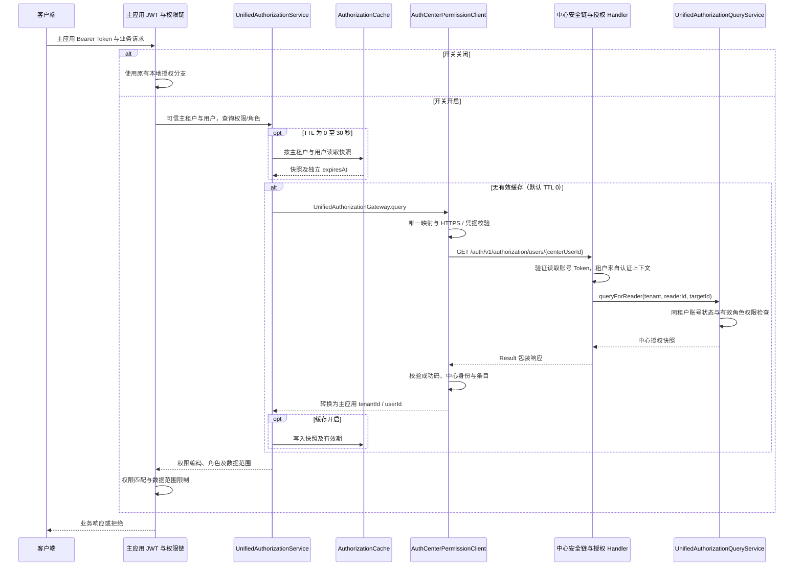

# Apex Scaffold 业务流程文档

> 文档版本: v1.0
> 创建时间: 2026-09-03
> 适用范围: 当前工作区授权实现；其他业务章节保留既有设计说明

> **配套流程图**:
> - [JWT 登录认证流程图](../diagrams/04_login_authentication_flow.svg)
> - [RBAC 权限校验流程图](../diagrams/05_permission_check_flow.svg)
> - [三级审批工作流图](../diagrams/06_workflow_approval_flow.svg)
> - [文件分片上传流程图](../diagrams/07_file_upload_flow.svg)
> - [数据流转架构图](../diagrams/62_data_flow_consistency.svg)
> - [RocketMQ消息队列架构图](../diagrams/61_message_queue_reliability.svg)

---

## 一、文档概述

本文档详细描述 Apex Scaffold 系统的核心业务流程,包括:
- 用户登录认证流程 (JWT Token)
- 权限校验流程 (RBAC + 数据权限)
- 工作流审批流程 (BPMN引擎)
- 文件上传流程 (多存储策略)

每个流程包含**流程图**和**详细步骤说明**,便于开发人员理解业务逻辑和系统实现。

---

## 二、用户登录认证流程

### 2.1 两个独立入口

| 运行边界 | 登录 / 刷新 / 登出 | 身份与响应 |
| --- | --- | --- |
| 主应用 `apex-interfaces` | `POST /api/v1/auth/login`、`/api/v1/auth/refresh`、`/api/v1/auth/logout` | 原有 `AuthHandler -> AuthService` 登录策略链与主应用用户身份 |
| 认证中心 `apex-auth-center`（默认 8081） | `POST /auth/v1/login`、`/auth/v1/refresh`、`/auth/v1/logout/{userId}` | 独立认证中心身份；登录直接返回 `LoginResponse`，刷新直接返回 `TokenPair` |

主应用通过组件扫描排除 `com.apex.scaffold.authcenter..*`，两个入口不属于同一 Spring ApplicationContext。统一授权开关不把主应用登录迁入认证中心，也不让主应用直接信任中心用户 ID。

### 2.2 认证中心登录与 Token 生命周期

`AuthenticationHandler.login` 接收用户名、密码、租户和可选设备 ID，调用 `AuthenticationApplicationService.login`；认证服务检查用户和凭据，再通过 `TokenServiceImpl` 签发与存储 Token。默认 Access Token 有效期由 `jwt.expiration=7200000` 指定，Refresh Token 由 `jwt.refresh-expiration=604800000` 指定。

`POST /auth/v1/refresh` 请求体为 `{ "refreshToken": "..." }`。实际 `TokenServiceImpl.refreshToken` 校验令牌类型，撤销旧 Refresh Token，再签发新 Token 对；客户端必须保存新的两种令牌。应用服务中旧的“不轮换”注释不代表实际行为。

`POST /auth/v1/logout/{userId}` 携带 Bearer ACCESS Token。路径 ID 必须与认证用户一致，租户取自认证上下文；撤销该用户在该租户的全部 Token，成功返回 HTTP 200 空响应体。登录、登出和刷新接口的验证用例见[认证接口集成测试源码](../../apex-auth-service/src/test/java/com/apex/scaffold/authservice/interfaces/handler/AuthenticationHandlerIntegrationTest.java)；测试使用模拟应用服务，不代表真实数据库种子或部署联调。

## 三、权限校验与统一授权流程

### 3.1 授权来源和信任边界

`apex.features.auth-center-permission=false` 为默认值，保留原有本地权限与角色分支。开启后，`PermissionService`、`RoleService` 通过 `UnifiedAuthorizationService` 获取中心授权；JWT 角色构造、`@RequirePermission` 与数据权限链据此使用中心授权来源。主应用数据库用户及可信 Reactor 租户上下文确定主身份，客户端租户头不能替代可信身份。

领域端口 `UnifiedAuthorizationGateway` 由 `AuthCenterPermissionClient` 实现。适配器解析配置中的唯一用户/租户映射，通过 HTTPS 请求 `GET /auth/v1/authorization/users/{centerUserId}`，携带专用读取账号 ACCESS Token。中心使用 Token 租户，检查读取账号与目标账号的状态，并返回有效角色和去重权限编码。

### 3.2 授权查询时序



图展示当前调用边界，不表示已完成 Mermaid 渲染验证或服务联调。关闭开关时在主应用服务层选择本地分支，不调用统一授权服务查询。

### 3.3 缓存、异常与数据范围

缓存默认关闭，配置 `cache-seconds` 允许 0–30 秒。缓存键为 `auth-center:authorization:v1:{Base64URL主租户}:{主用户ID}`，快照独立检查有效期；启用缓存后撤权与停用最多有该 TTL 延迟，目前无跨实例主动失效机制。

远程请求超时 3 秒，使用 Resilience4j 默认熔断器。缺少可信上下文、映射缺失/重复、无效凭据、中心异常或响应身份不一致时拒绝授权，不回退本地角色权限，也不使用过期缓存。最终 HTTP 状态由所在安全链或异常处理路径决定。

中心范围映射 `SELF`、`ALL`、`DEPT` 和 `DEPT_AND_CHILD`。SELF 使用主应用用户 ID；ALL 不取消租户隔离；DEPT 和 DEPT_AND_CHILD 使用主应用已认证且启用的部门信息。CUSTOM、空值和未知范围拒绝；角色/部门 ID 不复制到主库。开关不会迁移生产 `sys_*` 数据。

配置与部署前提见[配置说明](../05-operations/configuration.md#认证中心统一授权)，架构选择见[系统架构 ADR](system-architecture.md#adr-auth-center-001独立认证中心的远程授权集成)，图表适用边界见[时序图索引](../diagrams/sequence/README.md)。

---

## 四、工作流审批流程

### 4.1 流程概述

**工作流引擎**: 基于BPMN 2.0规范的轻量级工作流引擎

**核心表**:
- `wf_definition`: 流程定义表
- `wf_instance`: 流程实例表
- `wf_task`: 任务表
- `wf_approval_record`: 审批记录表

### 4.2 流程发起

**Step 1**: 用户发起流程
```javascript
POST /admin-api/v1/workflow/instances
Content-Type: application/json

{
  "definitionId": 1001,
  "businessKey": "LEAVE-2026-001",
  "variables": {
    "days": 3,
    "reason": "事假",
    "startDate": "2026-09-05"
  }
}
```

**Step 2**: 创建流程实例
```java
ProcessInstance instance = ProcessInstance.builder()
  .definitionId(definitionId)
  .businessKey(businessKey)
  .initiatorId(userId)
  .status("RUNNING")
  .startTime(LocalDateTime.now())
  .tenantId(tenantId)
  .build();
processInstanceRepository.save(instance);
```

**Step 3**: 解析BPMN获取下一节点
```java
WorkflowDefinition definition =
  definitionRepository.findById(definitionId);
String bpmnXml = definition.getBpmnXml();

// 解析BPMN,获取Start节点的下一节点
BpmnModel model = BpmnParser.parse(bpmnXml);
FlowNode nextNode = model.getNextNode("start");
```

**Step 4**: 创建第一个任务
```java
Task task = Task.builder()
  .instanceId(instanceId)
  .taskName(nextNode.getName())
  .taskKey(nextNode.getKey())
  .assigneeId(nextNode.getAssignee())
  .status("PENDING")
  .build();
taskRepository.save(task);
```

### 4.3 任务审批

**Step 1**: 审批人查看待办任务
```javascript
GET /admin-api/v1/workflow/tasks/pending
```

**响应**:
```json
{
  "code": 200,
  "data": {
    "total": 5,
    "records": [
      {
        "taskId": 10001,
        "taskName": "部门主管审批",
        "instanceId": 5001,
        "businessKey": "LEAVE-2026-001",
        "initiatorName": "张三",
        "createTime": "2026-09-03 10:00:00"
      }
    ]
  }
}
```

**Step 2**: 签收任务
```javascript
POST /admin-api/v1/workflow/tasks/{taskId}/claim
```

**后端处理**:
```java
task.setStatus("CLAIMED");
task.setClaimTime(LocalDateTime.now());
taskRepository.save(task);
```

**Step 3**: 提交审批
```javascript
POST /admin-api/v1/workflow/tasks/{taskId}/complete
Content-Type: application/json

{
  "approved": true,  // true=通过, false=驳回
  "comment": "同意请假"
}
```

**Step 4**: 完成任务
```java
task.setStatus("COMPLETED");
task.setCompleteTime(LocalDateTime.now());
taskRepository.save(task);

// 记录审批记录
ApprovalRecord record = ApprovalRecord.builder()
  .taskId(taskId)
  .approverId(userId)
  .approved(approved)
  .comment(comment)
  .approveTime(LocalDateTime.now())
  .build();
approvalRecordRepository.save(record);
```

**Step 5**: 流程流转

**通过**: 创建下一个任务
```java
FlowNode nextNode = model.getNextNode(currentNode.getKey());
if (nextNode != null) {
  createTask(nextNode);
} else {
  // 流程结束
  instance.setStatus("COMPLETED");
  instance.setEndTime(LocalDateTime.now());
}
```

**驳回**: 根据驳回策略处理
- 驳回到发起人: 流程终止
- 驳回到上一节点: 重新创建上一个任务
- 驳回重新提交: 回到第一个任务节点

### 4.4 流程状态机

**流程实例状态**:
- `RUNNING`: 运行中
- `SUSPENDED`: 已挂起
- `COMPLETED`: 已完成
- `TERMINATED`: 已终止

**任务状态**:
- `PENDING`: 待办
- `CLAIMED`: 已签收
- `COMPLETED`: 已完成
- `REJECTED`: 已驳回

**状态转换规则**:
```
PENDING → CLAIMED (签收)
CLAIMED → COMPLETED (通过)
CLAIMED → REJECTED (驳回)
PENDING → TERMINATED (流程终止)
```

---

## 五、文件上传流程

### 5.1 流程概述

**支持的存储策略**:
1. **本地存储**: 文件存储在应用服务器本地磁盘
2. **MinIO**: 私有化对象存储,S3兼容API
3. **火山云TOS**: 公有云对象存储,CDN全球加速

**存储策略配置**:
```yaml
file:
  storage:
    type: minio  # local / minio / tos
    max-size: 10MB
    allowed-types:
      - image/jpeg
      - image/png
      - application/pdf
```

### 5.2 前端上传流程

**Step 1**: 用户选择文件
```javascript
<input type="file" @change="handleFileChange" />
```

**Step 2**: 前端预检
```javascript
function handleFileChange(event) {
  const file = event.target.files[0];

  // 大小检查
  if (file.size > 10 * 1024 * 1024) {
    ElMessage.error('文件大小不能超过10MB');
    return;
  }

  // 类型检查
  const allowedTypes = ['image/jpeg', 'image/png', 'application/pdf'];
  if (!allowedTypes.includes(file.type)) {
    ElMessage.error('不支持的文件类型');
    return;
  }

  uploadFile(file);
}
```

**Step 3**: 上传文件
```javascript
function uploadFile(file) {
  const formData = new FormData();
  formData.append('file', file);
  formData.append('bizType', 'avatar'); // 业务类型

  axios.post('/admin-api/v1/files/upload', formData, {
    headers: { 'Content-Type': 'multipart/form-data' },
    onUploadProgress: (progressEvent) => {
      const percent = Math.round(
        (progressEvent.loaded * 100) / progressEvent.total
      );
      console.log(`上传进度: ${percent}%`);
    }
  }).then(response => {
    const { fileId, accessUrl } = response.data;
    ElMessage.success('上传成功');
  });
}
```

### 5.3 后端处理流程

**Step 1**: 接收文件
```java
@PostMapping("/upload")
public Mono<Result<FileUploadResponse>> upload(
  @RequestPart("file") FilePart filePart,
  @RequestParam("bizType") String bizType
) {
  return fileService.upload(filePart, bizType);
}
```

**Step 2**: 后端校验
```java
// 文件大小校验
if (filePart.headers().getContentLength() > maxSize) {
  throw new BusinessException("文件大小超过限制");
}

// 文件类型校验
String contentType = filePart.headers().getContentType().toString();
if (!allowedTypes.contains(contentType)) {
  throw new BusinessException("不支持的文件类型");
}

// 病毒扫描 (可选)
if (virusScanEnabled) {
  virusScanner.scan(filePart);
}
```

**Step 3**: 生成文件名
```java
String originalFilename = filePart.filename();
String extension = FilenameUtils.getExtension(originalFilename);
String newFilename = UUID.randomUUID().toString() + "." + extension;
```

**Step 4**: 根据策略存储文件

#### 策略1: 本地存储
```java
String basePath = "/upload/files/";
String datePath = LocalDate.now().format(
  DateTimeFormatter.ofPattern("yyyy/MM/dd")
);
String fullPath = basePath + datePath + "/" + newFilename;

File targetFile = new File(fullPath);
targetFile.getParentFile().mkdirs();

filePart.transferTo(targetFile).block();
```

#### 策略2: MinIO
```java
MinioClient minioClient = MinioClient.builder()
  .endpoint(minioConfig.getEndpoint())
  .credentials(minioConfig.getAccessKey(),
               minioConfig.getSecretKey())
  .build();

String bucketName = "apex-files";
String objectName = datePath + "/" + newFilename;

minioClient.putObject(
  PutObjectArgs.builder()
    .bucket(bucketName)
    .object(objectName)
    .stream(filePart.content(), -1, 10485760)
    .contentType(contentType)
    .build()
);
```

#### 策略3: 火山云TOS
```java
TOSClient tosClient = new TOSClient(
  tosConfig.getRegion(),
  tosConfig.getAccessKeyId(),
  tosConfig.getAccessKeySecret()
);

String bucketName = "apex-files";
String objectKey = datePath + "/" + newFilename;

PutObjectRequest request = new PutObjectRequest(bucketName, objectKey)
  .withContent(filePart.content())
  .withContentType(contentType);

tosClient.putObject(request);
```

**Step 5**: 保存文件元数据
```java
FileEntity fileEntity = FileEntity.builder()
  .fileName(newFilename)
  .originalName(originalFilename)
  .filePath(fullPath)
  .fileSize(filePart.headers().getContentLength())
  .contentType(contentType)
  .md5(calculateMD5(filePart))
  .storageType(storageType)
  .bizType(bizType)
  .uploadUserId(SecurityContextHolder.getUserId())
  .tenantId(TenantContext.getTenantId())
  .build();

fileRepository.save(fileEntity);
```

**Step 6**: 返回访问URL
```json
{
  "code": 200,
  "message": "上传成功",
  "data": {
    "fileId": 10001,
    "fileName": "abc123.jpg",
    "originalName": "头像.jpg",
    "fileSize": 102400,
    "accessUrl": "https://cdn.example.com/files/2026/09/03/abc123.jpg"
  }
}
```

### 5.4 文件访问控制

**公开文件**: 直接访问URL
```
GET https://cdn.example.com/files/2026/09/03/abc123.jpg
```

**私有文件**: 需要Token认证
```
GET /admin-api/v1/files/{fileId}/download
Authorization: Bearer {accessToken}
```

**后端鉴权**:
```java
@GetMapping("/{fileId}/download")
public Mono<ResponseEntity<Resource>> download(@PathVariable Long fileId) {
  // 1. 查询文件元数据
  FileEntity file = fileRepository.findById(fileId).block();

  // 2. 权限校验
  Long currentUserId = SecurityContextHolder.getUserId();
  if (!hasPermission(currentUserId, file)) {
    throw new BusinessException("无权限访问该文件");
  }

  // 3. 返回文件流
  Resource resource = loadFileResource(file);
  return Mono.just(ResponseEntity.ok()
    .header(HttpHeaders.CONTENT_DISPOSITION,
            "attachment; filename=\"" + file.getOriginalName() + "\"")
    .body(resource));
}
```

---

## 六、流程优化建议

### 6.1 登录流程优化

以下为既有设计建议，示例路径不作为当前已注册接口；当前登录、刷新与登出契约见第 2 节。

**优化点1**: 验证码防暴力破解
```java
// 登录失败3次后要求验证码
if (loginFailCount >= 3) {
  requireCaptcha = true;
}
```

**优化点2**: 短信验证码登录
```java
POST /admin-api/v1/auth/login-by-sms
{
  "phone": "13800138000",
  "code": "123456"
}
```

**优化点3**: 单点登录(SSO)
```java
// OAuth2授权码模式
GET /oauth/authorize
  ?client_id=xxx
  &redirect_uri=xxx
  &response_type=code
```

### 6.2 权限校验优化

以下为历史本地授权优化建议，不适用于当前远程统一授权。统一授权缓存默认关闭、TTL 上限 30 秒，尚无跨实例主动失效；不得按下面的 1 小时缓存或预加载示例配置远程授权。

**优化点1**: 权限缓存
```java
// 缓存用户权限1小时,减少数据库查询
@Cacheable(value = "user:permissions", key = "#userId", ttl = 3600)
```

**优化点2**: 权限预加载
```java
// 登录时一次性加载所有权限到Redis
redisTemplate.opsForSet().add("user:permissions:" + userId, permissions);
```

**优化点3**: 权限变更实时失效
```java
// 角色权限修改后,清除相关用户缓存
@CacheEvict(value = "user:permissions", allEntries = true)
public void updateRolePermissions(Long roleId, List<Long> permissionIds) {
  // 更新逻辑
}
```

### 6.3 工作流优化

**优化点1**: 并行审批
```java
// BPMN并行网关,多人同时审批
<parallelGateway id="parallelGateway1" />
```

**优化点2**: 审批超时提醒
```java
// 定时任务扫描超时任务
@Scheduled(cron = "0 */30 * * * ?")
public void checkTimeout() {
  List<Task> timeoutTasks = taskRepository
    .findByStatusAndCreateTimeBefore("PENDING",
                                     LocalDateTime.now().minusDays(2));
  // 发送提醒
}
```

**优化点3**: 审批委托
```java
// 审批人设置委托人代为审批
POST /admin-api/v1/workflow/tasks/{taskId}/delegate
{
  "delegateUserId": 10002
}
```

### 6.4 文件上传优化

**优化点1**: 分片上传(大文件)
```javascript
// 前端分片上传
function uploadChunks(file) {
  const chunkSize = 2 * 1024 * 1024; // 2MB
  const chunks = Math.ceil(file.size / chunkSize);

  for (let i = 0; i < chunks; i++) {
    const chunk = file.slice(i * chunkSize, (i + 1) * chunkSize);
    uploadChunk(chunk, i, chunks);
  }
}
```

**优化点2**: 断点续传
```java
// 记录已上传分片
redisTemplate.opsForSet().add("upload:" + uploadId, chunkIndex);
```

**优化点3**: 文件秒传(MD5去重)
```java
// 上传前计算MD5,检查是否已存在
String md5 = calculateMD5(file);
FileEntity existFile = fileRepository.findByMd5(md5);
if (existFile != null) {
  // 秒传,直接返回已有文件
  return existFile;
}
```

---

## 七、附录

### 7.1 相关文档

- [系统架构设计文档](system-architecture.md)
- [数据库设计文档](database-design.md)
- [配置文件完整性检查报告](../_archive/operations/configuration.md)

### 7.2 状态码说明

| 状态码 | 说明 | 适用场景 |
|--------|------|---------|
| 200 | 成功 | 请求成功 |
| 400 | 参数错误 | 请求参数不合法 |
| 401 | 未认证 | Token无效或已过期 |
| 403 | 无权限 | 无操作权限 |
| 404 | 不存在 | 资源不存在 |
| 500 | 服务器错误 | 服务器内部错误 |

### 7.3 业务错误码

| 错误码 | 说明 | 场景 |
|--------|------|------|
| `1001` | 用户不存在 | 登录时用户名不存在 |
| `1002` | 密码错误 | 登录时密码验证失败 |
| `1003` | 账号已禁用 | 用户状态为禁用 |
| `2001` | 无操作权限 | RBAC权限校验失败 |
| `2002` | 无数据权限 | 数据范围权限校验失败 |
| `3001` | 流程不存在 | 工作流定义不存在 |
| `3002` | 任务不存在 | 工作流任务不存在 |
| `4001` | 文件类型不支持 | 文件上传类型校验失败 |
| `4002` | 文件大小超限 | 文件上传大小校验失败 |

---

**文档维护者**: 架构团队
**审核状态**: 待人工审核
**下次更新**: 业务流程变更后同步更新
