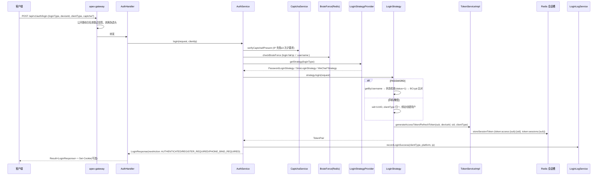
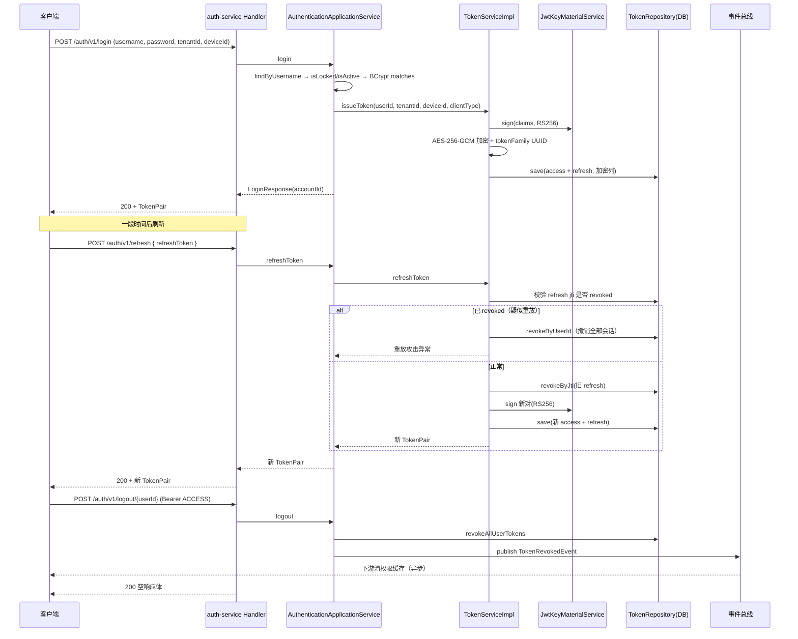
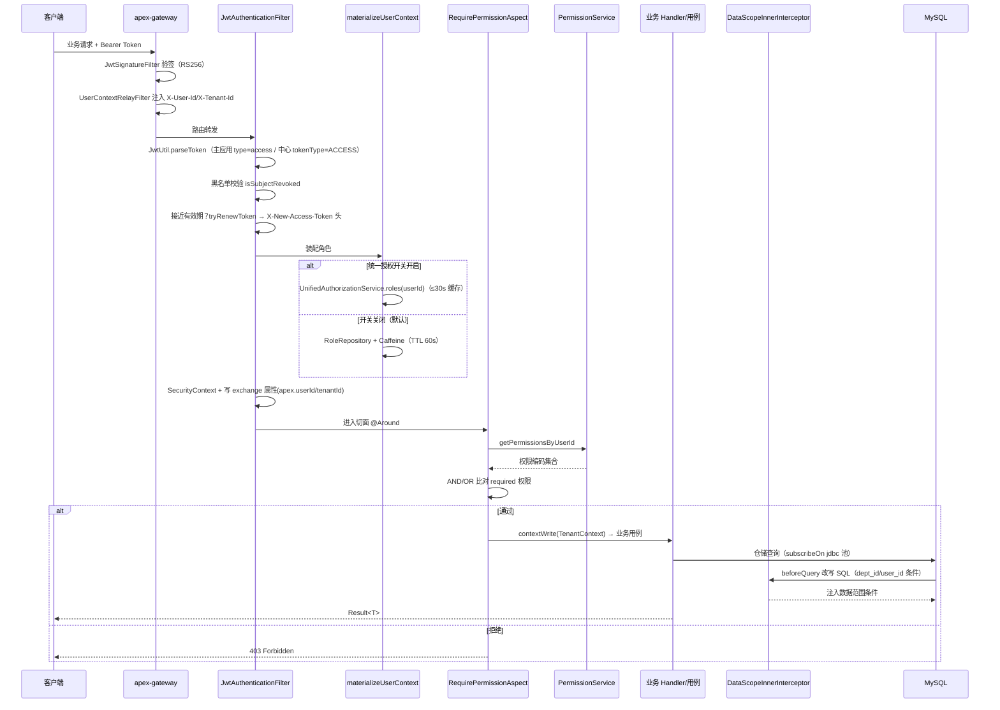
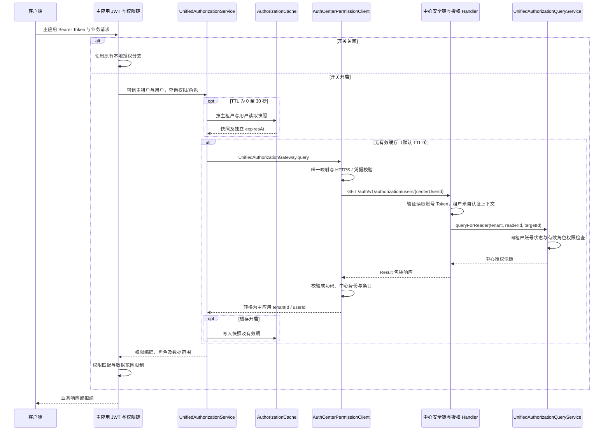
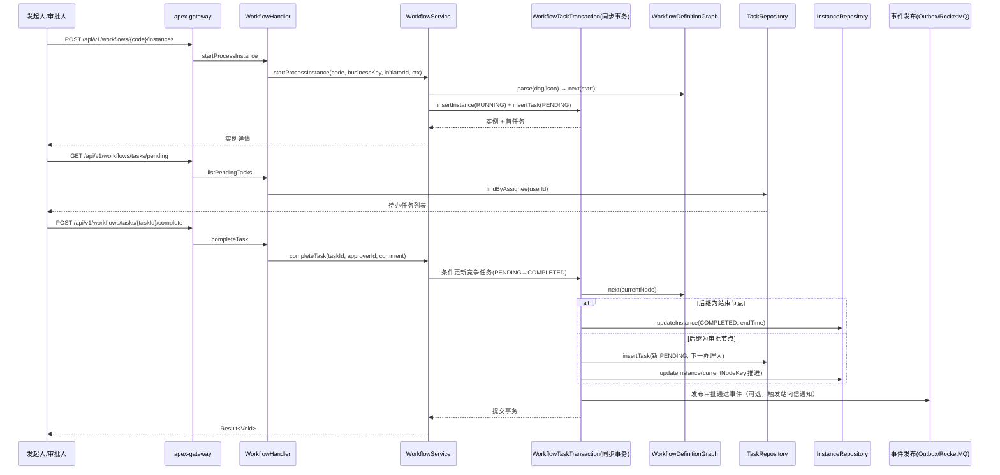
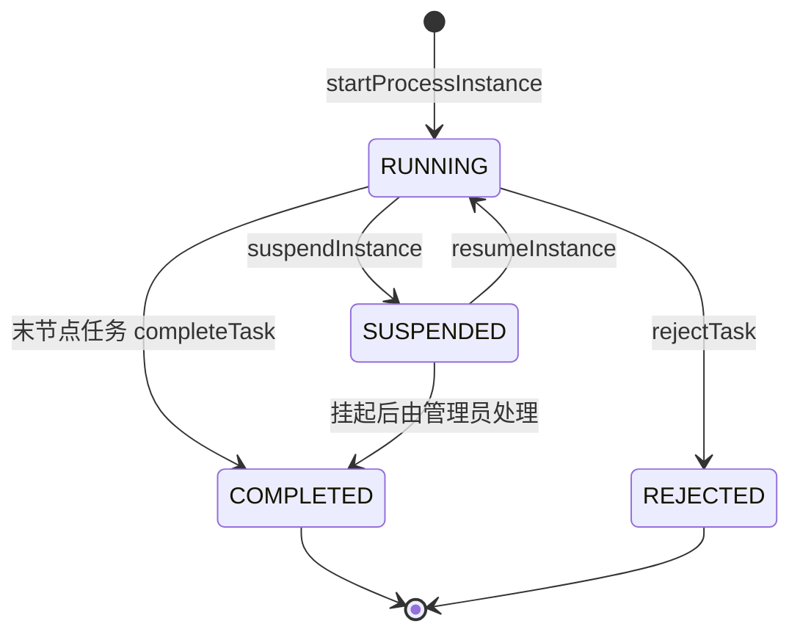
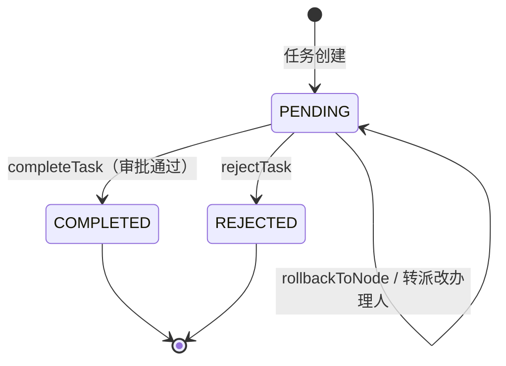
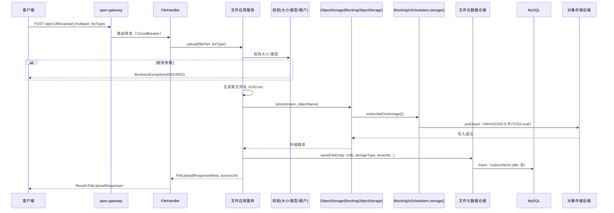

# Apex Scaffold 业务流程文档

> 文档版本: v1.1
> 创建时间: 2026-09-03
> 最近更新: 2026-10-28（按当前代码实现补充时序图与流程图，修正接口路径）
> 适用范围: 当前工作区授权实现；其他业务章节保留既有设计说明

> **配套流程图**:
> - [JWT 登录认证流程图](../diagrams/04_login_authentication_flow.svg)
> - [RBAC 权限校验流程图](../diagrams/05_permission_check_flow.svg)
> - [三级审批工作流图](../diagrams/06_workflow_approval_flow.svg)
> - [文件分片上传流程图](../diagrams/07_file_upload_flow.svg)
> - [数据流转架构图](../diagrams/62_data_flow_consistency.svg)
> - [RocketMQ消息队列架构图](../diagrams/61_message_queue_reliability.svg)
> - [时序图集](../diagrams/sequence/README.md)

---

## 一、文档概述

本文档详细描述 Apex Scaffold 系统的核心业务流程,包括:
- 用户登录认证流程 (多端统一账户 + JWT Token)
- 权限校验流程 (RBAC + 数据权限 + 统一授权)
- 工作流审批流程 (DAG 引擎)
- 文件上传流程 (五后端存储策略 + 分片上传)

每个流程包含**流程图/时序图**和**详细步骤说明**,便于开发人员理解业务逻辑和系统实现。接口路径与状态码以当前代码为准；历史 SVG 图集中的旧机制如有出入，以本文为准。

---

## 二、用户登录认证流程

### 2.1 两套独立登录入口

系统存在两套并行的登录体系，各自有独立的路由、Token 存储与签名方式：

| 运行边界 | 登录 / 刷新 / 登出 | Token 存储与签名 | 适用端 |
| --- | --- | --- | --- |
| 主应用 `apex-system-service` | `POST /api/v1/auth/login`、`/api/v1/auth/refresh`、`/api/v1/auth/logout` | Redis 会话槽（按 `sid` 多会话）+ HS256 共享密钥 | C 端/APP/小程序 |
| 认证中心 `apex-auth-service`（默认 8081） | `POST /auth/v1/login`、`/auth/v1/refresh`、`/auth/v1/logout/{userId}` | 数据库加密 Token 表 + RS256 非对称密钥 | B 端/PC_ADMIN |

两个入口不属于同一 Spring ApplicationContext（主应用扫描排除 authcenter 包）。统一授权开关 `apex.features.auth-center-permission` 不把主应用登录迁入认证中心，也不让主应用直接信任中心用户 ID。

### 2.2 主应用登录链路（多端统一账户）

主应用登录由 `PublicApiRouter` 挂载 `AuthHandler`，前缀 `/api/v1/auth`。`AuthService#login` 的主流程：

1. **验证码预检**（`verifyCaptchaIfPresent`）：同一 IP 失败次数达 `captcha-after-failures`（默认 3 次）后强制要求验证码。
2. **暴力破解检查**（`checkBruteForce`）：Redis 键 `login:fail:ip:` / `login:fail:username:` 计数，阈值由 `LoginProtectionProperties` 控制。
3. **策略分发**（`LoginStrategyProvider.getStrategy(loginType)`）：按 `LoginType` 枚举选择登录策略。
4. **令牌签发与存储**（`TokenServiceImpl`）：生成 Access/Refresh Token，按 `(subject, sid)` 写入 Redis 多会话槽，登记会话索引 `token:sessions:{sub}`。
5. **登录日志**（`LoginLogService`）：记录 clientType/platform/IP。

支持的 `LoginType`：`PASSWORD`、`WX_CODE`、`WX_PHONE`、`WX_SMS`、`CL_PHONE`、`CL_SMS`。手机号注册用户 openId 为 `PHONE_xxx` 占位，绑定微信后用真实 openId 替换并清理旧 Token。

**Access Token 有效期** `jwt.access-token-expire=7200000`（2h），**Refresh Token** `jwt.refresh-token-expire=604800000`（7d），滑动续期阈值 `jwt.access-token-renew-threshold=1800000`（剩余 <30min 时由 `JwtAuthenticationFilter` 经 `X-New-Access-Token` 头无感续发）。

**多会话语义**：一个用户多 Token 共存、互不覆盖，登录不互踢。每次登录生成新 `sid`，令牌按 `(subject, sid)` 独立 Redis 槽；刷新沿用旧 claims 的 sid/clientType，轮换锁按会话隔离。互踢仅在三种情况：主动登出（默认当前会话，`scope=all` 全端）、超管强制下线（`AdminUserManagementService#revokeSessions`）、账号注销后 subject 吊销。

#### 登录认证时序图



### 2.3 Token 刷新与登出

**刷新链**（`AuthHandler#refresh → AuthService#refreshToken`）：解析 Refresh Token → 设备指纹比对 → 黑名单校验（`isSubjectRevoked`）→ 签发新 Token 对 → `TokenServiceImpl#rotateRefreshToken`（分布式锁 `token:refresh:rotate:{sub}:{sid}`，按会话隔离原子轮换）。客户端必须保存新的两种令牌。

**登出链**（`AuthService.logout`）：三层防御——黑名单当前 Access（TTL=Access 有效期）→ 拉黑存储的 Refresh → 删会话槽。`scope=all` 遍历 `token:sessions:{sub}` 索引全清。

### 2.4 认证中心登录与 Token 生命周期

`AuthenticationHandler.login`（`POST /auth/v1/login`）接收用户名、密码、租户和可选设备 ID，调用 `AuthenticationApplicationService.login`：校验用户与凭据（BCrypt）→ `TokenServiceImpl#issueToken` 签发（RS256 非对称，`JwtKeyMaterialService`）→ `TokenEncryptionService` AES-256-GCM 加密 → `tokenRepository.save` 落库（数据库，非 Redis）→ 返回 `LoginResponse`（含 accountId）。

`POST /auth/v1/refresh` 请求体为 `{ “refreshToken”: “...” }`。`TokenServiceImpl#refreshToken` 是**轮换**的：校验令牌类型 → 若已 revoked 判定重放攻击（审计 + 撤销该用户全部会话）→ 否则撤销旧 Refresh → 签发新 Token 对落库。

`POST /auth/v1/logout/{userId}` 携带 Bearer ACCESS Token。路径 ID 必须与认证用户一致，租户取自认证上下文；`revokeAllUserTokens` 撤销该用户在该租户的全部 Token，并发布 `TokenRevokedEvent` 通知下游清权限缓存，成功返回 HTTP 200 空响应体。

#### 认证中心 Token 生命周期时序图



登录、登出和刷新接口的验证用例见[认证接口集成测试源码](../../apex-auth-service/src/test/java/com/apex/scaffold/authservice/interfaces/handler/AuthenticationHandlerIntegrationTest.java)；测试使用模拟应用服务,不代表真实数据库种子或部署联调。

<a id="三权限校验与统一授权流程"></a>

## 三、权限校验与统一授权流程

### 3.1 鉴权职责分层

鉴权在**网关**与**业务服务**两层完成，职责分明：

- **网关**（`apex-gateway`）：`JwtSignatureFilter` 仅做 Token 验签与主体提取（JWKS RS256，过渡期兼容 HMAC 双 kid），不做授权决策；`UserContextRelayFilter` 注入可信头 `X-User-Id` / `X-Tenant-Id` / `X-Client-Type`。`/internal/**` 路径在网关直接拒绝公网访问。
- **业务服务**：`JwtAuthenticationFilter` 解析令牌（主应用与认证中心双令牌分支）→ 黑名单校验 → 滑动续期 → `materializeUserContext` 装配角色 → `RequirePermissionAspect` 校验 `@RequirePermission`（AND/OR）。数据权限由 `@DataScope` + `DataScopeInnerInterceptor` 在 SQL 层改写。

#### 权限校验时序图



### 3.2 授权来源和信任边界

`apex.features.auth-center-permission=false` 为默认值，保留原有本地权限与角色分支。开启后，`PermissionService`、`RoleService` 通过 `UnifiedAuthorizationService` 获取中心授权；JWT 角色构造、`@RequirePermission` 与数据权限链据此使用中心授权来源。主应用数据库用户及可信 Reactor 租户上下文确定主身份，客户端租户头不能替代可信身份。

领域端口 `UnifiedAuthorizationGateway` 由 `AuthCenterPermissionClient` 实现。适配器解析配置中的唯一用户/租户映射，通过 HTTPS 请求 `GET /auth/v1/authorization/users/{centerUserId}`，携带专用读取账号 ACCESS Token。中心使用 Token 租户，检查读取账号与目标账号的状态，并返回有效角色和去重权限编码。

### 3.3 授权查询时序



图展示当前调用边界，不表示已完成 Mermaid 渲染验证或服务联调。关闭开关时在主应用服务层选择本地分支，不调用统一授权服务查询。

### 3.4 缓存、异常与数据范围

缓存默认关闭，配置 `cache-seconds` 允许 0–30 秒。缓存键为 `auth-center:authorization:v1:{Base64URL主租户}:{主用户ID}`，快照独立检查有效期；启用缓存后撤权与停用最多有该 TTL 延迟，目前无跨实例主动失效机制。

远程请求超时 3 秒，使用 Resilience4j 默认熔断器。缺少可信上下文、映射缺失/重复、无效凭据、中心异常或响应身份不一致时拒绝授权，不回退本地角色权限，也不使用过期缓存。最终 HTTP 状态由所在安全链或异常处理路径决定。

中心范围映射 `SELF`、`ALL`、`DEPT` 和 `DEPT_AND_CHILD`。SELF 使用主应用用户 ID；ALL 不取消租户隔离；DEPT 和 DEPT_AND_CHILD 使用主应用已认证且启用的部门信息。CUSTOM、空值和未知范围拒绝；角色/部门 ID 不复制到主库。开关不会迁移生产 `sys_*` 数据。

配置与部署前提见[配置说明](../05-operations/configuration.md#认证中心统一授权)，架构选择见[系统架构 ADR](system-architecture.md#adr-auth-center-001独立认证中心的远程授权集成)，图表适用边界见[时序图索引](../diagrams/sequence/README.md)。

---

## 四、工作流审批流程

### 4.1 流程概述

**工作流引擎**：基于 DAG（有向无环图）的轻量级工作流引擎，流程定义以 `dagJson` 存储，由 `WorkflowDefinitionGraph` 解析节点与后继关系，而非 BPMN XML。

**核心表**（`apex-workflow-service/src/main/resources/db/migration/mysql/`）：
- `wf_workflow_definition`：流程定义表（含 `dag_json`、版本与启用状态）
- `wf_process_instance`：流程实例表
- `wf_task`：任务表
- `wf_approval_record`：审批记录表
- `wf_scheduler_lease`：超时扫描租约表（防多实例重复扫描）

**核心类**：
- `WorkflowRouter` / `WorkflowDefinitionRouter`：接口层路由
- `WorkflowHandler` / `WorkflowDefinitionHandler`：请求处理
- `WorkflowService`（`apex-workflow`）：领域应用服务，承载发起/完成/驳回/回退/转办/委派/挂起/恢复
- `WorkflowDefinitionGraph`：DAG 解析与节点推进
- `WorkflowTimeoutHandler`：超时扫描（XXL-Job 接管，`wf_scheduler_lease` 租约保证单实例执行）
- `WorkflowEventConfig`：事件发布（Outbox + RocketMQ，basic/H2 回退本地发布器）

### 4.2 接口路由

| 操作 | 方法 + 路径 | Handler 方法 |
| --- | --- | --- |
| 发起流程实例 | `POST /api/v1/workflows/{workflowCode}/instances` | `startProcessInstance` |
| 待办任务 | `GET /api/v1/workflows/tasks/pending` | `listPendingTasks` |
| 完成任务（审批通过） | `POST /api/v1/workflows/tasks/{taskId}/complete` | `completeTask` |
| 回退任务 | `POST /api/workflow/tasks/{taskId}/rollback` | `rollbackTask` |
| 转办任务 | `POST /api/workflow/tasks/{taskId}/transfer` | `transferTask` |
| 委派任务 | `POST /api/workflow/tasks/{taskId}/delegate` | `delegateTask` |
| 挂起实例 | `POST /api/workflow/instances/{instanceId}/suspend` | `suspendInstance` |
| 恢复实例 | `POST /api/workflow/instances/{instanceId}/resume` | `resumeInstance` |
| 实例详情（管理端） | `GET /admin-api/v1/workflows/instances/{instanceId}` | `getInstanceDetail` |
| 统计/趋势 | `GET /admin-api/v1/workflows/statistics`、`/statistics/trend` | `getStatistics` / `getTrend` |
| 流程定义 CRUD | `/api/v2/workflow-definitions` 系列 | `WorkflowDefinitionHandler` |

> 注：网关谓词覆盖 `/api/v1/workflows/**`、`/api/v2/workflow-definitions/**`、`/api/workflow/**`、`/admin-api/v1/workflows/**`，统一转发到 `apex-workflow-service`。

### 4.3 流程发起与任务流转

`WorkflowService#startProcessInstance(workflowCode, businessKey, initiatorId, contextJson)` 在**同步事务**（`WorkflowTaskTransaction`）内完成：

1. `workflowDefinitionRepository.findByCode(workflowCode)` 取已发布定义。
2. `WorkflowDefinitionGraph.parse(definition.getDagJson())` 解析 DAG。
3. 取起始节点的后继 `graph.next(graph.start())`：
   - 后继为空或结束节点 → 实例直接 `COMPLETED`。
   - 否则实例状态 `RUNNING`，`currentNodeKey` 置为后继节点，创建首个 `PENDING` 任务。
4. 同事务内 `insertInstance` + `insertTask`。

`completeTask(taskId, approverId, comment)` 在同步事务内以**条件更新竞争任务**（乐观锁，`requireOne(updateTask)` 保证只更新一行）：

1. `validatePendingTask` 校验任务属于当前操作人且为 `PENDING`。
2. 置任务 `COMPLETED` + `completedTime`。
3. 取后继节点 `graph.next(current)`：
   - 为空或结束 → 实例 `COMPLETED` + `endTime`。
   - 否则 `currentNodeKey` 推进，`insertTask` 创建下一个 `PENDING` 任务。
4. 写审批记录 `ApprovalRecord`。

`rejectTask` 置任务 `REJECTED`，实例同步 `REJECTED` + `endTime`。`rollbackToNode(targetNodeCode)` 回退到指定节点；`transferTask` / `delegateTask` 改派办理人。

#### 工作流审批时序图



### 4.4 流程状态机

**流程实例状态**（`ProcessInstance`）：
- `RUNNING`：运行中
- `SUSPENDED`：已挂起
- `COMPLETED`：已完成
- `REJECTED`：已驳回（驳回时实例同步终止）

**任务状态**（`Task`）：
- `PENDING`：待办
- `COMPLETED`：已完成（审批通过）
- `REJECTED`：已驳回

**超时策略**（`Task.timeoutStrategy`，默认 `ESCALATE`）：
- `AUTO_COMPLETE`：超时自动完成
- `ESCALATE`：超时升级（触发提醒/转派）





> 注：当前实现无 `CLAIMED`（签收）状态，任务直接由 `assigneeId` 办理人完成或驳回；任务归属校验在 `validatePendingTask` 完成。历史 SVG 图（`06_workflow_approval_flow.svg`）若含签收状态，以本文为准。

---

## 五、office 审批撤销流程（幂等编排）

> 状态机与时序细节见 `docs/diagrams/126_approval_cancel_state_machine.svg`（`.mmd` 源同名）。

office 审批（`OfficeApprovalService`）发起后可撤销：撤销涉及"远端办公平台撤销 + 本地流程状态更新"
两步非原子操作，2026-11-12 起改为幂等编排（`off_approval_cancel_operation` 表，V9/V10 迁移）：

1. **受理**：`DELETE /api/office/approvals/{processInstanceId}` 创建编排记录（`PENDING`，
   幂等键客户端传入、租户内唯一；未传时自动生成），重复请求命中既有编排直接重放结果。
2. **远端撤销**：调用办公平台撤销 API；成功后编排记录置 `REMOTE_CANCELLED`（远端已撤销、
   本地未落库的中间态）。
3. **本地补偿**：`ApprovalCancelOperationRepositoryImpl#completeCancel` 在同一同步事务内
   （jdbc 阻塞池执行）将流程置 `CANCELLED` 并推进编排记录为 `COMPLETED`；审批流程更新使用
   乐观锁，版本冲突整体回滚返回 false，由调用方按远端已撤销语义重试。
4. **失败**：任一步失败置 `FAILED` 并保留 `error_message`（成功后不清理，留审计线索），
   重试经 `markPending` 复用同一幂等键。
5. **重放口径**：`COMPLETED` 与 `REMOTE_CANCELLED` 均视为重放成功（`isReplayableAsSuccess`），
   不再触发远端撤销。

| 阶段 | 含义 | 后续 |
| --- | --- | --- |
| `PENDING` | 已受理，未收到远端结果 | 远端成功 → `REMOTE_CANCELLED`；失败 → `FAILED` |
| `REMOTE_CANCELLED` | 远端撤销成功、本地未落库 | 补偿事务 → `COMPLETED`；重放直接成功 |
| `COMPLETED` | 远端与本地均完成 | 终态，重放直接返回成功 |
| `FAILED` | 远端或本地失败 | `markPending` 重试 |

## 六、文件上传流程

### 6.1 流程概述

**支持的存储策略**（由 `apex-storage-spring-boot-starter` 自动装配，五后端按配置选择）：
1. **本地存储**（`LocalStorage`）：应用服务器本地磁盘
2. **MinIO**（`MinioStorage`）：私有化对象存储，S3 兼容
3. **阿里云 OSS**（`OssStorage`）
4. **七牛云**（`QiniuStorage`）
5. **火山云 TOS**（`TosStorage`）

统一抽象端口为 `ObjectStorage`；所有后端经 `BlockingObjectStorage` 包装，同步 SDK 调用隔离到 `BlockingIoSchedulers.storage()` 池。配置切换通过 `apex.storage.type` 等键完成，由 `StorageAutoConfiguration` 按条件装配。

**存储策略配置示例**（以 MinIO 为例）：
```yaml
apex:
  storage:
    type: minio  # local / minio / oss / qiniu / tos
    max-size: 10MB
    allowed-types:
      - image/jpeg
      - image/png
      - application/pdf
```

### 6.2 接口路由

文件域接口由 `apex-file-service` 的 `FileRouter` / `ChunkRouter` / `DocumentRouter` / `ChartRouter` 注册，网关谓词覆盖 `/api/v1/file/**`、`/api/v1/files/**`、`/api/v1/documents/**`、`/admin-api/v1/documents/**`。

| 操作 | 方法 + 路径 |
| --- | --- |
| 普通上传 | `POST /api/v1/file/upload` |
| 分片初始化 | `POST /api/v1/file/chunk/init` |
| 分片上传 | `POST /api/v1/file/chunk/upload` |
| 分片合并 | `POST /api/v1/file/chunk/merge` |
| 分片状态查询 | `GET /api/v1/file/chunk/status/{fileId}` |
| 分片清理重试 | `POST /api/v1/file/chunk/cleanup/{fileId}/retry` |
| 文件下载/内容 | `GET /api/v1/file/content`、`/api/v1/file/url` |
| 文件预览 | `GET /api/v1/file/preview` |
| 文件存在性 | `GET /api/v1/file/exists` |
| 文件删除 | `POST /api/v1/file/delete` |
| 孤儿文件重试 | `POST /api/v1/file/orphan/{fileId}/retry` |

> 注：管理后台是独立前端项目，下列前端片段仅为协议示意，不代表后端生成或维护前端代码。

### 6.3 上传处理链

普通上传（`FileRouter` → Handler → 应用服务）：校验大小/类型/租户 → 生成新文件名（UUID + 原扩展名）→ 调用 `ObjectStorage` 写入后端（`subscribeOn(storage())` 隔离阻塞）→ 保存文件元数据到 `file` 域表（含 `md5`、`storageType`、`bizType`、`uploadUserId`、`tenantId`）→ 返回 `fileId` 与访问 URL。

分片上传（`ChunkRouter`）：前端切片 → `POST /chunk/init` 创建上传记录 → 逐片 `POST /chunk/upload` → 全部完成后 `POST /chunk/merge` 合并 → 合并失败或残留由 `cleanup/{fileId}/retry` 清理。分片状态可经 `status/{fileId}` 查询以支持断点续传。

#### 文件上传时序图



### 6.4 文件访问控制

**公开文件**：直接访问 URL（如 CDN 加速的公开桶对象）。

**私有文件**：需要 Token 认证，经网关验签后由 file-service 校验归属与权限：
```
GET /api/v1/file/content?fileId=xxx
Authorization: Bearer {accessToken}
```

下载链路：查询文件元数据 → 校验当前用户对该文件的访问权限（归属/租户/共享）→ 经 `ObjectStorage` 读取流（`subscribeOn(storage())`）→ 以 `Content-Disposition` 返回。私有桶对象也可生成带签名的临时访问 URL，签名有效期由配置控制。

---

## 七、流程优化建议

### 7.1 登录流程优化

以下为既有设计建议，示例路径不作为当前已注册接口；当前登录、刷新与登出契约见第 2 节。

**优化点1**: 验证码防暴力破解
```java
// 登录失败3次后要求验证码
if (loginFailCount >= 3) {
  requireCaptcha = true;
}
```

**优化点2**: 短信验证码登录
```java
POST /api/v1/auth/sms/code
POST /api/v1/auth/login (loginType=CL_SMS)
```

**优化点3**: 单点登录(SSO)
```java
// OAuth2授权码模式
GET /oauth/authorize
  ?client_id=xxx
  &redirect_uri=xxx
  &response_type=code
```

### 7.2 权限校验优化

以下为历史本地授权优化建议，不适用于当前远程统一授权。统一授权缓存默认关闭、TTL 上限 30 秒，尚无跨实例主动失效；不得按下面的 1 小时缓存或预加载示例配置远程授权。

**优化点1**: 权限缓存
```java
// 缓存用户权限1小时,减少数据库查询
@Cacheable(value = "user:permissions", key = "#userId", ttl = 3600)
```

**优化点2**: 权限预加载
```java
// 登录时一次性加载所有权限到Redis
redisTemplate.opsForSet().add("user:permissions:" + userId, permissions);
```

**优化点3**: 权限变更实时失效
```java
// 角色权限修改后,清除相关用户缓存
@CacheEvict(value = "user:permissions", allEntries = true)
public void updateRolePermissions(Long roleId, List<Long> permissionIds) {
  // 更新逻辑
}
```

### 7.3 工作流优化

**优化点1**: 并行审批
```java
// DAG并行网关,多人同时审批
<parallelGateway id="parallelGateway1" />
```

**优化点2**: 审批超时提醒
```java
// 定时任务扫描超时任务
@Scheduled(cron = "0 */30 * * * ?")
public void checkTimeout() {
  List<Task> timeoutTasks = taskRepository
    .findByStatusAndCreateTimeBefore("PENDING",
                                     LocalDateTime.now().minusDays(2));
  // 发送提醒
}
```

**优化点3**: 审批委托
```java
// 审批人设置委托人代为审批
POST /api/workflow/tasks/{taskId}/delegate
{
  "delegateToId": 10002
}
```

### 7.4 文件上传优化

**优化点1**: 分片上传(大文件)
```javascript
// 前端分片上传
function uploadChunks(file) {
  const chunkSize = 2 * 1024 * 1024; // 2MB
  const chunks = Math.ceil(file.size / chunkSize);

  for (let i = 0; i < chunks; i++) {
    const chunk = file.slice(i * chunkSize, (i + 1) * chunkSize);
    uploadChunk(chunk, i, chunks);
  }
}
```

**优化点2**: 断点续传
```java
// 记录已上传分片
redisTemplate.opsForSet().add("upload:" + uploadId, chunkIndex);
```

**优化点3**: 文件秒传(MD5去重)
```java
// 上传前计算MD5,检查是否已存在
String md5 = calculateMD5(file);
FileEntity existFile = fileRepository.findByMd5(md5);
if (existFile != null) {
  // 秒传,直接返回已有文件
  return existFile;
}
```

---

## 八、附录

### 8.1 相关文档

- [系统架构设计文档](system-architecture.md)
- [数据库设计文档](database-design.md)
- [配置文件完整性检查报告](../_archive/operations/configuration.md)

### 8.2 状态码说明

业务 JSON 响应沿用 `Result<T>`：`code` 为 **0** 表示成功（`ResultCode.SUCCESS`，不是 HTTP 200）；HTTP 状态码由安全链或异常处理路径决定。

| HTTP 状态码 | 说明 | 适用场景 |
|--------|------|---------|
| 200 | HTTP 成功 | 请求到达并处理（业务成功与否看 `Result.code`） |
| 400 | 参数错误 | 请求参数不合法 |
| 401 | 未认证 | Token无效或已过期 |
| 403 | 无权限 | RBAC权限校验失败 |
| 404 | 不存在 | 资源不存在 |
| 500 | 服务器错误 | 服务器内部错误 |

### 8.3 业务错误码

下列为示意性错误码，实际编码以 `apex-common` 的 `ResultCode` 枚举为准（成功=0，认证=401，禁止=403，业务错误码为 4xxx 段）。

| 错误码 | 说明 | 场景 |
|--------|------|------|
| `0` | 成功 | `ResultCode.SUCCESS` |
| `401` | 未授权 | Token 无效/过期/黑名单 |
| `403` | 禁止访问 | RBAC 或数据权限校验失败 |
| `4xxx` | 业务错误 | 用户/流程/文件等业务异常（见 `ResultCode` 枚举） |

---

**文档维护者**: 架构团队
**审核状态**: 待人工审核
**下次更新**: 业务流程变更后同步更新
