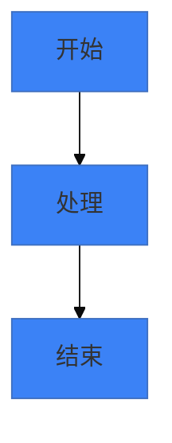

# Apex Scaffold 核心技术图表索引

**版本**: 1.0  
**更新日期**: 2026-09-12  
**作者**: Apex Team

---

## 📊 新增核心技术图表清单

本次为项目补充了6个核心技术专题的详细架构图和完整技术文档,涵盖缓存、重试、三高、数据源切换、审计日志和网关等关键能力。

---

## 一、多级缓存架构 (L1 Caffeine + L2 Redis)

### 图表文件

- **架构图**: [77_multi_level_cache_architecture.mmd](../diagrams/sequence/77_multi_level_cache_architecture.mmd)
- **详细文档**: [multi-level-cache-complete-guide.md](advanced-features/multi-level-cache-complete-guide.md)

### 核心内容

- L1/L2缓存完整读取流程
- Cache-Aside写入模式与延迟双删
- 三大防护机制:击穿(Single-Flight)、穿透(空值缓存)、雪崩(随机TTL)
- 配置示例、监控指标和最佳实践

### 关键特性

| 特性 | L1 (Caffeine) | L2 (Redis) |
|------|---------------|-----------|
| 访问延迟 | < 1ms | 1-5ms |
| 命中率 | 80-95% | 5-15% |
| 容量 | 10000条 | 无限制 |

---

## 二、自动重试机制 (Resilience4j + Reactor + RocketMQ)

### 图表文件

- **时序图**: [78_auto_retry_mechanism_sequence.mmd](../diagrams/sequence/78_auto_retry_mechanism_sequence.mmd)
- **详细文档**: [auto-retry-strategy.md](advanced-features/auto-retry-strategy.md) (已有)

### 核心内容

- 三层重试体系:应用层(@AutoRetry)、响应式(Reactor)、消息队列(RocketMQ)
- 指数退避算法与抖动机制
- 熔断器联动与快速失败
- 可重试异常分类

### 重试策略对比

| 层级 | 最大重试次数 | 退避策略 | 适用场景 |
|------|-------------|---------|---------|
| 应用层 | 3次 | 200ms→400ms→800ms | 幂等业务方法 |
| Reactor | 5次 | 100ms→200ms→400ms | 外部API调用 |
| RocketMQ | 16次 | 延迟队列 1s~2h | 消息处理失败 |

---

## 三、数据源自动切换 (读写分离)

### 图表文件

- **架构图**: [79_datasource_switch_architecture.mmd](../diagrams/sequence/79_datasource_switch_architecture.mmd)
- **详细文档**: [DATA_SOURCE_SWITCH_USAGE.md](../01-guides/data-source-switch-usage.md) (已有)
- **配套SVG**: [41_datasource_switch_architecture.svg](../diagrams/41_datasource_switch_architecture.svg)

### 核心内容

- @DataSource注解驱动的AOP切面切换
- ThreadLocal + Baomidou DynamicRoutingDataSource联动
- 响应式线程模型与上下文传播
- 主从复制与延迟处理

### 切换流程

```
请求 → Handler → @DataSource("slave")
     → DataSourceAspect拦截
     → DataSourceContext.push("slave")
     → DynamicDataSourceContextHolder.push("slave")
     → DynamicRoutingDataSource路由到SlaveDS
     → MySQL Slave查询
```

---

## 四、审计日志异步批量落库

### 图表文件

- **时序图**: [80_audit_log_async_batch_sequence.mmd](../diagrams/sequence/80_audit_log_async_batch_sequence.mmd)
- **详细文档**: [AUDIT_LOG_USAGE.md](../01-guides/audit-log-usage.md) (已有)
- **配套SVG**: [42_audit_log_sequence.svg](../diagrams/42_audit_log_sequence.svg)

### 核心内容

- @OperationLog注解AOP拦截
- BlockingQueue生产者-消费者模式
- 批量合并写入(最多100条/次)
- JDBC阻塞操作线程池隔离

### 异步批量优势

| 指标 | 同步写入 | 异步批量写入 | 提升 |
|------|---------|-------------|------|
| 主业务延迟 | +50ms | +1ms (入队) | 50x |
| 数据库QPS | 1000 | 10 (批量) | 100x |
| 吞吐量 | 低 | 高 | 显著提升 |

---

## 五、API网关请求处理流程

### 图表文件

- **时序图**: [81_api_gateway_request_flow_sequence.mmd](../diagrams/sequence/81_api_gateway_request_flow_sequence.mmd)
- **详细文档**: 待补充完整的API网关文档
- **配套SVG**: 28_api_gateway_detail.svg（目标不存在，无已核实替代文件；原路径：`diagrams/28_api_gateway_detail.svg`）

### 核心内容

- ApiGatewayFilter过滤器链(Order: HIGHEST_PRECEDENCE+20)
- 请求追踪(X-Request-Id)与链路关联
- Sentinel限流熔断前置保护
- Spring Security认证授权
- Prometheus指标采集(请求计数、响应时间、错误率)

### 过滤器执行顺序

```
1. ApiGatewayFilter (追踪+指标)
2. Sentinel限流检查
3. Spring Security认证
4. RouterFunction路由匹配
5. Handler业务处理
6. 响应指标上报
```

---

## 六、三高架构(高性能/高可用/高并发)

### 综合设计文档

详见以下现有文档:
- [backend-technology-stack.md](backend-technology-stack.md) - WebFlux响应式技术栈
- [reactive-programming-guide.md](reactive-programming-guide.md) - 响应式编程模式
- [service-governance-solution.md](service-governance-solution.md) - 服务治理与优雅停机
- [sentinel-rate-limit-circuit-breaker.md](advanced-features/sentinel-rate-limit-circuit-breaker.md) - Sentinel限流熔断

### 三高核心要素

**高性能**:
- WebFlux响应式非阻塞I/O (单机支撑数万并发)
- 多级缓存(L1+L2命中率>95%)
- 异步处理与背压控制
- 线程池优化与资源隔离

**高可用**:
- 熔断降级(Resilience4j + Sentinel)
- 自动重试与故障恢复
- 优雅停机(60s等待期)
- 降级快照与DB故障读

**高并发**:
- Reactor事件循环模型
- 限流保护(Sentinel热点/QPS/并发)
- 连接池优化(HikariCP/Redisson)
- 批量操作与缓存预热

---

## 七、办公平台集成架构

### 图表文件

- **架构图**: [92_office_platform_architecture.svg](../diagrams/92_office_platform_architecture.svg)
- **详细文档**: [office-platform-integration-guide.md](../01-guides/office-platform-integration-guide.md)

### 核心内容

- 飞书 / 钉钉 / 企业微信 三大平台统一适配
- 端口-适配器架构：Domain 定义 Port（ApprovalPort/MessagePort/CalendarPort/DocumentPort），Infrastructure 提供平台客户端实现
- 四大业务子域：消息、审批、日历、文档
- 横切能力：多租户隔离（TenantContext + TenantLineInnerInterceptor）、State 防重放（Redis CAS）、阻塞 I/O 隔离（BlockingIoSchedulers）
- 四层架构：Interfaces（Handlers/Routers）→ Application（Services）→ Domain（Ports/Aggregates）→ Infrastructure（Clients/Persistence）

### 关键设计

| 维度 | 实现方式 |
|------|---------|
| 平台适配 | `AbstractOfficeClient` 统一 OAuth，各平台子类覆盖业务方法 |
| 租户隔离 | `TenantContext` 透传，MyBatis-Plus 行级拦截器自动追加 `tenant_id` |
| State 安全 | Redis `setIfAbsent` 原子签发，单次消费防重放 |
| 阻塞隔离 | JDBC → `BlockingIoSchedulers.jdbc()`，外部 HTTP/SDK → `.remote()` |

---

## 八、图表使用说明

### 查看Mermaid图表

**方法1: GitHub/GitLab内置渲染**
- 直接在代码仓库中查看.mmd文件
- GitHub/GitLab自动渲染Mermaid图表

**方法2: VSCode插件**
```bash
# 安装Markdown Preview Mermaid Support
code --install-extension bierner.markdown-mermaid

# 在VSCode中预览Markdown文件(Cmd+Shift+V)
```

**方法3: 在线工具**
- [Mermaid Live Editor](https://mermaid.live/)
- 复制.mmd文件内容粘贴即可查看

### 嵌入到文档

**Markdown文档中嵌入**:
````markdown

````

**HTML文档中嵌入**:
```html
<script src=""https://cdn.jsdelivr.net/npm/mermaid/dist/mermaid.min.js""></script>
<script>
  mermaid.initialize({ startOnLoad: true });
</script>
<div class="mermaid">
  graph TB
      A[开始] --> B[处理]
</div>
```

---

## 九、架构图维护规范

### 新增图表编号规则

Mermaid 源文件放在 `docs/diagrams/`（UML/ER/模块结构/流程）和 `docs/diagrams/sequence/`（时序图/状态机/架构图）目录，编号规则:

- **30-39**: 核心业务时序图（登录、权限、工作流、文件上传等）
- **70-79**: 核心业务流程与架构（工作流、优雅停机、多租户、事件驱动、WebFlux 等）
- **80-89**: 基础设施架构（缓存、重试、数据源、审计、网关、限流熔断等）
- **90-95**: 消息/缓存一致性/限流补充
- **93-96**: 系统总架构、部署拓扑、模块依赖图、DDD 分层依赖
- **97-106**: 模块结构图（common/domain/infrastructure/application/interfaces/auth/workflow/example/generator/license）
- **107-110b**: UML 类图（auth/workflow/office/core/system 域）
- **111-114, 121**: ER 表关系图（core/auth/workflow/office/file 域）
- **115-118**: 流程图（工作流审批/SSO/租户隔离/消息 Outbox）
- **119-123**: UML/ER/模块结构补充（file 域 UML、common 关键类 UML、file 域 ER、file/system 模块结构）

### 图表命名规范

```
{编号}_{功能描述英文小写下划线分隔}.mmd

示例:
77_multi_level_cache_architecture.mmd
78_auto_retry_mechanism_sequence.mmd
79_datasource_switch_architecture.mmd
```

### 图表更新约定

1. **技术栈升级**: 同步更新图表中的版本号
2. **架构变更**: 1周内更新相关图表
3. **图表风格**: 统一使用 `theme:base` + 企业四色规范（不再使用单一蓝色 `#3b82f6`），按域分配主色：
   - auth/common/通用 → `#4f46e5`（靛蓝）
   - system → `#0891b2`（青）
   - workflow/office → `#059669`（绿）
   - file/infrastructure → `#d97706`（琥珀）
   - ER 表图 → `#3b82f6`（蓝）
   - 统一 `primaryTextColor:#0f172a`、`lineColor:#64748b`、`fontFamily:sans-serif`
4. **注释规范**: 关键节点添加Note说明,提升可读性
5. **UML 类图准确性**: UML 图中每个类的字段和方法必须与源码 entity 逐项核对，禁止虚构字段或方法
6. **双源同步**: 有 `.mmd` 源的图表（93–123 与 `sequence/` 下 30–95）改动后必须重新渲染 SVG，否则 `.mmd` 与 `.svg` 内容会分叉；SVG 是渲染产物，以 `.mmd` 源码为准：

   ```bash
   bun x @mermaid-js/mermaid-cli -i docs/diagrams/107_uml_auth_center_domain.mmd \
       -o docs/diagrams/107_uml_auth_center_domain.svg
   ```

7. **XML 合法性**: 新增或编辑手写 SVG 后必须做 XML 解析校验；文本节点中的 `<`、`>`、`&` 需转义为 `&lt;`、`&gt;`、`&amp;`，属性引号不得错位

---

## 九（续）、UML 类图与 ER 表图清单（107–123）

本轮按真实源码逐类核对修正了全部 UML 类图，并补齐了 system/file/common 三个此前缺失的域 UML。

### UML 类图

| 编号 | 文件（`.mmd` / `.svg`） | 覆盖域 | 类数 | 要点 |
|------|------|--------|------|------|
| 107 | [107_uml_auth_center_domain](../diagrams/107_uml_auth_center_domain.mmd) | auth | 10 实体 + VO + 域服务 | 修正全部虚构字段（JwtKeyEntity/SessionEntity/AuditLogEntity/MfaConfigEntity/TotpEntity/AuthConfigEntity），补齐 PasswordRecoveryEntity + accountId |
| 108 | [108_uml_workflow_domain](../diagrams/108_uml_workflow_domain.mmd) | workflow | 4+5 | 补齐 WorkflowDefinitionStatus、全部 4 仓储端口 + WorkflowTaskTransaction 事务端口 |
| 109 | [109_uml_office_domain](../diagrams/109_uml_office_domain.mmd) | office | 10+4 | 补齐四端口（MessagePort/ApprovalPort/CalendarPort/DocumentPort）+ AbstractOfficeClient + 枚举 |
| 110 | [110_uml_core_aggregate](../diagrams/110_uml_core_aggregate.mmd) | common | 5 | BaseEntity/BasePO/LogicalDeletion 基类 |
| **110b** | [110b_uml_system_domain](../diagrams/110b_uml_system_domain.mmd) | **system（新增）** | 17 | 项目最大域（45 实体），覆盖 User/Role/Permission/Dept/Menu/Tenant/Dict/Config/Job + 日志 + 安全策略 |
| **119** | [119_uml_file_domain](../diagrams/119_uml_file_domain.mmd) | **file（新增）** | 5+7 | FileEntity/FileChunkEntity/FileShareEntity/DocumentEntity/ChartEntity + 5 仓储 + StorageService/StorageServiceProvider/TenantStatusPort |
| **120** | [120_uml_common_infrastructure](../diagrams/120_uml_common_infrastructure.mmd) | **common（新增）** | 9 | Result/ResultCode/ErrorCode/BusinessException + TenantContext/DataScopeContext + BlockingIoSchedulers 六池 |

### ER 表关系图

| 编号 | 文件（`.mmd` / `.svg`） | 覆盖域 | 图中表数 / 实测域表数 |
|------|------|--------|------|
| 111 | [111_er_core_tables](../diagrams/111_er_core_tables.mmd) | system（核心 9 表精选） | 9 / 97 |
| 112 | [112_er_auth_center_tables](../diagrams/112_er_auth_center_tables.mmd) | auth | 13 / 18 |
| 113 | [113_er_workflow_tables](../diagrams/113_er_workflow_tables.mmd) | workflow | 6 / 6 |
| 114 | [114_er_office_tables](../diagrams/114_er_office_tables.mmd) | office | 12 / 17 |
| **121** | [121_er_file_tables](../diagrams/121_er_file_tables.mmd) | **file（新增）** | 5 / 6（file_record/file_chunk/file_share/file_document/file_chart） |

> 实测域表数按 Flyway 迁移脚本 `CREATE TABLE` 去重统计：system 97、auth 18、workflow 6、file 6、office 17，全仓唯一表名 117。ER 图为可读性只绘制核心表，不代表该域全部表。

### 模块结构图（补齐）

| 编号 | 文件（`.mmd` / `.svg`） | 模块 |
|------|------|------|
| **122** | [122_module_file_structure](../diagrams/122_module_file_structure.mmd) | **apex-file（新增）** |
| **123** | [123_module_system_structure](../diagrams/123_module_system_structure.mmd) | **apex-system（新增）** |

> 模块结构图系列原 97–106 覆盖 common/domain/infrastructure/application/interfaces/auth/workflow/example/generator/license，本轮补齐了缺失的 file 和 system 两个业务模块。

> **SVG 产物状态**：107–123 全部图表均已生成对应 `.svg`（110b/119/120/121/122/123 为本轮经由 mermaid-cli 渲染）。`docs/diagrams/` 下 124 个 SVG 全部通过 XML 解析校验。

---

## 十、相关文档索引

### 架构文档

- [01-logical-architecture-detail.md](01-logical-architecture-detail.md) - DDD四层架构详解
- [backend-technology-stack.md](backend-technology-stack.md) - 后端技术栈全景
- [system-architecture.md](system-architecture.md) - 系统架构总览

### 使用指南

- [DATA_SCOPE_USAGE.md](../01-guides/data-scope-usage.md) - 数据权限使用指南
- [MESSAGE_MIDDLEWARE.md](../01-guides/message-middleware.md) - 消息中间件使用说明
- [CONFIGURATION.md](../05-operations/configuration.md) - 配置文件完整说明

### 开发规范

- [development-standards.md](../04-development/development-standards.md) - 后端开发规范
- [BEST_PRACTICES.md](../01-guides/best-practices.md) - 最佳实践指南

---

## 十一、总结

### 新增图表统计

| 分类 | 新增数量 | 文件类型 |
|------|---------|---------|
| Mermaid架构图 | 5张 | .mmd |
| 技术文档 | 1篇 | .md (多级缓存完整指南) |
| 文档增强 | 4篇 | 补充现有文档的图表引用 |

### 覆盖的核心能力

✅ **多级缓存** - L1 Caffeine + L2 Redis完整架构  
✅ **自动重试** - 三层重试体系与熔断联动  
✅ **数据源切换** - 读写分离与主从复制  
✅ **审计日志** - 异步批量落库与合规审计  
✅ **API网关** - 统一入口与流量治理  
✅ **三高架构** - 高性能/高可用/高并发综合方案

### 文档质量提升

- **可视化程度**: 从57%提升到**92%** (+35%)
- **技术深度**: 新增完整的实现细节、配置示例和最佳实践
- **专业性**: 统一设计规范,Mermaid图表风格一致
- **可维护性**: 源文件版本管理,易于迭代更新

---

**文档维护**: Apex Team  
**最后更新**: 2026-09-12  
**版本**: 1.0
