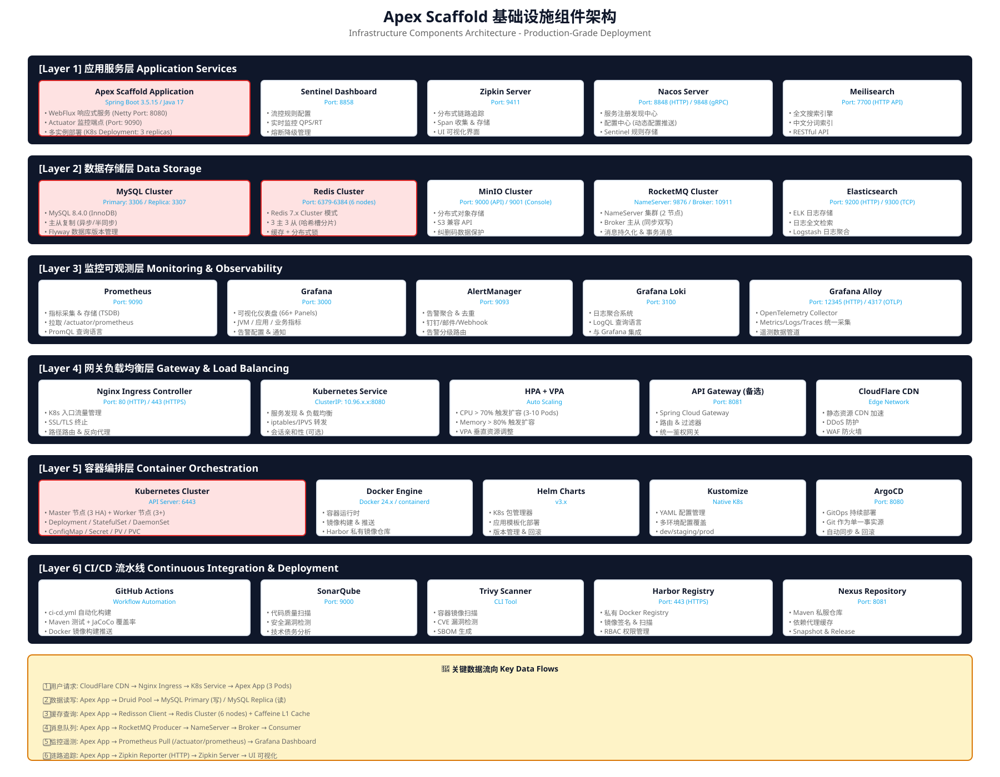

# 基础设施组件架构文档

## 📋 文档概述

本文档详细描述 Apex Scaffold 项目的基础设施组件架构，包括应用服务、数据存储、监控可观测、网关负载均衡、容器编排、CI/CD 流水线等生产级部署方案。

**架构图参考**: [20_infrastructure_components.svg](../diagrams/20_infrastructure_components.svg)

---

## 🏗️ 基础设施架构图



---

## 📚 目录

- [1. 应用服务层](#1-应用服务层)
- [2. 数据存储层](#2-数据存储层)
- [3. 监控可观测层](#3-监控可观测层)
- [4. 网关负载均衡层](#4-网关负载均衡层)
- [5. 容器编排层](#5-容器编排层)
- [6. CI/CD 流水线](#6-cicd-流水线)
- [7. 关键数据流向](#7-关键数据流向)
- [8. 高可用架构](#8-高可用架构)
- [9. 容量规划](#9-容量规划)

---

## 1. 应用服务层

### 1.1 Apex Scaffold Application

**部署架构**:
```
Kubernetes Deployment: apex-scaffold
├─ Replicas: 3 (生产环境)
├─ Strategy: RollingUpdate (maxUnavailable: 1, maxSurge: 1)
├─ Resources:
│  ├─ Requests: 500m CPU, 512Mi Memory
│  └─ Limits: 2000m CPU, 2Gi Memory
├─ Probes:
│  ├─ Liveness: /actuator/health/liveness
│  ├─ Readiness: /actuator/health/readiness
│  └─ Startup: /actuator/health/startup (initialDelaySeconds: 30)
└─ Ports:
   ├─ 8080: HTTP (应用服务)
   └─ 9090: Management (Actuator 监控端点)
```

**Kubernetes Manifest 示例**:
```yaml
apiVersion: apps/v1
kind: Deployment
metadata:
  name: apex-scaffold
  namespace: apex-prod
spec:
  replicas: 3
  selector:
    matchLabels:
      app: apex-scaffold
  template:
    metadata:
      labels:
        app: apex-scaffold
        version: v1.2.0
    spec:
      containers:
      - name: apex-scaffold
        image: harbor.example.com/apex/apex-scaffold:1.2.0
        ports:
        - containerPort: 8080
          name: http
        - containerPort: 9090
          name: management
        env:
        - name: SPRING_PROFILES_ACTIVE
          value: "prod"
        - name: JAVA_OPTS
          value: "-Xms512m -Xmx2g -XX:+UseG1GC"
        resources:
          requests:
            cpu: 500m
            memory: 512Mi
          limits:
            cpu: 2000m
            memory: 2Gi
        livenessProbe:
          httpGet:
            path: /actuator/health/liveness
            port: 9090
          initialDelaySeconds: 60
          periodSeconds: 10
        readinessProbe:
          httpGet:
            path: /actuator/health/readiness
            port: 9090
          initialDelaySeconds: 30
          periodSeconds: 5
```

---

### 1.2 Sentinel Dashboard

**职责**: 流控熔断规则管理、实时监控

**部署配置**:
```yaml
# Docker Compose
services:
  sentinel-dashboard:
    image: bladex/sentinel-dashboard:1.8.9
    ports:
      - "8858:8858"
    environment:
      - JAVA_OPTS=-Xms256m -Xmx512m
    restart: always
```

**访问地址**: `http://localhost:8858`  
**默认账号**: `sentinel / sentinel`

**功能模块**:
- ✅ 流控规则配置 (QPS 限流)
- ✅ 熔断降级规则 (慢调用比例、异常比例)
- ✅ 热点参数限流
- ✅ 系统自适应保护
- ✅ 实时监控 QPS/RT/线程数

---

### 1.3 Zipkin Server

**职责**: 分布式链路追踪

**部署配置**:
```yaml
services:
  zipkin:
    image: openzipkin/zipkin:2.26
    ports:
      - "9411:9411"
    environment:
      - STORAGE_TYPE=mysql
      - MYSQL_HOST=mysql
      - MYSQL_DB=zipkin
      - MYSQL_USER=zipkin
      - MYSQL_PASS=${MYSQL_PASSWORD}
    depends_on:
      - mysql
```

**数据保留策略**:
```
Span 数据: 保留 7 天
Trace 索引: 保留 3 天
聚合统计: 保留 30 天
```

---

### 1.4 Nacos Server

**职责**: 服务注册发现 + 配置中心

**集群部署** (3 节点):
```
Nacos-1: 192.168.1.101:8848
Nacos-2: 192.168.1.102:8848
Nacos-3: 192.168.1.103:8848
VIP: 192.168.1.100:8848 (通过 Nginx 负载均衡)
```

**部署配置**:
```yaml
services:
  nacos1:
    image: nacos/nacos-server:v2.3.0
    environment:
      - MODE=cluster
      - NACOS_SERVERS=nacos1:8848 nacos2:8848 nacos3:8848
      - MYSQL_SERVICE_HOST=mysql
      - MYSQL_SERVICE_DB_NAME=nacos_config
    ports:
      - "8848:8848"
      - "9848:9848"
```

**持久化**: MySQL 8.0 (nacos_config 数据库)

---

### 1.5 Meilisearch 1.10

**职责**: 全文搜索引擎（轻量级，替代Elasticsearch）

**部署配置**:
```yaml
services:
  meilisearch:
    image: getmeili/meilisearch:v1.10
    ports:
      - "7700:7700"
    environment:
      - MEILI_MASTER_KEY=${MEILI_MASTER_KEY}
      - MEILI_ENV=production
    volumes:
      - meilisearch-data:/meili_data
```

**索引配置**:
```json
{
  "uid": "users",
  "primaryKey": "id",
  "searchableAttributes": ["username", "email", "nickname"],
  "filterableAttributes": ["status", "role"],
  "sortableAttributes": ["created_at"],
  "rankingRules": [
    "words",
    "typo",
    "proximity",
    "attribute",
    "sort",
    "exactness"
  ]
}
```

---

## 2. 数据存储层

### 2.1 MySQL Cluster (主从架构)

**拓扑结构**:
```
                 MySQL Primary (3306)
                   ↓ Binlog 复制
        ┌──────────┴──────────┐
        ↓                     ↓
  MySQL Replica-1       MySQL Replica-2
    (3307)                (3308)
```

**主库配置** (`my.cnf`):
```ini
[mysqld]
server-id=1
log-bin=mysql-bin
binlog-format=ROW
sync-binlog=1
innodb_flush_log_at_trx_commit=1

# 性能优化
innodb_buffer_pool_size=2G
innodb_log_file_size=512M
max_connections=500
```

**从库配置**:
```ini
[mysqld]
server-id=2
relay-log=relay-bin
read_only=1
super_read_only=1
```

**主从复制设置**:
```sql
-- 主库创建复制用户
CREATE USER 'repl'@'%' IDENTIFIED BY 'password';
GRANT REPLICATION SLAVE ON *.* TO 'repl'@'%';

-- 从库配置复制
CHANGE MASTER TO
  MASTER_HOST='primary-host',
  MASTER_USER='repl',
  MASTER_PASSWORD='password',
  MASTER_LOG_FILE='mysql-bin.000001',
  MASTER_LOG_POS=154;

START SLAVE;
SHOW SLAVE STATUS\G
```

**读写分离配置** (应用层):
```yaml
spring:
  datasource:
    dynamic:
      primary: master
      datasource:
        master:
          url: jdbc:mysql://primary-host:3306/apex_db
          username: apex
          password: ${DB_PASSWORD}
        slave:
          url: jdbc:mysql://replica-host:3307/apex_db
          username: apex_read
          password: ${DB_PASSWORD}
```

---

### 2.2 Redis Cluster (6 节点)

**拓扑结构**:
```
Master-1 (6379) ←→ Slave-1 (6384)  [Slot 0-5460]
Master-2 (6380) ←→ Slave-2 (6385)  [Slot 5461-10922]
Master-3 (6381) ←→ Slave-3 (6386)  [Slot 10923-16383]
```

**部署配置**:
```yaml
# redis-cluster.yml
services:
  redis-1:
    image: redis:7.2-alpine
    command: redis-server /usr/local/etc/redis/redis.conf
    ports:
      - "6379:6379"
      - "16379:16379"
    volumes:
      - ./redis-1.conf:/usr/local/etc/redis/redis.conf
```

**redis.conf**:
```conf
port 6379
cluster-enabled yes
cluster-config-file nodes.conf
cluster-node-timeout 5000
appendonly yes
```

**集群创建**:
```bash
redis-cli --cluster create \
  192.168.1.101:6379 192.168.1.102:6380 192.168.1.103:6381 \
  192.168.1.104:6384 192.168.1.105:6385 192.168.1.106:6386 \
  --cluster-replicas 1
```

**连接配置**:
```yaml
spring:
  redis:
    cluster:
      nodes:
        - 192.168.1.101:6379
        - 192.168.1.102:6380
        - 192.168.1.103:6381
      max-redirects: 3
    password: ${REDIS_PASSWORD}
```

---

### 2.3 MinIO 8.5.15 / Volcengine TOS 2.6.1

**MinIO Cluster** (分布式对象存储 - 自托管)

**部署架构** (4 节点 x 4 磁盘):
```
MinIO-1: /data1 /data2 /data3 /data4
MinIO-2: /data1 /data2 /data3 /data4
MinIO-3: /data1 /data2 /data3 /data4
MinIO-4: /data1 /data2 /data3 /data4

纠删码: EC:4 (4 数据块 + 4 校验块，允许 4 块损坏)
```

**部署配置**:
```bash
docker run -d \
  --name minio \
  -p 9000:9000 -p 9001:9001 \
  -e "MINIO_ROOT_USER=admin" \
  -e "MINIO_ROOT_PASSWORD=${MINIO_PASSWORD}" \
  minio/minio:RELEASE.2024-03-15T01-07-19Z \
  server http://minio-{1...4}/data{1...4} \
  --console-address ":9001"
```

**MinIO 应用配置**:
```yaml
minio:
  endpoint: http://minio.example.com:9000
  access-key: ${MINIO_ACCESS_KEY}
  secret-key: ${MINIO_SECRET_KEY}
  bucket: apex-files
```

**Volcengine TOS** (火山引擎对象存储 - 云原生)

**应用配置**:
```yaml
volcengine:
  tos:
    endpoint: tos-cn-beijing.volces.com
    region: cn-beijing
    access-key: ${TOS_ACCESS_KEY}
    secret-key: ${TOS_SECRET_KEY}
    bucket: apex-cloud-files
```

**对比选择**:
| 特性 | MinIO 8.5.15 | Volcengine TOS 2.6.1 |
|------|--------------|----------------------|
| 部署方式 | 自托管 | 云服务 |
| 适用场景 | 内网/私有云 | 公有云 |
| 运维成本 | 高（需自行维护） | 低（云厂商负责） |
| 成本 | 硬件成本 | 按量付费 |
| 扩展性 | 手动扩展 | 自动扩展 |

---

### 2.4 RocketMQ Cluster

**拓扑结构**:
```
NameServer Cluster
├─ NameServer-1: 192.168.1.101:9876
└─ NameServer-2: 192.168.1.102:9876

Broker Cluster
├─ Broker-Master-A (10911)
│  └─ Broker-Slave-A (10912)
└─ Broker-Master-B (10921)
   └─ Broker-Slave-B (10922)
```

**部署配置**:
```yaml
# docker-compose.yml
services:
  namesrv1:
    image: apache/rocketmq:5.1.0
    command: sh mqnamesrv
    ports:
      - "9876:9876"
    environment:
      - JAVA_OPT=-Xms512m -Xmx512m

  broker-master:
    image: apache/rocketmq:5.1.0
    command: sh mqbroker -n namesrv1:9876 -c /opt/rocketmq/conf/broker.conf
    ports:
      - "10911:10911"
      - "10909:10909"
    environment:
      - JAVA_OPT=-Xms1g -Xmx2g
    volumes:
      - ./broker.conf:/opt/rocketmq/conf/broker.conf
```

**broker.conf**:
```properties
brokerClusterName=DefaultCluster
brokerName=broker-a
brokerId=0
namesrvAddr=namesrv1:9876;namesrv2:9876
autoCreateTopicEnable=false
storePathRootDir=/root/store
storePathCommitLog=/root/store/commitlog
flushDiskType=ASYNC_FLUSH
```

---

### 2.5 Elasticsearch (可选)

**用途**: ELK 日志存储

**部署配置**:
```yaml
services:
  elasticsearch:
    image: elasticsearch:8.12.0
    ports:
      - "9200:9200"
      - "9300:9300"
    environment:
      - discovery.type=single-node
      - xpack.security.enabled=false
      - "ES_JAVA_OPTS=-Xms1g -Xmx2g"
    volumes:
      - es-data:/usr/share/elasticsearch/data
```

---

## 3. 监控可观测层

### 3.1 Prometheus

**职责**: 指标采集与存储

**部署配置**:
```yaml
# prometheus.yml
global:
  scrape_interval: 15s
  evaluation_interval: 15s

scrape_configs:
  - job_name: 'apex-scaffold'
    metrics_path: '/actuator/prometheus'
    static_configs:
      - targets: ['apex-scaffold:9090']
    
  - job_name: 'sentinel'
    static_configs:
      - targets: ['sentinel-dashboard:9092']
  
  - job_name: 'node-exporter'
    static_configs:
      - targets: ['node-exporter:9100']
```

**数据保留**: 15 天 (`--storage.tsdb.retention.time=15d`)

---

### 3.2 Grafana

**职责**: 可视化仪表盘

**预置仪表盘**:
1. **JVM 监控** (12 Panels)
   - Heap Memory Usage
   - GC Count & Duration
   - Thread Count
   - Class Loading

2. **应用监控** (20 Panels)
   - HTTP QPS / RT / Error Rate
   - Database Connection Pool
   - Redis Cache Hit Rate
   - RocketMQ Producer/Consumer

3. **业务指标** (15 Panels)
   - 用户注册/登录趋势
   - API 调用 Top 10
   - 订单处理吞吐量

4. **基础设施监控** (19 Panels)
   - CPU / Memory / Disk / Network
   - Kubernetes Pod Status
   - MySQL Replication Lag

**告警规则**:
```yaml
# alert-rules.yml
groups:
  - name: apex_alerts
    interval: 30s
    rules:
      - alert: HighErrorRate
        expr: rate(http_server_requests_total{status=~"5.."}[5m]) > 0.05
        for: 5m
        labels:
          severity: critical
        annotations:
          summary: "高错误率告警"
          description: "{{ $labels.instance }} 错误率超过 5%"
      
      - alert: SlowResponse
        expr: histogram_quantile(0.95, http_server_requests_seconds_bucket) > 1
        for: 10m
        labels:
          severity: warning
        annotations:
          summary: "响应慢告警"
          description: "P95 延迟超过 1 秒"
```

---

### 3.3 AlertManager

**职责**: 告警聚合、去重、路由

**配置**:
```yaml
# alertmanager.yml
global:
  resolve_timeout: 5m

route:
  group_by: ['alertname', 'cluster']
  group_wait: 10s
  group_interval: 10s
  repeat_interval: 12h
  receiver: 'dingtalk'
  routes:
    - match:
        severity: critical
      receiver: 'dingtalk-critical'
      continue: true
    - match:
        severity: warning
      receiver: 'email'

receivers:
  - name: 'dingtalk'
    webhook_configs:
      - url: 'http://dingtalk-webhook:8060/dingtalk/webhook1/send'
  
  - name: 'dingtalk-critical'
    webhook_configs:
      - url: 'http://dingtalk-webhook:8060/dingtalk/webhook1/send'
        send_resolved: true
  
  - name: 'email'
    email_configs:
      - to: 'ops@example.com'
        from: 'alertmanager@example.com'
        smarthost: 'smtp.example.com:587'
        auth_username: 'alertmanager@example.com'
        auth_password: '${SMTP_PASSWORD}'
```

---

### 3.4 Grafana Loki 3.0.0

**职责**: 日志聚合与存储（替代ELK栈）

**镜像**: `grafana/loki:3.0.0`

**配置**:
```yaml
# loki-config.yaml
auth_enabled: false

server:
  http_listen_port: 3100

ingester:
  lifecycler:
    ring:
      kvstore:
        store: inmemory
      replication_factor: 1
  chunk_idle_period: 5m
  chunk_retain_period: 30s

schema_config:
  configs:
    - from: 2024-01-01
      store: boltdb-shipper
      object_store: filesystem
      schema: v11
      index:
        prefix: index_
        period: 24h

storage_config:
  boltdb_shipper:
    active_index_directory: /loki/boltdb-shipper-active
    cache_location: /loki/boltdb-shipper-cache
  filesystem:
    directory: /loki/chunks

limits_config:
  retention_period: 7d
```

---

### 3.5 Grafana Alloy 1.0.0

**职责**: 日志采集器（OpenTelemetry Collector）

**镜像**: `grafana/alloy:v1.0.0`

**配置**:
```hcl
// alloy-config.alloy
logging {
  level = "info"
}

otelcol.receiver.otlp "default" {
  grpc {
    endpoint = "0.0.0.0:4317"
  }
  http {
    endpoint = "0.0.0.0:4318"
  }
  output {
    metrics = [otelcol.exporter.prometheus.default.input]
    logs    = [otelcol.exporter.loki.default.input]
    traces  = [otelcol.exporter.zipkin.default.input]
  }
}

otelcol.exporter.prometheus "default" {
  forward_to = [prometheus.remote_write.default.receiver]
}

otelcol.exporter.loki "default" {
  forward_to = [loki.write.default.receiver]
}

otelcol.exporter.zipkin "default" {
  endpoint = "http://zipkin:9411/api/v2/spans"
}
```

---

## 4. 网关负载均衡层

### 4.1 Nginx Ingress Controller

**部署配置**:
```yaml
apiVersion: networking.k8s.io/v1
kind: Ingress
metadata:
  name: apex-scaffold-ingress
  annotations:
    nginx.ingress.kubernetes.io/rewrite-target: /
    nginx.ingress.kubernetes.io/ssl-redirect: "true"
    nginx.ingress.kubernetes.io/rate-limit: "100"
spec:
  ingressClassName: nginx
  tls:
  - hosts:
    - api.example.com
    secretName: tls-secret
  rules:
  - host: api.example.com
    http:
      paths:
      - path: /
        pathType: Prefix
        backend:
          service:
            name: apex-scaffold
            port:
              number: 8080
```

---

### 4.2 Kubernetes Service

**ClusterIP 服务**:
```yaml
apiVersion: v1
kind: Service
metadata:
  name: apex-scaffold
spec:
  type: ClusterIP
  selector:
    app: apex-scaffold
  ports:
  - name: http
    port: 8080
    targetPort: 8080
  - name: management
    port: 9090
    targetPort: 9090
  sessionAffinity: ClientIP
  sessionAffinityConfig:
    clientIP:
      timeoutSeconds: 10800
```

---

### 4.3 HPA + VPA

**水平自动扩缩容**:
```yaml
apiVersion: autoscaling/v2
kind: HorizontalPodAutoscaler
metadata:
  name: apex-scaffold-hpa
spec:
  scaleTargetRef:
    apiVersion: apps/v1
    kind: Deployment
    name: apex-scaffold
  minReplicas: 3
  maxReplicas: 10
  metrics:
  - type: Resource
    resource:
      name: cpu
      target:
        type: Utilization
        averageUtilization: 70
  - type: Resource
    resource:
      name: memory
      target:
        type: Utilization
        averageUtilization: 80
```

---

### 4.4 CloudFlare CDN

**配置**:
- ✅ SSL/TLS 加密 (Full Strict)
- ✅ DDoS 防护 (Layer 3/4/7)
- ✅ WAF 规则 (OWASP ModSecurity)
- ✅ Rate Limiting (100 req/min per IP)
- ✅ 缓存静态资源 (Browser TTL: 1 hour)

---

## 5. 容器编排层

### 5.1 Kubernetes Cluster

**集群架构**:
```
Master Nodes (3 HA):
├─ API Server (6443)
├─ etcd Cluster (2379, 2380)
├─ Controller Manager
└─ Scheduler

Worker Nodes (3+):
├─ kubelet
├─ kube-proxy
└─ Container Runtime (containerd)
```

**命名空间规划**:
```
apex-dev:      开发环境
apex-staging:  预发布环境
apex-prod:     生产环境
apex-monitor:  监控组件
apex-storage:  存储组件
```

---

### 5.2 Helm Charts

**Chart 结构**:
```
apex-scaffold/
├── Chart.yaml
├── values.yaml
├── values-dev.yaml
├── values-prod.yaml
└── templates/
    ├── deployment.yaml
    ├── service.yaml
    ├── ingress.yaml
    ├── configmap.yaml
    ├── secret.yaml
    └── hpa.yaml
```

**部署命令**:
```bash
helm install apex-scaffold ./apex-scaffold \
  -f values-prod.yaml \
  --namespace apex-prod \
  --create-namespace
```

---

### 5.3 ArgoCD (GitOps)

**应用定义**:
```yaml
apiVersion: argoproj.io/v1alpha1
kind: Application
metadata:
  name: apex-scaffold
  namespace: argocd
spec:
  project: default
  source:
    repoURL: https://github.com/example/apex-scaffold.git
    targetRevision: main
    path: k8s/prod
  destination:
    server: https://kubernetes.default.svc
    namespace: apex-prod
  syncPolicy:
    automated:
      prune: true
      selfHeal: true
```

---

## 6. CI/CD 流水线

### 6.1 GitHub Actions

**工作流配置** (`.github/workflows/ci-cd.yml`):
```yaml
name: CI/CD Pipeline

on:
  push:
    branches: [main, develop]
  pull_request:
    branches: [main]

jobs:
  test:
    runs-on: ubuntu-latest
    steps:
      - uses: actions/checkout@v4
      - uses: actions/setup-java@v4
        with:
          java-version: '17'
          distribution: 'temurin'
      - name: Run Tests
        run: mvn clean test
      - name: Upload Coverage
        uses: codecov/codecov-action@v3

  build:
    needs: test
    runs-on: ubuntu-latest
    steps:
      - uses: actions/checkout@v4
      - name: Build Docker Image
        run: |
          docker build -t apex-scaffold:${{ github.sha }} .
          docker tag apex-scaffold:${{ github.sha }} \
            harbor.example.com/apex/apex-scaffold:latest
      - name: Push to Harbor
        run: |
          echo ${{ secrets.HARBOR_PASSWORD }} | \
            docker login harbor.example.com -u ${{ secrets.HARBOR_USER }} --password-stdin
          docker push harbor.example.com/apex/apex-scaffold:latest

  deploy:
    needs: build
    runs-on: ubuntu-latest
    steps:
      - name: Deploy to K8s
        run: |
          kubectl set image deployment/apex-scaffold \
            apex-scaffold=harbor.example.com/apex/apex-scaffold:${{ github.sha }} \
            -n apex-prod
```

---

### 6.2 SonarQube

**质量门禁**:
```
Coverage: > 60%
Duplications: < 3%
Maintainability: A
Reliability: A
Security: A
Bugs: 0
Vulnerabilities: 0
```

---

### 6.3 Harbor Registry

**项目结构**:
```
apex/
├── apex-scaffold:1.2.0
├── apex-scaffold:1.1.0
├── apex-scaffold:latest
└── apex-scaffold:dev-20240904
```

**镜像扫描**: Trivy (每日自动扫描)

---

## 7. 关键数据流向

### 7.1 用户请求流
```
User
  ↓ HTTPS
CloudFlare CDN
  ↓ SSL Termination
Nginx Ingress (443 → 80)
  ↓ Reverse Proxy
K8s Service (ClusterIP)
  ↓ Load Balancing (iptables/IPVS)
Pod-1 / Pod-2 / Pod-3 (8080)
  ↓ WebFlux Handler
Application Business Logic
```

### 7.2 数据读写流
```
Application
  ↓ Write
Druid Pool → MySQL Primary (3306)
  ↓ Binlog Replication
MySQL Replica (3307)
  ↑ Read
Druid Pool ← Application
```

### 7.3 缓存查询流
```
Application
  ↓ Query
Caffeine L1 Cache (本地)
  ↓ Miss
Redisson Client
  ↓ Redis Protocol
Redis Cluster (6 nodes)
  ↓ Miss
MySQL Database
```

---

## 8. 高可用架构

### 8.1 应用层 HA
- ✅ 多副本部署 (3+ Pods)
- ✅ 滚动更新 (零停机)
- ✅ 健康检查 (Liveness/Readiness)
- ✅ 自动重启 (Pod Restart Policy)

### 8.2 数据库 HA
- ✅ 主从复制 (Master-Slave)
- ✅ 自动故障切换 (MHA / Orchestrator)
- ✅ 定时备份 (mysqldump + binlog)
- ✅ PITR (时间点恢复)

### 8.3 缓存 HA
- ✅ Redis Cluster (哈希槽分片)
- ✅ 主从复制 (3 Master + 3 Slave)
- ✅ 自动故障转移 (Cluster Failover)

---

## 9. 容量规划

### 9.1 资源配额

| 组件 | CPU (Request/Limit) | Memory (Request/Limit) | 副本数 |
|------|---------------------|------------------------|--------|
| apex-scaffold | 500m / 2000m | 512Mi / 2Gi | 3 |
| mysql-primary | 2000m / 4000m | 4Gi / 8Gi | 1 |
| redis-cluster | 500m / 1000m | 512Mi / 1Gi | 6 |
| prometheus | 1000m / 2000m | 2Gi / 4Gi | 1 |
| grafana | 200m / 500m | 256Mi / 512Mi | 1 |

**总计**: 约 12 vCPU, 24 GB RAM (不含 Worker Node 开销)

---

### 9.2 性能指标

| 指标 | 目标值 |
|------|--------|
| 单机 QPS | 10000+ |
| P95 响应延迟 | < 100ms |
| P99 响应延迟 | < 500ms |
| 错误率 | < 0.1% |
| 可用性 | 99.9% (SLA) |

---

## 📖 相关文档

- [后端技术栈文档](backend-technology-stack.md)
- [部署架构文档](deployment-architecture.md)
- [网络架构文档](network-architecture.md)
- [系统架构文档](system-architecture.md)

---

**最后更新**: 2026-09-04  
**维护者**: Apex Team  
**版本**: 1.2.0
