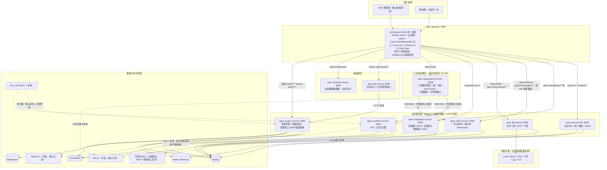
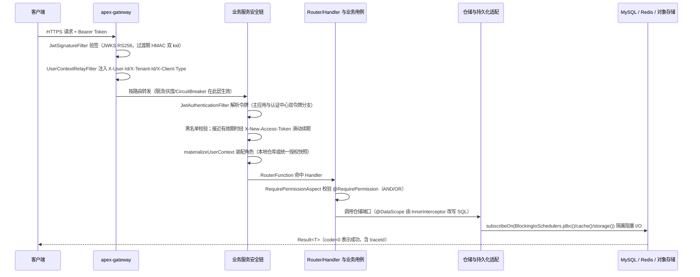

# Apex Scaffold 系统架构设计文档

> 文档版本: v1.1\
> 创建时间: 2026-09-03\
> 最近更新: 2026-11-13（第一阶段 Maven 分组、当前运行拓扑与图表入口）\
> 适用版本: apex-scaffold v1.3.1+\
> 架构模式: DDD (领域驱动设计) + 网关微服务拆分

> **配套架构图**:
>
> - [DDD 四层逻辑架构图](../diagrams/01_logical_architecture.svg)
>
> - [网络物理部署架构图](../diagrams/02_physical_architecture.svg)
>
> - [全栈技术选型全景图](../diagrams/03_technical_architecture.svg)
>
> - [部署架构拓扑图](../diagrams/45_deployment_flow.svg)
>
> - [数据流转架构图](../diagrams/62_data_flow_consistency.svg)
>
> - [RocketMQ消息队列架构图](../diagrams/61_message_queue_reliability.svg)
>
> - [i18n 消息处理链路](../diagrams/69_i18n_message_flow.svg)
>
> - [前后端交互架构图](../diagrams/58_api_error_response_flow.svg)
>
> - [微服务治理架构图](../diagrams/43_spi_plugin_architecture.svg)
>
> - [配置层级图](../diagrams/46_configuration_hierarchy.svg)
>
> - [监控体系架构图](../diagrams/48_monitoring_configuration.svg)
>
> - [Prometheus监控体系架构图](../diagrams/24_prometheus_grafana_monitoring.svg)
>
> - [后端技术栈架构图](../diagrams/29_technology_stack_overview.svg)
>
> 上述 SVG 属于历史图集，与当前实现有出入的部分以本文 1.2 节的运行架构图与网关路由表为准。93 / 94 的单体历史视图保留，不因 Maven 分组重绘。
>
> **当前 Maven 结构图**：
> - [七管理组聚合图（128）](../diagrams/128_maven_module_groups.svg) / [Mermaid 源](../diagrams/128_maven_module_groups.mmd)
> - [直接 parent 继承图（129）](../diagrams/129_maven_parent_inheritance.svg) / [Mermaid 源](../diagrams/129_maven_parent_inheritance.mmd)
> - [35 JAR 直接内部生产依赖图（95）](../diagrams/95_module_dependency_graph.svg) / [Mermaid 源](../diagrams/95_module_dependency_graph.mmd)
>
> 聚合、parent 与生产依赖是三种关系；95 / 128 / 129 为语义配对的手写 SVG，维护方式见[图表指南](../diagrams/README.md#图表双源规范重要)。

***

## 一、架构概览

Apex Scaffold 采用**领域驱动设计(DDD)思想,结合**响应式编程(Reactive)**和**微服务治理模式,构建高性能、可扩展的企业级应用平台。

### 1.1 核心设计原则

| 原则        | 说明          | 实现方式                             |
| --------- | ----------- | -------------------------------- |
| **分层解耦**  | 清晰的四层架构边界   | 接口层 → 应用层 → 领域层 → 基础设施层（每个业务服务内部）|
| **依赖倒置**  | 高层模块不依赖低层模块 | 领域层定义接口,基础设施层实现                  |
| **服务拆分**  | 网关统一入口,按业务域拆分运行单元 | Spring Cloud Gateway + 六业务服务 + 只读查询聚合 + 任务代理/可选脱敏服务 |
| **响应式优先** | 非阻塞异步编程     | Spring WebFlux + Project Reactor |
| **阻塞隔离**  | 同步 I/O 与事件循环隔离 | `BlockingIoSchedulers` 专用池（jdbc/cache/storage/event/remote/general） |
| **可观测性**  | 全链路监控追踪     | Prometheus + Grafana + Loki/Alloy（Zipkin/SkyWalking 为可选组件） |
| **弹性伸缩**  | 水平扩展能力      | 无状态服务 + Redis共享会话                |
| **安全合规**  | 多租户数据隔离     | tenant\_id + RBAC权限              |

### 1.2 当前运行拓扑（系统架构图）

Maven 管理结构为 **7 个管理组、44 个后代、45 个 reactor 项目含根**：6 个新增 `packaging=pom` 分组加现有 `apex-services-bom`，共 8 个 POM 含根、37 个 JAR。shared / components / starters / services / applications / tools / business 分别聚合 9/6/4/11/2/4/1 个 JAR；第二阶段（2026-11-14）叶子物理位于各分组父目录之下，分组以 `<module>apex-xxx</module>` 聚合同目录叶子，不改变坐标、生产依赖或运行拓扑。

22 个叶子调整直接 parent；api-contract / integration / boot-all 分别聚合到 shared / components / applications，却继续继承 services-bom，连同 10 个运行模块共 13 个 parent 不变。business 第一阶段为空，只管理项目业务库及业务专属配置 / 资源；通用框架实现在其他组，未来独立 `business-domain-service` 只归 services 聚合与继承，不重复登记到 business。管理 POM 不是新服务，不含业务实现、端口或可执行 JAR。

当前运行架构为**一个网关 + 六个业务服务 + 只读查询聚合服务 + 两个辅助服务**：网关负责 JWT 验签、可信头注入、限流、灰度与熔断回退；各业务服务内部保持 DDD 四层与 WebFlux 函数式路由；查询聚合服务（`apex-aggregation-service`，8098）无数据库，仅提供统一待办等只读跨源聚合；任务代理与脱敏服务是轻量侧车，未注册 Nacos，走固定受信地址。



要点：

- `job-domain`、`masking-domain` 两条路由使用固定地址，不依赖 Nacos；office 的 WS/HTTP 消息路由缺省与 office 主路由同为 `lb://apex-office-service`，直连部署必须显式注入 `ROUTE_OFFICE_MESSAGE_URI` / `ROUTE_OFFICE_WS_URI` 并指向同一实例（票据与连接注册表是单实例内存态）。
- 关闭 Nacos 时，`lb://` 路由须通过 `ROUTE_*` 环境变量改为明确地址；各路由均带 `ROUTE_*` 覆盖能力，可一键回滚。
- XXL 执行器与 Seata 均默认禁用；Seata 通过 `apex.seata.mode` 选择 AT/TCC/SAGA/XA。

#### 网关路由表

| 路由 id | 匹配路径 | 默认目标 |
| --- | --- | --- |
| auth-service | `/auth/v1/**`、`/auth/v2/**`、`/oauth2/**`、`/.well-known/**`、`/api/v1/mfa/**`、`/api/mfa/**`、`/api/ip-access-control/**`、`/api/v1/auth/configs/**`、`/api/v1/auth/audit-logs/**` | `lb://apex-auth-service` |
| workflow-domain | `/api/v1/workflows/**`、`/api/v2/workflow-definitions/**`、`/api/workflow/**`、`/admin-api/v1/workflows/**` | `lb://apex-workflow-service` |
| office-message-websocket | `/api/v1/messages/ws`（要求 `Upgrade: websocket`） | `lb://apex-office-service`（`ROUTE_OFFICE_WS_URI`） |
| office-message-http | `/api/v1/messages`、`/api/v1/messages/**` | `lb://apex-office-service`（`ROUTE_OFFICE_MESSAGE_URI`） |
| office-domain | `/api/v1/office/**`、`/api/v2/office/**`、`/api/office/**`、`/api/v1/messages/**`、`/admin-api/v1/office/**`、`/admin-api/v1/org/**`、`/admin-api/v1/message-templates` | `lb://apex-office-service` |
| aggregation-domain | `/api/v2/todo` | `lb://apex-aggregation-service` |
| file-domain | `/api/v1/file/**`、`/api/v1/files/**`、`/api/v1/documents/**`、`/admin-api/v1/documents/**`、`/admin-api/v1/charts/**`、`/api/v2/files/**`、`/api/v2/file-shares/**` | `lb://apex-file-service` |
| job-domain | `/admin-api/v1/jobs`、`/admin-api/v1/jobs/**` | `http://127.0.0.1:8095` |
| masking-domain | `/api/v1/masking/**` | `http://127.0.0.1:8096` |
| integration-domain | `/integration/v1/**` | `lb://apex-integration-service` |
| open-api-file | `/open-api/file/**` | `lb://apex-file-service` |
| open-api-workflow | `/open-api/workflow/**` | `lb://apex-workflow-service` |
| open-api-system | `/open-api/users`、`/open-api/users/**`、`/open-api/user/**` | `lb://apex-system-service` |
| open-api-office | `/open-api/messages/**` | `lb://apex-office-service` |
| system-domain（兜底） | `/api/v1/**`、`/api/v2/operations/**`、`/api/v2/platform/**`、`/api/v2/tenant-packages/**`、`/api/v2/capabilities/**`、`/api/v2/capability-usage/**`、`/api/v2/overview/**`、`/admin-api/v1/**`、`/health`、`/actuator/**` | `lb://apex-system-service` |

来源：`apex-gateway/src/main/resources/application.yml`（生产覆盖见同目录 `application-prod.yml`，该文件重定义 routes 列表，新增路由必须两处同步；Nacos 下发见 `config/nacos/apex-gateway.yaml`，同样整表覆盖）。

> 归属说明：`/admin-api/v1/auth/**`、`/admin-api/v1/sso/**` 由 system 承载（`AuthConfigRouter`、`SsoAdminRouter`），不进入 auth-service 路由，经 system-domain 兜底；其余 `/api/v1/auth/**`（Keycloak OIDC 登录等）同样由 system 兜底。

#### 请求处理链路时序图



网关只做验签与主体提取，不做授权决策；`/internal/**` 路径在网关直接拒绝公网访问，细粒度权限全部在下游服务完成。

***

## 二、逻辑架构 - DDD四层模型

### 2.1 架构分层

```
┌─────────────────────────────────────────────────────────────┐
│  接口层 (Interfaces Layer)                                   │
│  - REST API (RouterFunction)                                │
│  - Scheduler (定时任务)                                      │
│  - MQ Listener (消息监听)                                    │
│  - CLI (命令行)                                             │
├─────────────────────────────────────────────────────────────┤
│  应用层 (Application Layer)                                  │
│  - 认证授权 (JWT/RBAC/数据权限/租户隔离)                      │
│  - 系统管理 (用户/角色/菜单/部门/字典/配置/定时任务)           │
│  - 监控审计 (登录日志/操作日志/API调用日志)                   │
│  - 工作流引擎 (流程定义/流程实例/任务审批)                     │
├─────────────────────────────────────────────────────────────┤
│  领域层 (Domain Layer)                                       │
│  - 领域模型 (Entity/ValueObject/Aggregate)                  │
│  - 领域服务 (业务规则/领域事件/规格模式)                      │
│  - 仓储接口 (Repository/聚合根操作/查询规约)                  │
│  - 工厂与策略 (Factory/Strategy/Policy)                     │
├─────────────────────────────────────────────────────────────┤
│  基础设施层 (Infrastructure Layer)                           │
│  - 数据持久化 (MyBatis-Plus)                                │
│  - 缓存 (Redis/Caffeine)                                    │
│  - 消息队列 (RocketMQ)                                      │
│  - 文件存储 (MinIO/TOS)                                     │
│  - 第三方服务 (微信/短信)                                    │
└─────────────────────────────────────────────────────────────┘
```

### 2.2 模块职责

#### 2.2.1 接口层 (Interfaces Layer)

**职责**: 对外暴露服务能力,接收请求并路由到应用层

**核心组件**:

| 组件          | 技术实现                              | 端口   | 说明          |
| ----------- | --------------------------------- | ---- | ----------- |
| REST API    | Spring WebFlux RouterFunction     | 8080 | 函数式端点,响应式处理 |
| Scheduler   | Spring @Scheduled + Quartz        | -    | 定时任务调度      |
| MQ Listener | RocketMQ @RocketMQMessageListener | -    | 消息消费监听      |
| CLI         | Spring Shell (可选)                 | -    | 命令行接口       |

**设计要点**:

- ✅ 薄接口层,仅负责参数验证、格式转换、异常处理

- ✅ 统一响应格式 `Result<T>`,包含code/message/data

- ✅ 全局异常处理器 `GlobalExceptionHandler`

- ✅ 请求日志拦截器,记录API调用轨迹

#### 2.2.2 应用层 (Application Layer)

**职责**: 编排业务流程,协调领域服务完成用例

**核心模块**:

**1. 认证授权模块**

- JWT Token生成与验证

- RBAC权限校验 (用户-角色-权限)

- 数据权限拦截器 (部门级/租户级隔离)

- 多租户上下文管理 `TenantContext`

**2. 系统管理模块**

- 用户管理: CRUD、角色分配、部门分配

- 角色管理: CRUD、权限分配、数据范围

- 菜单管理: 树形结构、动态路由、按钮权限

- 部门管理: 树形结构、租户隔离

- 字典管理: 类型-数据两级管理

- 参数配置: 系统参数热更新

- 定时任务: Quartz任务CRUD、执行日志

**3. 监控审计模块**

- 登录日志: 记录登录成功/失败、IP地理位置

- 操作日志: `@OperationLog`注解,AOP切面记录

- API调用日志: WebFilter拦截,记录请求/响应

**4. 工作流引擎模块**

- 流程定义: DAG JSON 定义、流程版本管理

- 流程实例: 启动流程、挂起/激活、终止

- 任务审批: 待办任务、已办任务、审批操作

**设计要点**:

- ✅ 应用服务负责事务边界管理 `@Transactional`

- ✅ DTO与领域模型转换 (使用MapStruct)

- ✅ 防腐层模式,隔离外部API依赖

- ✅ 领域事件发布与订阅

#### 2.2.3 领域层 (Domain Layer)

**职责**: 封装核心业务逻辑,保持领域模型纯粹性

**核心概念**:

**1. 聚合根 (Aggregate Root)**

- `User` 聚合: 用户基本信息、认证信息、组织信息

- `Role` 聚合: 角色信息、权限列表、数据范围

- `Dept` 聚合: 部门信息、上下级关系、租户归属

- `Workflow` 聚合: 流程定义、流程实例、任务节点

**2. 值对象 (Value Object)**

- `LoginCredential`: 登录凭据(用户名/密码)

- `GeoLocation`: 地理位置(国家/省份/城市)

- `AuditInfo`: 审计信息(创建人/创建时间/修改人/修改时间)

**3. 领域服务 (Domain Service)**

- `PermissionChecker`: 权限校验服务

- `DataPermissionFilter`: 数据权限过滤服务

- `TenantIsolationService`: 租户隔离服务

- `WorkflowEngine`: 工作流引擎服务

**4. 仓储接口 (Repository Interface)**

```java
public interface UserRepository {
    Mono<User> findById(Long id);
    Mono<User> findByUsername(String username);
    Flux<User> findByDeptId(Long deptId);
    Mono<User> save(User user);
    Mono<Void> deleteById(Long id);
}
```

**设计要点**:

- ✅ 领域模型充血模型,封装行为方法

- ✅ 仓储接口定义在领域层,实现在基础设施层

- ✅ 领域事件驱动异步解耦

- ✅ 规格模式实现复杂查询条件组合

#### 2.2.4 基础设施层 (Infrastructure Layer)

**职责**: 提供技术支撑,实现领域层定义的接口

**核心组件**:

**1. 数据持久化**

- MyBatis-Plus: ORM框架,Lambda条件构造器

- Druid: 连接池,SQL监控

- Flyway: 数据库版本化迁移

- Dynamic-Datasource: 主从读写分离

**2. 缓存体系**

- L1缓存: Caffeine本地缓存,JVM内存

- L2缓存: Redis分布式缓存,集群模式

- 缓存策略: Cache-Aside模式,先查缓存后查DB

**3. 消息队列**

- RocketMQ: 可靠消息投递,事务消息

- 应用场景: 异步解耦、削峰填谷、事件通知

**4. 文件存储**

- MinIO: 私有化对象存储

- 火山云TOS: 公有云对象存储

- 统一抽象接口 `FileStorageService`

**5. 第三方服务**

- 微信登录: OAuth2授权,OpenID/UnionID

- 短信服务: 创蓝短信API,验证码/通知

- 统一客户端封装 `WebClient` 响应式调用

**设计要点**:

- ✅ 实现领域层定义的Repository接口

- ✅ PO与DO分离,PO仅用于持久化

- ✅ 技术组件可替换,通过配置切换实现

- ✅ 异常转换,将技术异常转换为领域异常

### 2.3 模块依赖关系

35 个既有 JAR（95 图尚未纳入知识库两模块的依赖边，其依赖见 AGENTS.md 依赖表）的直接内部生产依赖见[95 依赖图](../diagrams/95_module_dependency_graph.svg)及[Mermaid 源](../diagrams/95_module_dependency_graph.mmd)，共 104 条内部 compile 边；44 个后代中的 7 个管理 POM（加根共 8 个 POM）不是生产 JAR，不画为 compile 节点。

| 边界 | 直接内部生产依赖要点 |
| --- | --- |
| 五个共享设施 JAR | 均依赖 common / domain；messaging 另依赖 persistence，infrastructure-integration 另依赖 remote。 |
| 六业务库 | 均依赖 common / domain；system 另依赖 api-contract、五设施 JAR 与 license starter；auth 另依赖 api-contract / infrastructure-integration；file 另依赖 storage starter；integration 另依赖 persistence / remote。 |
| 六业务 service | 各自依赖所属业务库、common / domain、job / seata starter；system / auth / workflow / office 另依赖 api-contract，auth 另依赖 cache / messaging / infrastructure-integration。 |
| aggregation | 只依赖 common / api-contract；通过 WebClient 聚合 workflow / office 的内部 HTTP 接口，不依赖两业务库或运行模块的 JAR，无数据库。 |
| gateway / job / masking | gateway 与 masking 仅依赖 common；job 仅依赖 infrastructure-remote，system 数据所有权不变。 |
| apex-infrastructure | 仍为兼容 JAR，生产依赖五个设施能力 JAR，不是 Maven 分组父 POM。 |

约束：common、共享 domain/infrastructure、api-contract 不得反向依赖具体业务库；网关不承载业务四层实现。图中排除 test scope 的 auth-service→system、office-service→gateway、aggregation-service→gateway、infrastructure-integration→cache；第三方 optional MQTT 客户端也不在内部依赖图范围。聚合见 128，parent 见 129，不根据管理归属推导生产依赖。

***

## 三、物理架构 - 部署拓扑

### 3.1 部署架构图

当前运行访问方向见 §1.2 的 Mermaid 图。下面按部署单元列出清单，**不是串联调用或 Maven 聚合树**：

```text
客户端 / 独立管理前端 -> apex-gateway :8080
    六个业务服务（网关各自直接路由）：
        apex-auth-service        :8081
        apex-system-service      :8082  / 管理 :8083
        apex-workflow-service    :8093
        apex-office-service      :8084  / HTTP 与 WS 必须同实例
        apex-file-service        :8085
        apex-integration-service :8094  / 管理 :8097
    只读查询聚合（网关独立路由）：
        apex-aggregation-service :8098
        -> 内部签名 WebClient -> workflow / office；无 DB / 迁移 / 事务
    辅助运行模块（固定受信地址）：
        apex-job-service         :8095 -> 仅代理 system 九个任务接口
        apex-masking-service     :8096 -> 启动期脱敏策略，无持久化

设施访问按业务配置启用（不表示每个服务全依赖）：
    业务域独立数据库 / Flyway；Redis / Redisson；RocketMQ / Outbox
    system 全文检索 Meilisearch；file 五后端对象存储
    integration 外部 EMQX（MQTT 桥接默认关闭）
    可选 Nacos / XXL-Job Admin / Seata TC / Keycloak
可观测性：Actuator/Micrometer -> Prometheus + Grafana + Alertmanager
日志聚合：Logback -> Loki（Grafana Alloy 采集）
```

> 注：`apex-system-service` 管理端口 8083 与业务端口 8082 物理隔离（管理端口默认仅绑定 127.0.0.1）。workflow 业务端口 8093（2026-11-07 由 8083 调整，与 system 管理端口 8083 不再冲突）。

### 3.2 组件职责与端口

| 组件             | 用途                     | 端口                  | 部署方式               |
| -------------- | ---------------------- | ------------------- | ------------------ |
| **apex-gateway** | API 网关，JWT 验签与路由分发 | 8080                | Podman / K8s       |
| **apex-auth-service** | 认证中心，登录/刷新/登出/统一授权 | 8081                | Podman / K8s       |
| **apex-system-service** | 系统管理（用户/角色/菜单/字典/任务） | 8082 业务 / 8083 管理（仅 127.0.0.1） | Podman / K8s |
| **apex-workflow-service** | DAG 工作流引擎 | 8093   | Podman / K8s       |
| **apex-office-service** | 办公协同 + 站内信 WebSocket | 8084                | Podman / K8s       |
| **apex-file-service** | 文件上传/分片/下载 | 8085                | Podman / K8s       |
| **apex-integration-service** | 连接器 / 设备接入，HTTP WebClient 与可选 MQTT 桥接 | 8094 业务 / 8097 管理 | Podman / K8s |
| **apex-aggregation-service** | 只读统一待办聚合，无 DB / 迁移 / 事务 | 8098 | Podman / K8s |
| **apex-job-service** | 任务管理接口代理（9 个接口） | 8095（仅 127.0.0.1）  | Podman / K8s       |
| **apex-masking-service** | 启动期脱敏策略（无持久化） | 8096（仅 127.0.0.1） | Podman / K8s       |
| **MySQL**      | 关系型数据库，按业务域独立迁移链 | 3306                | 独立部署 / RDS         |
| **Redis**      | 缓存与会话，Redisson 客户端 | 6379                | 独立部署 / ElastiCache |
| **RocketMQ**   | 消息队列，Outbox 可靠投递 | 9876(NameServer)    | Podman / K8s       |
| **Meilisearch** | 轻量全文检索（system 域使用） | 7700                | Podman             |
| **Nacos**      | 配置中心与服务发现（默认可关） | 8848                | Podman / K8s       |
| **XXL-Job Admin** | 任务调度控制台（执行器默认禁用） | 8097→8080           | Podman             |
| **Seata TC**   | 分布式事务（默认关闭，`apex.seata.mode`） | 8091                | Podman             |
| **Keycloak**   | SSO/OAuth2 IdP（可选） | 8080→8080           | Podman             |
| **Loki / Alloy** | 日志聚合与 OTel 采集 | 3100 / 4317         | Podman             |
| **Prometheus / Grafana / Alertmanager** | 指标采集、大盘与告警 | 9090 / 3000 / 9093  | Podman             |

容器与端口以 [podman-compose.yml](../../podman-compose.yml) 为准；中间件可选组件见 [podman-compose.infra.yml](../../podman-compose.infra.yml)。

### 3.3 网络拓扑

**生产环境网络规划**:

| 网络分区     | 组件                        | 访问策略           |
| -------- | ------------------------- | -------------- |
| **DMZ区** | Nginx/ALB                 | 公网暴露,HTTPS 443 |
| **应用区**  | apex-scaffold实例           | 仅DMZ可访问        |
| **数据区**  | MySQL/Redis               | 仅应用区可访问        |
| **中间件区** | Nacos/Sentinel/RocketMQ   | 仅应用区可访问        |
| **监控区**  | Prometheus/Grafana/Zipkin | 管理员VPN访问       |

**安全策略**:

- ✅ 数据库禁止公网访问,仅内网IP白名单

- ✅ Redis设置密码认证

- ✅ 应用服务间通信使用HTTPS

- ✅ 敏感配置存储在Nacos加密配置

***

## 四、技术架构 - 技术栈全景

### 4.1 前端技术栈

| 分类          | 技术           | 版本     | 说明                  |
| ----------- | ------------ | ------ | ------------------- |
| **核心框架**    | Vue          | 3.5.13 | Composition API,响应式 |
| **构建工具**    | Vite         | 6.0.7  | 极速冷启动,HMR           |
| **类型系统**    | TypeScript   | 5.x    | 类型安全,智能提示           |
| **UI组件库**   | Element Plus | 2.x    | 企业级UI组件             |
| **状态管理**    | Pinia        | 2.x    | Vue官方推荐             |
| **HTTP客户端** | Axios        | 1.x    | Promise based       |
| **路由**      | Vue Router   | 4.x    | 动态路由,守卫             |

### 4.2 后端技术栈

#### 4.2.1 核心框架

| 技术                  | 版本             | 说明         |
| ------------------- | -------------- | ---------- |
| **Java**            | 21（SDKMAN `21.0.13.0+9-tem`） | LTS，虚拟线程可选启用 |
| **Spring Boot**     | 3.5.15         | 父 POM 统一管理版本 |
| **Spring WebFlux**  | Reactor 3.6.x | 响应式编程，函数式 Router |
| **Spring Security** | 6.5.x          | JWT+RBAC权限 |
| **Netty**           | 4.x            | 底层IO运行时    |

#### 4.2.2 数据访问

| 技术               | 版本       | 说明                      |
| ---------------- | -------- | ----------------------- |
| **MyBatis-Plus** | 3.5.10.1 | ORM框架,代码生成              |
| **Druid**        | 1.2.25   | 连接池+SQL监控               |
| **Flyway**       | 11.20.3  | 数据库版本化迁移（按业务域独立版本链） |
| **MySQL**        | 9.x      | 关系型数据库                  |
| **Redis**        | 7.x      | KV缓存,Redisson 3.36.0    |
| **Caffeine**     | 3.1.8    | 本地缓存                    |
| **Meilisearch**  | 1.10     | 轻量级全文搜索引擎（system 域）               |

#### 4.2.3 微服务治理

| 技术               | 版本    | 说明        |
| ---------------- | ----- | --------- |
| **Nacos**        | 2.4.3 | 配置中心+服务发现（默认可关闭） |
| **Resilience4j** | 2.2.0 | 熔断器模式（网关路由 CircuitBreaker） |
| **RocketMQ**     | 5.3.1 | 消息队列,事务消息/Outbox |
| **Seata**        | 2.2.0 | 分布式事务(默认关闭，AT/TCC/SAGA/XA) |
| **XXL-Job**      | 3.1.1 | 分布式任务调度（执行器默认禁用） |

#### 4.2.4 可观测性

| 技术                | 版本     | 说明                               |
| ----------------- | ------ | -------------------------------- |
| **Micrometer**    | 1.14.2 | 指标门面,统一抽象                        |
| **Prometheus**    | 2.54.1 | 时序数据库,指标采集                       |
| **Grafana**       | 11.2.0 | 监控大盘,可视化                         |
| **Grafana Loki**  | 3.0.0  | 日志聚合系统,轻量级Elasticsearch替代        |
| **Grafana Alloy** | 1.0.0  | OpenTelemetry Collector,统一遥测数据收集 |
| **Logback**       | 1.5.12 | 日志框架,异步Appender                  |

> Zipkin/SkyWalking 为可选链路追踪组件（见 `podman-compose.infra.yml`），不作为默认运行栈强制依赖。

#### 4.2.5 对象存储

| 技术                 | 版本     | 说明             |
| ------------------ | ------ | -------------- |
| **MinIO**          | 8.5.15 | 自托管对象存储,S3兼容   |
| **火山引擎 TOS** | 2.6.1  | 公有云对象存储 |
| **阿里云 OSS / 七牛** | - | 其余三后端由 `apex-storage-spring-boot-starter` 自动装配 |

#### 4.2.6 安全与认证

| 技术         | 说明          |
| ---------- | ----------- |
| **JWT**    | Token认证,无状态 |
| **BCrypt** | 密码加密,防彩虹表   |
| **RBAC**   | 角色权限模型      |
| **数据权限**   | 部门级/租户级隔离   |

#### 4.2.7 API文档

| 技术            | 版本    | 说明            |
| ------------- | ----- | ------------- |
| **SpringDoc** | 2.7.0 | OpenAPI 3.0规范 |
| **Knife4j**   | 4.5.0 | Swagger增强UI   |

#### 4.2.8 测试框架

| 技术                 | 版本     | 说明           |
| ------------------ | ------ | ------------ |
| **JUnit**          | 5.11.3 | 单元测试框架       |
| **Mockito**        | 5.14.2 | Mock框架       |
| **TestContainers** | 1.20.4 | 容器化集成测试      |
| **WebTestClient**  | -      | WebFlux响应式测试 |

#### 4.2.9 构建与部署

| 技术                 | 版本    | 说明        |
| ------------------ | ----- | --------- |
| **Maven**          | 3.9.x | 构建工具,依赖管理 |
| **Podman**         | -     | 容器化       |
| **podman-compose** | -     | 本地编排      |
| **Kubernetes**     | 1.28+ | 生产编排(可选)  |
| **GitHub Actions** | -     | CI/CD流水线  |

### 4.3 技术选型理由

| 技术决策                      | 理由                                         |
| ------------------------- | ------------------------------------------ |
| **WebFlux而非WebMVC**       | 高并发场景下非阻塞性能更优,适合IO密集型应用                    |
| **MyBatis-Plus而非JPA**     | 更灵活的SQL控制,Lambda条件构造器易用性高                  |
| **网关 + 业务域服务而非单体** | 按业务域独立部署、独立迁移与扩缩容；网关统一验签与熔断，下游专注业务         |
| **Resilience4j（网关熔断）** | 纯代码熔断器模式，与 WebFlux 响应式链路天然契合，无需独立 Dashboard |
| **Nacos（可选）而非Config Server**  | 同时提供配置中心和服务发现，默认可关，关闭时走 `ROUTE_*` 固定地址     |
| **RocketMQ而非Kafka**       | 事务消息支持,更适合业务消息场景；Outbox 保证与业务写同事务          |
| **DAG JSON 而非 BPMN 引擎** | 工作流以 `WorkflowDefinitionGraph` 解析 dagJson，轻量可控，满足三级审批等场景 |
| **Prometheus+Grafana+Loki**    | 云原生监控与日志标准，社区生态丰富；Zipkin/SkyWalking 为可选增强    |

***

## 五、架构演进路线

### 5.1 当前架构 (v1.3.x)

- ✅ 当前运行拓扑为网关 + 六业务服务 + 只读查询聚合 + 任务代理 / 可选脱敏；Maven 七组调整不改变运行单元

- ✅ 各业务服务内部保持 DDD 四层与 WebFlux 函数式路由

- ✅ 响应式编程 (WebFlux) + `BlockingIoSchedulers` 阻塞 I/O 隔离

- ✅ 可选治理组件集成 (Nacos/XXL-Job/Seata 均默认可关)

- ✅ 统一账户多端登录 + 认证中心独立授权（渐进开关）

- ✅ 可观测性体系 (Prometheus + Grafana + Loki/Alloy)

### 5.2 进行中与近期优化

**功能与可靠性**:

- [ ] office 站内信多实例实时广播（当前票据与连接注册表为单实例内存态）

- [ ] 统一授权跨实例主动失效（当前仅 ≤30s TTL，无主动撤权广播）

- [ ] 生产 `sys_*` 数据迁移至认证中心（开关不迁移数据）

- [ ] Seata 真实 TC 环境下四模式端到端验证

**性能优化**:

- [ ] SQL慢查询优化,索引调优

- [ ] JVM参数调优,虚拟线程灰度（按池启用 `apex.blocking-io.<pool>.virtual-threads`）

### 5.3 长期规划 (v2.0.0+)

**技术升级**:

- Spring Boot 4.x

- GraalVM Native Image（受 MyBatis-Plus/JWT 等反射依赖约束，需评估）

**云原生演进**:

- Service Mesh (Istio)

- Serverless部署 (Knative)

- 多云适配 (AWS/阿里云/腾讯云)

***

## 六、架构决策记录 (ADR)

正式编号以[逻辑架构 ADR-001](01-logical-architecture-decision.md)、[部署 ADR-002–008](02-physical-architecture-decision.md)及[技术 ADR-009–015](03-technical-architecture-decision.md)为准。下列旧决策摘要不再复用冲突编号，历史性能结果未在本轮重新验证。

<a id="adr-auth-center-001独立认证中心的远程授权集成"></a>

### ADR-AUTH-CENTER-001：独立认证中心的远程授权集成

**状态**：方案已批准；当前代码具备渐进授权接入，部署与集成验收待执行。

**决策**：主应用与认证中心入口 `AuthServiceApplication` 保持独立 Spring ApplicationContext，主应用以显式 `scanBasePackages` 白名单扫描，不包含 auth 包。共享基础类型，不直接调用中心内部仓储或 Mapper。主应用身份认证继续使用原有 JWT 链，授权数据通过领域端口 `UnifiedAuthorizationGateway` 与 HTTPS 适配器接入中心。

**实现边界**：`apex.features.auth-center-permission` 默认关闭。开启后以可信主租户/用户解析服务端唯一映射，使用专用读取账号 ACCESS Token 查询 `/auth/v1/authorization/users/{userId}`；中心租户来自 Token，中心检查读取账号和目标账号的状态。客户端验证响应身份并转换回主应用身份；映射 SELF、ALL、DEPT、DEPT_AND_CHILD 数据范围，CUSTOM、空值和未知范围拒绝。

**取舍**：3 秒请求超时与默认熔断器限制远程故障影响；错误拒绝授权。缓存默认关闭，可配置 0–30 秒，存在 TTL 撤权延迟；没有过期缓存降级或本地权限回退。专用凭据由部署侧轮换，适配器不自动刷新。跨实例主动失效、生产 sys_* 数据迁移和整体认证迁移仍需独立推进，不能登记为已完成。

**迁移资源**：认证中心当前激活 `classpath:db/migration/mysql`；未激活的 `db/migration/auth/*/V51` 重复脚本已从当前工作区移除，不表示数据库迁移已执行。

**验证依据**：[配置说明](../05-operations/configuration.md#认证中心统一授权)、[登录与授权时序](business-flows.md)、[统一授权 Handler 测试源码](../../apex-services-bom/apex-auth-service/src/test/java/com/apex/scaffold/authservice/interfaces/handler/UnifiedAuthorizationHandlerTest.java)。本 ADR 的状态不代表测试通过或已部署。

### 历史决策摘要：采用 Spring WebFlux（正式编号 ADR-009）

**决策日期**: 2024-Q2\
**状态**: 已采纳 ✅

**背景**:\
传统Servlet容器(Tomcat)基于线程池模型,每个请求占用一个线程,在高并发IO密集场景下线程资源受限。

**决策**:\
采用Spring WebFlux + Netty响应式框架,非阻塞异步处理请求；同步 JDBC/缓存/存储等阻塞 I/O 经 `BlockingIoSchedulers` 隔离到专用线程池。

**结果**:

- ✅ 非阻塞主链路适配高并发 IO 密型场景

- ✅ 阻塞 I/O 与事件循环隔离，避免载体线程被钉住

- ⚠️ 学习曲线陡峭,需要团队培训

***

### 历史决策摘要：采用 DDD（正式编号 ADR-001）

**决策日期**: 2024-Q3\
**状态**: 已采纳 ✅

**背景**:\
传统MVC三层架构在业务复杂度增长后,Service层过于臃肿,业务逻辑分散。

**决策**:\
采用DDD四层架构,明确接口层、应用层、领域层、基础设施层职责。

**结果**:

- ✅ 业务逻辑内聚在领域层,可测试性提升

- ✅ 领域模型充血,封装行为而非贫血模型

- ✅ 仓储模式实现存储技术解耦

- ⚠️ 初期开发效率略有下降,但长期可维护性增强

***

### 历史决策摘要：多租户 tenant_id 字段隔离

**决策日期**: 2024-Q4\
**状态**: 已采纳 ✅

**背景**:\
SaaS场景需要支持多租户,保证数据隔离与安全。

**决策**:\
采用共享数据库、共享Schema、tenant\_id字段隔离方案。

**方案对比**:

| 方案            | 优点          | 缺点       | 选择 |
| ------------- | ----------- | -------- | -- |
| 独立数据库         | 隔离性最强,可独立备份 | 成本高,运维复杂 | ❌  |
| 独立Schema      | 隔离性强,扩展灵活   | 连接池管理复杂  | ❌  |
| 共享表tenant\_id | 成本低,易扩展     | 需严格SQL审查 | ✅  |

**结果**:

- ✅ 单库支持1000+租户

- ✅ 运维成本低,仅需一套数据库

- ✅ 通过MyBatis-Plus拦截器自动注入tenant\_id

- ⚠️ 需要代码review保证tenant\_id不遗漏

***

## 七、非功能性需求

### 7.1 性能指标

| 指标        | 目标值         | 实际值      |
| --------- | ----------- | -------- |
| **QPS**   | 5000 QPS/实例 | 待生产实测 |
| **P95延迟** | < 200ms     | 待生产实测 |
| **P99延迟** | < 500ms     | 待生产实测 |
| **可用性**   | 99.9%       | 待生产实测 |

> 历史文档中的实测数值未在本轮重新验证，登记为"待生产实测"，不作为已达成 SLA 引用。

### 7.2 扩展性

- ✅ 业务服务无状态,支持水平扩展

- ✅ 数据库按业务域独立迁移链，可按域读写分离

- ✅ Redis 共享会话与缓存，支持集群模式

- ✅ RocketMQ 分布式消息队列（Outbox 与业务写同事务）

### 7.3 安全性

- ✅ HTTPS全链路加密

- ✅ JWT Token认证,无状态

- ✅ 密码BCrypt加密,防彩虹表

- ✅ SQL注入防护 (MyBatis预编译)

- ✅ XSS防护 (前端转义)

- ✅ CSRF防护 (Token验证)

### 7.4 可维护性

- ✅ 代码分层清晰,职责单一

- ✅ API文档自动生成 (OpenAPI 3)

- ✅ 日志结构化,便于检索

- ✅ 监控告警体系 (Prometheus + Grafana + Alertmanager)

***

## 八、参考资料

### 8.1 内部文档

- [前后端API路由对比清单](../_archive/api/route-mapping.md)

- [配置文件完整性检查报告](../_archive/operations/configuration.md)

- [Grafana监控面板增强方案](../_archive/operations/monitoring.md)

### 8.2 外部参考

- [Spring Boot官方文档](https://docs.spring.io/spring-boot/docs/current/reference/html/)

- [Spring WebFlux官方文档](https://docs.spring.io/spring-framework/reference/web/webflux.html)

- [DDD领域驱动设计](https://domain-driven-design.org/)

- [12-Factor App](https://12factor.net/)

- [云原生应用架构实践](https://www.cncf.io/)

***

**文档维护者**: 架构团队\
**审核状态**: 待人工审核\
**下次更新**: 架构演进后同步更新
