# Apex Scaffold 微服务架构改造方案

> **版本**：v1.0 | **日期**：2026-10-07（2026-10-09 同步实施状态） | **状态**：实施中（已按执行计划推进：Phase 1 共享层/BOM、网关、内部契约、Nacos 配置分层及 Phase 1 验收均已完成并产出测试报告与离线契约基线；Phase 2.1 JWT 对称→非对称（JWKS）、Phase 2.2 auth 库治理、Phase 2.3 Nacos 注册 + 内部 API、Phase 2.4 网关 /auth 切流 + 灰度、Phase 2.5 主应用双通道兼容、Phase 2.6 登出传播（TokenRevokedEvent + Outbox + V56）均已完成，`mvn -pl apex-auth-center -am verify` 全门禁绿）
>
> 本方案基于对当前仓库全部 11 个 Maven 模块的实际代码调研形成，所有图表与结论均以真实文件路径为证据。
>
> > **实施状态说明（2026-10-08 更新）**：早期"尚未执行任何代码变更"表述已过期。`.trae/documents/microservice-migration-execution-plan.md` 为当前执行跟踪文档；Phase 1.2 `apex-gateway` 模块已完成过滤器链 + JWKS 验签 + 统一错误出口，`mvnd -pl apex-gateway -am verify` 全门禁绿（64/64 测试，JaCoCo LINE 85.9% / BRANCH 64.4%，spotless/pmd/ArchUnit 全过），测试报告见 `docs/06-testing/gateway-module-test-report.md` 及 `docs/06-testing/TEST_REPORT.md` 网关段。
>
> > > **Phase 2 状态（2026-10-09 更新）**：Phase 2.1 JWT 对称→非对称（JWKS）已完成 —— 新增 `JwtKeyMaterialService`（RS256 外观：`sign`/`parse`/`availablePublicKeys` JWKS 投影），`TokenServiceImpl` 签发/解析改走响应式 `JwtKeyMaterialService`；`JwtKeyRotationService` 三实现合并为 `domain` 的 Redis-RSA 单一版本。Phase 2.2 库治理已完成（Flyway 重复 V49→V51、`bootstrap.yml` 服务名收敛为 `apex-auth-service`）。Phase 2.3 Nacos 注册 + 内部 API 已完成（`InternalAuthService` / `InternalAuthRouter`，服务间契约 `/internal/v1/**` 免鉴权白名单）。Phase 2.4 网关 `/auth` 切流 + 灰度已完成。Phase 2.5 主应用双通道兼容已完成。Phase 2.6 登出传播已完成 —— 新增 `TokenRevokedEvent`（`apex-domain`），`AuthenticationApplicationService.logout()` 经 `DomainEventPublisher` 发布；auth-center 显式装配 Outbox 三件套（`AuthCenterEventConfig`：`DomainEventOutboxStore` / `DomainEventOutboxPublisher` / `DomainEventOutboxDispatcher`）与 H2 降级发布器 `LocalDomainEventPublisher`，补齐 `sys_domain_event_outbox` 表（`V56__create_domain_event_outbox.sql`，mysql/postgresql）。定向验证 `mvn -pl apex-auth-center -am verify` → BUILD SUCCESS（spotless/pmd/JaCoCo/ArchUnit 全过）。

---

## 2026-10-12 system 物理迁移实施状态

第二批已将原 application 全部源码、资源与测试及 system 专属 domain/infrastructure 依赖闭包迁入 `apex-system`，保留原 Java 包名；interfaces/application 坐标退出 reactor 与 BOM，system-service/example 改用 system，auth-service parity 测试采用 test-scope system。共享 domain 保留 BaseEntity、Token/SMS/Event/缓存/远程调用契约；共享 infrastructure 保留通用设施，无 system 反向生产依赖。ApiCallLogEntity 留在 system，受管 HTTP 客户端通过共享观测 DTO 和 sink 接口解耦。

本批迁入文件按旧路径与 system 对应路径交叉统计为 683 个：application 281、domain 180、infrastructure 222（main 560、test 123，含资源）；共享层及兄弟服务 801 个生产 Java 文件未发现直接导入 system 类型。

此前全 reactor `compile -DskipTests` 于 18:19:24 通过（含 example），BaseEntityTest 漏迁已补齐。本次已加载 JDK 17.0.12-oracle/mvnd 2.0.0-rc-3 后执行完整 `clean verify -pl '!apex-example'`，20:52:48 因 LoggingFilterTest 缺少 httpHandler 测试辅助方法在 testCompile 失败；已补齐 WebFlux 过滤器/异常处理装配。重跑原完整门禁于 21:09:11 BUILD SUCCESS（12:34，当前 reactor Surefire/Failsafe XML 汇总 4853 tests、Failures 0、Errors 0、Skipped 3；含合并后的 Spotless、PMD、ArchUnit、JaCoCo 门禁），没有降低阈值或跳过检查。随后加载同一构建环境执行 `mvnd -T4 -B test-compile -pl apex-example -am`，21:10:28 BUILD SUCCESS（38.539s）。下文现状分析保留为方案制定时的历史基线。

## 目录

1. [现状分析](#1-现状分析)
2. [拆分原则与微服务边界](#2-拆分原则与微服务边界)
3. [目标系统架构](#3-目标系统架构)
4. [共享基础设施 SDK](#4-共享基础设施-sdk-apex-common-sdk)
5. [API 网关设计](#5-api-网关设计-apex-gateway)
6. [服务间通信设计](#6-服务间通信设计)
7. [认证授权改造](#7-认证授权改造)
8. [数据一致性与分布式事务](#8-数据一致性与分布式事务)
9. [数据库拆分方案](#9-数据库拆分方案)
10. [多租户与横切能力迁移](#10-多租户与横切能力迁移)
11. [可观测性方案](#11-可观测性方案)
12. [配置管理与服务治理](#12-配置管理与服务治理)
13. [部署架构](#13-部署架构)
14. [分阶段实施路线图](#14-分阶段实施路线图)
15. [绞杀者模式与灰度迁移](#15-绞杀者模式与灰度迁移)
16. [风险与缓解措施](#16-风险与缓解措施)
17. [验收标准清单](#17-验收标准清单)
18. [附录：关键代码证据索引](#18-附录关键代码证据索引)

---

## 1. 现状分析

### 1.1 当前模块拓扑

当前项目是 **Java 17 + Spring Boot 3.5.15 + Spring WebFlux** 的多模块 DDD 单体（外加一个准独立的认证中心），共 11 个 Maven 模块：

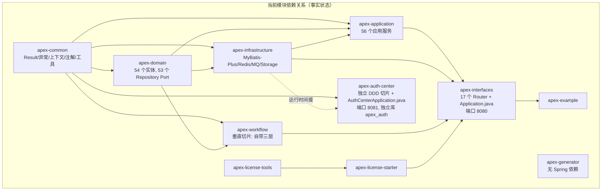

**关键事实**（均经代码核实）：

- 主应用启动类 `apex-interfaces/src/main/java/com/apex/scaffold/Application.java` 通过正则排除 `com.apex.scaffold.authcenter..*`，认证中心与主应用是两个独立进程。
- 认证中心使用独立数据库（`apex_auth` / `apex_auth_dev`）、独立 Flyway 链（V44–V55）、独立 Security 链（`AuthCenterConfig`），已是事实微服务雏形。
- `apex-workflow` 不依赖 `apex-infrastructure`，内部自带 application/domain/infrastructure 三层，领域模型对主 `apex-domain` 引用为零（仅共享 `common` 的 BasePO 等），是现成的垂直切片。
- **Spring Cloud 基础已部分就位**：根 POM 已管理 `spring-cloud-dependencies:2025.0.0` 与 `spring-cloud-alibaba:2025.0.0.0`；`apex-interfaces` 已引入 **Nacos Discovery、Nacos Config、Sentinel（含 sentinel-datasource-nacos）**，`Application.java` 已标注 `@EnableDiscoveryClient`，且存在 `bootstrap.yml`。
- **缺失**：Spring Cloud Gateway、OpenFeign/LoadBalanced WebClient、Seata、跨服务 RPC 调用层（当前全部为进程内方法调用）。

### 1.2 业务子域与代码分布

| 业务子域 | 领域模型 | 应用服务 | 路由 |
|---|---|---|---|
| 用户/账户/租户 | `apex-domain/entity`（UserEntity, TenantEntity, UserProfileEntity…） | UserService, ProfileService, TenantApplicationService, AccountDeletionService… | `/api/v1/user`, `/admin-api/v1/users` |
| RBAC（角色/权限/菜单/部门） | RoleEntity, PermissionEntity, MenuEntity, DeptEntity | RoleService, PermissionService, MenuService, DeptService, UnifiedAuthorizationService | `/admin-api/v1/menus`, `/depts` |
| 认证/SSO/OAuth2 | `apex-domain`（SysSso*Entity, OAuth2*Entity）+ auth-center 同名模型 | AuthService, OAuth2ClientManagementService + auth-center 16 个服务 | `/api/v1/auth`, `/admin-api/v1/auth/config`, `/admin-api/v1/sso` |
| 字典/配置/日志 | DictTypeEntity, ConfigEntity, LoginLogEntity, AuditLogRecord | DictService, ConfigService, LoginLogService, AuditLogQueryService… | `/admin-api/v1/dict`, `/configs`, `/login-logs`, `/audit-logs` |
| 文件/文档/图表 | FileEntity, DocumentEntity, ChartEntity | FileService, DocumentService, ChartService | `/api/v1/file`, `/admin-api/v1/documents`, `/charts` |
| 工作流 | `apex-workflow/domain`（WorkflowDefinition, ProcessInstance, Task, ApprovalRecord） | WorkflowService | `/admin-api/v1/workflows`, `/api/v1/workflows` |
| 办公集成（企微/钉钉/飞书） | `apex-domain/office` + Off*/Office*Entity | OfficeIntegrationService, OrgSyncService, OffMessageService | `/api/v1/office`, `/admin-api/v1/office/*`, `/org/*`（6 个 Router） |
| 消息/通知 | SystemMessageEntity, OffMessageEntity | OffMessageService, SSE 通知 | `/api/v1/messages`, `/api/v1/notifications` |
| 定时任务/监控/导出/生成器 | JobEntity, Gen*Entity | JobService, MonitorDashboard, CodeGenerationService… | `/admin-api/v1/jobs`, `/monitor`, `/generator/*` |

### 1.3 现状结论

1. **两条天然服务边界已经存在**：认证中心（独立进程+独立库）与工作流（垂直切片），拆分成本最低、风险最小。
2. **真正的拆分对象是主应用**：`apex-domain`（54 实体大一统）与 `apex-application`（56 服务一个包）必须按限界上下文解耦，这是工作量的主体。
3. **服务治理地基已备好一半**：Nacos/Sentinel 已接入，缺网关、缺服务间调用层、缺分布式事务方案。
4. 共享 Redis、共享 RocketMQ、共享 MinIO 属于**基础设施**，微服务化后仍然共享，不需要"拆分"，只需要按 key/topic/bucket 划命名空间。

---

## 2. 拆分原则与微服务边界

### 2.1 拆分原则

1. **按限界上下文拆分**，不是按技术层拆分——每个服务拥有完整的 DDD 四层，而不是"网关服务+业务服务+数据服务"。
2. **数据库私有**：服务只能通过自己的数据源读写自己的表；跨服务取数走 API 或事件冗余副本，禁止跨库 JOIN。
3. **渐进式绞杀（Strangler Fig）**：网关按路由逐个切流，旧单体在过渡期继续承载未迁移流量，任意阶段可回滚。
4. **API 契约不变**：对前端透明——`/api/v1/**`、`/admin-api/v1/**` 的路径、`Result<T>` 结构、错误码全部保持现状。
5. **先拆内聚的，再动耦合的**：auth（已独立）→ workflow（已切片）→ file/office（子域清晰）→ system（剩余核心）。

### 2.2 目标服务清单

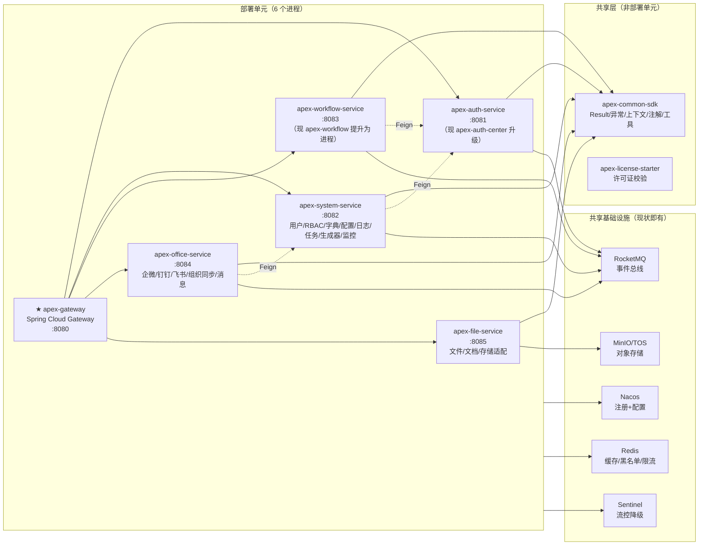

### 2.3 各服务职责与来源

| 服务 | 职责 | 代码来源（真实路径） | 数据库 |
|---|---|---|---|
| **apex-gateway** | 统一入口、路由、JWT 轻量校验、全局限流、TraceId 注入、CORS | 新建模块 | 无 |
| **apex-auth-service** | 登录/登出/MFA/TOTP、JWT 签发与轮换、会话、Token 黑名单、角色权限判定、OAuth2 授权服务器、SSO 管理、认证配置 | `apex-auth-center/` 全模块 + `apex-application` 中 SysSso*Service、OAuth2Client*Service、`apex-domain` 中 OAuth2*Entity/SysSso*Entity + `AuthConfigRouter`、`SsoAdminRouter`、`SsoAuthRouter` | `apex_auth`（已有） |
| **apex-system-service** | 用户档案/租户、菜单/部门、字典、系统配置、登录/操作/审计日志、定时任务、Excel 导出、统一搜索、监控大盘、代码生成、在线用户、健康检查 | `apex-domain` 剩余核心实体 + `apex-application` 剩余服务 + `apex-infrastructure` 持久化/缓存 + `ApiRouter` 大部分子路由 | `apex_system`（由 `apex_data` 更名收敛） |
| **apex-workflow-service** | 流程定义、实例、任务、审批记录、监控统计 | `apex-workflow/` + 把 `apex-interfaces` 的 `WorkflowRouter` 迁入 | `apex_workflow`（新库） |
| **apex-office-service** | 平台接入（企微/钉钉/飞书）、审批/日历/文档/消息集成、组织同步、身份绑定 | `apex-domain/office/` + `apex-application/office/`、OfficeIntegrationService、OrgSyncService、OffMessage*Service + `router/office/` 5 个 Router、`OfficeAdminRouter`、`OrgSyncRouter` | `apex_office`（新库） |
| **apex-file-service** | 上传/下载、分片、文档管理、缩略图/预览、存储 SPI（MinIO/TOS/Local） | `apex-domain` File/Document/Chart 实体 + FileService、DocumentService、ChartService + `infrastructure/storage/` + `common/spi/StorageProvider` | `apex_file`（新库，对象数据仍在 MinIO） |
| **apex-common-sdk** | 见 §4 | `apex-common/` 整体发布 | — |

**不拆**：`apex-license-spring-boot-starter`（各服务以 starter 依赖）、`apex-license-tools`（离线工具）、`apex-example`（示例）、`apex-generator` 的模板引擎部分（合入 system-service 作为工具包）。

### 2.4 拆分粒度取舍说明

- **消息/通知**并入 office-service（`OffMessage*` 本质是办公平台消息；站内 SSE 通知第一期留在 system-service，二期视流量决定是否独立）。
- **搜索/图表/监控**第一期留在 system-service——它们是 system 数据的衍生视图，独立服务会引入高频跨服务取数，得不偿失。
- **用户与认证分离**是最大胆的一处：`apex-domain.UserEntity`（业务档案）与 `apex-auth-center.UserEntity`（认证主体）本就同名重复存在，维持"档案归 system、凭证归 auth"的现有事实，用 `accountId` 关联，通过事件同步（V59 多端统一账户改造已经为此铺路）。

---

## 3. 目标系统架构

### 3.1 总体架构图（五层）

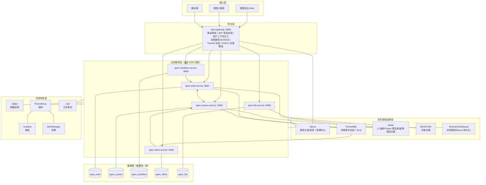

### 3.2 单个微服务内部结构（统一模板）

每个新服务沿用仓库现有 DDD 分层与 ArchUnit 规则，模板如下：

```text
apex-xxx-service/
├── pom.xml                       # parent: spring-boot-starter + apex-common-sdk
├── src/main/java/com/apex/scaffold/xxx/
│   ├── XxxServiceApplication.java   # @SpringBootApplication + @EnableDiscoveryClient
│   ├── interfaces/               # Router + Handler + 本服务安全链
│   ├── application/              # 应用服务、DTO、Assembler、事件监听、Outbox 调度
│   ├── domain/                   # 实体、值对象、领域事件、Repository Port
│   ├── client/                   # ★ 新增: Feign 客户端与 FallbackFactory
│   └── infrastructure/           # RepositoryImpl、Mapper/PO、缓存、MQ
└── src/main/resources/
    ├── bootstrap.yml             # Nacos 接入
    ├── application.yml           # 本服务私有配置
    └── db/migration/{mysql,postgresql}/   # 本服务独立 Flyway 链
```

### 3.3 目标模块依赖图（构建期）

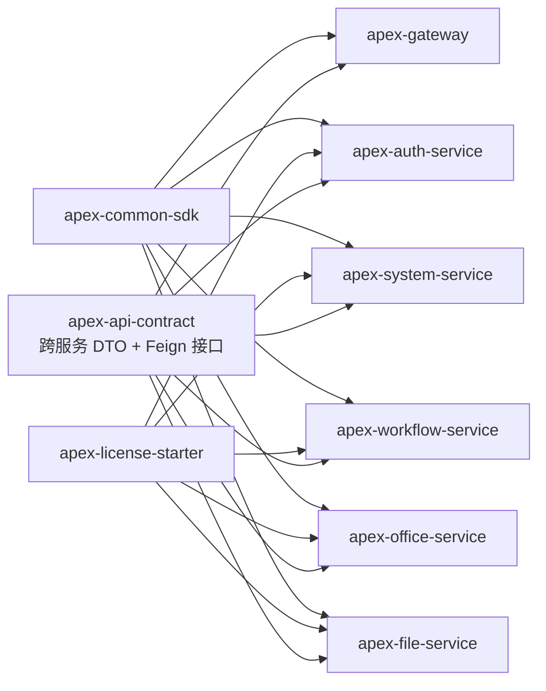

**关键约束**：服务之间**没有编译期依赖**，只有对 `apex-common-sdk`（工具/契约基类）和 `apex-api-contract`（跨服务 DTO 与 Feign 接口定义）的依赖。`apex-api-contract` 是新增模块：谁提供内部 API，谁在该模块登记接口与 DTO，避免 Feign 接口散落。

### 3.4 端到端请求流程图（改造后）

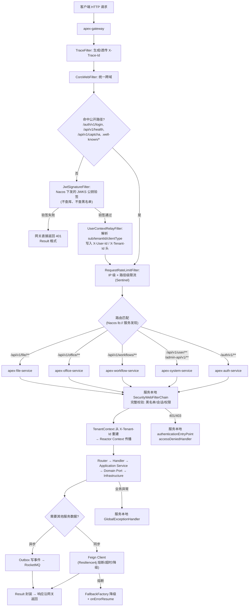

**职责分界原则**：网关做"验签与路由"（无状态、便宜、快速拒绝无效 Token），服务做"完整认证与授权"（黑名单、会话、RBAC、租户）——网关验签通过不等于服务放行，深度防御。

### 3.5 用户查询时序图（含缓存与跨服务调用）

以 `GET /api/v1/user/{userId}` 为例（服务落到 apex-system-service，权限判定需要 auth-service 参与时演示 Feign）：

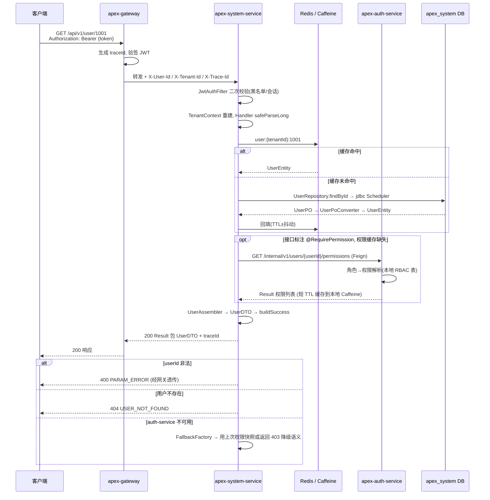

---

## 4. 共享基础设施 SDK：apex-common-sdk

### 4.1 拆分方式

`apex-common` 当前无循环依赖、无基础设施实现，**整体直接改名为 `apex-common-sdk` 发布到私服（或保留 artifactId 不变，仅按语义化版本独立发版）**，供所有服务以 Maven 依赖引用。第一期不做子模块细分，避免拆分动作叠加发布动作放大风险；第二期按使用面裁剪：

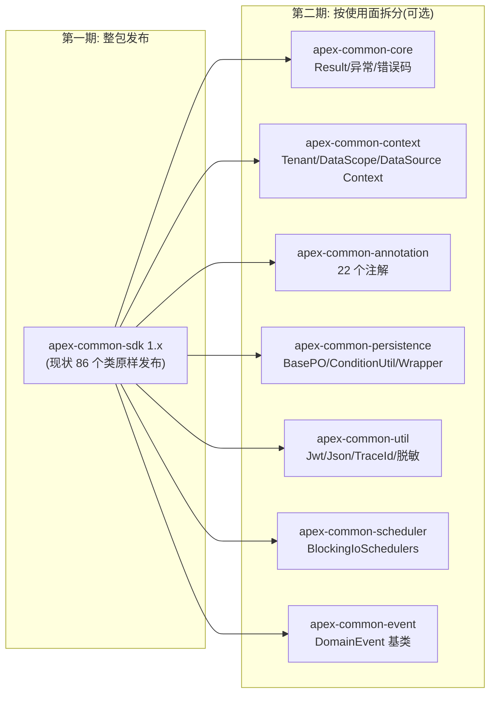

### 4.2 版本管理

- `apex-common-sdk` 独立语义化版本，CI 强制：**SDK 只增不改**（新增错误码/注解为 minor，破坏性变更为 major），各服务按需升级。
- 新增根 BOM `apex-services-bom`：统一锁定 Spring Boot、Spring Cloud、Spring Cloud Alibaba、MyBatis-Plus、Redisson、RocketMQ 版本，各服务 parent 指向 BOM，杜绝版本漂移。
- 错误码 + i18n key 仍在 SDK 的 `ResultCode` 集中维护，各服务不得散落魔法数字（沿用 AGENTS.md 现有约定）。

### 4.3 SDK 内容准入规则

| 可以进 SDK | 不可以进 SDK |
|---|---|
| Result/ResultCode/异常体系 | 任何 Redis/MQ/Storage 的**实现** |
| TenantContext/DataScopeContext 及 Reactor 钩子 | 具体业务实体 |
| 22 个注解与 AOP 依赖的**契约**（切面实现下沉为独立 starter） | 业务枚举 |
| BasePO/ConditionUtil/ApexLambdaQueryWrapper | 服务私有 DTO |
| BlockingIoSchedulers/JwtUtil/JsonUtil/TraceIdUtil/脱敏工具 | — |

横切**能力**（幂等、防重放、操作日志、限流、数据权限）从 interfaces/infrastructure 中抽为按需引入的 Spring Boot Starter（`apex-starter-idempotent`、`apex-starter-operation-log`、`apex-starter-ratelimit` 等），服务通过 `@ConditionalOnProperty` 自选装配——这是防止"SDK 变成新的大一统模块"的关键约束。

---

## 5. API 网关设计：apex-gateway

### 5.1 技术选型

**Spring Cloud Gateway（WebFlux 栈）**。理由：与现有 WebFlux/Netty 技术栈一致，团队无新栈学习成本；与 Nacos Discovery、Sentinel 的 Spring Cloud Gateway 适配天然兼容；支持 Reactive 路由断言与过滤器。

### 5.2 路由规则（对前端契约不变）

```yaml
spring:
  cloud:
    gateway:
      routes:
        - id: auth-service
          uri: lb://apex-auth-service
          predicates:
            - Path=/auth/v1/**,/oauth2/**,/.well-known/**,/admin-api/v1/auth/**,/admin-api/v1/sso/**
        - id: workflow-service
          uri: lb://apex-workflow-service
          predicates:
            - Path=/api/v1/workflows/**,/api/workflow/**,/admin-api/v1/workflows/**
        - id: office-service
          uri: lb://apex-office-service
          predicates:
            - Path=/api/v1/office/**,/admin-api/v1/office/**,/admin-api/v1/org/**,/api/v1/messages/**
        - id: file-service
          uri: lb://apex-file-service
          predicates:
            - Path=/api/v1/file/**,/api/v1/files/**,/admin-api/v1/documents/**,/api/v1/documents/**
        - id: system-service
          uri: lb://apex-system-service
          predicates:
            - Path=/api/v1/**,/admin-api/v1/**
      default-filters:
        - DedupeResponseHeader=Access-Control-Allow-Origin
```

> 系统服务路由放最后兜底 `/api/v1/**`，未显式切流的接口默认仍由 system-service（过渡期即旧单体）承接——这正是绞杀者模式的落点（见 §15）。

### 5.3 网关过滤器链

| 顺序 | Filter | 职责 | 失败出口 |
|---|---|---|---|
| -1 | TraceWebFilter | 生成/透传 `X-Trace-Id`，注入 Brave/Zipkin span | — |
| -100 | CorsWebFilter | 统一跨域（从 SecurityConfig 迁移，全局唯一一处） | — |
| 10 | JwtSignatureFilter | JWKS 公钥验签、过期检查；公开路径白名单跳过 | 401 Result |
| 20 | UserContextRelayFilter | 解析 `sub/accountId/tenantId/clientType` → `X-User-Id`/`X-Tenant-Id` 头；**剥离客户端伪造的同名头** | 401 |
| 30 | GatewayRateLimitFilter | IP 级 + 路径级限流（Sentinel 或 Redis RequestRateLimiter） | 429 Result |
| 40 | GrayRouteFilter | 按租户/用户尾号/_header 灰度切流（§15） | — |
| 50 | RequestLoggingFilter | 摘要日志（method/uri/status/耗时/traceId），脱敏 | — |

**安全红线**：`UserContextRelayFilter` 必须先删除外部请求自带的 `X-User-Id`/`X-Tenant-Id`/`X-Internal-*` 再注入，防止身份伪造；`/internal/v1/**` 路径在网关**强制拒绝**（403），内部 API 只允许集群内直连。

### 5.4 公开路径（与现有 `SystemConstants.PUBLIC_PATHS` 对齐）

`/auth/v1/login`、`/auth/v1/refresh`、`/api/v1/captcha`、`/api/v1/health`、`/api/v1/info`、`/.well-known/**`、OAuth2 token/revoke/introspect。网关白名单从 Nacos 配置下发，各服务 `SecurityConfig` 维护自己的最终防线（允许不一致方向：服务比网关更严格是安全的，反之不是）。

---

## 6. 服务间通信设计

### 6.1 通信模式选择

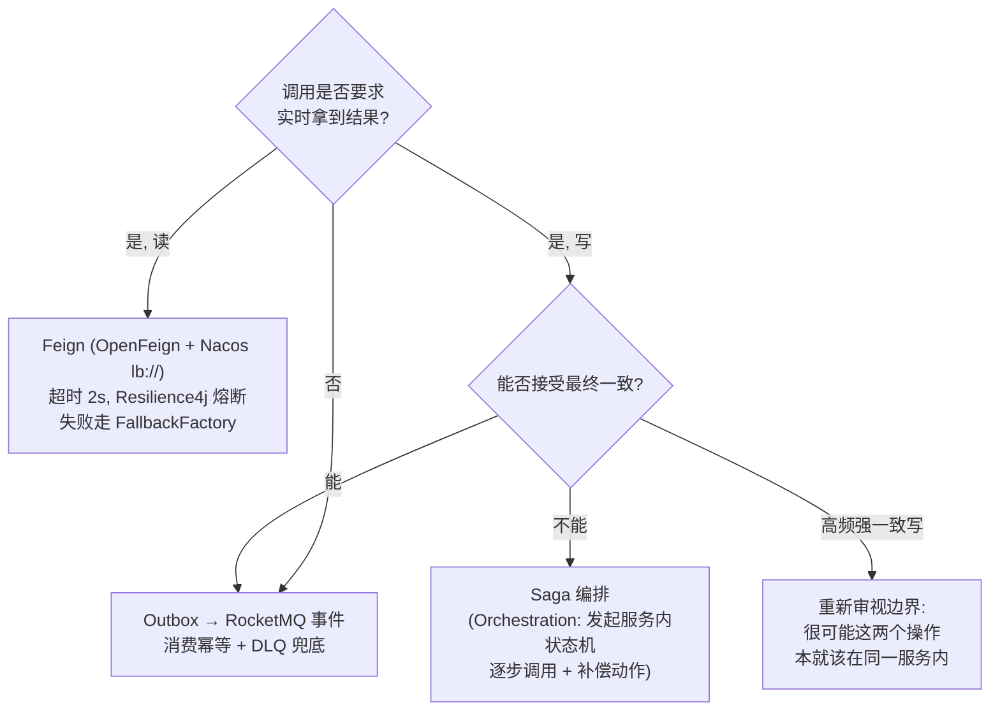

**选型结论**：
- **同步**：OpenFeign（声明式、拦截器可注入租户/traceId 头、Fallback 友好）。项目全栈是 WebFlux，Feign 是阻塞 IO——因此 **Feign 调用统一用 `Mono.fromCallable(...).subscribeOn(BlockingIoSchedulers.remote())` 包装**，不阻塞 Netty 事件循环（符合 AGENTS.md 阻塞隔离规范）。备选方案 Spring Cloud Function 式 `WebClient + @LoadBalanced` 保留为纯响应式调用的选项，用于文件流式传输等场景。
- **异步**：RocketMQ + Outbox（现成：`MqProducerService`、`Outbox dispatcher`、DLQ handler、幂等切面 `IdempotentAspect` 全部复用）。
- **分布式事务**：**不引入 Seata AT**。理由：项目已具备 Outbox + 事件 + 幂等的完整积木；Seata AT 对响应式/WebFlux 支持不成熟、与 MyBatis-Plus 拦截器和多租户拦截器的兼容性风险高。跨服务写一律"最终一致 + Saga 补偿"，仅当出现真实强一致需求再评估 Seata TCC/Saga 模式。

### 6.2 内部 API 契约

- 路径前缀 `/internal/v1/**`，**只注册在服务端口，不注册网关路由**；集群内以 mTLS 或内部服务 Token（`X-Internal-Token`，密钥走环境变量/KMS）互认。
- 契约统一定义在 `apex-api-contract` 模块（接口 + Request/DTO），提供方实现、消费方引用，CI 校验契约与实现签名一致。

核心内部 API 清单（第一期）：

| 提供方 | 接口 | 消费方 | 用途 |
|---|---|---|---|
| auth-service | `GET /internal/v1/users/{accountId}/permissions` | system/workflow/office | 实时权限判定（消费侧加 Caffeine 短缓存） |
| auth-service | `POST /internal/v1/tokens/validate` | 过渡期 system | 存量主应用 Token 语义查询 |
| system-service | `GET /internal/v1/users/{accountId}` | auth/office | 用户档案快照（脱敏字段） |
| system-service | `GET /internal/v1/depts/tree` | office/workflow | 部门树 |
| system-service | `GET /internal/v1/dict/{type}` | 全部服务 | 字典只读副本 |
| workflow-service | `GET /internal/v1/instances/{id}/status` | office/system | 审批状态查询 |

### 6.3 Feign 客户端模板（含 WebFlux 桥接与降级）

```java
@FeignClient(name = "apex-auth-service",
        configuration = FeignTenantTraceConfiguration.class,   // 注入 X-Tenant-Id / X-Trace-Id
        fallbackFactory = AuthFeignClientFallbackFactory.class)
public interface AuthFeignClient {

    @GetMapping("/internal/v1/users/{accountId}/permissions")
    Result<List<String>> getUserPermissions(@PathVariable("accountId") Long accountId);
}

// 调用侧统一响应式包装（Handler/Service 内）
public Mono<Result<List<String>>> loadPermissions(Long accountId) {
    return Mono.fromCallable(() -> authFeignClient.getUserPermissions(accountId))
            .subscribeOn(BlockingIoSchedulers.remote());
}
```

降级策略矩阵：

| 依赖 | 降级动作 | 语义 |
|---|---|---|
| auth 权限接口 | 读 Caffeine 权限快照（TTL 5min）→ 仍无则返回 403 权限暂不可验证 | 拒绝优先（安全默认） |
| system 用户档案 | 返回 503 SERVICE_UNAVAILABLE + Resilience4j retry(1 次) | 快速失败 |
| dict 字典 | 本地缓存 stale-while-revalidate | 可用性优先 |
| MQ 发送 | Outbox 兜底（发送失败不阻塞业务事务） | 最终一致 |

### 6.4 事件契约（领域事件）

沿用 `AbstractDomainEvent` 基类，事件信封统一字段：`eventId`（幂等 key）、`eventType`、`tenantId`、`aggregateId`、`occurredAt`、`traceId`、`payload`、`version`。

| 事件 | 发布方 | 订阅方 | 用途 |
|---|---|---|---|
| UserCreatedEvent / UserUpdatedEvent / UserDeactivatedEvent | system | auth、office | 档案→认证主体/组织成员同步（只带需要的列） |
| AccountCredentialsChangedEvent | auth | system（写登录日志） | 凭证操作审计 |
| RolePermissionChangedEvent | auth | system、workflow、file | 权限缓存失效广播（Redis Pub/Sub + MQ 双通道，沿用现有 CacheConsistencyService 思路） |
| WorkflowInstanceStarted / TaskAssigned / TaskCompleted | workflow | system（通知）、office（推送到企微/钉钉） | 审批联动 |
| FileUploaded / FileDeleted | file | system（操作日志）、office | 文件事件 |
| UserLoggedInEvent | auth | system | 登录日志、在线用户 |

Topic 命名 `apex-{domain}-events`，消费者组 `cg-{service}-{event}`；租户上下文由消息体 `tenantId` 恢复进 `TenantContext`（沿用现有消费者规范）。

---

## 7. 认证授权改造

### 7.1 现状问题

- `JwtAuthenticationFilter`（apex-interfaces）**同时接受两类 Token**（主应用 `type=access` 与认证中心 `tokenType=ACCESS + accountId`），两边共享 `JWT_SECRET` 对称密钥——拆分后密钥必须收敛到认证中心单点签发。
- Token 黑名单、会话管理逻辑分散在两处，主应用侧角色来自本库 `RoleRepository`。

### 7.2 目标认证架构：JWT + JWKS 非对称

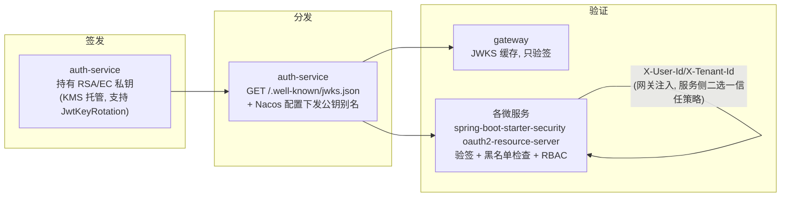

**改造要点**：

1. **签发权唯一化**：拆分完成后只有 auth-service 持有私钥；主应用 `JwtUtil` 对称密钥签发路径下线，`JwtAuthenticationFilter` 中"双 Token 兼容"分支随流量迁移逐步移除。auth-center 已有 `JwtKeyRotationService`（KMS 集成），私钥轮换机制直接复用。
2. **验签三级**：网关（JWKS 公钥验签，拒绝无效 Token 进入内网）→ 服务（oauth2-resource-server 再验签 + `TokenBlacklistService` 查 Redis 黑名单）→ 方法级 `@RequirePermission`（auth-service 权限判定缓存到本地）。
3. **滑动续期**：现有 `X-New-Access-Token` 响应头机制保留，但改由 auth-service 的 `/auth/v1/refresh` 统一提供；网关透传该头。
4. **会话与在线用户**：会话数据归 auth-service（已有 `SessionService`）；system-service 的 `/admin-api/v1/online-users` 改为 Feign/事件副本查询。
5. **登出传播**：auth-service 撤销 Token → 写 Redis 黑名单（既有）+ 发 `TokenRevokedEvent` → 各服务清本地权限缓存。
   - ✅ 已实现（Phase 2.6，2026-10-09）：`TokenRevokedEvent`（`apex-domain`，`EVENT_TYPE=TOKEN_REVOKED`，字段 `userId`/`tenantId`/`reason`）由 `AuthenticationApplicationService.logout()` 在写入 Redis 黑名单后发布；auth-center 经 `AuthCenterEventConfig` 显式装配事务 Outbox（生产 `DomainEventPublisherImpl(@Primary)` + `DomainEventOutboxDispatcher`，basic/H2 降级 `LocalDomainEventPublisher`），事件落 `sys_domain_event_outbox`（Flyway `V56`，mysql/postgresql 双套）后由投递器可靠投递，消费方据事件清本地权限缓存。

### 7.3 多端登录链路时序图（小程序，改造后）

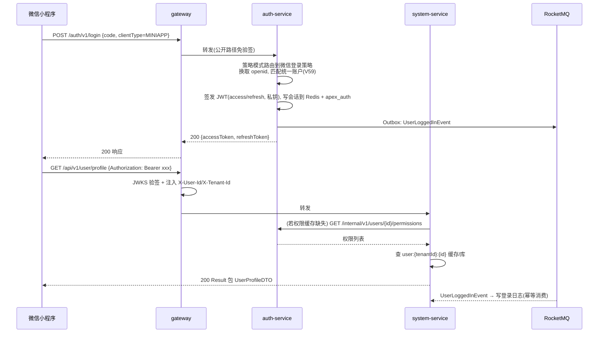

---

## 8. 数据一致性与分布式事务

> **结论（消除歧义）**：本项目的"分布式事务"统一采用 **Outbox 最终一致** 方案（本地事务内写业务表 + Outbox 表，再由调度投递 RocketMQ，消费端幂等 + DLQ 兜底）。
> **不启用 Seata**：Seata 仅为可选项，当前未引入、未配置、未依赖。仅当出现无法用"最终一致 + Saga 补偿"覆盖的真实强一致需求时，才重新评估 Seata TCC/Saga 模式。
> 已落地的 Outbox 支撑组件：`TransactionalOutboxExecutor`（业务写 + Outbox 写同事务）、`DefaultMqLocalTransactionHandler`（RocketMQ 事务消息回查，按 `event_id` 是否存在决定 COMMIT/ROLLBACK）、`MqConsumerMetrics`（含死信指标 `mq.consumer.dlq.messages`）。

### 8.1 Outbox 事件链路（复用现有实现）

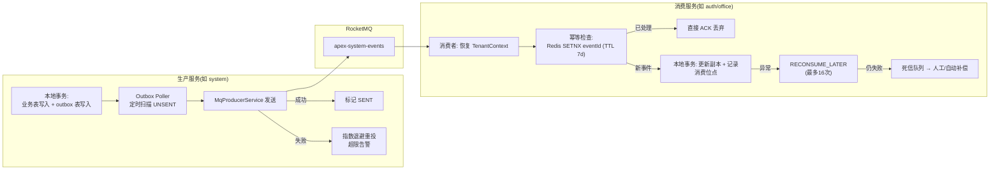

现状基础已具备：`infrastructure/outbox/`（调度）、`MqProducerService/MqConsumerService`、`IdempotentAspect`、DLQ handler——拆分为多服务后**逐服务启用同一套设施**（依赖 common 的 `BasePO` + 每服务库建自己的 outbox 表，Flyway 新增）。

### 8.2 Saga 编排示例：用户注册（跨 auth + system + office）

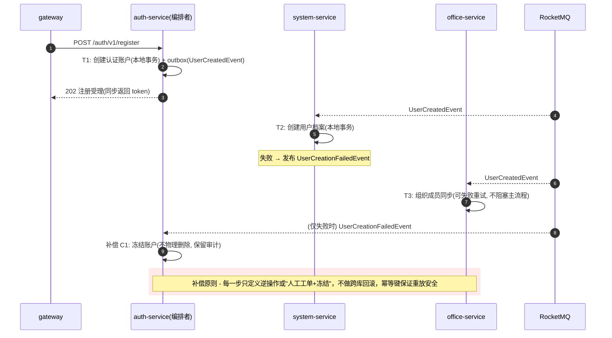

一致性等级承诺：

| 数据 | 一致等级 | RPO |
|---|---|---|
| 认证 Token/会话 | 强一致（单点 auth-service + Redis） | 0 |
| 权限判定 | 最终一致（缓存 TTL ≤ 5min，变更广播主动失效） | 秒级 |
| 用户档案副本 | 最终一致 | 秒级 |
| 操作/审计日志 | 最终一致 | 秒级 |

---

## 9. 数据库拆分方案

### 9.1 拆分总览

当前：`apex_data`（主应用 V1–V59）+ `apex_auth`（认证中心 V44–V55）。目标五库：

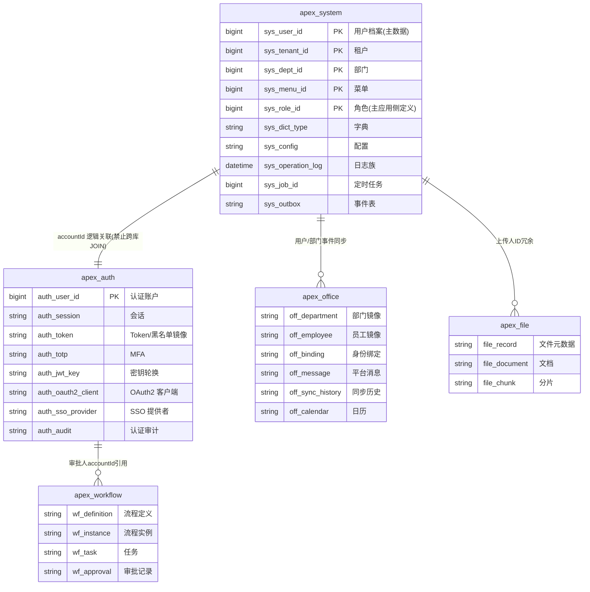

### 9.2 表迁移映射

| 目标库 | 来源（`apex_data` 中） | 依据 |
|---|---|---|
| apex_auth（已存在） | sso/oauth2/jwt 配置类表（V25-V26, V27, V48-V55 相关）、auth 核心表 | 已建（V44–V55） |
| apex_workflow | 工作流引擎表（V20-V21 相关）、审批表 | WorkflowRouter 迁移 |
| apex_office | `office_*` 表（V29/V31/V32/V34/V35，已在 `apex-office-service` 的 `V1__init_office_schema.sql` 重建）；`off_*` 组织/消息域表（V57 / PG V42，**已于 2026-10-11 迁入** `apex-office-service` 的 `V2__create_off_msg_org.sql`） | office 子域 |
| apex_file | file/document 元数据表 | file 子域 |
| apex_system | 其余全部（user/tenant/dept/menu/dict/config/log/job/monitor…） | 剩余核心 |

> **归属澄清（与代码事实对齐）**：
> - `V29–V36` 中创建 `office_*` 表的是 V29/V31/V32/V34/V35；**V30/V33/V36 仅写入共享 `sys_menu`/`sys_role_menu`/`sys_permission` 种子**，属系统域，不随办公域迁出。
> - `V41` 主体是 `gen_*`/`sys_*`（系统域），其中“办公平台增强”部分**未新建表**（复用 `office_*`），故不可整份迁出。
> - `off_*`（`off_department`/`off_employee`/`off_sync_history`/`off_message`/`off_message_recipient`/`off_message_template`）由 `mysql/V57`（等价 `postgresql/V42`）创建，**已于 2026-10-11 迁出至 `apex-office-service`**：新库经 `V2__create_off_msg_org.sql` 重建同构表，`Off*` 代码（`apex-office` 50 类 + `apex-office-service` 5 接口类）整体迁入、单体侧 55 类删除，网关切流已补齐 `/admin-api/v1/message-templates`，进入观察期。
> - 逐文件归属明细见 `apex-interfaces/src/main/resources/db/migration/OFFICE_MIGRATION_OWNERSHIP.md`。

### 9.3 迁移执行方案（每个服务抽取时重复此流程）

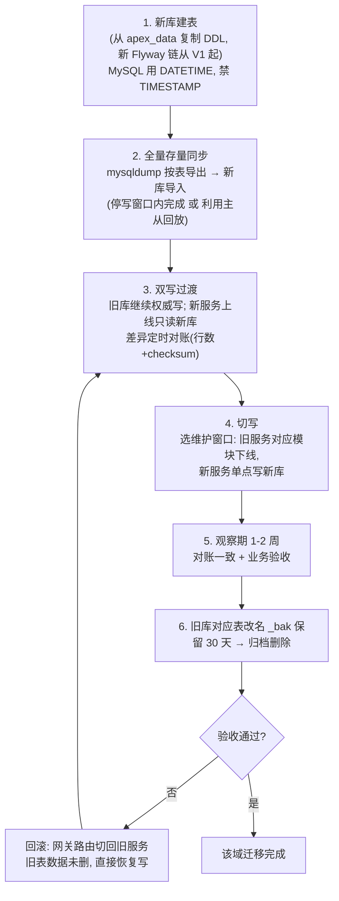

**规则**：

- 新服务 Flyway 版本链从 `V1` 重新开始（与旧库版本链解耦），MySQL/PostgreSQL 双脚本同步维护，脚本幂等（沿用 AGENTS.md 规范）。
- 跨库逻辑关联只允许存 ID（如 `sys_user.account_id`、`wf_task.assignee_account_id`），列表页需要"用户名"时由事件同步**冗余展示列**（username/nickname），不做跨库查询。
- 多租户策略不变：各库仍是**行级隔离**（TenantLineInnerInterceptor），不升级为库级隔离；每服务各自建 `tenant_id` 列与拦截器配置。
- **已应用迁移文件不可改写**：prod `validate-on-migrate=true`、`repair=false`，Flyway `checksum` 含整份文件（含注释），任何源码修改都会导致校验失败、单体无法启动。归属调整一律通过**新增迁移**或外部索引（`OFFICE_MIGRATION_OWNERSHIP.md`）/本文档登记完成，绝不回改历史 `.sql`。

---

## 10. 多租户与横切能力迁移

| 能力 | 现实现 | 微服务化方案 |
|---|---|---|
| 租户上下文 | `TenantContext`（ThreadLocal + Reactor Hooks） | 不变；**入口重建**：服务从网关注入的 `X-Tenant-Id` 重建上下文，Feign 拦截器透传（`FeignTenantTraceConfiguration`），MQ 消费者从消息体恢复 |
| 租户 SQL 隔离 | `DefaultTenantLineHandler` + MyBatis-Plus 拦截器 | 下沉为 `apex-starter-persistence`（含 BasePO/Wrapper/拦截器/分页/乐观锁/逻辑删），每服务引入并维护自己的 ignore-tables 清单 |
| 数据权限 @DataScope | `DataScopeInnerInterceptor` + MdcProvider | 随 starter 下沉；dept 树数据源改为 system-service Feign/字典副本 |
| 幂等 @IdempotentApi | `IdempotentAspect`（Redis） | 下沉 starter；幂等 key 规范 `{service}:{tenantId}:{bizKey}` |
| 防重放 @AntiReplay | interfaces 切面 + Redis nonce | 下沉 starter |
| 操作日志 @OperationLog | interfaces AOP → `sys_operation_log` | 切面下沉 starter；**日志落库改事件驱动**：AOP 采集 → MQ `OperationLogEvent` → system-service 统一入库（各服务业务日志集中查询不变） |
| 限流 | Sentinel(Nacos 规则) + IP 级 Filter + Bucket4j | **两级**: 网关全局/IP 维度；服务内 `@SentinelResource`/`@UserRateLimit` 细粒度。规则全部 Nacos 持久化, Dashboard 按服务分组 |
| 审计/登录日志 | application 层服务 | 事件化（§6.4），auth 发登录事件，system 入库与查询 |
| 阻塞隔离 | `BlockingIoSchedulers` 六调度器 | 在 SDK 原样复用；Feign 调用点新增 `remote()` 使用约定（§6.1） |

---

## 11. 可观测性方案

### 11.1 架构

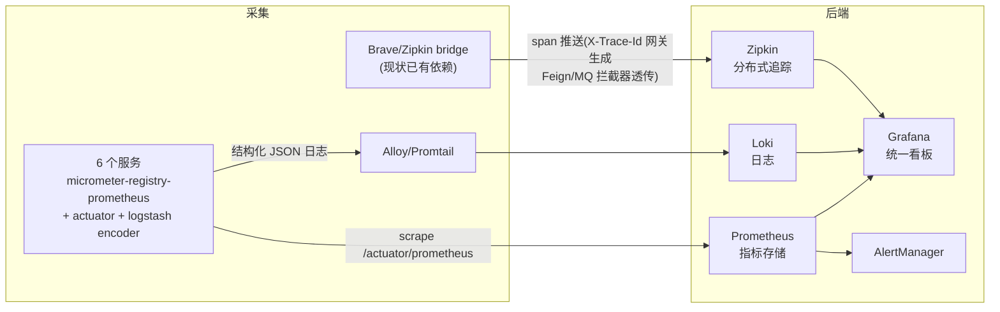

### 11.2 跨服务追踪贯通

- TraceId 唯一来源：网关 `TraceWebFilter`；服务间经 Feign 拦截器与 MQ 事件信封 `traceId` 字段透传（现有 `TraceIdUtil`/MDC 机制不变）。
- MQ 消费侧：从事件信封恢复 traceId 写入 MDC，使"请求链路 + 异步链路"在 Zipkin 上可串联。

### 11.3 核心告警（阈值上线后按基线校准，不预设）

| 信号 | 告警 |
|---|---|
| 服务实例从 Nacos 掉线 / 存活探针失败 | P0 |
| Feign 对 auth-service 成功率跌破阈值、熔断开启 | P0 |
| MQ 堆积深度、DLQ 进入量 | P0 |
| Outbox UNSENT 积压超时限 | P1 |
| 网关 P95/错误率、各服务 P95/错误率 | P1 |
| 对账作业差异计数 > 0 | P0（迁移期） |

---

## 12. 配置管理与服务治理

### 12.1 Nacos 配置分层

```text
namespace: public(开发) / dev / prod
├── 共享配置:          apex-common.yaml            # Result/i18n 开关、日志级别基线、JWKs 地址
│                     apex-datasource-{env}.yaml # 各服务各自引用不同 dataId
├── 服务私有:          apex-gateway.yaml
│                     apex-auth-service.yaml
│                     apex-system-service.yaml
│                     apex-workflow-service.yaml
│                     apex-office-service.yaml
│                     apex-file-service.yaml
├── Sentinel 规则:     {service}-flow-rules / {service}-degrade-rules
└── 密钥: 一律环境变量/KMS 注入，禁止写入 Nacos 明文
```

- `bootstrap.yml` 按现有模式复制到各服务；`spring.application.name` = 服务名（注册名即路由名 `lb://apex-xxx-service`）。
- 现有 profile 体系（basic/dev/prod/standard/enterprise/performance）**映射为部署矩阵而非代码分支**：basic 档继续单体部署（starter 聚合，见 §15.3），dev/prod 走微服务拓扑；standard/enterprise 差异收敛为 Nacos 配置开关。

### 12.2 敏感配置

延续现有约定：`APEX_JWT_*`（改为 RSA 私钥仅 auth-service 消费）、`APEX_DB_PASSWORD_{SERVICE}`、`APEX_REDIS_PASSWORD`、各服务独立 DB 账号（最小权限：只授权自己库）。

---

## 13. 部署架构

### 13.1 目标部署图

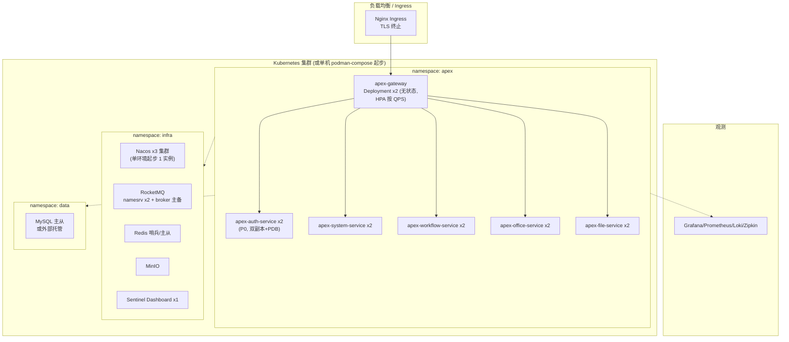

- **资源与容量**：每服务 JVM 起步 1G（WebFlux 无容器线程池，内存压力低于 MVC），网关/auth 各 2 副本起步；HPA 按 CPU 60% + QPS。
- **发布**：滚动发布（maxUnavailable=0）+ readiness 探针接 Nacos 摘除；`DrainParticipant` 治理接口沿用做优雅下线。
- **起步替代**：dev/standard 环境可用 podman-compose（gateway + 5 服务 + mysql + redis + rocketmq + nacos + minio），降低初期运维面。

---

## 14. 分阶段实施路线图

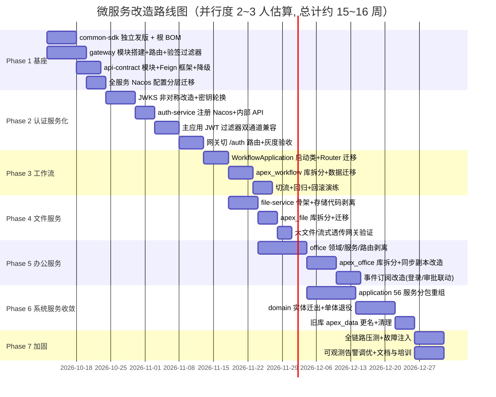

### 各阶段任务与退出标准（Exit Criteria）

| Phase | 关键任务 | 退出标准 |
|---|---|---|
| **1. 基座**（约 2.5 周） | ① `apex-common` 改坐标发布 SDK + 根 BOM；② 新建 `apex-gateway`（路由+验签+租户头注入+全局限流），先把**全部流量**指向现有单体验证转发无损；③ 新建 `apex-api-contract` + Feign 基础设施 + `BlockingIoSchedulers.remote()` 桥接约定 | 网关透明代理模式下全接口回归通过；`mvnd test` + ArchUnit + `spotless:check` 绿 |
| **2. 认证服务化**（约 3 周） | JWT 对称→非对称（JWKS）；auth-center 注册 Nacos；实现内部权限/校验 API；主应用过滤器双通道兼容；网关按 header/租户灰度切 `/auth` | 登录/刷新/登出/MFA/OAuth2 全链路在新进程跑通；灰度 100% 后旧进程不再签发 Token |
| **3. 工作流**（约 2.5 周） | 新建 `WorkflowServiceApplication`；`WorkflowRouter` 从 interfaces 迁出；库拆分（V1 链）；事件改造 | `/workflows` 全接口切流；旧应用删除 workflow 相关路由与依赖 |
| **4. 文件**（约 2 周，可与 3 并行） | 剥离 File/Document/Storage；大文件走网关流式（不限缓冲）；库拆分 | 上传/下载/分片/预览回归通过 |
| **5. 办公**（约 3 周） | office 子域三件套（domain/application/router）物理剥离；`off_*` 表迁移；平台回调直连 office 服务 | 企微/钉钉/飞书审批、日历、消息、组织同步端到端通过 |
| **6. 系统收敛**（约 3.5 周，可与 5 部分并行） | application 按 `user/rbac/config/log/job/…` 子包重组并改名 `apex-system-service`；domain 剩余实体归位；**旧单体退役**（example 模块演示单体模式除外）；`apex_data` → `apex_system` | 主应用不再依赖已剥离模块；全量回归 + 压测达标 |
| **7. 加固**（约 1.5 周） | 混沌测试（杀 auth 看降级）、容量规划、告警阈值基线化、运维手册 | §17 验收清单全绿 |

**人力**：2~3 名后端 + 0.5 名运维；单人执行则周期约 ×1.8。

---

## 15. 绞杀者模式与灰度迁移

### 15.1 目标流量接管顺序

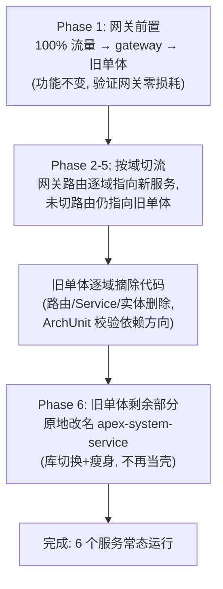

### 15.2 灰度切流机制

- 网关 `GrayRouteFilter`：按 `tenantId` 白名单 → 用户 ID 尾号百分比 → Header 强制（测试通道）三级推进；每个域按 **1% → 10% → 50% → 100%** 节奏，每档观察 ≥ 1 天。
- 双写期对账作业（`general()` 调度器、每日跑）：行数 + 字段 checksum 对比新旧库，差异输出报告并阻断下一档放量。
- **回滚预案**：网关路由一键切回旧单体（旧代码在对应域验收前不删除）；数据回滚依赖"旧库未删 + 事件重放"（MQ 保留位点可回溯 48h）。

### 15.3 商业版本兼容

现有按 Profile 分档（basic/standard/enterprise）发布：微服务化后 basic 档客户交付物改为**单体聚合包**（保留 `apex-example` 式的聚合装配模块，同一 jar 内嵌 system+auth+workflow），enterprise 档交付微服务拓扑 + Helm chart。License starter 同时覆盖两种形态，校验逻辑不变。

---

## 16. 风险与缓解措施

| # | 风险 | 等级 | 影响 | 缓解 |
|---|---|---|---|---|
| 1 | JWT 对称→非对称切换期间新旧 Token 并存 | 高 | 登录中断 | auth-service 双验签公钥（旧 HMAC kid 与新 RSA kid 并行），全量过期后（≤ 14 天）移除 HMAC 分支 |
| 2 | WebFlux 与阻塞 Feign 混用导致事件循环饥饿 | 高 | 雪崩延迟 | 强制 `remote()` 调度桥接 + ArchUnit 规则禁止响应式链上裸 Feign 调用；压测验证 |
| 3 | domain 实体迁出引发隐性跨域引用 | 中 | 编译/行为回归 | 先跑依赖扫描（grep import 矩阵）再迁；每域迁移后 ArchUnit + 全量回归 |
| 4 | 数据迁移窗口与存量脏数据 | 中 | 不一致 | 双写+对账（§15.2）；维护窗口脚本化（复用 `scripts/test/test-*-migration.sh` 模式）；30 天备份表兜底 |
| 5 | auth-service 成全局单点 | 高 | 登录/鉴权整体不可用 | ≥2 副本 + PDB；网关验签不依赖 auth 在线；服务侧权限走本地缓存 stale 降级；熔断仅影响实时权限查询 |
| 6 | 办公平台回调地址变更协调 | 低 | 集成中断 | 网关保留旧回调路径别名转发；平台侧双配置过渡 |
| 7 | 多服务 Flyway 版本链并行演进混乱 | 低 | 环境错配 | 每服务独立 V1 链 + 启动校验 baseline；`check-migration-integrity.sh` 扩展为逐服务执行 |
| 8 | 团队运维复杂度陡增 | 中 | 交付速度下降 | podman-compose 起步、Grafana 开箱模板、runbook 与值班手册（Phase 7） |
| 9 | 网关成性能瓶颈/单点 | 中 | 入口抖动 | ≥2 副本 + Ingress LB；网关无状态；压测目标含网关层 P95 增幅 ≤ 15ms |

---

## 17. 验收标准清单

### 17.1 功能与契约

- [ ] `/api/v1/**` 与 `/admin-api/v1/**` 全部现有接口在新拓扑下回归通过，响应 `Result` 结构与错误码逐字段一致（自动化契约对比：导出 `export-api-docs.sh` 的 OpenAPI diff 为空）
- [ ] 登录（密码/短信/微信/SSO）、MFA、刷新、登出、Token 黑名单全链路正常
- [ ] 多租户隔离：跨租户数据访问在各服务均被拦截（含缓存 key、MQ 消费、异步任务）
- [ ] 工作流审批、办公平台推送、文件上传下载端到端可用

### 17.2 架构

- [ ] 5 个服务 + 网关可独立构建（`mvnd -pl <service> -am package`）、独立部署、独立启停
- [ ] 无任何跨服务数据库访问；每服务 Flyway 链独立
- [ ] `apex-common-sdk` 无业务实体；横切能力经 starter 按需装配
- [ ] ArchUnit：服务间无编译依赖、domain 纯净性、`Schedulers.boundedElastic()` 禁用、Feign 必须经 `remote()` 桥接
- [ ] `/internal/v1/**` 公网不可达

### 17.3 韧性与性能

- [ ] 故障注入：杀 auth-service → 已登录用户读操作不受影响、新登录降级报 503 且熔断告警触发；杀任一业务服务 → 其余域正常
- [ ] 网关单点故障时 Ingress 健康检查自动摘除
- [ ] 全链路 P95 ≤ 单体基线 × 1.3；压测覆盖网关 2 副本
- [ ] MQ 堆积、Outbox 积压、DLQ 均有告警且演练过消费追赶

### 17.4 可观测与运维

- [ ] 任一请求 traceId 贯穿：网关 → 服务 → Feign → MQ → 下游服务日志（Zipkin 可查完整链路）
- [ ] Grafana：网关/每服务/每库/每 topic 四类 dashboard + 告警规则上线
- [ ] 灰度切流与一键回滚在 staging 演练通过
- [ ] 交付物：架构图、部署手册、故障 runbook、SDK 升级指南

---

## 18. 附录：关键代码证据索引

| 结论 | 证据路径 |
|---|---|
| 双入口与包排除 | `apex-interfaces/src/main/java/com/apex/scaffold/Application.java`（excludeFilters 正则排除 authcenter）、`apex-auth-center/.../AuthCenterApplication.java` |
| 双 Token 兼容现状 | `apex-interfaces/.../security/JwtAuthenticationFilter.java` |
| 认证安全链 | `apex-interfaces/.../config/SecurityConfig.java`、`apex-auth-center/.../config/AuthCenterConfig.java` |
| Nacos/Sentinel 已接入 | 根 `pom.xml`（spring-cloud 2025.0.0 / alibaba 2025.0.0.0）、`apex-interfaces/pom.xml`（nacos-config/discovery/bootstrap/sentinel-datasource-nacos）、`apex-interfaces/src/main/resources/bootstrap.yml` |
| 路由聚合 | `apex-interfaces/.../router/ApiRouter.java`（约 2709 行）、`WorkflowRouter.java`、`router/office/` 5 Router |
| Outbox/MQ/幂等 | `apex-infrastructure/.../outbox/`、`.../mq/service/MqProducerService.java`、`.../mq/aspect/IdempotentAspect.java`、`.../mq/dlq/` |
| 多级缓存/一致性 | `apex-infrastructure/.../cache/service/MultiLevelCacheService.java`、`CacheConsistencyService.java` |
| 存储 SPI | `apex-common/.../spi/StorageProvider.java`、`apex-infrastructure/.../storage/`（MinIO/TOS/Local） |
| 租户/数据权限 | `apex-common/.../context/TenantContext.java`、`apex-infrastructure/.../persistence/datapermission/DefaultTenantLineHandler.java` |
| 数据库拆分先例 | `apex-auth-center/src/main/resources/db/migration/mysql/`（V44–V55 独立链 vs 主链 V1–V59） |
| 工作流垂直切片 | `apex-workflow/pom.xml`（仅依赖 domain+common）、`apex-workflow/.../domain/` |
| 统一账户铺垫 | 提交 `1634ee2 feat(auth-center): unified account claims...`、V59 迁移（多端统一账户） |
| JWT/JWKS 非对称（Phase 2.1） | `apex-auth-center/.../domain/service/JwtKeyMaterialService.java`（RS256 `sign`/`parse`/JWKS 投影）、`.../application/service/TokenServiceImpl.java`（改走响应式 `sign`/`parse`）、`.../domain/service/JwtKeyRotationService.java`（Redis-RSA 单一实现）；测试报告 `docs/06-testing/auth-center-jwt-jwks-test-report.md` |
| auth 库治理（Phase 2.2） | `apex-auth-center/src/main/resources/bootstrap.yml`（服务名 `apex-auth-service`）、`db/migration/{mysql,postgresql}/V51__add_high_risk_authorization_permissions.sql`（修复重复 V49） |
| 登出传播/Outbox（Phase 2.6） | `apex-domain/.../event/TokenRevokedEvent.java`、`apex-auth-center/.../application/service/AuthenticationApplicationService.java`（logout 发布）、`apex-auth-center/.../config/AuthCenterEventConfig.java`、`.../infrastructure/event/LocalDomainEventPublisher.java`、`resources/db/migration/{mysql,postgresql}/V56__create_domain_event_outbox.sql`、`application-basic.yml`（`apex.events.outbox.enabled=false`） |

---

## 下一步（待你确认后执行）

方案确认后按 Phase 1 启动：先建 `apex-gateway` 模块与 `apex-common-sdk` 发布流程，**不动任何业务代码**；每个 Phase 结束以提交分组（网关/auth/workflow…分主题 commit）交付，随时可停在任一 Phase 验收。
