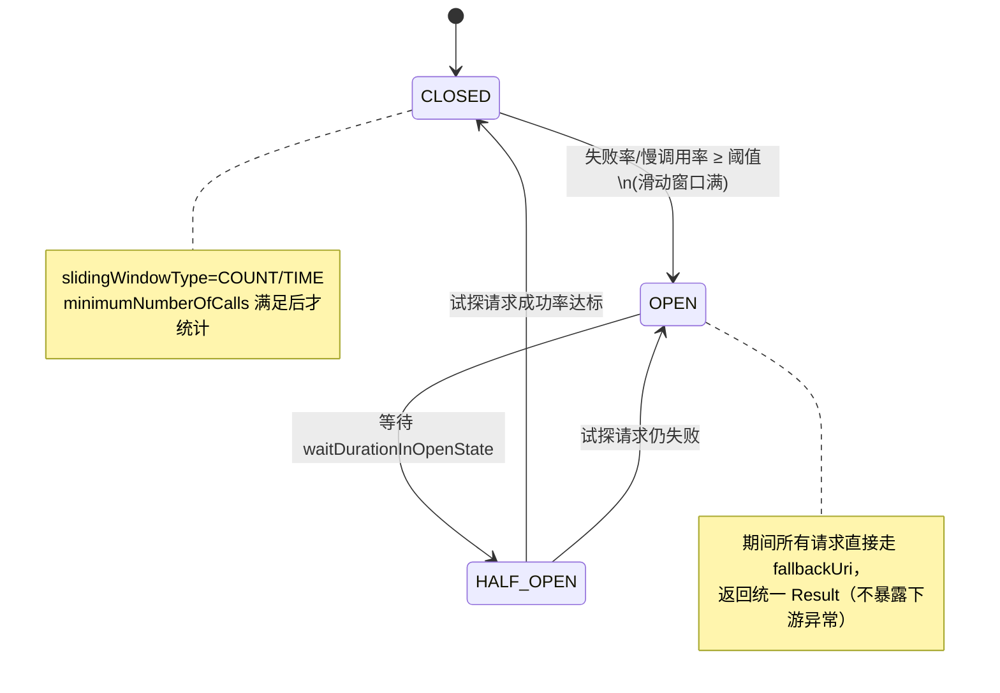
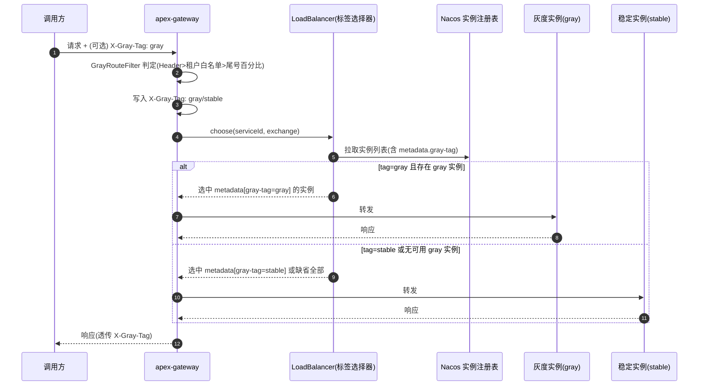
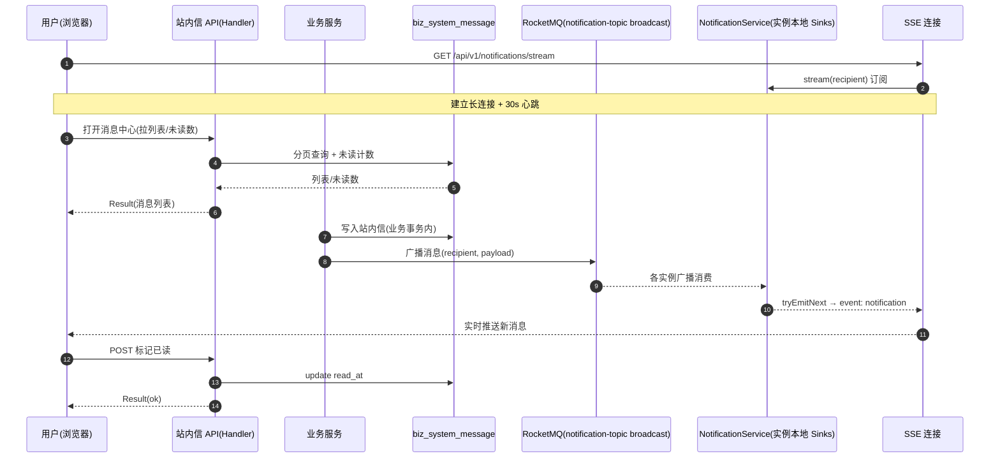
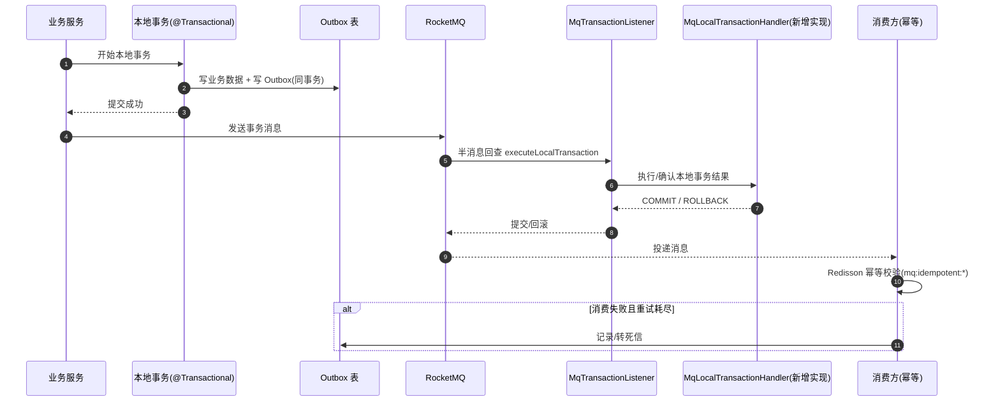
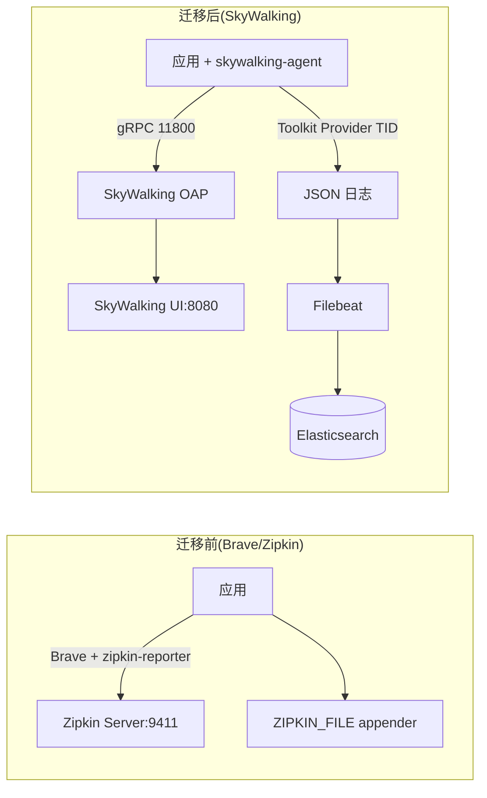
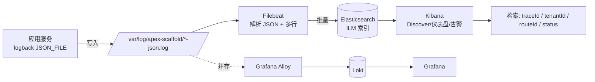

# 平台韧性、消息、事务与可观测性增强实现方案
## （网关熔断/限流/负载均衡/访问日志 + 消息服务/SSE + 分布式事务 + SkyWalking + ELK）

> **面向执行者：** 本方案为待确认稿，**未经用户确认不得执行任何代码、配置、迁移或部署清单修改**。
>
> 确认后按任务逐条执行，步骤采用 `- [ ]` 复选框跟踪。
>
> 语言：中文；图表：Mermaid（架构图 / 时序图 / 流程图）。

**Goal（目标）：** 在现有平台基础上补齐两组能力：
1. **网关韧性（第一部分，第 0–6 节）：** 路由级熔断降级、统一分布式限流、实例标签级负载均衡、网关访问日志持久化。
2. **平台新增能力（第二部分，第 7–10 节）：** ①消息服务（站内信 + SSE 实时推送）；②分布式事务支持（Outbox / RocketMQ 事务）；③链路追踪由 Zipkin 迁移至 SkyWalking；④查询/日志增加 ELK 支持。

使平台从“可用的脚手架”演进为具备生产级韧性、可靠消息、全链路追踪与统一日志检索能力的基础平台。

**Architecture（方案架构）：** 复用网关既有 GlobalFilter 链（`TraceWebFilter(-1) → JwtSignatureFilter(10) → UserContextRelayFilter(20) → RequestRateLimitFilter(30) → GrayRouteFilter(40) → RequestLoggingFilter(50)`），新增**路由级 Resilience4j CircuitBreaker Filter + fallback 端点**、以 **Redis Lua 令牌桶**替换固定窗口限流并支持 Nacos 热更新、以 **LoadBalancer 实例标签选择器**消费 `X-Gray-Tag`、以**异步落库的网关访问日志**对齐 `sys_api_call_log` 模型。所有新增能力默认遵循“灰度开关 + Redis/下游故障降级放行”原则，保证 Phase 1 行为兼容。

**Tech Stack（技术栈）：** Java 17.0.12-oracle、Spring Boot 3.5.15、Spring Cloud Gateway (WebFlux)、Spring Cloud 2025.0.0、Spring Cloud Alibaba 2025.0.0.0 (Nacos)、Resilience4j、Reactive Redis (Lettuce)、Micrometer/Prometheus、Flyway、JUnit 5 / Mockito / AssertJ / WebTestClient、ArchUnit。构建：mvnd 2.0.0-rc-3。

---

## 0. 背景与本次评审结论

### 0.1 评审范围

用户要求评审并（如需要）增强网关的 **熔断**、**限流**、**负载均衡**、**接口调用日志（API 日志 / 网关日志）** 四项能力。

### 0.2 现状结论（代码事实）

| 能力 | 现状 | 结论 |
|---|---|---|
| **熔断降级** | `spring-cloud-starter-circuitbreaker-reactor-resilience4j` 依赖已引入；`spring.cloud.circuitbreaker.resilience4j.enabled: true` 已开启；但**没有任何路由绑定 `CircuitBreaker` GatewayFilter**，也无 fallback 降级路由。 | ⚠️ **存在缺口，需增强** |
| **限流** | 网关自建 [`RequestRateLimitFilter`](../../apex-gateway/src/main/java/com/apex/scaffold/gateway/filter/RequestRateLimitFilter.java) 使用 **Redis 固定窗口计数**（`INCREMENT + EXPIRE`），维度=用户(`X-User-Id` 优先)/IP + 路径；`RateLimitConfig` 提供 `ipKeyResolver(@Primary)`/`userKeyResolver`。infra 另有 [`DistributedTokenBucketRateLimiter`](../../apex-infrastructure/src/main/java/com/apex/scaffold/infrastructure/ratelimit/distributed/DistributedTokenBucketRateLimiter.java)（Redis Lua 令牌桶，`apex.ratelimit.distributed.enabled` 默认 false）。 | ⚠️ **口径不一致（文档称令牌桶，实为固定窗口）；且未接入 infra 令牌桶，需统一** |
| **负载均衡** | `spring-cloud-starter-loadbalancer` + Nacos + `lb://apex-*-service` 基础可用。[`GrayRouteFilter`](../../apex-gateway/src/main/java/com/apex/scaffold/gateway/filter/GrayRouteFilter.java) 写入 `X-Gray-Tag: gray/stable`，但**该标签未参与 LoadBalancer 实例选择**（无法把灰度流量路由到灰度实例）。 | ⚠️ **基础可用，灰度标签路由缺口需增强** |
| **接口调用日志** | 应用侧 [`ApiCallLogFilter`](../../apex-infrastructure/src/main/java/com/apex/scaffold/infrastructure/remote/filter/ApiCallLogFilter.java)+`ApiCallLogService` → 落库 `sys_api_call_log`（出站第三方调用）；网关 [`RequestLoggingFilter`](../../apex-gateway/src/main/java/com/apex/scaffold/gateway/filter/RequestLoggingFilter.java) → **仅文件日志，未落库**；接口层 `LoggingFilter` → 文件+指标。三者以 `X-Trace-Id` 关联。 | ⚠️ **网关访问日志未持久化，检索/审计缺口需增强** |

### 0.3 需澄清/已采用的默认假设

> 用户跳过了方案范围确认。为使方案可落地，本方案**默认覆盖全部四项能力**，并采用以下默认取向；执行前若与预期不符，可在确认阶段调整：

1. 熔断采用**路由级 `CircuitBreaker` Filter + fallback 兜底端点**（推荐做法，可按路由差异化阈值）。
2. 限流**网关接入 infra 分布式令牌桶**（Lua 原子），保留 `RequestRateLimitFilter` 类名与顺序但改造其内核；固定窗口作为可选算法。
3. 负载均衡在基础 `lb://` 之上，新增**实例标签选择器**消费 `X-Gray-Tag`，实现灰度实例路由。
4. 网关访问日志**新增独立表异步落库**（不污染 `sys_api_call_log` 的出站语义），字段与 `sys_api_call_log` 对齐便于统一检索。

### 0.4 关键约束（来自 AGENTS.md / 项目规则）

- 构建环境：`sdk env` 激活 `JDK 17.0.12-oracle` + `mvnd 2.0.0-rc-3`；**禁止**回退 `mvn`；并行度 `-T4`。
- 架构：网关为 WebFlux，**仅函数式/GlobalFilter 风格**，禁止引入 `@RestController`；构造器注入；配置用 `@ConfigurationProperties` + `@ConditionalOnProperty`。
- 统一返回契约 `Result<T>`；错误码枚举 `ResultCode`；i18n。
- 阻塞 I/O 必须走 `BlockingIoSchedulers`（如 `jdbc()`），**禁止阻塞 Reactor/Netty 事件循环**。
- 新增生产类/方法补中文 Javadoc（含 `@author/@version/@since`）；不记录密钥/Token/完整敏感头。
- 数据库变更走 Flyway `mysql/V{n}__*.sql`；架构约束由 `GatewayArchTest` 等 ArchUnit 守护。
- 安全：新增外部可感知的 header/日志字段不得包含明文敏感信息，复用 `SensitiveDataMasker`。

---

## 1. 目标架构

### 1.1 目标架构图

```mermaid
graph TB
    subgraph Client["调用方"]
        C1[Web / App]
        C2[第三方租户]
    end

    subgraph GW["apex-gateway (WebFlux)"]
        direction TB
        F0[CorsGlobalConfig -100]
        F1[TraceWebFilter -1]
        F2[JwtSignatureFilter 10]
        F3[UserContextRelayFilter 20]
        F4[RequestRateLimitFilter 30]
        F5[GrayRouteFilter 40]
        F6[RequestLoggingFilter 50]
        F0 --> F1 --> F2 --> F3 --> F4 --> F5 --> F6
        F6 --> RT{Route\nlb://apex-*-service}
        RT --> CB[CircuitBreaker Filter\n(新增, 路由级)]
        CB --> LB[ReactiveLoadBalancer\n+ 实例标签选择器 新增]
    end

    subgraph Deps["依赖设施"]
        R[(Redis)]
        N[Nacos\n注册/配置]
        DB[(MySQL)]
    end

    subgraph Svc["下游服务"]
        AUTH[apex-auth-service]
        WF[apex-workflow-service]
        FILE[apex-file-service]
        OFFICE[apex-office-service]
        SYS[apex-system-service]
        FB[fallback 兜底端点\n新增]
    end

    C1 --> F0
    C2 --> F0
    F4 -.令牌桶.-> R
    F5 -.标签.-> LB
    F2 -.JWKS.-> N
    LB --> AUTH & WF & FILE & OFFICE & SYS
    CB -.熔断OPEN.-> FB
    F6 -.异步落库.-> DB
    N -.路由/规则热更新.-> RT
```

### 1.2 请求处置流程（过滤器 + 熔断 + 负载）

```mermaid
flowchart TD
    S([请求进入网关]) --> CORS[CORS 处理]
    CORS --> TRACE[生成/透传 X-Trace-Id]
    TRACE --> JWT{JWT 签名校验}
    JWT -- 失败 --> R401[401 统一错误]
    JWT -- 通过 --> CTX[注入 X-User-Id / X-Tenant-Id]
    CTX --> RL{限流: 令牌桶消费}
    RL -- 超限 --> R429[429 RATE_LIMIT]
    RL -- Redis 异常 --> PASSL[降级放行 + WARN 指标]
    RL -- 通过 --> GRAY[灰度判定\n写 X-Gray-Tag]
    PASSL --> GRAY
    GRAY --> LOG[访问日志: 开始计时]
    LOG --> CB{CircuitBreaker\n状态}
    CB -- CLOSED/HALF_OPEN --> LB[LoadBalancer\n按 tag 选实例]
    LB --> DOWN{下游结果}
    DOWN -- 2xx --> OK[正常返回]
    DOWN -- 失败/超时 --> REC[记录失败\n可能触发 OPEN]
    REC --> FB[转发 fallbackUri]
    CB -- OPEN --> FB
    OK --> END([响应])
    FB --> END
    R429 --> END
    R401 --> END
    END --> PERSIST[异步落库访问日志\n(不阻塞响应)]
```

### 1.3 熔断状态迁移流程图



### 1.4 灰度标签负载均衡时序图



---

## 2. 文件结构

### 2.1 新增生产代码（apex-gateway）

- `apex-gateway/src/main/java/com/apex/scaffold/gateway/config/CircuitBreakerProperties.java`：熔断默认参数与按路由覆盖绑定。
- `apex-gateway/src/main/java/com/apex/scaffold/gateway/config/ResilienceConfig.java`：Resilience4j `Customizer`（注册默认配置、熔断指标绑定 `GatewayMetrics`）。
- `apex-gateway/src/main/java/com/apex/scaffold/gateway/fallback/FallbackController.java`：函数式 `RouterFunction` 兜底端点（返回统一 `Result`，**非 @RestController**）。
- `apex-gateway/src/main/java/com/apex/scaffold/gateway/fallback/FallbackHandler.java`：`HandlerFunction`，依据 `X-Circuit-State`/`serviceId` 产出降级响应。
- `apex-gateway/src/main/java/com/apex/scaffold/gateway/ratelimit/TokenBucketRateLimitFilter.java`：改造后的限流内核（保留类 `RequestRateLimitFilter` 作为门面，见 2.2）。
- `apex-gateway/src/main/java/com/apex/scaffold/gateway/ratelimit/GatewayRateLimitProperties.java`：网关限流配置（容量/速率/窗口/维度/开关）。
- `apex-gateway/src/main/java/com/apex/scaffold/gateway/lb/GrayTagServiceInstanceListSupplier.java`：`ServiceInstanceListSupplier` 装饰器，按 `X-Gray-Tag` 过滤实例。
- `apex-gateway/src/main/java/com/apex/scaffold/gateway/lb/GrayTagLoadBalancerConfiguration.java`：装配标签选择器（`@LoadBalancerClient`/全局 `@LoadBalancerClients`）。
- `apex-gateway/src/main/java/com/apex/scaffold/gateway/log/AccessLogService.java`：网关访问日志异步落库服务（`BlockingIoSchedulers.jdbc()`）。
- `apex-gateway/src/main/java/com/apex/scaffold/gateway/log/AccessLogRecord.java`：访问日志值对象（record）。
- `apex-gateway/src/main/java/com/apex/scaffold/gateway/log/AccessLogRepository.java`：`R2dbc`/`JdbcTemplate` 写入（按现有 infra 数据访问风格选择）。
- `apex-gateway/src/main/java/com/apex/scaffold/gateway/log/AccessLogProperties.java`：落库开关、采样率、截断长度。

### 2.2 修改生产代码（apex-gateway）

- `.../filter/RequestRateLimitFilter.java`：保留 `GlobalFilter` 契约与 `ORDER=30`，内部委托 `TokenBucketRateLimitFilter`；保留 Redis 异常降级放行语义。
- `.../filter/RequestLoggingFilter.java`：在文件日志基础上增加**异步落库**调用（开关控制，失败不影响响应）。
- `.../config/GatewayExceptionHandler.java`：补充熔断/降级相关异常到 `Result` 的映射（保持 503/429 语义）。
- `.../metrics/GatewayMetrics.java`（注意：位于 **apex-interfaces**，见下方说明）：`recordCircuitBreakerTriggered/recordRateLimitRejected` 已存在，补充调用点接通。
- `apex-gateway/src/main/resources/application.yml`：新增路由级 `CircuitBreaker` filter、fallback 路由、`resilience4j` 默认实例配置、`apex.gateway.rate-limit` 扩展、`apex.gateway.access-log` 配置。
- `config/nacos/apex-gateway.yaml`：同步可热更新项（routes 的熔断参数、限流规则、灰度标签开关）。

> ⚠️ 说明：`GatewayMetrics` 实际位于 `apex-interfaces` 模块。若网关需要直接调用，需确认模块依赖方向（网关当前仅依赖 `apex-common`）。**默认方案**：在 `apex-gateway` 内新增轻量 `GatewayResilienceMetrics`（仅熔断/限流计数），避免网关反向依赖 interfaces；若确认可复用则改注入 `GatewayMetrics`。此点列入确认项。

### 2.3 依赖与配置（关键前置）

> ⚠️ **现状事实（已核实）：** `apex-gateway/pom.xml` **仅依赖 `apex-common`**，**不含任何 JDBC/数据库驱动**，也未引用 `apex-infrastructure`（`SensitiveDataMasker`）或 `apex-interfaces`（`GatewayMetrics`）。因此：

- **Task 4（访问日志落库）必须先解决数据访问依赖**，二选一（列入确认项）：
  - **方案 A（推荐）：网关新增 `spring-boot-starter-data-r2dbc` + `r2dbc-mysql`**，以响应式方式写库，契合 WebFlux 非阻塞模型。
  - **方案 B：网关新增 `spring-boot-starter-jdbc` + `mysql-connector-j`**，写库经 `BlockingIoSchedulers.jdbc()` 调度（`BlockingIoSchedulers` 在 `apex-common`，可直接使用）。
  - 若两者皆不希望引入：退化为 **方案 C**——网关通过 HTTP/消息将访问日志投递到已具 DB 能力的服务落库（改动更大，优先度低）。
- **脱敏：** 网关不可见 `apex-infrastructure` 的 `SensitiveDataMasker`，需**在网关内实现等价脱敏**（白名单头 + 掩码头），或将该工具上移到 `apex-common`（列入确认项）。
- **指标：** 网关不可见 `apex-interfaces` 的 `GatewayMetrics`；默认在网关内新增轻量 `GatewayResilienceMetrics`，避免网关→interfaces 反向依赖。

### 2.4 数据库迁移（apex-interfaces 的 Flyway 目录）

- `apex-interfaces/src/main/resources/db/migration/mysql/V{n}__create_gateway_access_log.sql`：新增 `sys_gateway_access_log` 表（`n` 取当前最大版本号 +1，**执行时以实际目录为准**）。Flyway 迁移集中在 `apex-interfaces`，网关侧仅新增数据访问代码。

### 2.5 新增/修改测试代码

- `apex-gateway/src/test/java/.../fallback/FallbackHandlerTest.java`
- `apex-gateway/src/test/java/.../ratelimit/TokenBucketRateLimitFilterTest.java`
- `apex-gateway/src/test/java/.../lb/GrayTagServiceInstanceListSupplierTest.java`
- `apex-gateway/src/test/java/.../log/AccessLogServiceTest.java`
- `apex-gateway/src/test/java/.../CircuitBreakerRouteIntegrationTest.java`（WebTestClient）
- 修改 `GatewayApplicationTest.java`（如需断言新增 filter 顺序）、`GatewayArchTest.java`（新增包边界约束）。
- 修改 `docs/06-testing/gateway-module-test-report.md` 补充新覆盖率。

---

## 3. 实施任务

### Task 1：网关路由级熔断 + 降级兜底

**Files:**
- Create: `apex-gateway/.../config/CircuitBreakerProperties.java`
- Create: `apex-gateway/.../config/ResilienceConfig.java`
- Create: `apex-gateway/.../fallback/FallbackHandler.java`
- Create: `apex-gateway/.../fallback/FallbackController.java`
- Modify: `apex-gateway/src/main/resources/application.yml`
- Modify: `config/nacos/apex-gateway.yaml`
- Test: `apex-gateway/.../fallback/FallbackHandlerTest.java`、`.../CircuitBreakerRouteIntegrationTest.java`

- [x] **Step 1: 编写失败测试 — fallback 返回统一 Result**

```java
@Test
void fallbackReturnsUnifiedResultWhenCircuitOpen() {
    FallbackHandler handler = new FallbackHandler();
    MockServerWebExchange exchange = MockServerWebExchange.from(
            MockServerHttpRequest.get("/api/v1/workflows/x")
                    .header("X-Trace-Id", "t-1")
                    .build());
    exchange.getAttributes().put(ServerWebExchangeUtils.CIRCUITBREAKER_EXECUTION_EXCEPTION_ATTR,
            new RuntimeException("downstream unreachable"));

    StepVerifier.create(handler.fallback(exchange))
            .assertNext(resp -> {
                assertThat(resp.getStatusCode()).isEqualTo(HttpStatus.SERVICE_UNAVAILABLE);
                assertThat(resp.getHeaders().getFirst("X-Trace-Id")).isEqualTo("t-1");
            })
            .verifyComplete();
}
```

- [x] **Step 2: 运行测试确认失败**

Run: `sdk env && mvnd -pl apex-gateway -am test -Dtest=FallbackHandlerTest`
Expected: 编译失败（`FallbackHandler` 不存在）。

- [x] **Step 3: 实现 FallbackHandler（函数式 Handler，不引入 @RestController）**

```java
package com.apex.scaffold.gateway.fallback;

import com.apex.scaffold.common.result.Result;
import com.apex.scaffold.common.result.ResultCode;
import com.apex.scaffold.common.util.TraceIdUtil;
import java.nio.charset.StandardCharsets;
import lombok.extern.slf4j.Slf4j;
import org.springframework.http.HttpStatus;
import org.springframework.http.MediaType;
import org.springframework.stereotype.Component;
import org.springframework.web.reactive.function.server.ServerRequest;
import org.springframework.web.reactive.function.server.ServerResponse;
import org.springframework.web.server.ServerWebExchange;
import org.springframework.web.server.ServerWebExchangeUtils;
import reactor.core.publisher.Mono;

/** 网关熔断降级兜底处理器：下游不可用/熔断 OPEN 时返回统一 Result，不暴露下游异常。 */
@Slf4j
@Component
public class FallbackHandler {

    /** 处理降级请求，写入统一错误码并透传 traceId。 */
    public Mono<ServerResponse> fallback(ServerWebExchange exchange) {
        Throwable cause = exchange.getAttribute(
                ServerWebExchangeUtils.CIRCUITBREAKER_EXECUTION_EXCEPTION_ATTR);
        String traceId = exchange.getRequest().getHeaders().getFirst("X-Trace-Id");
        log.warn("网关熔断降级触发 uri={} traceId={} cause={}",
                exchange.getRequest().getURI().getRawPath(), traceId,
                cause == null ? "unknown" : cause.getClass().getSimpleName());
        Result<Void> body = Result.error(ResultCode.SERVICE_UNAVAILABLE, traceId);
        return ServerResponse.status(HttpStatus.SERVICE_UNAVAILABLE)
                .contentType(MediaType.APPLICATION_JSON)
                .bodyValue(body);
    }
}
```

> 已核实签名：`Result.error(ResultCode, String traceId)`、`ResultCode.SERVICE_UNAVAILABLE(3007)`、`ResultCode.RATE_LIMIT(2001)` 均存在，直接复用。

- [x] **Step 4: 实现函数式路由暴露兜底端点**

```java
package com.apex.scaffold.gateway.fallback;

import static org.springframework.web.reactive.function.server.RequestPredicates.path;
import static org.springframework.web.reactive.function.server.RouterFunctions.route;

import lombok.RequiredArgsConstructor;
import org.springframework.context.annotation.Bean;
import org.springframework.context.annotation.Configuration;
import org.springframework.web.reactive.function.server.RouterFunction;
import org.springframework.web.reactive.function.server.ServerResponse;

/** 注册熔断兜底路由 /__gateway/fallback（内部使用，不对外暴露为业务接口）。 */
@Configuration
@RequiredArgsConstructor
public class FallbackController {

    private final FallbackHandler handler;

    @Bean
    public RouterFunction<ServerResponse> gatewayFallbackRoute() {
        return route(path("/__gateway/fallback"),
                req -> handler.fallback(req.exchange()));
    }
}
```

- [x] **Step 5: 在 application.yml 为每条路由挂 CircuitBreaker + fallback**

```yaml
# 在 spring.cloud.gateway.routes[*].filters 增加:
        - name: CircuitBreaker
          args:
            name: authService
            fallbackUri: forward:/__gateway/fallback
# 其余 workflow-domain/office-domain/file-domain/system-domain 同理，
# name 分别为 workflowService/officeService/fileService/systemService。
```

- [x] **Step 6: 配置 resilience4j 默认实例与降级指标**

```yaml
spring:
  cloud:
    circuitbreaker:
      resilience4j:
        enabled: true
resilience4j:
  circuitbreaker:
    configs:
      default:
        sliding-window-type: COUNT_BASED
        sliding-window-size: 50
        minimum-number-of-calls: 20
        failure-rate-threshold: 50
        slow-call-rate-threshold: 60
        slow-call-duration-threshold: 2s
        wait-duration-in-open-state: 30s
        permitted-number-of-calls-in-half-open-state: 10
        automatic-transition-from-open-to-half-open-enabled: true
    instances:
      authService: {base-config: default}
      workflowService: {base-config: default}
      officeService: {base-config: default}
      fileService: {base-config: default}
      systemService: {base-config: default}
```

- [x] **Step 7: 落地 CircuitBreakerProperties + ResilienceConfig（按路由覆盖 + 指标接通）**

按 `@ConfigurationProperties(prefix="apex.gateway.circuit-breaker")` 绑定各路由可覆盖参数；`ResilienceConfig` 使用 `Resilience4JCircuitBreakerFactory` 的 `configure`/`addCircuitBreakerCustomizer` 绑定事件到日志与计数指标。默认不引入网关→interfaces 反向依赖（详见 2.2 说明）。

- [x] **Step 8: 运行测试**

Run: `sdk env && mvnd -pl apex-gateway -am test -Dtest=FallbackHandlerTest,CircuitBreakerRouteIntegrationTest`
Expected: PASS；集成测试断言下游持续失败后返回 503 且 body 为统一 `Result`。

- [x] **Step 9: 提交**

```bash
git add apex-gateway config/nacos/apex-gateway.yaml
git commit -m "feat(gateway): add route-level circuit breaker with unified fallback"
```

---

### Task 2：统一分布式令牌桶限流

**Files:**
- Create: `apex-gateway/.../ratelimit/TokenBucketRateLimitFilter.java`
- Create: `apex-gateway/.../ratelimit/GatewayRateLimitProperties.java`
- Modify: `apex-gateway/.../filter/RequestRateLimitFilter.java`
- Modify: `apex-gateway/src/main/resources/application.yml`、`config/nacos/apex-gateway.yaml`
- Test: `apex-gateway/.../ratelimit/TokenBucketRateLimitFilterTest.java`

- [x] **Step 1: 编写失败测试 — 令牌桶超限返回 429、Redis 异常降级放行**

```java
@Test
void rejectsWith429WhenTokensExhausted() { /* mock Lua 返回 0 → 期望 429 RATE_LIMIT */ }

@Test
void failsOpenWhenRedisError() { /* mock 抛异常 → 期望放行且 WARN 指标 +1 */ }
```

- [x] **Step 2: 运行确认失败**

Run: `sdk env && mvnd -pl apex-gateway -am test -Dtest=TokenBucketRateLimitFilterTest`
Expected: FAIL（类不存在）。

- [x] **Step 3: 实现 Lua 原子令牌桶核心**

以 `RedisTemplate<String,String>.execute(RedisScript<Long>...)` 执行与 infra `DistributedTokenBucketRateLimiter` **相同算法**的 Lua 脚本（读取 tokens/lastRefill → 计算补充 → 截断到容量 → 扣减或拒绝 → 设置过期）。**复用同一脚本语义**，key 前缀使用 `apex:gateway:rl:`，多维拼接：`{scope}:{identity}:{path}`，`scope∈{user,tenant,ip,global}`。

- [x] **Step 4: 改造 RequestRateLimitFilter 委托新内核**

保留 `ORDER=30`、`GlobalFilter` 契约、Redis 异常降级放行；维度解析优先级：`X-Tenant-Id → X-User-Id → IP`（新增租户维度）。返回 429 时携带 `X-RateLimit-Remaining` / `Retry-After` 头（如可行）。

- [x] **Step 5: 配置扩展（含 Nacos 热更新）**

```yaml
apex:
  gateway:
    rate-limit:
      enabled: ${RATE_LIMIT_ENABLED:true}
      algorithm: ${RATE_LIMIT_ALGORITHM:token-bucket}   # token-bucket | fixed-window
      default-capacity: ${RATE_LIMIT_CAPACITY:1000}
      default-refill-rate: ${RATE_LIMIT_REFILL_RATE:100}
      key-prefix: "apex:gateway:rl:"
      rules:                                            # 可按路径/维度覆盖，Nacos 热更新
        - resource: "/api/v1/workflows/**"
          capacity: 2000
          refill-rate: 200
        - resource: "/auth/v1/**"
          capacity: 5000
          refill-rate: 500
```

- [x] **Step 6: 运行测试**

Run: `sdk env && mvnd -pl apex-gateway -am test -Dtest=TokenBucketRateLimitFilterTest`
Expected: PASS。

- [x] **Step 7: 提交**

```bash
git add apex-gateway config/nacos/apex-gateway.yaml
git commit -m "feat(gateway): unify rate limiting on redis token bucket"
```

---

### Task 3：灰度标签负载均衡（实例级路由）

**Files:**
- Create: `apex-gateway/.../lb/GrayTagServiceInstanceListSupplier.java`
- Create: `apex-gateway/.../lb/GrayTagLoadBalancerConfiguration.java`
- Modify: `apex-gateway/src/main/resources/application.yml`
- Test: `apex-gateway/.../lb/GrayTagServiceInstanceListSupplierTest.java`

- [x] **Step 1: 编写失败测试 — 按 gray 标签过滤实例、无匹配回退全量**

```java
@Test
void filtersInstancesByGrayTag() { /* metadata[gray-tag=gray] 命中 */ }

@Test
void fallsBackToAllWhenNoTaggedInstance() { /* 无 gray 实例 → 返回 stable/全量 */ }
```

- [x] **Step 2: 运行确认失败**

Run: `sdk env && mvnd -pl apex-gateway -am test -Dtest=GrayTagServiceInstanceListSupplierTest`
Expected: FAIL。

- [x] **Step 3: 实现 ServiceInstanceListSupplier 装饰器**

从 `exchange.getRequest().getHeaders().getFirst("X-Gray-Tag")` 读取标签，对 delegate 的实例流按 `metadata.get("gray-tag")` 过滤；`gray` 无匹配时回退 `stable`，再回退全量，保证不空路由。通过 `ReactorServiceInstanceLoadBalancer` 上下文（`LoadBalancerClientRequest` 属性）传递标签。

- [x] **Step 4: 装配（全局或按 client）**

```java
@Configuration
public class GrayTagLoadBalancerConfiguration {
    @Bean
    public ServiceInstanceListSupplier grayTagSupplier(
            ConfigurableApplicationContext ctx) {
        return ServiceInstanceListSupplier.builder()
                .withDiscoveryClient()
                .withCaching()
                .build(ctx)
                .map ? // 落地时以 Spring Cloud 2025 的 builder/delegate 组合方式实现，
                       // 用 GrayTagServiceInstanceListSupplier 装饰 discovery+caching 供应商
                : null;
    }
}
```

> 落地要点：Spring Cloud LoadBalancer 2025 版本通过 `ServiceInstanceListSupplier.builder()...` 组合供应商；本任务需实现**自定义装饰器**包裹 `withDiscoveryClient().withCaching()`，并在网关配置注册。**执行时以实际 API 为准**，避免臆造方法名。

- [x] **Step 5: 实例元数据约定（下游注册侧）**

约定 Nacos 实例 `metadata`：`gray-tag=stable|gray`（灰度实例在 Nacos/`application.yml` 的 `spring.cloud.nacos.discovery.metadata` 中声明）。本任务在网关侧消费该标签；下游服务注册侧标注为配套改动（列入确认项）。

- [x] **Step 6: 运行测试**

Run: `sdk env && mvnd -pl apex-gateway -am test -Dtest=GrayTagServiceInstanceListSupplierTest`
Expected: PASS。

- [x] **Step 7: 提交**

```bash
git add apex-gateway
git commit -m "feat(gateway): gray-tag aware load balancing"
```

---

### Task 4：网关访问日志持久化

**Files:**
- Modify: `apex-gateway/pom.xml`（按 2.3 选定方案新增数据访问依赖）
- Create: `apex-gateway/.../log/AccessLogRecord.java`
- Create: `apex-gateway/.../log/AccessLogProperties.java`
- Create: `apex-gateway/.../log/AccessLogService.java`
- Create: `apex-gateway/.../log/AccessLogRepository.java`
- Modify: `apex-gateway/.../filter/RequestLoggingFilter.java`
- Create: `apex-interfaces/src/main/resources/db/migration/mysql/V{n}__create_gateway_access_log.sql`
- Test: `apex-gateway/.../log/AccessLogServiceTest.java`

- [x] **Step 0: 引入数据访问依赖（按 2.3 确认的方案）**

```xml
<!-- 方案 A（推荐，响应式） -->
<dependency>
    <groupId>org.springframework.boot</groupId>
    <artifactId>spring-boot-starter-data-r2dbc</artifactId>
</dependency>
<dependency>
    <groupId>io.asyncer</groupId>
    <artifactId>r2dbc-mysql</artifactId>
</dependency>
```

并配置 `spring.r2dbc.url/username/password`（环境变量注入，禁止硬编码）。

- [x] **Step 1: 编写失败测试 — 异步落库、脱敏、采样、失败不影响响应**

```java
@Test
void masksSensitiveHeadersBeforePersist() { /* Authorization → *** */ }

@Test
void persistsAsyncAndSwallowsRepositoryError() { /* repo 抛异常 → 不抛出到调用方 */ }
```

- [x] **Step 2: 运行确认失败**

Run: `sdk env && mvnd -pl apex-gateway -am test -Dtest=AccessLogServiceTest`
Expected: FAIL。

- [x] **Step 3: 定义值对象与配置**

`AccessLogRecord`（record）：`traceId, method, path, routeId, serviceId, grayTag, status, costMs, clientIp, userAgent, requestHeadersJson, userId, tenantId, createTime`。`AccessLogProperties`：`enabled, sampleRate, maxHeaderLength, persistRequestBody(false 默认)`。

- [x] **Step 4: 实现 AccessLogService（脱敏 + 异步）**

复用 `SensitiveDataMasker`（如跨模块不可用，则在网关内做等价脱敏：白名单头 `Content-Type/Accept/User-Agent/X-Client-Type/X-Gray-Tag`，掩码 `Authorization/Cookie/Set-Cookie/X-Api-Key/X-Auth-Token`）。落库通过 `BlockingIoSchedulers.jdbc()` 异步执行，`onErrorResume` 吞异常并计数。

- [x] **Step 5: Flyway 建表**

```sql
CREATE TABLE IF NOT EXISTS `sys_gateway_access_log` (
  `id` BIGINT NOT NULL,
  `trace_id` VARCHAR(100),
  `method` VARCHAR(10) NOT NULL,
  `path` VARCHAR(500),
  `route_id` VARCHAR(100),
  `service_id` VARCHAR(100),
  `gray_tag` VARCHAR(20),
  `status` INT,
  `cost_ms` BIGINT,
  `client_ip` VARCHAR(64),
  `user_agent` VARCHAR(512),
  `request_headers` TEXT,
  `user_id` VARCHAR(64),
  `tenant_id` VARCHAR(64),
  `create_time` DATETIME NOT NULL DEFAULT CURRENT_TIMESTAMP,
  PRIMARY KEY (`id`),
  INDEX `idx_trace_id` (`trace_id`),
  INDEX `idx_route_create` (`route_id`, `create_time`),
  INDEX `idx_status` (`status`)
) ENGINE=InnoDB DEFAULT CHARSET=utf8mb4 COLLATE=utf8mb4_unicode_ci
  COMMENT='网关访问日志表';
```

> 版本号 `V{n}`：执行时列出 `db/migration/mysql` 取最大序号 +1，**不得臆造**。

- [x] **Step 6: 改造 RequestLoggingFilter 增加落库调用（开关/采样控制）**

保留现有文件日志（`access method=... ` 格式）；新增：`if (props.isEnabled() && sampled()) accessLogService.save(record)`，不阻塞响应（`doFinally` 中触发）。

- [x] **Step 7: 运行测试**

Run: `sdk env && mvnd -pl apex-gateway -am test -Dtest=AccessLogServiceTest`
Expected: PASS。

- [x] **Step 8: 提交**

```bash
git add apex-gateway apex-interfaces/src/main/resources/db/migration
git commit -m "feat(gateway): persist structured gateway access logs"
```

---

### Task 5：可观测性、文档与门禁

**Files:**
- Modify: `apex-gateway/src/main/resources/application.yml`（metrics tag）
- Modify: `docs/06-testing/gateway-module-test-report.md`
- Modify: `docs/architecture/service-governance-solution.md`（补网关韧性现状与本次落地说明，避免与既有评审稿冲突）
- Modify: `GatewayArchTest.java`（新增包边界约束）

- [x] **Step 1: 补充指标**：熔断触发计数、限流拒绝计数、灰度命中计数、访问日志落库失败计数（`apex.gateway.*`）。
- [x] **Step 2: 补充 ArchUnit 约束**：`gateway.fallback`/`gateway.lb`/`gateway.log` 不得依赖业务层；`filter` 不依赖 `config`；不引入 Servlet 类型。
- [x] **Step 3: 更新测试报告**：补充 `GatewayExceptionHandler`、`RateLimitConfig` 等此前 0 覆盖分支，及本次新增类。
- [x] **Step 4: 文档一致性**：标注限流算法由固定窗口改为令牌桶的口径修正，避免文档/实现再次漂移。
- [x] **Step 5: 运行完整门禁**

Run:
```bash
sdk env
mvnd -T4 -B clean verify
```
Expected: 全模块 `BUILD SUCCESS`，`Failures: 0 / Errors: 0`，spotless/PMD(p3c)/ArchUnit/JaCoCo 通过。

- [x] **Step 6: 提交**

```bash
git add apex-gateway apex-interfaces docs
git commit -m "test(gateway): resilience coverage, arch rules and docs"
```

---

## 4. 验收标准

1. 下游服务持续失败/超时达到阈值后，对应路由进入 OPEN，请求返回 `503` + 统一 `Result`（含 traceId），**不暴露下游异常与堆栈**；等待窗口后半开恢复。
2. 每条已迁移路由（auth/workflow/office/file/system）均绑定 `CircuitBreaker` filter 且配置独立实例名；`fallbackUri` 指向 `/__gateway/fallback`。
3. 限流在 Redis 可用时按令牌桶精确控制，超限返回 `429`（`ResultCode.RATE_LIMIT`）；Redis 异常时**降级放行**并记录 WARN 与指标，不整体拒绝。
4. 限流维度覆盖 用户/租户/IP/路径；规则可由 Nacos 热更新；算法可由配置在 `token-bucket`/`fixed-window` 间切换。
5. 携带 `X-Gray-Tag: gray` 的请求优先路由到 `metadata[gray-tag=gray]` 实例；无匹配时回退稳定/全量实例，**不产生空路由**。
6. 网关访问日志在开关开启时异步落库 `sys_gateway_access_log`，敏感头脱敏，落库失败不影响请求响应；`traceId` 可与 `sys_api_call_log` 关联检索。
7. 新增包通过 ArchUnit 约束（无业务层依赖、无 Servlet、filter↛config）。
8. `mvnd -T4 -B clean verify` 全绿；JaCoCo 门禁（LINE≥0.60/BRANCH≥0.50）通过。
9. 所有新增 Java 类型/方法含中文 Javadoc；YAML/SQL 含中文注释；无密钥/Token/明文敏感信息。

---

## 5. 发布与回滚

- **分批上线**：① 熔断+fallback（先 1 条非核心路由试运行）→ ② 限流令牌桶 → ③ 灰度标签负载 → ④ 访问日志落库。
- **开关控制**：`apex.gateway.rate-limit.enabled`、`apex.gateway.access-log.enabled`、灰度 `gray.enabled`、熔断可按路由摘除 `CircuitBreaker` filter 即回退到纯直连。
- **回滚**：配置层回滚（Nacos 摘除 filter/规则）优先；代码回滚次之。回滚限流时恢复 `algorithm: fixed-window` 保持行为不变。
- **观察指标**：熔断 OPEN 次数、429 比率、Redis 错误率、灰度命中比例、访问日志落库失败率、P99 延迟。

---

## 6. 风险与确认事项

| 风险 | 影响 | 控制 |
|---|---|---|
| 熔断阈值过激 | 误判导致大量降级 | 先 COUNT_BASED + `minimum-number-of-calls=20`，观察后调参 |
| 令牌桶与既有固定窗口口径并存 | 规则冲突、行为不可预期 | 单一入口 `RequestRateLimitFilter`，`algorithm` 显式切换 |
| 灰度标签在实例 metadata 缺失 | 灰度流量落不到灰度实例 | 无匹配回退稳定/全量，不空路由 |
| 访问日志写放大 | DB 压力、响应抖动 | 异步 + 采样 + 头长度截断 + 开关 |
| 网关反向依赖 interfaces（GatewayMetrics） | 模块边界破坏 | 默认在网关内新增轻量指标类，不复用 interfaces |

**需用户确认（第一部分）：**
1. 是否四项能力全部纳入本次范围（当前默认全纳入）。
2. 熔断 `sliding-window-size/minimum-number-of-calls/failure-rate-threshold` 初始阈值取值。
3. 限流默认算法是否直接切换为 `token-bucket`（影响现有行为）。
4. 下游服务是否配合在 Nacos 实例注册 `metadata.gray-tag`。
5. 网关访问日志：独立表 `sys_gateway_access_log`（推荐）还是并入 `sys_api_call_log`。
6. 是否复用 `apex-interfaces` 的 `GatewayMetrics`/`SensitiveDataMasker`（涉及模块依赖决策）。

---

# 第二部分：平台新增能力（消息服务 / 分布式事务 / SkyWalking / ELK）

> 对应需求原文：**“1 文档新增项目新增消息服务,支持站内信,sse 2 新增分布式事务的支持 3 将链路追踪zikpin替换成skywalking 4 相关查询增加elk的支持”**。

## 6A. 第二部分现状评审结论（代码事实）

| 能力 | 现状（已核实） | 结论 |
|---|---|---|
| **消息服务 / 站内信** | 平台站内信表 `biz_system_message`（PO：[SystemMessagePO](../../apex-infrastructure/src/main/java/com/apex/scaffold/infrastructure/persistence/po/SystemMessagePO.java)，字段 `user_id/msg_type/content/ref_type/ref_id/read_at`），有 `SystemMessageEntity/Repository/RepositoryImpl/Converter`；办公域另有独立 `off_message*` 表与 `MessageRouter`（apex-office-service）。**但站内信缺少读侧查询/已读 API**（收件箱列表、未读数、标记已读）。 | ⚠️ **读写闭环缺口，需补齐** |
| **SSE** | [`NotificationService`](../../apex-infrastructure/src/main/java/com/apex/scaffold/infrastructure/notification/NotificationService.java) 基于 Reactor `Sinks.many().multicast().onBackpressureBuffer(100)` 实现**进程内单实例广播**；[`NotificationSseHandler`](../../apex-interfaces/src/main/java/com/apex/scaffold/interfaces/handler/NotificationSseHandler.java) 提供 `GET /api/v1/notifications/stream`（`text/event-stream`，30s 心跳），已在 [ApiRouter](../../apex-interfaces/src/main/java/com/apex/scaffold/interfaces/router/ApiRouter.java) 注册。 | ⚠️ **SSE 未与站内信落库打通；单实例广播，多实例下跨实例不可达** |
| **分布式事务** | **未引入 Seata**（代码零引用，仅文档提及；迁移计划明确“不引入 Seata AT”）。已有两套 **Outbox**：`sys_domain_event_outbox`（JDBC，auth-service V56）与 `sys_message_outbox`（MyBatis-Plus，V45，[MessageOutboxEntity](../../apex-infrastructure/src/main/java/com/apex/scaffold/infrastructure/outbox/entity/MessageOutboxEntity.java)）；RocketMQ 事务框架 `MqTransactionListener`/`MqLocalTransactionHandler`（**接口无实现**）；消费幂等 `MqConsumerService`（Redisson `mq:idempotent:{tenantId}:{messageId}`）；死信 `UserMessageDlqHandler`。`DomainEventOutboxStore.appendSync(Connection)` **已实现但无调用方**。 | ⚠️ **最终一致性骨架已具备，但事务性写入未接线，需正式化** |
| **链路追踪** | 现为 **Zipkin/Brave**：[TraceConfig](../../apex-interfaces/src/main/java/com/apex/scaffold/interfaces/config/TraceConfig.java) 组装 `ZipkinSpanHandler`+`AsyncReporter`+`OkHttpSender`；依赖 `micrometer-tracing-bridge-brave` + `zipkin-reporter-brave` + `zipkin-sender-okhttp3`；`docker-compose.infra.yml` 含 `zipkin:3.4`；logback 有 `ZIPKIN_FILE` appender。 | ⚠️ **需整体替换为 SkyWalking** |
| **日志/查询** | 现无 **ELK**：使用 **Loki 3.0.0 + Grafana Alloy v1.0.0 + Grafana 11.1.0**（`config/monitoring/alloy-config.alloy`、`loki-config.yaml`），全文检索用 Meilisearch。logback 已有 `JSON_FILE`（LogstashEncoder）与 legacy `LOGSTASH` TCP appender（prod）。 | ⚠️ **需新增 ELK 用于结构化日志查询** |

### 6A.1 第二部分默认取向（执行前可调整）

1. 消息服务：**在 `biz_system_message` 上补齐读侧 API（收件箱/未读数/标记已读）**，并在站内信落库成功后调用 `NotificationService.publish` 打通 SSE；多实例经 **RocketMQ 广播（broadcast）** 做 SSE 扇出（复用既有 `notify-topic` 语义，新增独立 topic）。
2. 分布式事务：**沿用“Outbox + 幂等 + 死信”最终一致路线**（与既有迁移计划一致），不引入 Seata；本次将 `appendSync(Connection)` 接入业务本地事务、补齐 `MqLocalTransactionHandler` 实现。
3. 追踪：**Zipkin/Brave 整体下线，切换 SkyWalking**（javaagent + OAP + UI）；保留 `X-Trace-Id` 与 SkyWalking `sw8` 头并行兼容期。
4. 日志：**新增 Elasticsearch + Kibana + Filebeat**（Filebeat 采集既有 JSON 日志文件 → ES，Kibana 查询），Loki/Grafana 保留并存，形成“实时指标/日志 + 结构化检索”双通道。

### 6A.2 第二部分架构总览

```mermaid
graph TB
    subgraph Producer["业务侧"]
        BIZ[业务服务\nstation message 落库]
        MQTX[RocketMQ 事务消息\nMqLocalTransactionHandler]
    end

    subgraph Msg["消息服务（新增读写闭环）"]
        MSGAPI[站内信 API\n收件箱/未读数/已读]
        SSE[SSE /api/v1/notifications/stream\nNotificationService]
        ROCKET_B[新增 topic: notification-topic\nbroadcast 扇出]
    end

    subgraph TX["分布式事务（最终一致）"]
        OUTBOX[(sys_message_outbox\nsys_domain_event_outbox)]
        IDEM[幂等 Redisson\nmq:idempotent:*]
        DLQ[死信 DlqHandler]
    end

    subgraph OBS["可观测性"]
        SWAGENT[SkyWalking Agent]
        OAP[SkyWalking OAP + UI\n(替换 Zipkin)]
        FB[Filebeat]
        ES[(Elasticsearch)]
        KB[Kibana]
        LOKI[Loki + Grafana 保留]
    end

    BIZ -->|同事务写| OUTBOX
    OUTBOX -->|Dispatcher 投递| MQTX
    MQTX --> ROCKET_B
    BIZ -->|落库成功后 publish| SSE
    ROCKET_B -->|各实例广播| SSE
    MSGAPI --> SSE
    QQ[消费端] --> IDEM
    QQ -->|重试耗尽| DLQ
    SWAGENT --> OAP
    FB -->|JSON 日志文件| ES
    ES --> KB
    LOKI -.并存.-> KB
```

---

## 7. 任务六：消息服务——站内信读写闭环 + SSE 实时推送

**Files（预计）：**
- Create: `apex-interfaces/.../handler/SystemMessageHandler.java`（站内信查询/已读，函数式 Handler）
- Modify: `apex-interfaces/.../router/ApiRouter.java`（注册 `/api/v1/messages/**` 站内信路由）
- Modify: `apex-domain/.../repository/SystemMessageRepository.java`（新增 `pageByUser`/`countUnread`/`markRead`/`markAllRead`）
- Modify: `apex-infrastructure/.../persistence/repository/SystemMessageRepositoryImpl.java`
- Create: `apex-application/.../service/SystemMessageAppService.java`（或复用既有 service）——落库后 `publish` SSE
- Create: `apex-infrastructure/.../mq/listener/NotificationBroadcastListener.java`（RocketMQ broadcast 消费 → 本地 `Sinks` 重发，多实例扇出）
- Modify: `apex-infrastructure/.../notification/NotificationService.java`（增加由 MQ 触发的 `publishLocal`，避免回环）
- Modify: `apex-infrastructure/.../mq/listener/UserMessageListener.java`（写 WELCOME 站内信后触发推送）
- Test: `SystemMessageHandlerTest`、`NotificationBroadcastListenerTest`

**关键流程时序图：**



- [x] **Step 1: 编写失败测试**
  - `SystemMessageHandlerTest`：分页查询按当前登录用户过滤；未读数正确；标记已读幂等。
  - `NotificationBroadcastListenerTest`：收到 MQ 广播后本地 `Sinks` 收到消息且不重复回环。
- [x] **Step 2: 运行确认失败**：`sdk env && mvnd -pl apex-interfaces,apex-infrastructure -am test -Dtest=SystemMessageHandlerTest,NotificationBroadcastListenerTest`
- [x] **Step 3: 补齐 `SystemMessageRepository` 读侧方法**（`pageByUser(userId, page, size, unreadOnly)`、`countUnread(userId)`、`markRead(userId, id)`、`markAllRead(userId)`），并落地 `Impl`（MyBatis-Plus，`read_at` 置值即已读）。**索引**：`biz_system_message(user_id, read_at)`、`(user_id, id)`（Flyway 新增 `V{n}__index_system_message.sql`，`n` 取实际最大版本 +1）。
- [x] **Step 4: 新增 `SystemMessageHandler` + 路由**：`GET /api/v1/messages/inbox`、`GET /api/v1/messages/unread-count`、`POST /api/v1/messages/{id}/read`、`POST /api/v1/messages/read-all`。返回统一 `Result`；主键走当前 Principal，禁止越权查询他人消息。
- [x] **Step 5: 打通 SSE（落库 → 推送）**：站内信写库成功后调用 `NotificationService.publish(userId, content)`；对 `UserMessageListener` 的 WELCOME 消息同样触发。**注意**：`publish` 前先持久化，保证“可查 + 可推”。
- [x] **Step 6: 多实例扇出**：新增 `notification-topic`（RocketMQ **broadcast** 模式），业务发送广播消息，`NotificationBroadcastListener` 在每个实例消费后调用 `publishLocal` 注入本实例 `Sinks`，解决 `NotificationService` 单实例广播的横向扩展问题。开关 `apex.notification.broadcast.enabled`。
- [x] **Step 7: 运行测试**：`sdk env && mvnd -pl apex-interfaces,apex-infrastructure -am test -Dtest=SystemMessageHandlerTest,NotificationBroadcastListenerTest` → PASS。
- [x] **Step 8: 提交**：`git commit -m "feat(message): in-app message read APIs and SSE fan-out"`

---

## 8. 任务七：分布式事务支持（Outbox 正式化 + RocketMQ 事务消息）

> **设计决策（默认）：** 沿用项目既有路线——**不引入 Seata AT**，以 **事务性 Outbox + 消费幂等 + 死信重试** 实现跨服务最终一致性。Seata 仅作为“可选评估项”列出，不在本次默认实施。

**Files（预计）：**
- Create: `apex-infrastructure/.../outbox/TransactionalOutboxExecutor.java`（封装“同事务写业务 + 写 Outbox”）
- Modify: `apex-infrastructure/.../outbox/store/DomainEventOutboxStore.java`（`appendSync(Connection)` 接线或补 `appendInCurrentTx`）
- Create: `apex-infrastructure/.../mq/transaction/DefaultMqLocalTransactionHandler.java`（`MqLocalTransactionHandler` 默认实现）
- Modify: `apex-infrastructure/.../mq/transaction/MqTransactionListener.java`（接线 handler）
- Test: `TransactionalOutboxExecutorTest`、`DefaultMqLocalTransactionHandlerTest`

**事务消息流程时序图：**



- [x] **Step 1: 编写失败测试**
  - `TransactionalOutboxExecutorTest`：业务写入异常时 Outbox 不落库（同事务回滚）；成功时同事务落库。
  - `DefaultMqLocalTransactionHandlerTest`：返回 `COMMIT`/`ROLLBACK` 语义正确。
- [x] **Step 2: 运行确认失败**。
- [x] **Step 3: 实现 `TransactionalOutboxExecutor`**：以 `TransactionTemplate` 保证“业务写 + Outbox 写”原子；对外暴露 `execute(Runnable business, OutboxEvent event)`；复用 `DomainEventOutboxStore.appendSync(Connection)`（**已有但无调用方**）。
- [x] **Step 4: 实现 `DefaultMqLocalTransactionHandler`**：`MqTransactionListener` 回查时按 `messageId` 查询 Outbox 状态决定提交/回滚，避免消息与本地事务不一致。
- [x] **Step 5: 统一幂等与死信约定**：`MqConsumerService` 幂等键 `mq:idempotent:{tenantId}:{messageId}`（既有）；重试耗尽转 `UserMessageDlqHandler`/`sys_message_outbox.status=DEAD`。补齐告警指标 `apex.mq.dlq.count`。
- [x] **Step 6: 文档标注**：在 `docs/microservice-migration-plan.md` 明确“分布式事务 = Outbox 最终一致；Seata 为可选项未启用”，消除文档歧义。
- [x] **Step 7: 运行测试** → PASS。
- [x] **Step 8: 提交**：`git commit -m "feat(tx): transactional outbox and rocketmq transaction handler"`

---

## 9. 任务八：链路追踪 Zipkin → SkyWalking 迁移

**Files（预计）：**
- Modify: `pom.xml` / 各模块 `pom.xml`：移除 `micrometer-tracing-bridge-brave`、`zipkin-reporter*`，按需加入 `apm-toolkit-trace`（仅手动埋点用，可选）
- Delete/Refactor: `apex-interfaces/.../config/TraceConfig.java`（Brave/Zipkin 组装逻辑下线）
- Modify: `apex-interfaces/.../config/BraveWebTracingFilter.java`、`AdaptiveSampler.java`（评估是否保留/迁移）
- Modify: `apex-system/src/main/resources/logback-spring.xml`（Toolkit Provider 输出 `TID`，保留业务 `traceId`；移除 `ZIPKIN_FILE`）
- Modify: `docker-compose.infra.yml`（新增 `skywalking-oap`/`skywalking-ui`，移除/停用 `zipkin`）
- Create: `config/monitoring/skywalking/`（`application.yml`：存储/告警/采样配置）
- Modify: 启动脚本/`Dockerfile`：JVM 参数加 `-javaagent:/path/skywalking-agent.jar`（含 `SW_AGENT_NAME`、`SW_AGENT_COLLECTOR_BACKEND_SERVICES`）
- Test: `TraceContextPropagationTest`（断言 `sw8`/traceId 透传）

**迁移架构图：**



- [x] **Step 1: 编写失败测试**：断言业务 traceId 在请求上下文、响应头和日志中可见；SkyWalking Agent 的链路标识由 Toolkit 输出为 TID，两者独立。
- [x] **Step 2: 运行确认失败**。
- [x] **Step 3: 移除 Zipkin/Brave 依赖与 `TraceConfig`**：确认无其它引用后删除 `zipkinSpanHandler`/`tracing` Bean；日志关联改用 SkyWalking Toolkit Provider。
- [x] **Step 4: 接入 SkyWalking Agent**：为各服务 JVM 增加 `-javaagent`，配置 `SW_AGENT_NAME=${spring.application.name}`、`SW_AGENT_COLLECTOR_BACKEND_SERVICES=oap:11800`；网关（WebFlux）与各服务均由 agent 自动埋点。
- [x] **Step 5: 头部兼容**：`X-Trace-Id`（既有业务头）与 SkyWalking `sw8` 并存；网关 `TraceWebFilter(-1)` 保留生成 `X-Trace-Id`，SkyWalking 负责跨进程链路。
- [x] **Step 6: 日志对齐**：JSON 通过 SkyWalking Toolkit Provider 输出 `TID`，Filebeat 转为 `tid` 并优先于同名 MDC 字段；业务 `traceId` 独立保留。真实日志与链路关联状态见下方运行验收记录。
- [x] **Step 7: 编排与配置**：当前 `podman-compose.infra.yml` 提供 OAP/UI；OAP 使用官方镜像内完整 application.yml，通过环境变量设置存储与 TTL；Agent 采样由 JVM 属性设置，见 `config/monitoring/skywalking/agent-options.md`。`zipkin` 仍保留用于灰度并存。
- [ ] **Step 8: 运行验收**：OAP 9.7.0、Agent 9.7.0 的临时 HTTP 应用真实 trace 和 Toolkit JSON TID 已验证；生产 WebFlux/跨服务传播、服务拓扑及 UI 仍待完成，因此保留此综合项未勾选，详见 11.1。
- [x] **Step 9: 提交**：`git commit -m "refactor(tracing): replace zipkin/brave with skywalking"`

---

## 10. 任务九：新增 ELK 用于日志/查询

> **定位：** 与既有 Loki+Grafana **并存**，不替换。ELK 面向**结构化日志的复杂检索、长期留存与聚合分析**（如按 `traceId`、`tenantId`、`routeId`、`status` 组合查询 `sys_api_call_log` / 网关访问日志关联日志）。

**Files（预计）：**
- Create: `config/monitoring/filebeat/filebeat.yml`（采集 `/var/log/apex-scaffold/*-json.log`，解析 JSON，输出到 ES）
- Create: `config/monitoring/elasticsearch/elasticsearch.yml`
- Create: `config/monitoring/kibana/kibana.yml`
- Create: `config/monitoring/elk/ilm-policy.json`、`index-template.json`（ILM + 索引模板）
- Modify: `docker-compose.infra.yml`（新增 `elasticsearch`、`kibana`、`filebeat`）
- Modify: `apex-interfaces/src/main/resources/logback-spring.xml`（确认 JSON 字段含 `traceId/tenantId/serviceName`，供 Filebeat 采集）
- Test: `LogJsonSchemaTest`（断言日志 JSON 字段契约）

**日志管道流程图：**



- [x] **Step 1: 编写失败测试**：`LogJsonSchemaTest` 断言 JSON 日志含必需字段（`@timestamp`、`level`、`logger_name`、`message`、`traceId`、`serviceName`）。
- [x] **Step 2: 运行确认失败**。
- [x] **Step 3: 落地 Filebeat 配置**：`filebeat.inputs` 采集 JSON 日志文件，`processors` 解析 JSON（`decode_json_fields`），输出 `elasticsearch`；`filebeat.yml` 含索引命名 `apex-logs-%{+yyyy.MM.dd}`。
- [x] **Step 4: 落地 ES/Kibana 编排**：`docker-compose.infra.yml` 增加 `elasticsearch:8.x`（关闭安全或按环境启用）、`kibana:8.x`、`filebeat:8.x`；`ES_JAVA_OPTS` 控制堆内存，卷持久化。
- [x] **Step 5: 索引模板与 ILM**：`index-template.json` 定义 `tid/traceId/tenantId/serviceName/routeId` 为 `keyword`，`message` 为 `text`；Filebeat 生成日期索引，ILM 按索引创建满 30 天删除，不使用 rollover。
- [x] **Step 6: Kibana 资产**：Data View `apex-logs-*`；内置检索：按 `traceId` 串联单请求全链路日志；按 `tenantId` 隔离租户；按 `routeId`/`status` 查询网关访问日志。
- [x] **Step 7: 文档**：在 `docs/05-operations/` 补 ELK 运维说明（端口 9200/5601、健康检查、索引管理），并标注与 Loki/Grafana 的分工。
- [ ] **Step 8: 运行验收**：Filebeat → ES 8.13.4 合成日志投递与检索已通过；真实应用日志及 Kibana Discover 仍待完成，详见 11.1。
- [x] **Step 9: 提交**：`git commit -m "feat(observability): add elk stack for log query"`

---

## 11. 第二部分验收标准

1. **站内信**：登录用户可查询本人收件箱（分页）、未读数、按条/全部标记已读；越权查询被拒绝；`biz_system_message` 增加 `(user_id, read_at)` 索引。
2. **SSE**：站内信落库后，**已建立 SSE 连接的在线用户**在 30s 内收到 `event: notification` 推送；多实例部署下经 RocketMQ 广播**每个实例均可收到并本地扇出**；断连不计入活动连接数（`apex.sse.connections` 回落）。
3. **分布式事务**：业务写与 Outbox 写**同事务原子**；MQ 回查由 `MqLocalTransactionHandler` 决定提交/回滚；消费幂等键生效，重试耗尽进入死信并计数。
4. **SkyWalking**：Zipkin/Brave 依赖与 `TraceConfig` 下线；各服务经 agent 上报，OAP/UI 可见服务拓扑与调用链；Toolkit `TID` 经 Filebeat 转为 `tid` 与链路关联；`podman-compose.infra.yml` 提供 OAP/UI。
5. **ELK**：应用 JSON 日志经 Filebeat 入 ES；Kibana 可按 `traceId`/`tenantId`/`routeId`/`status` 检索；ILM 生效、索引按天滚动；Loki/Grafana 仍可用（并存）。
6. 全部新增 Java 类型/方法含中文 Javadoc；无密钥/明文敏感信息；Flyway 版本号取实际最大 +1。
7. `sdk env && mvnd -T4 -B clean verify` 全绿（`Failures: 0 / Errors: 0`），spotless/PMD(p3c)/ArchUnit/JaCoCo 通过。

---

### 11.1 2026-10-13 SkyWalking / ELK 运行验收

本次授权范围为可观测链路收尾；历史实施/提交 checkbox 保留，不代表本次已执行提交或全仓回归。当前编排以 `podman-compose.infra.yml` 为准；system 已承接原 interfaces 的源码和资源。日志契约为 Toolkit Provider `TID` → Filebeat `tid`，业务 `traceId` 独立保留，不能依赖 agent 自动注入 MDC `%X{tid}`。下述记录覆盖第 9/10 节旧运行验收结论。

- [x] 核对设施：rootful 既有容器均停止，rootless 无容器；旧 ES 7.14.1 / OAP 9.2.0 不计入目标验收。独立网络 `apex-observe-acceptance-20261013`、验收容器 `apex-accept-*-20261013` 未挂旧数据卷。
- [x] ES 8.13.4：隔离端口 `19200` 根 API 返回 `8.13.4`，build hash `da95df118650b55a500dcc181889ac35c6d8da7c`；Filebeat 二进制为 `8.13.4`，仓库配置校验 `Config OK`。
- [x] Filebeat 真实采集投递：嵌套文件 `/var/log/apex-scaffold/acceptance/nested/acceptance-json.log` 含合成 `TID=probe-tid-20261013`、冲突 `tid=mdc-should-be-replaced`、业务 `traceId=business-trace-20261013`。默认日期索引 `apex-logs-2026.10.13` 检索到 1 条，`tid` 为 TID 的值、无 `TID`、业务 traceId 不变。日志未经 ES 直接写入接口投放。
- [x] 模板/ILM：仓库策略和模板 PUT 返回 `acknowledged=true`。首次先投日志再装模板的索引为动态 text 映射、`managed=false`，证明必须先初始化。未删除该索引；模板安装后仅在验收 Filebeat 覆盖输出索引为 `apex-logs-acceptance-2026.10.13`，检索 1 条，`tid/traceId=keyword`、`message=text`、ILM `managed=true`、hot complete；尚未验证 30 天实际删除。
- [x] Alloy → Loki：二进制为 `v1.0.0` / `3.0.0`，仓库 Alloy 配置实际加载；仓库 Loki 配置校验通过并用于复验实例。通过文件投放合成日志，LogQL `{service="apex-observe-acceptance"} |= "repository-loki-config"` 返回 1 条；`cluster=local/env=dev/job=apex-scaffold-logs/level=INFO/service` 标签正确，traceId 留在日志内容。未直接 push Loki。
- [x] OAP 查询服务：GraphQL `{version}` 返回 `9.7.0-066457b`。`/health`、`/healthcheck` 为 404，`checkHealth` 报 `health-checker missing`；修正编排为 GraphQL 版本响应探针，并在目标容器内执行成功，只证明查询服务可用。
- [x] 真实 SkyWalking Agent trace / Toolkit TID：按 Containerfile 的 Apache archive 9.7.0 下载源，在 `/tmp/apex-agent-final-20261013` 下载并解压；初次续传包损坏已排除，最终 `agent-full.tgz` SHA-512 与官方一致：`4b2f8ec00604ed067c44ccadf8800852ecf3d33f4da16ed494a05b4a5ffb45b078cf48e25ebadfda6d1197611fe8a1cb49bf426256c5e194299a1ddd631484ac`。Agent 日志版本为 `9.7.0-7a6c1e4`。本轮新建 OAP 容器 `apex-agent-final-oap-20261013`，无挂载卷，gRPC/GraphQL 仅映射回环 `21803/22803`，查询版本 `9.7.0-066457b`。
- [x] 真实 HTTP → Agent → OAP：Oracle 17.0.12 启动临时 Tomcat 10.1.55 探针（`FinalProbe.java` / `run-probe.sh`，HTTP `127.0.0.1:23803`），使用本地 Toolkit trace/logback 9.2.0。`GET /ok` 返回 200、TID `1a99e15b8365400793790e2b8a81f8c4.39.17918766231100001`；`GET /error` 返回 503、TID `1a99e15b8365400793790e2b8a81f8c4.40.17918766243840001`。GraphQL `queryTrace(traceId:"<上述真实TID>"){spans{traceId serviceCode endpointName type component isError tags{key value}}}` 各返回 1 个 span：服务 `apex-final-real-http-20261013`、`GET:/ok` / `GET:/error`、Entry/Tomcat、HTTP status_code 200/503、isError false/true。未调用 OAP 合成写入接口。
- [x] Toolkit Provider 日志关联：临时 Logback 使用项目同款 `TraceIdJsonProvider`、`includeMdc=true`、排除 MDC tid；`real-http.json.log` 两条 JSON 的 TID 与 HTTP 返回及 OAP traceId 一致。业务 traceId 分别为 `055c7ea4-d024-4257-b472-5f5f8a710c40`、`ec274fd0-54ab-4c8a-8a11-128db8947216`，与 TID 独立；预置冲突 MDC `tid=mdc-conflict` 未输出。此项证明临时应用真实 Toolkit TID，尚未验证生产 WebFlux 链路、sw8 跨服务传播、拓扑、UI 或该真实日志进入 ES。
- [ ] 真实应用端到端：未验证应用 bind mount 日志路径、Kibana Discover、Grafana UI；本次合成样本只证明采集器真实投递和后端查询，不替代应用验收。
- [x] 最小修复及配置检查：两个启动脚本此前已修正过时 MDC tid 注释；本轮修正 Containerfile 同类注释和方案的 TID/配置/保留期说明，限定文件空白检查通过。未改根 POM、auth 或业务 Java，未提交。
- [ ] 完整门禁尾部独立复核：交接报告命令为 `source scripts/build/init-build-env.sh && mvnd -Dmvnd.daemonStorage=/tmp/apex-final-gate-20261013 -T4 -B clean verify`，真退出 0、21/21 模块成功、4943 tests、Failures 0、Errors 0、skipped 6；但本轮读取 `/tmp/apex-final-gate-20261013-T4-test-profile.log` 返回文件不存在，未能核实尾部，以上整体数字保留为交接结果，不当作本轮独立结论。example 在隔离 MySQL `127.0.0.1:13316/apex_example_test` 的 V1/V2 成功亦为交接结果。
- [x] 现存专项测试报告复核：`apex-auth-service/target/surefire-reports/TEST-com.apex.scaffold.authservice.OAuth2BootTest.xml` 为 tests=11/errors=0/skipped=0/failures=0；`target/failsafe-reports/TEST-com.apex.scaffold.authservice.config.DualServiceAuthorizationIntegrationTest.xml` 为 tests=5/errors=0/skipped=0/failures=0。本轮未修改 3s SLA，未重跑完整门禁。Oracle 17.0.12 与 mvnd 2.0.0-rc-3 环境激活成功；规范引用的 `scripts/test/mvnd-only-build-tool-check.sh` 当前不存在，不能记录为通过。

此前采集器证据及复查命令见 `docs/05-operations/elk-log-query.md` 第 8 节；本轮真实 Agent 证据保留于 `/tmp/apex-agent-final-20261013`（源码、启动脚本、logback.xml、官方摘要、Agent 日志及真实 JSON 日志）。此前六个验收容器已停止；本轮结束仅停止自己启动的临时探针和 `apex-agent-final-oap-20261013`，保留容器及证据，未停止已有 `apex-sw-real-20261013` 或其他服务/daemon，未删除卷、未改业务库。用户删除的 `/tmp/apex-acceptance-20261013-json.log` 与 recheck-json.log 未恢复。

## 12. 第二部分风险与确认事项

| 风险 | 影响 | 控制 |
|---|---|---|
| SSE 多实例扇出引入 MQ 依赖 | 链路变长、重复推送 | RocketMQ broadcast + 幂等键 + 开关 `apex.notification.broadcast.enabled` |
| Outbox 接线改动事务边界 | 事务失效/回滚异常 | `TransactionTemplate` 显式控制 + 集成测试覆盖回滚分支 |
| 移除 Zipkin 造成追踪空窗 | 迁移期无可观测 | 迁移期 SkyWalking 与 Zipkin **并存**，验证后再下线 Zipkin |
| SkyWalking 探针与现有 MDC/traceId 冲突 | 日志关联标识混淆 | Toolkit `TID` 转为 `tid`，优先于同名 MDC；保留独立业务 `traceId` / `X-Trace-Id` |
| ELK 资源占用（ES 内存） | 本地/CI 环境负担 | 当前仅 `podman-compose.infra.yml` 启用；限制 `ES_JAVA_OPTS`；CI 不启动 ELK |
| 日志字段变更破坏既有采集 | Loki/告警失效 | 字段**只增不改**；保留原有 JSON 字段 |

**需用户确认（第二部分）：**
1. 消息服务读写闭环：**新建 `SystemMessageHandler`**（推荐）还是复用 office 的 `off_message*` 体系？
2. SSE 多实例：采用 **RocketMQ 广播**（推荐，复用既有 MQ）还是 Redis Pub/Sub？
3. 分布式事务：确认**不引入 Seata**，以 Outbox 最终一致为准（推荐）；如必须 Seata，请明确。
4. SkyWalking：存储选型 **H2（轻量）** 还是 **Elasticsearch（与 ELK 复用）**？是否允许迁移期 Zipkin 并存？
5. ELK：当前 ES/Kibana/Filebeat 为 8.13.4，ELK ILM 保留 30 天；OAP trace/metrics TTL 默认 7 天，两者独立。与 Loki 并存，长期策略另行确认。

---

> 本文件仅为实现方案与边界确认稿。**未经确认，不执行任何代码、配置、迁移与部署清单修改。**
