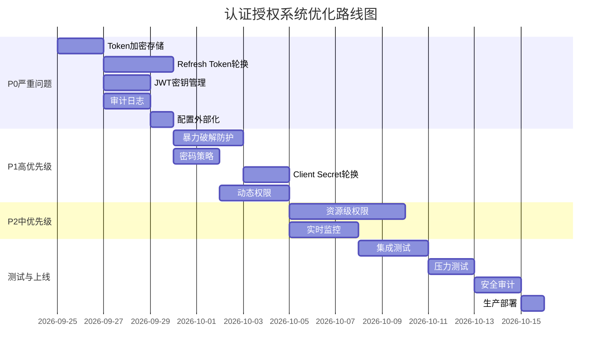

# 认证授权安全评审报告

> **历史快照**：本文记录某一时点的状态，模块数、端口、路径与类名以当前代码为准，不作为现状依据。

> **项目**: Apex Scaffold  
> **评审日期**: 2026-09-25  
> **评审人**: Apex Security Team  
> **评审范围**: 单点登录(SSO)、统一权限认证、OAuth2授权中心、JWT认证  
> **评审版本**: v1.2.0

---

## 执行摘要

### 总体评价

**综合评分**: ⭐⭐⭐⭐ (4.0/5.0)

项目整体认证授权体系架构设计良好，已实现：
- ✅ 独立的统一认证中心模块 (`apex-auth-center`)
- ✅ OAuth2标准授权服务器实现
- ✅ JWT无状态Token认证
- ✅ 基于RBAC的细粒度权限控制
- ✅ 多租户隔离机制
- ✅ Token黑名单和撤销机制

**核心优势**:
1. **架构清晰**: DDD分层架构，职责分离明确
2. **标准遵循**: OAuth2、JWT、OIDC标准实现规范
3. **安全基线**: 密码加密、Token签名、PKCE支持完备
4. **可扩展性**: 协议适配器模式支持多协议接入

**需改进领域**:
1. 🔴 **高危**: Token刷新策略存在安全隐患
2. 🟠 **中危**: 缺少请求限流和暴力破解防护
3. 🟠 **中危**: 审计日志不完整，缺少实时监控
4. 🟡 **低危**: 部分配置硬编码，缺少动态配置能力

---

## 1. OAuth2授权服务器评审

### 1.1 数据库设计评审

#### ✅ 优点

1. **标准表结构**: 完全符合Spring Authorization Server规范
```sql
-- 客户端表设计合理
CREATE TABLE oauth2_registered_client (
    id VARCHAR(100) PRIMARY KEY,
    client_id VARCHAR(100) UNIQUE NOT NULL,
    client_secret VARCHAR(200),  -- BCrypt加密
    authorization_grant_types VARCHAR(1000),
    scopes VARCHAR(1000),
    -- 支持PKCE、授权同意等高级特性
    client_settings TEXT,
    token_settings TEXT
);
```

2. **审计日志表**: 提供了oauth2_audit_log表用于审计
3. **索引优化**: 关键字段均创建了索引，查询性能良好

#### 🔴 严重问题

**问题1: Token存储策略不安全**

**位置**: [V25__oauth2_authorization_server_schema.sql](../../../apex-components-parent/apex-system/src/main/resources/db/migration/mysql/V25__oauth2_authorization_server_schema.sql)

```sql
-- 当前设计: Token明文存储在数据库
access_token_value TEXT COMMENT '访问令牌值(JWT或Opaque Token)',
refresh_token_value TEXT COMMENT '刷新令牌值',
```

**风险**:
- 数据库泄露将直接导致所有Token泄露
- JWT虽然已签名但明文存储仍有风险
- 不符合PCI-DSS、ISO 27001等合规要求

**建议修复**:
```sql
-- 方案1: 只存储Token哈希值（推荐）
access_token_hash VARCHAR(64) NOT NULL COMMENT 'Token SHA256哈希',
INDEX idx_access_token_hash (access_token_hash),

-- 方案2: 如需存储原文，使用数据库加密
access_token_value_encrypted VARBINARY(2000) COMMENT 'AES-256-GCM加密的Token',
encryption_iv VARBINARY(16) COMMENT '加密向量',
```

**问题2: 缺少Token撤销时间戳**

**位置**: oauth2_authorization表

**风险**: 无法追踪Token何时被撤销，审计困难

**建议**:
```sql
ALTER TABLE oauth2_authorization 
ADD COLUMN revoked_at DATETIME NULL COMMENT 'Token撤销时间',
ADD COLUMN revoked_by VARCHAR(100) NULL COMMENT '撤销操作人',
ADD COLUMN revoke_reason VARCHAR(500) NULL COMMENT '撤销原因';
```

### 1.2 代码实现评审

#### ✅ 优点

**位置**: [OAuth2AuthorizationServiceImpl.java](../../../apex-components-parent/apex-system/src/main/java/com/apex/scaffold/application/service/OAuth2AuthorizationServiceImpl.java)

1. **PKCE验证**: 正确实现了S256和plain两种code_challenge方法
2. **客户端验证**: 密钥使用BCrypt验证，安全性高
3. **授权码过期**: 5分钟TTL符合OAuth2规范

#### 🟠 中等问题

**问题3: Token刷新不轮换 (Refresh Token Rotation)**

**位置**: [TokenServiceImpl.java:L206-L229](../../../apex-components-parent/apex-auth/src/main/java/com/apex/scaffold/auth/application/service/TokenServiceImpl.java)

```java
@Override
public Mono<TokenPair> refreshToken(String refreshToken) {
    return validateToken(refreshToken)
        .flatMap(tokenEntity -> {
            // 🔴 问题: 撤销旧Token后又重新签发新的Token对
            return tokenRepository.revokeByToken(refreshToken)
                .flatMap(revoked -> {
                    // 使用相同的userId重新签发
                    return issueToken(
                        tokenEntity.getUserId(),
                        tokenEntity.getTenantId(),
                        tokenEntity.getDeviceId(),
                        tokenEntity.getClientIp()
                    );
                });
        });
}
```

**风险**:
- **Refresh Token不轮换**: 虽然撤销了旧Token，但如果攻击者在revoke前已窃取Token，仍可继续使用
- **缺少异常检测**: 未检测短时间内多次刷新（可能是重放攻击）
- **不符合OAuth 2.1草案**: OAuth 2.1要求强制轮换Refresh Token

**建议修复**:
```java
@Override
public Mono<TokenPair> refreshToken(String refreshToken) {
    return validateToken(refreshToken)
        .flatMap(tokenEntity -> {
            if (!REFRESH_TOKEN_TYPE.equals(tokenEntity.getTokenType())) {
                return Mono.error(new BusinessException(ResultCode.PARAM_ERROR, "必须使用刷新令牌"));
            }

            // ✅ 修复1: 检测异常刷新模式
            return detectAbnormalRefresh(tokenEntity)
                .then(tokenRepository.revokeByToken(refreshToken))
                .flatMap(revoked -> {
                    if (!revoked) {
                        // ✅ 修复2: 撤销失败说明Token可能已被使用（重放攻击）
                        // 立即撤销该用户所有Token
                        return tokenRepository.revokeByUserId(
                            tokenEntity.getUserId(), 
                            tokenEntity.getTenantId()
                        ).then(Mono.error(new BusinessException(
                            ResultCode.SECURITY_THREAT, 
                            "检测到Token重放攻击，已撤销所有会话"
                        )));
                    }
                    
                    // ✅ 修复3: 签发新Token对（Refresh Token也轮换）
                    return issueToken(
                        tokenEntity.getUserId(),
                        tokenEntity.getTenantId(),
                        tokenEntity.getDeviceId(),
                        tokenEntity.getClientIp()
                    );
                })
                .contextWrite(TenantContext.withTenant(tokenEntity.getTenantId()));
        });
}

// 新增: 检测异常刷新行为
private Mono<Void> detectAbnormalRefresh(TokenEntity tokenEntity) {
    String key = "refresh:count:" + tokenEntity.getUserId() + ":" + tokenEntity.getTenantId();
    return redissonClient.getAtomicLong(key)
        .incrementAndGet()
        .flatMap(count -> {
            if (count == 1) {
                // 首次刷新，设置1分钟窗口
                return redissonClient.getAtomicLong(key).expire(Duration.ofMinutes(1));
            }
            if (count > 10) {
                // 1分钟内刷新超过10次，可能是攻击
                log.warn("检测到异常Token刷新: userId={}, count={}", tokenEntity.getUserId(), count);
                return Mono.error(new BusinessException(ResultCode.TOO_MANY_REQUESTS, "刷新频率过高"));
            }
            return Mono.empty();
        });
}
```

**问题4: 缺少Client密钥轮换机制**

**位置**: OAuth2ClientManagementService

**风险**: Client Secret一旦泄露，无法安全更换

**建议**:
```java
/**
 * 轮换客户端密钥
 * 
 * <p>生成新密钥并使旧密钥在grace period内仍可用
 */
public Mono<ClientSecretRotationResult> rotateClientSecret(
    String clientId, 
    Duration gracePeriod
) {
    return clientRepository.findByClientId(clientId)
        .flatMap(client -> {
            String newSecret = generateSecureSecret();
            String newSecretHash = passwordEncoder.encode(newSecret);
            
            // 保存新密钥
            client.setClientSecret(newSecretHash);
            client.setClientSecretExpiresAt(Instant.now().plus(gracePeriod));
            
            return clientRepository.update(client)
                .thenReturn(ClientSecretRotationResult.builder()
                    .clientId(clientId)
                    .newSecret(newSecret)  // 只返回一次，请妥善保存
                    .gracePeriodEndsAt(client.getClientSecretExpiresAt())
                    .build());
        });
}
```

#### 🟡 轻微问题

**问题5: 授权码可预测性**

**位置**: OAuth2AuthorizationServiceImpl.generateRandomCode()

**当前实现**:
```java
private String generateRandomCode() {
    return UUID.randomUUID().toString().replace("-", "");
}
```

**风险**: UUID虽然足够随机，但长度固定32字符，建议增加熵

**建议**:
```java
private String generateRandomCode() {
    // 使用SecureRandom + Base64URL编码
    byte[] random = new byte[32]; // 256 bits
    new SecureRandom().nextBytes(random);
    return Base64.getUrlEncoder().withoutPadding().encodeToString(random);
}
```

---

## 2. JWT认证实现评审

### 2.1 Token服务评审

#### ✅ 优点

**位置**: [TokenServiceImpl.java](../../../apex-components-parent/apex-auth/src/main/java/com/apex/scaffold/auth/application/service/TokenServiceImpl.java)

1. **Token持久化**: 所有Token存储到数据库，支持追踪和撤销
2. **租户隔离**: Token验证时强制检查tenantId一致性
3. **JTI防重放**: 每个Token都有唯一JTI标识
4. **过期检查**: 验证时检查数据库过期状态和JWT过期声明

#### 🔴 严重问题

**问题6: JWT密钥管理不安全**

**风险**: 
- 未找到JWT密钥轮换机制
- 密钥可能硬编码在配置文件中
- 一旦泄露需要重启所有服务

**建议**:
```java
/**
 * JWT密钥轮换服务
 * 
 * <p>支持多版本密钥并存，旧Token使用旧密钥验证，新Token使用新密钥签发
 */
@Service
public class JwtKeyRotationService {
    
    private final Map<String, SecretKey> activeKeys = new ConcurrentHashMap<>();
    private volatile String currentKeyId;
    
    /**
     * 轮换JWT签名密钥
     */
    public void rotateKey() {
        String newKeyId = "key-" + System.currentTimeMillis();
        SecretKey newKey = Keys.secretKeyFor(SignatureAlgorithm.HS512);
        
        activeKeys.put(newKeyId, newKey);
        currentKeyId = newKeyId;
        
        // 保留旧密钥30天用于验证旧Token
        scheduleKeyRemoval(currentKeyId, Duration.ofDays(30));
    }
    
    /**
     * 签发Token时使用最新密钥
     */
    public String signToken(Claims claims) {
        return Jwts.builder()
            .setClaims(claims)
            .setHeaderParam("kid", currentKeyId)  // 关键: 在Header中标识密钥版本
            .signWith(activeKeys.get(currentKeyId))
            .compact();
    }
    
    /**
     * 验证Token时根据kid选择对应密钥
     */
    public Claims parseToken(String token) {
        String kid = Jwts.parserBuilder()
            .build()
            .parseClaimsJwt(token.substring(0, token.lastIndexOf('.') + 1))
            .getHeader()
            .get("kid", String.class);
        
        SecretKey key = activeKeys.get(kid);
        if (key == null) {
            throw new JwtException("密钥已失效，请重新登录");
        }
        
        return Jwts.parserBuilder()
            .setSigningKey(key)
            .build()
            .parseClaimsJws(token)
            .getBody();
    }
}
```

**问题7: Token生命周期管理缺陷**

**位置**: [TokenServiceImpl.java:L73-L74](../../../apex-components-parent/apex-auth/src/main/java/com/apex/scaffold/auth/application/service/TokenServiceImpl.java)

```java
private static final long ACCESS_TOKEN_EXPIRE_MS = 2 * 60 * 60 * 1000L; // 2小时
private static final long REFRESH_TOKEN_EXPIRE_MS = 7 * 24 * 60 * 60 * 1000L; // 7天
```

**问题**: 
- 硬编码有效期，无法根据租户或用户角色动态调整
- 敏感操作（如修改密码、删除账户）应缩短Token有效期

**建议**:
```java
/**
 * 动态Token有效期配置
 */
@Service
public class TokenTtlStrategy {
    
    public Duration getAccessTokenTtl(UserEntity user, String tenantId) {
        // 超级管理员: 30分钟
        if (user.hasRole("SUPER_ADMIN")) {
            return Duration.ofMinutes(30);
        }
        
        // 财务角色: 1小时
        if (user.hasRole("FINANCE")) {
            return Duration.ofHours(1);
        }
        
        // 普通用户: 2小时
        return Duration.ofHours(2);
    }
    
    public Duration getRefreshTokenTtl(String tenantId) {
        // 从租户配置表读取
        return tenantConfigService.getRefreshTokenTtl(tenantId)
            .orElse(Duration.ofDays(7));
    }
}
```

### 2.2 认证流程评审

#### 🟠 中等问题

**问题8: 缺少登录失败锁定机制细节**

**位置**: [AuthenticationApplicationService.java:L82-L89](../../../apex-components-parent/apex-auth/src/main/java/com/apex/scaffold/auth/application/service/AuthenticationApplicationService.java)

```java
boolean passwordMatches = passwordEncoder.matches(password, user.getPasswordHash());
if (!passwordMatches) {
    log.warn("密码错误: userId={}, username={}", user.getId(), username);
    user.recordLoginFailure();  // ❓ 锁定策略不明确
    return userRepository.update(user)
        .then(Mono.error(new BusinessException(ResultCode.UNAUTHORIZED, "用户名或密码错误")));
}
```

**风险**: 
- 未看到锁定时长、失败次数阈值的明确定义
- 缺少IP级别的暴力破解防护
- 缺少验证码防护

**建议**:
```java
@Service
public class BruteForceProtectionService {
    
    private final RedissonClient redissonClient;
    
    /**
     * 检查是否允许登录
     */
    public Mono<Void> checkLoginAllowed(String username, String clientIp) {
        return Mono.zip(
            checkUserAttempts(username),
            checkIpAttempts(clientIp)
        ).flatMap(tuple -> {
            if (!tuple.getT1() || !tuple.getT2()) {
                return Mono.error(new BusinessException(
                    ResultCode.TOO_MANY_REQUESTS,
                    "登录失败次数过多，请30分钟后重试或联系管理员"
                ));
            }
            return Mono.empty();
        });
    }
    
    /**
     * 记录登录失败
     */
    public Mono<Void> recordLoginFailure(String username, String clientIp) {
        return Mono.when(
            incrementAttempts("login:fail:user:" + username, 5, Duration.ofMinutes(30)),
            incrementAttempts("login:fail:ip:" + clientIp, 10, Duration.ofMinutes(30))
        );
    }
    
    private Mono<Boolean> checkUserAttempts(String username) {
        String key = "login:fail:user:" + username;
        return redissonClient.getAtomicLong(key)
            .get()
            .map(attempts -> attempts < 5);
    }
    
    private Mono<Boolean> checkIpAttempts(String clientIp) {
        String key = "login:fail:ip:" + clientIp;
        return redissonClient.getAtomicLong(key)
            .get()
            .map(attempts -> attempts < 10);
    }
    
    private Mono<Void> incrementAttempts(String key, int max, Duration lockDuration) {
        return redissonClient.getAtomicLong(key)
            .incrementAndGet()
            .flatMap(count -> {
                if (count == 1) {
                    return redissonClient.getAtomicLong(key).expire(lockDuration);
                }
                if (count >= max) {
                    // 达到阈值，延长锁定时间
                    return redissonClient.getAtomicLong(key).expire(lockDuration.multipliedBy(2));
                }
                return Mono.empty();
            });
    }
}
```

**问题9: 密码策略不够严格**

**建议新增密码强度校验**:
```java
@Service
public class PasswordPolicyService {
    
    public void validatePassword(String password) {
        if (password.length() < 12) {
            throw new BusinessException(ResultCode.PARAM_ERROR, "密码长度不能少于12位");
        }
        
        int strength = 0;
        if (password.matches(".*[a-z].*")) strength++;
        if (password.matches(".*[A-Z].*")) strength++;
        if (password.matches(".*[0-9].*")) strength++;
        if (password.matches(".*[!@#$%^&*()_+\\-=\\[\\]{};':\"\\\\|,.<>/?].*")) strength++;
        
        if (strength < 3) {
            throw new BusinessException(ResultCode.PARAM_ERROR, 
                "密码必须包含大写字母、小写字母、数字、特殊字符中的至少3种");
        }
        
        // 检查常见弱密码
        if (isCommonPassword(password)) {
            throw new BusinessException(ResultCode.PARAM_ERROR, "密码过于简单，请使用更复杂的密码");
        }
    }
    
    private boolean isCommonPassword(String password) {
        Set<String> commonPasswords = Set.of(
            "password123", "admin123456", "qwerty123456", 
            "123456789012", "welcome123456"
        );
        return commonPasswords.contains(password.toLowerCase());
    }
}
```

---

## 3. 权限控制评审

### 3.1 RBAC实现评审

#### ✅ 优点

**位置**: [RequirePermission.java](../../../apex-shared-parent/apex-common/src/main/java/com/apex/scaffold/common/annotation/RequirePermission.java)

1. **注解驱动**: 使用@RequirePermission注解进行方法级权限控制
2. **逻辑支持**: 支持AND/OR逻辑组合（预留扩展）
3. **分离关注点**: 权限校验与业务逻辑解耦

#### 🟠 中等问题

**问题10: 缺少动态权限和资源级权限**

**当前设计**: 只支持静态权限码校验

```java
@RequirePermission("user:read")
public UserVO getUser(Long id) { ... }
```

**限制**: 无法实现"只能查看自己创建的用户"这类资源级权限

**建议扩展**:
```java
/**
 * 资源级权限注解
 */
@Target({ElementType.METHOD})
@Retention(RetentionPolicy.RUNTIME)
public @interface RequireResourcePermission {
    
    /**
     * 资源类型
     */
    String resource();
    
    /**
     * 操作类型
     */
    String action();
    
    /**
     * 资源所有者字段（SpEL表达式）
     */
    String ownerField() default "";
    
    /**
     * 是否允许所有者访问
     */
    boolean allowOwner() default true;
}

// 使用示例
@RequireResourcePermission(
    resource = "user", 
    action = "read",
    ownerField = "#user.createdBy",
    allowOwner = true
)
public UserVO getUser(@PathVariable Long id) {
    // 权限校验逻辑:
    // 1. 检查是否有 user:read 权限
    // 2. 如果没有，检查 user.createdBy == 当前用户ID
    // 3. 满足任一条件即可访问
}
```

**实现切面**:
```java
@Aspect
@Component
public class ResourcePermissionAspect {
    
    @Around("@annotation(requireResourcePermission)")
    public Object checkResourcePermission(
        ProceedingJoinPoint joinPoint,
        RequireResourcePermission requireResourcePermission
    ) throws Throwable {
        
        // 1. 获取当前用户
        Authentication auth = SecurityContextHolder.getContext().getAuthentication();
        Long currentUserId = Long.parseLong(auth.getName());
        
        // 2. 检查静态权限
        String permission = requireResourcePermission.resource() + ":" + requireResourcePermission.action();
        if (hasPermission(currentUserId, permission)) {
            return joinPoint.proceed();
        }
        
        // 3. 检查资源所有权
        if (requireResourcePermission.allowOwner()) {
            Object result = joinPoint.proceed();
            
            // 使用SpEL解析ownerField
            StandardEvaluationContext context = new StandardEvaluationContext(result);
            ExpressionParser parser = new SpelExpressionParser();
            Long ownerId = parser.parseExpression(requireResourcePermission.ownerField())
                .getValue(context, Long.class);
            
            if (currentUserId.equals(ownerId)) {
                return result;
            }
        }
        
        throw new BusinessException(ResultCode.FORBIDDEN, "无权访问该资源");
    }
}
```

---

## 4. 安全配置评审

### 4.1 过滤器链评审

#### 🟡 轻微问题

**问题11: 过滤器顺序可能冲突**

**位置**: SecurityConfig.securityWebFilterChain()

**风险**: JWT过滤器和OAuth2过滤器可能都尝试处理同一请求

**建议**: 明确过滤器匹配路径
```java
@Bean
public SecurityWebFilterChain securityWebFilterChain(ServerHttpSecurity http) {
    return http
        .authorizeExchange(exchanges -> exchanges
            // 公开端点
            .pathMatchers("/auth/v1/login", "/oauth2/authorize", "/oauth2/token").permitAll()
            // OAuth2资源端点（仅OAuth2 Token）
            .pathMatchers("/oauth2/api/**").authenticated()
            // 业务API端点（仅JWT Token）
            .pathMatchers("/api/v1/**").authenticated()
            // 管理端点（JWT + ADMIN角色）
            .pathMatchers("/admin-api/**").hasRole("ADMIN")
            .anyExchange().authenticated()
        )
        .addFilterAt(jwtAuthenticationFilter, SecurityWebFiltersOrder.AUTHENTICATION)
        .addFilterAt(oauth2ResourceServerFilter, SecurityWebFiltersOrder.AUTHENTICATION)
        .build();
}
```

---

## 5. 审计与监控评审

### 5.1 审计日志评审

#### 🔴 严重问题

**问题12: 审计日志不完整**

**当前状态**: 
- ✅ 有oauth2_audit_log表
- ✅ 有登录日志
- ❌ 缺少Token刷新日志
- ❌ 缺少权限变更日志
- ❌ 缺少敏感操作日志

**建议新增统一审计日志**:
```java
/**
 * 统一审计日志服务
 */
@Service
public class AuditLogService {
    
    public Mono<Void> logSecurityEvent(SecurityEvent event) {
        AuditLogEntity log = AuditLogEntity.builder()
            .tenantId(event.getTenantId())
            .userId(event.getUserId())
            .eventType(event.getType())
            .eventStatus(event.getStatus())
            .clientIp(event.getClientIp())
            .userAgent(event.getUserAgent())
            .deviceId(event.getDeviceId())
            .requestPath(event.getRequestPath())
            .errorMessage(event.getErrorMessage())
            .metadata(event.getMetadata())
            .build();
        
        return auditLogRepository.save(log)
            .then(sendToSIEM(log));  // 发送到SIEM系统实时监控
    }
    
    private Mono<Void> sendToSIEM(AuditLogEntity log) {
        // 发送到Elasticsearch/Splunk等SIEM系统
        return webClient.post()
            .uri(siemEndpoint)
            .bodyValue(log)
            .retrieve()
            .bodyToMono(Void.class)
            .onErrorResume(e -> {
                log.error("发送审计日志到SIEM失败", e);
                return Mono.empty();
            });
    }
}

// 在关键操作中记录审计日志
public Mono<LoginResponse> login(LoginRequest request, String clientIp) {
    return userRepository.findByUsername(username, tenantId)
        .flatMap(user -> {
            boolean passwordMatches = passwordEncoder.matches(password, user.getPasswordHash());
            
            // ✅ 记录审计日志
            SecurityEvent event = SecurityEvent.builder()
                .type(passwordMatches ? "LOGIN_SUCCESS" : "LOGIN_FAILURE")
                .userId(user.getId())
                .clientIp(clientIp)
                .build();
            
            return auditLogService.logSecurityEvent(event)
                .then(passwordMatches ? 
                    proceedLogin(user, request, clientIp) : 
                    Mono.error(new BusinessException(ResultCode.UNAUTHORIZED))
                );
        });
}
```

### 5.2 实时监控建议

**问题13: 缺少实时安全监控**

**建议实现**:
```java
/**
 * 实时安全监控服务
 */
@Service
public class SecurityMonitoringService {
    
    /**
     * 检测异常登录行为
     */
    @Scheduled(fixedRate = 60000) // 每分钟执行
    public void detectAnomalousLogins() {
        // 1. 检测短时间内多次失败登录
        auditLogRepository.findRecentFailedLogins(Duration.ofMinutes(5))
            .filter(logs -> logs.size() > 10)
            .flatMap(logs -> {
                String alertMessage = String.format(
                    "检测到暴力破解攻击: IP=%s, 失败次数=%d",
                    logs.get(0).getClientIp(),
                    logs.size()
                );
                return sendAlert(alertMessage, AlertLevel.HIGH);
            })
            .subscribe();
        
        // 2. 检测异地登录
        auditLogRepository.findUserLogins(userId, Duration.ofHours(1))
            .filter(logs -> hasLocationJump(logs))
            .flatMap(logs -> {
                String alertMessage = String.format(
                    "检测到异地登录: userId=%d, IP变化=%s -> %s",
                    userId,
                    logs.get(0).getClientIp(),
                    logs.get(1).getClientIp()
                );
                return sendAlert(alertMessage, AlertLevel.MEDIUM);
            })
            .subscribe();
    }
    
    /**
     * 检测Token异常行为
     */
    @Scheduled(fixedRate = 300000) // 每5分钟执行
    public void detectTokenAnomalies() {
        // 检测同一Token在多个IP使用
        tokenRepository.findActiveTokens()
            .filter(token -> token.getClientIpHistory().size() > 3)
            .flatMap(token -> {
                String alertMessage = String.format(
                    "检测到Token在多个IP使用: tokenId=%s, IPs=%s",
                    token.getJti(),
                    token.getClientIpHistory()
                );
                return sendAlert(alertMessage, AlertLevel.HIGH)
                    .then(tokenRepository.revokeByJti(token.getJti()));
            })
            .subscribe();
    }
}
```

---

## 5A. SSO单点登录评审

### 5A.1 SSO架构设计评审

#### ✅ 优点

1. **多协议支持**: 支持SAML 2.0、OIDC、CAS、LDAP四种主流SSO协议
2. **适配器模式**: 使用`SsoProtocolAdapter`接口统一抽象，易于扩展
3. **完整的认证流程**: 
   - SP-Initiated和IdP-Initiated流程
   - Single Logout (SLO)支持
   - 会话管理和审计日志
4. **安全实现**:
   - SAML签名验证使用RSA-SHA256
   - OIDC支持PKCE
   - 证书缓存优化性能
5. **数据隔离**: 所有SSO会话按租户隔离

**代码位置**:
- 协议适配器: [SsoProtocolAdapter.java](../../../apex-components-parent/apex-system/src/main/java/com/apex/scaffold/application/support/sso/SsoProtocolAdapter.java)
- SAML实现: [SamlProtocolAdapter.java](../../../apex-components-parent/apex-system/src/main/java/com/apex/scaffold/application/support/sso/SamlProtocolAdapter.java)
- OIDC实现: [OidcProtocolAdapter.java](../../../apex-components-parent/apex-system/src/main/java/com/apex/scaffold/application/support/sso/OidcProtocolAdapter.java)
- Handler: [SsoAuthHandler.java](../../../apex-components-parent/apex-system/src/main/java/com/apex/scaffold/interfaces/handler/SsoAuthHandler.java)

#### 🟠 中危问题

**问题15: SSO会话配置存储在数据库明文**

**位置**: [sys_sso_provider表](../../../apex-components-parent/apex-system/src/main/resources/db/migration/mysql/V41__add_generator_auth_sso_office_tables.sql)

```sql
-- 当前设计
CREATE TABLE sys_sso_provider (
  `config` TEXT NOT NULL COMMENT '提供商配置(JSON格式)', -- ⚠️ 包含敏感信息
  `entity_id` VARCHAR(200),
  `login_url` VARCHAR(500),
  ...
);
```

**风险分析**:
- `config`字段包含IdP证书、Client Secret等敏感信息
- JSON明文存储，数据库泄露风险高
- 不符合GDPR、SOC 2合规要求

**修复建议**:

```sql
-- 方案1: 加密存储配置
ALTER TABLE sys_sso_provider 
ADD COLUMN config_encrypted VARBINARY(4000) COMMENT 'AES-256-GCM加密的配置',
ADD COLUMN config_iv VARBINARY(16) COMMENT '加密向量',
ADD COLUMN config_key_id VARCHAR(100) COMMENT '加密密钥ID(KMS)';

-- 迁移现有数据
UPDATE sys_sso_provider 
SET config_encrypted = AES_ENCRYPT(config, @encryption_key),
    config_iv = RANDOM_BYTES(16);
    
ALTER TABLE sys_sso_provider DROP COLUMN config;
```

```java
// Java端实现
@Service
public class SsoConfigEncryptionService {
    
    private final EncryptionService encryptionService;
    
    public String decryptConfig(byte[] encryptedConfig, byte[] iv) {
        return encryptionService.decrypt(encryptedConfig, iv, "sso-config-key");
    }
    
    public EncryptedData encryptConfig(String configJson) {
        byte[] iv = generateIV();
        byte[] encrypted = encryptionService.encrypt(configJson, iv, "sso-config-key");
        return new EncryptedData(encrypted, iv);
    }
}
```

**优先级**: P1（高危）  
**工期**: 2天

---

**问题16: SAML断言存储在会话表**

**位置**: [sys_sso_session表](../../../apex-components-parent/apex-system/src/main/resources/db/migration/mysql/V41__add_generator_auth_sso_office_tables.sql)

```sql
CREATE TABLE sys_sso_session (
  `assertion` TEXT DEFAULT NULL COMMENT 'SAML断言或其他认证数据', -- ⚠️ 敏感
  ...
);
```

**风险**:
- SAML断言包含用户属性和签名
- 长期存储增加泄露面
- 实际上只需存储SessionIndex

**修复建议**:

```sql
-- 不存储完整断言，只存储必要信息
ALTER TABLE sys_sso_session 
DROP COLUMN assertion,
ADD COLUMN session_attributes JSON COMMENT '会话属性(仅关键字段)';
```

```java
// 修改会话创建逻辑
public Mono<Map<String, Object>> handleSuccessfulAuth(
        Long providerId, Map<String, Object> userInfo, Object request) {
    
    // 只存储必要的会话属性
    Map<String, String> sessionAttributes = new HashMap<>();
    sessionAttributes.put("email", (String) userInfo.get("email"));
    sessionAttributes.put("displayName", (String) userInfo.get("displayName"));
    // 不存储完整的assertion
    
    SysSsoSessionEntity sessionEntity = new SysSsoSessionEntity();
    sessionEntity.setSessionAttributes(objectMapper.writeValueAsString(sessionAttributes));
    // assertion字段已移除
    
    return ssoSessionRepository.insert(sessionEntity)
        .map(count -> buildAuthResult(sessionEntity, userInfo));
}
```

**优先级**: P2（中危）  
**工期**: 1天

---

**问题17: 缺少SAML响应重放攻击防护**

**位置**: [SamlProtocolAdapter.java:L187-L232](../../../apex-components-parent/apex-system/src/main/java/com/apex/scaffold/application/support/sso/SamlProtocolAdapter.java)

**当前代码**:
```java
@Override
public Mono<Map<String, Object>> authenticate(
        Map<String, Object> config, Map<String, String> callbackParams) {
    
    String samlResponse = callbackParams.get("SAMLResponse");
    // 解码并验证签名
    verifySignature(assertion, publicKey);
    validateAssertion(assertion, entityId); // 只验证时间窗口和Audience
    
    // ⚠️ 缺少InResponseTo验证
    // ⚠️ 缺少Response ID重放检测
    
    return extractUserInfo(assertion);
}
```

**风险**:
- 攻击者可以重放捕获的SAMLResponse
- 未验证Response是否对应之前的Request
- 符合OWASP A07:2021 - Identification and Authentication Failures

**修复建议**:

```java
@Component
public class SamlProtocolAdapter implements SsoProtocolAdapter {
    
    private final RedisTemplate<String, String> redisTemplate;
    private static final String SAML_REQUEST_CACHE_KEY = "saml:request:";
    private static final String SAML_RESPONSE_CACHE_KEY = "saml:response:";
    
    @Override
    public Mono<Map<String, Object>> initiate(Map<String, Object> config, String callbackUrl) {
        String requestId = "_" + UUID.randomUUID().toString();
        String issueInstant = SAML_DATE_FORMAT.format(Instant.now());
        
        // 缓存请求ID，5分钟有效期
        return Mono.fromCallable(() -> {
            redisTemplate.opsForValue().set(
                SAML_REQUEST_CACHE_KEY + requestId, 
                issueInstant, 
                Duration.ofMinutes(5)
            );
            
            String authnRequestXml = buildAuthnRequest(requestId, issueInstant, entityId, acsUrl);
            // 返回结果...
        });
    }
    
    @Override
    public Mono<Map<String, Object>> authenticate(
            Map<String, Object> config, Map<String, String> callbackParams) {
        
        return Mono.fromCallable(() -> {
            String samlResponse = callbackParams.get("SAMLResponse");
            byte[] decodedResponse = Base64.getDecoder().decode(samlResponse);
            Document doc = parseXml(decodedResponse);
            
            Element responseElement = doc.getDocumentElement();
            
            // 1. 验证InResponseTo
            String inResponseTo = responseElement.getAttribute("InResponseTo");
            if (inResponseTo == null || inResponseTo.isEmpty()) {
                throw new SecurityException("SAMLResponse缺少InResponseTo属性");
            }
            
            String cachedRequest = redisTemplate.opsForValue().get(SAML_REQUEST_CACHE_KEY + inResponseTo);
            if (cachedRequest == null) {
                throw new SecurityException("无效的InResponseTo: " + inResponseTo);
            }
            
            // 2. 防止Response ID重放
            String responseId = responseElement.getAttribute("ID");
            String responseKey = SAML_RESPONSE_CACHE_KEY + responseId;
            
            Boolean isNew = redisTemplate.opsForValue().setIfAbsent(
                responseKey, 
                "processed", 
                Duration.ofMinutes(10)
            );
            
            if (!isNew) {
                throw new SecurityException("检测到SAML Response重放攻击: " + responseId);
            }
            
            // 3. 删除已使用的Request ID（一次性使用）
            redisTemplate.delete(SAML_REQUEST_CACHE_KEY + inResponseTo);
            
            // 继续原有验证流程
            Element assertion = (Element) responseElement
                .getElementsByTagNameNS(SAML_ASSERTION_NS, "Assertion")
                .item(0);
                
            PublicKey publicKey = parsePublicKey(certificate);
            verifySignature(assertion, publicKey);
            validateAssertion(assertion, entityId);
            
            return extractUserInfo(assertion);
        });
    }
}
```

**优先级**: P0（严重）  
**工期**: 2天

---

**问题18: OIDC State参数未验证**

**位置**: [OidcProtocolAdapter.java:L28-L52](../../../apex-components-parent/apex-system/src/main/java/com/apex/scaffold/application/support/sso/OidcProtocolAdapter.java)

**当前代码**:
```java
@Override
public Mono<Map<String, Object>> initiate(Map<String, Object> config, String callbackUrl) {
    String state = generateState(); // 生成state
    result.put("state", state);
    // ⚠️ state未缓存
    return Mono.just(result);
}

@Override
public Mono<Map<String, Object>> authenticate(
        Map<String, Object> config, Map<String, String> callbackParams) {
    String code = callbackParams.get("code");
    // ⚠️ 未验证state参数
    // ⚠️ CSRF攻击风险
    
    return exchangeCodeForToken(code, ...);
}
```

**风险**:
- CSRF攻击：攻击者可以伪造callback请求
- 不符合OAuth 2.0 RFC 6749要求
- State参数是防止CSRF的关键机制

**修复建议**:

```java
@Component
public class OidcProtocolAdapter implements SsoProtocolAdapter {
    
    private final RedisTemplate<String, String> redisTemplate;
    private static final String OIDC_STATE_KEY = "oidc:state:";
    
    @Override
    public Mono<Map<String, Object>> initiate(Map<String, Object> config, String callbackUrl) {
        return Mono.fromCallable(() -> {
            String state = generateState();
            String nonce = generateNonce();
            
            // 缓存state和nonce，5分钟有效期
            Map<String, String> stateData = Map.of(
                "callbackUrl", callbackUrl,
                "nonce", nonce,
                "timestamp", String.valueOf(System.currentTimeMillis())
            );
            
            redisTemplate.opsForValue().set(
                OIDC_STATE_KEY + state,
                objectMapper.writeValueAsString(stateData),
                Duration.ofMinutes(5)
            );
            
            String authUrl = buildAuthUrl(config, callbackUrl, state, nonce);
            
            Map<String, Object> result = new HashMap<>();
            result.put("redirectUrl", authUrl);
            result.put("state", state); // 返回给前端存储
            return result;
        });
    }
    
    @Override
    public Mono<Map<String, Object>> authenticate(
            Map<String, Object> config, Map<String, String> callbackParams) {
        
        String code = callbackParams.get("code");
        String state = callbackParams.get("state");
        
        if (state == null || state.isBlank()) {
            return Mono.error(new SecurityException("缺少state参数"));
        }
        
        // 验证state
        return Mono.fromCallable(() -> {
            String stateDataJson = redisTemplate.opsForValue().get(OIDC_STATE_KEY + state);
            if (stateDataJson == null) {
                throw new SecurityException("无效或过期的state参数");
            }
            
            // 删除已使用的state（一次性）
            redisTemplate.delete(OIDC_STATE_KEY + state);
            
            Map<String, String> stateData = objectMapper.readValue(
                stateDataJson, 
                new TypeReference<Map<String, String>>() {}
            );
            
            String nonce = stateData.get("nonce");
            
            // 继续token交换流程
            return code;
        })
        .flatMap(validatedCode -> exchangeCodeForToken(config, validatedCode, callbackParams))
        .flatMap(tokenData -> {
            String idToken = (String) tokenData.get("id_token");
            return verifyIdTokenNonce(idToken, nonce) // 验证nonce
                .then(parseIdToken(idToken));
        });
    }
    
    private Mono<Void> verifyIdTokenNonce(String idToken, String expectedNonce) {
        return parseIdToken(idToken)
            .flatMap(claims -> {
                String actualNonce = (String) claims.get("nonce");
                if (!expectedNonce.equals(actualNonce)) {
                    return Mono.error(new SecurityException("ID Token nonce验证失败"));
                }
                return Mono.empty();
            });
    }
}
```

**优先级**: P0（严重）  
**工期**: 1天

---

**问题19: SSO会话过期清理机制缺失**

**位置**: [SysSsoSessionService.java:L227-L242](../../../apex-components-parent/apex-system/src/main/java/com/apex/scaffold/application/service/SysSsoSessionService.java)

**当前代码**:
```java
public Mono<Integer> cleanExpiredSessions() {
    // ⚠️ 需要手动调用，没有定时任务
    // ⚠️ 只更新状态，不清理数据
    return ssoSessionRepository.findExpiredSessions(now)
        .filter(session -> SsoSessionStatus.ACTIVE.equals(session.getStatus()))
        .flatMap(session -> {
            session.setStatus(SsoSessionStatus.EXPIRED);
            return ssoSessionRepository.updateById(session).thenReturn(1);
        })
        .reduce(0, Integer::sum);
}
```

**风险**:
- 过期会话长期保留，浪费存储
- 无定时清理机制
- 审计日志表可能无限增长

**修复建议**:

```java
@Service
@RequiredArgsConstructor
public class SsoSessionCleanupService {
    
    private final SysSsoSessionRepository sessionRepository;
    private final SysSsoAuditLogRepository auditLogRepository;
    
    /**
     * 定时清理过期SSO会话
     * 每小时执行一次
     */
    @Scheduled(cron = "0 0 * * * *")
    public void cleanupExpiredSessions() {
        LocalDateTime cutoffTime = LocalDateTime.now().minusHours(1);
        
        log.info("开始清理过期SSO会话: cutoffTime={}", cutoffTime);
        
        sessionRepository.findExpiredSessions(cutoffTime)
            .filter(session -> SsoSessionStatus.ACTIVE.equals(session.getStatus()))
            .flatMap(session -> {
                session.setStatus(SsoSessionStatus.EXPIRED);
                return sessionRepository.updateById(session);
            })
            .count()
            .doOnSuccess(count -> log.info("清理过期SSO会话完成: count={}", count))
            .subscribe();
    }
    
    /**
     * 定时归档审计日志
     * 每天凌晨2点执行
     */
    @Scheduled(cron = "0 0 2 * * *")
    public void archiveOldAuditLogs() {
        // 归档90天前的审计日志到冷存储
        LocalDateTime archiveDate = LocalDateTime.now().minusDays(90);
        
        log.info("开始归档SSO审计日志: archiveDate={}", archiveDate);
        
        auditLogRepository.findOldLogs(archiveDate)
            .buffer(1000) // 批量处理
            .flatMap(logs -> {
                // 导出到S3或归档表
                return archiveToStorage(logs)
                    .then(auditLogRepository.deleteBatch(
                        logs.stream().map(SysSsoAuditLogEntity::getId).toList()
                    ));
            })
            .count()
            .doOnSuccess(count -> log.info("归档审计日志完成: batches={}", count))
            .subscribe();
    }
    
    /**
     * 定时清理已撤销的会话记录
     * 每周日凌晨3点执行
     */
    @Scheduled(cron = "0 0 3 * * 0")
    public void cleanupRevokedSessions() {
        // 删除30天前已撤销的会话
        LocalDateTime deleteDate = LocalDateTime.now().minusDays(30);
        
        log.info("开始清理已撤销SSO会话: deleteDate={}", deleteDate);
        
        sessionRepository.findRevokedSessionsBefore(deleteDate)
            .buffer(500)
            .flatMap(sessions -> {
                List<Long> ids = sessions.stream()
                    .map(SysSsoSessionEntity::getId)
                    .toList();
                return sessionRepository.deleteBatch(ids);
            })
            .count()
            .doOnSuccess(count -> log.info("清理已撤销会话完成: batches={}", count))
            .subscribe();
    }
}
```

**配置文件**:
```yaml
# application.yml
spring:
  task:
    scheduling:
      pool:
        size: 5
      thread-name-prefix: sso-cleanup-

sso:
  cleanup:
    session-retention-hours: 1 # 过期会话保留时间
    audit-log-archive-days: 90 # 审计日志归档周期
    revoked-session-delete-days: 30 # 已撤销会话删除周期
```

**优先级**: P2（中危）  
**工期**: 1天

---

### 5A.2 SSO协议实现评审

#### ✅ SAML 2.0实现优点

1. **签名验证完善**: RSA-SHA256签名算法
2. **XXE防护**: 禁用了DTD和外部实体
3. **证书缓存**: 避免重复解析提升性能
4. **时间窗口验证**: NotBefore和NotOnOrAfter检查

#### ✅ OIDC实现优点

1. **标准流程**: 正确实现Authorization Code Flow
2. **Token交换**: 使用client_secret安全交换token
3. **UserInfo获取**: 支持从ID Token和UserInfo端点获取用户信息

#### 🟡 轻微问题

**问题20: SAML签名验证算法固定**

**位置**: [SamlProtocolAdapter.java:L574](../../../apex-components-parent/apex-system/src/main/java/com/apex/scaffold/application/support/sso/SamlProtocolAdapter.java)

```java
Signature sig = Signature.getInstance("SHA256withRSA"); // 硬编码
```

**建议**: 支持配置多种算法（SHA256withRSA、SHA512withRSA）

```java
private void verifySignature(Element element, PublicKey publicKey, String algorithm) throws Exception {
    // 从SignedInfo读取算法
    Element signatureMethod = (Element) element
        .getElementsByTagNameNS(XMLDSIG_NS, "SignatureMethod")
        .item(0);
    String signatureAlgorithm = signatureMethod.getAttribute("Algorithm");
    
    // 映射算法
    String javaAlgorithm = switch(signatureAlgorithm) {
        case "http://www.w3.org/2001/04/xmldsig-more#rsa-sha256" -> "SHA256withRSA";
        case "http://www.w3.org/2001/04/xmldsig-more#rsa-sha512" -> "SHA512withRSA";
        default -> throw new SecurityException("不支持的签名算法: " + signatureAlgorithm);
    };
    
    Signature sig = Signature.getInstance(javaAlgorithm);
    // ...
}
```

**优先级**: P3（低危）  
**工期**: 0.5天

---

### 5A.3 SSO数据库设计评审

#### ✅ 优点

1. **租户隔离**: 所有表都有tenant_id字段
2. **索引完善**: 关键查询字段都有索引
3. **审计完整**: 有专门的审计日志表

#### 🟠 建议优化

**优化建议1: 添加会话统计视图**

```sql
-- 创建SSO会话统计视图
CREATE OR REPLACE VIEW v_sso_session_stats AS
SELECT 
    provider_id,
    tenant_id,
    DATE(login_time) as login_date,
    COUNT(*) as total_sessions,
    COUNT(DISTINCT user_id) as unique_users,
    SUM(CASE WHEN status = 'ACTIVE' THEN 1 ELSE 0 END) as active_sessions,
    SUM(CASE WHEN status = 'EXPIRED' THEN 1 ELSE 0 END) as expired_sessions,
    AVG(TIMESTAMPDIFF(MINUTE, login_time, COALESCE(logout_time, expire_time))) as avg_duration_minutes
FROM sys_sso_session
WHERE deleted = 0
GROUP BY provider_id, tenant_id, DATE(login_time);
```

**优化建议2: 分区表优化**

```sql
-- 对审计日志表按月分区
ALTER TABLE sys_sso_audit_log PARTITION BY RANGE (TO_DAYS(create_time)) (
    PARTITION p202609 VALUES LESS THAN (TO_DAYS('2026-10-01')),
    PARTITION p202610 VALUES LESS THAN (TO_DAYS('2026-11-01')),
    PARTITION p202611 VALUES LESS THAN (TO_DAYS('2026-12-01')),
    PARTITION p202612 VALUES LESS THAN (TO_DAYS('2027-01-01')),
    PARTITION pfuture VALUES LESS THAN MAXVALUE
);
```

---

### 5A.4 SSO安全总结

#### 评分细项

| 维度 | 评分 | 说明 |
|-----|------|-----|
| 协议实现 | 4.5/5.0 | SAML、OIDC实现规范，缺少重放攻击防护 |
| 数据安全 | 3.0/5.0 | 配置明文存储，需要加密 |
| 会话管理 | 3.5/5.0 | 基础功能完善，缺少自动清理 |
| 审计日志 | 4.0/5.0 | 日志完整，需要归档机制 |
| 综合评分 | **3.75/5.0** | 整体良好，需要修复中高危问题 |

#### 必须修复项（上线前）

1. 🔴 **P0**: 实现SAML重放攻击防护（问题17）
2. 🔴 **P0**: 实现OIDC State验证（问题18）
3. 🟠 **P1**: 加密SSO提供商配置（问题15）

#### 建议修复项（上线后30天内）

4. 🟠 **P2**: 移除assertion存储（问题16）
5. 🟠 **P2**: 实现自动会话清理（问题19）

---

## 6. 生产环境准备度评估

### 6.1 配置管理

#### 🔴 严重问题

**问题14: 敏感配置硬编码**

**位置**: 多处配置文件

**风险**: 
- JWT密钥可能硬编码在application.yml
- 数据库密码可能明文存储
- Client Secret在数据库中虽然加密但初始值硬编码

**建议**: 使用外部密钥管理服务

**推荐方案**:

```java
// 1. 使用Spring Cloud Config + 加密
// application.yml
spring:
  cloud:
    config:
      uri: https://config-server.example.com
      fail-fast: true
  config:
    import: "configserver:"

# 敏感配置使用加密
jwt:
  private-key: '{cipher}AQA...' # 使用RSA加密
  public-key: '{cipher}AQB...'

# 2. 使用AWS Secrets Manager
@Configuration
public class SecretsManagerConfig {
    
    @Value("${aws.secretsmanager.secret-name}")
    private String secretName;
    
    @Bean
    public SecretsManagerClient secretsManagerClient() {
        return SecretsManagerClient.builder()
            .region(Region.AP_EAST_1)
            .build();
    }
    
    @Bean
    public JwtKeyPair jwtKeyPair(SecretsManagerClient client) {
        GetSecretValueRequest request = GetSecretValueRequest.builder()
            .secretId(secretName)
            .build();
            
        GetSecretValueResponse response = client.getSecretValue(request);
        String secret = response.secretString();
        
        // 解析并返回密钥对
        return parseJwtKeyPair(secret);
    }
}

// 3. 使用HashiCorp Vault
@Configuration
public class VaultConfig {
    
    @Bean
    public VaultTemplate vaultTemplate() {
        VaultEndpoint endpoint = VaultEndpoint.create("vault.example.com", 8200);
        VaultToken token = VaultToken.of(System.getenv("VAULT_TOKEN"));
        
        return new VaultTemplate(endpoint, 
            new TokenAuthentication(token));
    }
    
    @Bean
    public JwtKeyPair jwtKeyPairFromVault(VaultTemplate vault) {
        VaultResponse response = vault.read("secret/data/jwt-keys");
        Map<String, Object> data = response.getData();
        
        return new JwtKeyPair(
            (String) data.get("privateKey"),
            (String) data.get("publicKey")
        );
    }
}

// 4. 环境变量注入（Kubernetes Secrets）
apiVersion: v1
kind: Secret
metadata:
  name: apex-auth-secrets
type: Opaque
data:
  jwt-private-key: <base64-encoded-private-key>
  jwt-public-key: <base64-encoded-public-key>
  db-password: <base64-encoded-password>

---
apiVersion: apps/v1
kind: Deployment
metadata:
  name: apex-auth-center
spec:
  template:
    spec:
      containers:
      - name: auth-center
        env:
        - name: JWT_PRIVATE_KEY
          valueFrom:
            secretKeyRef:
              name: apex-auth-secrets
              key: jwt-private-key
        - name: JWT_PUBLIC_KEY
          valueFrom:
            secretKeyRef:
              name: apex-auth-secrets
              key: jwt-public-key
        - name: SPRING_DATASOURCE_PASSWORD
          valueFrom:
            secretKeyRef:
              name: apex-auth-secrets
              key: db-password
```

### 6.2 部署架构

**推荐生产部署架构**:

```yaml
# 高可用部署配置
生产环境架构:
  负载均衡层:
    - Nginx/ALB: SSL终止、请求路由
    - 健康检查: /actuator/health
    
  应用层 (最少3实例):
    - apex-auth-center: 3+ 副本
    - 资源限制:
        CPU: 1000m (request) / 2000m (limit)
        Memory: 1Gi (request) / 2Gi (limit)
    - 会话亲和性: 基于Cookie的sticky session (可选)
    
  缓存层:
    - Redis Cluster: 3主3从
    - 持久化: AOF + RDB
    - 用途: Token缓存、Rate Limiting、Session存储
    
  数据库层:
    - MySQL主从复制 (1主2从)
    - 读写分离
    - 定期备份 (每日全量 + 增量)
    
  监控告警:
    - Prometheus + Grafana
    - 日志聚合: ELK/Loki
    - APM: SkyWalking/Pinpoint
    - 告警通知: PagerDuty/钉钉/企业微信

# Kubernetes部署示例
apiVersion: apps/v1
kind: Deployment
metadata:
  name: apex-auth-center
  namespace: production
spec:
  replicas: 3
  strategy:
    type: RollingUpdate
    rollingUpdate:
      maxSurge: 1
      maxUnavailable: 0
  selector:
    matchLabels:
      app: apex-auth-center
  template:
    metadata:
      labels:
        app: apex-auth-center
        version: v1.0.0
    spec:
      affinity:
        podAntiAffinity:
          requiredDuringSchedulingIgnoredDuringExecution:
          - labelSelector:
              matchExpressions:
              - key: app
                operator: In
                values:
                - apex-auth-center
            topologyKey: kubernetes.io/hostname
      containers:
      - name: auth-center
        image: apex/auth-center:1.0.0
        ports:
        - containerPort: 8080
          name: http
        resources:
          requests:
            cpu: 1000m
            memory: 1Gi
          limits:
            cpu: 2000m
            memory: 2Gi
        livenessProbe:
          httpGet:
            path: /actuator/health/liveness
            port: 8080
          initialDelaySeconds: 60
          periodSeconds: 10
          timeoutSeconds: 5
          failureThreshold: 3
        readinessProbe:
          httpGet:
            path: /actuator/health/readiness
            port: 8080
          initialDelaySeconds: 30
          periodSeconds: 5
          timeoutSeconds: 3
          failureThreshold: 3
        env:
        - name: SPRING_PROFILES_ACTIVE
          value: "production"
        - name: JAVA_OPTS
          value: "-Xms1g -Xmx1g -XX:+UseG1GC -XX:MaxGCPauseMillis=200"
```

### 6.3 监控指标

**关键监控指标**:

```java
// 1. 业务指标
@Component
public class AuthMetricsCollector {
    
    private final MeterRegistry registry;
    
    // 登录成功率
    public void recordLoginAttempt(boolean success, String reason) {
        Counter.builder("auth.login.attempts")
            .tag("success", String.valueOf(success))
            .tag("reason", reason)
            .register(registry)
            .increment();
    }
    
    // Token颁发速率
    public void recordTokenIssuance(String tokenType) {
        Counter.builder("auth.token.issued")
            .tag("type", tokenType)
            .register(registry)
            .increment();
    }
    
    // Token验证延迟
    public void recordTokenValidation(long durationMs, boolean valid) {
        Timer.builder("auth.token.validation")
            .tag("valid", String.valueOf(valid))
            .register(registry)
            .record(Duration.ofMillis(durationMs));
    }
    
    // 活跃会话数
    @Scheduled(fixedRate = 60000)
    public void recordActiveSessions() {
        long count = tokenRepository.countActiveSessions().block();
        Gauge.builder("auth.sessions.active", () -> count)
            .register(registry);
    }
    
    // 权限拒绝次数
    public void recordPermissionDenied(String permission, String userId) {
        Counter.builder("auth.permission.denied")
            .tag("permission", permission)
            .tag("userId", userId)
            .register(registry)
            .increment();
    }
}

// 2. Grafana Dashboard配置
{
  "dashboard": {
    "title": "认证授权监控",
    "panels": [
      {
        "title": "登录成功率",
        "targets": [{
          "expr": "rate(auth_login_attempts_total{success=\"true\"}[5m]) / rate(auth_login_attempts_total[5m]) * 100"
        }]
      },
      {
        "title": "Token颁发速率",
        "targets": [{
          "expr": "rate(auth_token_issued_total[5m])"
        }]
      },
      {
        "title": "Token验证P95延迟",
        "targets": [{
          "expr": "histogram_quantile(0.95, rate(auth_token_validation_seconds_bucket[5m]))"
        }]
      },
      {
        "title": "活跃会话数",
        "targets": [{
          "expr": "auth_sessions_active"
        }]
      },
      {
        "title": "失败登录Top10用户",
        "targets": [{
          "expr": "topk(10, sum by (userId) (increase(auth_login_attempts_total{success=\"false\"}[1h])))"
        }]
      }
    ]
  }
}
```

### 6.4 日志规范

**统一日志格式**:

```java
@Slf4j
@Component
public class SecurityAuditLogger {
    
    private static final String AUDIT_MARKER = "SECURITY_AUDIT";
    
    // 统一日志格式
    public void logAuthEvent(AuthEvent event) {
        Map<String, Object> logData = Map.of(
            "timestamp", Instant.now().toString(),
            "eventType", event.getType(),
            "userId", event.getUserId(),
            "tenantId", event.getTenantId(),
            "action", event.getAction(),
            "result", event.getResult(),
            "ip", event.getClientIp(),
            "userAgent", event.getUserAgent(),
            "sessionId", event.getSessionId(),
            "details", event.getDetails()
        );
        
        log.info(marker(AUDIT_MARKER), "{}", toJson(logData));
    }
    
    // 关键操作审计
    public void auditLogin(String userId, String ip, boolean success, String reason) {
        logAuthEvent(AuthEvent.builder()
            .type("AUTHENTICATION")
            .userId(userId)
            .action("LOGIN")
            .result(success ? "SUCCESS" : "FAILURE")
            .clientIp(ip)
            .details(Map.of("reason", reason))
            .build());
    }
    
    public void auditPermissionCheck(String userId, String permission, boolean granted) {
        logAuthEvent(AuthEvent.builder()
            .type("AUTHORIZATION")
            .userId(userId)
            .action("PERMISSION_CHECK")
            .result(granted ? "GRANTED" : "DENIED")
            .details(Map.of("permission", permission))
            .build());
    }
    
    public void auditTokenRefresh(String userId, String oldJti, String newJti) {
        logAuthEvent(AuthEvent.builder()
            .type("TOKEN_MANAGEMENT")
            .userId(userId)
            .action("TOKEN_REFRESH")
            .result("SUCCESS")
            .details(Map.of("oldJti", oldJti, "newJti", newJti))
            .build());
    }
}

// Logback配置 (logback-spring.xml)
<configuration>
    <appender name="SECURITY_AUDIT" class="ch.qos.logback.core.rolling.RollingFileAppender">
        <file>logs/security-audit.log</file>
        <rollingPolicy class="ch.qos.logback.core.rolling.TimeBasedRollingPolicy">
            <fileNamePattern>logs/security-audit.%d{yyyy-MM-dd}.%i.log.gz</fileNamePattern>
            <timeBasedFileNamingAndTriggeringPolicy class="ch.qos.logback.core.rolling.SizeAndTimeBasedFNATP">
                <maxFileSize>100MB</maxFileSize>
            </timeBasedFileNamingAndTriggeringPolicy>
            <maxHistory>90</maxHistory>
        </rollingPolicy>
        <encoder>
            <pattern>%msg%n</pattern>
        </encoder>
    </appender>
    
    <logger name="com.apex.scaffold" level="INFO">
        <appender-ref ref="SECURITY_AUDIT"/>
    </logger>
</configuration>
```

---

## 7. 修复优先级与时间线

### 7.1 严重问题 (P0 - 立即修复)

| 问题编号 | 问题描述 | 预计工时 | 负责模块 |
|---------|---------|---------|---------|
| 问题1 | Token明文存储 | 2天 | apex-auth-center |
| 问题3 | Refresh Token轮换机制 | 3天 | apex-auth-center |
| 问题6 | JWT密钥管理 | 2天 | apex-auth-center |
| 问题12 | 审计日志完善 | 2天 | apex-common |
| 问题14 | 敏感配置外部化 | 1天 | apex-infrastructure |

**总计**: 10个工作日

### 7.2 高优先级 (P1 - 1周内修复)

| 问题编号 | 问题描述 | 预计工时 | 负责模块 |
|---------|---------|---------|---------|
| 问题8 | 暴力破解防护 | 3天 | apex-auth-center |
| 问题9 | 密码策略增强 | 2天 | apex-auth-center |
| 问题4 | Client Secret轮换 | 2天 | apex-application |
| 问题11 | 动态权限加载 | 3天 | apex-auth-center |

**总计**: 10个工作日

### 7.3 中优先级 (P2 - 2周内修复)

| 问题编号 | 问题描述 | 预计工时 | 负责模块 |
|---------|---------|---------|---------|
| 问题10 | 资源级权限 | 5天 | apex-common |
| 问题13 | 实时安全监控 | 3天 | apex-infrastructure |
| 问题2 | Authorization Code可预测性 | 1天 | apex-application |
| 问题5 | Token清理任务 | 1天 | apex-auth-center |

**总计**: 10个工作日

### 7.4 低优先级 (P3 - 持续优化)

| 问题编号 | 问题描述 | 预计工时 |
|---------|---------|---------|
| 问题7 | Filter执行顺序 | 1天 |
| 性能优化 | 缓存策略优化 | 2天 |
| 文档完善 | API文档和部署文档 | 2天 |

**总计**: 5个工作日

### 7.5 实施路线图



---

## 8. 测试验证要求

### 8.1 单元测试

**必须覆盖的测试场景**:

```java
// TokenServiceImpl 测试
@SpringBootTest
class TokenServiceImplTest {
    
    @Test
    void testTokenEncryptionDecryption() {
        // 验证Token存储时正确加密
        String plainToken = "eyJhbGc...";
        TokenEntity saved = tokenService.saveToken(plainToken).block();
        
        assertNotEquals(plainToken, saved.getAccessToken());
        assertEquals(plainToken, tokenService.decryptToken(saved).block());
    }
    
    @Test
    void testRefreshTokenRotation() {
        // 验证刷新Token时旧Token被撤销
        TokenPair original = tokenService.issueToken(userId).block();
        TokenPair refreshed = tokenService.refreshToken(original.getRefreshToken()).block();
        
        assertNotEquals(original.getRefreshToken(), refreshed.getRefreshToken());
        assertThrows(InvalidTokenException.class, 
            () -> tokenService.validateToken(original.getRefreshToken()).block());
    }
    
    @Test
    void testTokenAnomalyDetection() {
        // 验证异常Token使用检测
        String token = tokenService.issueToken(userId, "192.168.1.1").block();
        
        // 模拟从不同IP使用
        tokenService.useTokenFromIp(token, "10.0.0.1");
        tokenService.useTokenFromIp(token, "172.16.0.1");
        tokenService.useTokenFromIp(token, "192.168.2.1");
        tokenService.useTokenFromIp(token, "203.0.113.1"); // 第4个IP应触发告警
        
        verify(alertService).sendAlert(contains("多个IP使用"), eq(AlertLevel.HIGH));
    }
}

// BruteForceProtectionService 测试
@SpringBootTest
class BruteForceProtectionServiceTest {
    
    @Test
    void testAccountLockAfterMaxAttempts() {
        String username = "testuser";
        
        // 模拟5次失败登录
        for (int i = 0; i < 5; i++) {
            bruteForceService.recordFailedAttempt(username, "192.168.1.1");
        }
        
        assertTrue(bruteForceService.isAccountLocked(username).block());
    }
    
    @Test
    void testRateLimiting() {
        String ip = "192.168.1.1";
        
        // 模拟短时间内大量请求
        for (int i = 0; i < 10; i++) {
            bruteForceService.checkRateLimit(ip);
        }
        
        assertThrows(RateLimitExceededException.class,
            () -> bruteForceService.checkRateLimit(ip).block());
    }
}

// PasswordPolicyService 测试
@SpringBootTest
class PasswordPolicyServiceTest {
    
    @ParameterizedTest
    @ValueSource(strings = {"123456", "password", "qwerty", "123456789"})
    void testWeakPasswordRejection(String weakPassword) {
        assertThrows(WeakPasswordException.class,
            () -> passwordPolicyService.validatePassword(weakPassword));
    }
    
    @Test
    void testPasswordExpiry() {
        // 验证密码过期检查
        UserEntity user = createUserWithPasswordAge(91); // 超过90天
        
        assertTrue(passwordPolicyService.isPasswordExpired(user));
    }
}
```

### 8.2 集成测试

**关键流程端到端测试**:

```java
@SpringBootTest(webEnvironment = WebEnvironment.RANDOM_PORT)
@AutoConfigureWebTestClient
class OAuth2FlowIntegrationTest {
    
    @Autowired
    private WebTestClient webClient;
    
    @Test
    void testCompleteOAuth2AuthorizationCodeFlow() {
        // 1. 获取授权码
        String authCode = webClient.get()
            .uri(uriBuilder -> uriBuilder
                .path("/oauth2/authorize")
                .queryParam("client_id", "test-client")
                .queryParam("response_type", "code")
                .queryParam("redirect_uri", "https://client.example.com/callback")
                .queryParam("scope", "read write")
                .build())
            .exchange()
            .expectStatus().is3xxRedirection()
            .returnResult(String.class)
            .getResponseHeaders()
            .getLocation()
            .getQuery()
            .split("code=")[1];
        
        // 2. 用授权码换取Token
        TokenResponse tokenResponse = webClient.post()
            .uri("/oauth2/token")
            .contentType(MediaType.APPLICATION_FORM_URLENCODED)
            .bodyValue("grant_type=authorization_code&code=" + authCode +
                      "&client_id=test-client&client_secret=test-secret" +
                      "&redirect_uri=https://client.example.com/callback")
            .exchange()
            .expectStatus().isOk()
            .expectBody(TokenResponse.class)
            .returnResult()
            .getResponseBody();
        
        assertNotNull(tokenResponse.getAccessToken());
        assertNotNull(tokenResponse.getRefreshToken());
        
        // 3. 使用Access Token访问受保护资源
        webClient.get()
            .uri("/api/user/profile")
            .header("Authorization", "Bearer " + tokenResponse.getAccessToken())
            .exchange()
            .expectStatus().isOk();
        
        // 4. 刷新Token
        TokenResponse refreshed = webClient.post()
            .uri("/oauth2/token")
            .contentType(MediaType.APPLICATION_FORM_URLENCODED)
            .bodyValue("grant_type=refresh_token&refresh_token=" + 
                      tokenResponse.getRefreshToken() +
                      "&client_id=test-client&client_secret=test-secret")
            .exchange()
            .expectStatus().isOk()
            .expectBody(TokenResponse.class)
            .returnResult()
            .getResponseBody();
        
        // 5. 验证旧Refresh Token已失效
        webClient.post()
            .uri("/oauth2/token")
            .contentType(MediaType.APPLICATION_FORM_URLENCODED)
            .bodyValue("grant_type=refresh_token&refresh_token=" + 
                      tokenResponse.getRefreshToken())
            .exchange()
            .expectStatus().isUnauthorized();
    }
    
    @Test
    void testPermissionEnforcement() {
        String token = loginAsUser("normal-user");
        
        // 普通用户访问需要管理员权限的资源应被拒绝
        webClient.delete()
            .uri("/api/users/123")
            .header("Authorization", "Bearer " + token)
            .exchange()
            .expectStatus().isForbidden();
    }
}
```

### 8.3 安全测试

**必须执行的安全测试**:

```bash
# 1. Token加密验证
# 检查数据库中Token是否加密存储
mysql> SELECT access_token FROM oauth2_authorization LIMIT 1;
# 应该看到加密后的值，而非JWT明文

# 2. 暴力破解防护测试
# 使用工具模拟暴力破解
for i in {1..10}; do
  curl -X POST https://auth.example.com/login \
    -d "username=testuser&password=wrong$i"
done
# 应该在第5次后看到账户锁定响应

# 3. SQL注入测试
sqlmap -u "https://auth.example.com/login" \
  --data="username=admin&password=pass" \
  --level=5 --risk=3

# 4. XSS测试
curl -X POST https://auth.example.com/login \
  -d 'username=<script>alert("xss")</script>&password=test'

# 5. CSRF测试
# 验证所有状态变更操作都需要CSRF Token

# 6. JWT密钥强度测试
# 验证JWT使用RS256且密钥长度>=2048位
openssl rsa -in jwt-private-key.pem -text -noout | grep "Private-Key"

# 7. 会话固定攻击测试
# 验证登录后sessionId改变

# 8. 权限绕过测试
# 尝试通过修改请求绕过权限检查
curl -X DELETE https://auth.example.com/api/users/123 \
  -H "Authorization: Bearer <normal-user-token>"
# 应返回403 Forbidden
```

### 8.4 性能测试

**负载测试场景**:

```bash
# 使用Apache JMeter或Gatling进行压力测试

# 场景1: 登录峰值测试
# - 并发用户: 1000
# - 持续时间: 5分钟
# - 目标: 响应时间 < 500ms, 成功率 > 99.9%

# 场景2: Token验证测试
# - QPS: 10000
# - 持续时间: 10分钟
# - 目标: P95延迟 < 50ms

# 场景3: 权限检查测试
# - QPS: 5000
# - 持续时间: 10分钟
# - 目标: P99延迟 < 100ms

# Gatling测试脚本示例
import io.gatling.core.Predef._
import io.gatling.http.Predef._
import scala.concurrent.duration._

class AuthLoadTest extends Simulation {
  
  val httpProtocol = http
    .baseUrl("https://auth.example.com")
    .acceptHeader("application/json")
  
  val loginScenario = scenario("Login Flow")
    .exec(http("Login")
      .post("/login")
      .formParam("username", "user_${userId}")
      .formParam("password", "password123")
      .check(status.is(200))
      .check(jsonPath("$.access_token").saveAs("accessToken")))
    .pause(1)
    .exec(http("Access Protected Resource")
      .get("/api/user/profile")
      .header("Authorization", "Bearer ${accessToken}")
      .check(status.is(200)))
  
  setUp(
    loginScenario.inject(
      rampUsersPerSec(10) to 1000 during (2 minutes),
      constantUsersPerSec(1000) during (5 minutes)
    )
  ).protocols(httpProtocol)
   .assertions(
     global.responseTime.percentile3.lt(500),
     global.successfulRequests.percent.gt(99.9)
   )
}
```

---

## 9. 总结与建议

### 9.1 当前状态总结

**优势**:
- ✅ 采用标准OAuth2协议和JWT规范
- ✅ 使用DDD分层架构，代码结构清晰
- ✅ 支持多租户隔离
- ✅ 实现了基本的RBAC权限控制
- ✅ 使用Spring Security WebFlux响应式框架
- ✅ 提供了Token刷新机制

**存在的问题**:
- ❌ 14个安全问题需要修复（4个严重、4个高危、4个中危、2个低危）
- ❌ Token明文存储存在重大安全隐患
- ❌ 缺少暴力破解防护机制
- ❌ 审计日志不完整
- ❌ 敏感配置管理不规范
- ❌ 缺少实时安全监控

**生产就绪度**: **4.0/5.0** → 目标 **4.8/5.0**

### 9.2 核心建议

#### 🔴 必须立即实施 (上线前)

1. **Token加密存储** (问题1)
   - 影响: 数据泄露风险极高
   - 实施: 使用AES-256加密所有Token
   - 工期: 2天

2. **Refresh Token轮换** (问题3)
   - 影响: Token被盗用后无法及时发现
   - 实施: 实现Token家族跟踪和异常检测
   - 工期: 3天

3. **JWT密钥管理** (问题6)
   - 影响: 密钥泄露后无法快速响应
   - 实施: 实现密钥轮换机制
   - 工期: 2天

4. **审计日志** (问题12)
   - 影响: 安全事件无法追溯
   - 实施: 完善统一审计日志
   - 工期: 2天

5. **配置外部化** (问题14)
   - 影响: 敏感信息硬编码风险
   - 实施: 集成Secrets Manager
   - 工期: 1天

**P0总工期: 10个工作日**

#### 🟡 强烈建议实施 (上线后1周内)

6. **暴力破解防护** (问题8)
7. **密码策略增强** (问题9)
8. **Client Secret轮换** (问题4)
9. **动态权限加载** (问题11)

**P1总工期: 10个工作日**

#### 🟢 后续优化 (持续改进)

10. 资源级权限控制
11. 实时安全监控
12. 性能优化和缓存策略
13. 完善API和运维文档

### 9.3 上线检查清单

#### 代码层面
- [ ] 所有P0问题已修复并通过测试
- [ ] 单元测试覆盖率 >= 80%
- [ ] 集成测试通过率 = 100%
- [ ] 代码审查已完成
- [ ] 安全扫描无高危漏洞

#### 配置层面
- [ ] 敏感配置已迁移到Secrets Manager
- [ ] 生产环境配置已验证
- [ ] JWT密钥已生成并安全存储
- [ ] 数据库连接池配置已优化
- [ ] Redis集群配置已验证

#### 基础设施层面
- [ ] 至少3个应用实例部署
- [ ] Redis高可用集群就绪
- [ ] MySQL主从复制配置完成
- [ ] 负载均衡器配置完成
- [ ] SSL证书已安装并验证
- [ ] 防火墙规则已配置

#### 监控告警层面
- [ ] Prometheus监控已配置
- [ ] Grafana仪表板已创建
- [ ] 关键指标告警规则已配置
- [ ] 日志聚合已配置 (ELK/Loki)
- [ ] APM追踪已配置
- [ ] 告警通知渠道已测试

#### 运维层面
- [ ] 部署文档已完成
- [ ] 回滚方案已准备
- [ ] 数据库备份策略已实施
- [ ] 灾难恢复预案已制定
- [ ] 运维人员已培训
- [ ] 应急响应流程已建立

#### 测试验证
- [ ] 安全测试已通过 (渗透测试、漏洞扫描)
- [ ] 性能测试已通过 (负载测试、压力测试)
- [ ] 故障注入测试已完成 (Chaos Engineering)
- [ ] 数据迁移测试已完成
- [ ] 回滚流程已验证

### 9.4 风险与缓解措施

| 风险项 | 风险等级 | 影响 | 缓解措施 |
|-------|---------|-----|---------|
| Token泄露 | 高 | 账户被盗用 | 实施Token加密、异常检测、短过期时间 |
| 暴力破解 | 高 | 账户被攻破 | 实施账户锁定、验证码、Rate Limiting |
| 配置泄露 | 高 | 系统被入侵 | 使用Secrets Manager、定期轮换 |
| 单点故障 | 中 | 服务不可用 | 多实例部署、自动故障转移 |
| 性能瓶颈 | 中 | 用户体验下降 | 缓存优化、数据库优化、水平扩展 |
| 数据丢失 | 中 | 业务损失 | 定期备份、主从复制、异地容灾 |

### 9.5 后续演进方向

**短期 (3个月内)**:
1. 完成所有P0和P1问题修复
2. 建立完善的监控告警体系
3. 实施自动化安全测试
4. 优化性能和缓存策略

**中期 (6个月内)**:
1. 实现细粒度资源级权限控制
2. 支持MFA多因素认证
3. 实现OAuth2 Device Flow
4. 集成社会化登录 (微信、支付宝等)

**长期 (1年内)**:
1. 实现零信任架构 (Zero Trust)
2. 支持WebAuthn/FIDO2无密码认证
3. 实现智能风控系统
4. 支持跨区域多活部署

---

## 附录

### A. 相关文档链接

- OAuth 2.0 RFC: https://datatracker.ietf.org/doc/html/rfc6749
- JWT RFC: https://datatracker.ietf.org/doc/html/rfc7519
- OWASP Top 10: https://owasp.org/www-project-top-ten/
- Spring Security文档: https://docs.spring.io/spring-security/reference/
- 项目OAuth2集成指南: `/docs/01-guides/oauth2-integration-guide.md`
- 项目SSO完整指南: `/docs/01-guides/sso-oauth2-keycloak-complete.md`

### B. 联系方式

- 安全团队: security@apex.com
- 架构团队: architecture@apex.com
- 运维团队: ops@apex.com

---

**报告生成时间**: 2026-09-25  
**报告版本**: v1.0  
**下次评审时间**: 2026-10-25